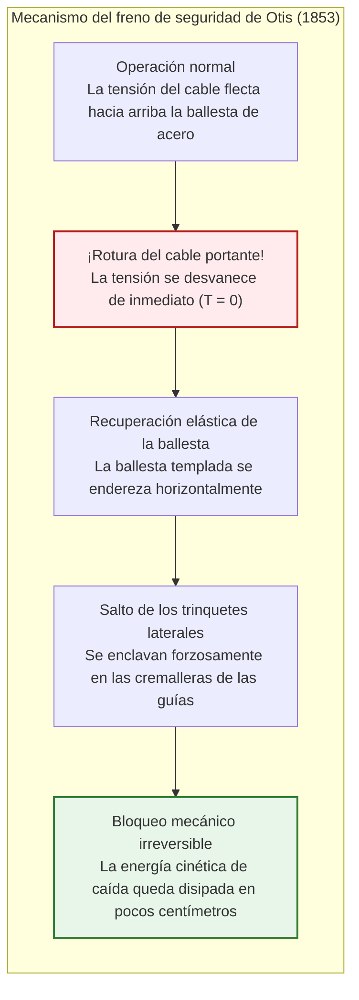
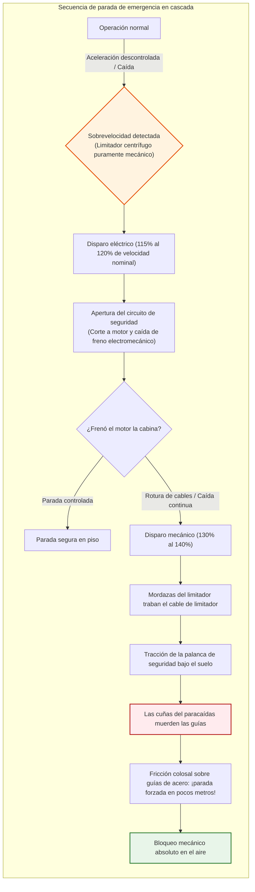
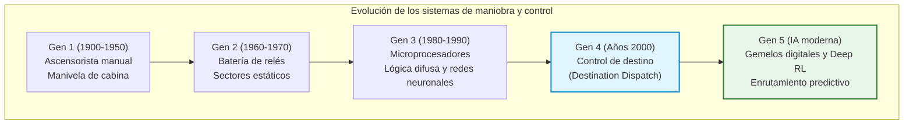
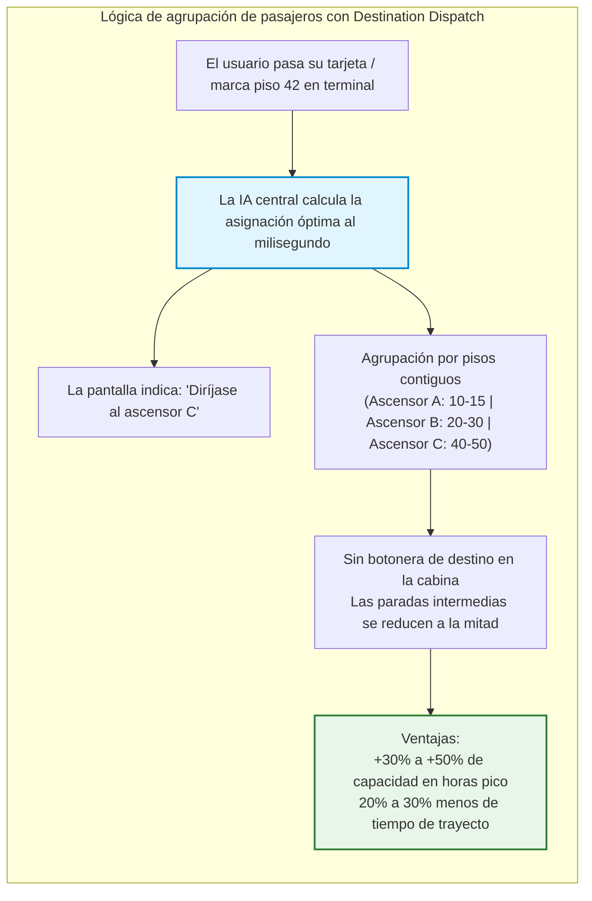
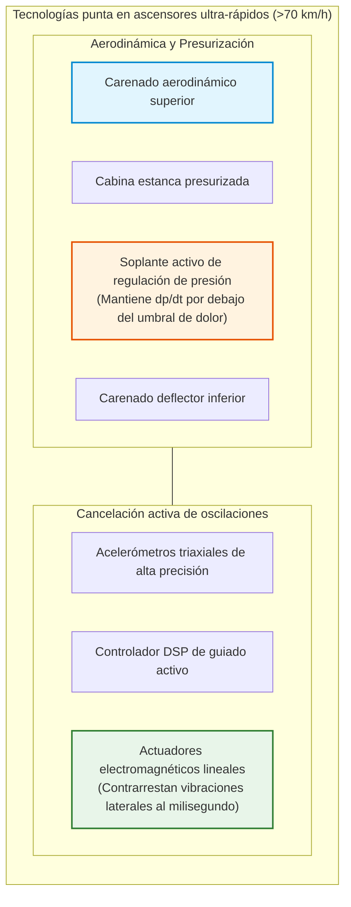
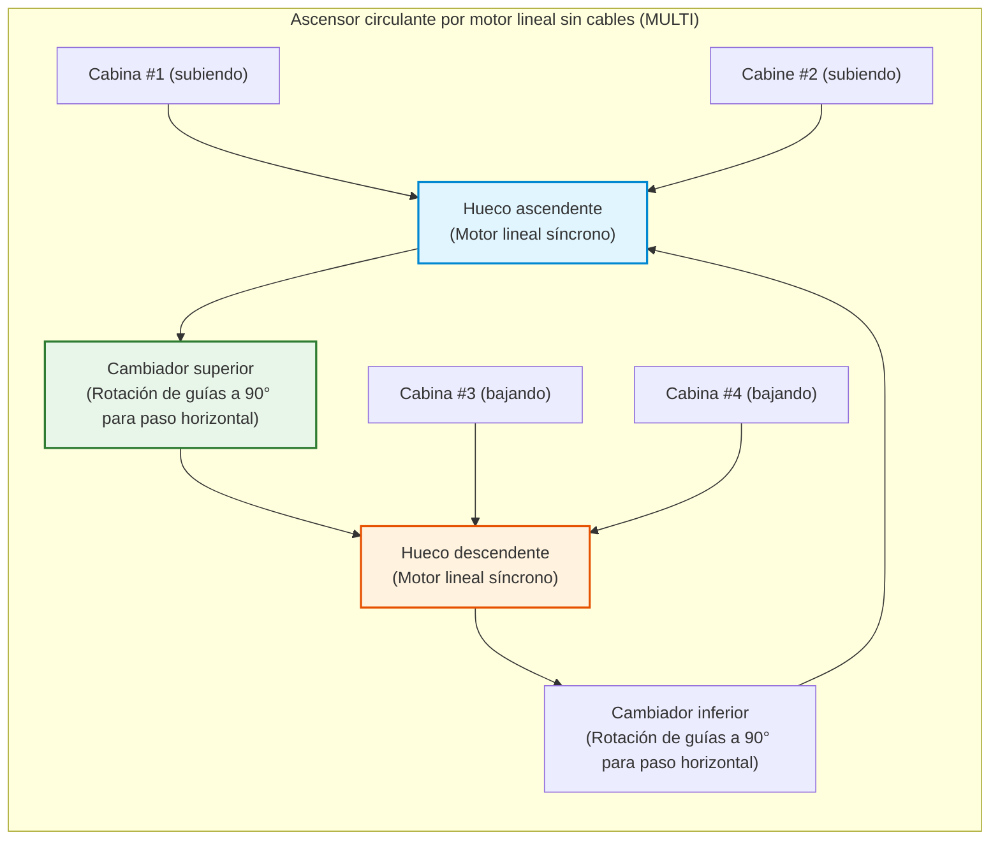

## Introducción: La máquina que liberó a la humanidad en la vertical

Cada mañana, en los vestíbulos de rascacielos residenciales y corporativos de todo el planeta, cientos de millones de personas pulsan un botón y entran tranquilamente en cuanto las puertas se abren. En una cabina cerrada, mientras miran sus teléfonos durante unas decenas de segundos, desafían la gravedad para ser elevados a cientos de metros sobre la tierra.

En la sociedad contemporánea, apenas existe otra máquina a la que confiemos nuestra vida con tanta serenidad. Casi nadie teme que el suelo ceda o que todos los cables de acero se rompan a la vez. En el imaginario colectivo moderno, el ascensor se ha consolidado como **«el vehículo que jamás se cae»**.

Estadísticamente, el ascensor es **el transporte de pasajeros más seguro del mundo**. Pese a desplazar a diario una cifra astronómica de personas que eclipsa a las aerolíneas comerciales y los trenes de alta velocidad juntos, la tasa de mortalidad por caída libre mecánica es prácticamente cero.

Sin embargo, retrocediendo apenas 170 años, este artefacto era una jaula temible cuyos cables podían quebrarse en cualquier instante. El límite de altura urbana rondaba los cinco o seis pisos (el tope del esfuerzo humano por escalera). El obstáculo de los rascacielos no era la falta de acero estructural, sino **la inexistencia de un método seguro para el transporte vertical de personas**.

La invención del freno de seguridad de Otis desencadenó la explosión de las ciudades verticales, alumbrando los horizontes de Nueva York, Hong Kong, Tokio y Dubái.

```mermaid
flowchart TD
    subgraph ElevatorStructure["Arquitectura mecánica básica de un ascensor de tracción"]
        direction TB
        MachineRoom["Cuarto de máquinas / Cabecero del hueco<br/>Motor síncrono de imanes permanentes (PMSM) y freno electromecánico normalmente cerrado"]
        TractionSheave["Polea de tracción (Traction Sheave)"]
        Governor["Limitador mecánico de velocidad (Governor)"]
        
        MachineRoom --> TractionSheave
        MachineRoom -.-> Governor
        
        TractionSheave -->|Cables de tracción (Múltiples cables de acero trenzado)| Car["Cabina (Car)<br/>Bastidor, cabina, operador de puertas y pesacargas"]
        TractionSheave -->|Extremo opuesto de cables| CWT["Contrapeso (Counterweight)<br/>Peso propio de cabina ＋ 45% de carga nominal"]
        
        Governor -.->|Cable del limitador| SafetyGear["Paracaídas (Safety Gear)<br/>Mecanismo de cuñas de acuñamiento en guías"]
        SafetyGear -.-> Car
        
        GuideRail["Guías verticales de acero (Perfiles en T de alta precisión)"]
        Car --- GuideRail
        CWT --- GuideRail
        
        Buffer["Amortiguadores del foso (Amortiguadores hidráulicos de aceite)"]
        Car -.->|Protección de sobrecarrera inferior| Buffer
        CWT -.->|Protección de sobrecarrera inferior| Buffer
    end
    
    style MachineRoom fill:#e1f5fe,stroke:#0288d1,stroke-width:2px
    style SafetyGear fill:#ffebee,stroke:#b71c1c,stroke-width:2px
    style CWT fill:#fff3e0,stroke:#e65100,stroke-width:2px
```

---

## Capítulo 1: El hito histórico – El audaz experimento de Elisha Otis

La elevación de cargas se remonta a Arquímedes en el siglo III a. C. En la Revolución Industrial, las minas usaban cabrestantes de vapor con plataformas suspendidas.

Pero eran montacargas peligrosos colgados de cuerdas de cáñamo o cadenas de hierro forjado. Al partirse una soga, la caja caía a velocidad de aceleración gravitatoria $g$.

### 1.1 La Exposición Mundial de Nueva York de 1853

El hombre que terminó con esta pesadilla fue el inventor estadounidense **Elisha Graves Otis**.

En 1853, en el Crystal Palace de Nueva York, Otis levantó un armazón vertical de 12 metros. Ataviado con levita y sombrero de copa, él mismo subió a la plataforma elevadora.

La máquina de vapor izó la plataforma hasta el techo ante miles de espectadores. Otis dio la señal y ordenó con voz firme:

**«¡Corten la cuerda!»**

El hacha cercenó el único cable portante. El público contuvo el aliento esperando el desastre. Pero la plataforma solo descendió unos centímetros y **se detuvo en seco con un crujido metálico en el aire**.

Otis se quitó el sombrero y proclamó:
> **«All safe, gentlemen, all safe!» (¡Todos a salvo, caballeros!)**



### 1.2 Ballestas y trinquetes: El nacimiento del principio «Fail-Safe»

En la viga superior de la cabina iba montada una **ballesta de acero templado**:
1. **Normal**: La tracción del cable combaba la ballesta hacia arriba, manteniendo los trinquetes retraídos.
2. **Rotura**: Al anularse la tensión ($T = 0$), la energía elástica acumulada forzaba a la ballesta a enderezarse.
3. **Acuñamiento**: Los trinquetes salían disparados hacia los laterales, clavándose en las guías dentadas.

La propia desaparición de la fuerza de sostén activaba mecánicamente el freno, sentando las bases del principio de seguridad a prueba de fallos (**Fail-Safe**).

---

## Capítulo 2: Mecánica del ascensor por adherencia y tracción

En los ascensores modernos de tracción, **el motor no eleva a pulso el peso de la cabina**.

### 2.1 El equilibrio del contrapeso (Counterweight)

Al igual que en un pozo donde dos cubos idénticos equilibran la cuerda, la cabina se vincula a un **contrapeso** a través de la polea motriz.

El contrapeso $M_{\text{cwt}}$ equilibra **el peso de la cabina vacía $M_{\text{car}}$ más el 40 % o 50 % de la carga nominal útil $Q$** (factor de compensación $\alpha$):

$$M_{\text{cwt}} = M_{\text{car}} + \alpha \cdot Q \quad (\alpha \approx 0{,}40 \sim 0{,}50)$$

```
[Regímenes de carga en tracción]
1. Cabina vacía (0% de carga):
   [Cabina: Mcar] < [Contrapeso: Mcar + 0,45Q]  ==> El contrapeso pesa más (El motor regenera energía subiendo)
2. Equilibrio medio (45% de carga):
   [Cabina: Mcar + 0,45Q] == [Contrapeso: Mcar + 0,45Q]  ==> Equilibrio perfecto (¡Carga motriz neta casi nula!)
3. Cabina llena (100% de carga):
   [Cabina: Mcar + Q] > [Contrapeso: Mcar + 0,45Q]  ==> La cabina pesa más (El motor regenera energía bajando)
```

El motor solo aporta la potencia precisa para compensar la diferencia de pasajeros, las aceleraciones iniciales y la mínima fricción de rodadura.

### 2.2 Ecuación de fricción de correa de Euler

Los cables descansan en las gargantas mecanizadas de la polea motriz. La adherencia sin deslizamiento sigue la relación de Euler:

$$\frac{T_1}{T_2} \le e^{\mu' \theta}$$

Donde $\theta$ es el ángulo de contacto y $\mu'$ es el **coeficiente aparente de fricción**, multiplicado por gargantas en V o con entalla inferior (*undercut*):

$$\mu' = \mu \cdot \frac{4 \left(\cos\frac{\gamma}{2} - \sin\frac{\beta}{2}\right)}{\pi - \beta - \sin\beta + \sin\gamma}$$

El efecto de cuña eleva $\mu'$ de $0{,}10$ hasta $0{,}40 \sim 0{,}60$, garantizando agarre absoluto bajo cualquier frenada imprevista.

### 2.3 Cables múltiples y coeficientes de seguridad superiores a 10

Los ascensores montan entre **3 y 10 o más cables independientes de acero trenzado**, con un factor de seguridad reglamentario de **10 a 12**. Un solo cable restante soportaría la cabina colmada al límite.

---

## Capítulo 3: La fortaleza multinivel de los sistemas de parada



1. **Freno electromagnético por resorte**: Bloqueado mecánicamente de forma permanente. Requiere electricidad para abrirse; ante cualquier corte, se cierra instantáneamente.
2. **Limitador centrífugo de velocidad**: Mecanismo con contrapesos volantes que activa el corte eléctrico al 115 % y bloquea su cable por cuña mecánica al 130–140 %.
3. **Paracaídas progresivo**: Cuñas de aleación templada que aprisionan el alma de las guías en T. La fuerza disipativa acota la desaceleración entre **$0{,}2g$ y $1{,}0g$**, deteniendo la cabina suavemente en el aire:

$$M \cdot a_{\text{stop}} = F_{\text{friction}} - M g \implies a_{\text{stop}} = \frac{F_{\text{friction}}}{M} - g$$

4. **Amortiguadores de foso**: Cilindros hidráulicos de aceite que disipan la energía cinética residual mediante estrangulamiento de fluido:

$$E_k = \frac{1}{2} M v^2 = \int_0^S F_{\text{hydraulic}}(x) \, dx$$

---

## Capítulo 4: De los relés a la inteligencia artificial de tráfico



El **sistema de asignación anticipada de destino (Destination Dispatch)** agrupa a los usuarios que viajan a pisos cercanos en la misma cabina desde los torniquetes o quioscos del vestíbulo.



---

## Capítulo 5: Rascacielos a más de 70 km/h

| Edificio (Ciudad) | Año | Velocidad nominal | km/h | Recorrido |
| :--- | :--- | :--- | :--- | :--- |
| **Sunshine 60 (Tokio)** | 1978 | 600 m/min | 36,0 km/h | ~240 m |
| **Yokohama Landmark Tower** | 1993 | 750 m/min | 45,0 km/h | ~290 m |
| **Taipei 101 (Taipéi)** | 2004 | 1.010 m/min | 60,6 km/h | ~382 m |
| **Shanghai Tower (Shanghái)** | 2016 | 1.230 m/min | 73,8 km/h | ~578 m |
| **Guangzhou CTF Finance Centre** | 2019 | 1.260 m/min | **75,6 km/h** | ~500 m |

El efecto pistón a 75 km/h se mitiga con carenados aerodinámicos cónicos que reducen drásticamente la resistencia $F_{\text{aero}} \propto v^2$.



Compresores inteligentes modulan la presión interna a ritmos inferiores a **1,5 hPa/s** para evitar el barotrauma en los oídos, mientras que rodillos de guiado magnéticos activos contrarrestan vibraciones, permitiendo mantener una moneda de canto en pie durante todo el trayecto vertical.

---

## Capítulo 6: El futuro – Motores lineales sin cable y ascensores espaciales

El sistema seilless **MULTI** emplea levitación y motores lineales continuos para hacer circular varias cabinas por el mismo hueco en circuito cerrado continuo.



---

## Conclusión: La dignidad de la máquina que sostiene a la humanidad

El ascensor es el fruto de más de dos mil años de refinamiento en ingeniería. Sin él, la civilización contemporánea carecería de metrópolis verticales compactas. En su marcha perpetua, segura y discreta descansa el más alto testimonio del ingenio humano.
