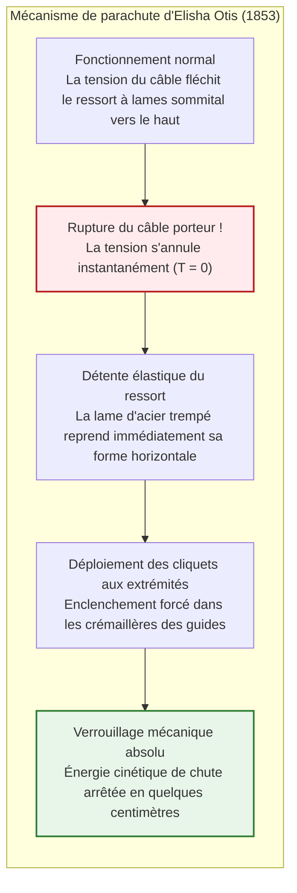
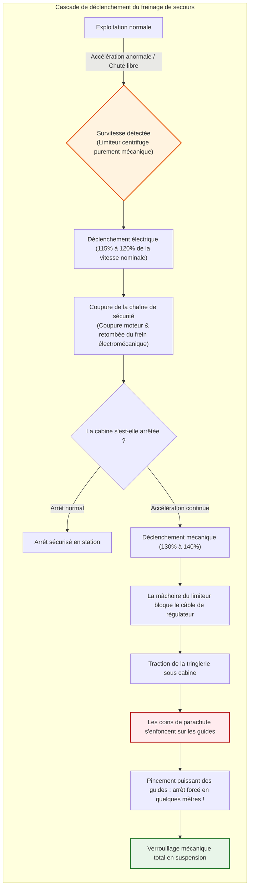
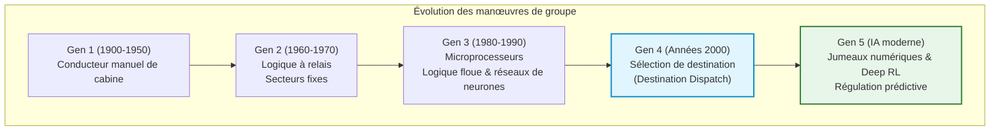
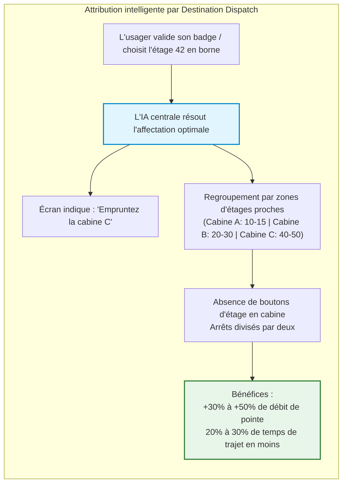
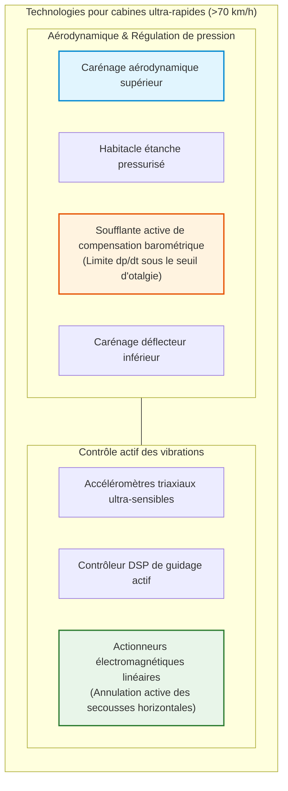
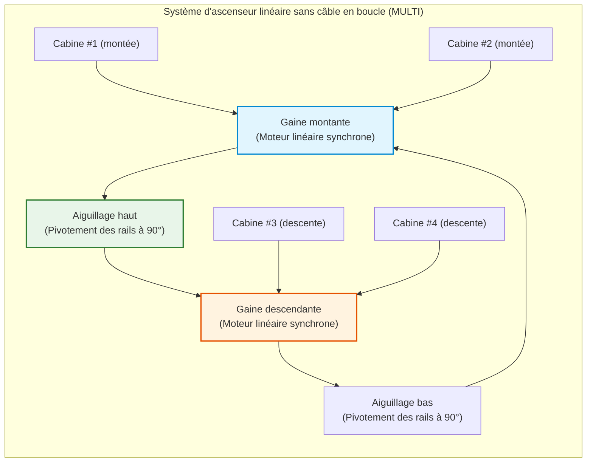

## Introduction : La machine qui a libéré l'humanité dans la verticalité

Chaque matin, dans les halls des tours de bureaux et des résidences du monde entier, des centaines de millions d'individus appuient sur un bouton d'appel et montent à bord dès que les portes coulissent. Durant quelques dizaines de secondes, les yeux rivés sur leur écran de smartphone à l'intérieur d'une cabine métallique scellée, ils défient la pesanteur terrestre pour atteindre des sommets vertigineux.

Dans la vie quotidienne, il n'existe pratiquement aucune autre machine à laquelle l'être humain confie son existence physique avec une confiance aussi aveugle. Presque personne n'imagine le cauchemar d'un plancher qui se dérobe ou d'une rupture simultanée de tous les câbles de suspension. Dans notre civilisation, l'ascenseur est devenu **« l'appareil qui ne tombe jamais »**.

D'un point de vue statistique, l'ascenseur est **le moyen de transport de passagers le plus sûr au monde**. Transportant quotidiennement un volume astronomique d'usagers – surpassant l'aviation civile et les trains à grande vitesse réunis –, son taux de mortalité dû à une chute libre mécanique est virtuellement nul.

Pourtant, il y a 170 ans, cet engin était une benne effroyable dont les cordes pouvaient céder à tout moment, précipitant ses occupants vers une mort certaine. La hauteur maximale des immeubles plafonnait alors à cinq ou six étages (la limite physique de l'ascension à pied). Le frein majeur à la verticalité n'était pas la résistance de l'acier, mais **l'absence d'une technologie sûre pour élever des êtres humains**.

L'invention du frein de sûreté d'Otis fut l'étincelle qui métamorphosa l'étalement urbain bidimensionnel en métropoles verticales tridimensionnelles.

```mermaid
flowchart TD
    subgraph ElevatorStructure["Architecture mécanique fondamentale d'un ascenseur à adhérence"]
        direction TB
        MachineRoom["Local des machines / Haut de gaine<br/>Moteur synchrone à aimants permanents (PMSM) & frein électromagnétique"]
        TractionSheave["Poulie de traction (Traction Sheave)"]
        Governor["Limiteur de vitesse mécanique (Governor)"]
        
        MachineRoom --> TractionSheave
        MachineRoom -.-> Governor
        
        TractionSheave -->|Câbles de traction (Faisceau de câbles en acier)| Car["Cabine (Car)<br/>Étrier, habitacle, opérateur de porte & pèse-charge"]
        TractionSheave -->|Brin opposé des câbles| CWT["Contrepoids (Counterweight)<br/>Masse à vide ＋ 45% de la charge utile"]
        
        Governor -.->|Câble du limiteur| SafetyGear["Parachute (Safety Gear)<br/>Système de calage à coins sur guides"]
        SafetyGear -.-> Car
        
        GuideRail["Guides verticaux en acier (Profilés en T usinés)"]
        Car --- GuideRail
        CWT --- GuideRail
        
        Buffer["Amortisseurs de cuvette (Amortisseurs oléopneumatiques)"]
        Car -.->|Course de dépassement inférieure| Buffer
        CWT -.->|Course de dépassement inférieure| Buffer
    end
    
    style MachineRoom fill:#e1f5fe,stroke:#0288d1,stroke-width:2px
    style SafetyGear fill:#ffebee,stroke:#b71c1c,stroke-width:2px
    style CWT fill:#fff3e0,stroke:#e65100,stroke-width:2px
```

---

## Chapitre 1 : Le tournant historique – L'audacieuse démonstration d'Elisha Otis

L'histoire du levage remonte à Archimède et ses palans au IIIe siècle av. J.-C. Les mines du Moyen Âge et de la Révolution industrielle utilisaient des treuils à vapeur pour hisser les wagonnets.

Mais ces monte-charges étaient suspendus à de simples cordes de chanvre ou chaînes de fer. Lorsqu'un câble rompait, la cabine chutait en roue libre sous l'accélération $g$, écrasant les mineurs qui montaient à bord la peur au ventre.

### 1.1 L'Exposition universelle de New York en 1853

L'homme qui brisa cette malédiction fut l'inventeur américain **Elisha Graves Otis**.

En 1853, sous la coupole du Crystal Palace de New York, Otis fit ériger une structure de guidage ouverte de 12 mètres de hauteur. En chapeau haut-de-forme et redingote, Otis monta lui-même sur la plate-forme en bois.

Hissé à la cime sous les yeux ébahis de milliers de spectateurs, il fit signe à son assistant et ordonna d'une voix tonitruante :

**« Coupez la corde ! »**

D'un coup de hache vigoureux, l'assistant trancha le câble porteur unique. Un cri d'effroi s'éleva de la foule. Mais au lieu de s'écraser au sol, la plate-forme s'arrêta net après quelques centimètres de chute, **bloquée dans un fracas métallique assourdissant**.

Otis salua la foule stupéfaite :
> **« All safe, gentlemen, all safe ! » (Tout est en sécurité, messieurs !)**

Le verrou de la verticalité venait de sauter.



### 1.2 Le ressort à lames et le cliquet : L'acte de naissance du « Fail-Safe »

Le système d'Otis incarnait à la perfection le principe de sécurité intrinsèque (**Fail-Safe**) :
1. **En service** : La tension du câble maintient le ressort à lames fléchi vers le haut, dégageant les cliquets des montants crantés.
2. **À la rupture** : La disparition soudaine de la tension libère l'énergie élastique du ressort qui se détend horizontalement.
3. **Blocage forcé** : Les cliquets en acier s'enfoncent irréversiblement dans les crémaillères latérales.

Aucune énergie extérieure, aucun capteur ni intervention humaine n'étaient requis : **la défaillance physique elle-même déclenchait le freinage.**

---

## Chapitre 2 : La mécanique de l'adhérence – L'ascenseur à traction

Dans un ascenseur moderne, **le moteur électrique ne hisse pas le poids total de la cabine.**

### 2.1 La science du contrepoids (Counterweight)

Comme dans un puits où deux seaux de même masse s'équilibrent, l'ascenseur relie la cabine à un **contrepoids** via les câbles passant sur la poulie de traction.

La masse du contrepoids $M_{\text{cwt}}$ est calculée pour équilibrer **la masse de la cabine vide $M_{\text{car}}$ plus 40 % à 50 % de la charge nominale utile $Q$** (facteur d'équilibrage $\alpha$) :

$$M_{\text{cwt}} = M_{\text{car}} + \alpha \cdot Q \quad (\alpha \approx 0{,}40 \sim 0{,}50)$$

```
[Régimes d'équilibrage de charge]
1. Cabine vide (0% de charge) :
   [Cabine: Mcar] < [Contrepoids: Mcar + 0,45Q]  ==> Contrepoids plus lourd (Le moteur régénère en montée)
2. Équilibre nominal moyen (45% de charge) :
   [Cabine: Mcar + 0,45Q] == [Contrepoids: Mcar + 0,45Q]  ==> Équilibre parfait (Couple moteur utile quasiment nul !)
3. Cabine pleine (100% de charge) :
   [Cabine: Mcar + Q] > [Contrepoids: Mcar + 0,45Q]  ==> Cabine plus lourde (Le moteur régénère en descente)
```

Le moteur ne fournit ainsi que le couple nécessaire pour vaincre le déséquilibre passager, l'inertie lors des accélérations et les légers frottements mécaniques.

### 2.2 Équation de frottement d'Euler et gorges de traction

Les câbles reposent par simple adhérence dans les gorges de la poulie de traction. La limite d'adhérence est fixée par la célèbre formule d'Euler pour les courroies :

$$\frac{T_1}{T_2} \le e^{\mu' \theta}$$

Où $\theta$ est l'angle d'enroulement et $\mu'$ le **coefficient de frottement apparent**, démultiplié par la géométrie de la gorge (gorges taillées en V ou semi-circulaires sous-cotées) :

$$\mu' = \mu \cdot \frac{4 \left(\cos\frac{\gamma}{2} - \sin\frac{\beta}{2}\right)}{\pi - \beta - \sin\beta + \sin\gamma}$$

Par effet de coin, $\mu'$ atteint $0{,}40$ à $0{,}60$ (contre $0{,}10$ à plat), garantissant une adhérence absolue sans patinage.

### 2.3 Câbles multiples en acier et coefficient de sécurité démesuré

Les ascenseurs utilisent de **3 à 10 câbles d'acier parallèles** présentant un coefficient de sécurité de **10 à 12**. Cela signifie qu'un seul câble restant suffirait à retenir l'ensemble de la cabine chargée à bloc.

---

## Chapitre 3 : La forteresse des systèmes de sécurité étagés



1. **Frein électromécanique à manque de courant** : Maintenu ouvert par électro-aimant, des ressorts massifs le plaquent instantanément dès que l'alimentation est coupée.
2. **Limiteur de vitesse centrifuge** : Dispositif autonome à masselottes déclenchant un contact électrique à 115 % et bloquant son câble à 130–140 %.
3. **Parachute à prise progressive** : Des coins en acier allié pincent les rails guides en T. La décélération est régulée élastiquement entre **$0{,}2g$ et $1{,}0g$** pour ne pas blesser les occupants :

$$M \cdot a_{\text{stop}} = F_{\text{friction}} - M g \implies a_{\text{stop}} = \frac{F_{\text{friction}}}{M} - g$$

4. **Amortisseurs de cuvette** : Vérins hydrauliques dissipant l'énergie cinétique résiduelle :

$$E_k = \frac{1}{2} M v^2 = \int_0^S F_{\text{hydraulic}}(x) \, dx$$

---

## Chapitre 4 : Du relais à l'intelligence artificielle de manœuvre



Le système de **sélection de destination (Destination Dispatch)** regroupe intelligemment les usagers par étage cible dès les bornes du hall, réduisant les arrêts intermédiaires et dopant la capacité de transport de 30 % à 50 %.



---

## Chapitre 5 : Au-delà de 70 km/h dans les mégatours

| Bâtiment (Ville) | Année | Vitesse nominale | km/h | Course |
| :--- | :--- | :--- | :--- | :--- |
| **Sunshine 60 (Tokyo)** | 1978 | 600 m/min | 36,0 km/h | ~240 m |
| **Yokohama Landmark Tower** | 1993 | 750 m/min | 45,0 km/h | ~290 m |
| **Taipei 101 (Taipei)** | 2004 | 1 010 m/min | 60,6 km/h | ~382 m |
| **Shanghai Tower (Shanghai)** | 2016 | 1 230 m/min | 73,8 km/h | ~578 m |
| **Guangzhou CTF Finance Centre** | 2019 | 1 260 m/min | **75,6 km/h** | ~500 m |

À 75,6 km/h, l'effet de piston impose des carénages aérodynamiques profilés afin de limiter la traînée $F_{\text{aero}} \propto v^2$.



Des pompes barométriques régulent la pression de l'habitacle en continu (taux inférieur à **1,5 hPa/s**) pour éliminer le mal d'oreilles, tandis que des rouleaux de guidage actifs électromagnétiques absorbent les micro-défauts des rails, maintenant une pièce de monnaie en équilibre parfait sur sa tranche pendant toute la course.

---

## Chapitre 6 : Les nouveaux horizons – Sans câble et ascenseur spatial

Le système seilless **MULTI** de TK Elevator remplace les câbles par des moteurs linéaires magnétiques, permettant à plusieurs cabines de circuler en boucle continue dans les mêmes gaines.



Au-delà, l'ascenseur spatial à câble en nanotubes de carbone jusqu'à l'orbite géostationnaire (36 000 km) repousse les frontières de l'ingénierie vers le cosmos.

---

## Conclusion : La grandeur d'une mécanique au service de l'homme

L'ascenseur moderne est l'aboutissement de deux millénaires d'ingénierie mécanique. Sans lui, nos villes s'étaleraient à l'infini en détruisant les écosystèmes. Dans son fonctionnement silencieux et infaillible s'incarne le triomphe le plus éclatant de la sécurité mécanique.
