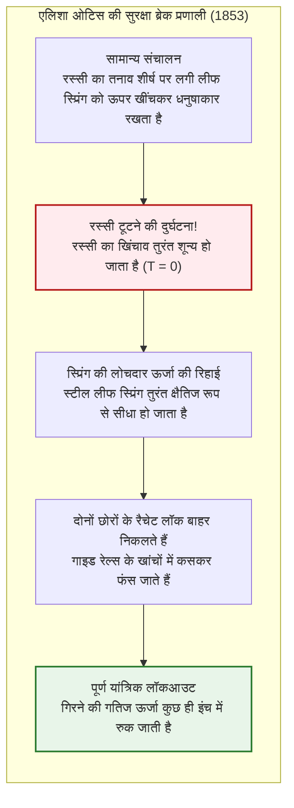
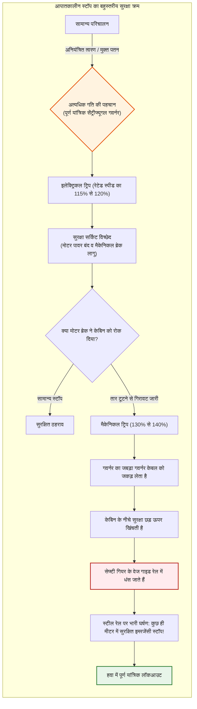
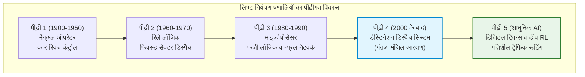
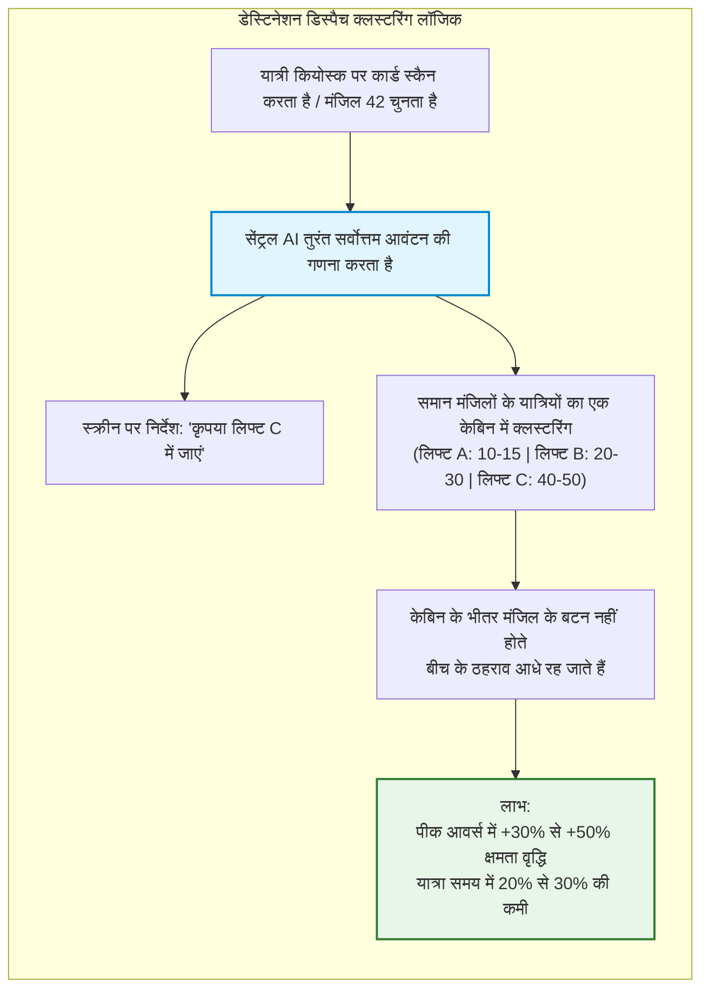
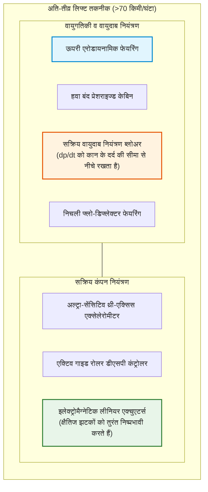
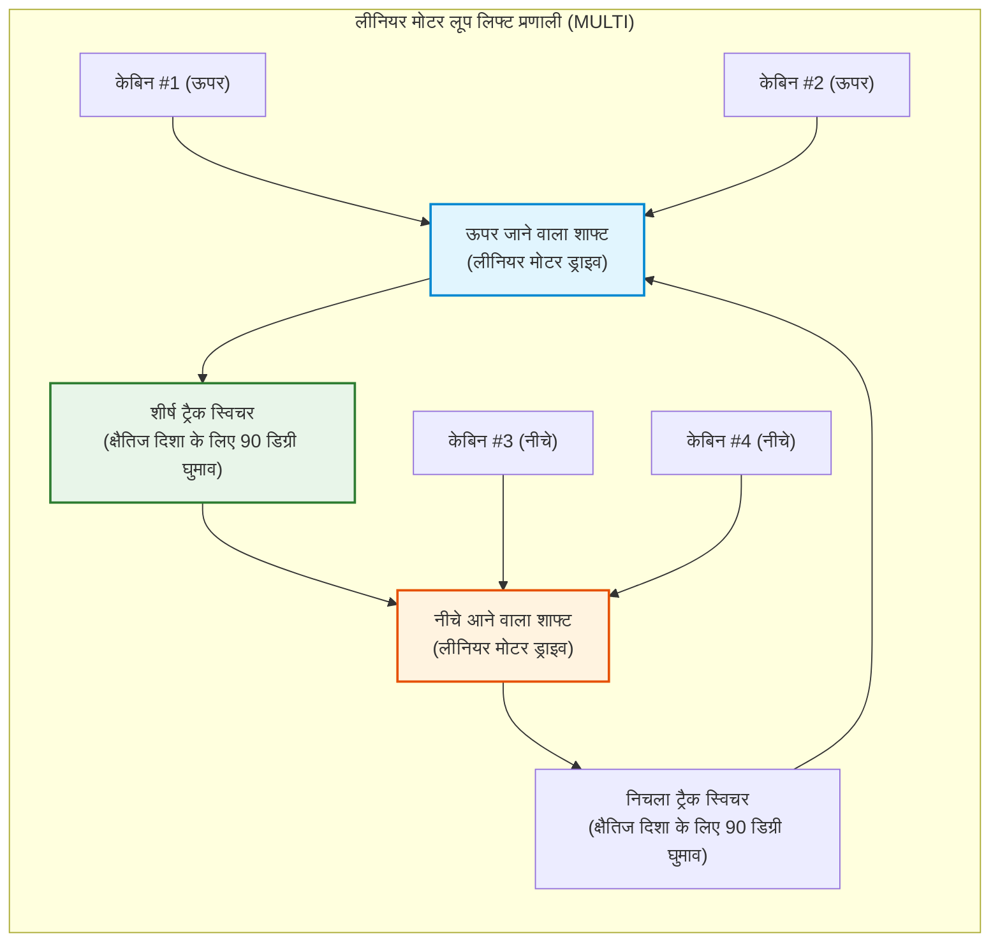

## परिचय: वह मशीन जिसने मानव सभ्यता को लंबवत विस्तार दिया

हर सुबह दुनिया भर के गगनचुंबी कार्यालयों और बहुमंजिला आवासीय टावरों की लॉबी में लाखों लोग कॉल बटन दबाते हैं और दरवाजे खुलते ही बिना किसी झिझक के अंदर कदम रख देते हैं। बंद धातु के केबिन में स्मार्टफोन देखते हुए कुछ ही सेकंड में हम गुरुत्वाकर्षण को मात देकर सैकड़ों मीटर की ऊंचाई पर पहुंच जाते हैं।

दैनिक जीवन में शायद ही कोई दूसरी मशीन हो जिस पर इंसान अपनी जान का इतना अटूट भरोसा करता हो। किसी के मन में यह खौफनाक विचार नहीं आता कि लिफ्ट का फर्श धंस जाएगा या उसे थामने वाले सारे स्टील के तार एक साथ टूट जाएंगे। आधुनिक युग में लिफ्ट **"कभी न गिरने वाला वाहन"** बन चुकी है।

सांख्यिकीय दृष्टि से लिफ्ट **दुनिया का सबसे सुरक्षित परिवहन साधन** है। विमानन और हाई-स्पीड ट्रेनों से कहीं अधिक दैनिक यात्रियों को ले जाने के बावजूद यांत्रिक विफलता से मुक्त पतन में मृत्यु दर लगभग शून्य है।

लेकिन 170 साल पहले यह एक भयानक फंदा माना जाता था जिसकी रस्सियां कभी भी टूट सकती थीं। तब इमारतों की अधिकतम ऊंचाई 5 या 6 मंजिलों तक सीमित थी। ऊंची इमारतों के रास्ते में मुख्य बाधा स्टील की कमी नहीं, बल्कि **इंसानों को सुरक्षित लंबवत उठाने वाली तकनीक का अभाव** थी।

एलिशा ओटिस द्वारा सुरक्षा ब्रेक का आविष्कार वह मोड़ था जिसने शहरों को क्षैतिज फैलाव से मुक्त कर न्यूयॉर्क, हांगकांग, टोक्यो और दुबई के गगनचुंबी क्षितिज का निर्माण किया।

```mermaid
flowchart TD
    subgraph ElevatorStructure["ट्रैक्शन लिफ्ट की मूल यांत्रिक संरचना"]
        direction TB
        MachineRoom["मशीन रूम / शाफ्ट का शीर्ष भाग<br/>परमानेंट मैग्नेट सिंक्रोनस मोटर (PMSM) और स्प्रिंग-क्लोज्ड इलेक्ट्रोमैग्नेटिक ब्रेक"]
        TractionSheave["ट्रैक्शन शीव (ड्राइविंग पुली)"]
        Governor["मैकेनिकल स्पीड गवर्नर (Speed Governor)"]
        
        MachineRoom --> TractionSheave
        MachineRoom -.-> Governor
        
        TractionSheave -->|मुख्य ट्रैक्शन रस्सियां (समानांतर स्टील वायर रस्सियां)| Car["लिफ्ट कार (Car)<br/>कार फ्रेम, पैसेंजर केबिन, डोर ऑपरेटर और लोड सेंसर"]
        TractionSheave -->|विपरीत छोर की रस्सियां| CWT["काउंटरवेट (Counterweight)<br/>कार का खाली भार ＋ 45% रेटेड क्षमता"]
        
        Governor -.->|गवर्नर स्टील केबल| SafetyGear["सेफ्टी गियर (Safety Gear)<br/>गाइड रेल पर ग्रिप करने वाला वेज मैकेनिज्म"]
        SafetyGear -.-> Car
        
        GuideRail["वर्टिकल गाइड रेल्स (टी-शेप मशीन्ड स्टील रेल्स)"]
        Car --- GuideRail
        CWT --- GuideRail
        
        Buffer["पिट बफर (हाइड्रोलिक ऑयल बफर्स)"]
        Car -.->|निचली ओवर-ट्रैवल सुरक्षा| Buffer
        CWT -.->|निचली ओवर-ट्रैवल सुरक्षा| Buffer
    end
    
    style MachineRoom fill:#e1f5fe,stroke:#0288d1,stroke-width:2px
    style SafetyGear fill:#ffebee,stroke:#b71c1c,stroke-width:2px
    style CWT fill:#fff3e0,stroke:#e65100,stroke-width:2px
```

---

## अध्याय 1: ऐतिहासिक मोड़ – एलिशा ओटिस का साहसी प्रदर्शन

प्राचीन काल में आर्किमिडीज (तीसरी शताब्दी ईसा पूर्व) ने पुली के जरिए भार उठाने की शुरुआत की थी। औद्योगिक क्रांति में कोयला खदानों में भाप की चरखियों का इस्तेमाल हुआ, लेकिन पटसन की रस्सियां टूटने पर प्लेटफॉर्म सीधे जमीन पर गिरकर चकनाचूर हो जाते थे।

### 1.1 1853 का न्यूयॉर्क विश्व मेला

इस घातक डर को खत्म करने वाले अमेरिकी आविष्कारक **एलिशा ग्रेव्स ओटिस (Elisha Graves Otis)** थे।

1853 में न्यूयॉर्क के क्रिस्टल पैलेस में ओटिस ने 12 मीटर ऊंचा खुला गाइड फ्रेम खड़ा किया। वे खुद लकड़ी के प्लेटफॉर्म पर खड़े हुए।

भाप इंजन ने प्लेटफॉर्म को हजारों दर्शकों के सामने ऊंचाई तक खींच लिया। शिखर पर पहुंचकर ओटिस ने अपने सहायक को निर्देश दिया:

**"रस्सी काट दो!"**

कुल्हाड़ी के एक ही वार से भारी रस्सी कट गई। दर्शकों की चीख निकल गई। लेकिन जमीन पर गिरने के बजाय प्लेटफॉर्म कुछ ही इंच नीचे खिसक कर **एक तेज धातुई आवाज के साथ हवा में रुक गया**।

ओटिस ने अपनी टोपी उठाई और भीड़ से कहा:
> **"All safe, gentlemen, all safe!" (सब सुरक्षित है, सज्जनों!)**



### 1.2 लीफ स्प्रिंग और रैचेट: फेल-सेफ (Fail-Safe) की शुरुआत

केबिन के ऊपरी फ्रेम पर मुड़ा हुआ **स्टील लीफ स्प्रिंग** लगा था:
1. **सामान्य स्थिति**: रस्सी का खिंचाव स्प्रिंग को ऊपर खींचे रखता था और साइड के लॉक पीछे रहते थे।
2. **रस्सी टूटने पर**: तनाव खत्म होते ही ($T = 0$) स्प्रिंग सीधा फैल गया।
3. **लॉकिंग**: सिरों पर लगे स्टील के पंजे बाहर निकलकर खंभों के दांतों में धंस गए।

खिंचाव का खत्म होना ही ब्रेक का ट्रिगर बन गया—यही आधुनिक इंजीनियरिंग का **Fail-Safe** सिद्धांत है।

---

## अध्याय 2: ट्रैक्शन लिफ्ट की यांत्रिकी और भार संतुलन

ट्रैक्शन लिफ्ट में **मोटर केबिन का पूरा भार अकेले नहीं उठाती**।

### 2.1 काउंटरवेट (संतुलन भार) का विज्ञान

कुएं की घिरनी पर दो बराबर बाल्टियों की तरह, केबिन शीव के ऊपर से गुजरकर एक भारी **काउंटरवेट** से जुड़ा होता है।

काउंटरवेट $M_{\text{cwt}}$ को **खाली केबिन भार $M_{\text{car}}$ प्लस रेटेड भार $Q$ के 40% से 50%** के बराबर रखा जाता है (ओवरबैलेंस अनुपात $\alpha$):

$$M_{\text{cwt}} = M_{\text{car}} + \alpha \cdot Q \quad (\alpha \approx 0{,}40 \sim 0{,}50)$$

```
[ट्रैक्शन लिफ्ट में लोड संतुलन की स्थितियां]
1. खाली केबिन (0% भार):
   [केबिन: Mcar] < [काउंटरवेट: Mcar + 0,45Q]  ==> काउंटरवेट भारी (ऊपर जाते समय मोटर बिजली बनाती है)
2. डिजाइन संतुलन भार (45% भार):
   [केबिन: Mcar + 0,45Q] == [काउंटरवेट: Mcar + 0,45Q]  ==> पूर्ण संतुलन (मोटर पर लिफ्टिंग लोड लगभग शून्य!)
3. पूरी भरी केबिन (100% भार):
   [केबिन: Mcar + Q] > [काउंटरवेट: Mcar + 0,45Q]  ==> केबिन भारी (नीचे आते समय मोटर बिजली बनाती है)
```

मोटर को केवल यात्रियों के अंतर, त्वरण की जड़ता और मामूली घर्षण को दूर करने के लिए ही बल लगाना पड़ता है।

### 2.2 यूलर का बेल्ट घर्षण समीकरण

शीव की खांचों में रस्सियों की पकड़ यूलर के घर्षण समीकरण का पालन करती है:

$$\frac{T_1}{T_2} \le e^{\mu' \theta}$$

जहां $\mu'$ **प्रभावी घर्षण गुणांक** है जिसे अंडरकट या वी-ग्रूव द्वारा बढ़ाया जाता है:

$$\mu' = \mu \cdot \frac{4 \left(\cos\frac{\gamma}{2} - \sin\frac{\beta}{2}\right)}{\pi - \beta - \sin\beta + \sin\gamma}$$

वेज प्रभाव से $\mu'$ बढ़कर $0{,}40 \sim 0{,}60$ हो जाता है, जिससे आपातकालीन ब्रेक लगाने पर भी तार कभी नहीं फिसलते।

### 2.3 एकाधिक तार और सुरक्षा गुणांक

लिफ्ट में **3 से 10 या अधिक समानांतर स्टील तार** होते हैं जिनका सुरक्षा गुणांक **10 से 12 गुना** होता है। यदि 10 में से 9 तार कट जाएं, तो भी बचा हुआ 1 तार भरी हुई लिफ्ट को थामे रख सकता है।

---

## अध्याय 3: बहुस्तरीय सुरक्षा प्रणालियों का किला



1. **इलेक्ट्रोमैग्नेटिक स्प्रिंग ब्रेक**: सामान्यतः बंद रहता है; बिजली केवल इसे खोलने का काम करती है। बिजली कटते ही यह तुरंत पहिये को जकड़ लेता है।
2. **सेंट्रीफ्यूगल गवर्नर**: बिना बिजली के चलने वाला यांत्रिक उपकरण जो 115% पर बिजली काटता है और 130–140% पर केबल को लॉक करता है।
3. **प्रोग्रेसिव सेफ्टी गियर**: वेज रेल को दबाते हैं और मंदन को **$0{,}2g \sim 1{,}0g$** के बीच सीमित रखते हैं, जिससे यात्रियों को चोट नहीं लगती:

$$M \cdot a_{\text{stop}} = F_{\text{friction}} - M g \implies a_{\text{stop}} = \frac{F_{\text{friction}}}{M} - g$$

4. **पिट बफर**: हाइड्रोलिक पिस्टन जो केबिन की गतिज ऊर्जा को अवशोषित करते हैं:

$$E_k = \frac{1}{2} M v^2 = \int_0^S F_{\text{hydraulic}}(x) \, dx$$

---

## अध्याय 4: रिले से AI डेस्टिनेशन डिस्पैच तक



**डेस्टिनेशन डिस्पैच सिस्टम** में यात्री अंदर जाने से पहले ही लॉबी में अपनी मंजिल चुनते हैं, जिससे AI समान मंजिल वाले लोगों को एक ही लिफ्ट में भेजकर क्षमता 30% से 50% तक बढ़ा देता है।



---

## अध्याय 5: गगनचुंबी इमारतों में 70 किमी/घंटा से अधिक की रफ्तार

| इमारत (शहर) | वर्ष | रेटेड स्पीड | किमी/घंटा | ऊंचाई |
| :--- | :--- | :--- | :--- | :--- |
| **सनशाइन 60 (टोक्यो)** | 1978 | 600 मी/मिनट | 36,0 किमी/घंटा | ~240 मी |
| **योकोहामा लैंडमार्क टावर** | 1993 | 750 मी/मिनट | 45,0 किमी/घंटा | ~290 मी |
| **ताइपे 101 (ताइपे)** | 2004 | 1,010 मी/मिनट | 60,6 किमी/घंटा | ~382 मी |
| **शंघाई टावर (शंघाई)** | 2016 | 1,230 मी/मिनट | 73,8 किमी/घंटा | ~578 मी |
| **गुआंगझोउ सीटीएफ फाइनेंस सेंटर** | 2019 | 1,260 मी/मिनट | **75,6 किमी/घंटा** | ~500 मी |

75 किमी/घंटा की गति पर वायुमंडलीय पिस्टन प्रभाव को कम करने के लिए वायुगतिकीय फेयरिंग लगाई जाती है जो ड्रैग $F_{\text{aero}} \propto v^2$ को घटा देती है।



प्रेशराइजेशन सिस्टम वायुदाब परिवर्तन को **1,5 hPa/सेकंड** से नीचे रखता है ताकि कानों में दर्द न हो, और सक्रिय रोलर गाइड कंपन को इस हद तक मिटा देते हैं कि खड़े सिक्के भी पूरी यात्रा के दौरान नहीं गिरते।

---

## अध्याय 6: भविष्य – बिना तार की MULTI और स्पेस एलिवेटर

**MULTI** प्रणाली में तारों के स्थान पर लीनियर मोटर का प्रयोग किया जाता है, जिससे कई केबिन एक ही शाफ्ट में लूप में चल सकते हैं।



---

## निष्कर्ष: मानवता को ऊपर उठाने वाली मशीन का गौरव

आधुनिक लिफ्ट दो हजार साल की इंजीनियरिंग का शिखर है। इसके बिना आधुनिक शहर नहीं बन सकते थे। इसकी शांत, अचूक और विश्वसनीय कार्यप्रणाली में मैकेनिकल इंजीनियरिंग का सर्वोच्च गौरव समाया हुआ है।
