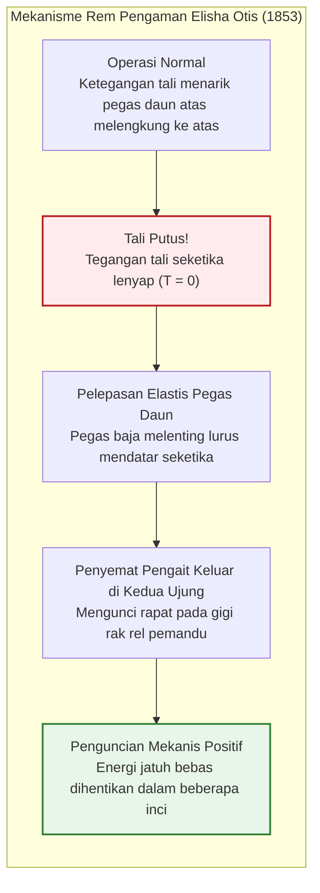
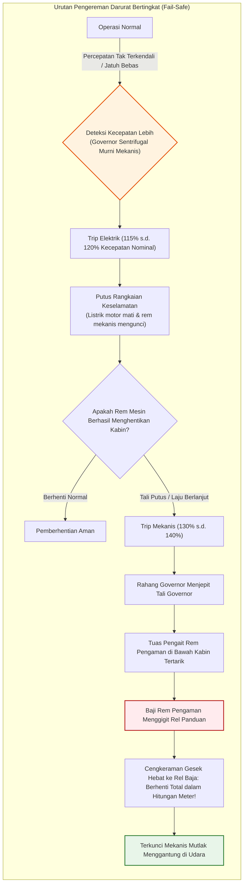
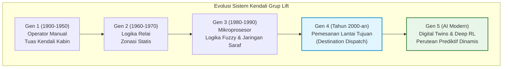
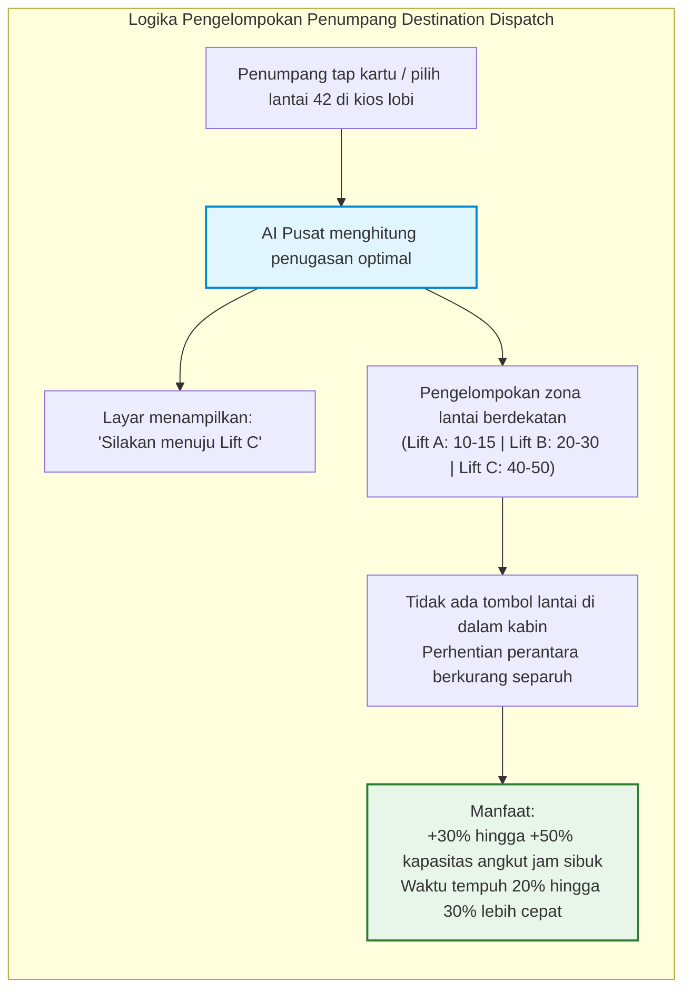
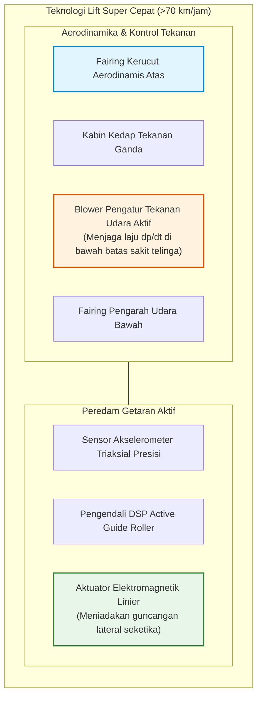
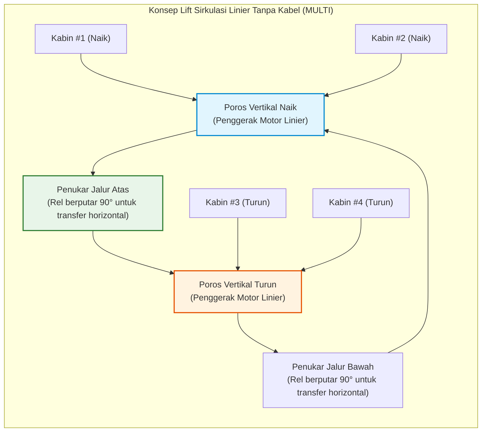

## Pendahuluan: Mesin yang Membebaskan Manusia ke Dimensi Vertikal

Setiap pagi, di lobi gedung perkantoran dan apartemen pencakar langit di seluruh dunia, ratusan juta orang menekan tombol panggil dan melangkah masuk tanpa ragu saat pintu terbuka. Selama beberapa puluh detik di dalam kotak logam tertutup sembari menatap layar ponsel, kita melawan gravitasi bumi dan diangkat setinggi puluhan atau ratusan meter ke angkasa.

Dalam kehidupan modern, hampir tidak ada mesin lain yang kita percayai keselamatan fisik kita secara begitu mutlak. Nyaris tidak ada yang membayangkan lantai kabin jebol atau seluruh kawat baja penggantung putus serentak. Dalam peradaban kontemporer, lift telah diakui sebagai **"kendaraan yang tidak pernah jatuh"**.

Secara statistik, lift adalah **moda transportasi penumpang paling aman di dunia**. Mengangkut volume penumpang harian yang melampaui gabungan maskapai penerbangan dan kereta cepat, tingkat fatalitas akibat jatuh bebas mekanis praktis mendekati nol.

Namun, jika memutar waktu 170 tahun ke belakang, alat ini dipandang sebagai sangkar gantung mematikan yang talinya bisa putus kapan saja. Ketinggian bangunan kota saat itu mentok di 5 hingga 6 lantai (batas kekuatan manusia menaiki tangga). Hambatan utama pembangunan gedung tinggi bukanlah kekurangan baja struktural, melainkan **ketiadaan teknologi untuk mengangkut manusia secara vertikal dengan aman**.

Penemuan rem pengaman oleh Elisha Otis adalah pemantik yang membebaskan kota dari bentangan dua dimensi menjadi kota vertikal tiga dimensi, memungkinkan lahirnya lanskap pencakar langit di New York, Hong Kong, Tokyo, dan Dubai.

```mermaid
flowchart TD
    subgraph ElevatorStructure["Arsitektur Mekanik Dasar Lift Traksi"]
        direction TB
        MachineRoom["Ruang Mesin / Bagian Atas Hoistway<br/>Motor Sinkron Magnet Permanen (PMSM) & Rem Elektromagnetik Normally-Closed"]
        TractionSheave["Puli Traksi (Traction Sheave)"]
        Governor["Governor Mekanis (Speed Governor)"]
        
        MachineRoom --> TractionSheave
        MachineRoom -.-> Governor
        
        TractionSheave -->|Tali Traksi Utama (Kumpulan Kawat Baja Berkekuatan Tinggi)| Car["Kereta Lift (Car)<br/>Rangka kabin, ruang penumpang, penggerak pintu & sensor beban"]
        TractionSheave -->|Sisi Sebelah Tali Traksi| CWT["Beban Penyeimbang (Counterweight)<br/>Bobot kosong kabin ＋ 45% kapasitas beban nominal"]
        
        Governor -.->|Tali Kawat Baja Governor| SafetyGear["Rem Pengaman (Safety Gear)<br/>Mekanisme baji penjepit rel pemandu"]
        SafetyGear -.-> Car
        
        GuideRail["Rel Pemandu Vertikal (Baja Profil T Presisi)"]
        Car --- GuideRail
        CWT --- GuideRail
        
        Buffer["Peredam Pit Dasar (Buffer Hidrolik Oli)"]
        Car -.->|Proteksi overshoot batas bawah| Buffer
        CWT -.->|Proteksi overshoot batas bawah| Buffer
    end
    
    style MachineRoom fill:#e1f5fe,stroke:#0288d1,stroke-width:2px
    style SafetyGear fill:#ffebee,stroke:#b71c1c,stroke-width:2px
    style CWT fill:#fff3e0,stroke:#e65100,stroke-width:2px
```

---

## Bab 1: Titik Balik Sejarah – Eksperimen Mempertaruhkan Nyawa Elisha Otis

Sejarah alat angkat vertikal bermula dari Archimedes pada abad ke-3 SM. Di era Revolusi Industri, tambang batu bara memanfaatkan derek uap dengan tali rami atau rantai besi kasar. Namun jika tali putus, lantai muatan terjun bebas dengan percepatan gravitasi $g$, menewaskan siapa pun di atasnya.

### 1.1 New York World's Fair 1853

Sosok yang memutus kutukan mematikan ini adalah penemu asal Amerika, **Elisha Graves Otis**.

Pada tahun 1853 di Crystal Palace New York, Otis mendirikan rangka panduan vertikal setinggi 12 meter. Mengenakan jas berekor dan topi tinggi, Otis sendiri berdiri di atas platform kayu tersebut.

Mesin uap mengangkat platform ke langit-langit kubah di hadapan ribuan penonton yang menahan napas. Di titik puncak, Otis memberi aba-aba kepada asistennya:

**"Potong talinya!"**

Dengan ayunan kapak, asisten memutus satu-satunya tali penggantung tebal. Jeritan panik terdengar dari penonton. Namun alih-alih hancur menghantam lantai, platform hanya melorot beberapa inci dan **berhenti mendadak di udara dengan dentang logam yang nyaring**.

Otis membuka topinya dan berseru tenang kepada kerumunan yang terperangah:
> **"All safe, gentlemen, all safe!" (Semuanya aman, hadirin!)**



### 1.2 Pegas Daun dan Roda Gigi: Kelahiran Konsep Fail-Safe

Di bagian atas platform terpasang **pegas daun baja (leaf spring)** yang melengkung:
1. **Normal**: Tarikan tali membuat pegas melengkung ke atas, menjauhkan pengait dari rel.
2. **Putus**: Saat tegangan lenyap ($T = 0$), energi elastis pegas memaksanya lurus mendatar seketika.
3. **Mengunci**: Pasak baja melesat ke samping dan mencengkeram rel bergigi.

Hilangnya tarikan secara fisik menjadi pemicu langsung kerja rem—inilah esensi sejati dari prinsip **Fail-Safe** (aman saat gagal).

---

## Bab 2: Mekanika Lift Traksi dan Keseimbangan Beban

Pada lift traksi modern, **motor listrik tidak mengangkat seluruh bobot kabin secara langsung**.

### 2.1 Keseimbangan Counterweight (Beban Penyeimbang)

Sama seperti dua ember seimbang pada timba sumur, kabine terhubung dengan **beban penyeimbang (counterweight)** melalui puli traksi.

Massa penyeimbang $M_{\text{cwt}}$ dirancang menyamai **bobot kabin kosong $M_{\text{car}}$ ditambah 40% hingga 50% dari kapasitas muatan nominal $Q$** (faktor overbalance $\alpha$):

$$M_{\text{cwt}} = M_{\text{car}} + \alpha \cdot Q \quad (\alpha \approx 0{,}40 \sim 0{,}50)$$

```
[Kondisi Keseimbangan Beban Lift Traksi]
1. Kabin Kosong (Beban 0%):
   [Kabin: Mcar] < [Penyeimbang: Mcar + 0,45Q]  ==> Penyeimbang lebih berat (Motor regenerasi listrik saat naik)
2. Keseimbangan Desain (Beban 45%):
   [Kabin: Mcar + 0,45Q] == [Penyeimbang: Mcar + 0,45Q]  ==> Keseimbangan sempurna (Beban angkat motor nyaris nol!)
3. Kabin Penuh (Beban 100%):
   [Kabin: Mcar + Q] > [Penyeimbang: Mcar + 0,45Q]  ==> Kabin lebih berat (Motor regenerasi listrik saat turun)
```

Motor hanya perlu mengatasi selisih beban penumpang, inersia saat akselerasi, dan gesekan kecil pada rel.

### 2.2 Persamaan Gesekan Sabuk Euler

Tali baja bertumpu pada alur puli traksi. Batas gesekan tanpa slip mengikuti rumus Euler:

$$\frac{T_1}{T_2} \le e^{\mu' \theta}$$

Di mana $\mu'$ adalah **koefisien gesekan ekuivalen**, yang dilipatgandakan oleh alur undercut atau alur V:

$$\mu' = \mu \cdot \frac{4 \left(\cos\frac{\gamma}{2} - \sin\frac{\beta}{2}\right)}{\pi - \beta - \sin\beta + \sin\gamma}$$

Efek baji meningkatkan $\mu'$ menjadi $0{,}40 \sim 0{,}60$ (dibandingkan $0{,}10$ pada permukaan rata), menjamin cengkeraman mutlak tanpa selip saat pengereman darurat.

### 2.3 Rangkaian Tali Baja Paralel dan Faktor Keamanan Tinggi

Lift menggunakan **3 hingga 10 atau lebih tali kawat baja paralel** dengan faktor keamanan **10 hingga 12**. Jika 9 dari 10 tali putus bersamaan, 1 tali tersisa sanggup menahan kabin yang penuh sesak.

---

## Bab 3: Benteng Pertahanan Keselamatan Bertingkat



1. **Rem Elektromagnetik Pegas**: Selalu mencengkeram poros secara mekanis. Listrik hanya berfungsi membuka rem; saat listrik padam, rem menutup otomatis.
2. **Governor Sentrifugal**: Perangkat mekanis independen yang memutus listrik pada 115% dan mengunci tali pada 130–140%.
3. **Safety Gear Progresif**: Baji baja menjepit rel panduan dengan pegas piringan, membatasi deselerasi pada rentang aman **$0{,}2g \sim 1{,}0g$**, menghentikan kabin tanpa mencederai penumpang:

$$M \cdot a_{\text{stop}} = F_{\text{friction}} - M g \implies a_{\text{stop}} = \frac{F_{\text{friction}}}{M} - g$$

4. **Buffer Pit Dasar**: Piston hidrolik oli yang meredam sisa energi kinetik benturan:

$$E_k = \frac{1}{2} M v^2 = \int_0^S F_{\text{hydraulic}}(x) \, dx$$

---

## Bab 4: Evolusi Otak Lift – Menuju AI Destination Dispatch



Sistem **Destination Dispatch** mengelompokkan penumpang berdasarkan lantai tujuan serupa sejak dari gerbang lobi, memangkas jumlah perhentian dan meningkatkan kapasitas angkut puncak sebesar 30% hingga 50%.



---

## Bab 5: Menembus Batas Kecepatan 70 km/jam

| Gedung (Kota) | Tahun | Kecepatan Nominal | km/jam | Tinggi Tempuh |
| :--- | :--- | :--- | :--- | :--- |
| **Sunshine 60 (Tokyo)** | 1978 | 600 m/mnt | 36,0 km/jam | ~240 m |
| **Yokohama Landmark Tower** | 1993 | 750 m/mnt | 45,0 km/jam | ~290 m |
| **Taipei 101 (Taipei)** | 2004 | 1.010 m/mnt | 60,6 km/jam | ~382 m |
| **Shanghai Tower (Shanghai)** | 2016 | 1.230 m/mnt | 73,8 km/jam | ~578 m |
| **Guangzhou CTF Finance Centre** | 2019 | 1.260 m/mnt | **75,6 km/jam** | ~500 m |

Efek piston udara pada kecepatan 75 km/jam diredam melalui fairing aerodinamis kerucut yang memangkas hambatan udara $F_{\text{aero}} \propto v^2$.



Sistem kontrol tekanan kabin membatasi perubahan tekanan di bawah **1,5 hPa/detik** agar telinga penumpang tidak sakit, sementara roller pemandu aktif berbasis elektromagnetik meredam getaran hingga koin yang ditaruh berdiri tetap seimbang sepanjang perjalanan.

---

## Bab 6: Masa Depan – Lift Linier MULTI dan Lift Luar Angkasa

Sistem **MULTI** meniadakan kabel traksi dan mengadopsi motor linier sehingga beberapa kabin dapat meluncur berputar dalam satu poros jalur tertutup.



---

## Kesimpulan: Martabat Rekayasa Mesin yang Menopang Peradaban

Lift adalah mahakarya dua milenium rekayasa manusia. Tanpanya, peradaban kota vertikal tidak akan pernah terwujud. Di balik keheningan operasinya yang andal setiap hari, bersemayam martabat tertinggi dari keselamatan teknik mesin.
