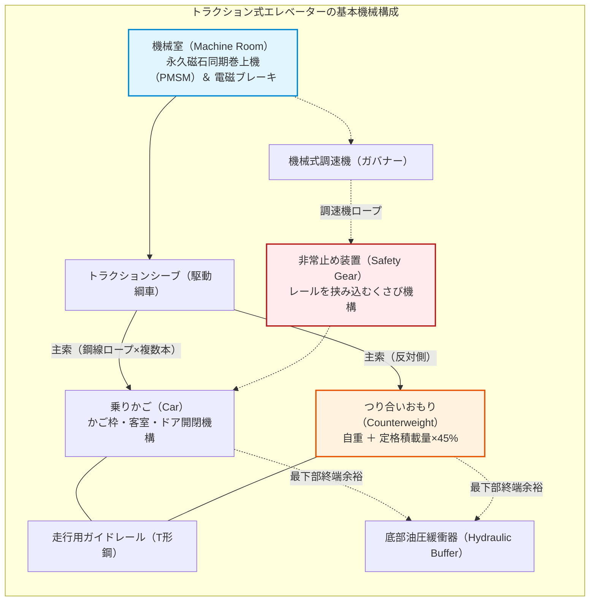
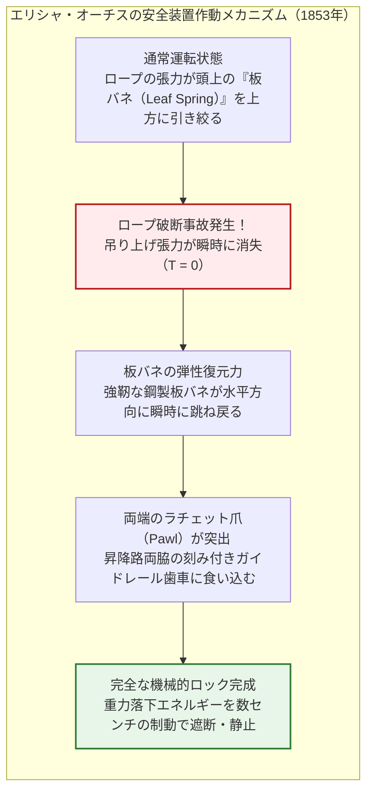
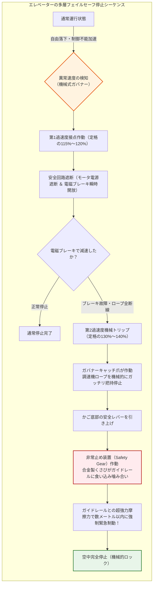
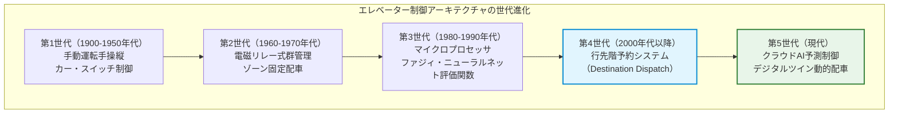
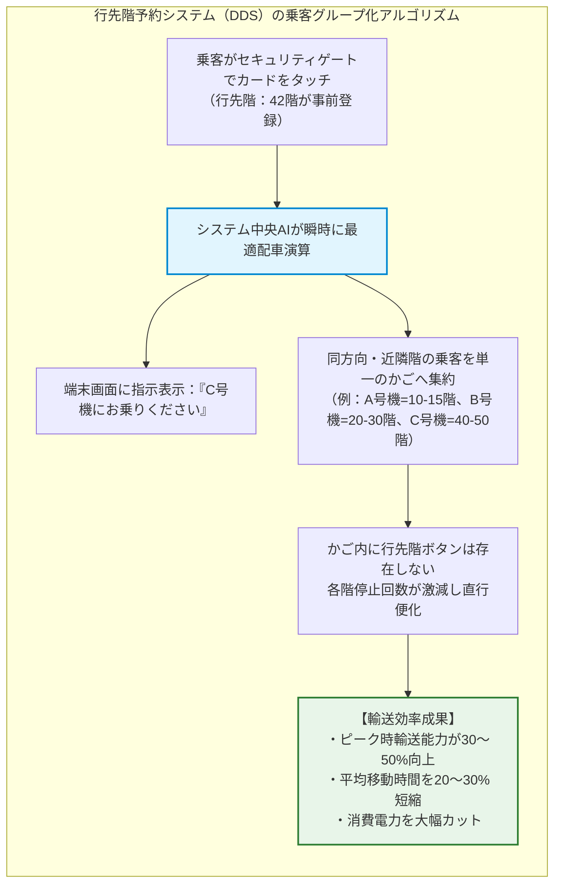
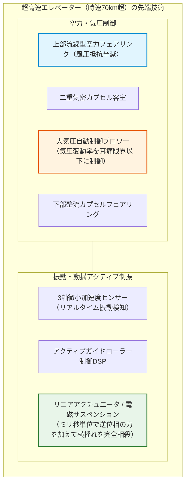
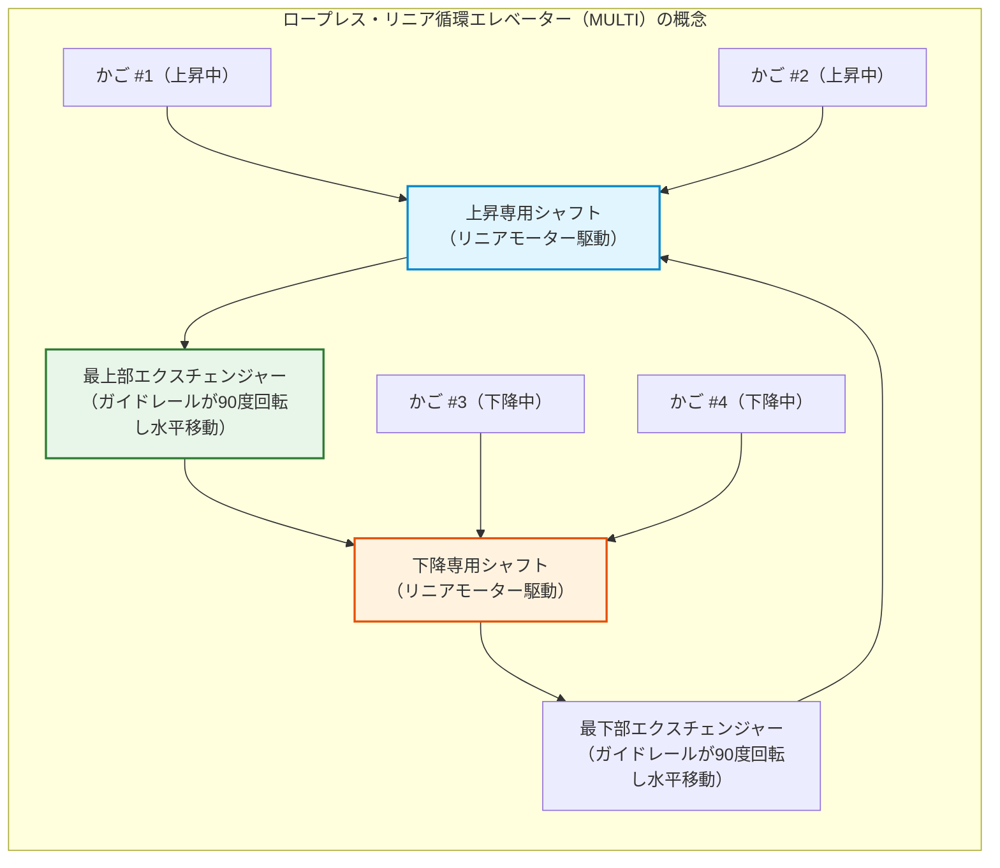

## はじめに：人類を「垂直」に解放した乗り物

毎朝、オフィスビルやタワーマンションのエントランスでボタンを押し、ドアが開けば何のためらいもなく乗り込む。密閉された箱の中で数十秒スマートフォンの画面を眺めている間に、私たちは重力に逆らい、地上数十メートル、数百メートルの高さへと運ばれている。

日常においてこれほど無防備に、かつ全面的に信頼を預けている機械は他にない。もし足元の床が抜けたら、もし吊り下げているワイヤーロープがすべて断断したら——そんな悪夢のような想像を巡らせる乗客はほとんどいない。なぜなら現代の文明社会において、エレベーターは**「絶対に落ちない乗り物」**として完全に信頼されているからである。

統計的に見ても、エレベーターは**世界で最も安全な交通機関**である。航空機や新幹線を遥かに凌駕する天文学的な乗客数を日々運びながら、機械的な自由落下事故による死亡率はほぼゼロ（宝くじに連続で当選する確率よりも低い）に抑え込まれている。

しかし、歴史の視点をほんの170年ほど巻き戻せば、この乗り物は「いつワイヤーが切れて乗客全員が叩きつけられるかわからない恐怖の昇降機」であり、人間が日常的に乗るなど狂気の沙汰と考えられていた。当時の都市の建物の高さ限界がせいぜい5階から6階（人間が階段を徒歩で登れる限界）にとどまっていた最大のボトルネックは、鉄骨構造の強度不足ではなく、**「人間を安全に垂直輸送する技術が存在しなかったこと」**にあった。

エレベーターの安全装置の発明こそが、地上の二次元に張り付いていた人類の都市を「三次元の垂直都市」へと解き放ち、ニューヨーク、香港、東京、ドバイの摩天楼群（スカイスクレイパー）を可能にした真の起爆剤であった。

本稿では、エレベーターがなぜ絶対に落ちないのか、いかにして重力と摩擦を操り、時速70kmを超える超高速走行とミリメートル単位の着床精度を両立させているのかを、機械力学・材料力学・制御工学・流体力学の全方位から徹底的に解明する。



---

## 第1章：恐怖を信頼に変えた歴史的瞬間——エリシャ・オーチスの命がけの実験

人間や重量物を垂直に吊り上げる機械の歴史は、古代ギリシャのアルキメデスが考案した滑車とロープの巻上機（紀元前3世紀）にまで遡る。中世の鉱山や要塞、産業革命期の炭鉱などでも、水力や蒸気機関を用いた昇降プラットフォームが広く稼働していた。

しかし、それらはすべて「いつ切れてもおかしくない麻縄やワイヤー」で吊り下げられただけの、極めて危険な荷物専用リフトであった。ロープが破断すれば、荷台は重力加速度 $g$ で一気に落下し、乗っていた作業員は粉砕された。炭鉱夫たちは昇降機に乗るたびに神に祈りを捧げていたという。

### 1.1 1853年ニューヨーク万博：伝説の公開切断デモンストレーション

この致命的な恐怖に終止符を打ち、現代の垂直都市の扉を開いたのが、アメリカの発明家**エリシャ・グレイブス・オーチス（Elisha Graves Otis）**であった。

1853年、ニューヨーク万国博覧会（クリスタル・パレス）。広大なドーム会場の中央にそびえ立つ、高さ約12メートルの吹き抜け昇降ガイドフレーム。その高みにある開放型の昇降台の上に、シルクハットとフロックコートを身にまとったオーチス自身が乗っていた。

昇降台は蒸気機関によって最頂部までゆっくりと巻き上げられ、眼下には何千人もの観衆が固唾を呑んで見上げていた。オーチスは手に持った合図旗を振り、助手に叫んだ。

**「ロープを切れ！」**

助手が長柄の斧を振り下ろし、昇降台を吊り下げていた唯一の太い主索が一閃のもとに切断された。観衆から悲鳴が上がった。ロープを失った物体は、ニュートンの万有引力に従って即座に自由落下し、地表へ叩きつけられるはずであった。

しかし、昇降台はわずか数インチ落下した瞬間、**「ガシャン！」という激しい金属音とともに空中で静止した**。

帽子に手を添え、平然と立ち尽くすオーチスは、静まり返った観衆に向かって誇らしげに宣言した。
> **"All safe, gentlemen, all safe!"（皆様、すべて安全です！）**

この瞬間、人類の歴史から「昇降機＝墜落の恐怖」という等式が消滅し、近代摩天楼文明の夜明けが告げられたのである。



### 1.2 板バネとラチェット：フェイルセーフの原点

オーチスが考案した「安全装置（Safety Brake）」の構造は、驚くほどシンプルでありながら、フェイルセーフ（Fail-Safe）設計の究極の模範であった。

かごのフレーム最上部には、反り上がった頑強な**鋼製板バネ（Leaf Spring）**が設置されていた。
1. **通常時**: 主索ワイヤーが荷台を吊り上げている間、ワイヤーの張力によって板バネは上方に引っ張られ、弓なりに撓（たわ）んだ緊張状態に保たれる。この状態では、バネの両端に取り付けられた爪（ラチェットパウル）は内側に引っ込んでおり、ガイドレールに触れることはない。
2. **ロープ破断時**: ワイヤーが切れて張力がゼロになった瞬間、板バネの強力な弾性エネルギーが解放され、バネが水平へと跳ね戻る。
3. **強制ロック**: バネの両端に直結された鋼鉄の爪が外側へ向かって飛び出し、昇降路の両脇に固定されたノコギリ歯状の鋳鉄製ラチェットレールの段差に瞬時にガッチリと噛み合う。

外部からの電力もセンサーも人間の操作も必要としない。**「吊り上げ力を失ったという物理現象そのもの」をトリガーにして機械的にブレーキをかける**——この極めて強固な自律的フェイルセーフの思想は、現代のエレベーターの安全工学に今なお不変の哲学として受け継がれている。

---

## 第2章：物理と力学のシンフォニー——トラクション式エレベーターの基本構造

現代のエレベーターのほぼすべては、**「トラクション式（Traction Elevator）」**と呼ばれる方式を採用している。

トラクション式エレベーターを理解する上で、最も直感に反し、かつ最も重要な事実は、**「モーターはかごの重さを持ち上げているわけではない」**という点である。

### 2.1 カウンターウェイト（つり合いおもり）の絶妙なバランス学

井戸の釣瓶（つるべ）を想像してほしい。片方に重い桶を吊るし、もう片方に同じ重さのおもりを吊るせば、シーソーのように釣り合い、指一本の力で桶を上下させることができる。

トラクション式エレベーターも全く同じ原理である。かご（Car）に繋がれたワイヤーロープは、頭上の駆動滑車（トラクションシーブ）を通り、反対側に吊るされた**「つり合いおもり（Counterweight：カウンターウェイト）」**に接続されている。

では、カウンターウェイトの重量 $M_{\text{cwt}}$ は、かごの自重 $M_{\text{car}}$ とまったく同じ重さに設定されているのだろうか？ 答えは「否」である。

かごには人が乗る。誰も乗っていない空車時もあれば、定格いっぱいの満員時もある。そこでエレベーター工学では、カウンターウェイトの質量を**「かご自重 ＋ 定格積載量（最大積載質量 $Q$）の40〜50%」**に設定する。この比率を**オーバーバランス率（$\alpha$）**と呼ぶ：

$$M_{\text{cwt}} = M_{\text{car}} + \alpha \cdot Q \quad (\alpha \approx 0.4 \sim 0.5)$$

```
【エレベーターの荷重バランス状態】
1. 空車時（乗客 0%）:
   [かご: Mcar] < [おもり: Mcar + 0.45Q]  ==> おもりの方が重い（上昇時にモーターが発電）
2. 設計中心荷重（乗客 45%）:
   [かご: Mcar + 0.45Q] == [おもり: Mcar + 0.45Q]  ==> 完全につり合い（モーター負荷ほぼゼロ！）
3. 満員時（乗客 100%）:
   [かご: Mcar + Q] > [おもり: Mcar + 0.45Q]  ==> かごの方が重い（下降時にモーターが発電）
```

このオーバーバランス設計により、実運用における平均的な乗車率（30〜50%程度）において、かごとカウンターウェイトはほぼ完璧に釣り合う。

モーター（巻上機）が負担しなければならない力は、全質量を持ち上げる力ではなく、**「乗客数の変動によるアンバランス分の差額」と「加減速のための慣性力」、そして「わずかな機械摩擦」のみ**となる。もし自重2トンのエレベーターにカウンターウェイトがなければ数十〜数百キロワットの巨大モーターが必要になるが、カウンターウェイトのおかげで数分の一の省エネルギーモーターで高速走行が可能になるのである。

さらに現代のエレベーターは、重い側が下降する際、モーターを発電機として回転させて電力を生み出し、ビルの照明や空調へと電力を送り返す**「電力回生インバータ」**を標準装備しており、究極のエネルギー循環を実現している。

### 2.2 オイラーのベルト摩擦方程式とトラクション（摩擦駆動）

エレベーターの主索ワイヤーは、綱車（シーブ）にボルトで固定されているわけではない。ただシーブの溝の上に掛けられているだけである。

なぜ、何トンもの重量がぶら下がっているワイヤーロープが、ツルツルと滑り落ちることなく、シーブの回転に合わせて確実に走行できるのだろうか？

このトラクション（綱車とロープの摩擦伝達力）の物理を支配しているのが、レオンハルト・オイラーが導き出した**「ベルト摩擦の方程式（Euler's Belt Friction Equation）」**である。

巻き付け角 $\theta$（ラジアン）でシーブに接触しているロープの両端の張力を $T_1$（大きい側の張力）および $T_2$（小さい側の張力）とすると、ロープがシーブ上で滑り出さないための限界張力比は以下の不等式で表される：

$$\frac{T_1}{T_2} \le e^{\mu' \theta}$$

ここで、$e$ は自然対数の底（約2.718）、$\theta$ はロープの接触巻き付け角（通常の1:1ラップで $\theta = \pi \approx 3.14\ \text{rad}$、ダブルラップで $\theta \approx 2\pi$）、そして $\mu'$ はシーブ溝の形状によって補正された**「等価摩擦係数（見かけの摩擦係数）」**である。

平らな面の上に鋼鉄ロープを置いただけでは、鋼と鋼の摩擦係数 $\mu$ はわずか $0.09 \sim 0.15$ 程度しかなく、これでは張力比が約 $1.3 \sim 1.6$ を超えた途端にロープが滑ってしまう。

そこでエレベーターのシーブには、特殊な断面形状を持つ溝が精密に切削加工されている：

```
【シーブ（綱車）のロープ溝形状の進化】
1. 半丸溝（Round Groove）:
   ロープの底面がそのまま接触。摩擦力は小さいが摩耗が最も少ない。
2. アンダーカット溝（Undercut Groove）:
   溝の底を一段深くくり抜いた形状。ロープの両側面2点にくさび状に強い面圧が集中。
3. V溝（V-Groove）:
   鋭角なV字断面（挟み角 γ = 35°〜40°）。強烈なくさび作用で摩擦係数を極大化。
```

アンダーカット溝における等価摩擦係数 $\mu'$ は、溝のアンダーカット角 $\beta$ とV字角 $\gamma$ を用いて次のように導出される：

$$\mu' = \mu \cdot \frac{4 \left(\cos\frac{\gamma}{2} - \sin\frac{\beta}{2}\right)}{\pi - \beta - \sin\beta + \sin\gamma}$$

くさび効果によって、見かけの摩擦係数 $\mu'$ は元の摩擦係数 $\mu$ の**3倍から5倍（$\mu' \approx 0.4 \sim 0.6$）**にまで劇的に引き上げられる。この結果、$e^{\mu' \theta}$ の値は $5 \sim 10$ 以上に達し、かごが満員であっても、あるいは緊急停止で急激な減速度が加わっても、ロープがスリップすることなく確実に駆動されるのである。

### 2.3 複数本のスチールワイヤーロープと過剰な安全率

映画のアクションシーンでは、エレベーターのワイヤーが1本ずつ「ブツン、ブツン」と切れていき、最後に底へ真っ逆さまに落ちる描写が定番である。しかし現実のエレベーター工学において、そのような事態は**力学的に100%あり得ない**。

現代のエレベーターは、高炭素鋼素線を幾重にも撚り合わせた特殊なエレベーター用スチールワイヤーロープを、**最低でも3本から8本以上、超高層ビルでは10本以上**並列に張ってかごを吊り下げている。

建築基準法およびJIS規格において、エレベーターの主索には**「安全率10倍以上（一部用途では12倍以上）」**が厳格に義務付けられている。

安全率10倍とはどういう意味か。それは、**「並列に張られたロープのうち、仮に全本数のうち9本が切断され、最後の1本しか残っていなかったとしても、満員の乗客を乗せたかごをそのまま吊り上げ続けられる」**という驚異的な耐荷重マージンを意味している。

さらに、全ロープの張力をミリ単位で均等化するためのコイルスプリング付き張力調整装置がロープエンドに組み込まれており、1本のロープだけに過大な負荷が集中することを防いでいる。現代の点検体制において、複数本の超強力ワイヤーロープが同時にすべて破断することは、工学的に事実上「ゼロ」である。

---

## 第3章：多重防御の要塞——多層フェイルセーフ安全システム

百歩譲って、巨大地震による瓦礫の直撃やテロリズムなど、未知の極限外力によって吊り下げロープが奇跡的にすべて同時に切断されたと仮定しよう。

その時、エレベーターはどうなるのか？ 答えは**「それでも絶対に墜落しない」**である。エレベーターには、主索が消失した瞬間から作動する、独立した機械式安全装置の多重防御要塞が構築されているからである。



### 3.1 電磁ブレーキ：Fail-to-Safetyの極致

エレベーターの基本ブレーキは、機械室（または昇降路頂部）の巻上機軸に設置された**電磁ブレーキ（Electromagnetic Brake）**である。

自動車のブレーキはペダルを踏み込むことで油圧をかけてブレーキを「かける」が、エレベーターのブレーキはその正反対の設計思想である。

**「強力な圧縮コイルスプリングが、常にブレーキシューをホイールに猛烈な力で押し付けている」**。電磁石に通電している間だけ、スプリングの力に打ち勝ってブレーキが「引き離され」、モーターが回る。

走行中に停電が発生しようが、安全回路のリレーが1箇所でも断線しようが、マイコンがフリーズしようが、電気の供給が途絶えた瞬間に、電磁石の吸着力が消滅し、**物理スプリングがブレーキシューを瞬時にディスクへ叩きつけて物理的に軸をロックする**。これが「安全側に倒す（Fail-to-Safety）」の神髄である。

### 3.2 調速機（ガバナー）：重力加速度を見張る独立の目

電磁ブレーキすら効かず、ロープが切断されてかごが落下を始めた場合、それを検知するのはコンピュータではない。電気に一切依存しない純機械式の**調速機（ガバナー：Speed Governor）**である。

昇降路の頂部に設置されたガバナープーリーには、主索とは完全に独立した専用の細いスチールロープ（調速機ロープ）が張られ、かごの上下移動と1対1で連動して回転している。

ガバナーの内部には、ジェームズ・ワットの蒸気機関に由来する**遠心フライボール（遠心錘）**が組み込まれている。かごの走行速度が上昇すると、遠心力によってフライボールが外側へと押し広げられる。

1. **第1段階（定格速度の115%〜120%超過）**:
   外側に広がったフライボールが電気スイッチ（過速度スイッチ）を蹴飛ばし、制御盤の安全回路を瞬時に遮断。モーターへの給電を断ち、電磁ブレーキを作動させて通常減速を試みる。
2. **第2段階（定格速度の130%〜140%超過）**:
   それでも速度が上昇し続けた場合（ロープ破断などのカタストロフィ時）、フライボールはさらに外側へと開き、頑強な機械的トリップ爪に噛み合う。ガバナープーリーは機械的にガッチリとロックされ、回転を停止する。

### 3.3 非常止め装置（セーフティギア）：レールを喰い破る鋼のくさび

ガバナープーリーがロックされると、落下を続けるかごに対して、停止した調速機ロープが猛烈な力で引っ張られる。

この張力がトリガーとなり、かごの下部フレーム（下梁）に仕込まれた**「非常止め装置（Safety Gear）」**の起動リンクアームが一気に引き上げられる。

非常止めには、速度に応じて2つのタイプが存在する：
- **瞬時停止型（Instantaneous Safety）**: 低速エレベーター（分速45m以下）用。焼入れされたローラーや急峻なくさびがガイドレールに食い込み、瞬時にロックする。
- **次第停止型（Progressive Safety）**: 中高速エレベーター用。板バネと特殊合金製のくさび（Wedge）を組み合わせた**フレキシブル・ガイド・クランプ（FGC）**。

次第停止型非常止めの工学美は、**「人間を殺さない減速度で安全に止める」**点にある。

時速数十キロで落下しているかごをコンクリートの壁に衝突するように一瞬で止めてしまえば、乗客は強烈な減速G（数十G）によって床に叩きつけられ、内臓破裂や骨折で命を落としてしまう。

次第停止型では、ガイドレール（エレベーターの昇降路両脇に垂直に設置された重厚なT字型鋼鉄レール）を挟み込むくさびがレール表面に食い込みつつ、特殊な皿ばねや板バネが弾性変形しながら滑り、**一定の制御された摩擦抵抗力 $F_{\text{friction}}$** を発生させ続ける。

非常止め作動時のかごの減速度 $a_{\text{stop}}$ は、以下の運動方程式に従う：

$$M \cdot a_{\text{stop}} = F_{\text{friction}} - M g \implies a_{\text{stop}} = \frac{F_{\text{friction}}}{M} - g$$

建築基準法および国際安全規格（EN 81）では、非常止め作動時の平均減速度を**$0.2g \sim 1.0g$（地球重力の0.2倍から1倍程度）**に収めるよう厳密に規定されている。

これは自動車の急ブレーキと同等からやや強い程度の減速度であり、乗客は強い圧迫感を受けるものの、怪我をすることなく数メートル滑走した後に空中で完全に静止する。

### 3.4 昇降路最下部の緩衝器（バッファ）

万が一、すべてのブレーキと非常止めをすり抜けて最下階を突破してしまった場合の最後の防衛線として、ピット（昇降路の最底部）には巨大な**緩衝器（バッファ：Buffer）**が屹立している。

低速機には強大なコイルスプリング（スプリングバッファ）が使われるが、中高速機には自動車のショックアブソーバーを巨大化させた**油圧式緩衝器（Hydraulic Oil Buffer）**が配備される。

かご底部の突起が油圧ピストンに激突すると、シリンダー内部の作動油がピストンの側面に開けられた無数の微細なオリフィス孔から超高圧で絞り出される。

流体の粘性摩擦抵抗によって、落下するかごの運動エネルギー $E_k$ は瞬時に熱エネルギーへと変換・散逸される：

$$E_k = \frac{1}{2} M v^2 = \int_0^S F_{\text{hydraulic}}(x) \, dx$$

ピストンストローク $S$ を経て、エレベーターは底突きすることなく安全に受け止められる。

---

## 第4章：頭脳の進化——リレー制御からAI群管理（群乗合制御）へ

エレベーターの進化は、機械的な頑強さの追求にとどまらない。ビルの巨大化に伴い、複数台のエレベーターをいかに効率的に動かし、利用者の待ち時間をゼロに近づけるかという**制御工学と最適化アルゴリズムの進化**が不可欠であった。



### 4.1 群管理制御（Group Supervisory Control）の数学的最適化

数十階建てのオフィスビルに8台のエレベーターが並んでいるとする。各階からランダムに発生する「上り」「下り」の呼び出し（ホールコール）に対し、どの号機をどの順番で向かわせるべきか？

単純に「最も近くにいる号機」を向かわせるナイーブな手法（最近距離割当）をとると、特定の階にエレベーターが団子状に固まり（バンチング現象）、他の階で数分間も待たされる「長待ち（Long Wait）」が頻発する。

現代の群管理システムは、**多目的評価関数（Objective Evaluation Function）**をミリ秒単位で高速演算して最適号機を決定する：

$$J(k) = \min_{k} \left[ w_1 \cdot T_{\text{wait}}(k) + w_2 \cdot T_{\text{ride}}(k) + w_3 \cdot P_{\text{long}}(k) + w_4 \cdot E_{\text{energy}}(k) \right]$$

ここで：
- $T_{\text{wait}}(k)$: 号機 $k$ を割り当てた場合の予想待機時間
- $T_{\text{ride}}(k)$: 既に車内にいる乗客の目的地到着までの乗車時間増分
- $P_{\text{long}}(k)$: 待機時間が60秒を超える確率に対する重いペナルティ関数
- $E_{\text{energy}}(k)$: 当該走行に伴うモーター消費電力
- $w_1, w_2, w_3, w_4$: 時間帯や交通流に応じた動的重み付け係数

朝の出勤ラッシュ時には $w_1$（待機時間短縮）と1階での充填率を最優先し、閑散時には $w_4$（省エネ）を重視して待機電力を削減するなど、**ファジィ理論、遺伝的アルゴリズム（GA）、深層強化学習**を組み合わせたAIが、刻々と変化するビル内人口動態を先読みして動的にエレベーターを配車している。

### 4.2 行先階予約システム（Destination Dispatch System）の革命

近年の最新鋭オフィスビルで普及しているのが、**行先階予約システム（Destination Dispatch System）**である。

従来のエレベーターは、乗り場で「上」「下」ボタンを押し、かごに乗り込んでから行先階ボタンを押していた。この方式では、誰が何階に行きたいのかがエレベーターに乗るまでシステム側にわからない。

行先階予約システムでは、乗客は乗り場のタッチパネルやセキュリティゲートで**最初に行先階を指定する**。



乗客が行先階を事前申告することにより、システムは**「同じ階や近隣の階に行く乗客」を同じ号機へとスマートにグループ化（クラスタリング）**できる。

各号機が立ち寄るフロア数が劇的に減少し、実質的な「各停から急行・直行便へのシフト」が実現。エレベーターの設置台数を増やすことなく、朝のピーク時輸送能力を30%以上向上させることに成功した。

---

## 第5章：超高層の物理限界への挑戦——時速70km超の世界

超高層ビル（スーパートール：300m超、メガトール：600m超）の建設ラッシュは、エレベーター技術を航空宇宙工学の領域へと押し上げた。

| 施設名（都市） | 竣工年 | 定格最高速度 | 時速換算 | 昇降行程 |
| :--- | :--- | :--- | :--- | :--- |
| **サンシャイン60（東京）** | 1978年 | 分速 600 m | 36.0 km/h | 約 240 m |
| **横浜ランドマークタワー（横浜）** | 1993年 | 分速 750 m | 45.0 km/h | 約 290 m |
| **台北101（台北）** | 2004年 | 分速 1,010 m | 60.6 km/h | 約 382 m |
| **上海中心大厦（上海タワー）** | 2016年 | 分速 1,230 m | 73.8 km/h | 約 578 m |
| **広州周大福金融中心（広州）** | 2019年 | 分速 1,260 m | **75.6 km/h** | 約 500 m |

分速1,260メートル（秒速21メートル、時速75.6キロメートル）。一般道路を走る自動車を追い抜く猛烈なスピードで、ビルの中を垂直に突っ走る。ここには、想像を絶する極限の物理的課題が立ちはだかっていた。

### 5.1 ピストン効果と空力カバー

細長い筒（昇降路：シャフト）の中を巨大な箱（かご）が時速70km超で高速移動すると、注射器のピストンと同じ現象が発生する。

かごの前面にある空気が猛烈に圧縮されて進行方向の抵抗となり、かごの後方には強烈な負圧（バキューム）が発生する。これを**ピストン効果（Piston Effect）**と呼ぶ。

空気抵抗力 $F_{\text{aero}}$ は、流体力学の公式に従い、**速度の2乗（$v^2$）に比例して爆発的に増大する**：

$$F_{\text{aero}} = \frac{1}{2} C_d \cdot \rho_{\text{air}} \cdot A_{\text{frontal}} \cdot v^2$$

何の対策も施さなければ、かごは凄まじい風切り音（空力騒音）と振動に包まれ、昇降路壁面の各階ドアを風圧でガタガタと打ち鳴らし、モーターの消費電力は激増する。

これを解決するため、超高速エレベーターの上下には、新幹線の先頭車両と同じ流線型の**空力カプセルフェアリング（Aerodynamic Fairing：風防カバー）**が装着されている。数値流体力学（CFD）シミュレーションにより最適化された流線型カプセルが気流をスムーズにかご後方へと逃し、空気抵抗係数 $C_d$ と風切り音を極限まで低減している。



### 5.2 大気圧アクティブ制御：耳詰まり（耳痛）を消し去る気圧ポンプ

地上から標高500メートル超の展望台までわずか30〜40秒で急上昇・急降下すると、外気圧は急激に約50〜60ヘクトパスカル（hPa）も低下する。

何の手当てもしなければ、乗客の鼓膜の内外に急激な気圧差が生じ、激しい耳の痛み（航空性中耳炎と同様の症状）を引き起こす。

最新の超高速エレベーターは、客室全体が潜水艦や航空機と同じ**完全密閉型気密構造（Sealed Cabin）**となっている。車体には高性能の気圧制御ブロワーが搭載され、昇降速度に合わせて室内の気圧を自動加圧・減圧する。人体の耳管が自然に適応できる**気圧変化率（約1.5 hPa/秒以下）**を厳密に維持しながら気圧を滑らかに連続変化させることで、乗客は耳痛をほとんど感じることなく超高速移動を体験できる。

### 5.3 アクティブ制振ガイドローラー：コインが倒れない静粛性

時速70kmで走行中、わずか数ミリメートルのガイドレールの継ぎ目や歪み、あるいは昇降路内の乱気流が、かごに微細な横揺れ（振動）を引き起こす。

超高速エレベーターには、磁気浮上技術を応用した**アクティブガイドローラー（Active Mass Damper / Active Guide Roller）**が装備されている。

かご枠に設置された高精度加速度センサーが、レールの継ぎ目などによるわずかな揺れ（ミリG単位）を検知すると、制御マイコンが瞬時に逆位相の打ち消し力を計算。リニアアクチュエータや電磁コイルがガイドローラーをミリ秒単位で押し引きし、**揺れが発生した瞬間に反対向きの力を加えて振動を強制的に相殺する**。

このアクティブ制振技術により、時速70kmで急加速・急停止する車内の床の上にタバコや硬貨を立てても、走行中に一度も倒れることなく終点まで直立し続けるという、驚異的な乗り心地が実現されている。

---

## 第6章：最新トレンドと未来の垂直交通

エレベーター工学は現在、1853年以来の「ロープで箱を吊る」という基本構造そのものを破壊する、歴史的パラダイムシフトの渦中にある。

### 6.1 マシンルームレス（MRL）エレベーターの普及

従来のトラクションエレベーターは、ビルの屋上に巨大な機械室（Machine Room）を設置する必要があり、建物の高さ制限（斜線制限）や意匠設計の大きな制約となっていた。

1990年代以降、ネオジム磁石を用いた**永久磁石同期電動機（PMSM：Permanent Magnet Synchronous Motor）**の進化により、巻上機の大幅な小型・薄型化（ギアレス化）が達成された。

これにより、巻上機と制御盤を昇降路内の最上部や隙間にすべて収容してしまう**「マシンルームレス（MRL）エレベーター」**が誕生。現在、中低層ビルやマンションで新設されるエレベーターの主流となっており、屋上突出部を完全になくす建築の自由をもたらした。

### 6.2 ロープレス・リニア式マルチカーエレベーター（MULTI）

エレベーターが直面している究極の物理的限界、それは**「1つの昇降路（シャフト）には1台のかごしか走れない」**という制約である。

超高層ビルにおいて、上層階に人を運ぶために何十本もの昇降路を貫通させると、ビルの床面積の40%以上がエレベーターシャフトに侵食され、オフィスとして貸し出せる有効面積（レンタブル比）が激減してしまう。

この限界を突破するためにドイツのティッセンクルップ（現TK Elevator）が開発したのが、世界初のロープレス・マルチカーシステム**「MULTI」**である。



1. **ワイヤーロープの完全排除**:
   かごの駆動には、リニア誘導モーター（LSM）を採用。かご自体が自走する。
2. **ループ循環走行**:
   地下鉄や環状線のように、1本のシャフトを複数のかごが一定間隔で続々と上昇し、最上階でレールが90度回転（エクスチェンジャー）して水平にスライド、隣のシャフトを下降する。
3. **垂直と水平の融合**:
   エレベーターはビルの中を垂直に登るだけでなく、複数のビルをつなぐ渡り廊下を水平に走行して隣のタワーへと移動することすら可能になる。

### 6.3 宇宙エレベーター（軌道エレベーター）の工学理論

エレベーター工学の究極の到達点として真剣に研究されているのが、静止軌道（高度約36,000km）から地上へとテザー（ケーブル）を垂らし、ロケットを使わずに電気の力で宇宙へと登る**「宇宙エレベーター（Space Elevator）」**である。

自重で切れない極限の引張強度を持つ素材として**カーボンナノチューブ（CNT）**が発見されたことで、単なるSFから理論的工学検討のフェーズへと移行した。地上から宇宙へ、1回あたり数千円の電気代で物資と人間を安全に運ぶ未来の垂直交通は、まさにエレベーターの基本原理の延長線上にある。

---

## 第7章：結論——人間を安全に持ち上げる機械が描く都市の未来

私たちが普段何気なく利用しているエレベーターは、古代ギリシャの滑車から始まり、産業革命の蒸気機関、オーチスのフェイルセーフ板バネ、オイラーの摩擦力学、そして現代のAI群管理と航空宇宙レベルの空力制御に至る、**2000年を超える人類工学の結晶**である。

もしエレベーターがなければ、現代の都市は存在し得ない。世界中の大都市は横へと無秩序にスプロール化し、豊かな自然を侵食し、通勤に何時間も費やす非効率な平面社会に留まっていただろう。人類が高密度の都市環境においてエネルギーを節約し、豊かな文化と経済活動を集中させることができているのは、ひとえに「安全に垂直移動できる」という保証があるからである。

「人を乗せたまま、絶対に落としてはならない」という過酷な命題に挑み続けた先人たちの執念。幾重にも張り巡らされたバックアップ機構、電気を失っても重力とバネだけで止まるフェイルセーフの知恵。

今日も世界中のビルのシャフトの中で、数百万台のエレベーターが、一度の破綻もなく静寂のうちに人を運び続けている。その完璧な沈黙の作動の中にこそ、機械工学が到達した最高の誇りと尊厳が宿っているのである。
