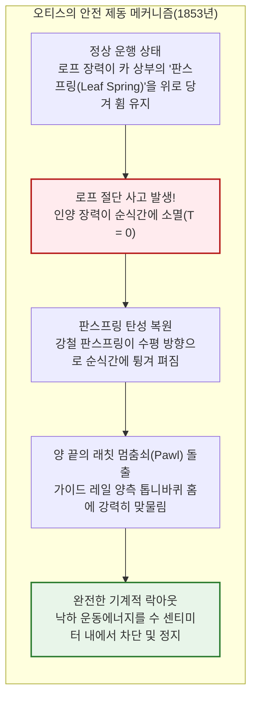
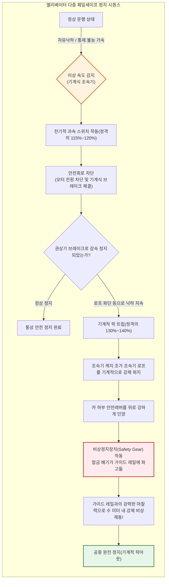
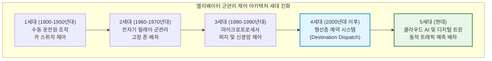
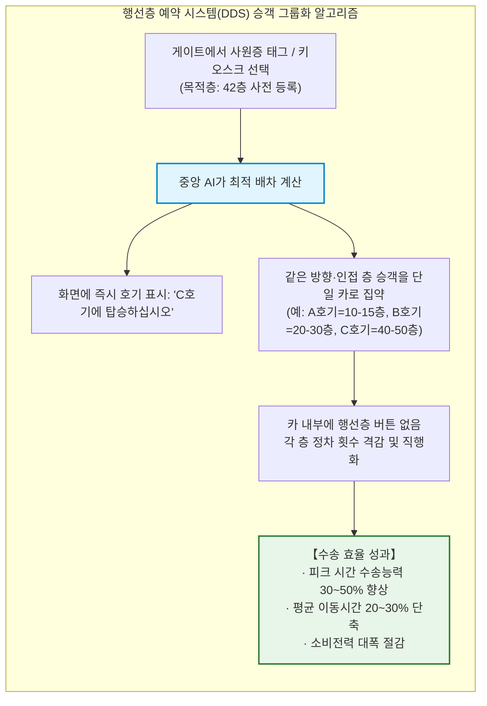
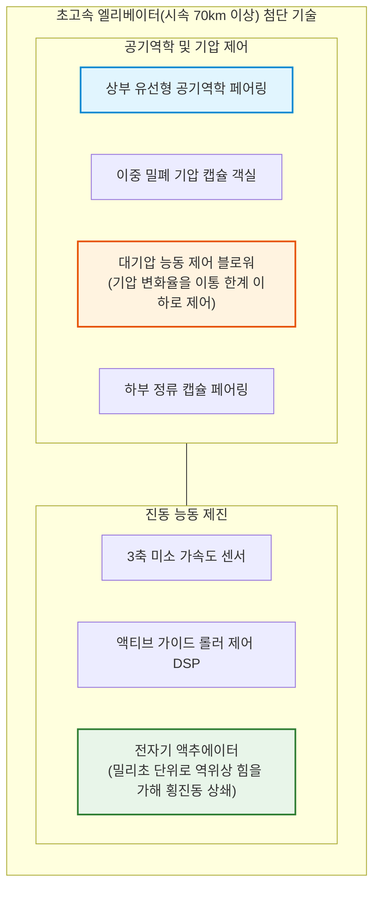
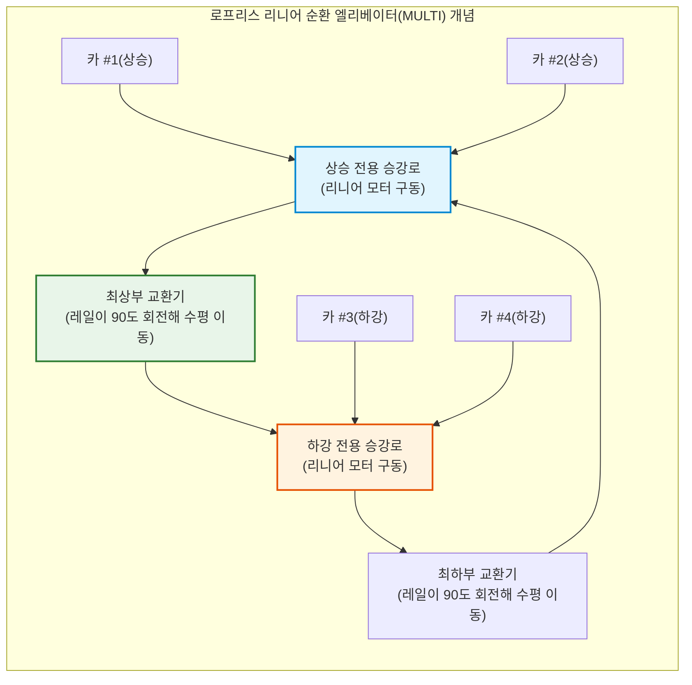

## 서론: 인류를 '수직'으로 해방시킨 기계

매일 아침, 전 세계의 수많은 오피스 빌딩과 초고층 아파트 로비에서 사람들은 호출 버튼을 누르고 문이 열리면 아무런 망설임 없이 탑승한다. 밀폐된 상자 안에서 스마트폰 화면을 몇십 초 바라보는 동안, 우리는 중력을 거슬러 지상 수십 미터, 수백 미터의 높이로 운반된다.

일상에서 이토록 무방비하게, 전적으로 생명을 맡기는 기계는 드물다. 만약 바닥이 빠진다면, 매달린 와이어 로프가 일제히 끊어진다면 어쩌나 하는 악몽 같은 상상을 하는 승객은 거의 없다. 현대 문명사회에서 엘리베이터는 **'절대 추락하지 않는 이동 수단'**으로 완벽히 신뢰받고 있기 때문이다.

통계적으로 엘리베이터는 **세계에서 가장 안전한 교통수단**이다. 항공기나 고속철도를 압도하는 천문학적인 수의 승객을 매일 실어 나르면서도, 기계적 자유낙하로 인한 사망 사고율은 사실상 제로(복권에 연속 당첨될 확률보다 낮음)에 가깝다.

그러나 역사를 불과 170년 전으로 되돌리면, 이 기계는 '언제 로프가 끊어져 탑승자 전원이 바닥에 내동댕이쳐질지 모르는 공포의 리프트'였으며, 사람이 타는 것은 무모한 광기로 여겨졌다. 당시 도시 건축물의 높이 한계가 5~6층(계단을 걸어 오를 수 있는 한계)에 머물렀던 최대 병목은 철골 구조의 강도 부족이 아니라, **'인간을 안전하게 수직 수송할 기술이 존재하지 않았다는 점'**에 있었다.

엘리베이터 안전장치의 발명이야말로 지상의 2차원에 묶여 있던 인류의 도시를 '3차원 수직 도시'로 해방시키고, 뉴욕, 홍콩, 도쿄, 두바이의 마천루군(Skyscraper)을 가능케 한 진정한 기폭제였다.

본 글에서는 엘리베이터가 왜 절대 떨어지지 않는지, 중력과 마찰력을 어떻게 제어하여 시속 70km가 넘는 초고속 주행과 밀리미터 단위의 착상 정밀도를 양립시키고 있는지를 기계역학, 재료역학, 제어공학, 유체역학 전 방위에서 철저히 파헤친다.

```mermaid
flowchart TD
    subgraph ElevatorStructure["트랙션식 엘리베이터 기본 기계 구성"]
        direction TB
        MachineRoom["기계실 / 승강로 상부<br/>영구자석 동기권상기(PMSM) 및 상폐형 전자브레이크"]
        TractionSheave["트랙션 시브(구동 도르래)"]
        Governor["기계식 조속기(Speed Governor)"]
        
        MachineRoom --> TractionSheave
        MachineRoom -.-> Governor
        
        TractionSheave -->|주 로프(복수 강철 와이어 로프)| Car["카(Car, 승강기 탑승실)<br/>카 프레임·케이지·도어 머신·하중 감지 센서"]
        TractionSheave -->|주 로프 반대편| CWT["균형추(Counterweight)<br/>자체 중량 ＋ 정격적재량×45%"]
        
        Governor -.->|조속기 로프| SafetyGear["비상정지장치(Safety Gear)<br/>레일 클램핑 쐐기 기구"]
        SafetyGear -.-> Car
        
        GuideRail["주행용 가이드 레일(T형 강철 레일)"]
        Car --- GuideRail
        CWT --- GuideRail
        
        Buffer["최하부 완충기(유압식 오일 버퍼)"]
        Car -.->|최하부 런바이 보호| Buffer
        CWT -.->|최하부 런바이 보호| Buffer
    end
    
    style MachineRoom fill:#e1f5fe,stroke:#0288d1,stroke-width:2px
    style SafetyGear fill:#ffebee,stroke:#b71c1c,stroke-width:2px
    style CWT fill:#fff3e0,stroke:#e65100,stroke-width:2px
```

---

## 제1장: 공포를 신뢰로 바꾼 역사적 순간——엘리샤 오티스의 목숨을 건 실험

물건이나 사람을 수직으로 들어 올리는 기계의 역사는 기원전 3세기 고대 그리스 아르키메데스의 복합 도르래와 윈치로 거슬러 올라간다. 중세 광산과 성채, 산업혁명기 탄광에서도 수력과 증기기관을 활용한 승강 플랫폼이 가동되었다.

하지만 그것들은 모두 마포 밧줄이나 조잡한 쇠사슬에 매달린 위험천만한 화물용 리프트에 불과했다. 로프가 끊어지면 짐칸은 중력가속도 $g$ 로 추락했고, 인부들은 산산조각이 났다. 광부들은 승강기를 탈 때마다 기도를 올렸다고 전해진다.

### 1.1 1853년 뉴욕 만국박람회: 전설적인 공개 절단 시연

이 치명적인 공포에 종지부를 찍고 현대 수직 도시의 문을 연 인물이 바로 미국의 발명가 **엘리샤 그레이브스 오티스(Elisha Graves Otis)**였다.

1853년 뉴욕 크리스털 팰리스 박람회장 중앙에 12미터 높이의 오픈형 승강 가이드 프레임이 세워졌다. 실크햇과 프록코트를 차려입은 오티스 자신이 개방형 승강대 위에 올라섰다.

승강대는 증기기관에 의해 천장 높이까지 끌어올려졌고, 수천 명의 관중이 마른침을 삼키며 올려다보았다. 오티스는 깃발을 흔들며 조수에게 외쳤다.

**"로프를 잘라라!"**

조수가 도끼를 휘두르자 승강대를 매달고 있던 유일한 굵은 밧줄이 단칼에 끊어졌다. 관중석에서 비명이 터져 나왔다. 만유인력에 따라 승강대는 바닥으로 내리꽂혀 산산조각 나야 마땅했다.

그러나 승강대는 불과 몇 인치 떨어진 순간, **"철컥!" 하는 날카로운 금속음과 함께 공중에서 거짓말처럼 정지했다**.

모자를 벗어 들고 태연히 서 있던 오티스는 넋을 잃은 관중을 향해 외쳤다:
> **"All safe, gentlemen, all safe!" (여러분, 모두 안전합니다!)**

이 순간, '승강기 = 추락사'라는 등식이 인류 역사에서 사라지고 근대 마천루 문명의 서막이 올랐다.



### 1.2 판스프링과 래칫: 페일세이프(Fail-Safe)의 원점

오티스가 고안한 안전 브레이크의 구조는 단순하면서도 페일세이프 설계의 완벽한 표본이었다.

승강대 상단 프레임에는 휜 강철 **판스프링(Leaf Spring)**이 장착되어 있었다:
1. **정상 시**: 로프가 짐칸을 당기고 있는 동안 장력에 의해 판스프링은 위로 당겨져 활처럼 휘어진 긴장 상태를 유지한다. 스프링 끝의 멈춤쇠(래칫 파울)는 안쪽으로 들어가 레일에 닿지 않는다.
2. **로프 파단 시**: 로프가 끊어져 장력이 0이 되는 순간, 판스프링에 저장된 탄성에너지가 방출되며 스프링이 수평으로 튕겨 펴진다.
3. **강제 잠금**: 스프링 양 끝에 연결된 강철 멈춤쇠가 밖으로 튀어나와 승강로 양쪽에 설치된 톱니 모양의 래칫 레일에 깊숙이 물린다.

외부 전력도, 센서도, 인간의 개입도 필요 없다. **'로프 장력을 잃었다는 물리 현상 그 자체'가 브레이크를 작동시키는 트리거가 된다.** 이 자율적 페일세이프 철학은 현대 엘리베이터 안전공학의 불변의 원리로 계승되고 있다.

---

## 제2장: 물리와 역학의 하모니——트랙션식 엘리베이터의 기본 원리

현대의 거의 모든 엘리베이터는 **'트랙션식(Traction Elevator)'** 방식을 채택한다.

트랙션식을 이해하기 위해 가장 먼저 깨야 할 직관적 오해는 **"모터가 카의 무게 전체를 들어 올리는 것이 아니다"**라는 사실이다.

### 2.1 균형추(Counterweight)의 절묘한 밸런스

우물의 두레박을 떠올려 보라. 양쪽에 같은 무게의 양동이를 매달면 시소처럼 평형을 이루어 손가락 힘만으로도 오르내릴 수 있다.

트랙션식 엘리베이터도 동일하다. 카(Car)에 연결된 와이어 로프는 머리 위의 구동 도르래(트랙션 시브)를 지나 반대편에 매달린 **'균형추(Counterweight)'**에 연결된다.

그렇다면 균형추의 질량 $M_{\text{cwt}}$ 은 빈 카의 무게 $M_{\text{car}}$ 와 완전히 같을까? 아니다. 카에는 승객이 탄다. 비어 있을 때도 있고 정원 만원일 때도 있다. 따라서 엘리베이터 공학에서는 균형추 질량을 **'카 자체 무게 ＋ 정격 적재량(최대 적재 질량 $Q$)의 40~50%'**로 설정한다. 이 비율을 **오버밸런스율($\alpha$)**이라 부른다:

$$M_{\text{cwt}} = M_{\text{car}} + \alpha \cdot Q \quad (\alpha \approx 0.40 \sim 0.50)$$

```
[엘리베이터 하중 밸런스 상태]
1. 공차 시(승객 0%):
   [카: Mcar] < [균형추: Mcar + 0.45Q]  ==> 균형추가 더 무거움(상승 시 모터가 발전 제동)
2. 설계 중심 하중(승객 45%):
   [카: Mcar + 0.45Q] == [균형추: Mcar + 0.45Q]  ==> 완전 평형(모터의 순수 인양 부하 거의 제로!)
3. 만원 시(승객 100%):
   [카: Mcar + Q] > [균형추: Mcar + 0.45Q]  ==> 카가 더 무거움(하강 시 모터가 발전 제동)
```

일상 운행에서 평균 승차율은 30~50% 수준이므로 카와 균형추는 거의 완벽히 균형을 이룬다.

모터(권상기)가 감당해야 하는 힘은 총 중량이 아니라 **'승객 수 변동에 따른 불평형 차액', '가감속을 위한 관성력', '미세한 기계 마찰력'뿐**이다. 자체 중량 2톤의 엘리베이터에 균형추가 없다면 수백 kW의 거대 모터가 필요하지만, 균형추 덕분에 5분의 1 이하의 에너지 절약형 모터로도 고속 주행이 가능하다.

또한 무거운 쪽이 하강할 때 모터를 발전기로 회전시켜 전력을 생산하고 건물 전력망으로 되돌려 보내는 **전력 회생 인버터(Regenerative VFD)**가 표준 장착되어 에너지 순환을 극대화한다.

### 2.2 오일러의 벨트 마찰 방정식과 트랙션(마찰 구동)

엘리베이터의 메인 와이어 로프는 시브(도르래)에 볼트로 고정되어 있지 않다. 홈 위에 걸쳐져 있을 뿐이다.

어떻게 수 톤의 하중이 걸린 로프가 미끄러지지 않고 시브의 회전에 맞춰 정확하게 주행할 수 있을까?

이 마찰 구동을 지배하는 물리 법칙이 레온하르트 오일러의 **'벨트 마찰 방정식(Euler's Belt Friction Equation)'**이다. 접촉각 $\theta$(라디안)로 감긴 로프의 양단 장력을 $T_1$, $T_2$라 할 때 미끄러지지 않기 위한 한계 장력비는 다음과 같다:

$$\frac{T_1}{T_2} \le e^{\mu' \theta}$$

여기서:
- $e$ 는 자연로그의 밑($\approx 2.718$),
- $\theta$ 는 로프 감김 각도(단일 래핑 시 $\theta = \pi \approx 3.14\ \text{rad}$, 더블 래핑 시 최대 $2\pi$),
- $\mu'$ 는 홈의 형상에 의해 보정된 **등가 마찰계수(유효 마찰계수)**다.

평평한 강철 면 위에 로프를 얹으면 마찰계수 $\mu$ 는 0.09~0.15에 불과하여 장력비가 1.3~1.6을 넘는 순간 미끄러진다.

따라서 시브의 홈은 정밀한 단면 형상으로 가공된다:

```
[시브 홈 형상의 진화]
1. 반원 홈(Round Groove):
   로프 바닥면이 접촉. 마찰력은 작으나 로프 마모가 가장 적음.
2. 언더컷 홈(Undercut Groove):
   홈 바닥을 한 단 깊게 파내어 로프 양 측면 2점에 쐐기형 고면압 집중.
3. V 홈(V-Groove):
   예리한 V자 단면(끼인각 gamma = 35°~40°). 강력한 쐐기 작용으로 마찰계수 극대화.
```

언더컷 홈의 등가 마찰계수 $\mu'$ 는 언더컷 각도 $\beta$ 와 V각도 $\gamma$ 를 통해 유도된다:

$$\mu' = \mu \cdot \frac{4 \left(\cos\frac{\gamma}{2} - \sin\frac{\beta}{2}\right)}{\pi - \beta - \sin\beta + \sin\gamma}$$

쐐기 효과를 통해 유효 마찰계수 $\mu'$ 는 본래의 **3~5배($\mu' \approx 0.40 \sim 0.60$)**로 대폭 상승한다. 그 결과 $e^{\mu' \theta}$ 는 5~10 이상에 달해 만원 상태나 급제동 감속 시에도 로프가 미끄러지지 않고 확실히 구동된다.

### 2.3 복수 강철 와이어 로프와 과도한 안전율

영화에서는 로프가 하나씩 끊어지며 바닥으로 곤두박질치는 장면이 클리셰로 등장하지만, 현실 공학에서는 **100% 불가능한 일**이다.

현대 엘리베이터는 고탄소강 소선을 꼬아 만든 특수 로프를 **최소 3~8가닥, 초고층에서는 10가닥 이상** 병렬로 설치한다.

국제 안전 규격(ASME A17.1, EN 81 등)에서는 주 로프에 **안전율 10~12배 이상**을 엄격히 의무화한다.

안전율 10배란, **10가닥 중 9가닥이 동시에 절단되고 단 1가닥만 남더라도 만원 승객을 태운 카를 끊어짐 없이 그대로 지탱할 수 있음**을 의미한다. 또한 로프 장력을 균등화하는 스프링 장치가 결합되어 있어 다중 로프가 동시에 파단될 확률은 공학적으로 제로다.

---

## 제3장: 다중 방어 요새——다층 페일세이프 안전 시스템

모든 로프가 동시에 끊어지는 극한의 외력이 가해졌다고 가정하자. 그때 엘리베이터는 어떻게 되는가? 정답은 **"그래도 절대로 추락하지 않는다"**이다.



### 3.1 전자 브레이크: Fail-to-Safety의 극치

엘리베이터의 메인 브레이크는 자동차 브레이크와 정반대다. 자동차는 페달을 밟아 유압으로 브레이크를 '잡지만', 엘리베이터는 **"강력한 압축 코일스프링이 항상 브레이크 슈를 드럼에 짓누르고 있다."**

전자석에 전기가 통하는 동안에만 스프링을 압축해 브레이크를 '열어주고' 모터가 돈다. 정전이 발생하든 제어기가 다운되든, 전기가 끊기면 **물리 스프링이 즉시 브레이크 슈를 디스크에 내리쳐 축을 기계적으로 잠근다.** 전기가 끊기면 안전하게 정지하는 'Fail-to-Safety'의 정수다.

### 3.2 조속기(Governor): 중력가속도를 감시하는 기계의 눈

전기가 완전히 끊기고 로프가 잘려 카가 추락할 때 이를 감지하는 것은 컴퓨터가 아니라 순수 기계식 **조속기(Speed Governor)**다.

승강로 상부에 설치된 조속기 풀리에는 카와 1:1로 연동되어 회전하는 독립된 강철 로프가 걸려 있다. 내부의 원심 추(Flyball)는 속도가 올라갈수록 원심력에 의해 외측으로 벌어진다:
1. **1단계(정격속도 115%~120%)**: 전기 스위치를 쳐서 안전회로를 차단하고 권상기 브레이크를 작동시킨다.
2. **2단계(정격속도 130%~140%)**: 속도가 계속 상승하면 기계식 래치에 걸려 조속기 로프를 물리적으로 꽉 물어 회전을 정지시킨다.

### 3.3 비상정지장치(Safety Gear): 레일을 씹어 멈추는 강철 쐐기

정지된 조속기 로프는 계속 추락하는 카에 의해 강하게 당겨진다. 이 장력이 카 하부의 레버를 들어 올려 **비상정지장치(Safety Gear)**를 작동시킨다.

- **순간정지식(Instantaneous Safety)**: 저속기용. 롤러나 급경사 쐐기가 레일에 박혀 즉시 정지.
- **점차정지식(Progressive Safety)**: 중고속기용. 합금 쐐기와 접시스프링이 결합되어 레일을 쥐어짜며 미끄러져 감속한다.

점차정지식의 핵심은 **"사람이 죽지 않는 감속도로 멈추는 것"**이다. 시속 수십 km로 떨어지는 카를 벽에 부딪히듯 멈추면 탑승자는 수십 G의 충격으로 사망한다. 점차정지식은 스프링이 탄성 변형하며 일정한 마찰력 $F_{\text{friction}}$ 을 유지한다:

$$M \cdot a_{\text{stop}} = F_{\text{friction}} - M g \implies a_{\text{stop}} = \frac{F_{\text{friction}}}{M} - g$$

안전 규격은 평균 감속도를 **$0.2g \sim 1.0g$** 로 엄격히 제한한다. 자동차 급브레이크 수준의 충격으로 수 미터 슬라이딩한 뒤 공중에 완벽히 정지한다.

### 3.4 승강로 최하부의 완충기(Buffer)

모든 브레이크를 뚫고 최하층을 돌파했을 때를 대비해 피트 바닥에는 대형 **유압식 완충기(Hydraulic Buffer)**가 버티고 있다. 카 바닥이 완충기 피스톤을 누르면 오일이 미세 오리피스로 분출되며 낙하 운동에너지 $E_k$ 를 열에너지로 흡수·소산한다:

$$E_k = \frac{1}{2} M v^2 = \int_0^S F_{\text{hydraulic}}(x) \, dx$$

피스톤 행정 $S$ 내에서 카는 바닥에 충돌하지 않고 안전하게 정지한다.

---

## 제4장: 두뇌의 진화——릴레이 제어에서 AI 군관리 시스템으로

초고층 빌딩에서 여러 대의 엘리베이터를 어떻게 효율적으로 운용해 대기시간을 줄일 것인가는 **제어공학과 최적화 알고리즘의 핵심 과제**였다.



### 4.1 군관리 제어(Group Supervisory Control)의 수학적 최적화

50층 오피스 빌딩에 8대의 엘리베이터가 있을 때, 각 층의 무작위 호출에 어떤 호기를 배차해야 할까? 단순히 가장 가까운 호기를 보내면 특정 층에 엘리베이터가 뭉치는 번칭(Bunching) 현상이 일어나 장시간 대기가 발생한다.

현대 군관리 시스템은 다목적 평가함수를 실시간으로 계산한다:

$$J(k) = \min_{k} \left[ w_1 \cdot T_{\text{wait}}(k) + w_2 \cdot T_{\text{ride}}(k) + w_3 \cdot P_{\text{long}}(k) + w_4 \cdot E_{\text{energy}}(k) \right]$$

출근 시간에는 대기시간 단축과 1층 충전율을 최우선으로 하고, 한산한 시간대에는 절전을 중시하는 등 딥러닝 강화학습 AI가 빌딩 내 유동인구를 예측하여 최적 배차를 수행한다.

### 4.2 행선층 예약 시스템(Destination Dispatch System)의 혁신

최신 빌딩에서는 로비 게이트나 키오스크에서 **탑승 전에 행선층을 먼저 누른다**.



승객의 목적지를 미리 앎으로써 AI는 비슷한 층으로 가는 승객을 같은 호기로 묶어(클러스터링) 직행 편처럼 운행한다. 정차 횟수가 절반 이하로 줄어들어 승강로를 늘리지 않고도 출근길 수송능력을 30~50% 끌어올렸다.

---

## 제5장: 초고층 물리적 한계에 도전——시속 70km 초고속의 세계

| 건물명 (도시) | 준공연도 | 정격 최고속도 | 시속 환산 | 행정 거리 |
| :--- | :--- | :--- | :--- | :--- |
| **선샤인 60 (도쿄)** | 1978년 | 분속 600 m | 36.0 km/h | 약 240 m |
| **요코하마 랜드마크 타워 (요코하마)** | 1993년 | 분속 750 m | 45.0 km/h | 약 290 m |
| **타이베이 101 (타이베이)** | 2004년 | 분속 1,010 m | 60.6 km/h | 약 382 m |
| **상하이 타워 (상하이)** | 2016년 | 분속 1,230 m | 73.8 km/h | 약 578 m |
| **광저우 CTF 금융센터 (광저우)** | 2019년 | 분속 1,260 m | **75.6 km/h** | 약 500 m |

분속 1,260미터(초속 21미터, 시속 75.6km). 도심 도로의 자동차를 추월하는 초고속 수직 이동은 항공우주 분야의 물리적 과제를 수반한다.

### 5.1 피스톤 효과와 공기역학 페어링

좁은 승강로 안을 거대한 카가 시속 70km로 질주하면 주사기 피스톤처럼 전방 공기는 압축되고 후방에는 진공이 생긴다. 공기저항 $F_{\text{aero}}$ 은 속도의 제곱에 비례한다:

$$F_{\text{aero}} = \frac{1}{2} C_d \cdot \rho_{\text{air}} \cdot A_{\text{frontal}} \cdot v^2$$

풍절음과 진동을 막기 위해 카 상하부에는 고속열차와 같은 유선형 공기역학 커버(페어링)가 장착된다.



### 5.2 능동 대기압 제어: 귀 통증(이통) 해소

지상에서 500m 전망대까지 30여 초 만에 올라가면 기압이 50~60hPa 급감한다. 초고속 엘리베이터는 여객기처럼 완전 밀폐형 캡슐로 제작되며, 컴퓨터가 블로워를 제어해 기압 변화율을 **1.5 hPa/초 이하**로 유지하여 승객이 귀 먹먹함 없이 편안히 이동할 수 있게 한다.

### 5.3 액티브 가이드 롤러: 동전이 쓰러지지 않는 정숙성

가속도 센서가 레일의 미세한 흔들림을 감지하면 전자 코일 액추에이터가 반대 방향으로 힘을 가해 진동을 상쇄한다. 시속 70km로 질주하는 바닥 위에 담배나 동전을 세워두어도 끝까지 쓰러지지 않는 승차감을 실현했다.

---

## 제6장: 미래의 수직 교통——로프 없는 리니어와 우주 엘리베이터

### 6.1 머신룸리스(MRL) 엘리베이터

영구자석 동기모터(PMSM)의 소형화로 기계실을 승강로 상부나 틈새에 매립하는 MRL 방식이 대세가 되어 옥상 돌출부를 없앴다.

### 6.2 로프 없는 리니어 멀티카 시스템(MULTI)

티센크루프가 개발한 MULTI는 와이어 로프를 없애고 리니어 모터를 적용하여 지하철처럼 하나의 승강로에 여러 대의 카가 순환 운행한다.



### 6.3 궁극의 지향점: 우주 엘리베이터(Space Elevator)

정지궤도(36,000km)까지 탄소나노튜브 케이블을 늘어뜨려 로켓 없이 전기로 우주를 오가는 우주 엘리베이터는 수직 운송 기술의 위대한 종착지다.

---

## 결론: 인간을 들어 올리는 기계의 존엄

엘리베이터가 없었다면 현대의 수직 도시는 존재할 수 없었다. 도시들은 끝없이 수평으로 팽창해 자연을 파괴하고 출퇴근에 몇 시간을 허비했을 것이다.

"사람을 태운 채 절대로 떨어뜨리지 않는다"는 철칙 아래 구축된 다중 안전망. 오늘도 전 세계 수백만 대의 엘리베이터가 완벽한 침묵 속에서 사람들을 안전하게 나르고 있다. 그 정밀한 작동 속에 기계공학이 도달한 최고의 긍지와 존엄이 깃들어 있다.
