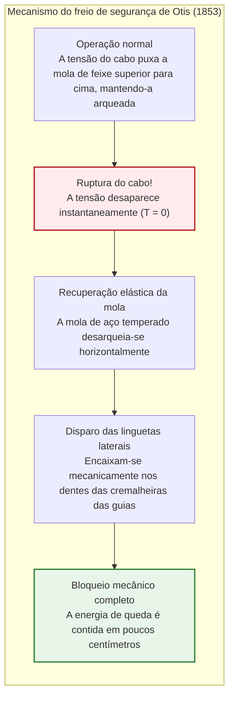
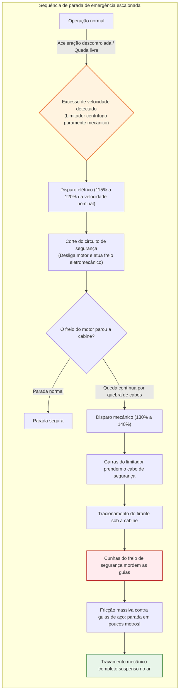
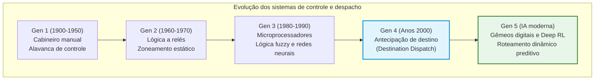
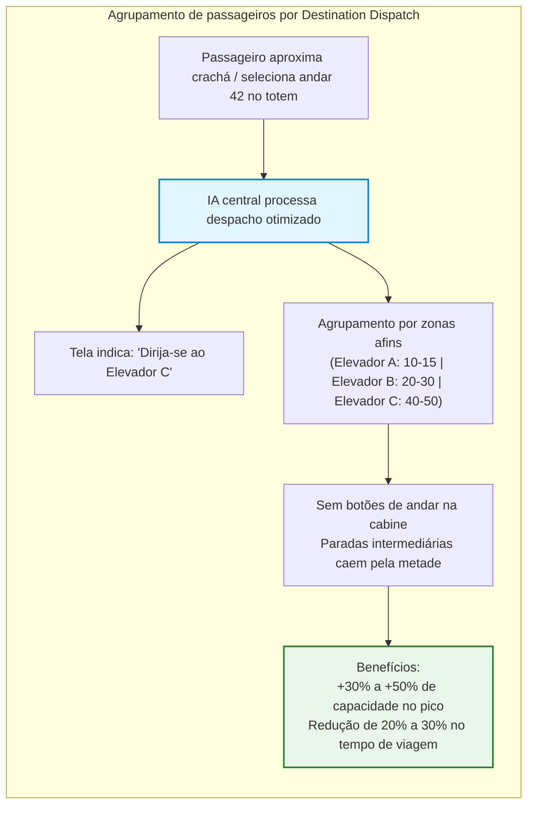
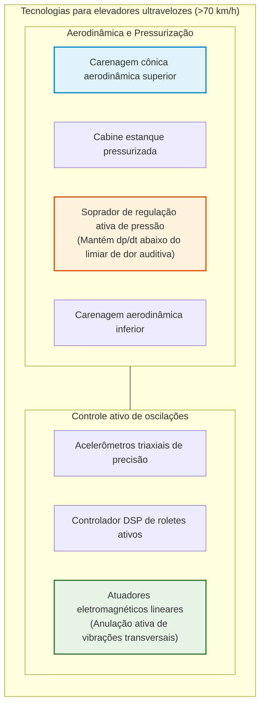
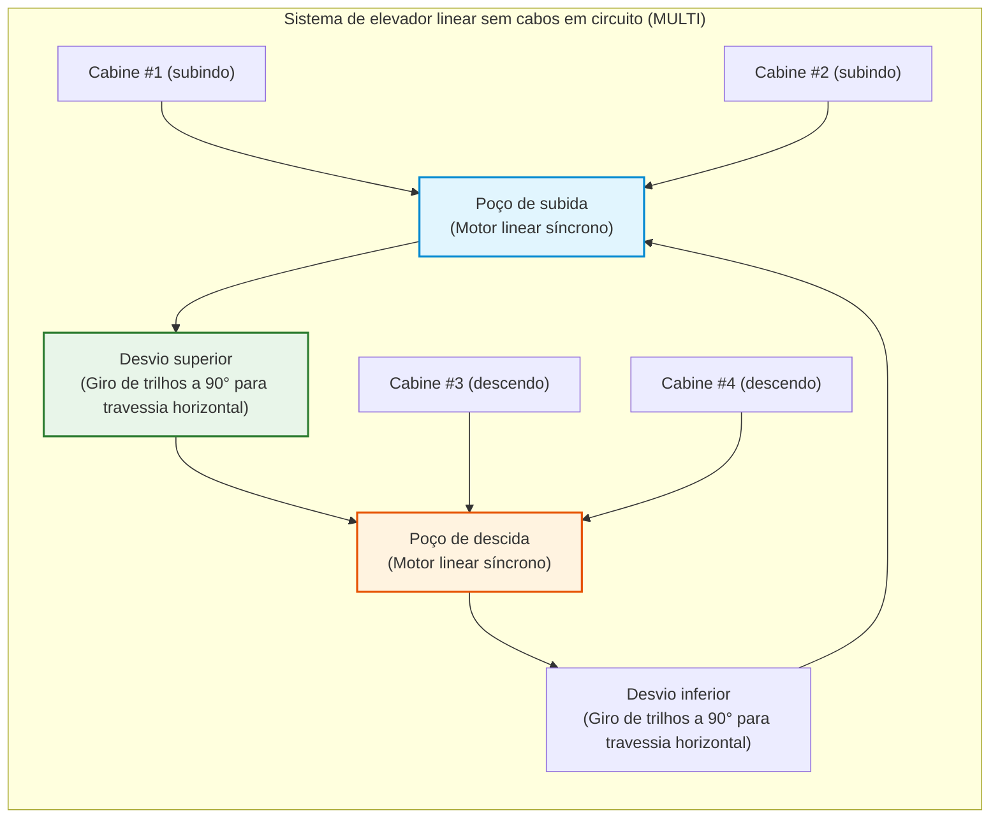

## Introdução: A máquina que libertou a humanidade na vertical

Todas as manhãs, nos halls de edifícios de escritórios e condomínios residenciais em todo o planeta, centenas de milhões de pessoas apertam o botão de chamada e entram calmamente na cabine assim que as portas se abrem. Durante algumas dezenas de segundos, olhando para a tela do smartphone dentro de uma caixa metálica selada, desafiam a gravidade e são elevadas a dezenas ou centenas de metros no céu.

No cotidiano moderno, praticamente não existe outra máquina à qual o ser humano confie sua própria vida com tamanha tranquilidade incondicional. Quase ninguém imagina o pesadelo de o assoalho ceder ou de todos os cabos de sustentação se romperem simultaneamente. Na civilização contemporânea, o elevador consolidou-se como **"o meio de transporte que nunca cai"**.

Estatisticamente, o elevador é **o meio de transporte de passageiros mais seguro do mundo**. Transportando diariamente um volume astronômico de pessoas – superando a aviação comercial e os trens de alta velocidade somados –, a taxa de fatalidade por queda livre mecânica é praticamente zero.

No entanto, há apenas 170 anos, esse equipamento era considerado um guincho aterrorizante cujos cabos podiam quebrar a qualquer momento, esmagando os ocupantes. O limite arquitetônico das cidades parava no quinto ou sexto andar (o limite do esforço humano em escadas). O maior obstáculo para a verticalização não era a falta de aço estrutural, mas sim **a ausência de uma tecnologia segura para erguer seres humanos**.

A invenção do freio de segurança de Otis foi o catalisador que permitiu a transição do espraiamento bidimensional para as metrópoles verticais tridimensionais, dando origem aos arranha-céus de Nova York, Hong Kong, Tóquio e Dubai.

```mermaid
flowchart TD
    subgraph ElevatorStructure["Arquitetura mecânica fundamental de um elevador de tração"]
        direction TB
        MachineRoom["Casa de Máquinas / Topo da Caixa<br/>Motor síncrono de ímãs permanentes (PMSM) e freio eletromecânico normalmente fechado"]
        TractionSheave["Polia de Tração (Traction Sheave)"]
        Governor["Limitador mecânico de velocidade (Governor)"]
        
        MachineRoom --> TractionSheave
        MachineRoom -.-> Governor
        
        TractionSheave -->|Cabos de tração (Múltiplos cabos de aço)| Car["Cabine (Car)<br/>Armação, cabine de passageiros, operador de porta e pesador de carga"]
        TractionSheave -->|Lado oposto dos cabos| CWT["Contrapeso (Counterweight)<br/>Peso próprio da cabine ＋ 45% da carga nominal"]
        
        Governor -.->|Cabo de aço do limitador| SafetyGear["Freio de Segurança (Safety Gear)<br/>Mecanismo de cunhas de travamento nas guias"]
        SafetyGear -.-> Car
        
        GuideRail["Guias verticais de aço (Perfis T usinados)"]
        Car --- GuideRail
        CWT --- GuideRail
        
        Buffer["Amortecedores do poço (Amortecedores hidráulicos a óleo)"]
        Car -.->|Proteção de sobrecurso inferior| Buffer
        CWT -.->|Proteção de sobrecurso inferior| Buffer
    end
    
    style MachineRoom fill:#e1f5fe,stroke:#0288d1,stroke-width:2px
    style SafetyGear fill:#ffebee,stroke:#b71c1c,stroke-width:2px
    style CWT fill:#fff3e0,stroke:#e65100,stroke-width:2px
```

---

## Capítulo 1: O marco histórico – O experimento arrojado de Elisha Otis

A elevação vertical remonta a Arquimedes no século III a.C. Durante a Revolução Industrial, minas de carvão empregavam guinchos a vapor para içar cargas em plataformas suspensas por cordas de cânhamo ou correntes rústicas. Ao menor desgaste, as cordas partiam-se e as plataformas caíam com a aceleração da gravidade $g$.

### 1.1 A Exposição Mundial de Nova York de 1853

O homem que transformou o medo em segurança foi o inventor norte-americano **Elisha Graves Otis**.

Em 1853, na Feira Mundial do Crystal Palace em Nova York, Otis montou uma estrutura aberta de guias com cerca de 12 metros de altura. Vestindo fraque e cartola, o próprio Otis posicionou-se sobre a plataforma elevatória de madeira.

O guincho a vapor elevou a plataforma até o alto perante milhares de espectadores que observavam em silêncio. No ponto mais alto, Otis fez um sinal ao seu assistente e ordenou:

**"Corte a corda!"**

Com um golpe de machado, o assistente cortou a única corda que sustentava a plataforma. Um grito ecoou pela plateia. Contudo, em vez de se espatifar no chão, a plataforma desceu apenas alguns centímetros e **travou firmemente no ar com um estalo metálico estridente**.

Otis tirou a cartola e declarou serenamente à multidão atônita:
> **"All safe, gentlemen, all safe!" (Todos a salvo, cavalheiros!)**



### 1.2 Molas e travas: A essência do Fail-Safe

No topo da armação ficava uma **mola de feixe de aço temperado**:
1. **Normal**: A tensão do cabo mantinha a mola curvada para cima, recuando as travas laterais.
2. **Ruptura**: Ao cessar a força de tração ($T = 0$), a energia elástica forçava a mola a se esticar horizontalmente.
3. **Travamento**: As travas de aço disparavam para fora e cravavam-se nas cremalheiras laterais.

A perda física da sustentação tornava-se o próprio gatilho mecânico do freio, criando o alicerce do conceito de segurança intrínseca (**Fail-Safe**).

---

## Capítulo 2: A mecânica do elevador de tração

Nos elevadores modernos, **o motor elétrico não ergue o peso bruto da cabine**.

### 2.1 A sabedoria do contrapeso (Counterweight)

Como em um poço onde baldes iguais se equilibram, a cabine conecta-se a um **contrapeso** através da polia motriz.

O contrapeso $M_{\text{cwt}}$ compensa **a massa da cabine vazia $M_{\text{car}}$ mais 40% a 50% da carga útil nominal $Q$** (fator de equilíbrio $\alpha$):

$$M_{\text{cwt}} = M_{\text{car}} + \alpha \cdot Q \quad (\alpha \approx 0{,}40 \sim 0{,}50)$$

```
[Regimes de carga em elevador de tração]
1. Cabine vazia (0% de carga):
   [Cabine: Mcar] < [Contrapeso: Mcar + 0,45Q]  ==> O contrapeso é mais pesado (Motor regenera energia na subida)
2. Equilíbrio de projeto (45% de carga):
   [Cabine: Mcar + 0,45Q] == [Contrapeso: Mcar + 0,45Q]  ==> Equilíbrio perfeito (Carga líquida do motor praticamente nula!)
3. Cabine cheia (100% de carga):
   [Cabine: Mcar + Q] > [Contrapeso: Mcar + 0,45Q]  ==> A cabine é mais pesada (Motor regenera energia na descida)
```

O motor precisa vencer apenas a diferença de passageiros, a inércia durante a aceleração e as pequenas perdas por atrito.

### 2.2 Equação de atrito de Euler e ranhuras da polia

Os cabos repousam nas ranhuras da polia de tração. A adesão sem deslizamento obedece à equação de atrito de correias de Euler:

$$\frac{T_1}{T_2} \le e^{\mu' \theta}$$

Onde $\mu'$ é o **coeficiente de atrito aparente**, amplificado por ranhuras com chanfro inferior (*undercut*) ou formato em V:

$$\mu' = \mu \cdot \frac{4 \left(\cos\frac{\gamma}{2} - \sin\frac{\beta}{2}\right)}{\pi - \beta - \sin\beta + \sin\gamma}$$

O efeito de cunha eleva $\mu'$ para $0{,}40 \sim 0{,}60$ (contra $0{,}10$ em superfícies lisas), assegurando tração firme sem patinagem.

### 2.3 Múltiplos cabos e coeficiente de segurança superior a 10

Os elevadores utilizam de **3 a 10 ou mais cabos de aço paralelos**, com fator de segurança regulamentar de **10 a 12**. Mesmo que 9 de 10 cabos quebrassem simultaneamente, o único cabo sobrevivente sustentaria a cabine cheia.

---

## Capítulo 3: A fortaleza dos sistemas de frenagem de emergência



1. **Freio eletromagnético normalmente fechado**: Molas mecânicas pesadas mantêm as sapatas comprimidas; a eletricidade serve apenas para abrir o freio. Na falta de energia, ele fecha imediatamente.
2. **Limitador de velocidade centrífugo**: Mecanismo com massas giratórias que interrompe a corrente a 115% e trava o cabo por garra mecânica a 130–140%.
3. **Freio de segurança progressivo**: Cunhas de aço especial comprimem a guia em T. Molas prato modulam a desaceleração entre **$0{,}2g$ e $1{,}0g$**, imobilizando a cabine sem provocar lesões nos passageiros:

$$M \cdot a_{\text{stop}} = F_{\text{friction}} - M g \implies a_{\text{stop}} = \frac{F_{\text{friction}}}{M} - g$$

4. **Amortecedores de poço**: Pistões hidráulicos a óleo que convertem a energia cinética final em calor:

$$E_k = \frac{1}{2} M v^2 = \int_0^S F_{\text{hydraulic}}(x) \, dx$$

---

## Capítulo 4: A revolução do despacho inteligente por IA



Nos sistemas de **antecipação de destino (Destination Dispatch)**, o passageiro seleciona o andar antes de embarcar, permitindo à IA agrupar pessoas com destinos contíguos na mesma cabine, reduzindo paradas e ampliando a capacidade de transporte em até 50%.



---

## Capítulo 5: Rumo aos 75 km/h em megaestruturas

| Edifício (Cidade) | Ano | Velocidade | km/h | Percurso |
| :--- | :--- | :--- | :--- | :--- |
| **Sunshine 60 (Tóquio)** | 1978 | 600 m/min | 36,0 km/h | ~240 m |
| **Yokohama Landmark Tower** | 1993 | 750 m/min | 45,0 km/h | ~290 m |
| **Taipei 101 (Taipei)** | 2004 | 1.010 m/min | 60,6 km/h | ~382 m |
| **Shanghai Tower (Xangai)** | 2016 | 1.230 m/min | 73,8 km/h | ~578 m |
| **Guangzhou CTF Finance Centre** | 2019 | 1.260 m/min | **75,6 km/h** | ~500 m |

O efeito pistão a 75 km/h é minimizado por carenagens aerodinâmicas cônicas que reduzem drasticamente o arrasto $F_{\text{aero}} \propto v^2$.



Sistemas barométricos ativos modulam a pressão do ar abaixo de **1,5 hPa/s** para prevenir o barotrauma nos ouvidos, enquanto roletes magnéticos ativos cancelam vibrações, permitindo que uma moeda permaneça em pé sobre sua borda durante toda a subida.

---

## Capítulo 6: O futuro – Motores lineares sem cabos e elevador espacial

O sistema **MULTI** dispensa cabos e usa motores lineares síncronos para circular múltiplas cabines pelo mesmo poço em circuito fechado.



---

## Conclusão: A dignidade da engenharia que eleva o mundo

O elevador é o ápice de dois milênios de engenharia mecânica. Sem ele, as metrópoles modernas não poderiam existir. Na sua marcha silenciosa e impecável, ergue-se o testemunho mais seguro e admirável do talento técnico da humanidade.
