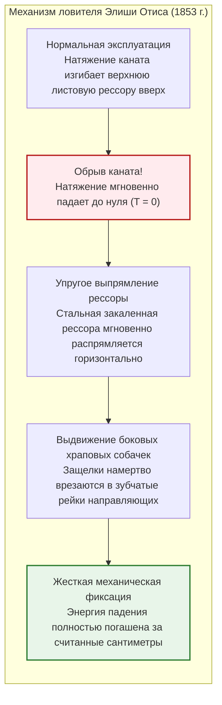
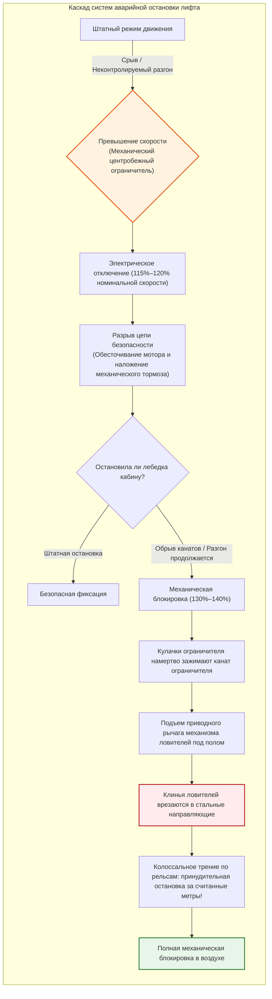
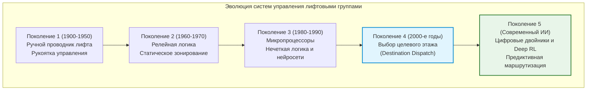
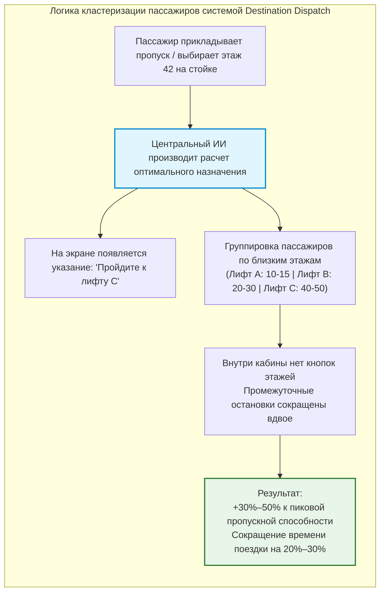
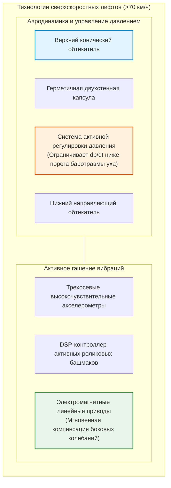
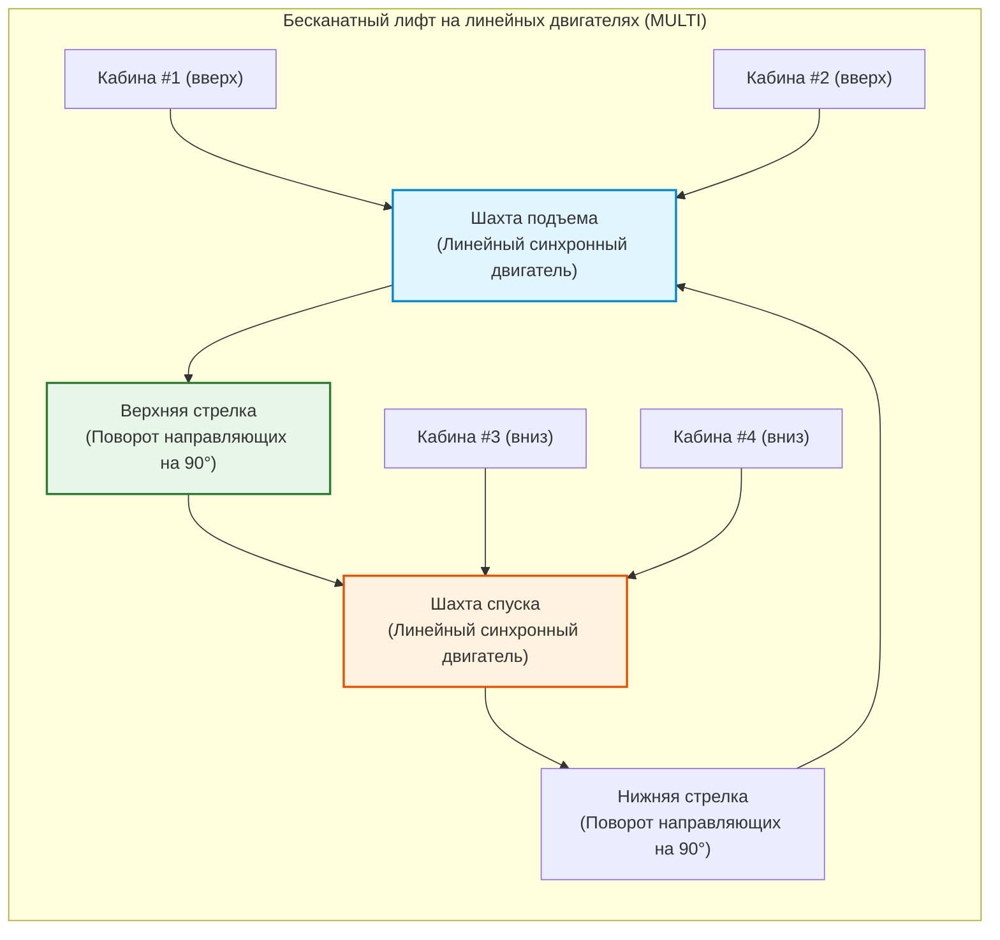

## Введение: Машина, освободившая человечество по вертикали

Каждое утро в холлах офисных центров и высотных жилых комплексов по всему миру сотни миллионов людей нажимают кнопку вызова и без малейших колебаний шагают в открывающиеся двери кабины. В течение нескольких десятков секунд, глядя в экраны смартфонов внутри замкнутого металлического пространства, они преодолевают земное притяжение и поднимаются на сотни метров ввысь.

В современной жизни практически нет другой машины, которой человек доверял бы свою жизнь с такой безоговорочной уверенностью. Мало кто представляет кошмарный сценарий, при котором пол провалится, а все удерживающие канаты одновременно оборвутся. В современном обществе лифт утвердился как **«транспортное средство, которое никогда не падает»**.

С точки зрения статистики лифт является **самым безопасным пассажирским транспортом в мире**. Перевозя колоссальное количество людей, превосходящее гражданскую авиацию и скоростные поезда вместе взятые, показатель смертности в результате механического свободного падения практически равен нулю.

Однако всего 170 лет назад эти механизмы считались смертельно опасными клетями, канаты которых могли лопнуть в любой момент. Высота городских зданий ограничивалась пятью-шестью этажами (физическим пределом подъема по лестнице). Главным препятствием для небоскребов была не нехватка конструкционной стали, а **отсутствие безопасного способа вертикальной транспортировки людей**.

Изобретение ловителя Отиса освободило города от двухмерного разрастания, породив вертикальные мегаполисы Нью-Йорка, Гонконга, Токио и Дубая.

```mermaid
flowchart TD
    subgraph ElevatorStructure["Базовая механическая архитектура лифта с канатоведущим шкивом"]
        direction TB
        MachineRoom["Машинное помещение / Оголовок шахты<br/>Синхронный двигатель на постоянных магнитах (PMSM) и нормально-замкнутый электромагнитный тормоз"]
        TractionSheave["Канатоведущий шкив (КВШ)"]
        Governor["Механический ограничитель скорости (Speed Governor)"]
        
        MachineRoom --> TractionSheave
        MachineRoom -.-> Governor
        
        TractionSheave -->|Тяговые канаты (Группа стальных тросов высокой прочности)| Car["Кабина лифта (Car)<br/>Каркас, купе, дверной привод и датчики нагрузки"]
        TractionSheave -->|Противоположная ветвь канатов| CWT["Противовес (Counterweight)<br/>Масса порожней кабины ＋ 45% номинальной грузоподъемности"]
        
        Governor -.->|Канат ограничителя скорости| SafetyGear["Ловители (Safety Gear)<br/>Клиновой механизм захвата направляющих"]
        SafetyGear -.-> Car
        
        GuideRail["Вертикальные направляющие (Стальные Т-образные рельсы)"]
        Car --- GuideRail
        CWT --- GuideRail
        
        Buffer["Буфера приямка шахты (Гидравлические масляные буфера)"]
        Car -.->|Защита нижнего переподъема/переспуска| Buffer
        CWT -.->|Защита нижнего переподъема/переспуска| Buffer
    end
    
    style MachineRoom fill:#e1f5fe,stroke:#0288d1,stroke-width:2px
    style SafetyGear fill:#ffebee,stroke:#b71c1c,stroke-width:2px
    style CWT fill:#fff3e0,stroke:#e65100,stroke-width:2px
```

---

## Глава 1: Исторический перелом — Смертельный эксперимент Элиши Отиса

Подъемные механизмы известны со времен Архимеда (III в. до н.э.). В эпоху промышленной революции паровые лебедки широко применялись на угольных шахтах, однако обрыв пенькового каната неизменно приводил к падению клети с ускорением свободного падения $g$.

### 1.1 Всемирная выставка 1853 года в Нью-Йорке

Человеком, положившим конец этому страху, стал американский изобретатель **Элиша Грейвс Отис (Elisha Graves Otis)**.

В 1853 году в нью-йоркском Кристал Пэлас Отис возвел открытый каркас шахты высотой около 12 метров. Надев фрак и цилиндр, он сам встал на деревянную подъемную платформу.

Паровая машина подняла платформу под свод павильона на глазах у тысяч замерших зрителей. На верхней точке Отис подал знак ассистенту и крикнул:

**«Рубите канат!»**

Ударом топора ассистент перерубил единственный удерживающий канат. Толпа вскрикнула от ужаса. Но платформа просела лишь на несколько дюймов и **со звонким металлическим скрежетом намертво застыла в воздухе**.

Отис снял цилиндр и спокойно обратился к оцепеневшей публике:
> **«All safe, gentlemen, all safe!» (Все в полной безопасности, господа!)**



### 1.2 Листовая рессора и храповик: Рождение принципа Fail-Safe

На верхней балке платформы Отиса располагалась изогнутая **стальная листовая рессора**:
1. **Штатный режим**: Натяжение каната держало рессору выгнутой дугой вверх, при этом боковые зубья были втянуты.
2. **Обрыв**: Исчезновение натяжения ($T = 0$) освобождало упругую энергию, и рессора распрямлялась.
3. **Блокировка**: Стальные собачки выдвигались наружу и механически заклинивали платформу в зубчатых рейках шахты.

Сам факт потери несущей силы служил прямой движущей силой для срабатывания тормоза (**Fail-Safe**).

---

## Глава 2: Механика тягового лифта и баланс сил

В современных канатных лифтах **электродвигатель не поднимает полную массу кабины**.

### 2.1 Искусство противовеса (Counterweight)

Подобно колодцу с двумя ведрами, кабина соединена через канатоведущий шкив с тяжелым **противовесом**.

Масса противовеса $M_{\text{cwt}}$ равна **массе порожней кабины $M_{\text{car}}$ плюс 40–50% от номинальной грузоподъемности $Q$** (коэффициент уравновешивания $\alpha$):

$$M_{\text{cwt}} = M_{\text{car}} + \alpha \cdot Q \quad (\alpha \approx 0{,}40 \sim 0{,}50)$$

```
[Режимы балансировки нагрузок]
1. Порожняя кабина (0% загрузки):
   [Кабина: Mcar] < [Противовес: Mcar + 0,45Q]  ==> Противовес тяжелее (При подъеме двигатель рекуперирует)
2. Расчетное равновесие (45% загрузки):
   [Кабина: Mcar + 0,45Q] == [Противовес: Mcar + 0,45Q]  ==> Идеальный баланс (Полезная нагрузка на мотор близка к нулю!)
3. Полная загрузка (100% загрузки):
   [Кабина: Mcar + Q] > [Противовес: Mcar + 0,45Q]  ==> Кабина тяжелее (При спуске двигатель рекуперирует)
```

Двигатель преодолевает только полезную разницу пассажирской загрузки, силы инерции при разгоне и трение.

### 2.2 Формула трения Эйлера и профиль ручьев КВШ

Канаты удерживаются на шкиве силой трения, описываемой формулой Эйлера:

$$\frac{T_1}{T_2} \le e^{\mu' \theta}$$

Где $\mu'$ — **приведенный коэффициент трения**, увеличенный за счет подрезных полукруглых или клиновых канавок:

$$\mu' = \mu \cdot \frac{4 \left(\cos\frac{\gamma}{2} - \sin\frac{\beta}{2}\right)}{\pi - \beta - \sin\beta + \sin\gamma}$$

Клиновой эффект увеличивает $\mu'$ до $0{,}40 \sim 0{,}60$ (вместо $0{,}10$ на плоскости), предотвращая проскальзывание канатов даже при экстренном торможении.

### 2.3 Многократное резервирование стальных канатов

Лифты подвешиваются на **3–10 и более независимых стальных канатах** с коэффициентом запаса прочности **от 10 до 12**. Даже если оборвутся 9 из 10 канатов, единственный оставшийся удержит полную кабину.

---

## Глава 3: Многоуровневая система аварийной безопасности



1. **Нормально-замкнутый электромагнитный тормоз**: Мощные пружины удерживают тормозные колодки прижатыми к диску; ток лишь отводит их. При обесточивании тормоз накладывается мгновенно.
2. **Центробежный ограничитель скорости**: Механическое устройство с грузами, разрывающее цепь при 115% и блокирующее канат при 130–140%.
3. **Ловители плавного (прогрессивного) торможения**: Клинья из легированной стали с тарельчатыми пружинами сжимают Т-образный рельс, обеспечивая замедление в пределах **$0{,}2g \sim 1{,}0g$**, что безопасно для пассажиров:

$$M \cdot a_{\text{stop}} = F_{\text{friction}} - M g \implies a_{\text{stop}} = \frac{F_{\text{friction}}}{M} - g$$

4. **Гидравлические буфера в приямке**: Поглощают остаточную кинетическую энергию:

$$E_k = \frac{1}{2} M v^2 = \int_0^S F_{\text{hydraulic}}(x) \, dx$$

---

## Глава 4: От реле к интеллектуальному групповому управлению



Система **Destination Dispatch** регистрирует целевой этаж еще на турникетах, позволяя ИИ группировать пассажиров по близким этажам в одну кабину, сокращая остановки и увеличивая пропускную способность на 30–50%.



---

## Глава 5: Скорости свыше 70 км/ч в супервысотных зданиях

| Здание (Город) | Год | Номинальная скорость | км/ч | Высота подъема |
| :--- | :--- | :--- | :--- | :--- |
| **Sunshine 60 (Токио)** | 1978 | 600 м/мин | 36,0 км/h | ~240 м |
| **Yokohama Landmark Tower** | 1993 | 750 м/мин | 45,0 km/h | ~290 м |
| **Taipei 101 (Тайбэй)** | 2004 | 1 010 м/мин | 60,6 km/h | ~382 м |
| **Shanghai Tower (Шанхай)** | 2016 | 1 230 м/мин | 73,8 km/h | ~578 м |
| **Guangzhou CTF Finance Centre** | 2019 | 1 260 м/мин | **75,6 km/h** | ~500 м |

Поршневой эффект на скорости 75 км/ч нейтрализуется аэродинамическими обтекателями, резко снижающими сопротивление $F_{\text{aero}} \propto v^2$.



Автоматические нагнетатели удерживают градиент изменения давления ниже **1,5 гПа/с** для предотвращения закладывания ушей, а электромагнитные башмаки гасят вибрации, позволяя поставленной на ребро монете сохранять устойчивость во время всего скоростного рейса.

---

## Глава 6: Бесканатные системы MULTI и космический лифт

Система **MULTI** использует линейные двигатели, позволяя нескольким независимым кабинам двигаться по замкнутому контуру шахт.



---

## Заключение: Инженерное величие вертикального транспорта

Лифт объединяет две тысячи лет инженерного гения человечества. Без него современные вертикальные города были бы невозможны. В его тихой, непрерывной и безупречной работе воплощено высочайшее торжество надежности машиностроения.
