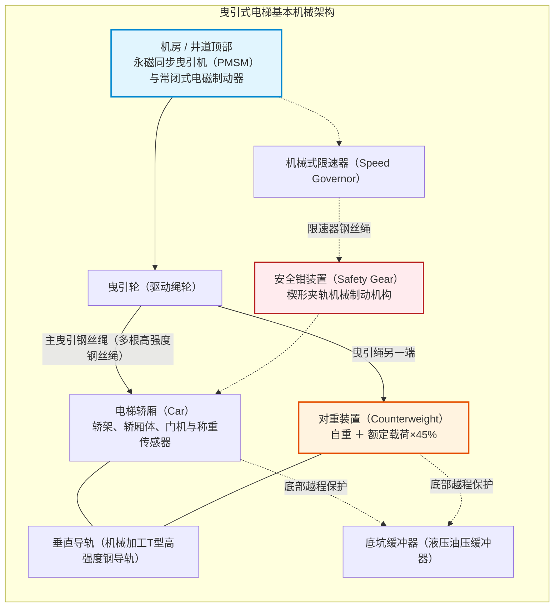
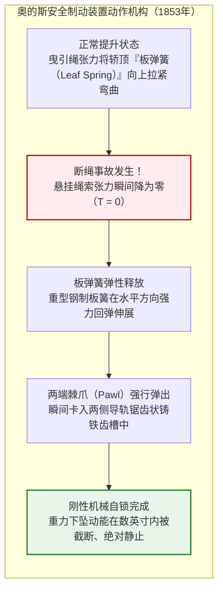
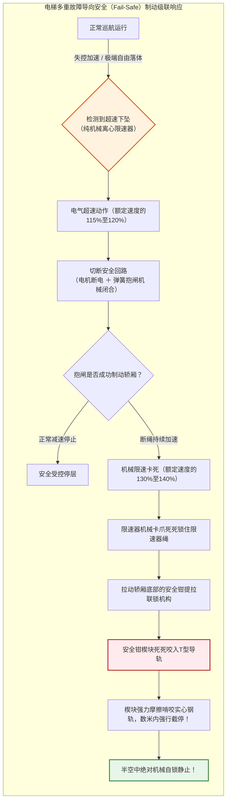
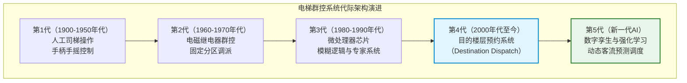
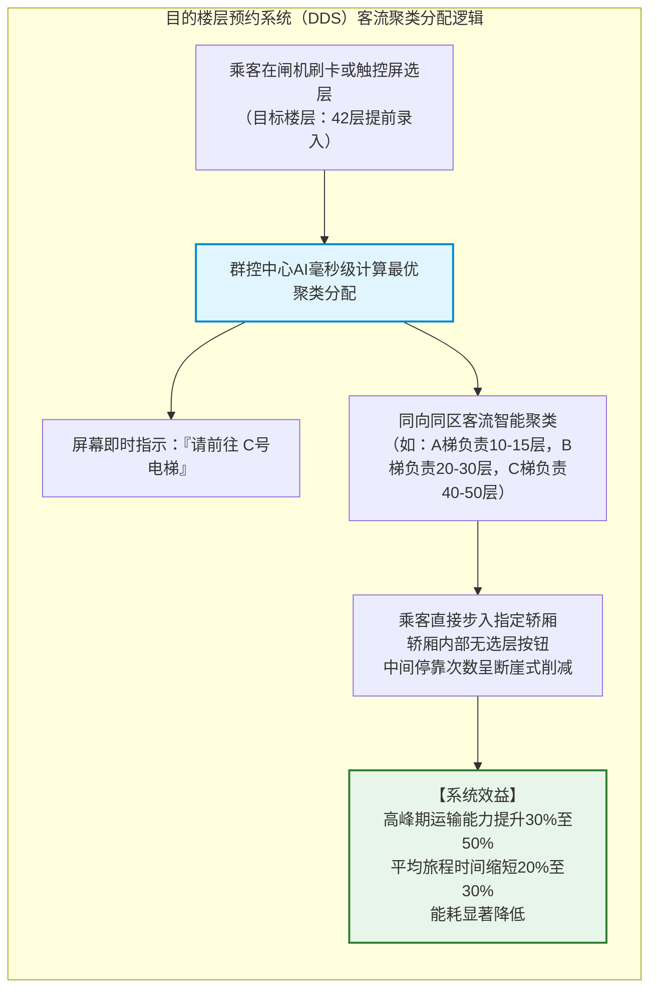
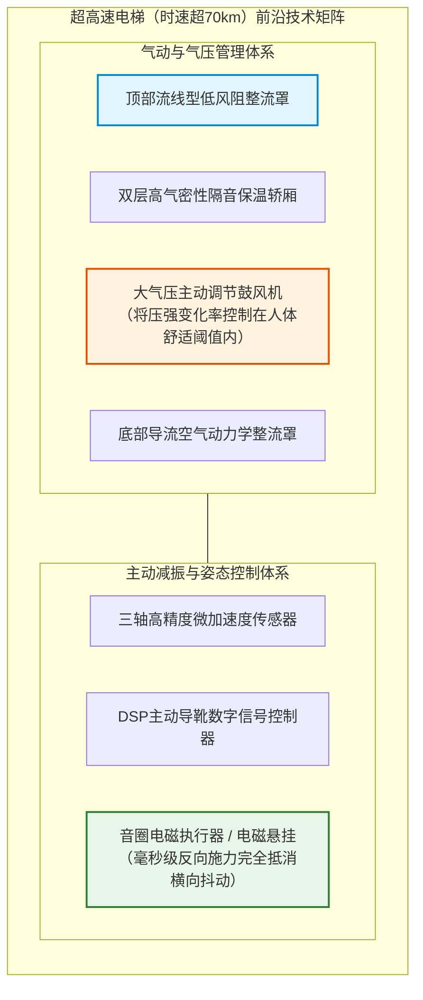
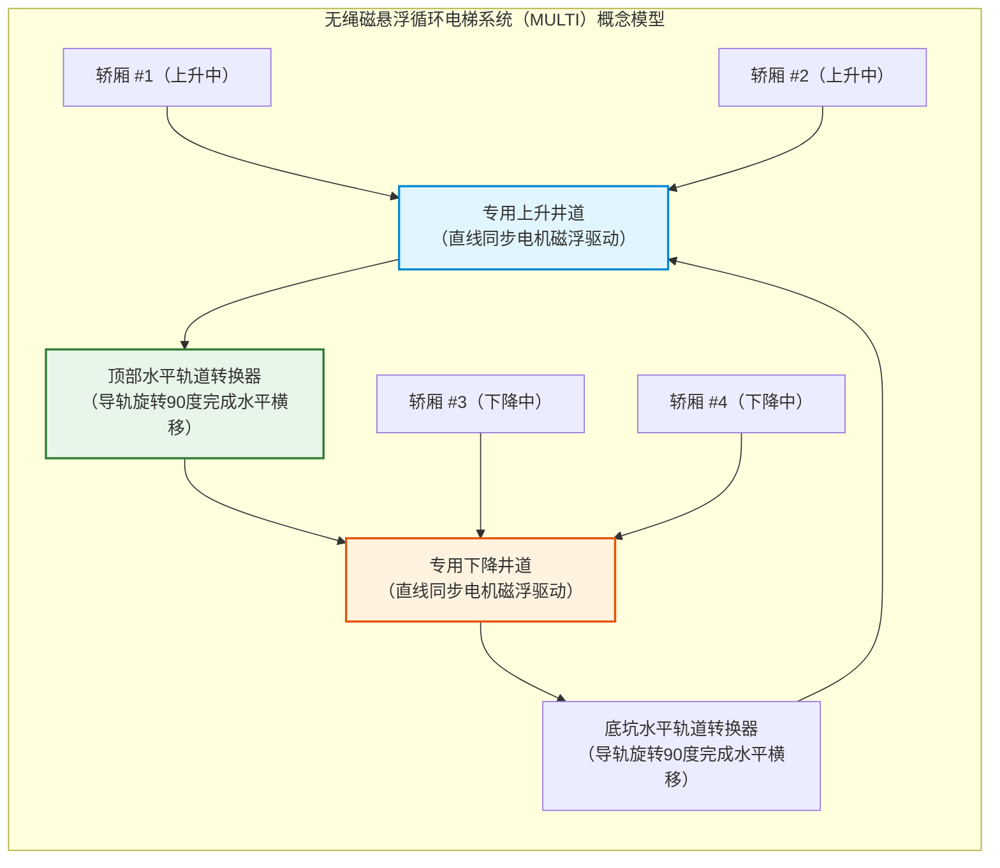

## 引言：将人类从二维地表解放至垂直维度的机械

每天早晨，在全世界数以亿计的写字楼与高层公寓门厅中，人们按下召唤按钮，待轿门敞开便毫无戒备地步入轿厢。在封闭的金属盒子里低头浏览数十秒手机的片刻之间，我们便反抗着地球重力，被平稳送上数十米甚至数百米的高空。

在日常生活中，人类几乎找不到第二种机械，能让我们如此全心全意且毫无保留地托付身家性命。如果脚下的轿底脱落怎么办？如果悬挂轿厢的所有钢丝绳在同一瞬间断裂又会如何？现代人几乎从不会陷入这种噩梦般的联想，因为在现代文明中，电梯已被公认为**“绝对不会坠落的交通工具”**。

从统计学维度来看，电梯是**全球最安全的客运交通工具**。其每日运送的庞大客运量远超民航客机与高速铁路的总和，然而因机械失控自由坠落导致的致命事故率却无限趋近于零（其概率远低于连续多次中得彩票特等奖）。

然而，若将历史的视线倒回仅仅170年前，这种装置在公众眼中依然是“悬索随时可能断裂、将乘员摔得粉身碎骨的恐怖吊笼”。当时欧美都市建筑的高度极限止步于五至六层（人类体能攀爬楼梯的极限），阻碍天际线生长的最大技术瓶颈并非钢结构强度的不足，而是**“人类尚未掌握安全运送人员进行垂直升降的技术”**。

电梯安全制动装置的发明，彻底将人类文明从地表二维平面解放为三维立体都市，正是它缔造了纽约、香港、东京与迪拜耸入云霄的摩天楼群（Skyscrapers）。

本文将从机械力学、材料力学、控制工程学与流体力学的全方位视角，深度解密电梯为何绝对不会坠落，它如何驾驭重力与摩擦力，并在实现时速超70公里飞驰的同时达成毫米级的平层停靠精度。



---

## 第一章：将恐惧转化为信任的划时代瞬间——奥的斯的舍命断绳实验

人类利用滑轮与绳索垂直吊运物体的历史，可追溯至公元前3世纪古希腊阿基米德发明的复式滑轮与绞车。在中世纪矿山、城堡工事以及工业革命时期的煤矿中，利用水力与蒸汽机驱动的升降平台早已广泛应用。

然而，这些早期装置无一例外都是极度危险的货运吊笼，仅靠麻绳或粗糙铁链悬吊。一旦绳索磨损断裂，平台便在重力加速度 $g$ 作用下瞬间砸向地表，矿工们每次搭乘都无异于在生死线上赌博。

### 1.1 1853年纽约世博会：传奇的公开斩绳表演

彻底终结这一致命梦魇、为现代垂直都市推开大门的人，是美国发明家**伊莱沙·格雷夫斯·奥的斯（Elisha Graves Otis）**。

1853年，在纽约水晶宫举办的万国工业博览会上，奥的斯在展厅中央树立了一座高达近12米的开敞式升降导轨架。身着深色礼服、头戴高丝礼帽的奥的斯亲自站上了高悬的木制升降平台。

蒸汽绞车将平台平稳提升至博览会穹顶的高空，数千名观众在下方屏息仰望。到达顶峰后，奥的斯向手持利斧的助手挥动信号旗，发出了一声震撼全场的命令：

**“砍断绳索！”**

助手手起斧落，悬挂平台的唯一一根粗大主绳应声断裂。全场观众发出惊恐的尖叫。按照万有引力定律，失去了牵引绳的平台本该在毫秒之内向地面急速坠毁。

然而，平台仅仅下坠了数英寸，便伴随着**“喀嗒！”一声清脆刺耳的金属咬合巨响，在半空中稳稳停住**。

神色自若的奥的斯脱下礼帽，向目瞪口呆的人群从容宣告：
> **“All safe, gentlemen, all safe!”（先生们，一切安全无虞！）**

在这一瞬间，人类历史上“升降机＝坠落死亡”的致命魔咒被彻底打破，近代摩天大楼文明的曙光破晓而出。



### 1.2 板弹簧与棘爪：故障导向安全（Fail-Safe）的工程原点

奥的斯发明的安全制动装置结构极其精巧，却完美诠释了现代安全工程的核心法则——**故障导向安全（Fail-Safe）**。

在平台横梁顶部横置着一根弯曲的淬火**钢制板弹簧（Leaf Spring）**：
1. **正常运行状态**：主吊绳拉动平台向上时，绳索的强大拉力将板弹簧向上拉扯呈紧绷的弓形，弹簧两端的锁紧棘爪收缩在内侧，绝不触碰导轨。
2. **断绳瞬态**：一旦悬绳断裂、拉力瞬间消失（$T = 0$），板簧内积蓄的巨大弹性势能毫无阻碍地释放，弹簧瞬间拉平伸展。
3. **强制自锁**：板弹簧两端的钢制棘爪借势向外暴突，狠狠嵌入井道两侧铸铁导轨的齿槽之中，实现不可逆的物理刚性锁死。

该机构不需要外部电力、传感器或人工干预。**“绳索断裂失去拉力”这一物理事故本身，正是触发机械制动的直接动力源。** 这种将故障转化为制动力量的哲学，构成了现代电梯工程不可动摇的底层基石。

---

## 第二章：物理与力学的交响乐——曳引式电梯的核心力学机制

现代几乎所有高层电梯均采用**“曳引式（Traction Elevator）”**设计。

理解曳引电梯首先必须打破一个反直觉的普遍误解：**电动机并非凭借蛮力在硬生生把轿厢向上拉拽。**

### 2.1 对重平衡学（Counterweight）：重力平衡的极意

想象一口水井的滑轮两侧各吊着一个重量相等的木桶，系统处于静止平衡，只需轻轻拂动指尖便能让木桶上下移动。

曳引电梯正是这一原理的极致应用。主曳引钢丝绳穿过机房的驱动曳引轮，一端悬挂装载乘客的轿厢（Car），另一端则悬挂着重磅铸铁构成的**“对重（Counterweight）”**。

对重的质量 $M_{\text{cwt}}$ 是否与空轿厢自重 $M_{\text{car}}$ 完全相等？答案是否定的。轿厢载客量是在完全空载与满载之间动态波动的。因此，电梯工程学将对重质量精确设定为**“轿厢自重 ＋ 额定载重量 $Q$ 的40%至50%”**。该系数被称为**平衡系数（Overbalance Factor, $\alpha$）**：

$$M_{\text{cwt}} = M_{\text{car}} + \alpha \cdot Q \quad (\alpha \approx 0.40 \sim 0.50)$$

```
【曳引电梯的载荷平衡工况】
1. 空载工况（乘客 0%）：
   [轿厢: Mcar] < [对重: Mcar + 0.45Q]  ==> 对重端更重（轿厢上行时电机处于发电制动状态）
2. 设计平衡工况（乘客 45%）：
   [轿厢: Mcar + 0.45Q] == [对重: Mcar + 0.45Q]  ==> 完美重力平衡（电机净提升负荷几乎为零！）
3. 满载工况（乘客 100%）：
   [轿厢: Mcar + Q] > [对重: Mcar + 0.45Q]  ==> 轿厢端更重（轿厢下行时电机处于发电制动状态）
```

在日常写字楼运营中，轿厢平均乘员率通常保持在30%至50%的区间。这意味着在绝大多数运行时段，轿厢与对重处于近乎理想的重力平衡状态。

电动机所需克服的，并非轿厢与人员的全重，而**仅为乘客人数偏离平衡点的净差值、加减速惯性力以及细微的机械摩擦阻力**。一个自重2吨的轿厢若无对重，需配备数百千瓦的庞大工业电机；引入对重后，只需数分之一功率的节能电机即可实现高速运行。

此外，当较重一侧在重力拉动下下行时，现代变频器（VFD）会自动将电机转为发电机工况，将重力势能转化为清洁电能回馈建筑物电网，实现极致的能源循环。

### 2.2 欧拉皮带摩擦定律与曳引驱动

电梯的钢丝绳并没有通过螺栓固定在曳引轮上，它只是搭放在曳引轮的轮槽中。

为什么吊挂着数吨乃至数十吨重物的钢丝绳，在高速启停时不会打滑脱扣，而是紧密贴合旋转？

主导曳引摩擦力的物理法则，正是伟大的数学家莱昂哈德·欧拉提出的**欧拉皮带摩擦方程（Euler's Belt Friction Equation）**。钢丝绳在包角为 $\theta$（弧度）的轮槽两侧，其紧边张力 $T_1$ 与松边张力 $T_2$ 维持无滑移的最大极限比值由下式决定：

$$\frac{T_1}{T_2} \le e^{\mu' \theta}$$

其中：
- $e$ 为自然对数底数（$\approx 2.718$），
- $\theta$ 为曳引绳在轮槽上的包角（常规单绕为 $\theta = \pi \approx 3.14\ \text{rad}$；复绕系统可达 $2\pi$），
- $\mu'$ 为考虑了轮槽几何形状后的**等效摩擦系数**。

如果钢丝绳平铺在平滑钢面上，钢与钢之间的摩擦系数 $\mu$ 仅为 $0.09 \sim 0.15$ 左右，此时最大允许张力比仅为 $1.3 \sim 1.6$，一旦轿厢乘客稍有增减便会严重打滑。

为此，现代曳引轮表面精密切削了特殊的剖面槽型：

```
【曳引轮绳槽剖面的演变】
1. 半圆槽（Round Groove）：
   绳底紧密贴合半圆底部。摩擦系数小，但钢丝绳寿命最长。
2. 带切口半圆槽（Undercut Groove）：
   槽底向内掏空一段切口，迫使钢丝绳向两侧凸台楔入，产生剧烈局部面压。
3. V型槽（V-Groove）：
   锐角V型夹角（夹角 gamma = 35°至40°）。利用楔形效应产生极高抓持力。
```

在切口半圆槽中，等效摩擦系数 $\mu'$ 由切口角 $\beta$ 与槽角 $\gamma$ 严格推导：

$$\mu' = \mu \cdot \frac{4 \left(\cos\frac{\gamma}{2} - \sin\frac{\beta}{2}\right)}{\pi - \beta - \sin\beta + \sin\gamma}$$

借助楔形效应，等效摩擦系数 $\mu'$ 被大幅放大了**3至5倍（$\mu' \approx 0.40 \sim 0.60$）**。由此计算得出的 $e^{\mu' \theta}$ 极限张力比高达 $5 \sim 10$ 以上，即便满载或紧急制动产生剧烈减速度，钢丝绳也绝无打滑之虞。

### 2.3 多根高韧性钢丝绳与极度富余的安全系数

好莱坞电影中经常上演电梯钢丝绳一根根崩断、最后彻底坠落底坑的惊悚桥段。然而在真实的机械工程中，这一情节是**100%不可能发生的力学虚构**。

现代电梯绝非依靠单根钢丝悬挂，而是由**至少3至8根、在超高层建筑中多达10根以上并联的高强度特种钢丝绳**共同承载。每根钢丝绳均由上百根高碳钢丝经多重绞捻而成。

在国际电梯法规（如ASME A17.1、EN 81及中国GB 7588）中，电梯悬挂钢丝绳被强制要求达到**不低于10至12倍的安全系数**。

安全系数大于10意味着：**即便极端事故导致并联钢丝绳中的90%在同一瞬间被切断，仅仅剩下最后孤零零的1根钢丝绳，其结构抗拉强度仍足以独自吊起满载的电梯轿厢而不发生断裂。**

此外，每根钢丝绳末端均装有弹簧张力平衡机构，确保多绳之间受力均匀到毫米级。在现代预防性维保体系下，多根特种钢丝绳同时自发断裂的概率在工程上等于绝对零。

---

## 第三章：多重防御的钢铁堡垒——级联失效安全防御体系

退一万步设想：假定由于极其罕见的巨震落石或恐怖袭击，将全部悬挂钢丝绳瞬间齐齐切断，电梯会怎样？

答案是：**它依然绝对不会坠落。** 因为电梯井道内部筑有一套完全不依赖外力、纯机械触发的级联安全防护体系。



### 3.1 常闭式电磁制动器：Fail-to-Safety的极致范例

电梯主机的主制动器与汽车刹车在设计逻辑上恰恰相反。汽车制动是踩下踏板施加液压从而“产生刹车力”；而电梯制动器则是**“常态常闭，通电释放”**。

在未通电状态下，**强力压缩螺旋弹簧时刻以万钧之力将刹车闸瓦死死压在制动盘（轮）上**。唯有电磁线圈通电建立磁场时，才能克服弹簧弹力将闸瓦吸开，允许电机运转。

无论运行中遭遇全城停电、控制芯片死机，还是任何一个安全开关跳闸，一旦供电中断，电磁吸力瞬间归零，**物理弹簧在毫秒之内将闸瓦猛烈撞向制动盘，实施纯物理锁死**。失去能源即自动制动，这是电梯安全的第一道钢铁防线。

### 3.2 离心式限速器（Speed Governor）：俯瞰重力的纯机械之眼

若遭遇钢丝绳全部断裂的极端灾难，在半空中监视轿厢速度的并非微处理器，而是一台完全脱离电力的纯机械装置——**离心式限速器**。

限速器安装在井道顶层机房内，一根独立的细钢丝绳（限速器绳）绕过限速器轮，与轿厢连接形成闭合回路，随着轿厢升降以1:1同步旋转。

限速器内部装有一套精密的离心飞块与校准弹簧。轿厢速度越高，离心力越大，飞块便向外扩张：
1. **第一级（额定速度的115%至120%）**：飞块触动电气过速开关，瞬间打断电梯安全回路，切断电机电源并触发主机抱闸。
2. **第二级（额定速度的130%至140%）**：若速度仍失控飙升，飞块完全甩出，触发坚固的机械卡爪。限速器轮在物理层面被瞬间锁死，限速器钢丝绳被夹绳钳紧紧钳住。

### 3.3 安全钳（Safety Gear）：啃噬实心钢轨的合金之楔

当限速器绳被卡死后，下坠的轿厢因惯性继续下移，两者产生强烈的相对位移。这股位移拉动了轿厢底部安全钳横梁上的机械提拉杆。

安全钳随即强行触发：
- **瞬时式安全钳（Instantaneous Safety）**：用于额定速度较低的电梯（分速45m以下）。滚柱或陡峭楔块瞬间咬死导轨，实现毫秒级锁死。
- **渐进式安全钳（Progressive Safety）**：用于中高速电梯。采用合金楔块与重型蝶形弹簧组合的**弹性导向夹钳**。

渐进式安全钳的核心工程美学在于**“在不伤害人体的前提下平稳刹停”**。

若时速数十公里的轿厢瞬间撞墙般骤停，乘员将承受致命的几十个重力加速度（G值），导致内脏出血和骨折。

渐进式安全钳在合金楔块咬入T型钢导轨表面的同时，碟簧发生受控弹性形变，使楔块在轨面上产生稳定受控的滑动摩擦阻力 $F_{\text{friction}}$。制动减速度 $a_{\text{stop}}$ 遵循牛顿第二定律：

$$M \cdot a_{\text{stop}} = F_{\text{friction}} - M g \implies a_{\text{stop}} = \frac{F_{\text{friction}}}{M} - g$$

全球安全法规（GB 7588、EN 81）严格要求渐进式安全钳的平均减速度必须控制在 **$0.2g \sim 1.0g$** 之间。这相当于汽车紧急制动的力度，虽然乘员会感到明显的下沉压迫，但绝不会受到致命损伤，轿厢在滑行数米后在半空中完全咬死静止。

### 3.4 井道底坑缓冲器（Buffer）：最后的结构防线

作为冲破一切制动防线后的绝对末端屏障，井道底坑伫立着重型**缓冲器**。

中高速电梯配置大型**液压油压缓冲器（Hydraulic Buffer）**。轿厢撞击缓冲柱塞时，液压油在极端压力下被强行从微孔节流环中挤出，液体的粘性阻力将轿厢残余的动能 $E_k$ 全部转化为热能耗散：

$$E_k = \frac{1}{2} M v^2 = \int_0^S F_{\text{hydraulic}}(x) \, dx$$

在冲程 $S$ 范围内，油压缓冲器能将轿厢稳稳托住，避免刚性触底。

---

## 第四章：大脑的进化——从继电器控制到AI智能群控

电梯技术的演进绝不仅限于机械韧性。随着巨型摩天楼的诞生，如何在多梯并联的复杂环境下极小化乘客等待时间，催生了**控制工程与运筹优化算法的百年进化**。



### 4.1 群控调度（Group Supervisory Control）的数学优化

假设一座50层的写字楼设有8台并联电梯。各楼层随机产生上下呼梯信号，系统应派遣哪台电梯响应？

若采取简单的“就近原则”（Nearest Car），将导致严重的“聚团现象”（Bunching）：多台电梯结伴停靠同一楼层，导致其他楼层出现长时间等待。

现代群控大脑在几毫秒内实时求解**多目标综合评价函数（Objective Function）**：

$$J(k) = \min_{k} \left[ w_1 \cdot T_{\text{wait}}(k) + w_2 \cdot T_{\text{ride}}(k) + w_3 \cdot P_{\text{long}}(k) + w_4 \cdot E_{\text{energy}}(k) \right]$$

其中：
- $T_{\text{wait}}(k)$：派梯 $k$ 后的预估候梯时间
- $T_{\text{ride}}(k)$：车内既有乘客因增加停靠而增加的行程时间
- $P_{\text{long}}(k)$：等待时间超过阈值（如60秒）的长等概率惩罚
- $E_{\text{energy}}(k)$：运行消耗的电能
- $w_1, w_2, w_3, w_4$：随早高峰、午餐峰、平峰动态切换的权重因子

借助模糊数学与深度强化学习算法，系统可根据历史客流大数据主动提前“预判”需求，将空闲轿厢提前派往高频出发层待命。

### 4.2 目的楼层预约系统（Destination Dispatch System）的客流革命

传统电梯模式中，乘客在门厅按“上/下”，进轿厢后再按楼层按钮。系统在乘客进轿厢前，对其终点一无所知。

而在**目的楼层预约系统（DDS）**下，乘客必须在**进梯前于闸机或触控终端输入目标楼层**。



通过提前获知所有人的目标楼层，AI将去往相同或邻近楼层的乘客**聚类打包（Clustering）至同一台电梯**。

电梯从“各站皆停的慢车”变成了“定点直达的特快专线”，单梯停靠站数减少一半以上。在不增加建筑井道面积的前提下，整栋楼的高峰运力提升了30%至50%。

---

## 第五章：向超高层物理极限宣战——时速70公里以上的极端领域

随着超高层与巨型摩天楼（500至600米以上）的涌现，现代电梯技术跨入了航空航天工程的领域。

| 建筑名称（城市） | 竣工年份 | 额定最高速度 | 时速换算 | 提升行程 |
| :--- | :--- | :--- | :--- | :--- |
| **阳光城60（东京）** | 1978年 | 分速 600 m | 36.0 km/h | 约 240 m |
| **横滨地标大厦（横滨）** | 1993年 | 分速 750 m | 45.0 km/h | 约 290 m |
| **台北101（台北）** | 2004年 | 分速 1,010 m | 60.6 km/h | 约 382 m |
| **上海中心大厦（上海）** | 2016年 | 分速 1,230 m | 73.8 km/h | 约 578 m |
| **广州周大福金融中心（广州）** | 2019年 | 分速 1,260 m | **75.6 km/h** | 约 500 m |

分速1,260米（秒速21米，时速75.6公里）。电梯在狭窄井道内的飞驰速度已超越地面市区汽车，这带来了惊人的流体与生理学挑战。

### 5.1 活塞效应与空气动力学整流罩

轿厢在狭长的井道内超高速穿行，如同注射器针管里的活塞。轿厢前方的空气被剧烈压缩形成阻力，后方则形成极大的负压真空，这便是**活塞效应（Piston Effect）**。

空气动力学阻力 $F_{\text{aero}}$ 与**速度的平方（$v^2$）成正比**：

$$F_{\text{aero}} = \frac{1}{2} C_d \cdot \rho_{\text{air}} \cdot A_{\text{frontal}} \cdot v^2$$

若缺乏应对，强烈的风噪与气流将震碎井道层门，电机能耗暴增。为此，超高速电梯上下两端安装了与高铁先头车类似的**流线型空气动力学整流罩（Aerodynamic Fairings）**，使气流顺畅分流，将阻力系数与噪音压制在极低水平。



### 5.2 大气压主动控制：告别耳痛与耳压反应

从地面疾升至500米观景台仅需30余秒，外界气压将骤降50至60百帕（hPa）。未作保护的乘客耳膜将向外膨胀，诱发剧烈的耳痛与暂时性耳聋。

超高速电梯轿厢被设计为如同潜水艇与客机一般的**全密封气密座舱**。车载计算机控制的高性能气压泵在升降过程中主动对轿厢内进行连续的加压与减压，将气压变化率严格限制在人体鼓膜可自如适应的 **1.5 hPa/秒以内**，乘客在全程中感受不到耳压不适。

### 5.3 主动减振导靴：硬币立于75km/h轿底不倒的奇迹

在时速70公里以上疾驰时，导轨微米级的接缝误差都将转化为剧烈的横向颠簸。

超高速电梯采用**磁悬浮级主动减振导靴（Active Guide Roller）**。传感器以千赫兹频率侦测震动，微处理器毫秒级计算反向抵消力，电磁执行器实时推动导靴抵消横晃。其平稳性达到让香烟或硬币立在轿厢地板上、全速升降全程不倒的惊人工业水准。

---

## 第六章：未来疆界——从无绳磁悬浮到太空电梯

电梯工业如今正迎来1853年以来最重大的范式变革：摆脱钢丝绳的终极束缚。

### 6.1 无机房（MRL）技术的普及

1990年代**永磁同步电机（PMSM）**的微型化突破，使曳引机体积缩小至原来的数分之一，催生了将曳引机与控制柜全部塞入井道内部的**无机房电梯（Machine-Room-Less）**，解放了摩天大楼的屋顶天际线设计。

### 6.2 无绳磁悬浮多轿厢循环系统（MULTI）

传统电梯的物理死穴在于**“一根井道只能运行一台轿厢”**，超高层建筑中电梯井道蚕食了高达40%的宝贵建筑面积。

德国蒂森克虏伯（TK Elevator）研发的**MULTI系统**彻底抛弃了钢丝绳，采用直线同步电机（LSM）驱动轿厢在井道内自主悬浮行走：



如同垂直地铁一般，多个轿厢在单根井道内循环跟车上升，在顶层通过机械转盘横移至另一侧井道下降，甚至可以在双子塔之间的连廊空中水平穿梭。

### 6.3 终极构想：太空电梯（Space Elevator）

垂直交通的终极圣杯，是从赤道向地球同步轨道（高度36,000公里）垂下一根碳纳米管超强缆索的**太空电梯**。无需庞大化学火箭，人类仅凭电力驱动升降舱即可将数吨货物与人员以极低成本送入太空轨道，这是电梯工程力学在星际尺度的伟大延续。

---

## 结语：托举人类直上云霄的机械尊严

电梯是融合了阿基米德滑轮、工业革命蒸汽动力、奥的斯安全弹簧、欧拉摩擦力学、现代AI群控与航空气动学的两千年人类工程结晶。

没有电梯，便没有现代垂直城市。世界将沦为无休止向外蔓延的平面荒漠，人类将把大半生命消耗在横向通勤的拥堵之中。高密度、低能耗、繁荣密集的现代都市之所以可能，全系于这根深藏在竖井中“绝对安全”的垂直动脉。

在日复一日的平稳寂静中，数百万台电梯正承托着人类的生活穿梭于重力与苍穹之间。那隐匿在黑暗井道中的严丝合缝与万无一失，正是机械工程献给人类文明最深沉的敬意与尊严。
