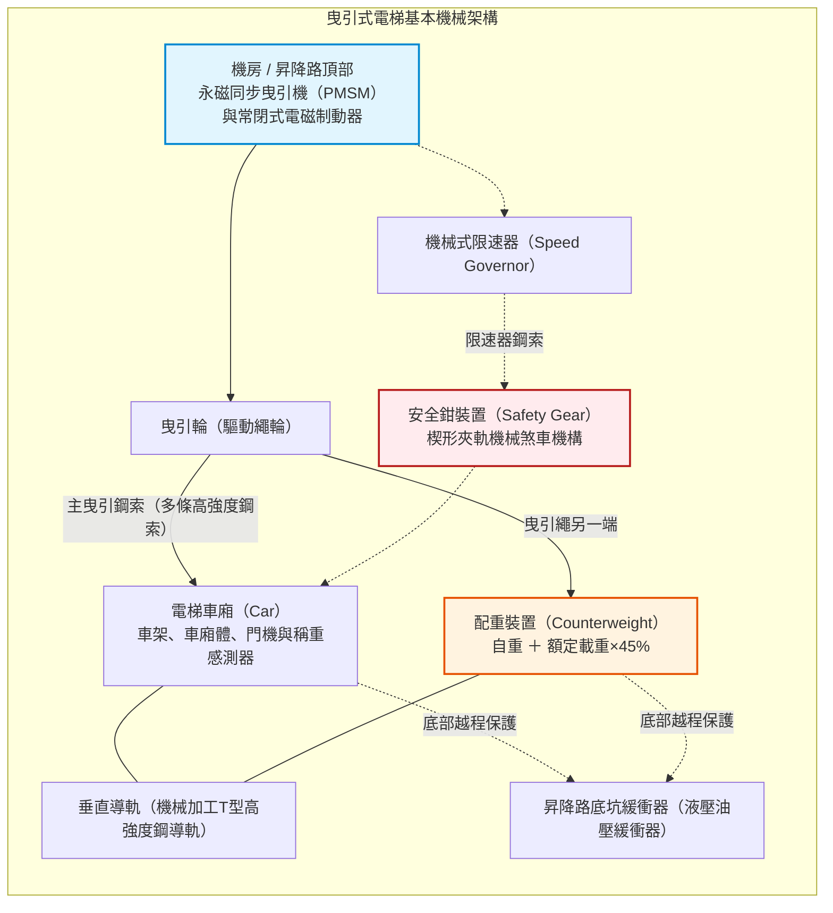
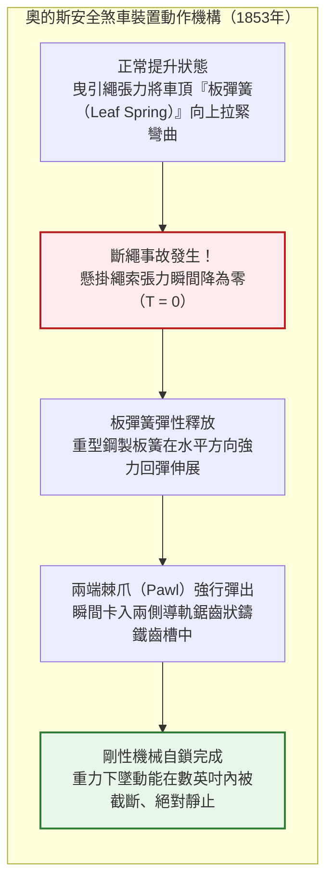
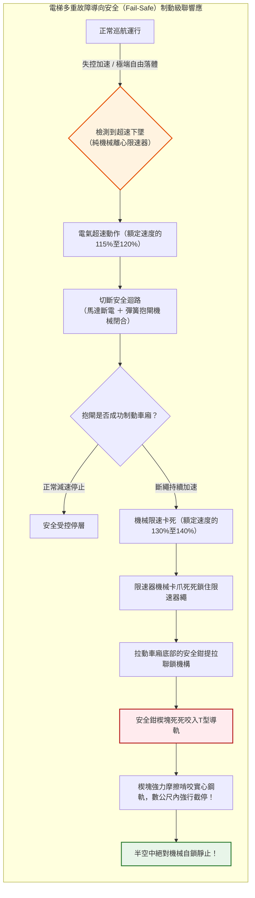
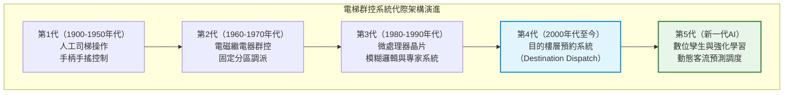
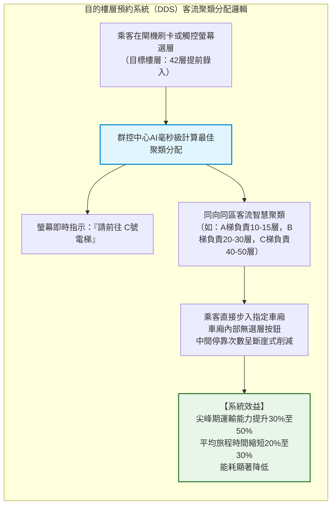
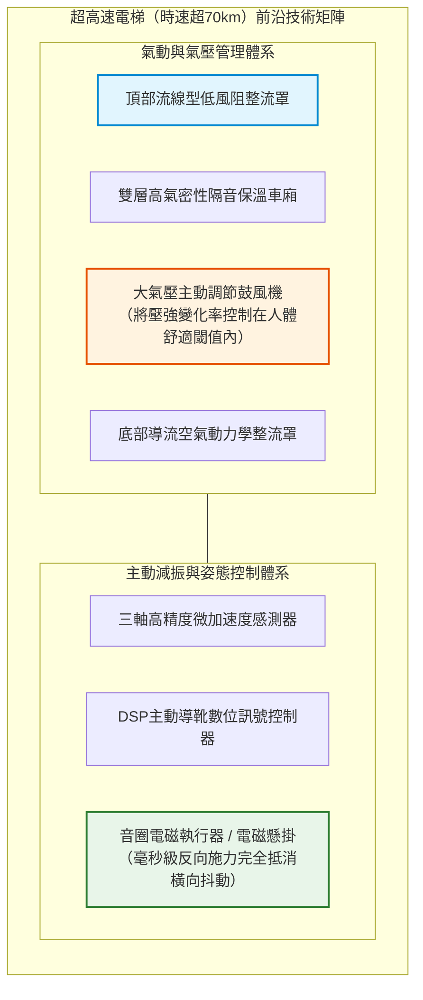
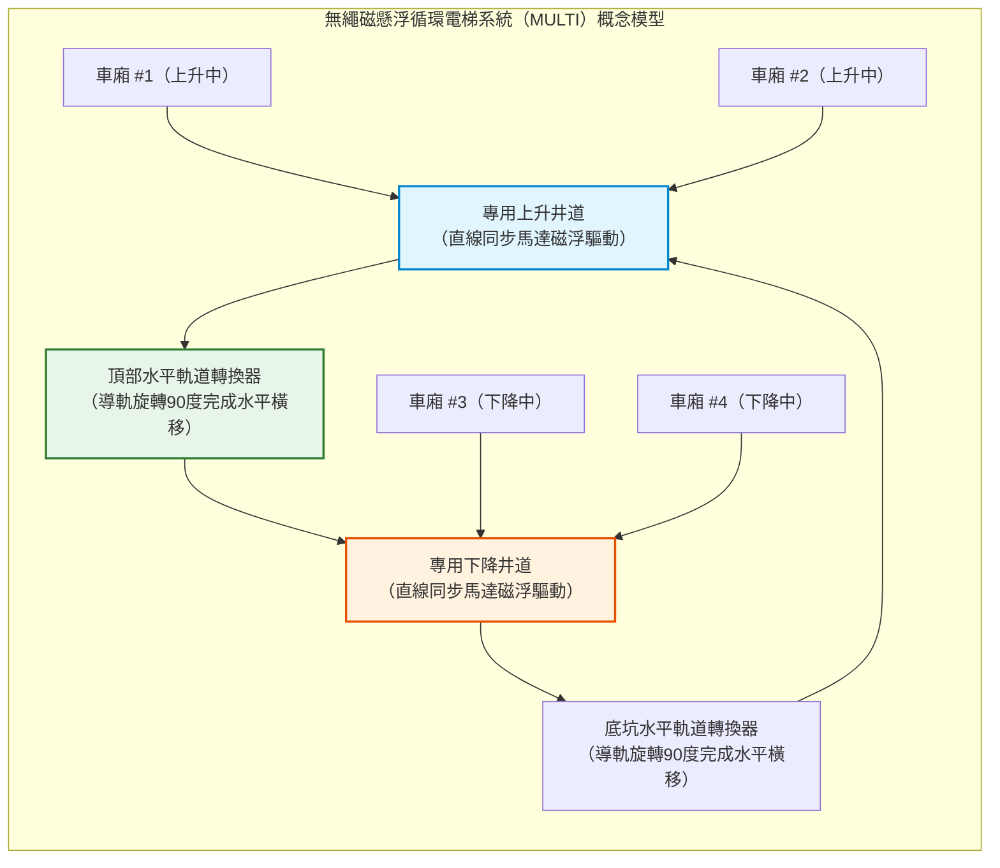

## 引言：將人類從二維地表解放至垂直維度的機械

每天早晨，在全世界數以億計的辦公大樓與高層公寓門廳中，人們按下召喚按鈕，待車門敞開便毫無戒備地步入車廂。在封閉的鋼鐵盒子裡低頭瀏覽數十秒智慧型手機的片刻之間，我們便反抗著地球重力，被平穩送上數十公尺甚至數百公尺的高空。

在日常生活中，人類幾乎找不到第二種機械，能讓我們如此全心全意且毫無保留地託付身家性命。如果腳下的車廂底板脫落怎麼辦？如果懸掛車廂的所有鋼索在同一瞬間斷裂又會如何？現代人幾乎從不會陷入這種噩夢般的聯想，因為在現代文明中，電梯已被公認為**「絕對不會墜落的交通工具」**。

從統計學維度來看，電梯是**全球最安全的客運交通工具**。其每日運送的龐大客運量遠超民航客機與高速鐵路的總和，然而因機械失控自由墜落導致的致命事故率卻無限趨近於零（其機率遠低於連續多次中得彩券特等獎）。

然而，若將歷史的視線倒回僅僅170年前，這種裝置在公眾眼中依然是「懸索隨時可能斷裂、將乘員摔得粉身碎骨的恐怖吊籠」。當時歐美都市建築的高度極限止步於五至六層（人類體能攀爬樓梯的極限），阻礙天際線生長的最大技術瓶頸並非鋼結構強度的不足，而是**「人類尚未掌握安全運送人員進行垂直升降的技術」**。

電梯安全煞車裝置的發明，徹底將人類文明從地表二維平面解放為三維立體都市，正是它締造了紐約、香港、東京與杜拜聳入雲霄的摩天樓群（Skyscrapers）。

本文將從機械力學、材料力學、控制工程學與流體力學的全方位視角，深度解密電梯為何絕對不會墜落，它如何駕馭重力與摩擦力，並在實現時速超70公里飛馳的同時達成毫米級的平層停靠精度。



---

## 第一章：將恐懼轉化為信任的劃時代瞬間——奧的斯的捨命斷繩實驗

人類利用滑輪與繩索垂直吊運物體的歷史，可追溯至西元前3世紀古希臘阿基米德發明的複式滑輪與絞車。在中世紀礦坑、城堡工事以及工業革命時期的煤礦中，利用水力與蒸汽機驅動的升降平台早已廣泛應用。

然而，這些早期裝置無一例外都是極度危險的貨運吊籠，僅靠麻繩或粗糙鐵鏈懸吊。一旦繩索磨損斷裂，平台便在重力加速度 $g$ 作用下瞬間砸向地表，礦工們每次搭乘都無異於在生死線上賭博。

### 1.1 1853年紐約世博會：傳奇的公開斬繩表演

徹底終結這一致命噩夢、為現代垂直都市推開大門的人，是美國發明家**伊萊沙·格雷夫斯·奧的斯（Elisha Graves Otis）**。

1853年，在紐約水晶宮舉辦的世界博覽會上，奧的斯在展廳中央樹立了一座高達近12公尺的開敞式升降導軌架。身著深色禮服、頭戴高絲禮帽的奧的斯親自站上了高懸的木製升降平台。

蒸汽絞車將平台平穩提升至博覽會穹頂的高空，數千名觀眾在下方屏息仰望。到達頂峰後，奧的斯向手持利斧的助手揮動信號旗，發出了一聲震撼全場的命令：

**「砍斷繩索！」**

助手手起斧落，懸掛平台的唯一一根粗大主繩應聲斷裂。全場觀眾發出驚恐的尖叫。按照萬有引力定律，失去了牽引繩的平台本該在毫秒之內向地面急速墜毀。

然而，平台僅僅下墜了數英吋，便伴隨著**「喀嗒！」一聲清脆刺耳的金屬咬合巨響，在半空中穩穩停住**。

神色自若的奧的斯脫下禮帽，向目瞪口呆的人群從容宣告：
> **「All safe, gentlemen, all safe!」（先生們，一切安全無虞！）**

在這一瞬間，人類歷史上「升降機＝墜落死亡」的致命魔咒被徹底打破，近代摩天大樓文明的曙光破曉而出。



### 1.2 板彈簧與棘爪：故障導向安全（Fail-Safe）的工程原點

奧的斯發明的安全煞車裝置結構極其精巧，卻完美詮釋了現代安全工程的核心法則——**故障導向安全（Fail-Safe）**。

在平台橫樑頂部橫置著一根彎曲的淬火**鋼製板彈簧（Leaf Spring）**：
1. **正常運行狀態**：主吊繩拉動平台向上時，繩索的強大拉力將板彈簧向上拉扯呈緊繃的弓形，彈簧兩端的鎖緊棘爪收縮在內側，絕不觸碰導軌。
2. **斷繩瞬態**：一旦懸繩斷裂、拉力瞬間消失（$T = 0$），板簧內積蓄的巨大彈性位能毫無阻礙地釋放，彈簧瞬間拉平伸展。
3. **強制自鎖**：板彈簧兩端的鋼製棘爪藉勢向外暴突，狠狠嵌入昇降路兩側鑄鐵導軌的齒槽之中，實現不可逆的物理剛性鎖死。

該機構不需要外部電力、感測器或人工干預。**「繩索斷裂失去拉力」這一物理事故本身，正是觸發機械煞車的直接動力源。** 這種將故障轉化為煞車力量的哲學，構成了現代電梯工程不可動搖的底層基石。

---

## 第二章：物理與力學的交響樂——曳引式電梯的核心力學機制

現代幾乎所有高層電梯均採用**「曳引式（Traction Elevator）」**設計。

理解曳引電梯首先必須打破一個反直覺的普遍誤解：**電動機並非憑藉蠻力在硬生生把車廂向上拉拽。**

### 2.1 配重平衡學（Counterweight）：重力平衡的極意

想像一口水井的滑輪兩側各吊著一個重量相等的木桶，系統處於靜止平衡，只需輕輕拂動指尖便能讓木桶上下移動。

曳引電梯正是這一原理的極致應用。主曳引鋼索穿過機房的驅動曳引輪，一端懸掛裝載乘客的車廂（Car），另一端則懸掛著重磅鑄鐵構成的**「配重（Counterweight）」**。

配重的質量 $M_{\text{cwt}}$ 是否與空車廂自重 $M_{\text{car}}$ 完全相等？答案是否定的。車廂載客量是在完全空載與滿載之間動態波動的。因此，電梯工程學將配重質量精確設定為**「車廂自重 ＋ 額定載重量 $Q$ 的40%至50%」**。該係數被稱為**平衡係數（Overbalance Factor, $\alpha$）**：

$$M_{\text{cwt}} = M_{\text{car}} + \alpha \cdot Q \quad (\alpha \approx 0.40 \sim 0.50)$$

```
【曳引電梯的載重平衡工況】
1. 空載工況（乘客 0%）：
   [車廂: Mcar] < [配重: Mcar + 0.45Q]  ==> 配重端更重（車廂上行時馬達處於發電制動狀態）
2. 設計平衡工況（乘客 45%）：
   [車廂: Mcar + 0.45Q] == [配重: Mcar + 0.45Q]  ==> 完美重力平衡（馬達淨提升負載幾乎為零！）
3. 滿載工況（乘客 100%）：
   [車廂: Mcar + Q] > [配重: Mcar + 0.45Q]  ==> 車廂端更重（車廂下行時馬達處於發電制動狀態）
```

在日常辦公大樓營運中，車廂平均乘員率通常保持在30%至50%的區間。這意味著在絕大多數運行時段，車廂與配重處於近乎理想的重力平衡狀態。

電動機所需克服的，並非車廂與人員的全重，而**僅為乘客人數偏離平衡點的淨差值、加減速慣性力以及細微的機械摩擦阻力**。一個自重2噸的車廂若無配重，需配備數百千瓦的龐大工業馬達；引入配重後，只需數分之一功率的節能馬達即可實現高速運行。

此外，當較重一側在重力拉動下下行時，現代變頻器（VFD）會自動將馬達轉為發電機工況，將重力位能轉化為清潔電能回饋建築物電網，實現極致的能源循環。

### 2.2 尤拉皮帶摩擦定律與曳引驅動

電梯的鋼索並沒有透過螺栓固定在曳引輪上，它只是搭放在曳引輪的輪槽中。

為什麼吊掛著數噸乃至數十噸重物的鋼索，在高速啟停時不會打滑脫扣，而是緊密貼合旋轉？

主導曳引摩擦力的物理法則，正是偉大的數學家萊昂哈德·尤拉提出的**尤拉皮帶摩擦方程式（Euler's Belt Friction Equation）**。鋼索在包角為 $\theta$（徑度）的輪槽兩側，其緊邊張力 $T_1$ 與鬆邊張力 $T_2$ 維持無滑移的最大極限比值由下式決定：

$$\frac{T_1}{T_2} \le e^{\mu' \theta}$$

其中：
- $e$ 為自然對數底數（$\approx 2.718$），
- $\theta$ 為曳引繩在輪槽上的包角（常規單繞為 $\theta = \pi \approx 3.14\ \text{rad}$；複繞系統可達 $2\pi$），
- $\mu'$ 為考慮了輪槽幾何形狀後的**等效摩擦係數**。

如果鋼索平鋪在平滑鋼面上，鋼與鋼之間的摩擦係數 $\mu$ 僅為 $0.09 \sim 0.15$ 左右，此時最大允許張力比僅為 $1.3 \sim 1.6$，一旦車廂乘客稍有增減便會嚴重打滑。

為此，現代曳引輪表面精密切削了特殊的剖面槽型：

```
【曳引輪繩槽剖面的演變】
1. 半圓槽（Round Groove）：
   繩底緊密貼合半圓底部。摩擦係數小，但鋼索壽命最長。
2. 帶切口半圓槽（Undercut Groove）：
   槽底向內掏空一段切口，迫使鋼索向兩側凸台楔入，產生劇烈局部面壓。
3. V型槽（V-Groove）：
   銳角V型夾角（夾角 gamma = 35°至40°）。利用楔形效應產生極高抓持力。
```

在切口半圓槽中，等效摩擦係數 $\mu'$ 由切口角 $\beta$ 與槽角 $\gamma$ 嚴格推導：

$$\mu' = \mu \cdot \frac{4 \left(\cos\frac{\gamma}{2} - \sin\frac{\beta}{2}\right)}{\pi - \beta - \sin\beta + \sin\gamma}$$

借助楔形效應，等效摩擦係數 $\mu'$ 被大幅放大了**3至5倍（$\mu' \approx 0.40 \sim 0.60$）**。由此計算得出的 $e^{\mu' \theta}$ 極限張力比高達 $5 \sim 10$ 以上，即便滿載或緊急煞車產生劇烈減速度，鋼索也絕無打滑之虞。

### 2.3 多條高韌性鋼索與極度充裕的安全係數

好萊塢電影中經常上演電梯鋼索一條條崩斷、最後徹底墜落底坑的驚悚橋段。然而在真實的機械工程中，這一情節是**100%不可能發生的力學虛構**。

現代電梯絕非依靠單條鋼絲懸掛，而是由**至少3至8條、在超高層建築中多達10條以上並聯的高強度特種鋼索**共同承載。每條鋼索均由上百根高碳鋼絲經多重絞擰而成。

在國際電梯法規（如ASME A17.1、EN 81及CNS規範）中，電梯懸掛鋼索被強制要求達到**不低於10至12倍的安全係數**。

安全係數大於10意味著：**即便極端事故導致並聯鋼索中的90%在同一瞬間被切斷，僅僅剩下最後孤零零的1條鋼索，其結構抗拉強度仍足以獨自吊起滿載的電梯車廂而不發生斷裂。**

此外，每條鋼索末端均裝有彈簧張力平衡機構，確保多索之間受力均勻到毫米級。在現代預防性維護體系下，多條特種鋼索同時自發斷裂的機率在工程上等於絕對零。

---

## 第三章：多重防禦的鋼鐵堡壘——級聯失效安全防禦體系

退一萬步設想：假定由於極其罕見的強震落石或恐怖襲擊，將全部懸掛鋼索瞬間齊齊切斷，電梯會怎樣？

答案是：**它依然絕對不會墜落。** 因為電梯井道內部築有一套完全不依賴外力、純機械觸發的級聯安全防護體系。



### 3.1 常閉式電磁制動器：Fail-to-Safety的極致範例

電梯主機的主煞車與汽車煞車在設計邏輯上恰恰相反。汽車制動是踩下踏板施加液壓從而「產生煞車力」；而電梯制動器則是**「常態常閉，通電釋放」**。

在未通電狀態下，**強力壓縮螺旋彈簧時刻以萬鈞之力將煞車閘瓦死死壓在制動盤（輪）上**。唯有電磁線圈通電建立磁場時，才能克服彈簧彈力將閘瓦吸開，允許馬達運轉。

無論運行中遭遇全城停電、控制晶片當機，還是任何一個安全開關跳脫，一旦供電中斷，電磁吸力瞬間歸零，**物理彈簧在毫秒之內將閘瓦猛烈撞向制動盤，實施純物理鎖死**。失去能源即自動煞車，這是電梯安全的第一道鋼鐵防線。

### 3.2 離心式限速器（Speed Governor）：俯瞰重力的純機械之眼

若遭遇鋼索全部斷裂的極端災難，在半空中監視車廂速度的並非微處理器，而是一台完全脫離電力的純機械裝置——**離心式限速器**。

限速器安裝在井道頂層機房內，一條獨立的細鋼索（限速器繩）繞過限速器輪，與車廂連接形成閉合迴路，隨著車廂升降以1:1同步旋轉。

限速器內部裝有一套精密的離心飛塊與校準彈簧。車廂速度越高，離心力越大，飛塊便向外擴張：
1. **第一級（額定速度的115%至120%）**：飛塊觸動電氣過速開關，瞬間打斷電梯安全迴路，切斷馬達電源並觸發主機抱閘。
2. **第二級（額定速度的130%至140%）**：若速度仍失控飆升，飛塊完全甩出，觸發堅固的機械卡爪。限速器輪在物理層面被瞬間鎖死，限速器鋼索被夾繩鉗緊緊鉗住。

### 3.3 安全鉗（Safety Gear）：啃噬實心鋼軌的合金之楔

當限速器繩被卡死後，下墜的車廂因慣性繼續下移，兩者產生強烈的相對位移。這股位移拉動了車廂底部安全鉗橫樑上的機械提拉桿。

安全鉗隨即強行觸發：
- **瞬時式安全鉗（Instantaneous Safety）**：用於額定速度較低的電梯（分速45m以下）。滾柱或陡峭楔塊瞬間咬死導軌，實現毫秒級鎖死。
- **漸進式安全鉗（Progressive Safety）**：用於中高速電梯。採用合金楔塊與重型碟形彈簧組合的**彈性導向夾鉗**。

漸進式安全鉗的核心工程美學在於**「在不傷害人體的前提下平穩煞停」**。

若時速數十公里的車廂瞬間撞牆般驟停，乘員將承受致命的幾十個重力加速度（G值），導致內臟出血和骨折。

漸進式安全鉗在合金楔塊咬入T型鋼導軌表面的同時，碟簧發生受控彈性形變，使楔塊在軌面上產生穩定受控的滑動摩擦阻力 $F_{\text{friction}}$。制動減速度 $a_{\text{stop}}$ 遵循牛頓第二定律：

$$M \cdot a_{\text{stop}} = F_{\text{friction}} - M g \implies a_{\text{stop}} = \frac{F_{\text{friction}}}{M} - g$$

全球安全法規（EN 81、ASME A17.1）嚴格要求漸進式安全鉗的平均減速度必須控制在 **$0.2g \sim 1.0g$** 之間。這相當於汽車緊急煞車的力道，雖然乘員會感到明顯的下沉壓迫，但絕不會受到致命損傷，車廂在滑行數公尺後在半空中完全咬死靜止。

### 3.4 井道底坑緩衝器（Buffer）：最後的結構防線

作為衝破一切煞車防線後的絕對末端屏障，昇降路底坑佇立著重型**緩衝器**。

中高速電梯配置大型**液壓油壓緩衝器（Hydraulic Buffer）**。車廂撞擊緩衝柱塞時，液壓油在極端壓力下被強行從微孔節流環中擠出，液體的黏性阻力將車廂殘餘的動能 $E_k$ 全部轉化為熱能耗散：

$$E_k = \frac{1}{2} M v^2 = \int_0^S F_{\text{hydraulic}}(x) \, dx$$

在衝程 $S$ 範圍內，油壓緩衝器能將車廂穩穩托住，避免剛性觸底。

---

## 第四章：大腦的進化——從繼電器控制到AI智慧群控

電梯技術的演進絕不僅限於機械韌性。隨著巨型摩天樓的誕生，如何在多梯並聯的複雜環境下極小化乘客等待時間，催生了**控制工程與運籌優化演算法的百年進化**。



### 4.1 群控調度（Group Supervisory Control）的數學優化

假設一座50層的辦公大樓設有8台並聯電梯。各樓層隨機產生上下呼梯訊號，系統應派遣哪台電梯響應？

若採取簡單的「就近原則」（Nearest Car），將導致嚴重的「聚團現象」（Bunching）：多台電梯結伴停靠同一樓層，導致其他樓層出現長時間等待。

現代群控大腦在幾毫秒內即時求解**多目標綜合評價函數（Objective Function）**：

$$J(k) = \min_{k} \left[ w_1 \cdot T_{\text{wait}}(k) + w_2 \cdot T_{\text{ride}}(k) + w_3 \cdot P_{\text{long}}(k) + w_4 \cdot E_{\text{energy}}(k) \right]$$

其中：
- $T_{\text{wait}}(k)$：派梯 $k$ 後的預估候梯時間
- $T_{\text{ride}}(k)$：車內既有乘客因增加停靠而增加的行程時間
- $P_{\text{long}}(k)$：等待時間超過閾值（如60秒）的長等機率懲罰
- $E_{\text{energy}}(k)$：運行消耗的電能
- $w_1, w_2, w_3, w_4$：隨早高峰、午餐峰、離峰動態切換的權重因子

借助模糊數學與深度強化學習演算法，系統可根據歷史客流大數據主動提前「預判」需求，將空閒車廂提前派往高頻出發層待命。

### 4.2 目的樓層預約系統（Destination Dispatch System）的客流革命

傳統電梯模式中，乘客在門廳按「上/下」，進車廂後再按樓層按鈕。系統在乘客進車廂前，對其終點一無所知。

而在**目的樓層預約系統（DDS）**下，乘客必須在**進梯前於閘機或觸控終端輸入目標樓層**。



透過提前獲知所有人的目標樓層，AI將去往相同或鄰近樓層的乘客**聚類打包（Clustering）至同一台電梯**。

電梯從「每站皆停的慢車」變成了「定點直達的特快專線」，單梯停靠站數減少一半以上。在不增加建築井道面積的前提下，整棟樓的高峰運力提升了30%至50%。

---

## 第五章：向超高層物理極限宣戰——時速70公里以上的極端領域

隨著超高層與巨型摩天樓（500至600公尺以上）的湧現，現代電梯技術跨入了航空航太工程的領域。

| 建築名稱（城市） | 竣工年份 | 額定最高速度 | 時速換算 | 提升行程 |
| :--- | :--- | :--- | :--- | :--- |
| **陽光城60（東京）** | 1978年 | 分速 600 m | 36.0 km/h | 約 240 m |
| **橫濱地標大廈（橫濱）** | 1993年 | 分速 750 m | 45.0 km/h | 約 290 m |
| **台北101（台北）** | 2004年 | 分速 1,010 m | 60.6 km/h | 約 382 m |
| **上海中心大廈（上海）** | 2016年 | 分速 1,230 m | 73.8 km/h | 約 578 m |
| **廣州周大福金融中心（廣州）** | 2019年 | 分速 1,260 m | **75.6 km/h** | 約 500 m |

分速1,260公尺（秒速21公尺，時速75.6公里）。電梯在狹窄井道內的飛馳速度已超越地面市區汽車，這帶來了驚人的流體與生理學挑戰。

### 5.1 活塞效應與空氣動力學整流罩

車廂在狹長的井道內超高速穿行，如同注射器針管裡的活塞。車廂前方的空氣被劇烈壓縮形成阻力，後方則形成極大的負壓真空，這便是**活塞效應（Piston Effect）**。

空氣動力學阻力 $F_{\text{aero}}$ 與**速度的平方（$v^2$）成正比**：

$$F_{\text{aero}} = \frac{1}{2} C_d \cdot \rho_{\text{air}} \cdot A_{\text{frontal}} \cdot v^2$$

若缺乏因應，強烈的風噪與氣流將震碎井道層門，馬達能耗暴增。為此，超高速電梯上下兩端安裝了與高鐵先頭車類似的**流線型空氣動力學整流罩（Aerodynamic Fairings）**，使氣流順暢分流，將阻力係數與噪音壓制在極低水準。



### 5.2 大氣壓主動控制：告別耳痛與耳壓反應

從地面疾升至500公尺觀景台僅需30餘秒，外界氣壓將驟降50至60百帕（hPa）。未作保護的乘客耳膜將向外膨脹，誘發劇烈的耳痛與暫時性耳聾。

超高速電梯車廂被設計為如同潛水艇與客機一般的**全密封氣密座艙**。車載電腦控制的高性能氣壓泵在升降過程中主動對車廂內進行連續的加壓與減壓，將氣壓變化率嚴格限制在人體鼓膜可自如適應的 **1.5 hPa/秒以內**，乘客在全程中感受不到耳壓不適。

### 5.3 主動減振導靴：硬幣立於75km/h車底不倒的奇蹟

在時速70公里以上疾馳時，導軌微米級的接縫誤差都將轉化為劇烈的橫向顛簸。

超高速電梯採用**磁懸浮級主動減振導靴（Active Guide Roller）**。感測器以千赫茲頻率偵測震動，微處理器毫秒級計算反向抵消力，電磁執行器即時推動導靴抵消橫晃。其平穩性達到讓香菸或硬幣立在車廂地板上、全速升降全程不倒的驚人工業水準。

---

## 第六章：未來疆界——從無繩磁懸浮到太空電梯

電梯工業如今正迎來1853年以來最重大的典範轉移：擺脫鋼索的終極束縛。

### 6.1 無機房（MRL）技術的普及

1990年代**永磁同步馬達（PMSM）**的微型化突破，使曳引機體積縮小至原來的數分之一，催生了將曳引機與控制櫃全部塞入昇降路內部的**無機房電梯（Machine-Room-Less）**，解放了摩天大樓的屋頂天際線設計。

### 6.2 無繩磁懸浮多車廂循環系統（MULTI）

傳統電梯的物理死穴在於**「一根昇降路只能運行一台車廂」**，超高層建築中電梯井道蠶食了高達40%的寶貴建築面積。

德國蒂森克虜伯（TK Elevator）研發的**MULTI系統**徹底拋棄了鋼索，採用直線同步馬達（LSM）驅動車廂在井道內自主懸浮行走：



如同垂直地鐵一般，多個車廂在單根昇降路內循環跟車上升，在頂層透過機械轉盤橫移至另一側井道下降，甚至可以在雙子塔之間的空橋空中水平穿梭。

### 6.3 終極構想：太空電梯（Space Elevator）

垂直交通的終極聖杯，是從赤道向地球同步軌道（高度36,000公里）垂下一條碳奈米管超強纜索的**太空電梯**。無需龐大化學火箭，人類僅憑電力驅動升降艙即可將數噸貨物與人員以極低成本送入太空軌道，這是電梯工程力學在星際尺度的偉大延續。

---

## 結語：托舉人類直上雲霄的機械尊嚴

電梯是融合了阿基米德滑輪、工業革命蒸汽動力、奧的斯安全彈簧、尤拉摩擦力學、現代AI群控與航空氣動學的兩千年人類工程結晶。

沒有電梯，便沒有現代垂直城市。世界將淪為無休止向外蔓延的平面荒漠，人類將把大半生命消耗在橫向通勤的擁堵之中。高密度、低能耗、繁榮密集的現代都市之所以可能，全繫於這條深藏在豎井中「絕對安全」的垂直動脈。

在日復一日的平穩寂靜中，數百萬台電梯正承託著人類的生活穿梭於重力與蒼穹之間。那隱匿在黑暗昇降路中的嚴絲合縫與萬無一失，正是機械工程獻給人類文明最深沉的敬意與尊嚴。
