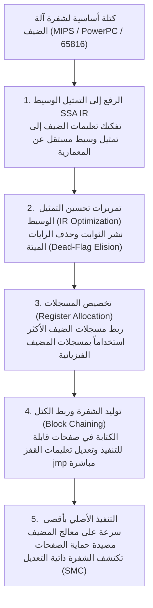
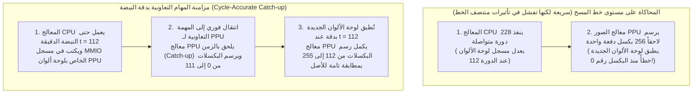

## 1. من السيليكون إلى الرياضيات: آلة تورينج الشاملة وتماثل الآلات محدودة الحالة

لم تكن أجهزة مثل نينتندو (NES - 1983)، وسوبر نينتندو (SNES - 1990)، وبلاي ستيشن 2 (2000)، وجيم كيوب (2001) مجرد حواسيب عامة الأغراض، بل كانت <strong>منظومات معقدة من الدوائر المتكاملة المخصصة (ASICs وشرائح LSI المصممة حسب الطلب)</strong>. ومع ذلك، نستطيع اليوم دون امتلاك أي قطعة من ذلك السيليكون الأصلي تشغيل ألعابها التجارية على الحواسيب والهواتف الذكية الحديثة المزودة بمعالجات x86-64 أو ARM64 بدقة متطابقة على مستوى البت. إن الفرع الهندسي البرمجي الذي يجعل هذا ممكناً هو <strong>محاكاة العتاد (Hardware Emulation)</strong>.

كيف يمكن لبرنامج يعمل على معمارية مختلفة تماماً أن يقلد السلوك الفيزيائي لملايين الترانزستورات ومذبذبات الكوارتز؟ يعود الأساس النظري إلى المبرهنة التأسيسية لعلوم الحاسوب التي أثبتها عالم الرياضيات البريطاني <strong>آلان تورينج (Alan Turing)</strong> عام 1936، وهي مبرهنة <strong>آلة تورينج الشاملة (Universal Turing Machine - UTM)</strong>:

$$U(\langle M \rangle, x) = M(x)$$

بالاقتران مع <strong>أطروحة تشيرش-تورينج (Church-Turing Thesis)</strong>، تثبت هذه المعادلة أنه إذا رمزنا لعتاد منصة الألعاب الفيزيائي بالرمز $M$، وللشفرة المصدرية للمحاكي التي تصف القواعد المنطقية لدوائر $M$ بالرمز $\langle M \rangle$، ولبيانات شريط اللعبة ومدخلات ذراع التحكم بالرمز $x$، فإن أي حاسوب مضيف كامل تورينجياً $U$ ينفذ $\langle M \rangle$ سينتج حتماً نفس سلسلة الحالات والمخرجات السمعية والبصرية $M(x)$ التي ينتجها الجهاز الأصلي.

من منظور الدوائر الرقمية، فإن أي دائرة منطقية متزامنة تعمل بنبضات ساعة رئيسية (سواء كانت المعالج المركزي CPU، أو معالج الصور PPU، أو معالج الصوت APU) تُختزل رياضياً إلى <strong>آلة حالة محدودة حتمية (Deterministic Finite State Machine - FSM)</strong>. إذا كانت $S_t \in \mathcal{S}$ تمثل متجه الحالة الكلي لجميع المسجلات والرايات وذاكرة الفيديو VRAM والذاكرة العشوائية WRAM عند النبضة الزمنية $t$، وكانت $I_t \in \mathcal{I}$ تمثل متجه المدخلات الخارجية، فإن شبكة البوابات المنطقية التوافقية تحسب بين النبضتين $t$ و $t+1$ دالتين رياضيتين نقيتين:

$$S_{t+1} = \delta(S_t, I_t), \qquad O_t = \lambda(S_t, I_t)$$

حيث $\delta$ هي دالة انتقال الحالة، و $\lambda$ هي دالة الخرج التي تولد بكسلات RGB وعينات الصوت PCM. إن الجبر البولياني الذي تنفذه ترانزستورات CMOS فيزيائياً عبر مستويات الجهد الكهربائي ($0\,\text{V}$ مقابل $3.3\,\text{V}/5\,\text{V}$) <strong>متماثل رياضياً بالكامل (Isomorphic)</strong> مع العمليات المنطقية الثنائية (`&`, `|`, `^`, `~`, `<<`) التي ينفذها معالج المضيف على متغيرات `uint32_t` و `uint64_t`.

لذلك فإن العقبة الكبرى أمام المحاكاة ليست *قابلية الحساب*، بل <strong>التعقيد الحسابي تحت قيد الزمن الحقيقي الصارم</strong>. ففي جهاز سوبر نينتندو بنظام NTSC الذي يعمل بمذبذب رئيسي تردده $21.477272\,\text{MHz}$، يتكون كل إطار صورة من $262$ خط مسح (Scanlines) يحتوي كل منها على $1364$ دورة ساعة رئيسية:

$$f_{\text{frame}} = \frac{21,477,272\,\text{Hz}}{262 \times 1364} \approx 60.0988\,\text{Hz} \implies T_{\text{frame}} \approx 16.639\,\text{ms}$$

في العتاد الفيزيائي، تقوم ملايين البوابات المنطقية بحساب $\delta(S_t, I_t)$ <strong>بالتوازي المكاني</strong> في كل نانوثانية، بينما يتعين على المحاكي البرمجي تحويل هذا التوازي الهائل إلى تعليمات متسلسلة وإنهاء جميع دورات الإطار البالغة $357,368$ دورة في <strong>أقل من $16.639\,\text{مللي ثانية}$</strong>.

---

## 2. أساسيات محاكاة المعالج: من مفسر Switch إلى الترجمة الديناميكية (JIT / Dynarec)

### 2.1 مفسر Switch الكلاسيكي وعقوبة فشل توقع التفرع

تتمثل الطريقة المباشرة لمحاكاة معالج الضيف (Guest CPU) في تقليد دورة <strong>الجلب (Fetch) $\to$ فك التشفير (Decode) $\to$ التنفيذ (Execute)</strong> داخل حلقة `while` تحتوي على جملة `switch (opcode)` ضخمة.

غير أن هذا التصميم يعاني من اختناق معماري حاد على المعالجات الفائقة التدرج (Superscalar) الحديثة؛ إذ تُترجم جملة `switch` بالكامل إلى تعليمة قفز غير مباشر واحدة (`jmp *[rax + rdx*8]`). ونظراً لأن شفرات العمليات للضيف تتغير باستمرار، فإن <strong>وحدة توقع التفرع غير المباشر (BTB)</strong> في معالج المضيف تخطئ التوقع باستمرار عند هذه النقطة، مما يؤدي إلى إفراغ خط الأنابيب (Pipeline Flush) المكون من 14 إلى 20 مرحلة وإهدار عشرات الدورات في كل تعليمة. ورغم أن تقنية <strong>Direct Threaded Code</strong> عبر عناوين اللافتات (`goto *dispatch_table[opcode]`) توزع القفزات غير المباشرة على نهايات دوال المعالجة، فإنها لا تلغي عبء فك التشفير المتكرر.

### 2.2 الترجمة الثنائية الديناميكية (JIT / Dynarec) وحذف الرايات الميتة

لتجاوز هذا الحاجز، تعتمد المحاكيات عالية الأداء (<strong>Dolphin</strong>، <strong>PCSX2</strong>، <strong>RPCS3</strong>، <strong>QEMU TCG</strong>، و <strong>Apple Rosetta 2</strong>) على <strong>الترجمة الفورية / إعادة الترجمة الديناميكية (JIT / Dynarec)</strong>: حيث تُترجم <strong>الكتل الأساسية (Basic Blocks)</strong> من شفرة آلة الضيف أثناء التشغيل إلى شفرة آلة أصلية للمضيف (x86-64 / ARM64) وتُنفذ مباشرة من ذاكرة التخزين المؤقت للشفرة.



تشمل التحسينات الجوهرية لمحرك Dynarec ما يلي:
1. <strong>حذف الرايات الميتة (Dead-Flag Elision)</strong>: تقوم التعليمات الحسابية بتحديث رايات الحالة (Z, N, C, V) باستمرار، لكن معظمها يُستبدل فوراً بالتعليمة التالية دون أن يُقرأ أبداً. ومن خلال تحليل الحياة العكسي (Liveness Analysis) على تمثيل SSA، يحذف المترجم أكثر من $80\%$ من حسابات الرايات غير الضرورية.
2. <strong>تخصيص المسجلات الفيزيائية</strong>: يحتفظ خوارزم Linear Scan بمسجلات الضيف الأكثر نشاطاً داخل المسجلات المادية لمعالج المضيف مباشرة، متجنباً القراءة والكتابة المتكررة في بنية `CPUState` بالذاكرة.
3. <strong>ربط الكتل (Block Chaining)</strong>: عندما تقفز كتلة مترجمة A إلى كتلة مترجمة أخرى B، يقوم المترجم بتعديل تعليمة `jmp` في نهاية الكتلة A لتشير مباشرة إلى العنوان الأصلي للكتلة B دون العودة إلى حلقة الموزع.
4. <strong>اكتشاف الشفرة ذاتية التعديل (SMC)</strong>: عندما تعيد اللعبة كتابة شفرتها الخاصة في الذاكرة العشوائية، يلتقط المحاكي عملية الكتابة عبر أقنعة برمجية أو حماية صفحات الذاكرة للقراءة فقط (`mprotect` / `VirtualProtect`) ويبطل الكتل المترجمة القديمة فوراً.

| معيار المقارنة | مفسر Switch | مفسر Threaded | المترجم الديناميكي (JIT / Dynarec) |
| :--- | :--- | :--- | :--- |
| <strong>التكلفة لكل تعليمة ضيف</strong> | $20 \sim 80+$ تعليمة مضيف | $12 \sim 35$ تعليمة مضيف | <strong>$1 \sim 4$ تعليمات أصلية للمضيف</strong> |
| <strong>كفاءة توقع التفرع</strong> | سيئة جداً (نقطة اختناق BTB واحدة) | متوسطة (قفزات غير مباشرة موزعة) | <strong>ممتازة (قفزات مباشرة أصلية وربط كتل)</strong> |
| <strong>حذف الرايات الميتة</strong> | مستحيل (لا يوجد سياق بين التعليمات) | محدود للغاية | <strong>كامل (تحليل شامل على تمثيل SSA IR)</strong> |
| <strong>التعقيد وقابلية النقل</strong> | بسيط جداً، لغة C/Rust قياسية | يتطلب امتدادات خاصة بالمترجم | <strong>معقد للغاية (يتطلب واجهة خلفية لكل معمارية)</strong> |
| <strong>التحكم في دقة النبضة</strong> | سهل جداً (إيقاف عند أي دورة) | سهل | <strong>صعب (تُحسب الدورات عند حدود الكتل)</strong> |

---

## 3. ناقل الذاكرة وتقنية Fastmem: اختطاف وحدة إدارة الذاكرة (MMU) للمضيف

في منصات الألعاب، يتحكم المعالج في شرائح الصورة والصوت والـ DMA عبر قراءة وكتابة مسجلات <strong>الإدخال والإخراج المحمولة على الذاكرة (MMIO)</strong>. ولو قام المحاكي بفحص كل عملية وصول للذاكرة برمجياً عبر جمل `if-else` للتمييز بين ذاكرة RAM ومسجلات MMIO، لانهارت سرعة الـ JIT تماماً.

تحل تقنية <strong>Fastmem</strong> هذه المشكلة عبر تسخير وحدة إدارة الذاكرة المادية (Hardware MMU) لنظام التشغيل المضيف ذي الـ 64 بت:
1. يحجز المحاكي في فضاء العناوين الافتراضي للمضيف (64 بت) منطقة متصلة بحجم فضاء عناوين الضيف بالكامل (مثلاً <strong>$4\,\text{GB}$ عبر `mmap` / `VirtualAlloc`</strong> لمنصة 32 بت)، ويحفظ مؤشر بدايتها في مسجل ثابت بالمضيف (`rbx`).
2. تُربط مناطق ذاكرة RAM الفعلية ومراياها بصلاحيات قراءة وكتابة كاملة (`PROT_READ | PROT_WRITE`).
3. تُضبط جميع الصفحات المقابلة <strong>لمسجلات العتاد MMIO</strong> عمداً لتكون <strong>محظورة الوصول (`PROT_NONE` / `PAGE_NOACCESS`)</strong>.

وبذلك يستطيع مترجم JIT تحويل أي عملية قراءة لذاكرة الضيف إلى <strong>تعليمة آلة أصلية واحدة فقط</strong> دون أي تفرع شرطي:

```nasm
; rbx = عنوان الأساس لمنطقة 4 جيجابايت الافتراضية، edi = عنوان الضيف (32 بت)
mov eax, dword ptr [rbx + rdi]   ; ترجمة العنوان والتحميل في تعليمة واحدة!
```

* <strong>المسار السريع ($99.9\%$ من عمليات الوصول لذاكرة RAM)</strong>: تنفذ وحدة MMU ومخزن TLB الماديان في معالج المضيف عملية التحميل خلال 3 إلى 4 دورات بتكلفة برمجية تساوي صفراً.
* <strong>المسار البطيء ($0.1\%$ من عمليات الوصول لمسجلات MMIO)</strong>: عند ملامسة صفحة محمية بـ `PROT_NONE`، تطلق وحدة MMU للمضيف فوراً استثناء خطأ صفحة مادي (`SIGSEGV` في أنظمة POSIX أو `STATUS_ACCESS_VIOLATION` في ويندوز). يلتقط معالج الإشارات في المحاكي هذا الاستثناء، ويفك شفرة التعليمة، ويستدعي دالة C++ الخاصة بـ `mmio_read/write()`، ثم يحدث المسجل الهدف ويقدم مؤشر التعليمات `RIP`.

---

## 4. الدقة على مستوى النبضة (Cycle Accuracy) ومزامنة المهام التعاونية

لماذا صرح مهندس المحاكيات الأسطوري الراحل <strong>Near (byuu)</strong> بأن <strong>محاكاة جهاز سوبر نينتندو الذي يعمل بتردد $3.58\,\text{MHz}$ فقط بدقة نبضة تصل إلى 100% تطلبت معالجاً مكتبياً حديثاً بتردد $3\,\text{GHz}$</strong>؟

كانت المحاكيات القديمة <strong>القائمة على خطوط المسح (Scanline-based)</strong> تشغل المعالج المركزي طوال خط مسح كامل ($228$ دورة) أولاً، ثم تطلب من معالج الصور PPU رسم جميع بكسلات ذلك الخط البالغة 256 بكسل دفعة واحدة. غير أن العديد من الألعاب تقوم بتعديل المسجلات الرسومية (لوحة الألوان، التمرير، أو مصفوفات Mode 7) <strong>في منتصف رسم خط المسح تماماً (Mid-Scanline)</strong> عبر المعالج أو قناة HDMA. وبدون مزامنة دقيقة عند نبضة البكسل المحددة، تظهر تشوهات بصرية أو تتوقف اللعبة عن العمل.



في المحاكيات الدقيقة على مستوى النبضة مثل <strong>bsnes / higan / Ares</strong>، تعمل كل شريحة (CPU، PPU، SMP، DSP) كـ <strong>مهمة تعاونية مستقلة في فضاء المستخدم (Coroutines / Fibers عبر مكتبة `libco`)</strong>. وكلما أصدرت شريحة إشارة أو عملية كتابة قد تؤثر على شريحة أخرى، تقوم دالة `co_switch()` بتبديل السياق في نحو 10 تعليمات تجميع (Assembly) فقط لتمكين الشريحة المستهدفة من اللحاق بالزمن الرئيسي بدقة.

علاوة على ذلك، تواصل هندسة المحاكاة الحديثة التغلب على ثلاثة تحديات متقدمة:
* <strong>حسابات الفاصلة العائمة غير القياسية (Non-IEEE-754)</strong>: لا يدعم معالج Emotion Engine ووحدات المتجهات في جهاز PS2 قيم اللانهاية (`Inf`) أو غير الرقم (`NaN`)، ويصفّر الأعداد غير الطبيعية تلقائياً، مما يلزم محاكي PCSX2 باستخدام أقنعة وتشبيك SIMD لمنع انهيار محركات الفيزياء في الألعاب.
* <strong>تقنية Run-Ahead لإلغاء زمن الاستجابة</strong>: من خلال محاكاة $N$ إطارات مسبقاً في الخلفية بصمت مع حفظ واسترجاع فائق السرعة لحالة الذاكرة (Savestates)، يتخطى المحاكي تأخير المخزن المؤقت الداخلي للعبة نفسها، محققاً استجابة أسرع حتى من الجهاز الأصلي المتصل بتلفاز أنبوب الأشعة المهبطية (CRT).
* <strong>مصفوفات FPGA وحفظ التراث الرقمي</strong>: إلى جانب إعادة بناء البوابات المنطقية عتادياً عبر <strong>FPGA (مشروع MiSTer)</strong> بلغات Verilog/VHDL، تمثل الشفرة المصدرية للمحاكيات الدقيقة <strong>وثائق عتادية قابلة للتنفيذ</strong> تحفظ الإرث الفني التفاعلي للبشرية من التلف الفيزيائي الحتمي لشرائح السيليكون القديمة.
