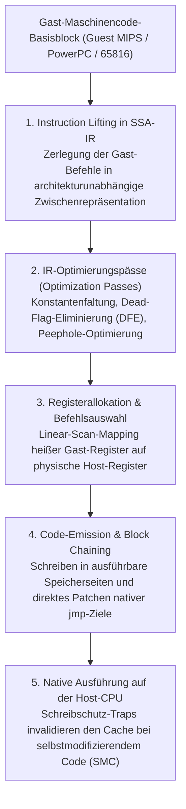
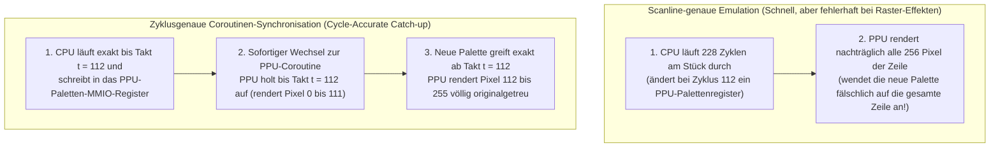

## 1. Von Silizium zur Mathematik: Universelle Turingmaschine und FSM-Isomorphie

Das Nintendo Entertainment System (1983), das Super Nintendo (1990), die PlayStation 2 (2000) und der Nintendo GameCube (2001) waren keine gewöhnlichen PCs, sondern hochgradig spezialisierte <strong>Sammlungen maßgeschneiderter ASICs und Custom-LSI-Chips</strong>. Dennoch können wir heute ihre Original-ROMs auf modernen x86-64- oder ARM64-Prozessoren bitgenau und oft in höherer Auflösung ausführen. Die Disziplin dahinter ist die <strong>Hardware-Emulation</strong>.

Warum kann ein reines Softwareprogramm auf einer völlig fremden Prozessorarchitektur das physikalische Verhalten von Millionen Transistoren und Quarzoszillatoren exakt nachbilden? Das theoretische Fundament legte <strong>Alan Turing</strong> 1936 mit dem Beweis der <strong>Universellen Turingmaschine (UTM)</strong>:

$$U(\langle M \rangle, x) = M(x)$$

Gemäß der <strong>Church-Turing-These</strong> kann jeder Turing-vollständige Host-Computer $U$, der die logische Beschreibung $\langle M \rangle$ einer Gast-Hardware $M$ (der Emulator-Quellcode) sowie die Eingabedaten $x$ (ROM-Image und Controller-Inputs) erhält, exakt dieselbe Zustands- und Ausgabefolge $M(x)$ berechnen wie die physische Konsole.

Aus Sicht der Digitaltechnik lässt sich jede synchrone digitale Logikschaltung (CPU, PPU, APU) mathematisch auf einen <strong>deterministischen endlichen Automaten (Deterministic Finite State Machine, FSM)</strong> reduzieren. Bezeichnet $S_t \in \mathcal{S}$ den gesamten Zustandsvektor aller Flipflops, Register, Flags, VRAM- und WRAM-Bits zum diskreten Taktzyklus $t$ und $I_t \in \mathcal{I}$ den Eingabevektor, so berechnet das kombinatorische Gatter-Netzwerk zwischen Takt $t$ und $t+1$ zwei reine mathematische Funktionen:

$$S_{t+1} = \delta(S_t, I_t), \qquad O_t = \lambda(S_t, I_t)$$

Hierbei ist $\delta$ die Zustandsübergangsfunktion und $\lambda$ die Ausgabefunktion für RGB-Pixel und PCM-Audiosamples. Die durch elektrische Spannungen ($0\,\text{V}$ vs. $3{,}3\,\text{V}/5\,\text{V}$) in CMOS-Silizium realisierte Boolesche Algebra ist <strong>mathematisch exakt isomorph</strong> zu den Bitoperationen (`&`, `|`, `^`, `~`, `<<`), die eine Host-CPU auf `uint32_t`- und `uint64_t`-Variablen im Arbeitsspeicher ausführt.

Die zentrale Hürde der Emulation ist daher nicht die *Berechenbarkeit*, sondern die <strong>Berechnungskomplexität unter harten Echtzeitbedingungen</strong>. Beim NTSC-Super-Nintendo schwingt der Master-Oszillator mit $21{,}477272\,\text{MHz}$; bei $262$ Scanlines zu je $1364$ Master-Takten ergibt sich:

$$f_{\text{frame}} = \frac{21.477.272\,\text{Hz}}{262 \times 1364} \approx 60{,}0988\,\text{Hz} \implies T_{\text{frame}} \approx 16{,}639\,\text{ms}$$

Während in echter Hardware Millionen Logikgatter in jedem Nanosekunden-Takt <strong>räumlich parallel</strong> schalten, muss ein Emulator diese massive Parallelität auf einer sequenziellen Host-CPU serialisieren und alle $357.368$ Master-Takte eines Frames zwingend innerhalb von <strong>$16{,}639\,\text{Millisekunden}$</strong> berechnen.

---

## 2. Grundlagen der CPU-Emulation: Vom Switch-Interpreter zum JIT-Compiler (Dynarec)

### 2.1 Der klassische Switch-Interpreter und Branch-Misprediction-Strafen

Der direkteste Ansatz zur Emulation einer Gast-CPU ist eine `while`-Schleife, die den Zyklus <strong>Fetch $\to$ Decode $\to$ Execute</strong> über eine große `switch (opcode)`-Anweisung abbildet.

Auf modernen superskalaren Prozessoren leidet dieser Ansatz jedoch unter einem massiven Mikroarchitektur-Engpass: Die gesamte `switch`-Anweisung wird zu einem einzigen indirekten Sprungbefehl (`jmp *[rax + rdx*8]`) kompiliert. Da sich die Gast-Opcodes ständig ändern, schlägt der <strong>indirekte Sprungvorhersager (Indirect Branch Predictor / BTB)</strong> der Host-CPU an dieser Stelle permanent fehl, was jedes Mal das Leeren (Flush) der 14- bis 20-stufigen Pipeline und den Verlust dutzender Taktzyklen erzwingt. Durch <strong>Direct Threaded Code</strong> mittels berechneter Labels (`goto *dispatch_table[opcode]`) lässt sich der indirekte Sprung zwar an das Ende jedes Opcode-Handlers verteilen, doch der Overhead des einzelbefehlsweisen Decodierens bleibt bestehen.

### 2.2 Dynamische Binärübersetzung (JIT / Dynarec) und Dead-Flag-Eliminierung

Hochleistungsemulatoren wie <strong>Dolphin</strong>, <strong>PCSX2</strong>, <strong>RPCS3</strong>, <strong>QEMU TCG</strong> und <strong>Apple Rosetta 2</strong> nutzen daher <strong>Just-In-Time-Kompilierung / Dynamic Recompilation (Dynarec)</strong>. Sie übersetzen ganze <strong>Basisblöcke (Basic Blocks)</strong> von Gast-Maschinencode zur Laufzeit in nativen Host-Maschinencode (x86-64 / ARM64) und führen diesen direkt aus einem Code-Cache aus.



Die wichtigsten Optimierungen eines modernen Dynarec-Compilers umfassen:
1. <strong>Dead-Flag-Eliminierung (DFE)</strong>: Arithmetische Gast-Befehle aktualisieren ständig Statusflags (Zero, Negative, Carry, Overflow), die jedoch meist sofort vom nächsten Befehl überschrieben werden, ohne je gelesen zu werden. Durch rückwärtsgerichtete Liveness-Analyse auf der SSA-IR eliminiert der JIT über $80\,\%$ aller redundanten Flag-Berechnungen.
2. <strong>Physische Registerallokation</strong>: Ein Linear-Scan-Allokator hält die am häufigsten genutzten Gast-Register dauerhaft in den Hardware-Registern der Host-CPU, wodurch Speicherzugriffe auf die `CPUState`-Struktur entfallen.
3. <strong>Block Chaining</strong>: Springt ein übersetzter Block A zu einem bereits kompilierten Block B, patcht der JIT den `jmp`-Befehl am Ende von Block A direkt auf die Host-Speicheradresse von Block B und umgeht so die zentrale Dispatcher-Schleife komplett.
4. <strong>Erkennung von selbstmodifizierendem Code (SMC)</strong>: Überschreibt ein Spiel zur Laufzeit eigenen Programmcode im RAM, fängt der Emulator dies über Software-Bitmasken oder Seiten-Schreibschutz (`mprotect` / `VirtualProtect`) ab und invalidiert die betroffenen Code-Blöcke sofort.

| Bewertungskriterium | Switch-Interpreter | Direct Threaded Interpreter | Dynamischer Recompiler (JIT / Dynarec) |
| :--- | :--- | :--- | :--- |
| <strong>Kosten pro Gast-Befehl</strong> | $20 \sim 80+$ Host-Befehle | $12 \sim 35$ Host-Befehle | <strong>$1 \sim 4$ native Host-Befehle</strong> |
| <strong>Sprungvorhersage-Effizienz</strong> | Sehr schlecht (einzelner BTB-Hotspot) | Mittel (verteilte indirekte Sprünge) | <strong>Exzellent (native direkte Sprünge & Chaining)</strong> |
| <strong>Dead-Flag- & IR-Optimierung</strong> | Unmöglich (kein Kontext über Befehle) | Sehr begrenzt | <strong>Vollständig (globale SSA-Liveness-Analyse)</strong> |
| <strong>Portabilität & Komplexität</strong> | Trivial, reines Standard-C/Rust | Erfordert Compiler-Erweiterungen | <strong>Extrem hoch (eigenes Backend pro Host-ISA)</strong> |
| <strong>Zyklusgenaue Steuerung</strong> | Sehr einfach (jeder Takt unterbrechbar) | Einfach | <strong>Schwierig (Taktabrechnung an Blockgrenzen)</strong> |

---

## 3. Speicherbus und Fastmem: Kapern der Hardware-MMU des Hosts

In Spielkonsolen steuert die CPU Grafik- und Soundchips über <strong>Memory-Mapped I/O (MMIO)</strong> an speziellen Speicheradressen. Würde jeder Speicherzugriff per Software-`if`-Abfrage oder Software- Seitentabelle auf MMIO geprüft, wäre selbst ein JIT-Compiler drastisch ausgebremst.

Die Lösung heißt <strong>Fastmem</strong> und nutzt die Hardware-Memory-Management-Unit (MMU) des 64-Bit-Host-Betriebssystems:
1. Der Emulator reserviert im 64-Bit-Host-Adressraum ein zusammenhängendes virtuelles Speicherfenster in der vollen Größe des Gast-Adressraums (z. B. <strong>$4\,\text{GB}$ via `mmap` / `VirtualAlloc`</strong> für ein 32-Bit-Gastsystem) und hält dessen Basisadresse in einem festen Host-Register (`rbx`).
2. Reguläre RAM-Bereiche (inklusive Spiegelungen) werden über Shared-Memory-Mappings direkt mit Lese-/Schreibrechten (`PROT_READ | PROT_WRITE`) eingeblendet.
3. Alle <strong>MMIO-Register-Seiten</strong> werden gezielt als <strong>nicht zugreifbar (`PROT_NONE` / `PAGE_NOACCESS`)</strong> markiert.

Dadurch kann der JIT-Compiler jeden Gast-Speicherzugriff bedingungslos in <strong>einen einzigen nativen Host-Befehl</strong> übersetzen:

```nasm
; rbx = 4GB Gast-Arena-Basisadresse, edi = 32-Bit-Gast-Adresse
mov eax, dword ptr [rbx + rdi]   ; Adressübersetzung & Load in 1 Befehl!
```

* <strong>Fast Path ($99{,}9\,\%$ RAM-Zugriffe)</strong>: Die Hardware-MMU und der TLB der Host-CPU führen den Zugriff ohne jeglichen Software-Overhead in 3–4 Takten aus.
* <strong>Slow Path ($0{,}1\,\%$ MMIO-Zugriffe)</strong>: Trifft der Befehl auf eine geschützte MMIO-Seite, löst die Host-MMU sofort einen Hardware-Seitenfehler aus (`SIGSEGV` unter POSIX bzw. `STATUS_ACCESS_VIOLATION` über Windows VEH). Der Signal-Handler des Emulators fängt den Trap ab, decodiert den Zugriff, ruft den C++-Handler `mmio_read/write()` auf, setzt das Zielregister und rückt den Befehlszeiger `RIP` auf den nächsten Befehl vor.

---

## 4. Zyklusgenauigkeit (Cycle Accuracy) und Multi-Chip-Coroutinen-Synchronisation

Warum erklärte der legendäre Emulator-Architekt <strong>Near (byuu)</strong> einst, dass die <strong>100 % zyklusgenaue Emulation eines mit nur $3{,}58\,\text{MHz}$ getakteten Super Nintendo eine moderne $3\,\text{GHz}$-CPU erforderte</strong>?

Klassische <strong>scanline-basierte</strong> Emulatoren führen die CPU zunächst für eine komplette Bildzeile (ca. $228$ Zyklen) aus und lassen die PPU danach alle 256 Pixel dieser Zeile auf einmal zeichnen. Viele anspruchsvolle Spiele ändern jedoch <strong>mitten während der laufenden Rasterzeile (Mid-Scanline)</strong> zu einem exakt definierten Pixeltakt über die CPU oder HDMA die Farbpalette, Scroll-Register oder Mode-7-Matrizen. Ohne taktgenaue Verzahnung entstehen Bildrisse, Flackern oder Abstürze.



In zyklusgenauen Emulatoren wie <strong>bsnes / higan / Ares</strong> laufen CPU, PPU, SMP und DSP als eigenständige, kooperative User-Space-<strong>Coroutinen (Fibers, z. B. via `libco`)</strong>. Sobald ein Chip einen Zustand ändert, den ein anderer Chip beobachten könnte, wechselt `co_switch()` in nur rund 10 Assembler-Befehlen den Kontext zum Zielchip, damit dieser exakt bis zum aktuellen Master-Takt aufholt (Catch-up).

Darüber hinaus meistert die moderne Emulationsforschung weitere Grenzbereiche:
* <strong>Nicht-IEEE-754-Gleitkomma-Eigenheiten</strong>: Die Emotion Engine (R5900) und die Vektoreinheiten der PlayStation 2 kennen weder `Inf` noch `NaN` und spülen Denormals sofort auf Null. Emulatoren wie PCSX2 müssen Host-SIMD-Operationen durch Bitmaskierung und Exponenten-Clamping absichern, um Physik-Explosionen in Spielen zu verhindern.
* <strong>Run-Ahead zur Latenzeliminierung</strong>: Durch spekulatives Vorberechnen von $N$ Frames im Hintergrund und blitzschnelle Speicher-Savestates überspringen moderne Emulatoren die interne Eingabepuffer-Latenz des Spiels und erreichen Reaktionszeiten, die sogar die Originalkonsole am Röhrenfernseher unterbieten.
* <strong>FPGA-Nachbau und digitale Kulturerhaltung</strong>: Neben Software-Emulatoren bilden Projekte wie <strong>MiSTer FPGA</strong> die Gatterlogik direkt in Hardware (Verilog/VHDL) nach. Da physische Originalchips durch Elektromigration und Materialalterung unweigerlich verfallen, bewahren Emulatoren und FPGA-Cores als <strong>ausführbare Hardware-Dokumentation</strong> das digitale Kulturerbe der Menschheit für kommende Generationen.
