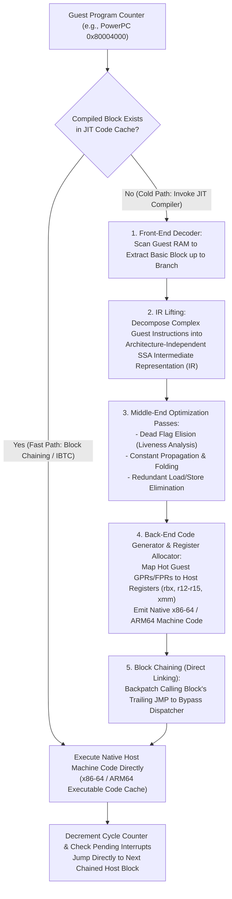
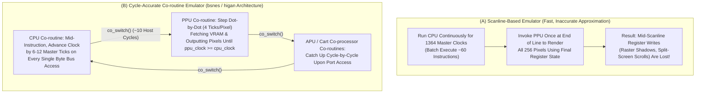

The Nintendo Entertainment System (1983), the Super Nintendo Entertainment System (1990), the Sony PlayStation 2 (2000), and the Nintendo GameCube (2001) were not general-purpose personal computers. They were highly specialized <strong>constellations of custom silicon (ASICs and custom LSI chips)</strong>. Working under tight transistor budgets and aggressive manufacturing cost constraints, hardware engineers of the 1980s through the early 2000s etched bespoke instruction set extensions, custom Picture Processing Units (PPUs) capable of hardware tile composition and per-scanline affine transformations (such as SNES Mode 7), custom Audio Processing Units (APUs) with dedicated DSP waveform synthesizers, and intricate DMA bus matrices directly into silicon wafers.

Yet today, without owning a single piece of that original silicon, we can boot commercial ROM images and optical discs from those consoles on a general-purpose PC or smartphone powered by an Intel/AMD x86-64 processor or an Apple Silicon ARM64 chip—often running at higher internal resolutions, rock-solid frame rates, and lower input latency than the original console connected to a cathode-ray tube (CRT) television. The software discipline that makes this possible is <strong>hardware emulation</strong>.

At first glance, this should strike any computer scientist or electrical engineer as astonishing. The Ricoh 5A22 CPU inside a Super Nintendo, or the 128-bit MIPS R5900 "Emotion Engine" inside a PlayStation 2, shares virtually nothing with a modern x86-64 processor: not its binary instruction encoding, not its register file layout, not its memory address space, not its floating-point rounding rules, and certainly not its physical pin-level interrupt timing. How can a pure software program running on an alien architecture reproduce the exact behavior of physical transistors, crystal oscillators, and data buses down to the individual clock tick? And why did emulating a <strong>mere $3.58\,\text{MHz}$ Super Nintendo</strong> with 100% cycle accuracy famously require a <strong>$3\,\text{GHz}$ modern desktop CPU</strong>—nearly a thousandfold increase in clock frequency?

In this comprehensive treatise, we deconstruct the engineering and theoretical foundations of modern hardware emulators. We begin with <strong>Alan Turing's 1936 Universal Turing Machine</strong> and the mathematical isomorphism between synchronous digital logic circuits and finite-state transition functions. We then examine <strong>CPU interpretation and superscalar branch prediction bottlenecks</strong>, dissect the internal pipeline of <strong>Dynamic Binary Translation (JIT / Dynarec)</strong> engines (as pioneered in projects like <strong>Dolphin</strong>, <strong>PCSX2</strong>, <strong>RPCS3</strong>, <strong>QEMU TCG</strong>, and <strong>Apple Rosetta 2</strong>), uncover how <strong>Fastmem</strong> hijacks the host operating system's hardware Memory Management Unit (MMU) to execute guest memory loads in a single native instruction, and finally confront the ultimate challenge in emulation: <strong>cycle-accurate multi-chip concurrency, non-IEEE-754 floating-point quirks, Run-Ahead latency elimination, and the cultural imperative of digital preservation</strong>.

---

## Chapter 1: From Silicon to Mathematics — The Universal Turing Machine and Hardware Isomorphism

### 1.1 The Miracle of $U(\langle M \rangle, x) = M(x)$
The fact that one computer can completely impersonate another computer of radically different physical construction is not merely a clever programming trick; it is a direct consequence of the foundational theorem of computer science, proven by the British mathematician <strong>Alan Turing</strong> in his landmark 1936 paper, *"On Computable Numbers, with an Application to the Entscheidungsproblem."*

In that paper, Turing formalized the concept of algorithmic computation using an abstract device consisting of an infinite tape, a read/write head, and a finite table of state transitions—now known as a Turing Machine. More importantly, Turing proved that it is possible to construct a single <strong>Universal Turing Machine (UTM)</strong>, denoted $U$, which takes as its input both the encoded structural description $\langle M \rangle$ of *any* arbitrary Turing Machine $M$ and an input string $x$, and step-by-step computes the exact same output that $M$ would produce when given $x$:

$$U(\langle M \rangle, x) = M(x)$$

Combined with the <strong>Church-Turing Thesis</strong>, this equation serves as the mathematical existence proof for every hardware emulator ever written. If we let $M$ represent the physical hardware of a PlayStation 2 or a Super Nintendo, let $\langle M \rangle$ represent the emulator's source code encoding the exact logical rules of $M$'s circuits, and let $x$ represent the game ROM data plus the stream of controller button inputs, then any Turing-complete host computer $U$ executing $\langle M \rangle$ is guaranteed to produce the exact same sequence of states and audiovisual outputs $M(x)$ as the original console.

### 1.2 Digital Circuits as Deterministic Finite State Machines (FSMs)
A skeptic might object: *"Turing machines describe abstract mathematical tape manipulations, whereas real game consoles are physical electronic systems made of millions of transistors, capacitors, buses, and custom video chips driven by quartz crystals!"*

However, every synchronous digital integrated circuit—no matter how exotic its custom PPU or DSP architecture—is mathematically reducible to a <strong>Deterministic Finite State Machine (FSM)</strong> operating over discrete time steps defined by a master clock.

Consider the entirety of the state stored inside a digital game console at a discrete clock tick $t \in \mathbb{N}$:
- Every general-purpose register, program counter ($\text{PC}$), pipeline latch, and status flag inside the CPU.
- Every byte of Video RAM (VRAM), Object Attribute Memory (OAM), palette CGRAM, and internal pixel shift register inside the PPU.
- Every phase accumulator, envelope counter, and sample buffer inside the APU.
- Every bit stored across main Working RAM (WRAM) and cartridge SRAM.

Because all of these storage elements are finite collections of bistable flip-flops and SRAM cells, the total architectural state of the entire console at clock tick $t$ can be represented as a single finite bit-vector $S_t$ belonging to a finite state space $\mathcal{S} = \{0, 1\}^N$ (where $N$ is the total number of state bits in the machine). Similarly, let $I_t \in \mathcal{I}$ represent the external input vector latched at tick $t$ (such as controller button states or optical drive sector reads). Between clock tick $t$ and tick $t+1$, all the combinational logic gates (AND, OR, NOT, XOR, multiplexers, and adders) etched into the console's silicon compute two pure mathematical functions:

$$S_{t+1} = \delta(S_t, I_t)$$
$$O_t = \lambda(S_t, I_t)$$

Here, $\delta: \mathcal{S} \times \mathcal{I} \to \mathcal{S}$ is the <strong>state transition function</strong>, and $\lambda: \mathcal{S} \times \mathcal{I} \to \mathcal{O}$ is the <strong>output function</strong> that yields the RGB pixel voltages sent to the display and the pulse-code modulated (PCM) audio samples sent to the digital-to-analog converter (DAC).

Crucially, the Boolean algebra implemented physically by CMOS transistors switching between $0\,\text{V}$ and $3.3\,\text{V}/5\,\text{V}$ is <strong>mathematically isomorphic</strong> to the bitwise and arithmetic operations (`&`, `|`, `^`, `~`, `+`, `<<`) executed by a host CPU on `uint32_t` and `uint64_t` integers stored in host RAM. Silicon does not possess any "magical essence" that software lacks; silicon is merely a physical medium that evaluates $\delta(S_t, I_t)$ using electron flow. Provided that the emulator programmer knows the exact Boolean specification of $\delta$ and $\lambda$, software will evolve through the exact same state trajectory $S_0 \to S_1 \to S_2 \to \dots \to S_t$ down to the last bit.

### 1.3 Simulation vs. Emulation and the Real-Time Complexity Wall
In computer science, we draw a sharp distinction between <strong>simulation</strong> and <strong>emulation</strong>:
- <strong>Simulation</strong> models the underlying physical or internal processes of a system for analysis—for example, using SPICE to solve differential equations governing transistor gate capacitance and voltage transients. A circuit simulator may take three hours to compute one millisecond of console execution, and that is perfectly acceptable.
- <strong>Emulation</strong> reproduces the externally observable behavior and functional interfaces of a guest system on a host system so that unmodified guest software executes seamlessly.

Therefore, the central challenge of console emulation is not *computability* (Turing settled that in 1936), but <strong>computational complexity under a hard real-time deadline</strong>. An NTSC console refreshes its video frame at roughly $60\,\text{Hz}$—specifically, on the Super Nintendo, the master crystal oscillates at $21.477272\,\text{MHz}$, and a standard non-interlaced frame consists of $262$ scanlines of $1364$ master clock cycles each, yielding a frame rate of:

$$f_{\text{frame}} = \frac{21,477,272\,\text{Hz}}{262 \times 1364} \approx 60.0988\,\text{Hz} \implies T_{\text{frame}} \approx 16.639\,\text{ms}$$

In physical hardware, millions of logic gates across the CPU, PPU, APU, and cartridge co-processors evaluate their respective components of $\delta(S_t, I_t)$ <strong>simultaneously in parallel</strong> during every single nanosecond clock cycle. An emulator running on a sequential von Neumann host CPU must serialize all of that massive spatial parallelism into a sequential stream of host instructions—and it must finish computing all $357,368$ master clock ticks of a frame in <strong>less than $16.639\,\text{milliseconds}$</strong>, or else the audio buffer will underrun (causing crackles and pops) and the video frame rate will stutter. Bridging this vast gap between spatial hardware parallelism and sequential software execution is the art and science of emulator architecture.

---

## Chapter 2: Fundamentals of CPU Emulation — From Switch Interpreters to Direct Threaded Code

The heart of any emulator is its virtual Central Processing Unit (CPU), responsible for executing the machine code of the guest processor—whether a MOS 6502 (NES), a WDC 65C816 (SNES), a Motorola 68000 (Sega Genesis), a MIPS R3000A/R5900 (PS1/PS2), or an IBM PowerPC Gekko/Broadway (GameCube/Wii).

### 2.1 The Classical Fetch-Decode-Execute Switch Interpreter
The most straightforward way to emulate a guest CPU is to directly mirror its hardware <strong>Fetch $\to$ Decode $\to$ Execute</strong> cycle using a C/C++ or Rust `while` loop containing a large `switch` statement over the instruction opcode. This architecture is known as a <strong>Switch-Dispatch Interpreter</strong>.

Below is a representative C implementation of a classical switch interpreter for an 8-bit/16-bit accumulator-based guest CPU:

```c
// A classical Switch-Dispatch Interpreter loop
void cpu_run_timeslice(CPUState *cpu) {
    while (cpu->cycles_remaining > 0) {
        // 1. FETCH: Read the 8-bit opcode at the Program Counter (PC)
        uint8_t opcode = bus_read8(cpu, cpu->pc++);

        // 2. DECODE & EXECUTE: Branch to the appropriate instruction handler
        switch (opcode) {
            case 0xA9: { // LDA #imm (Load Immediate into Accumulator A)
                uint8_t imm = bus_read8(cpu, cpu->pc++);
                cpu->a = imm;
                cpu->flag_z = (cpu->a == 0);
                cpu->flag_n = (cpu->a & 0x80) != 0;
                cpu->cycles_remaining -= 2;
                break;
            }
            case 0x69: { // ADC #imm (Add Immediate with Carry to Accumulator A)
                uint8_t imm = bus_read8(cpu, cpu->pc++);
                uint16_t sum = (uint16_t)cpu->a + (uint16_t)imm + (cpu->flag_c ? 1 : 0);
                // Signed overflow occurs if both inputs have the same sign,
                // which differs from the sign of the sum:
                cpu->flag_v = (~(cpu->a ^ imm) & (cpu->a ^ sum) & 0x80) != 0;
                cpu->flag_c = (sum > 0xFF);
                cpu->a = (uint8_t)sum;
                cpu->flag_z = (cpu->a == 0);
                cpu->flag_n = (cpu->a & 0x80) != 0;
                cpu->cycles_remaining -= 2;
                break;
            }
            case 0x4C: { // JMP abs (Unconditional Jump to 16-bit absolute address)
                uint16_t target = bus_read16(cpu, cpu->pc);
                cpu->pc = target;
                cpu->cycles_remaining -= 3;
                break;
            }
            // ... 253 additional opcode handlers ...
        }
    }
}
```

A switch interpreter is clean, portable, easy to debug, and trivially allows cycle-exact interrupt polling between every instruction. For early 8-bit consoles running at $1.79\,\text{MHz}$, a naive switch loop runs effortlessly on any modern CPU. However, as soon as we attempt to emulate 32-bit and 64-bit consoles running at tens or hundreds of megahertz, the switch interpreter hits a devastating microarchitectural wall.

### 2.2 The Superscalar Nightmare: Indirect Branch Misprediction Penalties
Why is `switch (opcode)` so slow on modern processors? When a C compiler (GCC, Clang, or MSVC) compiles a dense 256-case `switch` statement, it emits a lookup table of code addresses (a jump table) and a <strong>single indirect branch instruction</strong> at the top of the `while` loop—for example, `jmp qword ptr [r12 + rax*8]` on x86-64.

Modern superscalar, out-of-order processors (such as Intel Core, AMD Zen, or Apple M-series cores) achieve their high Instructions Per Cycle (IPC) by maintaining deep instruction pipelines (14 to 20+ stages) and speculatively executing hundreds of instructions ahead of the retirement point. Whenever the CPU front-end encounters an indirect jump (`jmp [reg]`), it must consult its hardware <strong>Indirect Branch Predictor</strong> and <strong>Branch Target Buffer (BTB)</strong> to guess where that jump will land *before* the target address is even computed.

In a switch interpreter, <strong>every single guest instruction transition funnel-necks through that one identical host `jmp` instruction address</strong>. As the guest program executes `LDA` $\to$ `ADC` $\to$ `STA` $\to$ `INX` $\to$ `BNE`, the target of that single host `jmp` instruction changes erratically on every iteration among 256 possible handler addresses. Even with modern TAGE/ITTAGE indirect branch predictors that index into history tables using recent branch paths, funneling all 256 opcodes through a single program counter address causes severe aliasing and BTB thrashing. Each time the hardware branch predictor guesses the wrong opcode handler, the CPU must flush its entire speculative pipeline—incurring a <strong>15- to 20-cycle branch misprediction penalty</strong> just to dispatch a single guest instruction!

### 2.3 Direct Threaded Code (Computed Goto) and Tail-Call Interpreters
To alleviate BTB contention without abandoning interpretation, emulator authors employ <strong>Direct Threaded Code</strong> using the GCC/Clang labels-as-values extension (`&&label` and `goto *expr`). Instead of jumping back to the top of the `while` loop after each opcode (`break;`), we duplicate the fetch-and-dispatch sequence at the very end of *every single opcode handler*:

```c
// Direct Threaded Code using Computed Goto (&&label)
void cpu_run_threaded(CPUState *cpu) {
    static const void * const dispatch_table[256] = {
        [0x00] = &&op_BRK,
        // ...
        [0x4C] = &&op_JMP_abs,
        [0x69] = &&op_ADC_imm,
        [0xA9] = &&op_LDA_imm,
        // ...
    };

    #define DISPATCH() do { \
        if (cpu->cycles_remaining <= 0) return; \
        uint8_t next_op = bus_read8(cpu, cpu->pc++); \
        goto *dispatch_table[next_op]; \
    } while (0)

    DISPATCH(); // Kick off execution

op_LDA_imm: {
        uint8_t imm = bus_read8(cpu, cpu->pc++);
        cpu->a = imm;
        cpu->flag_z = (cpu->a == 0);
        cpu->flag_n = (cpu->a & 0x80) != 0;
        cpu->cycles_remaining -= 2;
        DISPATCH(); // Emits a dedicated indirect jmp instruction strictly for LDA!
    }

op_ADC_imm: {
        uint8_t imm = bus_read8(cpu, cpu->pc++);
        // ... ADC arithmetic ...
        cpu->cycles_remaining -= 2;
        DISPATCH(); // Emits a dedicated indirect jmp instruction strictly for ADC!
    }

op_JMP_abs: {
        cpu->pc = bus_read16(cpu, cpu->pc);
        cpu->cycles_remaining -= 3;
        DISPATCH();
    }
}
```

By placing a separate `DISPATCH()` macro at the end of all 256 handlers, the compiler emits <strong>256 distinct indirect `jmp` instructions</strong> at 256 different host addresses. Because real-world machine code exhibits strong first-order Markov correlation between consecutive instructions (for instance, a `CMP` compare instruction is followed by a `BEQ` or `BNE` conditional branch over 90% of the time), giving the `CMP` handler its own private indirect branch instruction allows the host CPU's BTB to associate `CMP`'s host address directly with the `BNE` handler's target address!

An increasingly popular modern alternative to computed goto is the <strong>Tail-Call Interpreter</strong> (enabled via C++20/Clang's `[[clang::musttail]]` attribute). Here, each opcode handler is a separate small function with an identical signature `void op_handler(CPUState *cpu, uint32_t pc, int64_t cycles)` that ends with `[[clang::musttail]] return dispatch_table[next_op](cpu, pc, cycles);`. Not only does this provide dedicated indirect jump sites per opcode, it also forces the compiler to keep hot guest state (`pc`, `cycles`, and key registers) permanently pinned inside host calling-convention registers (`rdi`, `rsi`, `rdx`, `rcx`) across transitions without ever growing the call stack.

Yet even the most finely tuned threaded or tail-call interpreter remains bound by a fundamental ceiling: <strong>an interpreter has no memory of the past</strong>. If a guest game runs an inner loop 10,000 times per frame, the interpreter fetches the exact same guest bytes 10,000 times, extracts register indices via bit-shifts and masks 10,000 times, jumps through the dispatch table 10,000 times, and computes status flags 10,000 times—burning 15 to 50 host instructions for every 1 guest instruction.

---

## Chapter 3: Anatomy of Dynamic Binary Translation (DBT / JIT Dynarec) — Inside Dolphin, PCSX2, RPCS3, and Rosetta 2

To emulate complex 32-bit and 64-bit consoles (Nintendo 64, Dreamcast, PlayStation 2, GameCube, Wii, PlayStation 3, Xbox 360, Nintendo Switch) at full speed, emulators abandon per-instruction interpretation altogether in favor of <strong>Dynamic Binary Translation (DBT)</strong>—universally known in emulator engineering as <strong>Dynamic Recompilation (Dynarec)</strong> or <strong>Just-In-Time (JIT) Compilation</strong>.

### 3.1 The JIT Recompilation Pipeline
Instead of decoding and executing one guest instruction at a time, a JIT recompiler waits until the guest Program Counter ($\text{PC}$) lands on an uncompiled address, scans forward through guest memory until it hits a control-flow terminating instruction (a branch, jump, call, or system call) to extract a contiguous <strong>Basic Block</strong> (or multi-exit <strong>Superblock / Trace</strong>), translates that entire block of guest machine code into optimized <strong>native host machine code (x86-64 or ARM64)</strong>, writes the generated machine bytes into an executable memory buffer (the <strong>Code Cache</strong>), and jumps directly into it. Every subsequent time the guest $\text{PC}$ visits that block, the emulator executes the native host assembly directly at bare-metal speed.

The complete architectural pipeline of a modern IR-based JIT recompiler is illustrated below:



Let us examine the five key compiler engineering techniques that give modern Dynarecs their extraordinary performance.

### 3.2 Basic Block Extraction and Lifting to SSA Intermediate Representation (IR)
Early 1990s Dynarecs translated guest instructions directly into host instructions via simple 1-to-N macro templates. Modern emulators (such as Citra, Ryujinx, RPCS3, and QEMU TCG) instead <strong>lift</strong> guest machine instructions into an architecture-neutral <strong>Static Single Assignment (SSA) Intermediate Representation (IR)</strong> before emitting host code.

Why lift to an IR? Because a single guest instruction in architectures like PowerPC, ARM, or 68000 rarely performs just one operation; it bundles the primary arithmetic operation together with multiple implicit side effects—updating four condition code flags, checking for overflow traps, or post-incrementing an address register. By decomposing each guest instruction into fine-grained SSA micro-operations where every variable is assigned exactly once, the JIT compiler exposes all of those implicit side effects to standard dataflow optimization passes.

### 3.3 Dead Flag Elision (Lazy Flag Evaluation) — Cutting Emitted Instructions by $3\times$
Among all optimizations performed by a CPU emulator's JIT middle-end, none yields a larger speedup than <strong>Dead Flag Elision (Dead Flag Elimination)</strong>.

In most processor architectures—including ARM, 6502, 68000, x86, and PowerPC record-form instructions—almost every arithmetic or logical operation updates four architectural status flags in the condition register:
- <strong>N (Negative / Sign)</strong>: Set if the most significant bit (MSB) of the result is $1$.
- <strong>Z (Zero)</strong>: Set if the result is identically $0$.
- <strong>C (Carry)</strong>: Set if an unsigned carry-out (or borrow) occurred out of the MSB.
- <strong>V (Overflow)</strong>: Set if signed two's-complement arithmetic overflow occurred.

If a naive translator emits host instructions to compute and store N, Z, C, and V into `cpu->flags` after every guest `ADD`, `SUB`, `AND`, or `SHIFT`, each guest instruction explodes into <strong>10 to 15 host bit-manipulation instructions</strong>—especially when guest flag definitions subtly differ from host flag definitions (for example, subtraction carry/borrow semantics on ARM and 6502 are inverted relative to x86's `CF` borrow flag!).

Now observe what happens in a typical sequence of four guest instructions inside a basic block:

```nasm
; A 4-instruction sequence inside a Guest CPU Basic Block
ADDS r0, r1, #4      ; r0 = r1 + 4  (Computes and writes N, Z, C, V flags)
ADDS r2, r3, r0      ; r2 = r3 + r0 (OVERWRITES N, Z, C, V flags!)
SUBS r4, r2, #1      ; r4 = r2 - 1  (OVERWRITES N, Z, C, V flags again!)
BNE  loop_target     ; Branches based ONLY on the Z (Zero) flag of SUBS!
```

Look closely at the dataflow of the condition flags across these four instructions:
1. The N, Z, C, and V flags computed by the first `ADDS` instruction are <strong>never read by any instruction</strong> before being completely overwritten by the second `ADDS` instruction!
2. The N, Z, C, and V flags computed by the second `ADDS` instruction are likewise <strong>completely overwritten</strong> by the third instruction (`SUBS`) without ever being inspected!
3. Even in the third instruction (`SUBS`), the trailing conditional branch `BNE` (*Branch if Not Equal*) only tests the <strong>Z (Zero) flag</strong>. If the target basic block immediately overwrites the flags upon entry, then the N, C, and V flags produced by `SUBS` are also dead!

Empirical profiling across commercial console games reveals a startling law of computer architecture: <strong>between 85% and 95% of all condition flags computed by a CPU are dead stores that are overwritten before they are ever read.</strong>

By running a fast backward <strong>Liveness Analysis</strong> pass over the lifted SSA IR of a basic block, the JIT compiler marks flag-computation IR nodes as dead unless a subsequent instruction (or live-out branch exit) actually consumes them:

```c
// [BEFORE OPTIMIZATION] Naive Per-Instruction Translation
r0 = r1 + 4;
compute_and_store_nzcv_add(r1, 4, r0);     // <-- 100% DEAD! Eliminated by JIT!

r2 = r3 + r0;
compute_and_store_nzcv_add(r3, r0, r2);    // <-- 100% DEAD! Eliminated by JIT!

r4 = r2 - 1;
compute_and_store_nzcv_sub(r2, 1, r4);     // <-- N, C, V are DEAD! Only Z is live!
if (!cpu->flag_z) goto loop_target;

// [AFTER OPTIMIZATION] Native x86-64 Code Emitted by JIT Compiler
lea eax, [rcx + 4]      ; r0 = r1 + 4 (LEA doesn't even touch flags)
lea edx, [rbx + rax]    ; r2 = r3 + r0
mov esi, edx
sub esi, 1              ; r4 = r2 - 1 (Naturally sets host x86-64 ZF flag!)
jnz host_loop_target    ; Branches directly using the host CPU's native ZF flag!
```

What would have taken 45+ host instructions in an interpreter or unoptimized translator collapses into <strong>five single-cycle native x86-64 instructions</strong> that execute in under 2 nanoseconds! (Notably, when Apple engineered the M1/M2/M3/M4 ARM64 processors to run x86-64 binaries via <strong>Rosetta 2</strong>, they took this principle so seriously that they baked a proprietary hardware mode bit directly into Apple Silicon's `PSTATE` register that forces the ARM64 ALU to generate exact x86 parity, adjust, carry, and overflow semantics in hardware during translated execution.)

### 3.4 Register Allocation and Block Chaining (Direct Block Linking)
The second pillar of JIT performance is <strong>Register Allocation</strong>. Console RISC processors like the PlayStation 2's MIPS R5900 or the GameCube's PowerPC 750CXe possess 32 General-Purpose Registers (`GPR[0..31]`) and 32 Floating-Point/Vector Registers (`FPR[0..31]`). Meanwhile, an x86-64 host CPU provides 16 general-purpose 64-bit registers (`rax` through `r15`) and 16 to 32 vector registers (`xmm0` through `xmm15`/`zmm31`).

If the emitted JIT code had to load guest registers from the `cpu->gpr[]` struct in memory before every arithmetic operation and write them back afterward, L1 cache load-to-use latency (typically 4 to 5 cycles) would cripple execution speed. Instead, the JIT back-end runs a <strong>Linear Scan Register Allocator</strong>:
- Dedicated host registers are permanently reserved for critical emulator pointers: for example, `rbp` holds the base pointer to the `CPUState` struct, and `rbx` holds the base pointer to the 4 GB Fastmem virtual memory arena.
- The remaining host callee-saved and scratch registers (`r12`–`r15`, `rsi`, `rdi`, `r8`–`r11`) are dynamically mapped to the most frequently accessed guest GPRs within the current basic block, while host `xmm0`–`xmm15` registers hold guest floating-point and SIMD registers. Guest values remain exclusively inside physical silicon registers throughout the block and are only spilled back to `cpu->gpr[]` in RAM at block exits or before function calls.

Furthermore, when compiled Basic Block $B_1$ finishes executing and transitions to guest address `0x80004020` (Block $B_2$), returning to the C++ dispatcher loop to look up `0x80004020` in a hash table would waste dozens of cycles. To eliminate dispatcher overhead entirely, JIT engines implement <strong>Block Chaining (Direct Block Linking)</strong>:

1. When Block $B_1$ is first compiled, its target Block $B_2$ may not yet exist in the Code Cache. Therefore, $B_1$ initially ends with a `jmp` to a small trampoline stub that invokes the dispatcher.
2. The first time that trampoline is taken, the JIT compiles Block $B_2$ at host address `0x7FFF2000`. Immediately after compiling $B_2$, the runtime <strong>overwrites (backpatches) the 32-bit relative displacement of the `jmp` instruction at the end of Block $B_1$ so that it jumps directly to `0x7FFF2000`!</strong>
3. From that moment onward, execution flows seamlessly from native block to native block (`B1 -> B2 -> B3 -> B1`) inside the Code Cache without ever returning to the emulator's C++ loop, pausing only when the decremented cycle counter reaches zero to service a hardware interrupt.
4. For <strong>dynamic indirect branches</strong> whose target guest address is only known at runtime (such as function returns `jr $ra` / `blr` or C++ virtual method tables), the JIT emits an inline lookup into a small <strong>Indirect Branch Translation Cache (IBTC)</strong>—an array of `[guest_pc, host_code_ptr]` pairs indexed by a fast hash of the target register—resolving 99% of indirect jumps in 4 host instructions without leaving the Code Cache.

### 3.5 Self-Modifying Code (SMC) and Instruction Cache Coherency
A fundamental hazard of caching translated native code is <strong>Self-Modifying Code (SMC)</strong> and dynamic code overlays. Because historical consoles had tight RAM budgets (e.g., 2 MB on PS1, 4 MB on N64, 24 MB on GameCube), games routinely loaded new executable overlays from disc into the exact same RAM addresses previously occupied by older code, unpacked compressed binaries into RAM at runtime, or dynamically patched immediate operands inside tight rendering loops.

If a game overwrites instructions at guest RAM address `0x80010000`, any previously compiled native x86-64 block in the JIT Code Cache corresponding to `0x80010000` instantly becomes <strong>stale</strong>. Executing that stale cache will run the old code and crash the game. Emulators maintain JIT cache coherency using three mechanisms:

1. <strong>Explicit Cache Invalidation Instructions</strong>: On RISC architectures with split instruction and data caches (like PowerPC on GameCube/Wii), the real CPU hardware also requires the game programmer to explicitly issue `dcbf` (Data Cache Block Flush) and `icbi` (Instruction Cache Block Invalidate) instructions after modifying code in RAM. The emulator simply hooks the `icbi` instruction to evict the corresponding JIT block!
2. <strong>OS Page Write-Protection Traps (`mprotect` / `VirtualProtect`)</strong>: On architectures where the CPU automatically snoop-invalidates its own cache or where games modify code without cache instructions (e.g., x86 guests on Xbox, or PS1/N64 games), the JIT marks the host memory page (4 KB) backing any compiled guest code as <strong>Read-Only (`PROT_READ` / `PAGE_READONLY`)</strong>. The instant the guest program attempts to write to that RAM page, the host CPU triggers a hardware page fault (`SIGSEGV` on Linux/macOS, `STATUS_ACCESS_VIOLATION` via Vectored Exception Handling on Windows). The emulator's fault handler catches the signal, invalidates all JIT blocks overlapping that 4 KB page, restores write permissions (`PROT_READ | PROT_WRITE`), and resumes execution.
3. <strong>Software SMC Dirty Tables & Block Hash Verification</strong>: If a game places frequently mutated global variables on the *same* 4 KB page as executable code (false sharing), OS page-fault traps will fire thousands of times per second and tank performance. For such pages, the emulator switches to setting a software dirty bit or emitting a fast 64-bit checksum check at the prologue of the compiled block to verify that the underlying guest RAM bytes have not changed.

---

## Chapter 4: Memory Subsystems and Fastmem — Hijacking the Host Hardware MMU

In typical machine code, <strong>30% to 40% of all executed instructions are memory loads and stores</strong>. Even if a JIT compiler reduces arithmetic instructions to near-zero overhead, the emulator will still crawl if every guest memory read (`lw`, `lb`) and write (`sw`, `sb`) requires calling a complex C function to decode the target address.

### 4.1 The Challenge of Non-Uniform Console Memory Maps and MMIO
Why can't an emulator simply allocate a flat array `uint8_t ram[SIZE]` and translate a guest memory read into `ram[guest_addr]`? Because a console's physical address space is not a single contiguous block of RAM; it is a fragmented patchwork of RAM, mirrored address ranges, ROM banks, scratchpad caches, and <strong>Memory-Mapped I/O (MMIO) hardware registers</strong>.

Consider a simplified 32-bit console address map:
- `0x0000_0000` – `0x01FF_FFFF`: 32 MB Main WRAM
- `0x0200_0000` – `0x03FF_FFFF`: Mirror of Main WRAM (addresses wrap via `addr & 0x01FFFFFF`)
- `0x1000_0000` – `0x1000_FFFF`: <strong>Memory-Mapped I/O (MMIO) Registers</strong> (GPU command FIFOs, DMA channel triggers, audio registers, interrupt controllers)
- `0x1FC0_0000` – `0x1FFF_FFFF`: 4 MB Boot ROM (Read-Only; writes must be silently ignored)

Notice the crucial role of <strong>MMIO</strong>. When a game wants to start a DMA transfer or upload vertices to the GPU, it executes a standard CPU store instruction (such as `sw t0, 0(s1)`) targeting a special physical address like `0x10003000`. That write does not store data in RAM; on real silicon, the address decoder routes the write strobe directly to the DMA controller chip, immediately triggering a hardware side effect.

In a naive emulator using software bus dispatch, *every single load and store instruction* in the guest program must pass through an address classifier:

```c
// Naive Software Bus Dispatch: Runs on EVERY guest memory write!
void bus_write32(System *sys, uint32_t addr, uint32_t val) {
    if (addr < 0x04000000) {
        // Main RAM and its mirror (mask to 32 MB)
        *(uint32_t *)(&sys->ram[addr & 0x01FFFFFF]) = val;
    } else if (addr >= 0x10000000 && addr < 0x10010000) {
        // Memory-Mapped I/O Register: Trigger hardware side effects!
        mmio_dispatch_write(sys, addr, val);
    } else if (addr >= 0x1FC00000 && addr < 0x20000000) {
        // Boot ROM is read-only; ignore writes
        return;
    } else {
        // Unmapped physical address: raise Guest Bus Error exception
        cpu_raise_exception(sys->cpu, EXC_BUS_ERROR, addr);
    }
}
```

Even though <strong>over 99.9% of all memory accesses at runtime target ordinary RAM</strong>, a software bus dispatcher forces the host CPU to execute multiple comparisons, branches, and function calls on every load and store just to guard against the 0.1% of accesses that hit MMIO!

### 4.2 Software TLBs and the "Fastmem" Virtual Memory Trick
A first-generation optimization replaces the `if-else` chain with a <strong>Software Translation Lookaside Buffer (Software TLB)</strong>—a flat lookup array `uintptr_t soft_tlb[1048576]` indexed by the upper 20 bits of the 32-bit guest address (`addr >> 12`, representing 4 KB pages). If a page belongs to RAM, its table entry holds the precomputed pointer offset to the backing host memory; if the page contains MMIO registers, the entry sets a tag bit in the lowest bit (`bit 0 = 1`), prompting the JIT code to branch to a slow-path helper function. This reduces a RAM access to roughly 6–8 host instructions.

Can we do even better? Can we compress a guest memory load or store—including address translation, RAM mirroring, and MMIO trapping—down to <strong>a single native host assembly instruction with zero branches</strong>?

Yes. Modern 64-bit emulators (Dolphin, PCSX2, RPCS3, Citra, Ryujinx) achieve this through a brilliant systems programming technique known as <strong>Fastmem (Hardware MMU-Accelerated Memory Access)</strong>.

On a 64-bit operating system (Windows, Linux, macOS), each user-space process enjoys an enormous virtual address space of $128\,\text{TB}$ (48-bit) to $16\,\text{EB}$. Fastmem exploits the host CPU's own hardware Memory Management Unit (MMU) and hardware TLB to impersonate the guest console's memory map:

1. <strong>Reserve a 4 GB Virtual Arena</strong>: At startup, the emulator calls `mmap` (on Linux/macOS) or `VirtualAlloc` (on Windows) to reserve a contiguous <strong>$4\,\text{GB}$ ($2^{32}$ bytes) region of virtual address space</strong>, whose base address we store in a dedicated host register, say `rbx = 0x00007F0000000000`. Reserving virtual address space consumes zero physical RAM.
2. <strong>Hardware Aliasing via Shared Memory Views</strong>: Using OS shared-memory primitives (`shm_open` + `mmap(MAP_FIXED)` on POSIX, or `CreateFileMapping` + `MapViewOfFileEx` on Windows), the emulator maps the exact same 32 MB physical allocation of Main WRAM into `rbx + 0x00000000` *and simultaneously maps a second virtual view of that same physical memory* into the mirror region at `rbx + 0x02000000`!
3. <strong>Locking MMIO Pages as `PROT_NONE`</strong>: All virtual pages inside the 4 GB arena that correspond to <strong>MMIO hardware registers</strong> (`rbx + 0x10000000`) or unmapped regions are deliberately left with <strong>no read/write permissions (`PROT_NONE` / `PAGE_NOACCESS`)</strong>.

With this virtual memory layout in place, look at the native x86-64 machine code emitted by the JIT compiler for any guest 32-bit store instruction:

```nasm
; [FASTMEM ENABLED] Emitted x86-64 code for a Guest 32-bit Store (sw r_val, 0(r_addr))
; rbx = Base address of the 4 GB Fastmem Virtual Arena (0x00007F0000000000)
; edi = 32-bit Guest Address (automatically zero-extended to 64-bit rdi)
; eax = 32-bit Value to store

mov dword ptr [rbx + rdi], eax   ; <-- JUST ONE HOST INSTRUCTION! Zero branches!
```

When the guest accesses Main RAM or any of its mirrors (99.9% of execution), the host CPU's hardware MMU and L1 D-TLB translate `rbx + rdi` in <strong>zero extra clock cycles</strong>, executing at the full native memory bandwidth of the host machine!

And what happens during the 0.1% of instructions where `edi` holds an MMIO register address like `0x10003000`?
1. As soon as `mov dword ptr [rbx + rdi], eax` executes, the host CPU's hardware MMU sees that the page at `rbx + 0x10003000` has `PROT_NONE` permissions and immediately raises a <strong>Hardware Page Fault</strong>.
2. The OS kernel delivers the fault to the emulator's registered user-space exception handler (`SIGSEGV` action or Windows Vectored Exception Handler).
3. The fault handler inspects the faulting host instruction pointer (`RIP`) and faulting virtual address (`CR2`), disassembles the faulting `mov` instruction to identify the source register (`eax`), and calls `mmio_dispatch_write(sys, 0x10003000, eax)` to execute the hardware side effect!
4. <strong>Dynamic Backpatching</strong>: Because taking an OS kernel page fault costs several microseconds, we do not want that specific instruction to fault again on the next frame. Therefore, before returning from the exception handler, the emulator <strong>dynamically rewrites (backpatches) the `mov dword ptr [rbx + rdi], eax` instruction in the JIT Code Cache into a direct `jmp`/`call` to a slow-path MMIO thunk</strong> (having left a few bytes of `nop` padding around memory instructions during JIT emission for this exact purpose). Consequently, every RAM access executes in 1 native instruction, and every MMIO access faults *at most once* in the entire lifetime of the program before converting itself into a direct function call!

---

## Chapter 5: Concurrency, Timing, and Cycle Accuracy — Why Emulating a 3.58 MHz SNES Required a 3 GHz PC

Dynamic recompilation and Fastmem solved the throughput problem for 3D-era consoles whose workloads are dominated by heavy CPU math and vertex processing. Yet in the realm of 8-bit and 16-bit 2D consoles, a completely different architectural monster lurks: <strong>fine-grained multi-chip concurrency and cycle-accurate timing</strong>.

In 2011, the late <strong>Near (formerly known as byuu)</strong>, creator of the landmark Super Nintendo emulator <strong>bsnes (later higan and Ares)</strong>, published an influential technical essay titled *"Accuracy takes power: one man's 3GHz quest to build a perfect SNES emulator."* Near explained a paradox that baffled casual observers: early SNES emulators like ZSNES (written in 1997) could run *Super Mario World* at 60 FPS on a $100\,\text{MHz}$ Pentium processor, yet achieving <strong>100% cycle-accurate emulation</strong> across the entire commercial SNES library in `bsnes` required a <strong>$3\,\text{GHz}$ modern Core 2 Duo / Core i7 processor</strong>—nearly a $1000\times$ clock speed multiplier over the original console's $3.58\,\text{MHz}$ CPU!

Why does perfect fidelity demand such astronomical computational power? Because a real game console is not a sequential program; it is a <strong>massively parallel synchronous circuit board</strong>.

### 5.1 True Hardware Parallelism Inside a Super Nintendo
Inside a physical Super Nintendo, a single master crystal oscillator ticking at $21.477272\,\text{MHz}$ drives at least <strong>six independent processors and state machines simultaneously in parallel</strong>:

1. <strong>The Main CPU (Ricoh 5A22 / WDC 65C816 core)</strong>: Steps through instructions at a variable bus clock—dividing the master clock by $6$ ($3.58\,\text{MHz}$ FastROM), by $8$ ($2.68\,\text{MHz}$ SlowROM/WRAM), or by $12$ ($1.79\,\text{MHz}$ controller serial ports) depending on the exact memory address accessed during each individual byte cycle of an instruction.
2. <strong>An 8-Channel DMA / HDMA Controller</strong>: Capable of halting the CPU mid-instruction to hijack the address bus and stream graphics data or per-scanline register updates to the PPU during Horizontal Blank (H-Blank).
3. <strong>Dual Picture Processing Units (S-PPU1 & S-PPU2)</strong>: Clocked at $1/4$ of the master clock ($5.37\,\text{MHz}$ dot clock), fetching background tilemaps, character bitplanes, and sprite attributes from VRAM/OAM to output <strong>one pixel every 4 master clock ticks ($\approx 186\,\text{nanoseconds}$)</strong>.
4. <strong>The Sony SPC700 Audio CPU</strong>: An independent 8-bit processor running on its own separate $24.576\,\text{MHz}$ ceramic oscillator, communicating with the main CPU through four asynchronous I/O ports (`$2140`–`$2143`).
5. <strong>The Sony S-DSP Digital Signal Processor</strong>: Mixing 8 voices of compressed BRR audio with Gaussian pitch interpolation and echo FIR filtering in lockstep with the SPC700.
6. <strong>Cartridge Enhancement Co-Processors</strong>: Full-fledged auxiliary CPUs inside the game cartridge itself—such as the <strong>SA-1</strong> in *Super Mario RPG* and *Kirby Super Star* (a second 65C816 CPU clocked at $10.74\,\text{MHz}$ running concurrently with the main CPU and arbitrating shared RAM access cycle-by-cycle!) or the <strong>Super FX</strong> RISC chip in *Star Fox* and *Yoshi's Island*.

### 5.2 Why Scanline-Based Emulators Break on Mid-Scanline Raster Effects
How did 1990s emulators like ZSNES run on a $100\,\text{MHz}$ Pentium? By cheating on time. They used <strong>Scanline-Based Emulation</strong>—a coarse batch processing approximation:
1. Run the CPU emulator continuously in a tight loop for $1364$ master clock cycles (one full horizontal scanline, roughly 50 to 80 CPU instructions).
2. Call the PPU renderer once to draw <strong>all 256 horizontal pixels of that scanline in a single batch</strong>, reading whatever values happen to sit in the PPU scroll, palette, and brightness registers at the *end* of the scanline.
3. Repeat 262 times per frame.

Batching an entire scanline at a time keeps the host CPU's instruction and data caches hot and reduces inter-chip context switching to just 262 times per frame. However, this illusion shatters whenever a game performs a <strong>Mid-Scanline Raster Effect</strong>—modifying PPU hardware registers while the cathode-ray electron beam is actively sweeping across the middle of a visible scanline!

A famous real-world example is the SNES game <strong>*Air Strike Patrol</strong>*. To render a darkened translucent shadow directly underneath the player's helicopter on the desert floor—when all hardware background layers and color math modes were already occupied—the developers wrote a timed CPU spin-loop that tracks the exact horizontal dot position of the CRT electron beam on every scanline. <strong>At the exact microsecond the electron beam reaches the left edge of the helicopter's shadow mid-scanline, the CPU writes to the PPU Master Brightness register (`$2100` INIDISP) to dim the television output; a few dozen pixels later, as the beam passes the right edge of the shadow, the CPU writes to `$2100` again to restore full brightness!</strong>

Think about what happens in a scanline-based emulator: because the CPU dims the brightness register mid-line and restores it back to normal before the scanline ends, when the scanline emulator finally invokes its batch PPU renderer at the end of the line, the brightness register holds its normal value—and <strong>the helicopter's shadow completely vanishes!</strong> Even worse, games like *Battletoads* (NES), *Chrono Trigger*, *Final Fantasy VI*, and *Speedy Gonzales* rely on exact cycle-level races between CPU register writes, DMA transfers, and PPU counters; if the CPU and PPU drift out of sync by even <strong>a single bus cycle (a few hundred nanoseconds)</strong>, a hardware status latch or interrupt fires on the wrong cycle, deadlocking the game in an infinite wait loop.

### 5.3 Cycle-Accurate (Dot-by-Dot) Synchronization via Ultra-Light Co-routines (`libco`)
To achieve 100% compatibility without game-specific hacks, an emulator must abandon scanline batching and advance the CPU, PPU, DMA, and APU in <strong>cycle-accurate lockstep</strong>—synchronizing their clocks on every single bus read/write (every 4 to 12 master clock ticks):



Implementing this in software presents a formidable systems engineering dilemma. A single 65C816 instruction like `INC $2100` (Read-Modify-Write) takes 6 bus cycles, reading the old value on cycle 4 and writing the new value to the PPU register on cycle 6. Meanwhile, the PPU is partway through a complex multi-cycle tile-fetching pipeline. If you try to advance both chips tick-by-tick using traditional function calls that `return` after every clock cycle, you have to rip apart every loop and instruction handler in the CPU, PPU, and APU into giant, unreadable state-machine `switch` statements that save every local variable inside heap structs. Conversely, if you put the CPU and PPU on separate OS kernel threads (`pthread` / `std::thread`) and synchronize them via mutexes millions of times per second, OS kernel context-switching overhead (thousands of cycles per switch) will slow the emulator to 0.01 FPS.

Near solved this dilemma with breathtaking elegance by introducing <strong>ultra-lightweight user-space cooperative threads (Co-routines / Fibers)</strong> via a custom assembly library called <strong>`libco`</strong>:
- Each emulated chip (CPU, PPU, SMP, DSP, SA-1) runs in its own allocated stack frame with natural, readable nested loops and local variables.
- Inside the CPU's `bus_read8()` and `bus_write8()` functions—executed multiple times *inside* a single guest instruction—the CPU increments its master clock counter (`cpu_clock += 6`). Whenever `cpu_clock` pulls ahead of `ppu_clock`, it invokes `co_switch(ppu_coroutine)`.
- `co_switch()` is a 12-instruction hand-written assembly routine that saves only the 6 callee-saved host registers (`rbx`, `rbp`, `r12`–`r15`) and swaps the host stack pointer (`rsp`), jumping directly into the middle of the PPU's pixel-rendering loop in <strong>roughly 10 to 15 host clock cycles (less than 5 nanoseconds)</strong> without ever touching the OS kernel!
- Combined with <strong>Just-In-Time (Catch-Up) Synchronization</strong>—allowing a chip to run ahead until another chip actually reads or writes a shared communication port or register, and then stepping the lagging chip forward to the exact timestamp `t` of the interaction—cooperative multi-threading delivers mathematically exact cycle accuracy while remaining fast enough to run in real time on a 3 GHz processor.

Let us summarize the architectural trade-offs across CPU, memory, and synchronization paradigms in the comprehensive comparison table below:

| Subsystem | Architectural Technique | Core Mechanism | Execution Speed (Host Load) | Fidelity & Compatibility | Representative Emulators |
| :--- | :--- | :--- | :--- | :--- | :--- |
| <strong>CPU Execution</strong> | <strong>Switch Interpreter</strong> | Single `switch(opcode)` loop fetching and executing one instruction at a time | Slow (15–50 host insts/guest inst + heavy BTB mispredictions) | <strong>Exact</strong> (Trivial to inject cycle-granular interrupts) | Early 8/16-bit emulators, reference debuggers |
| <strong>CPU Execution</strong> | <strong>Direct Threaded / Tail-Call</strong> | Appends `goto *table[op]` or `musttail` call to every handler to separate BTB entries | Moderate ($1.3\times\text{–}2\times$ faster than switch loop) | <strong>Exact</strong> | SameBoy, Mesen, mGBA, QEMU TCI |
| <strong>CPU Execution</strong> | <strong>JIT / Dynarec (Dynamic Binary Translation)</strong> | Lifts basic blocks to SSA IR, eliminates dead flags, allocates host registers, emits native code | <strong>Ultra-Fast</strong> ($5\times\text{–}50\times$ faster than interpreters) | High (Requires SMC page traps & block-boundary interrupt approximation) | Dolphin, PCSX2, RPCS3, Citra, Ryujinx, Rosetta 2 |
| <strong>OS / Coprocessor</strong> | <strong>HLE (High-Level Emulation)</strong> | Intercepts BIOS/OS syscalls or DSP microcode and replaces them with native C++/Vulkan code | <strong>Fastest Possible</strong> (Bypasses low-level execution entirely) | Medium–Low (Breaks on custom microcode or undocumented hardware quirks) | UltraHLE, PPSSPP, Dolphin (HLE DSP), RPCS3 (Lv2 Kernel) |
| <strong>Memory (MMU)</strong> | <strong>Software Bus Dispatch / Soft-TLB</strong> | Checks address ranges via `if-else` or 4 KB page array on every guest load/store | Slow–Moderate (Adds 6–20 host instructions to every memory access) | <strong>100% Exact</strong> (Easily models open-bus capacitance and bus contention) | bsnes/higan, Mesen, Genesis Plus GX |
| <strong>Memory (MMU)</strong> | <strong>Fastmem (Hardware MMU Hijacking)</strong> | Reserves 4 GB virtual arena, aliases RAM views, traps `PROT_NONE` MMIO via `SIGSEGV` + backpatching | <strong>Native Bare-Metal Speed</strong> (RAM access is a single `mov [rbx+rdi], eax`) | Very High (Near-exact when paired with backpatched MMIO thunks) | Dolphin, PCSX2, RPCS3, Citra, Ryujinx |
| <strong>Chip Sync</strong> | <strong>Scanline-Based Batching</strong> | Runs CPU for a full scanline (~1364 ticks), then renders all 256 pixels in one batch | <strong>Extremely Fast</strong> (High cache locality, 262 switches/frame) | Low (Breaks mid-scanline raster effects, split scrolls, and timing races) | ZSNES, early Snes9x, 1990s emulators |
| <strong>Chip Sync</strong> | <strong>Cycle-Accurate (Dot-by-Dot + Catch-Up)</strong> | Synchronizes CPU, PPU, DMA, and APU on every bus cycle via `libco` co-routines or event queues | High CPU Load (Requires multi-GHz host for 16-bit systems) | <strong>100% Bit-Exact</strong> (Reproduces every hardware quirk without per-game hacks) | bsnes / higan / Ares, Mesen, CEN64 |

---

## Chapter 6: Non-Standard Floating-Point Silicon, Run-Ahead Latency Elimination, FPGAs, and Digital Preservation

Beyond integer instructions, memory maps, and clock synchronization, modern emulation engineering pushes into domains that confront non-standard silicon arithmetic and even surpass the physical responsiveness of original hardware.

### 6.1 The IEEE 754 Rebel: PlayStation 2's Emotion Engine Floating-Point Quirks
Virtually every modern CPU (x86-64 and ARM64) adheres strictly to the <strong>IEEE 754 standard</strong> for floating-point arithmetic. In IEEE 754 single-precision (`float`), an 8-bit exponent of `0xFF` ($255$) is reserved for positive/negative <strong>Infinity (`+Inf` / `-Inf`)</strong> and <strong>Not-a-Number (`NaN`)</strong>, while an exponent of `0x00` represents gradual underflow via subnormal (denormal) numbers.

When Sony and Toshiba designed the PlayStation 2's <strong>Emotion Engine (EE)</strong> FPU and its twin vector co-processors (<strong>VU0 and VU1</strong>) in 1999, they made a radical engineering decision: to maximize 3D geometry throughput ($66\,\text{million polygons/sec}$) and simplify silicon exception logic, <strong>they discarded key rules of IEEE 754 and implemented a bespoke 32-bit floating-point format</strong>:
1. <strong>No `Infinity` and No `NaN`</strong>: On the PS2, an exponent of `0xFF` is *not* Infinity or `NaN`—it is treated as a <strong>valid, normal finite number</strong>, extending the representable dynamic range up to $\pm 6.8 \times 10^{38}$ (twice the exponent ceiling of standard IEEE 754 floats)!
2. <strong>Hardware Saturation (Clamping) on Overflow</strong>: When a multiplication or addition overflows the maximum representable value, the PS2 hardware does not produce `Inf`; it saturates (clamps) the result deterministically to the maximum finite bit pattern `0x7FFFFFFF` ($+Max$) or `0xFFFFFFFF` ($-Max$).
3. <strong>Hardwired Flush-to-Zero (FTZ) and Round-to-Zero</strong>: All subnormal inputs and outputs are instantaneously flushed to zero, and rounding is hardwired to truncation toward zero.

Imagine what happens when a PS2 emulator (<strong>PCSX2</strong>) translates VU1 vector instructions directly into host x86 SSE/AVX instructions (`mulps`, `addps`). Many PS2 games—including physics engines in racing games and camera matrices in platformers—perform unguarded divisions by tiny numbers, relying on the PS2 hardware to silently clamp the resulting huge number to `0x7FFFFFFF`. On an x86-64 host CPU, that overflow instead generates IEEE 754 `+Infinity`. One instruction later, when the game subtracts two clamped values or multiplies by zero (`0.0 * Inf`), <strong>the x86 CPU produces `NaN`! Once a single `NaN` enters a transformation matrix, every subsequent arithmetic operation yields `NaN`, causing 3D character models to explode into invisible geometry or locking the game in an infinite physics loop!</strong>

To tame this silicon rebellion, PCSX2's JIT compiler configures the host x86 `MXCSR` register with `DAZ` (Denormals-Are-Zero) and `FTZ` (Flush-to-Zero) enabled, and injects vector clamping instructions (`minps` / `maxps` against `0x7F7FFFFF` masks) directly into the generated SIMD instruction stream to sanitize `Inf`/`NaN` bit patterns before they can corrupt guest registers—falling back to exact bitwise integer software floating-point emulation (`SoftFloat`) for edge cases that require bit-exact mantissa truncation.

### 6.2 Run-Ahead Latency Reduction: Time-Travel Below Real CRT Hardware Lag
For decades, purists argued that software emulators could never match the instantaneous "feel" of a physical console wired to a CRT television, because host operating systems, USB polling, audio ring buffers, and display compositors add 1 to 3 frames ($16\text{–}50\,\text{ms}$) of input latency. Moreover, almost every console game exhibits <strong>internal software pipeline lag</strong>: when you press the Jump button on frame $T$, the game's code polls the controller on frame $T$, updates physics state on frame $T+1$, and only uploads the jumping sprite to VRAM for display on frame $T+2$.

In 2018, the <strong>Run-Ahead</strong> algorithm (pioneered in RetroArch) weaponized a unique mathematical superpower of software emulators—<strong>instantaneous in-memory state serialization (Save States)</strong>—to perform literal time travel and obliterate internal game input lag:

Suppose a game has $k = 2$ frames of internal input latency. On every single 60 Hz display refresh cycle, Run-Ahead executes the following loop:
1. Capture the player's latest physical controller input $I_{\text{new}}$.
2. Load the saved emulator state $S_{T-k}$ from $k$ frames in the past (an instantaneous sub-millisecond RAM copy).
3. Inject the new input $I_{\text{new}}$ into that past state, and <strong>fast-forward the emulator for $k$ frames in the background with video rendering and audio output disabled</strong>:
   $$S'_{T-k+1} = \delta(S_{T-k}, I_{\text{new}}), \quad \dots, \quad S'_T = \delta(S'_{T-1}, I_{\text{new}})$$
4. Render and output the audiovisual frame for state $S'_T$!

By rewinding time by $k$ frames on every input poll and re-simulating the intervening frames as if the player had pressed the button $k$ frames ago, Run-Ahead shaves $16.6\text{–}33.3\,\text{ms}$ off the game's own internal processing pipeline—allowing a software emulator on a modern PC monitor to achieve <strong>lower total button-to-pixel latency than a real Super Nintendo connected to a physical CRT television</strong>!

### 6.3 FPGA Hardware Reconstruction (MiSTer) vs. Software Emulation
Alongside software emulators, <strong>Field-Programmable Gate Arrays (FPGAs)</strong>—championed by open-source projects like <strong>MiSTer FPGA</strong> and commercial devices like Analogue Pocket—have emerged as a powerful alternative for retro hardware reproduction.

An FPGA contains an array of programmable logic blocks (Look-Up Tables and flip-flops) and reconfigurable interconnects. Rather than compiling a state transition function $\delta(S_t, I_t)$ into sequential x86-64 instructions, an FPGA synthesizes a Hardware Description Language (Verilog or VHDL) specification directly into <strong>spatial logic gates that execute in true clock-level hardware parallelism</strong>. On an FPGA, the emulated CPU, PPU, and APU do not need `libco` co-routine switches; they tick simultaneously on every rising edge of a physical Phase-Locked Loop (PLL) clock with zero OS jitter and nanosecond GPIO controller polling.

However, it is a misconception to believe that FPGA cores are inherently "more accurate" than software emulators. Both a Verilog FPGA core and a C++ cycle-accurate emulator (such as `bsnes`/`Ares` or `Mesen`) are expressions of the exact same mathematical entity: <strong>human-authored logical specifications $\langle M \rangle$ derived from reverse-engineering the original silicon</strong>. If an engineer misunderstands an undocumented PPU sprite-overflow bug, the Verilog circuit and the C++ program will exhibit the exact same bug. In fact, modern hardware preservation relies on a symbiotic feedback loop: researchers dissolve the epoxy packaging of original console chips in fuming nitric acid (<strong>decapping</strong>), photograph the microscopic silicon die layers, trace the transistor netlists, validate those discoveries in cycle-accurate software emulators, and translate the verified logic into FPGA cores.

### 6.4 Conclusion: Digital Preservation and the Modern Library of Alexandria
Why have thousands of systems programmers spent three decades reverse-engineering obsolete processors, writing SSA JIT compilers, trapping MMIO page faults, and chasing single-cycle PPU latches for free in open-source repositories? The ultimate motivation transcends nostalgia: it is the urgent scientific and cultural mission of <strong>Digital Preservation</strong>.

Physical hardware is locked in an unwinnable war against the Second Law of Thermodynamics:
- Electrolytic capacitors on 1980s and 1990s console motherboards leak corrosive electrolyte that eats through copper PCB traces.
- Optical media (CD-ROMs, GD-ROMs, DVDs) suffer from progressive oxidation and delamination (<strong>disc rot</strong>), while optical laser pickups wear out.
- Most critically, the irreplaceable custom ASICs—the NES PPU, the SNES Sony SPC700, the Sega Saturn VDP1/VDP2, the PS2 Emotion Engine—are no longer manufactured. Inside every surviving chip on Earth, electromigration, thermal cycling, and dopant diffusion are slowly, irreversibly degrading the microscopic transistor junctions.

Within fifty to a hundred years, every physical Nintendo Entertainment System, Super Nintendo, and PlayStation 2 on the planet will fall silent forever. Without emulation, an entire epoch of human artistic expression—from *Super Mario Bros.* and *Chrono Trigger* to *Shadow of the Colossus*—would vanish into unplayable binary noise, just as silent films decayed on nitrate reels.

We can still perform the symphonies of Johann Sebastian Bach and Wolfgang Amadeus Mozart three centuries after their deaths only because their compositions were preserved as <strong>abstract mathematical notation (sheet music)</strong> rather than locked inside a fragile mechanical music box. In the exact same way, a cycle-accurate, open-source emulator is the <strong>mathematical sheet music of a computer architecture</strong>. By translating mortal silicon into the immortal formalism of Alan Turing's Universal Machine $U(\langle M \rangle, x) = M(x)$, emulation ensures that the interactive art and engineering triumphs of the digital age will remain alive, playable, and studied a thousand years into the future.
