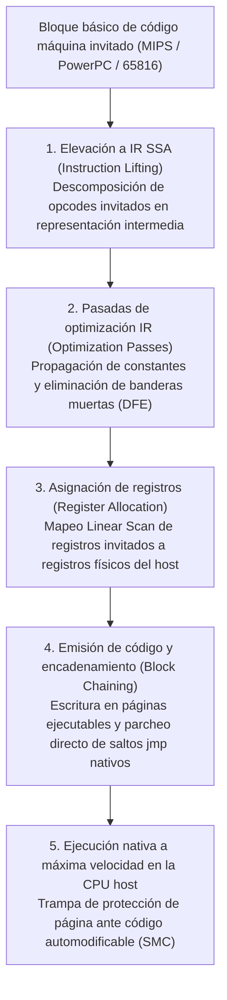
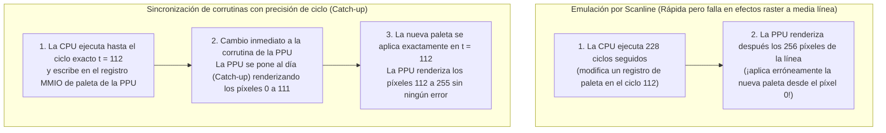

## 1. Del silicio a las matemáticas: La Máquina Universal de Turing y el isomorfismo de FSM

La Nintendo Entertainment System (1983), la Super Nintendo (1990), la PlayStation 2 (2000) y la GameCube (2001) no eran ordenadores de propósito general, sino <strong>conjuntos altamente especializados de chips ASIC y LSI personalizados</strong>. Sin embargo, hoy podemos ejecutar sus imágenes ROM originales en un PC o teléfono inteligente con procesador x86-64 o ARM64 con fidelidad exacta a nivel de bit. La disciplina de ingeniería de software que lo hace posible es la <strong>emulación de hardware</strong>.

¿Cómo puede un programa de software ejecutado en una arquitectura completamente ajena imitar el comportamiento físico de millones de transistores y osciladores de cuarzo? Su fundamento matemático reside en el teorema primordial de la informática demostrado por <strong>Alan Turing</strong> en 1936: la <strong>Máquina Universal de Turing (UTM)</strong>:

$$U(\langle M \rangle, x) = M(x)$$

Junto con la <strong>Tesis de Church-Turing</strong>, esta ecuación demuestra que si $M$ representa el hardware físico de una consola, $\langle M \rangle$ el código fuente del emulador que codifica las reglas lógicas de los circuitos de $M$, y $x$ los datos del cartucho ROM más las pulsaciones del mando, cualquier ordenador anfitrión (Host) Turing-completo $U$ que ejecute $\langle M \rangle$ generará exactamente la misma secuencia de estados y salidas audiovisuales $M(x)$ que la consola original.

Desde la perspectiva de los circuitos digitales, cualquier circuito lógico síncrono guiado por un reloj maestro (CPU, PPU de vídeo, APU de audio) se reduce matemáticamente a una <strong>Máquina de Estados Finitos Determinista (FSM)</strong>. Si $S_t \in \mathcal{S}$ es el vector de estado total que agrupa todos los registros, banderas, VRAM y WRAM en el ciclo de reloj discreto $t$, e $I_t \in \mathcal{I}$ es el vector de entrada externa, la red de puertas lógicas combinacionales evalúa entre el ciclo $t$ y $t+1$ dos funciones matemáticas puras:

$$S_{t+1} = \delta(S_t, I_t), \qquad O_t = \lambda(S_t, I_t)$$

donde $\delta$ es la función de transición de estado y $\lambda$ la función de salida que produce píxeles RGB y muestras de audio PCM. El álgebra booleana implementada físicamente mediante voltajes ($0\,\text{V}$ y $3,3\,\text{V}/5\,\text{V}$) en transistores CMOS es <strong>matemáticamente isomorfa</strong> a las operaciones a nivel de bits (`&`, `|`, `^`, `~`, `<<`) que una CPU anfitriona ejecuta sobre enteros `uint32_t` y `uint64_t`.

Por tanto, el gran obstáculo de la emulación no es la *computabilidad*, sino la <strong>complejidad computacional bajo un plazo de tiempo real estricto</strong>. En una Super Nintendo NTSC con cristal maestro de $21,477272\,\text{MHz}$, cada fotograma consta de $262$ líneas de escaneo (scanlines) de $1364$ ciclos maestros:

$$f_{\text{frame}} = \frac{21.477.272\,\text{Hz}}{262 \times 1364} \approx 60,0988\,\text{Hz} \implies T_{\text{frame}} \approx 16,639\,\text{ms}$$

Mientras que en el hardware físico millones de puertas lógicas evalúan $\delta(S_t, I_t)$ <strong>simultáneamente en paralelo espacial</strong> cada nanosegundo, un emulador debe serializar ese paralelismo masivo en instrucciones secuenciales y completar los $357.368$ ciclos del fotograma en <strong>menos de $16,639\,\text{milisegundos}$</strong>.

---

## 2. Fundamentos de emulación de CPU: Del intérprete Switch a la recompilación dinámica (JIT / Dynarec)

### 2.1 El intérprete Switch clásico y la penalización por predicción de saltos

El método más directo para emular una CPU invitada (Guest) consiste en reproducir su ciclo <strong>Fetch $\to$ Decode $\to$ Execute</strong> dentro de un bucle `while` con una gran sentencia `switch (opcode)`.

Aunque sencillo, este diseño sufre un grave cuello de botella en los procesadores superescalares modernos: todo el `switch` se compila en una única instrucción de salto indirecto (`jmp *[rax + rdx*8]`). Dado que los opcodes invitados cambian constantemente, el <strong>predictor de saltos indirectos (BTB)</strong> del procesador anfitrión falla de forma continua en ese punto, vaciando (flush) su tubería (pipeline) de 14 a 20 etapas y desperdiciando docenas de ciclos en cada instrucción. El uso de <strong>Direct Threaded Code</strong> mediante etiquetas calculadas (`goto *dispatch_table[opcode]`) distribuye los saltos indirectos al final de cada manejador, pero mantiene la sobrecarga de decodificación instrucción por instrucción.

### 2.2 Traducción binaria dinámica (JIT / Dynarec) y eliminación de banderas muertas

Para superar esta barrera, los emuladores de alto rendimiento (<strong>Dolphin</strong>, <strong>PCSX2</strong>, <strong>RPCS3</strong>, <strong>QEMU TCG</strong>, <strong>Apple Rosetta 2</strong>) emplean <strong>compilación Just-In-Time / Recompilación Dinámica (Dynarec)</strong>: traducen bloques básicos completos de código máquina invitado a código nativo del anfitrión (x86-64 / ARM64) en tiempo de ejecución y los almacenan en una caché de código ejecutable.



Las optimizaciones esenciales de un motor Dynarec incluyen:
1. <strong>Eliminación de banderas muertas (Dead-Flag Elision)</strong>: Las instrucciones aritméticas actualizan constantemente las banderas de estado (Z, N, C, V), pero la mayoría son sobrescritas inmediatamente por la siguiente instrucción sin ser leídas jamás. Mediante análisis de vivacidad (Liveness Analysis) sobre la representación SSA, el JIT elimina más del $80\,\%$ de los cálculos de banderas redundantes.
2. <strong>Asignación física de registros</strong>: Un asignador Linear Scan mantiene los registros invitados más utilizados directamente dentro de los registros físicos de la CPU anfitriona, evitando accesos continuos a la estructura `CPUState` en memoria.
3. <strong>Encadenamiento de bloques (Block Chaining)</strong>: Cuando un bloque compilado A salta a otro bloque ya compilado B, el JIT parchea la instrucción `jmp` final de A para saltar directamente a la dirección nativa de B, evitando regresar al bucle despachador de C++.
4. <strong>Detección de código automodificable (SMC)</strong>: Cuando el juego sobrescribe su propio código en RAM, el emulador captura la escritura mediante máscaras de software o permisos de página de solo lectura (`mprotect` / `VirtualProtect`) e invalida al instante los bloques JIT afectados.

| Criterio de evaluación | Intérprete Switch | Intérprete Threaded | Recompilador dinámico (JIT / Dynarec) |
| :--- | :--- | :--- | :--- |
| <strong>Coste por instrucción invitada</strong> | $20 \sim 80+$ instrucciones host | $12 \sim 35$ instrucciones host | <strong>$1 \sim 4$ instrucciones nativas host</strong> |
| <strong>Predicción de saltos</strong> | Muy mala (único cuello de botella BTB) | Media (saltos indirectos distribuidos) | <strong>Excelente (saltos directos nativos y chaining)</strong> |
| <strong>Eliminación de banderas muertas</strong> | Imposible (sin contexto entre opcodes) | Muy limitada | <strong>Completa (análisis global sobre IR SSA)</strong> |
| <strong>Complejidad y portabilidad</strong> | Muy simple, C/Rust estándar portable | Requiere extensiones del compilador | <strong>Muy alta (requiere backend por arquitectura)</strong> |
| <strong>Control de precisión de ciclo</strong> | Muy fácil (interrumpible en cada ciclo) | Fácil | <strong>Difícil (conteo agrupado en bordes de bloque)</strong> |

---

## 3. Bus de memoria y Fastmem: Secuestrando la MMU de hardware del anfitrión

En una consola, la CPU controla el vídeo, el audio y el DMA leyendo y escribiendo en registros de <strong>E/S mapeada en memoria (MMIO)</strong>. Comprobar mediante condicionales `if` por software en cada carga o almacenamiento si la dirección pertenece a la RAM o a un registro MMIO destruiría el rendimiento del JIT.

La técnica <strong>Fastmem</strong> resuelve este cuello de botella utilizando la Unidad de Gestión de Memoria (MMU) de hardware del sistema operativo anfitrión de 64 bits:
1. El emulador reserva en el espacio virtual de 64 bits del anfitrión una región contigua del tamaño exacto del espacio de direcciones invitado (por ejemplo, <strong>$4\,\text{GB}$ mediante `mmap` / `VirtualAlloc`</strong> para una consola de 32 bits) y fija su puntero base en un registro anfitrión (`rbx`).
2. Las regiones de RAM física y sus espejos se mapean con permisos de lectura y escritura (`PROT_READ | PROT_WRITE`).
3. Todas las páginas correspondientes a <strong>registros MMIO de hardware</strong> se marcan deliberadamente sin permisos de acceso (<strong>`PROT_NONE` / `PAGE_NOACCESS`</strong>).

De este modo, el compilador JIT emite cualquier lectura de memoria invitada como <strong>una única instrucción máquina nativa</strong>:

```nasm
; rbx = base de la arena virtual de 4 GB, edi = dirección invitada de 32 bits
mov eax, dword ptr [rbx + rdi]   ; ¡Traducción y carga en 1 sola instrucción!
```

* <strong>Ruta rápida ($99,9\,\%$ de accesos a RAM)</strong>: La MMU y el TLB físicos del procesador anfitrión resuelven el acceso en 3–4 ciclos con cero sobrecarga de software.
* <strong>Ruta lenta ($0,1\,\%$ de accesos a MMIO)</strong>: Al tocar una página `PROT_NONE`, la MMU anfitriona lanza un fallo de página por hardware (`SIGSEGV` en POSIX o excepción vectorizada `STATUS_ACCESS_VIOLATION` en Windows). El manejador de señales del emulador intercepta la trampa, decodifica la instrucción, invoca la función C++ `mmio_read/write()`, actualiza el registro destino y avanza el puntero de instrucción `RIP`.

---

## 4. Precisión de ciclo (Cycle Accuracy) y sincronización de corrutinas

¿Por qué el legendario autor de emuladores <strong>Near (byuu)</strong> afirmó que <strong>emular una Super Nintendo de tan solo $3,58\,\text{MHz}$ con un 100 % de precisión de ciclo requería una CPU moderna de $3\,\text{GHz}$</strong>?

Los emuladores clásicos <strong>basados en líneas de escaneo (Scanline-based)</strong> ejecutaban la CPU durante toda una línea ($228$ ciclos) y luego ordenaban a la PPU dibujar los 256 píxeles de esa línea de golpe. Sin embargo, muchos juegos modifican registros gráficos (paletas, desplazamiento o matrices del Modo 7) <strong>exactamente a mitad de una línea de escaneo (Mid-Scanline)</strong> mediante la CPU o HDMA. Si no se sincronizan ambos chips al ciclo exacto de píxel, aparecen fallos visuales o bloqueos.



En emuladores con precisión de ciclo como <strong>bsnes / higan / Ares</strong>, la CPU, PPU, SMP y DSP se ejecutan como <strong>corrutinas cooperativas en espacio de usuario (`libco`)</strong>. Cada vez que un chip realiza un acceso al bus o cambia una línea de interrupción observable por otro chip, `co_switch()` conmuta el contexto en unas 10 instrucciones ensamblador para que el chip destino alcance exactamente el reloj maestro actual.

Además, la ingeniería moderna de emulación aborda otros tres desafíos críticos:
* <strong>Punto flotante no IEEE-754</strong>: El Emotion Engine y las unidades vectoriales de la PS2 carecen de `Inf` y `NaN` y vacían los números denormales a cero, obligando a PCSX2 a aplicar máscaras y saturación SIMD para evitar explosiones geométricas.
* <strong>Run-Ahead para eliminar la latencia de entrada</strong>: Al simular en segundo plano $N$ fotogramas por adelantado y restaurar estados de memoria (Savestates) ultrarrápidos, el emulador salta el retardo del búfer interno del propio juego, logrando una respuesta más rápida que la consola física en un televisor CRT.
* <strong>FPGA y preservación del patrimonio digital</strong>: Junto con la recreación de puertas lógicas a nivel de hardware mediante <strong>FPGA (MiSTer)</strong> en Verilog/VHDL, el código fuente de los emuladores precisos actúa como <strong>documentación de hardware ejecutable</strong>, preservando el arte interactivo de la humanidad frente a la inevitable degradación física del silicio original.
