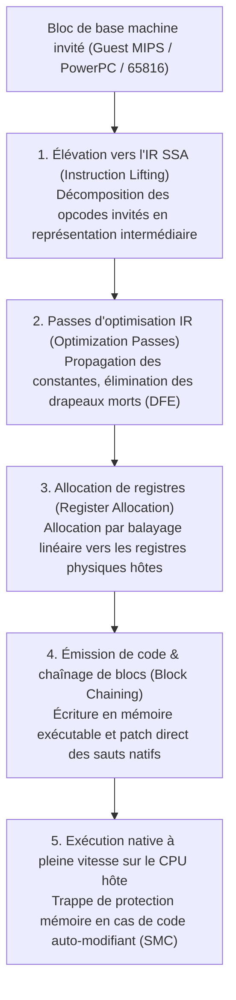
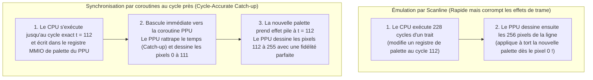

## 1. Du silicium aux mathématiques : Machine de Turing universelle et isomorphisme des FSM

La NES (1983), la Super Nintendo (1990), la PlayStation 2 (2000) et la GameCube (2001) n'étaient pas des ordinateurs génériques, mais des <strong>assemblages de circuits intégrés sur mesure (ASIC / Custom LSI)</strong>. Pourtant, sans posséder le moindre gramme de ce silicium d'origine, nous pouvons aujourd'hui exécuter leurs jeux sur un processeur x86-64 ou ARM64 avec une fidélité au bit près. La discipline logicielle qui réalise ce prodige est l'<strong>émulation matérielle</strong>.

Comment un simple programme informatique peut-il imiter le comportement physique de millions de transistors et d'oscillateurs à quartz d'une architecture étrangère ? Ce miracle repose sur le théorème fondateur de l'informatique démontré par <strong>Alan Turing</strong> en 1936 : l'existence de la <strong>Machine de Turing Universelle (UTM)</strong> :

$$U(\langle M \rangle, x) = M(x)$$

En vertu de la <strong>thèse de Church-Turing</strong>, si $M$ désigne le matériel physique de la console, $\langle M \rangle$ le code source de l'émulateur décrivant la logique exacte des circuits de $M$, et $x$ les données de la ROM ainsi que les entrées de la manette, alors tout ordinateur hôte Turing-complet $U$ exécutant $\langle M \rangle$ produira exactement la même séquence d'états et de sorties audiovisuelles $M(x)$ que la machine d'origine.

Du point de vue de l'électronique numérique, tout circuit logique synchrone cadencé par une horloge maîtresse (CPU, PPU graphique, APU sonore) se réduit mathématiquement à un <strong>automate fini déterministe (Finite State Machine, FSM)</strong>. Si $S_t \in \mathcal{S}$ représente le vecteur d'état global de toutes les bascules, registres, drapeaux, VRAM et WRAM à l'instant discret $t$, et $I_t \in \mathcal{I}$ le vecteur d'entrée externe, le réseau de portes logiques combinatoires calcule entre les cycles $t$ et $t+1$ deux fonctions mathématiques pures :

$$S_{t+1} = \delta(S_t, I_t), \qquad O_t = \lambda(S_t, I_t)$$

où $\delta$ est la fonction de transition d'état et $\lambda$ la fonction de sortie générant les pixels RGB et les échantillons audio PCM. L'algèbre booléenne réalisée physiquement par les tensions électriques ($0\,\text{V}$ et $3,3\,\text{V}/5\,\text{V}$) dans le silicium CMOS est <strong>mathématiquement isomorphe</strong> aux opérations bit à bit (`&`, `|`, `^`, `~`, `<<`) exécutées par le processeur hôte sur des entiers `uint32_t` et `uint64_t`.

Le véritable obstacle de l'émulation n'est donc pas la *calculabilité*, mais la <strong>complexité de calcul sous contrainte temps réel stricte</strong>. Sur une Super Nintendo NTSC cadencée à $21,477272\,\text{MHz}$, une trame vidéo compte $262$ lignes de balayage (scanlines) de $1364$ cycles maîtres chacune :

$$f_{\text{frame}} = \frac{21\,477\,272\,\text{Hz}}{262 \times 1364} \approx 60,0988\,\text{Hz} \implies T_{\text{frame}} \approx 16,639\,\text{ms}$$

Dans le matériel réel, des millions de portes logiques évaluent $\delta(S_t, I_t)$ <strong>simultanément en parallèle spatial</strong> à chaque nanoseconde. L'émulateur doit sérialiser ce parallélisme massif en un flux séquentiel d'instructions hôtes et achever les $357\,368$ cycles de la trame en <strong>moins de $16,639\,\text{millisecondes}$</strong> sous peine de saccades vidéo et de craquements audio.

---

## 2. Émulation du CPU : De l'interpréteur Switch à la recompilation dynamique (JIT / Dynarec)

### 2.1 L'interpréteur Switch classique et les pénalités de prédiction de branchement

L'approche la plus directe consiste à reproduire le cycle <strong>Fetch $\to$ Decode $\to$ Execute</strong> dans une boucle `while` contenant un vaste `switch (opcode)`.

Si cette méthode suffit pour des processeurs 8 bits, elle se heurte à un goulet d'étranglement microarchitectural majeur sur nos processeurs superscalaires modernes : l'intégralité du `switch` est compilée en une unique instruction de saut indirect (`jmp *[rax + rdx*8]`). Comme l'opcode invité change constamment, le <strong>prédicteur de branchement indirect (BTB)</strong> du CPU hôte subit un taux d'échec massif à ce point précis, vidant (flush) à chaque erreur son pipeline de 14 à 20 étages et gaspillant des dizaines de cycles. Le <strong>code filé direct (Direct Threaded Code)</strong> via l'extension `goto *dispatch_table[opcode]` répartit les sauts indirects à la fin de chaque gestionnaire d'instruction, mais ne supprime ni le décodage répétitif ni les accès mémoire aux registres invités.

### 2.2 Traduction binaire dynamique (JIT / Dynarec) et élimination des drapeaux morts

Pour franchir ce mur de performance, les émulateurs modernes (<strong>Dolphin</strong>, <strong>PCSX2</strong>, <strong>RPCS3</strong>, <strong>QEMU TCG</strong>, <strong>Apple Rosetta 2</strong>) utilisent la <strong>compilation à la volée / recompilation dynamique (JIT / Dynarec)</strong> : les blocs de base (Basic Blocks) du code machine invité sont traduits à l'exécution en instructions natives hôtes (x86-64 / ARM64) et exécutés directement depuis un cache de code.



Les optimisations clés d'un moteur Dynarec comprennent :
1. <strong>Élimination des drapeaux morts (Dead-Flag Elision)</strong> : Les instructions arithmétiques invitées mettent continuellement à jour les drapeaux d'état (Z, N, C, V), alors que la majorité de ces valeurs sont écrasées par l'instruction suivante sans jamais être lues. Une analyse de vivacité (Liveness Analysis) sur la représentation SSA permet d'éliminer plus de $80\,\%$ des calculs de drapeaux inutiles.
2. <strong>Allocation physique de registres</strong> : Un allocateur Linear Scan maintient les registres invités les plus sollicités directement dans les registres matériels du processeur hôte, évitant les lectures/écritures incessantes dans la structure `CPUState` en RAM.
3. <strong>Chaînage de blocs (Block Chaining)</strong> : Lorsqu'un bloc compilé A saute vers un bloc déjà compilé B, le JIT modifie directement l'instruction `jmp` finale du bloc A pour pointer vers l'adresse mémoire native du bloc B, court-circuitant totalement le répartiteur C++.
4. <strong>Invalidation du code auto-modifiant (SMC)</strong> : Si le jeu réécrit son propre code en RAM à l'exécution, l'émulateur intercepte l'écriture via des masques logiciels ou une protection de page en lecture seule (`mprotect` / `VirtualProtect`) et invalide immédiatement les blocs JIT obsolètes.

| Critère de comparaison | Interpréteur Switch | Interpréteur Threaded | Recompilateur dynamique (JIT / Dynarec) |
| :--- | :--- | :--- | :--- |
| <strong>Coût par instruction invitée</strong> | $20 \sim 80+$ instructions hôtes | $12 \sim 35$ instructions hôtes | <strong>$1 \sim 4$ instructions natives hôtes</strong> |
| <strong>Prédiction de branchement</strong> | Très mauvaise (goulot BTB unique) | Moyenne (sauts indirects distribués) | <strong>Excellente (sauts directs natifs & chaînage)</strong> |
| <strong>Élimination des drapeaux morts</strong> | Impossible (vision limitée à 1 opcode) | Très limitée | <strong>Complète (analyse globale sur l'IR SSA)</strong> |
| <strong>Complexité & portabilité</strong> | Très simple, C/Rust standard portable | Dépend d'extensions compilateur | <strong>Très élevée (backend spécifique par architecture)</strong> |
| <strong>Précision au cycle près</strong> | Très facile (interruption à chaque cycle) | Facile | <strong>Complexe (décompte groupé aux frontières de blocs)</strong> |

---

## 3. Bus mémoire et Fastmem : Détourner la MMU matérielle de l'hôte

Dans une console, le CPU communique avec le PPU, l'APU et le contrôleur DMA via des registres d'<strong>entrées-sorties mappées en mémoire (MMIO)</strong>. Vérifier logiciellement à chaque lecture/écriture si l'adresse cible est de la RAM ou du MMIO ruinerait les performances du JIT.

La technique <strong>Fastmem</strong> résout ce problème en exploitant l'unité de gestion mémoire (MMU) matérielle du système hôte 64 bits :
1. L'émulateur réserve dans l'espace d'adressage 64 bits de l'hôte une arène virtuelle contiguë égale à la totalité de l'espace d'adressage invité (par exemple <strong>$4\,\text{Go}$ via `mmap` / `VirtualAlloc`</strong> pour une console 32 bits) et conserve son adresse de base dans un registre hôte dédié (`rbx`).
2. Les régions de RAM physique (et leurs miroirs) sont mappées avec les droits de lecture/écriture (`PROT_READ | PROT_WRITE`).
3. Toutes les pages correspondant aux <strong>registres matériels MMIO</strong> sont délibérément configurées comme <strong>inaccessibles (`PROT_NONE` / `PAGE_NOACCESS`)</strong>.

Le compilateur JIT peut alors traduire n'importe quel accès mémoire invité en <strong>une seule instruction machine native</strong> sans aucun branchement conditionnel :

```nasm
; rbx = base de l'arène virtuelle de 4 Go, edi = adresse invitée 32 bits
mov eax, dword ptr [rbx + rdi]   ; Traduction et chargement en 1 instruction !
```

* <strong>Chemin rapide ($99,9\,\%$ des accès vers la RAM)</strong> : La MMU et le TLB matériels du processeur hôte exécutent la lecture en 3 à 4 cycles avec un surcoût logiciel strictement nul.
* <strong>Chemin lent ($0,1\,\%$ des accès vers les registres MMIO)</strong> : L'accès à une page `PROT_NONE` déclenche instantanément une faute de page matérielle (`SIGSEGV` sous POSIX ou exception vectorisée `STATUS_ACCESS_VIOLATION` sous Windows). Le gestionnaire de signaux de l'émulateur intercepte la faute, décode l'instruction fautive, appelle la fonction C++ `mmio_read/write()`, met à jour le registre cible et avance le pointeur d'instruction `RIP`.

---

## 4. Précision au cycle (Cycle Accuracy) et synchronisation par coroutines

Pourquoi le regretté architecte d'émulateurs <strong>Near (byuu)</strong> expliquait-il qu'<strong>émuler une Super Nintendo de seulement $3,58\,\text{MHz}$ avec une précision absolue au cycle près exigeait un processeur moderne à $3\,\text{GHz}$</strong> ?

Les anciens émulateurs <strong>par ligne de balayage (Scanline-based)</strong> exécutaient le CPU pendant toute une ligne ($228$ cycles) avant de demander au PPU de dessiner les 256 pixels de cette ligne d'un seul bloc. Or, de nombreux jeux modifient les registres graphiques (palette, défilement, matrice Mode 7) <strong>en plein milieu du tracé d'une ligne (Mid-Scanline)</strong> à un cycle d'horloge précis. Sans synchronisation au pixel près, l'image subit des corruptions ou le jeu plante.



Dans les émulateurs précis au cycle comme <strong>bsnes / higan / Ares</strong>, chaque puce (CPU, PPU, SMP, DSP) s'exécute dans sa propre <strong>coroutine coopérative en espace utilisateur (`libco`)</strong>. Dès qu'une puce effectue une action observable par une autre, `co_switch()` change de contexte en une dizaine d'instructions assembleur pour permettre à la puce cible de rattraper exactement l'horloge maîtresse.

Enfin, l'ingénierie moderne de l'émulation repousse trois autres frontières :
* <strong>Arithmétique flottante non-IEEE-754</strong> : L'Emotion Engine et les unités vectorielles de la PS2 ignorent les valeurs `Inf` et `NaN` et forcent les nombres dénormalisés à zéro, obligeant PCSX2 à masquer et borner les registres SIMD hôtes pour éviter l'explosion des moteurs physiques.
* <strong>Run-Ahead (réduction de latence)</strong> : En simulant silencieusement $N$ trames d'avance en arrière-plan grâce à des sauvegardes d'état (Savestates) ultra-rapides en RAM, l'émulateur court-circuite la latence interne du jeu et offre une réactivité supérieure à la console d'origine sur téléviseur cathodique.
* <strong>FPGA et préservation du patrimoine numérique</strong> : Aux côtés de la réimplémentation matérielle sur <strong>FPGA (MiSTer)</strong> en Verilog/VHDL, le code source des émulateurs de précision constitue une véritable <strong>documentation matérielle exécutable</strong>, sauvegardant l'histoire du jeu vidéo face à la dégradation physique inéluctable des puces de silicium du XXe siècle.
