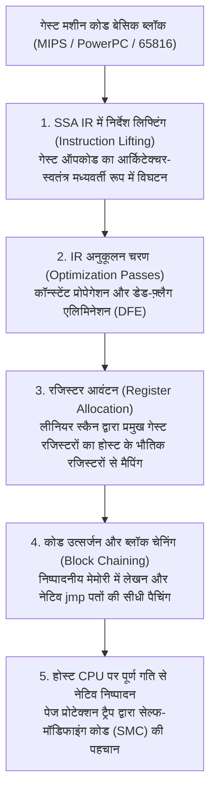
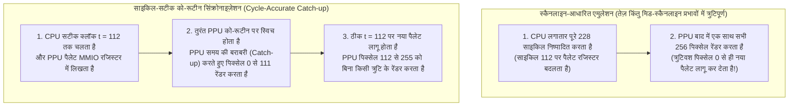

## 1. सिलिकॉन से गणित तक: यूनिवर्सल ट्यूरिंग मशीन और परिमित अवस्था मशीन (FSM) की समरूपता

1983 का निन्टेंडो एंटरटेनमेंट सिस्टम (NES), 1990 का सुपर निन्टेंडो (SNES), 2000 का PlayStation 2 और 2001 का GameCube सामान्य प्रयोजन के कंप्यूटर नहीं थे, बल्कि <strong>विशेष रूप से डिज़ाइन किए गए कस्टम ASIC और LSI चिप्स के समूह</strong> थे। फिर भी आज, उस मूल सिलिकॉन के एक भी टुकड़े के बिना, हम आधुनिक x86-64 या ARM64 प्रोसेसर वाले पीसी और स्मार्टफोन पर उन कंसोलों के मूल ROM को बिट-स्तर की सटीकता के साथ चला सकते हैं। इसे संभव बनाने वाली सॉफ़्टवेयर इंजीनियरिंग विधा को <strong>हार्डवेयर एमुलेशन (Hardware Emulation)</strong> कहा जाता है।

एक बिल्कुल भिन्न आर्किटेक्चर पर चलने वाला सॉफ़्टवेयर प्रोग्राम लाखों भौतिक ट्रांजिस्टर और क्वार्ट्ज़ क्रिस्टल के व्यवहार की हूबहू नकल कैसे कर सकता है? इसका गणितीय आधार 1936 में ब्रिटिश गणितज्ञ <strong>एलन ट्यूरिंग (Alan Turing)</strong> द्वारा सिद्ध किए गए कंप्यूटर विज्ञान के प्रथम सिद्धांत — <strong>यूनिवर्सल ट्यूरिंग मशीन (UTM)</strong> प्रमेय में निहित है:

$$U(\langle M \rangle, x) = M(x)$$

<strong>चर्च-ट्यूरिंग थीसिस (Church-Turing Thesis)</strong> के साथ मिलाकर यह समीकरण सिद्ध करता है कि यदि $M$ भौतिक कंसोल हार्डवेयर है, $\langle M \rangle$ उस हार्डवेयर के तार्किक नियमों को व्यक्त करने वाला एमुलेटर सोर्स कोड है, और $x$ गेम ROM डेटा तथा कंट्रोलर इनपुट है, तो कोई भी ट्यूरिंग-पूर्ण होस्ट कंप्यूटर $U$ जो $\langle M \rangle$ को निष्पादित करता है, मूल कंसोल के समान ही अवस्थाओं और दृश्य-श्रव्य आउटपुट $M(x)$ की सटीक श्रृंखला उत्पन्न करेगा।

डिजिटल लॉजिक सर्किट के दृष्टिकोण से, मास्टर क्लॉक द्वारा संचालित कोई भी सिंक्रोनस डिजिटल चिप (CPU, ग्राफ़िक्स PPU, ऑडियो APU) गणितीय रूप से एक <strong>नियतात्मक परिमित अवस्था मशीन (Deterministic Finite State Machine - FSM)</strong> के समतुल्य है। यदि क्लॉक टिक $t$ पर सभी रजिस्टरों, फ़्लैग्स, VRAM और WRAM बिट्स का कुल अवस्था सदिश $S_t \in \mathcal{S}$ हो और बाहरी इनपुट $I_t \in \mathcal{I}$ हो, तो टिक $t$ और $t+1$ के बीच कॉम्बिनेशनल लॉजिक गेट्स का जाल दो शुद्ध गणितीय फलनों की गणना करता है:

$$S_{t+1} = \delta(S_t, I_t), \qquad O_t = \lambda(S_t, I_t)$$

जहाँ $\delta$ अवस्था संक्रमण फलन (State Transition Function) है और $\lambda$ RGB पिक्सेल तथा PCM ऑडियो सैंपल उत्पन्न करने वाला आउटपुट फलन है। CMOS ट्रांजिस्टर में भौतिक वोल्टेज ($0\,\text{V}$ बनाम $3.3\,\text{V}/5\,\text{V}$) द्वारा निष्पादित बूलीय बीजगणित, होस्ट CPU द्वारा `uint32_t` और `uint64_t` पूर्णांकों पर किए जाने वाले बिटवाइज़ ऑपरेशनों (`&`, `|`, `^`, `~`, `<<`) के <strong>गणितीय रूप से पूर्णतः समरूप (Isomorphic)</strong> है।

अतः एमुलेशन की मुख्य चुनौती *गणनीयता* नहीं, बल्कि <strong>कठोर रीयल-टाइम समय-सीमा के भीतर गणना की जटिलता</strong> है। $21.477272\,\text{MHz}$ मास्टर क्रिस्टल वाले NTSC सुपर निन्टेंडो में प्रत्येक फ़्रेम में $262$ स्कैनलाइन होती हैं और प्रत्येक स्कैनलाइन में $1364$ मास्टर क्लॉक साइकिल होते हैं:

$$f_{\text{frame}} = \frac{21,477,272\,\text{Hz}}{262 \times 1364} \approx 60.0988\,\text{Hz} \implies T_{\text{frame}} \approx 16.639\,\text{ms}$$

भौतिक हार्डवेयर में लाखों लॉजिक गेट्स हर नैनोसेकंड में <strong>स्थानिक रूप से समानांतर (Spatially Parallel)</strong> काम करते हैं, जबकि एमुलेटर को उस विशाल समानांतरता को अनुक्रमिक होस्ट निर्देशों में बदलकर एक फ़्रेम के सभी $357,368$ क्लॉक टिकों की गणना <strong>$16.639\,\text{मिलीसेकंड}$ से कम समय में</strong> पूरी करनी होती है।

---

## 2. CPU एमुलेशन के मूल सिद्धांत: स्विच इंटरप्रेटर से डायनामिक बाइनरी ट्रांसलेशन (JIT / Dynarec) तक

### 2.1 क्लासिक स्विच इंटरप्रेटर और ब्रांच प्रेडिक्शन पेनल्टी

गेस्ट CPU को एमुलेट करने का सबसे सीधा तरीका `while` लूप के भीतर एक विशाल `switch (opcode)` स्टेटमेंट द्वारा <strong>Fetch $\to$ Decode $\to$ Execute</strong> चक्र को लागू करना है।

किंतु आधुनिक सुपरस्केलर प्रोसेसर पर यह संरचना एक गंभीर माइक्रोआर्किटेक्चरल बाधा उत्पन्न करती है: पूरा `switch` स्टेटमेंट मशीन कोड में केवल एक अप्रत्यक्ष जंप निर्देश (`jmp *[rax + rdx*8]`) में संकलित होता है। चूँकि गेस्ट ऑपकोड लगातार बदलते रहते हैं, होस्ट CPU का <strong>इनडायरेक्ट ब्रांच प्रेडिक्टर (BTB)</strong> इस जंप पर बार-बार विफल होता है, जिससे हर बार 14 से 20 चरणों की पाइपलाइन फ्लश होती है और दर्जनों क्लॉक साइकिल नष्ट हो जाते हैं। लेबल एड्रेस एक्सटेंशन (`goto *dispatch_table[opcode]`) के माध्यम से <strong>Direct Threaded Code</strong> का उपयोग करने से अप्रत्यक्ष जंप प्रत्येक हैंडलर के अंत में वितरित हो जाते हैं, लेकिन प्रति-निर्देश डिकोडिंग का ओवरहेड बना रहता है।

### 2.2 डायनामिक बाइनरी ट्रांसलेशन (JIT / Dynarec) और डेड-फ़्लैग एलिमिनेशन

इस प्रदर्शन सीमा को पार करने के लिए <strong>Dolphin</strong>, <strong>PCSX2</strong>, <strong>RPCS3</strong>, <strong>QEMU TCG</strong> और <strong>Apple Rosetta 2</strong> जैसे आधुनिक एमुलेटर <strong>जस्ट-इन-टाइम संकलन / डायनामिक रीकॉम्पाइलेशन (JIT / Dynarec)</strong> का उपयोग करते हैं: वे रनटाइम पर गेस्ट मशीन कोड के पूरे <strong>बेसिक ब्लॉक (Basic Block)</strong> को होस्ट के नेटिव मशीन कोड (x86-64 / ARM64) में अनुवादित कर सीधे कोड कैश से निष्पादित करते हैं।



एक उन्नत Dynarec इंजन के प्रमुख अनुकूलन निम्नलिखित हैं:
1. <strong>डेड-फ़्लैग एलिमिनेशन (Dead-Flag Elision)</strong>: गेस्ट के अंकगणितीय निर्देश हर बार स्टेटस फ़्लैग्स (Z, N, C, V) को अपडेट करते हैं, किंतु उनमें से अधिकांश बिना पढ़े ही अगले निर्देश द्वारा ओवरराइट कर दिए जाते हैं। SSA IR पर बैकवर्ड लाइवनेस विश्लेषण (Liveness Analysis) द्वारा JIT $80\%$ से अधिक अनावश्यक फ़्लैग गणनाओं को समाप्त कर देता है।
2. <strong>भौतिक रजिस्टर आवंटन</strong>: लीनियर स्कैन एल्गोरिदम सर्वाधिक प्रयुक्त गेस्ट रजिस्टरों को सीधे होस्ट प्रोसेसर के हार्डवेयर रजिस्टरों में रखता है, जिससे मेमोरी में स्थित `CPUState` स्ट्रक्चर को बार-बार पढ़ने-लिखने की आवश्यकता नहीं रहती।
3. <strong>ब्लॉक चेनिंग (Block Chaining)</strong>: जब संकलित ब्लॉक A किसी पहले से संकलित ब्लॉक B पर जंप करता है, तो JIT ब्लॉक A के अंत में स्थित नेटिव `jmp` निर्देश को सीधे ब्लॉक B के मेमोरी पते से जोड़ देता है, जिससे C++ डिस्पैचर लूप बायपास हो जाता है।
4. <strong>सेल्फ-मॉडिफाइंग कोड (SMC) अमान्यकरण</strong>: जब कोई गेम रनटाइम के दौरान RAM में अपने ही कोड को ओवरराइट करता है, तो एमुलेटर सॉफ़्टवेयर मास्क या रीड-ओनली पेज प्रोटेक्शन (`mprotect` / `VirtualProtect`) ट्रैप के माध्यम से पुराने JIT ब्लॉक को तुरंत अमान्य (Invalidate) कर देता है।

| मूल्यांकन मानदंड | स्विच इंटरप्रेटर | थ्रेडेड इंटरप्रेटर | डायनामिक रीकॉम्पाइलर (JIT / Dynarec) |
| :--- | :--- | :--- | :--- |
| <strong>प्रति गेस्ट निर्देश लागत</strong> | $20 \sim 80+$ होस्ट निर्देश | $12 \sim 35$ होस्ट निर्देश | <strong>$1 \sim 4$ नेटिव होस्ट निर्देश</strong> |
| <strong>ब्रांच प्रेडिक्शन दक्षता</strong> | अत्यंत खराब (एकल BTB बॉटलनेक) | मध्यम (वितरित अप्रत्यक्ष जंप) | <strong>उत्कृष्ट (नेटिव प्रत्यक्ष जंप और ब्लॉक चेनिंग)</strong> |
| <strong>डेड-फ़्लैग और IR अनुकूलन</strong> | असंभव (निर्देशों के बीच संदर्भ नहीं) | अत्यंत सीमित | <strong>पूर्ण (SSA IR पर वैश्विक लाइवनेस विश्लेषण)</strong> |
| <strong>जटिलता और पोर्टेबिलिटी</strong> | अत्यंत सरल, मानक C/Rust कोड | कंपाइलर एक्सटेंशन आवश्यक | <strong>अत्यंत उच्च (प्रत्येक होस्ट ISA हेतु अलग बैकएंड)</strong> |
| <strong>साइकिल एक्यूरेसी नियंत्रण</strong> | बहुत आसान (प्रत्येक साइकिल पर रोक संभव) | आसान | <strong>कठिन (ब्लॉक सीमाओं पर साइकिल गणना)</strong> |

---

## 3. मेमोरी बस और Fastmem: होस्ट के हार्डवेयर MMU का उपयोग

गेम कंसोल में CPU वीडियो, ऑडियो और DMA को नियंत्रित करने के लिए <strong>मेमोरी-मैप्ड I/O (MMIO)</strong> रजिस्टरों को पढ़ता और लिखता है। यदि हर मेमोरी लोड/स्टोर पर सॉफ़्टवेयर `if-else` द्वारा यह जाँचा जाए कि पता सामान्य RAM है या MMIO, तो JIT की गति भारी रूप से घट जाएगी।

<strong>Fastmem</strong> तकनीक 64-बिट होस्ट ऑपरेटिंग सिस्टम की हार्डवेयर मेमोरी मैनेजमेंट यूनिट (MMU) का उपयोग करके इस समस्या को हल करती है:
1. एमुलेटर 64-बिट होस्ट के वर्चुअल एड्रेस स्पेस में गेस्ट के संपूर्ण एड्रेस स्पेस के बराबर एक सतत मेमोरी क्षेत्र (उदाहरण के लिए, 32-बिट कंसोल के लिए `mmap` / `VirtualAlloc` द्वारा <strong>$4\,\text{GB}$ वर्चुअल स्पेस</strong>) आरक्षित करता है और उसका बेस पॉइंटर एक समर्पित होस्ट रजिस्टर (`rbx`) में रखता है।
2. भौतिक RAM और उसके मिरर क्षेत्रों को पढ़ने-लिखने की अनुमति (`PROT_READ | PROT_WRITE`) के साथ मैप किया जाता है।
3. सभी <strong>MMIO हार्डवेयर रजिस्टर पेजों</strong> को जानबूझकर <strong>पहुँच-रहित (`PROT_NONE` / `PAGE_NOACCESS`)</strong> के रूप में चिह्नित किया जाता है।

इसके परिणामस्वरूप, JIT कंपाइलर किसी भी गेस्ट मेमोरी लोड को बिना किसी शर्त के <strong>केवल एक नेटिव मशीन निर्देश</strong> में बदल देता है:

```nasm
; rbx = 4 GB वर्चुअल एरीना बेस पता, edi = 32-बिट गेस्ट पता
mov eax, dword ptr [rbx + rdi]   ; केवल 1 निर्देश में पता अनुवाद और लोड!
```

* <strong>फ़ास्ट पाथ ($99.9\%$ सामान्य RAM एक्सेस)</strong>: होस्ट प्रोसेसर का हार्डवेयर MMU और TLB शून्य सॉफ़्टवेयर ओवरहेड के साथ 3–4 साइकिल में डेटा लोड कर लेते हैं।
* <strong>स्लो पाथ ($0.1\%$ MMIO एक्सेस)</strong>: जैसे ही निर्देश किसी `PROT_NONE` पेज को छूता है, होस्ट MMU तुरंत हार्डवेयर पेज फ़ॉल्ट (`SIGSEGV` या विंडोज़ में `STATUS_ACCESS_VIOLATION` VEH) उत्पन्न करता है। एमुलेटर का सिग्नल हैंडलर इस ट्रैप को पकड़ता है, निर्देश को डिकोड कर C++ `mmio_read/write()` फ़ंक्शन को कॉल करता है, और इंस्ट्रक्शन पॉइंटर `RIP` को आगे बढ़ा देता है।

---

## 4. साइकिल एक्यूरेसी (Cycle Accuracy) और मल्टी-चिप को-रूटीन सिंक्रोनाइज़ेशन

महान एमुलेटर निर्माता दिवंगत <strong>Near (byuu)</strong> ने ऐसा क्यों कहा था कि <strong>"केवल $3.58\,\text{MHz}$ पर चलने वाले सुपर निन्टेंडो को 100% साइकिल एक्यूरेसी के साथ एमुलेट करने के लिए $3\,\text{GHz}$ के आधुनिक डेस्कटॉप CPU की आवश्यकता पड़ी"</strong>?

पुराने <strong>स्कैनलाइन-आधारित (Scanline-based)</strong> एमुलेटर पहले पूरी एक स्कैनलाइन ($228$ साइकिल) के लिए CPU को चलाते थे और फिर PPU एक साथ उस लाइन के सभी 256 पिक्सेल ड्रा करता था। किंतु कई गेम <strong>स्कैनलाइन के बीचोबीच (Mid-Scanline)</strong> किसी सटीक पिक्सेल साइकिल पर CPU या HDMA के माध्यम से पैलेट, स्क्रॉल या Mode 7 मैट्रिक्स बदल देते हैं। सटीक पिक्सेल-स्तरीय समन्वय के बिना ग्राफ़िक्स विकृत हो जाते हैं या गेम क्रैश हो जाता है।



<strong>bsnes / higan / Ares</strong> जैसे साइकिल-सटीक एमुलेटरों में CPU, PPU, SMP और DSP स्वतंत्र यूज़र-स्पेस सहकारी <strong>को-रूटीन (Coroutines / Fibers, `libco`)</strong> के रूप में चलते हैं। जब भी कोई चिप ऐसा कार्य करती है जो दूसरी चिप को प्रभावित कर सके, तो `co_switch()` मात्र ~10 असेंबली निर्देशों में संदर्भ (Context) बदल देता है ताकि लक्षित चिप वर्तमान मास्टर क्लॉक तक पहुँच सके।

इसके अतिरिक्त, आधुनिक एमुलेशन इंजीनियरिंग तीन अन्य उन्नत मोर्चों पर कार्य कर रही है:
* <strong>गैर-IEEE-754 फ़्लोटिंग-पॉइंट व्यवहार</strong>: PS2 का Emotion Engine और वेक्टर यूनिट `Inf` तथा `NaN` का समर्थन नहीं करते और डिनॉर्मल संख्याओं को शून्य कर देते हैं; इसलिए गेम के भौतिकी इंजन को टूटने से बचाने के लिए PCSX2 को SIMD मास्किंग और क्लैम्पिंग करनी पड़ती है।
* <strong>इनपुट विलंब समाप्त करने हेतु Run-Ahead</strong>: पृष्ठभूमि में $N$ फ़्रेम आगे की गणना करके और अल्ट्रा-फ़ास्ट मेमोरी सेवस्टेट (Savestates) का उपयोग करके, एमुलेटर गेम के आंतरिक इनपुट बफ़र विलंब को पार कर जाता है और CRT टीवी से जुड़े मूल कंसोल से भी तेज़ प्रतिक्रिया देता है।
* <strong>FPGA और डिजिटल सांस्कृतिक संरक्षण</strong>: Verilog/VHDL में <strong>FPGA (MiSTer)</strong> पर लॉजिक गेट्स के हार्डवेयर पुनर्निर्माण के साथ-साथ, सटीक एमुलेटरों का सोर्स कोड <strong>निष्पादनीय हार्डवेयर दस्तावेज़ीकरण</strong> के रूप में कार्य करता है, जो 20वीं सदी के सिलिकॉन चिप्स के भौतिक क्षरण के बावजूद मानवता की डिजिटल विरासत को सुरक्षित रखता है।
