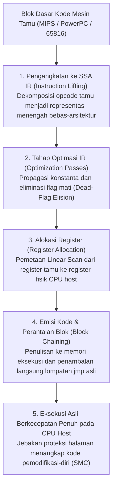
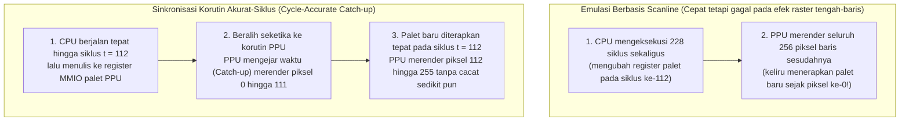

## 1. Dari Silikon ke Matematika: Mesin Turing Universal dan Isomorfisme FSM

Nintendo Entertainment System (1983), Super Nintendo (1990), PlayStation 2 (2000), dan GameCube (2001) bukanlah komputer pribadi serbaguna, melainkan <strong>kumpulan sirkuit terpadu khusus (ASIC dan chip LSI kustom)</strong>. Namun saat ini, tanpa memiliki satu keping pun silikon asli tersebut, kita dapat menjalankan ROM game komersialnya di PC atau ponsel pintar berprosesor x86-64 maupun ARM64 dengan ketepatan mutlak hingga ke level bit. Disiplin rekayasa perangkat lunak yang memungkinkan keajaiban ini adalah <strong>emulasi perangkat keras (Hardware Emulation)</strong>.

Bagaimana sebuah program perangkat lunak pada arsitektur yang sama sekali berbeda dapat meniru perilaku fisik jutaan transistor dan osilator kristal? Landasan matematisnya berasal dari teorema paling fundamental dalam ilmu komputer yang dibuktikan oleh <strong>Alan Turing</strong> pada tahun 1936: <strong>Mesin Turing Universal (UTM)</strong>:

$$U(\langle M \rangle, x) = M(x)$$

Dipadukan dengan <strong>Tesis Church-Turing</strong>, persamaan ini membuktikan bahwa jika $M$ adalah perangkat keras fisik konsol, $\langle M \rangle$ adalah kode sumber emulator yang mengenkode aturan logika sirkuit $M$, dan $x$ adalah data ROM beserta input stik kendali, maka setiap komputer host Turing-complete $U$ yang menjalankan $\langle M \rangle$ pasti menghasilkan urutan status dan keluaran audiovisual $M(x)$ yang identik dengan konsol aslinya.

Dari sudut pandang rangkaian logika digital, setiap sirkuit digital sinkron yang digerakkan oleh detak мастер (CPU, PPU grafis, APU audio) secara matematis dapat direduksi menjadi <strong>Mesin Status Hingga Deterministik (Deterministic Finite State Machine, FSM)</strong>. Misalkan $S_t \in \mathcal{S}$ adalah vektor status keseluruhan yang mencakup semua register, flag, VRAM, dan WRAM pada siklus detak diskrit $t$, serta $I_t \in \mathcal{I}$ adalah vektor input eksternal. Di antara siklus $t$ dan $t+1$, jaringan gerbang logika kombinasional menghitung dua fungsi matematika murni:

$$S_{t+1} = \delta(S_t, I_t), \qquad O_t = \lambda(S_t, I_t)$$

di mana $\delta$ adalah fungsi transisi status dan $\lambda$ adalah fungsi keluaran yang menghasilkan piksel RGB serta sampel audio PCM. Aljabar Boolean yang diwujudkan secara fisik oleh tegangan listrik ($0\,\text{V}$ dan $3,3\,\text{V}/5\,\text{V}$) pada transistor CMOS <strong>isomorfik secara matematis</strong> dengan operasi bitwise (`&`, `|`, `^`, `~`, `<<`) yang dieksekusi CPU host pada variabel `uint32_t` dan `uint64_t`.

Oleh karena itu, tantangan terbesar dalam emulasi bukanlah *komputabilitas*, melainkan <strong>kompleksitas komputasi di bawah tenggat waktu nyata (Real-Time) yang ketat</strong>. Pada Super Nintendo NTSC dengan kristal master $21,477272\,\text{MHz}$, satu bingkai (frame) terdiri dari $262$ garis pindai (scanline) yang masing-masing berdurasi $1364$ siklus master:

$$f_{\text{frame}} = \frac{21.477.272\,\text{Hz}}{262 \times 1364} \approx 60,0988\,\text{Hz} \implies T_{\text{frame}} \approx 16,639\,\text{ms}$$

Pada perangkat keras fisik, jutaan gerbang logika mengevaluasi $\delta(S_t, I_t)$ <strong>secara paralel spasial</strong> pada setiap nanodetik, sedangkan emulator harus melakukan serialisasi paralelisme masif tersebut menjadi aliran instruksi sekuensial dan menyelesaikan seluruh $357.368$ siklus bingkai dalam waktu <strong>kurang dari $16,639\,\text{milidetik}$</strong>.

---

## 2. Dasar Emulasi CPU: Dari Interpreter Switch hingga Rekompilasi Dinamis (JIT / Dynarec)

### 2.1 Interpreter Switch Klasik dan Penalti Prediksi Percabangan

Cara paling lugas untuk mengemulasikan CPU tamu (Guest) adalah meniru siklus <strong>Fetch $\to$ Decode $\to$ Execute</strong> di dalam perulangan `while` yang memuat pernyataan `switch (opcode)` berukuran besar.

Meskipun sederhana, struktur ini mengalami hambatan mikroarsitektur yang parah pada CPU superskalar modern: seluruh blok `switch` dikompilasi menjadi satu instruksi lompatan tidak langsung (`jmp *[rax + rdx*8]`). Karena opcode tamu terus berubah secara dinamis, <strong>prediktor percabangan tidak langsung (BTB)</strong> pada CPU host terus-menerus salah menebak target lompatan, memaksa pengosongan (flush) pipa instruksi 14–20 tahap dan membuang puluhan siklus pada setiap instruksi. Teknik <strong>Direct Threaded Code</strong> menggunakan ekstensi alamat label (`goto *dispatch_table[opcode]`) menyebarkan lompatan tidak langsung ke akhir setiap handler opcode, namun masih menyisakan beban dekode satu per satu.

### 2.2 Translasi Biner Dinamis (JIT / Dynarec) dan Eliminasi Flag Mati

Untuk menembus batas performa tersebut, emulator modern berkinerja tinggi (<strong>Dolphin</strong>, <strong>PCSX2</strong>, <strong>RPCS3</strong>, <strong>QEMU TCG</strong>, <strong>Apple Rosetta 2</strong>) menerapkan <strong>kompilasi Just-In-Time / Rekompilasi Dinamis (Dynarec)</strong>: menerjemahkan satu <strong>blok dasar (Basic Block)</strong> kode mesin tamu sekaligus menjadi kode mesin asli host (x86-64 / ARM64) saat runtime dan mengeksekusinya langsung dari cache kode.



Optimasi utama pada mesin Dynarec meliputi:
1. <strong>Eliminasi Flag Mati (Dead-Flag Elision)</strong>: Instruksi aritmetika tamu selalu memperbarui flag status (Z, N, C, V), padahal sebagian besar langsung ditimpa oleh instruksi berikutnya tanpa pernah dibaca. Melalui analisis keaktifan (Liveness Analysis) mundur pada IR SSA, JIT mampu membuang lebih dari $80\,\%$ perhitungan flag yang sia-sia.
2. <strong>Alokasi Register Fisik</strong>: Algoritma Linear Scan menempatkan register tamu yang paling sering dipakai langsung di dalam register perangkat keras CPU host, menghilangkan akses baca/tulis berulang ke struktur `CPUState` di RAM.
3. <strong>Perantaian Blok (Block Chaining)</strong>: Ketika blok terkompilasi A melompat ke blok terkompilasi B, JIT menambal instruksi `jmp` di akhir blok A agar langsung menuju alamat memori asli blok B tanpa kembali ke perulangan dispatcher C++.
4. <strong>Deteksi Kode Pemodifikasi-Diri (SMC)</strong>: Saat game menulis ulang kodenya sendiri di RAM, emulator menangkap penulisan tersebut melalui mask perangkat lunak atau proteksi halaman baca-saja (`mprotect` / `VirtualProtect`) dan segera membatalkan (invalidate) blok JIT yang usang.

| Kriteria Evaluasi | Interpreter Switch | Interpreter Threaded | Rekompilator Dinamis (JIT / Dynarec) |
| :--- | :--- | :--- | :--- |
| <strong>Biaya per Instruksi Tamu</strong> | $20 \sim 80+$ instruksi host | $12 \sim 35$ instruksi host | <strong>$1 \sim 4$ instruksi asli host</strong> |
| <strong>Prediksi Percabangan</strong> | Sangat buruk (satu titik macet BTB) | Sedang (lompatan tersebar) | <strong>Sangat baik (lompatan langsung & chaining)</strong> |
| <strong>Eliminasi Flag Mati</strong> | Mustahil (tanpa konteks antar-opcode) | Sangat terbatas | <strong>Lengkap (analisis global pada SSA IR)</strong> |
| <strong>Kompleksitas & Portabilitas</strong> | Sangat mudah, C/Rust standar portabel | Butuh ekstensi kompiler | <strong>Sangat tinggi (butuh backend tiap arsitektur)</strong> |
| <strong>Kendali Akurasi Siklus</strong> | Sangat mudah (bisa berhenti tiap siklus) | Mudah | <strong>Sulit (siklus dihitung per batas blok)</strong> |

---

## 3. Bus Memori dan Fastmem: Membajak MMU Perangkat Keras Host

Pada konsol game, CPU mengendalikan chip video, audio, dan DMA dengan membaca serta menulis ke register <strong>Memory-Mapped I/O (MMIO)</strong>. Memeriksa setiap akses memori dengan percabangan `if-else` perangkat lunak untuk membedakan RAM dan MMIO akan menghancurkan kecepatan JIT.

Teknik <strong>Fastmem</strong> mengatasi masalah ini dengan memanfaatkan Unit Manajemen Memori (MMU) perangkat keras dari sistem operasi host 64-bit:
1. Emulator memesan ruang memori virtual berdampingan di ruang alamat 64-bit host sebesar seluruh ruang alamat tamu (misalnya <strong>$4\,\text{GB}$ melalui `mmap` / `VirtualAlloc`</strong> untuk konsol 32-bit) dan menyimpan pointer dasarnya di satu register host (`rbx`).
2. Area RAM fisik beserta cerminannya dipetakan dengan izin baca dan tulis (`PROT_READ | PROT_WRITE`).
3. Semua halaman yang mewakili <strong>register perangkat keras MMIO</strong> sengaja diatur tanpa izin akses (<strong>`PROT_NONE` / `PAGE_NOACCESS`</strong>).

Dengan demikian, kompiler JIT dapat menerjemahkan setiap pembacaan memori tamu menjadi <strong>satu instruksi mesin asli tunggal</strong>:

```nasm
; rbx = basis arena virtual 4 GB, edi = alamat tamu 32-bit
mov eax, dword ptr [rbx + rdi]   ; Translasi alamat & baca dalam 1 instruksi!
```

* <strong>Jalur Cepat ($99,9\,\%$ akses RAM biasa)</strong>: MMU dan TLB fisik prosesor host menyelesaikan pembacaan dalam 3–4 siklus dengan beban perangkat lunak nol.
* <strong>Jalur Lambat ($0,1\,\%$ akses MMIO)</strong>: Saat menyentuh halaman `PROT_NONE`, MMU host langsung memicu page fault perangkat keras (`SIGSEGV` di POSIX atau eksepsi ter-vektor `STATUS_ACCESS_VIOLATION` di Windows). Penangan sinyal emulator menangkap jebakan tersebut, mendekode instruksi, memanggil fungsi C++ `mmio_read/write()`, mengisi register tujuan, dan memajukan penunjuk instruksi `RIP`.

---

## 4. Akurasi Siklus (Cycle Accuracy) dan Sinkronisasi Korutin Multi-Chip

Mengapa mendiang arsitek emulator legendaris <strong>Near (byuu)</strong> pernah menyatakan bahwa <strong>mengemulasikan Super Nintendo berkecepatan $3,58\,\text{MHz}$ dengan akurasi siklus 100% membutuhkan CPU desktop modern berkecepatan $3\,\text{GHz}$</strong>?

Emulator lawas <strong>berbasis scanline</strong> menjalankan CPU selama satu garis penuh ($228$ siklus) terlebih dahulu, baru kemudian menyuruh PPU menggambar seluruh 256 piksel garis tersebut sekaligus. Namun, banyak game memodifikasi register grafis (palet warna, guliran layar, atau matriks Mode 7) <strong>tepat di tengah penggambaran garis pindai (Mid-Scanline)</strong> melalui CPU atau HDMA. Tanpa sinkronisasi tepat pada siklus pikselnya, tampilan akan rusak atau macet.



Dalam emulator akurat-siklus seperti <strong>bsnes / higan / Ares</strong>, CPU, PPU, SMP, dan DSP berjalan sebagai <strong>korutin kooperatif ruang pengguna (`libco`)</strong> yang independen. Setiap kali sebuah chip melakukan aksi yang dapat diamati chip lain, `co_switch()` mengalihkan konteks hanya dalam ~10 instruksi assembly agar chip target mengejar (Catch-up) waktu detak master saat itu.

Selain itu, rekayasa emulasi modern juga menjawab tiga tantangan mutakhir:
* <strong>Floating-Point Non-IEEE-754</strong>: Emotion Engine dan unit vektor PS2 tidak mengenal `Inf` maupun `NaN` serta langsung mengubah angka denormal menjadi nol, sehingga PCSX2 harus menerapkan masking dan penjepitan SIMD agar fisika game tidak meledak.
* <strong>Run-Ahead untuk Eliminasi Latensi Input</strong>: Dengan menghitung $N$ bingkai ke depan secara diam-diam di latar belakang menggunakan penyimpanan status (Savestates) super cepat di RAM, emulator melompati penundaan buffer internal game dan memberikan respons yang bahkan lebih cepat daripada konsol asli di TV tabung (CRT).
* <strong>FPGA dan Pelestarian Warisan Digital</strong>: Bersama rekreasi gerbang logika berbasis <strong>FPGA (MiSTer)</strong> dalam Verilog/VHDL, kode sumber emulator presisi berfungsi sebagai <strong>dokumentasi perangkat keras yang dapat dieksekusi</strong>, menyelamatkan sejarah seni interaktif manusia dari kerusakan fisik chip silikon abad ke-20 yang tak terhindarkan.
