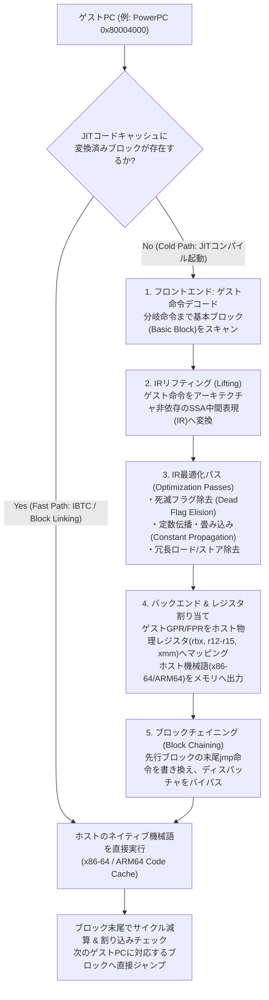
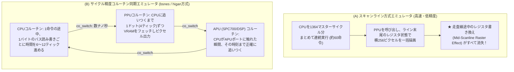

1983年に発売されたファミリーコンピュータ（NES）、1990年のスーパーファミコン（SNES）、2000年のPlayStation 2、あるいは2001年のニンテンドーゲームキューブ。これらの家庭用ゲーム機は、汎用的なパーソナルコンピュータとは全く異なる設計思想で作られた<strong>「専用カスタムLSI（大規模集積回路）の集合体」</strong>であった。当時の半導体エンジニアたちは、限られたトランジスタ予算と厳しい製造コストの制約の中で、特定の画像表現（スプライト合成、背景の回転・拡大縮小、ラスタ割り込み）や特定の音響合成（波形メモリ音源、ADPCM、FM音源）を最小の回路規模で達成するため、独自の命令セットを持つCPUや、トリッキーな結線を施したPPU（Picture Processing Unit：画像処理プロセッサ）、APU（Audio Processing Unit：音声処理プロセッサ）をシリコンウェハー上に直接刻み込んだのである。

ところが今日、私たちはそれらの専用ハードウェアを一切持たなくとも、IntelやAMDのx86-64プロセッサ、あるいはApple SiliconなどのARM64プロセッサを搭載した汎用PCやスマートフォンの上で、当時のゲームROMイメージを寸分違わず——時には実機のブラウン管テレビ以上の解像度と低遅延で——実行することができる。これを可能にしているソフトウェア技術が<strong>「エミュレーション（Emulation）」</strong>である。

考えてみれば、これは極めて不思議な現象である。スーパーファミコンのCPU（Ricoh 5A22）と現代のPCのCPU（たとえばAMD RyzenやIntel Core）とでは、機械語のビット並びも、レジスタの本数も、メモリアドレスの空間構造も、割り込みの電気信号のタイミングも、何一つ共通点がない。それにもかかわらず、なぜ「ただのソフトウェアプログラム」が、物理的なシリコンチップと水晶発振器と電子回路の振る舞いを完璧に模倣できるのだろうか？そして、なぜ「わずか $3.58\,\text{MHz}$ で動いていたスーパーファミコン」を1クロックの狂いもなく完璧に再現しようとしたとき、かつて<strong>「$3\,\text{GHz}$（約1000倍のクロック周波数）の現代的CPU」</strong>が必要とされたのだろうか？

本稿では、計算機科学の根幹をなす<strong>万能チューリング機械（Universal Turing Machine）</strong>の数学的定理から出発し、CPUエミュレーションにおける<strong>インタプリタと分岐予測の攻防</strong>、DolphinやPCSX2、RPCS3、Rosetta 2などの心臓部である<strong>動的バイナリ変換（JIT / Dynarec）と死滅フラグ除去最適化</strong>、ホストOSの仮想記憶機構（MMU）をハックする<strong>Fastmem</strong>、そしてエミュレータ開発における最大の難所である<strong>並列ハードウェアのサイクル精度（Cycle-Accurate）同期</strong>に至るまで、エミュレーション工学の深淵を体系的に解き明かす。

---

## 第1章：シリコンから数学へ——万能チューリング機械とハードウェアの同型性

### 1.1 万能チューリング機械 $U(\langle M \rangle, x) = M(x)$ という奇跡
「あるコンピュータが、全く別の構造を持つコンピュータの振る舞いをソフトウェアとして完全に模倣できる」という事実は、単なるプログラミング上の工夫ではなく、1936年にイギリスの数学者<strong>アラン・チューリング（Alan Turing）</strong>が証明した計算機科学の第一原理に根ざしている。

チューリングは記念碑的論文『計算可能数について（On Computable Numbers, with an Application to the Entscheidungsproblem）』において、テープと読み書きヘッドと有限個の状態遷移表からなる抽象的な計算モデル（チューリング機械）を定義した。さらに彼は、任意の個別チューリング機械 $M$ の構造記述（状態遷移表を符号化した文字列）$\langle M \rangle$ と、その機械への入力データ $x$ の双方をテープ上のデータとして受け取り、$M$ が $x$ に対して行う計算過程をステップごとにそのまま模倣する<strong>「万能チューリング機械（Universal Turing Machine: UTM）」</strong> $U$ が存在することを数学的に構成してみせたのである。

$$U(\langle M \rangle, x) = M(x)$$

この等式こそが、あらゆるエミュレータの存在証明である。ここで $M$ を「スーパーファミコンやPlayStation 2という物理ハードウェア」、$\langle M \rangle$ を「その回路の論理仕様を記述したエミュレータのプログラムコード」、そして $x$ を「ゲームのROMカートリッジやCD/DVDデータおよびコントローラ入力」と読み替えれば、ホストコンピュータ $U$ がソフトウェア $\langle M \rangle$ を介して $M(x)$ と完全に同一の出力を生成できることが直ちに導かれる。

### 1.2 デジタル論理回路の数学的本質：有限状態機械（FSM）
「いや、チューリング機械は抽象的な計算の話であって、実際のゲーム機にはカスタム画像チップやアナログに近い複雑なタイミングのバス配線があるではないか」という疑問が生じるかもしれない。しかし、同期式デジタル論理回路（Synchronous Digital Logic Circuit）として設計されたあらゆる半導体チップは、どれほど複雑に見えようとも、数学的には<strong>決定論的な有限状態オートマトン（Finite State Machine: FSM）</strong>に還元される。

任意のデジタルゲーム機の全ハードウェア状態を考えてみよう。
- CPU内部の汎用レジスタ、プログラムカウンタ（PC）、ステータスフラグ
- PPU内部のVRAM（ビデオメモリ）、OAM（スプライト属性メモリ）、CGRAM（パレットメモリ）、内部ラッチや描画パイプラインカウンタ
- APU内部の音声バッファ、エンベロープカウンタ、DSPレジスタ
- メインRAMのすべてのビット（たとえばSFCの128KB WRAMなら $128 \times 1024 \times 8 = 1,048,576$ ビット）

これらすべての記憶素子（フリップフロップおよびSRAMセル）のビットを並べた巨大な直積集合を、そのゲーム機の<strong>状態空間 $\mathcal{S}$</strong> と呼ぶ。時刻 $t$（マスタークロックの第 $t$ ティック）におけるシステム全体の状態ベクトルを $S_t \in \mathcal{S}$ とし、その瞬間に外部から与えられる入力（コントローラのボタン押下状態など）を $I_t \in \mathcal{I}$ とすると、組み合わせ論理回路（AND、OR、NOT、XORゲートの網の目）が次のクロックエッジまでに計算する処理は、厳密に次の2つの純粋関数として記述できる。

$$S_{t+1} = \delta(S_t, I_t)$$
$$O_t = \lambda(S_t, I_t)$$

ここで $\delta: \mathcal{S} \times \mathcal{I} \to \mathcal{S}$ は<strong>状態遷移関数</strong>であり、$\lambda: \mathcal{S} \times \mathcal{I} \to \mathcal{O}$ は画面のRGBピクセル信号やスピーカーのPCM音声サンプルを生成する<strong>出力関数</strong>である。

シリコンチップ上の論理ゲートが電圧のHigh/Low（$3.3\,\text{V}$ や $5\,\text{V}$ と $0\,\text{V}$）を使って物理的に計算しているブール代数（Boolean Algebra）は、ホストCPUが `uint32_t` や `uint64_t` の変数に対して行うビット演算（`&`, `|`, `^`, `~`, `+`, `<<`）と<strong>数学的に完全同型（Isomorphic）</strong>である。物理的なトランジスタが電子を移動させて真理値表を実現しようと、ホストCPUがメモリ上の構造体変数を書き換えて同じ真理値表を実現しようと、入力 $I_0, I_1, \dots, I_t$ と初期状態 $S_0$ が同一であれば、状態列 $S_1, S_2, \dots, S_{t+1}$ と出力列 $O_0, O_1, \dots, O_t$ は1ビットの狂いもなく一致する。

### 1.3 シミュレーションとエミュレーションの違い、そしてリアルタイムの壁
計算機科学において、しばしば<strong>シミュレーション（Simulation）</strong>と<strong>エミュレーション（Emulation）</strong>は区別される。
- <strong>シミュレーション</strong>は、対象システムの「内部状態や物理的プロセス」を解析・予測することを目的とする（たとえばSPICEによるトランジスタの電圧波形・過渡応答の微分方程式計算など）。ここでは時間が何千倍スローになろうとも内部の物理量が正確に求まればよい。
- <strong>エミュレーション</strong>は、あるシステム（ホスト）が別のシステム（ゲスト）の「外部から観測可能な振る舞いとインターフェース」を完全に代替し、ゲスト用のソフトウェアをそのまま改変なしに実行させることを目的とする。

ゲーム機のエミュレーションにおいて最大の障壁となるのは、「計算可能かどうか（Computability）」ではなく、<strong>「実時間制約（Real-Time Constraint）の中で計算し切れるか」</strong>という計算複雑性の壁である。たとえばNTSC方式のゲーム機は、毎秒約60フレーム（正確にはスーパーファミコンなら $21.477272\,\text{MHz} / (1364 \times 262) \approx 60.0988\,\text{Hz}$、すなわち1フレームあたり約 $16.639\,\text{ミリ秒}$）で画面を更新し、音声を途切れなく出力し続けなければならない。

実機のハードウェアでは、数百万個のトランジスタがクロック信号に合わせて<strong>すべて同時に（並列に）</strong>1ナノ秒〜数十ナノ秒で状態遷移関数 $\delta$ を計算する。しかしソフトウェアエミュレータは、その膨大な並列回路の状態更新を、ホストCPUの限られた命令パイプラインの上で<strong>逐次的な機械語命令の列</strong>として直列に計算しなければならない。この「空間的な並列回路」から「時間的な逐次命令」への変換ギャップをいかにして埋めるか——それこそが、過去30年間にわたるエミュレータ開発者たちの戦いの歴史なのである。

---

## 第2章：CPUエミュレーションの基礎——SwitchインタプリタからDirect Threaded Codeまで

エミュレータが最初に直面する課題は、ゲストゲーム機のメインCPU（ファミコンの6502系、SFCの65C816、メガドライブのMotorola 68000、PS1のMIPS R3000A、PS2のMIPS R5900、GameCubeのPowerPC 750CXeなど）の機械語プログラムをいかにして解釈・実行するかである。

### 2.1 古典的フェッチ・デコード・エグゼキュート（Switchインタプリタ）
最も直感的で実装しやすい手法は、実機のCPUが行っている<strong>フェッチ（命令取得）→ デコード（命令解読）→ エグゼキュート（実行）</strong>のサイクルを、そのままC言語やRustの `while` ループと `switch` 文で記述する<strong>インタプリタ（Interpreter：逐次解釈実行）方式</strong>である。

架空のシンプルな8ビット/16ビット風CPUを例にとると、典型的なSwitchインタプリタのコードは以下のようになる。

```c
// 古典的なSwitchディスパッチ型インタプリタの構造
void cpu_run_frame(CPUState *cpu) {
    while (cpu->cycles_remaining > 0) {
        // 1. Fetch: プログラムカウンタ(PC)が指すアドレスから1バイトのオペコードを読む
        uint8_t opcode = bus_read8(cpu, cpu->pc++);

        // 2. Decode & Execute: オペコードに応じて処理を分岐
        switch (opcode) {
            case 0xA9: { // LDA #imm (即値をアキュムレータAにロード)
                uint8_t imm = bus_read8(cpu, cpu->pc++);
                cpu->a = imm;
                cpu->flag_z = (cpu->a == 0);
                cpu->flag_n = (cpu->a & 0x80) != 0;
                cpu->cycles_remaining -= 2;
                break;
            }
            case 0x69: { // ADC #imm (キャリー付き加算)
                uint8_t imm = bus_read8(cpu, cpu->pc++);
                uint16_t sum = (uint16_t)cpu->a + (uint16_t)imm + (cpu->flag_c ? 1 : 0);
                cpu->flag_v = (~(cpu->a ^ imm) & (cpu->a ^ sum) & 0x80) != 0;
                cpu->flag_c = (sum > 0xFF);
                cpu->a = (uint8_t)sum;
                cpu->flag_z = (cpu->a == 0);
                cpu->flag_n = (cpu->a & 0x80) != 0;
                cpu->cycles_remaining -= 2;
                break;
            }
            case 0x4C: { // JMP abs (絶対アドレスジャンプ)
                uint16_t addr = bus_read16(cpu, cpu->pc);
                cpu->pc = addr;
                cpu->cycles_remaining -= 3;
                break;
            }
            // ... 256通りのオペコードハンドラが続く ...
        }
    }
}
```

このコードは極めて明快でデバッグも容易であり、8ビット・16ビット世代のCPU（クロック数MHz程度）を現代の数GHzのPCで動かす分には十分な速度が出る。しかし、対象がNintendo 64、セガサターン、ドリームキャスト、あるいはPlayStation 2以降になると、この素朴なSwitchインタプリタは深刻な性能の壁に激突する。

### 2.2 現代のCPUを苦しめる「間接分岐予測ミス」の罠
なぜ `switch (opcode)` ループは遅いのか？コンパイラ（GCCやClang、MSVC）は、256個の `case` を持つ巨大な `switch` 文をコンパイルする際、ジャンプテーブル（関数ポインタ配列に相当するアドレス表）を用いた<strong>単一の間接ジャンプ命令（x86-64なら `jmp qword ptr [r12 + rax*8]`）</strong>をループの先頭に1つだけ生成する。

現代の高性能CPU（Intel CoreやAMD Ryzenなど）は、14〜20段におよぶ深い命令パイプラインを持ち、同時に数百個の命令をアウトオブオーダー（順不同）で投機実行している。間接ジャンプ命令に遭遇すると、ハードウェアの<strong>間接分岐予測器（Indirect Branch Predictor / BTB: Branch Target Buffer）</strong>は、「前回この `jmp` 命令を実行したとき、どこへ飛んだか（あるいは直前の分岐履歴パターンからして次はどう飛ぶか）」を予測して、ジャンプ先の命令を先回りしてパイプラインに流し込む。

ところが、Switchインタプリタでは、<strong>ゲストプログラムのあらゆる命令の切り替えが、ホストプログラム上の「たった1箇所の同じ `jmp` 命令アドレス」を通過する</strong>。ゲストが `LDA` → `ADC` → `STA` → `DEX` → `BNE` と毎サイクル全く異なるオペコードを実行するたびに、その単一の `jmp` 命令の飛び先は256通りのハンドラへ目まぐるしく変化する。結果としてハードウェアの分岐予測は高確率で外れ（Branch Misprediction）、投機実行していたパイプラインをすべて破棄（フラッシュ）してやり直すため、<strong>ゲストのたった1命令を実行するごとにホストCPUで15〜20クロックサイクルもの空転ペナルティ</strong>が発生してしまうのである。

### 2.3 Direct Threaded Code（Computed Goto）による分岐履歴の分散
この分岐予測ボトルネックを緩和する古典的かつ強力なテクニックが、GCCやClangの拡張機能であるラベルアドレス参照（`&&label`）を利用した <strong>Direct Threaded Code（ダイレクト・スレッデッド・コード）</strong> である。

```c
// Direct Threaded Code (Computed Goto) によるディスパッチの分散
void cpu_run_threaded(CPUState *cpu) {
    static const void * const dispatch_table[256] = {
        [0x00] = &&op_BRK,
        // ...
        [0x4C] = &&op_JMP_abs,
        [0x69] = &&op_ADC_imm,
        [0xA9] = &&op_LDA_imm,
        // ...
    };

    #define DISPATCH() do { \
        if (cpu->cycles_remaining <= 0) return; \
        uint8_t next_op = bus_read8(cpu, cpu->pc++); \
        goto *dispatch_table[next_op]; \
    } while(0)

    DISPATCH(); // 最初の命令へジャンプ

op_LDA_imm: {
        uint8_t imm = bus_read8(cpu, cpu->pc++);
        cpu->a = imm;
        cpu->flag_z = (cpu->a == 0);
        cpu->flag_n = (cpu->a & 0x80) != 0;
        cpu->cycles_remaining -= 2;
        DISPATCH(); // ★ op_LDA_imm 専用の独立した間接ジャンプ命令が生成される！
    }

op_ADC_imm: {
        uint8_t imm = bus_read8(cpu, cpu->pc++);
        // ... 加算処理 ...
        cpu->cycles_remaining -= 2;
        DISPATCH(); // ★ op_ADC_imm 専用の独立した間接ジャンプ命令が生成される！
    }

op_JMP_abs: {
        cpu->pc = bus_read16(cpu, cpu->pc);
        cpu->cycles_remaining -= 3;
        DISPATCH();
    }
    // ...
}
```

この書き換えにより、メインループ先頭の1箇所に集中していた間接ジャンプ命令が、<strong>256個の各オペコードハンドラの末尾へと複製・分散</strong>される。実際のプログラムには強い統計的偏り（たとえば「`CMP`（比較）命令の直後には極めて高い確率で `BEQ` または `BNE`（条件分岐）命令が来る」など）があるため、各オペコード専用の `jmp` 命令ごとにBTBエントリが割り当てられることで、ホストCPUの分岐予測ヒット率が劇的に向上する。

さらに近年では、SwitchループやThreaded Codeの関数呼び出しオーバーヘッドを抑えるため、各オペコードハンドラを独立した小関数とし、関数の末尾で次のハンドラ関数を末尾再帰呼び出し（Tail Call：`[[clang::musttail]] return dispatch[next_op](cpu, pc, cycles);`）することで、ゲストのプログラムカウンタや主要レジスタを常にホストCPUの物理レジスタ（引数レジスタ `rdi`, `rsi`, `rdx` 等）に載せっぱなしにする<strong>Tail-Call Interpreter</strong>も広く採用されている。

しかし、いかにインタプリタを洗練させようとも、根本的な限界は残る。インタプリタは<strong>「同じループを1万回実行する際、1万回とも毎回同じ機械語バイト列をメモリから読み、ビットフィールドをマスク＆シフトしてレジスタ番号を取り出し、ディスパッチテーブルを引く」</strong>という冗長な作業を繰り返している。ゲスト1命令の意味する実作業（たとえば「レジスタAとBを足す」というホスト1命令で済む処理）のために、毎回10〜50命令ものフェッチ・デコード・状態更新のラッパー処理を実行しているのである。

---

## 第3章：動的バイナリ変換（DBT / JIT Dynarec）の解剖学——Dolphin・PCSX2・RPCS3・Rosetta 2の心臓部

第5世代〜第7世代以降のゲーム機（Nintendo 64、ドリームキャスト、PlayStation 2、ゲームキューブ、Wii、PlayStation 3、Xbox 360、Nintendo Switchなど）や、AppleのRosetta 2、QEMU（TCG: Tiny Code Generator）において、実用的な実行速度を達成するための絶対的な中核技術が <strong>動的バイナリ変換（Dynamic Binary Translation: DBT）</strong>、エミュレータ界隈では通称 <strong>Dynarec（Dynamic Recompiler：動的再コンパイラ）</strong> または <strong>JIT（Just-In-Time）コンパイラ</strong> と呼ばれる機構である。

### 3.1 JIT動的再コンパイラの全体パイプライン
Dynarecの基本思想は明快である。「ゲストCPUの機械語命令を1命令ずつ解釈するのではなく、実行時にゲストのプログラムカウンタ（PC）が到達した<strong>基本ブロック（Basic Block：入り口が1つで、途中に分岐を含まず、末尾の分岐命令で終わる連続した命令列）</strong>を丸ごと読み取り、それと等価な仕事をする<strong>ホストCPU（x86-64やARM64）のネイティブ機械語列</strong>へ動的にコンパイルして実行可能メモリ領域（Code Cache）に保存し、2回目以降はそのネイティブコードを直接爆速で実行する」というものである。

現代の高度なエミュレータ（GameCube/Wiiエミュレータの<strong>Dolphin</strong>、PS2の<strong>PCSX2</strong>、PS3の<strong>RPCS3</strong>、3DSの<strong>Citra</strong>、Switchの<strong>Ryujinx</strong>など）におけるJITコンパイラの内部パイプラインを以下の図に示す。



このパイプラインの各段階で行われている驚異的なコンパイラ最適化を、具体的に見ていこう。

### 3.2 基本ブロックの抽出とSSA中間表現（IR）へのリフティング
ゲストのメモリから機械語命令列を読み取ったフロントエンドは、まずそれを直接x86-64命令に変換するのではなく、一度エミュレータ独自の<strong>中間表現（Intermediate Representation: IR）</strong>、特に<strong>静的単一代入（SSA: Static Single Assignment）形式</strong>のマイクロオペレーション列へと分解（Lifting）する。

なぜ1つのゲスト命令をわざわざ複数の細かいIR命令に分解するのか？それは、ゲストCPUの1命令には「本来の演算」だけでなく「複数の副作用（ステータスフラグの更新、アドレスレジスタのポストインクリメント、条件判定など）」が複雑に絡み合っているからである。一度それらを独立した原始的なSSA変数への代入としてバラバラに分解することで、後続の最適化パスが<strong>「実は使われていない無駄な副作用」</strong>を数学的に見つけ出して削ぎ落とすことが可能になる。

### 3.3 死滅フラグ除去（Dead Flag Elision）と遅延評価——命令数を3分の1に削る魔法
CPUエミュレーションにおいて、JITコンパイラがもたらす最も劇的な最適化が<strong>条件フラグの死滅ストア除去（Dead Flag Elimination / Flag Elision）</strong>である。

たとえば、GameCube/WiiのPowerPC（ドット付き命令や比較命令）、ARM、6502、あるいはx86といった多くのCPUアーキテクチャでは、算術論理演算命令が実行されるたびに、ステータスレジスタ内の4つの主要な条件フラグが更新される。
- <strong>N (Negative / Sign)</strong>：演算結果の最上位ビット（MSB）が $1$（負）か
- <strong>Z (Zero)</strong>：演算結果が $0$ か
- <strong>C (Carry)</strong>：最上位ビットからの桁上がり（またはボロー）が発生したか
- <strong>V (Overflow)</strong>：符号付き2の補数表現において算術オーバーフローが発生したか

もしこれを素直にC言語や愚直なコード生成でエミュレートすると、たった1回の加算命令 `ADD r1, r2, r3` ごとに、元の加算に加えてN・Z・C・Vの4つのフラグをビット演算で算出し、`cpu->flags` メモリへ書き込むために<strong>ホスト命令が10〜15命令</strong>も生成されてしまう。

しかし、実際のゲームプログラムの命令列を観察してみよう。

```nasm
; ゲストCPUのある基本ブロック内の4命令
ADDS r0, r1, #4      ; r0 = r1 + 4  (N, Z, C, V フラグを更新)
ADDS r2, r3, r0      ; r2 = r3 + r0 (N, Z, C, V フラグを上書き更新！)
SUBS r4, r2, #1      ; r4 = r2 - 1  (N, Z, C, V フラグをさらに上書き更新！)
BNE  label_loop      ; 直前の SUBS の Z フラグだけを見て分岐判定！
```

この4命令のブロックにおいて、1行目の `ADDS` と2行目の `ADDS` が計算した N, Z, C, V フラグは、<strong>誰にも一度も読まれることなく3行目の `SUBS` によって完全に上書き（Overwrite）されて消滅している</strong>！さらに3行目の `SUBS` が計算した4つのフラグのうち、4行目の `BNE`（Branch if Not Equal：ゼロでなければ分岐）が参照しているのは <strong>Z（Zero）フラグただ1つだけ</strong> であり、後続のジャンプ先ブロックでも最初に別のフラグ更新命令が実行されるならば、N・C・Vの3つのフラグもやはり誰にも読まれない<strong>「死んだ計算（Dead Computation）」</strong>なのである。

実証的なプロファイリングによれば、一般的なCPUの実行命令ストリームにおいて生成される条件フラグのうち、<strong>実に80%〜90%以上は一度も参照されることなく上書きされる</strong>。JITコンパイラは基本ブロック（あるいは複数のブロックを跨いだイグジット）に対して逆方向のデータフロー解析（Liveness Analysis：生存解析）を実行し、参照されないフラグ計算IRをすべて削除する。

```c
// 【最適化前】愚直な変換（ゲスト3命令に対して膨大なフラグ計算が発生）
r0 = r1 + 4;
calc_and_store_nzcv(r1, 4, r0);       // <- Dead! 削除可能

r2 = r3 + r0;
calc_and_store_nzcv(r3, r0, r2);      // <- Dead! 削除可能

r4 = r2 - 1;
calc_and_store_nzcv_sub(r2, 1, r4);   // <- N, C, V は Dead! Z だけ必要
if (!cpu->flag_z) goto label_loop;

// 【最適化後】JITの死滅フラグ除去＋ホストフラグ直接利用後（x86-64アセンブリ相当）
lea eax, [rcx + 4]      ; r0 = r1 + 4 (フラグ更新すら不要な lea 命令を使える)
lea edx, [rbx + rax]    ; r2 = r3 + r0
mov esi, edx
sub esi, 1              ; r4 = r2 - 1 (ホストx86-64自身のZFフラグが自然にセットされる！)
jnz host_label_loop     ; ホストのZFフラグをそのまま使ってネイティブ条件分岐！
```

見ての通り、本来なら数十命令を要したゲストの4命令が、<strong>たった5個のx86-64ネイティブ命令（わずか1〜2クロックサイクル）</strong>へと昇華された。AppleのM1/M2/M3/M4チップに搭載されている <strong>Rosetta 2</strong> がx86-64バイナリをARM64へ変換する際にも、このデッドフラグ除去に加え、ハードウェアレベルでARM64プロセッサ自体に「x86のフラグ更新規則（CFやOFの特殊な振る舞い）を直接模倣する専用モードビット」を搭載するというシリコン・ソフトウェア協調設計によって、ネイティブコードと遜色ない変換効率を実現している。

### 3.4 レジスタ割り当て（Register Allocation）とブロックチェイニング（Block Chaining）
もう一つの重要なJIT最適化が<strong>レジスタ割り当て</strong>である。PS2（MIPS R5900）やGameCube（PowerPC）、PS3（Cell PPU/SPU）などのRISCプロセッサは、32本の汎用レジスタ（`r0`〜`r31`）と32本の浮動小数点/ベクトルレジスタ（`f0`〜`f31`）を備えている。一方、ホストとなるx86-64アーキテクチャには汎用レジスタが16本（`rax`〜`r15`）、AVX/SSEベクトルレジスタが16〜32本（`xmm0`〜`xmm15/31`）存在する。

もし命令ごとにゲストのレジスタ値を `cpu->gpr[reg_idx]` というRAM上の構造体からロードし、計算後にまたストアしていたら、メモリアクセスのレイテンシが足を引っ張る。そこでJITコンパイラは、基本ブロック内で頻繁に使われるゲストレジスタ（およびシステム全体で常にホットなスタックポインタやアキュムレータ等）を、<strong>ホストx86-64の呼び出し規約で保存される物理レジスタ（Callee-saved registers：`rbx`, `rbp`, `r12`, `r13`, `r14`, `r15` など）へ直接割り当てる（Register Caching / Pinning）</strong>。ブロックの実行中、ゲストのレジスタ演算はすべてホストの物理レジスタ間だけで完結し、そのレジスタがブロック外で退避される必要が生じた瞬間（Spill）にだけメモリへ書き戻される。

さらに、コンパイルされた基本ブロック $B_1$ の実行が終わり、次のゲストPCが確定したとき、毎回C言語のメインループ（ディスパッチャ）へ `ret` で戻ってハッシュテーブルから次のブロック $B_2$ を検索していたのでは、やはり数十サイクルのオーバーヘッドが生じる。そこで導入されるのが <strong>ブロックチェイニング（Block Chaining / Direct Block Linking）</strong> である。

1. ブロック $B_1$ を最初にコンパイルした時点では、末尾の分岐先であるゲストアドレス `0x80004020` のブロック $B_2$ はまだコンパイルされていないかもしれない。そのため、$B_1$ の末尾には「ディスパッチャを呼び出して `0x80004020` をコンパイル・検索するスタブ（Trampoline）」へのジャンプ命令を出力しておく。
2. 実行時にそのスタブが踏まれ、ブロック $B_2$ がホストアドレス `0x7FFF1000` にコンパイルされた瞬間、JITランタイムは<strong>ブロック $B_1$ の末尾にあるx86-64の `jmp` 命令のオペランドを直接書き換え（パッチし）、次回からディスパッチャを一切経由せず `jmp 0x7FFF1000` で $B_1$ から $B_2$ へ直結ジャンプするように繋ぎ変える</strong>。
3. 関数のリターン（`blr` や `jr $ra`）や仮想関数テーブル呼び出しのように、ジャンプ先のゲストアドレスが実行時に動的に変わる<strong>間接分岐（Indirect Branch）</strong>に対しても、直近の変換ペア `[ゲストPC -> ホストネイティブアドレス]` を小さな配列（またはインライン比較キャッシュ）に保持する <strong>IBTC（Indirect Branch Translation Cache）</strong> をアセンブリコード内に直接埋め込むことで、99%以上のケースでC言語のランタイムに戻ることなくネイティブコード空間内だけで高速に実行を継続する。

### 3.5 自己書き換えコード（Self-Modifying Code: SMC）との戦い
JITコンパイラにとって最も厄介な敵が<strong>自己書き換えコード（Self-Modifying Code: SMC）</strong>および実行時の動的コードロード（オーバーレイ）である。昔のゲーム機はメインメモリ（RAM）が数メガバイトと極めて少なかったため、ゲームのステージが切り替わる際や、圧縮されたプログラムをRAM上に展開してそこにジャンプする際、あるいは動的に命令列を書き換えて高速化を図る際に、<strong>「さっきまで機械語コードが置かれていた同じRAMアドレス」に新しい機械語を上書きする</strong>ことが日常茶飯事であった。

インタプリタであれば、毎回RAMから直接バイト列を読むため何の問題も起きない。しかしJITコンパイラの場合、古い機械語を元にコンパイルしたネイティブコードがCode Cacheに残っていると、<strong>ゲーム側がRAM上の命令を書き換えたにもかかわらず、エミュレータは古いコンパイル済みキャッシュを実行し続けてしまい、即座にクラッシュする</strong>。これを防ぐため、現代のJITエミュレータは以下のいずれか（または組み合わせ）によってキャッシュの一貫性（Coherency）を保つ。

1. <strong>ハードウェアページ保護トラップ（Page Write Protection）</strong>：JITがゲストRAMの特定のページ（4KB単位）にあるコードをコンパイルした際、ホストOSのAPI（Linux/macOSの `mprotect`、Windowsの `VirtualProtect`）を使って、そのゲストRAMに対応するホストメモリページを<strong>「読み取り専用（Read-Only）」</strong>にロックする。ゲストプログラムがその領域へ命令やデータを書き込もうとした瞬間、ホストCPUがアクセス違反例外（`SIGSEGV` / `STATUS_ACCESS_VIOLATION`）を発生させる。エミュレータのシグナルハンドラがこの例外を捕捉し、該当ページに含まれるJITブロックを即座に無効化（Invalidate）した上でページの書き込み許可を戻す。
2. <strong>ソフトウェアダーティビットとブロックハッシュ検証</strong>：同じ4KBページ内に「頻繁に書き換えられるデータ変数」と「機械語コード」が同居している場合（False Sharing）、ページ保護方式では例外トラップが多発して逆に遅くなる。そのようなページに対しては、メモリ書き込み時にソフトウェアのビットマップ（SMC Dirty Table）にフラグを立てるか、ブロックの先頭で元のゲスト機械語列の高速ハッシュ（CRC32C等）をチェックして変更があれば再コンパイルへ飛ばすハイブリッド手法が採られる。

---

## 第4章：メモリサブシステムとFastmem——ホストMMUをハイジャックする仮想記憶トリック

CPUの演算命令と並んで、エミュレータの性能を決定づけるもう一つの巨大な柱が<strong>メモリアクセス（Load / Store命令）のエミュレーション</strong>である。一般的なプログラムでは全実行命令の約30%〜40%がメモリの読み書きであり、ここが遅ければどれほど算術命令のJITを最適化しても意味がない。

### 4.1 なぜゲストのメモリアクセスは単純な配列参照にならないのか？
「ゲストが32ビットのアドレス空間を持っているなら、ホスト側で4GBの配列を確保して `ram[guest_addr]` を読むだけではないのか？」と思うかもしれない。しかし、実際のゲーム機の物理メモリマップは、単一のフラットなRAMではなく、複雑なモザイク状の構造（Memory Map）になっている。

たとえばあるゲーム機の32ビットアドレス空間が以下のように割り当てられていたとしよう。
- `0x0000_0000` 〜 `0x01FF_FFFF`：メインRAM（32MB）
- `0x0200_0000` 〜 `0x03FF_FFFF`：メインRAMのミラー領域（同じ32MBが繰り返し見える）
- `0x1000_0000` 〜 `0x1000_FFFF`：<strong>メモリマップドI/O（MMIO）レジスタ</strong>（DMAコントローラ、タイマー、GPUコマンドポート、音声レジスタ、コントローラ入力など）
- `0x1FC0_0000` 〜 `0x1FFF_FFFF`：BIOS ROM（読み取り専用、書き込むと無視される）

ここで特に厄介なのが <strong>MMIO（Memory-Mapped I/O）</strong> である。ゲーム機には「画面を描画せよ」「DMA転送を開始せよ」といった専用のCPU命令があるわけではなく、特定の予約されたメモリアドレス（たとえば `0x1000_3000`）に値を書き込む（Storeする）という行為そのものが、ハードウェアチップのピンに電気信号を送ってDMAや描画を起動するトリガーになっている。

そのため、素朴なエミュレータでは、ゲストが `lw`（Load Word）や `sw`（Store Word）を実行するたびに、以下のような `bus_write32` 関数を呼び出さなければならない。

```c
// 素朴なソフトウェアバスディスパッチ（毎回のメモリアクセスで条件分岐が発生）
void bus_write32(System *sys, uint32_t addr, uint32_t val) {
    if (addr < 0x04000000) {
        // メインRAMおよびミラー領域（マスクして書き込み）
        *(uint32_t *)(&sys->ram[addr & 0x01FFFFFF]) = val;
    } else if (addr >= 0x10000000 && addr < 0x10010000) {
        // MMIOハードウェアレジスタへの書き込み -> 副作用を発火！
        mmio_write_handler(sys, addr, val);
    } else if (addr >= 0x1FC00000 && addr < 0x20000000) {
        // BIOS ROM領域への書き込みは無視
        return;
    } else {
        // 未マップ領域（バスエラー例外の発生など）
        trigger_bus_error(sys, addr);
    }
}
```

ゲストのメモリアクセスの99.9%は単なるメインRAMの読み書きであるにもかかわらず、万が一の0.1%のMMIOアクセスを判定するために、<strong>毎回のロード・ストアごとに何段もの `if-else` 分岐と関数呼び出しを行う</strong>のは途方もない無駄である。

### 4.2 ソフトウェアTLBから「Fastmem」への進化
この問題を解決する第1段階が <strong>ソフトウェアTLB（Software Lookaside Buffer / Page Table）</strong> である。32ビットアドレスの上位20ビット（4KBページ番号）をインデックスとする巨大なポインタ配列 `uintptr_t page_table[1048576]` を用意し、通常のRAMページであれば「ホストメモリの対応アドレスへのオフセット」を格納し、MMIOページであれば最下位ビット（アライメント上常に0になるビット）に `1`（MMIOフラグ）を立てておく。これにより、JITコード内でのチェックは「上位ビットでテーブルを引き、ビット0が0ならそのままメモリアクセス、1ならMMIO関数を呼ぶ」という数命令に短縮される。

しかし、現代の64ビットOS上で動く一線級のエミュレータ（Dolphin、PCSX2、RPCS3、Ryujinxなど）は、さらにその先を行く究極の技法——<strong>Fastmem（ハードウェアMMU活用型直接メモリアクセス）</strong>を採用している。

64ビットOS（Windows、Linux、macOS）がプロセスに提供する仮想アドレス空間は $128\,\text{TB}$（48ビット）〜 $16\,\text{EB}$ という天文学的な広さを持っている。そこでエミュレータは起動時に、ゲストの32ビットアドレス空間まるごと1個分にあたる<strong>連続した $4\,\text{GB}$ の仮想アドレス空間（Fastmem Arena）</strong>をOSから予約（`mmap` / `VirtualAlloc`）する。この時点では物理メモリは消費されない。

次に、OSの共有メモリ・ファイルマッピング機能（POSIXの `shm_open` + `mmap(MAP_FIXED)`、Windowsの `CreateFileMapping` + `MapViewOfFileEx`）を使い、実体としては32MBしかないメインRAMの物理メモリを、$4\,\text{GB}$ アリーナ内の `0x0000_0000` からの領域と、ミラー領域である `0x0200_0000` からの領域の<strong>両方の仮想アドレスに多重マッピング（Hardware Aliasing）</strong>する。そして、MMIOレジスタが存在する `0x1000_0000` 付近の仮想ページや未マップ領域については、あえて<strong>アクセス権限なし（`PROT_NONE` / `PAGE_NOACCESS`）</strong>に設定しておくのである！

すると、JITコンパイラが生成するゲストのメモリアクセス命令はどうなるだろうか？

```nasm
; 【Fastmem適用後】ゲストの32ビットストア命令 (例: sw r_val, 0(r_addr))
; rbx = ホスト上の 4GB Fastmem アリーナの先頭ベースアドレス (例: 0x00007F0000000000)
; edi = ゲストの32ビット仮想/物理アドレス (ゼロ拡張により rdi は 0x00000000XXXXXXXX)
; eax = 書き込む32ビット値

mov dword ptr [rbx + rdi], eax   ; ★ たった1命令！if分岐もテーブル参照もゼロ！
```

なんと、ゲストのRAMアクセス（ミラー領域へのアクセスすら含む）が、<strong>条件分岐もマスク演算も一切ない、ホストx86-64のたった1つのネイティブ `mov` 命令</strong>に収束してしまう！アドレスの変換やミラーの解決、範囲チェックはすべて、ホストCPU内部のハードウェアMMU（Memory Management Unit）とハードウェアTLBが<strong>0サイクルの追加コスト</strong>で並列に処理してくれるのである。

では、ゲストプログラムが `0x1000_3000` のようなMMIOレジスタにアクセスしたときは何が起きるのか？
1. `mov dword ptr [rbx + rdi], eax` が実行された瞬間、そのアドレスは `PROT_NONE`（アクセス不可）に設定されているため、ホストCPUのMMUがハードウェアページフォルトを検出し、OSカーネルがエミュレータプロセスへ例外（Linuxなら `SIGSEGV`、WindowsならVectored Exception Handlingの `STATUS_ACCESS_VIOLATION`）を送出する。
2. エミュレータのカスタム例外ハンドラが起動し、例外発生時のホスト命令ポインタ（`RIP`）とアクセス先アドレス（`CR2` / `ExceptionInformation`）を検査する。
3. アクセス先がFastmemアリーナ内のMMIO領域であることを確認すると、ハンドラは該当する `mmio_write_handler()` を呼び出してハードウェアの副作用を処理する。
4. さらに、OSの例外処理は1回あたり数マイクロ秒と重いため、同じ命令が次回以降もMMIOを叩くことが分かっている場合、例外ハンドラはその場で<strong>JITコードキャッシュ内の該当 `mov` 命令（数バイト）を「直接 `mmio_write_handler` を `call` する命令（Thunk呼び出し）」へと動的に書き換え（Backpatching）</strong>、ホストの命令ポインタを進めて実行を再開させる！これにより、2回目以降はOSのページフォルトすら発生せず、RAMアクセスは1命令、MMIOアクセスも直接関数呼び出しという理想的な速度が達成される。

---

## 第5章：並列性・タイミング・サイクル精度——なぜ「3MHzのSFC」を再現するのに「3GHzのPC」が必要だったのか

ここまでのJITコンパイルやFastmemは、主に「CPUが大量の命令を高速に処理する近代的な3Dゲーム機（PS1/N64/PS2/GameCube以降）」で威力を発揮する技術であった。ところが、エミュレーションの世界にはこれとは正反対のベクトルを持つ、もう一つの深淵な領域が存在する。それが8ビット・16ビット世代の2Dゲーム機における<strong>「サイクル精度（Cycle Accuracy）と並列チップ間同期」</strong>の問題である。

2011年、スーパーファミコン（SNES）エミュレータ『bsnes（後のhigan / Ares）』の開発者である故 <strong>Near（旧名 byuu）</strong> 氏は、著名な技術論文 *"Accuracy takes power: one man's 3GHz quest to build a perfect SNES emulator"* を発表した。その中で彼が提示した事実は世界に衝撃を与えた。1997年当時のPentium（100MHz程度）でも動く軽量なSFCエミュレータ（ZSNESやSnes9xの初期版）が存在した一方で、<strong>「実機のスーパーファミコンと1クロックの狂いもなく100%同一の挙動をするエミュレータ」を作ろうとすると、約 $3.58\,\text{MHz}$ のSFCを動かすために $3\,\text{GHz}$ の現代的PCが必要になった</strong>のである。

なぜ1000倍ものクロック差が必要になるのか？その理由は、実機のハードウェアが持つ<strong>「真の物理的並列性（True Hardware Parallelism）」</strong>にある。

### 5.1 実機ハードウェアの真の姿：21.477MHzで同時駆動する6つの独立回路
実機のスーパーファミコンの内部には、単一のCPUだけでなく、少なくとも以下の独立したプロセッサおよび状態機械が存在し、マスター水晶発振器（NTSC版では $21.477272\,\text{MHz}$）のクロック信号に同期して、<strong>電気的に完全同時並行</strong>で動いている。

1. <strong>メインCPU（Ricoh 5A22 / 65C816コア）</strong>：命令やアクセス先メモリ領域に応じて、マスタークロックの6分周（$3.58\,\text{MHz}$）、8分周（$2.68\,\text{MHz}$）、12分周（$1.79\,\text{MHz}$）と動的に速度を変えながら動作する。
2. <strong>8チャンネルの汎用DMA / HDMAコントローラ</strong>：CPUを停止（Halt）させてバスを掌握し、水平帰線期間（H-Blank）や垂直帰線期間（V-Blank）に1バイトずつPPUレジスタへデータを流し込む。
3. <strong>2つのPPUチップ（S-PPU1 / S-PPU2）</strong>：マスタークロック4分周（$5.37\,\text{MHz}$）のドットクロックで動作し、1ドット（約186ナノ秒）ごとに背景タイル（BG1〜BG4）とスプライト（OBJ）のピクセルデータをVRAM/OAMからフェッチし、優先度判定とカラーマス（半透明合成）を行ってテレビの走査線へ出力する。
4. <strong>オーディオサブシステム（Sony SPC700 CPU + S-DSP）</strong>：本体とは独立した $24.576\,\text{MHz}$ の別系統セラミック発振子で動く8ビットCPUと16ビットデジタルシグナルプロセッサ。
5. <strong>カートリッジ内の特殊コプロセッサ（Enhancement Chips）</strong>：『スターフォックス』のSuper FX（GSU）、『スーパーマリオRPG』や『星のカービィ スーパーデラックス』のSA-1（本体と同じ65C816がもう1個載っており $10.74\,\text{MHz}$ で並列稼働する！）、『ロックマンX2/X3』のCX4など。

### 5.2 スキャンライン単位エミュレーションの破綻と「ラスタエフェクト」
1990年代の古いエミュレータが非力なPCでも高速に動いたのは、これらのチップを細かく同期させることを諦め、<strong>「スキャンライン単位（Scanline-based）」</strong>という粗い近似（バッチ処理）を行っていたからである。

テレビの1画面（1フレーム）は262本の水平走査線（Scanline）からなり、1本の走査線はマスタークロックで $1364$ サイクル（CPUの命令にして約50〜100命令分）に相当する。スキャンライン方式のエミュレータは以下のように動く。
1. まずCPUインタプリタを連続して $1364$ マスターサイクル分まとめて実行する。
2. 次にPPU関数を1回呼び出し、その時点のVRAM・パレット・スクロールレジスタの値を使って、<strong>1ライン分（横256ピクセル）を1回のループで一気に描画</strong>する。
3. これを262ライン繰り返して1フレームを完成させる。

この方式は、各チップの関数が長く連続して走るためCPUキャッシュ効率が抜群に良く、コンテキストスイッチも1ラインに1回しか起きないため極めて高速である。しかし、当時の天才的なゲームプログラマーたちが駆使した<strong>「ミッドスキャンライン・ラスタエフェクト（Mid-Scanline Raster Effects）」</strong>に遭遇した瞬間、この近似は無残に崩壊する。

たとえば、SFCの『Air Strike Patrol（デザートファイターの続編）』というゲームでは、地上を飛ぶヘリコプターの真下に落ちる「半透明の丸い影」を表現するため、空いている機能を使った驚くべきハックを行っている。なんと、<strong>ブラウン管の電子ビームが左から右へ1本の走査線を描画しているまさにその最中に、CPUがタイミングを計って待機ループを回し、電子ビームがヘリコプターのX座標に差し掛かった瞬間にPPUの輝度レジスタ（`$2100` INIDISP）を直接書き換えて画面を少し暗くし、影の右端を通り過ぎた瞬間に元の明るさに戻す</strong>という処理を毎ライン行っているのである！

もしエミュレータが「スキャンライン単位」で、CPUを1ライン分先に走らせてから最後に256ピクセルをまとめて描画していたらどうなるか？CPUが途中で輝度を変えてすぐ元に戻したため、ラインの終わりには輝度レジスタは「元の明るさ」に戻っており、<strong>ヘリコプターの影は完全に消え去ってしまう</strong>。同様に、ファミコンの『バトルトード（Battletoads）』やメガドライブの『ソニック・ザ・ヘッジホッグ』の水中ラスタ表現、SFCの『クロノ・トリガー』や『ファイナルファンタジーVI』の画面歪みエフェクトなど、走査線の途中でスクロール値やスプライトバンク、パレットを書き換えるゲームは、CPUとPPUが「今、電子ビームが横何ドット目を走っているか」というレベルで同期していなければ、画面が激しくティアリングを起こすか、スプライト衝突フラグ（Sprite 0 Hit）のタイミングがずれて無限ループに陥りフリーズする。

### 5.3 サイクル精度（Dot-by-Dot）同期と超軽量コルーチン（Fibers）
この問題を根本的に解決するには、エミュレータの抽象度をスキャンラインから引き下げ、<strong>CPUの1バスアクセス（さらにはPPUの1ドット描画＝4マスタークロック）単位で各チップの状態を噛み合わせて進行させる「サイクル精度（Cycle-Accurate）」エミュレーション</strong>へと移行するほかない。



ここで重大な実装上の壁が立ちはだかる。たとえばCPUが `INC $2100`（メモリの値を読み、1を足して、書き戻すRead-Modify-Write命令）を実行するとき、65C816 CPUは合計6回のバスサイクルを消費し、最後の6サイクル目で初めてPPUレジスタ `$2100` に新しい値が書き込まれる。もしCPUの状態を「1命令まるごと実行する関数」として書いてしまうと、命令の途中の何サイクル目でバスに値が出たのかを表現できない。

かといって、CPUもPPUもAPUも「1クロック進めるごとに `return` する巨大なステートマシン（`switch(state)`）」として書き直そうとすれば、何百もの命令の途中状態をすべて構造体変数に保存しなければならず、コードは人間が保守不可能なスパゲッティと化す。また、CPUとPPUをOSの別々のスレッド（`std::thread` や `pthread`）に分けてミューテックスやセマフォで1サイクルごとに同期させようとすれば、OSカーネルのコンテキストスイッチに毎回1,000〜10,000サイクルがかかり、秒間数百万回の切り替えなど到底不可能である。

Near氏が『bsnes』で完成させたエレガントな解決策が、<strong>ユーザー空間の協調的マルチタスキング（Cooperative Multitasking / Co-routines / Fibers）</strong>、具体的には彼が設計した超軽量Cライブラリ `libco` の活用であった。

- CPU、PPU、SMP（APU CPU）、DSP、カートリッジコプロセッサのそれぞれに、独立した小さなコールスタックを割り当て、<strong>「自分自身の自然なループ構造を持ったまま」</strong>記述する。
- CPUが1バイトのメモリアクセスを行って自身のローカル時計 `cpu_clock` を $6$ マスターサイクル進めたとき、もし `cpu_clock > ppu_clock` になった（あるいはPPUに関連するレジスタにアクセスした）瞬間、アセンブリで書かれたわずか十数命令の関数 `co_switch(ppu_thread)` を呼び出す。
- `co_switch` はOSカーネルを一切介さず、ホストCPUの不揮発性レジスタ6〜8本とスタックポインタ（`rsp`）だけを差し替えて、<strong>わずか数ナノ秒（10〜15ホストサイクル）でPPUの実行途中だったコード位置へ直接ジャンプ</strong>する。
- PPUは自身の時計 `ppu_clock` が `cpu_clock` に追いつくまで数ドット分のピクセル描画処理を進め、追いついた瞬間に `co_switch(cpu_thread)` でCPUのメモリアクセス直後の行へと制御を返す。

さらに現代のサイクル精度エミュレータでは、このコルーチン切り替えの回数すら最小化する<strong>「Just-In-Time同期（Catch-up / Event-Driven Synchronization）」</strong>が併用されている。たとえばCPUがメインRAM内だけで計算を続けており、APU（音声チップ）の通信ポート（`$2140`〜`$2143`）に一切触れていない間は、APUのコルーチンを毎回呼び出す必要はない。CPU側が数千サイクル先まで走り、<strong>いざCPUがAPUの通信ポートを読み書きしようとしたまさにその瞬間（あるいは音声バッファの出力が必要になった瞬間）に初めてAPUコルーチンを呼び出し、溜まっていた数千サイクル分の時間を一気に追いつかせる（Catch-up）</strong>。両者が互いの状態を観測しない限り因果律は破れないため、数学的なサイクル精度を1ビットも犠牲にすることなく、コンテキストスイッチの回数を劇的に削減できるのである。

ここで、これまでに解説したCPU・メモリ・タイミングの各エミュレーション手法の特性を一覧表にまとめよう。

| 技術カテゴリ | 手法・アーキテクチャ | 動作原理の核心 | 実行速度（ホスト負荷） | 再現精度・互換性 | 代表的な採用プロジェクト・用途 |
| :--- | :--- | :--- | :--- | :--- | :--- |
| <strong>CPU実行方式</strong> | <strong>Switchインタプリタ</strong> | 単一の `switch(opcode)` ループで1命令ずつフェッチ・解読・実行 | 低速（1命令あたり15〜50ホスト命令＋分岐予測ミス） | <strong>極めて高い</strong>（サイクル単位の割り込み挿入が容易） | 8/16ビット機エミュレータ、デバッガ、初期実装 |
| <strong>CPU実行方式</strong> | <strong>Threaded Code / Tail-Call</strong> | 各ハンドラ末尾に `goto *table[op]` や末尾呼び出しを配置し分岐履歴を分散 | 中速（Switch比で1.3〜2倍高速） | <strong>極めて高い</strong> | 高精度SFC/MD/GBAエミュレータ、QEMU（TCI） |
| <strong>CPU実行方式</strong> | <strong>JIT / Dynarec（動的再コンパイル）</strong> | ゲスト基本ブロックをSSA IRへ変換し、死滅フラグ除去・レジスタ割当を経てホスト機械語へ変換 | <strong>超高速</strong>（インタプリタ比で5〜50倍高速） | 高〜中（SMC検知やブロック境界でのみ割り込みを処理する近似が伴う） | Dolphin, PCSX2, RPCS3, Citra, Ryujinx, Rosetta 2 |
| <strong>CPU / OS抽象化</strong> | <strong>HLE（High-Level Emulation）</strong> | BIOSやOS API、DSPマイクロコードの命令列を実行せず、等価なホストC++関数やVulkan/OpenGL呼び出しで置換 | <strong>圧倒的に高速</strong> | 中〜低（独自マイクロコードや未文書化のハードウェア副作用を使うゲームで破綻） | UltraHLE (N64), PPSSPP, Dolphin (HLE Audio), RPCS3 (Lv2 OS) |
| <strong>メモリ（MMU）</strong> | <strong>ソフトウェアバスディスパッチ</strong> | 毎回のLoad/Storeでアドレス範囲を `if-else` または配列で判定 | 低速（全命令の30〜40%で分岐オーバーヘッド） | 完全（バス競合やオープンバス挙動も正確に模倣可能） | 8/16ビット機全般、サイクル精度エミュレータ |
| <strong>メモリ（MMU）</strong> | <strong>Fastmem（ハードウェアMMU活用）</strong> | 4GB仮想空間を予約しRAMを多重マップ、MMIOを `PROT_NONE` にして `SIGSEGV` 例外で捕捉 | <strong>ネイティブ同等</strong>（RAMアクセスがホスト1命令 `mov [rbx+rdi], eax` に収束） | 高い（バックパッチ併用で実用上ほぼ完全） | Dolphin, PCSX2, RPCS3, Ryujinx, Citra |
| <strong>チップ間同期</strong> | <strong>スキャンライン方式</strong> | 1走査線（数百サイクル）単位でCPUとPPUを交互にバッチ実行 | <strong>非常に高速</strong>（キャッシュ局所性が高く旧世代PCでも動作） | 低い（走査線途中のラスタエフェクトやタイミング依存処理が崩壊） | ZSNES, 初期Snes9x, 1990年代の初期エミュレータ |
| <strong>チップ間同期</strong> | <strong>サイクル精度（Dot-by-Dot + Catch-up）</strong> | 1マスタークロック/1バスサイクル単位でコルーチン（`libco`）やイベントキューにより全チップを同期 | 高負荷（数GHzのホストCPUを要求） | <strong>100%完璧</strong>（実機のハードウェアバグやラスタ技法まで完全再現） | bsnes / higan / Ares, Mesen, SameBoy, CEN64 |

---

## 第6章：浮動小数点の非標準挙動、Run-Ahead遅延ゼロ化、FPGA、そしてデジタル文化遺産の保存

エミュレーション工学の挑戦は、整数CPUとメモリとタイミングだけにとどまらない。近年のエミュレータは、実機のシリコン設計の奇妙な癖を克服し、さらには「実機以上の体験」を生み出す領域へと踏み込んでいる。

### 6.1 IEEE 754に背いた怪物：PlayStation 2の浮動小数点演算
現代のほぼすべてのCPU（x86-64やARM64）は、浮動小数点演算（`float` / `double`）において <strong>IEEE 754標準規格</strong> に厳密に準拠している。IEEE 754では、$0$ で割ったときの無限大（`+Inf` / `-Inf`）、$0/0$ などの非数（`NaN`: Not a Number）、そして非常にゼロに近い微小数を表現する非正規化数（Denormals / Subnormals）が厳格に定義されている。

ところが、2000年に登場したPlayStation 2のメインプロセッサ <strong>Emotion Engine（EE）</strong> とそのベクトル演算ユニット <strong>VU0 / VU1</strong> の設計者たちは、当時のトランジスタ予算で最大の3Dジオメトリ演算性能（毎秒6600万ポリゴン）を絞り出すため、<strong>IEEE 754規格を意図的に捨て去り、独自の32ビット浮動小数点フォーマットを採用した</strong>のである。
1. <strong>`NaN` も `Infinity` も存在しない</strong>：IEEE 754では指数部（8ビット）がすべて `1`（`0xFF`）のときを `Inf` や `NaN` として特別扱いするが、PS2のFPU/VUは指数部 `0xFF` すらも「通常の巨大な数値（最大で約 $\pm 6.8 \times 10^{38}$）」として扱う！
2. <strong>オーバーフロー時の飽和（Clamping）</strong>：計算結果が最大値を超えた場合、`Infinity` になるのではなく、ビットパターン `0x7FFFFFFF`（正の最大有限値）または `0xFFFFFFFF`（負の最大有限値）にピタリと張り付く（飽和する）。
3. <strong>非正規化数の強制ゼロフラッシュ（Flush-to-Zero）とゼロ除算</strong>：微小な非正規化数はすべて即座に $0$ として扱われ、丸めモードも常にゼロ方向への切り捨て（Round-to-Zero）に固定されている。

これがPS2エミュレータ（PCSX2）にどれほどの悪夢をもたらしたか想像してほしい。PS2の多くのゲーム（たとえば『グランツーリスモ』の車両物理計算や、各種アクションゲームの衝突判定）は、「分母が極小になって巨大な値になっても、自動的に最大有限値 `0x7FFFFFFF` でクランプされるから計算が破綻しない」というハードウェア仕様を前提に書かれている。

もしJITコンパイラがPS2の浮動小数点命令をそのままホストPCのSSE/AVX命令（`addps`, `mulps`）に変換すると、オーバーフローした瞬間にIEEE 754の `Infinity` が発生し、次の引き算 `Inf - Inf` で <strong>`NaN`（非数）に汚染され、ゲームの3D空間の座標がすべて `NaN` になってキャラクターが宇宙の彼方へ消滅するか、ゲームが即座にフリーズする</strong>のである！

この問題を解決するため、PCSX2のJITコンパイラは、ホストx86 CPUのMXCSR制御レジスタの `FTZ`（Flush-to-Zero）と `DAZ`（Denormals-Are-Zero）ビットを有効化した上で、演算結果の直後にベクトル論理演算命令（`minps` / `maxps` やビットマスク）を挟み込んで `NaN`/`Inf` 相当の指数部を強引に最大有限値へクランプするコードを生成し、さらに1ビットの丸め誤差すら許されない場面では整数ALUを使ったソフトウェア浮動小数点エミュレーション（SoftFloat）へ動的に切り替えるという離れ業を行っている。

### 6.2 Run-Ahead（先行実行）：時間軸を巻き戻して「実機以下の入力遅延」を実現する
ソフトウェアエミュレータに対する長年の批判の一つに、「実機＋ブラウン管テレビ（CRT）に比べて、コントローラのボタンを押してから画面が反応するまでに1〜3フレーム（16〜50ミリ秒）の入力遅延（Input Lag）がある」という問題があった。これはOSのオーディオ・ディスプレイバッファやUSBポーリングの遅延に加え、ゲームプログラム自体が「フレーム $T$ で受け取ったボタン入力を元に内部座標を計算し、実際に画面のVRAMに反映されるのはフレーム $T+1$ や $T+2$ になる」という内部パイプライン遅延を持っているためである。

2018年、RetroArchなどのエミュレータフロントエンドに導入された <strong>Run-Ahead（ラン・アヘッド：先行実行）</strong> アルゴリズムは、エミュレータが持つ「状態を瞬時に丸ごとメモリコピー（ステートセーブ／ロード）できる」という数学的特権を逆手に取り、<strong>事実上のタイムトラベルによってゲーム内部の入力遅延を完全に消し去る</strong>ことに成功した。

たとえば、ボタンを押してからキャラクターがジャンプし始めるまでに内部で $k=2$ フレームの遅延があるゲームを考えよう。Run-Aheadは以下の手順を<strong>毎秒60回（1フレームごと）</strong>実行する。

1. 現在画面に表示されている時刻をフレーム $T$ とする。エミュレータはフレーム $T$ の直前の全ハードウェア状態 $S_T$ をRAM上のバッファに保持している。
2. 新しいフレームの開始時、プレイヤーの実際のコントローラ入力 $I_{\text{new}}$ を読み取る。
3. もし前フレームからボタン入力が変化していた場合、エミュレータは時間をフレーム $T$ に巻き戻し（状態 $S_T$ を瞬時にロードし）、<strong>その過去の時点から新しい入力 $I_{\text{new}}$ がずっと押されていたものとして、画面出力も音声出力も無効化した状態で $k=2$ フレーム分を超高速でバックグラウンド実行（Fast-Forward）</strong>する！
   $$S'_{T+1} = \delta(S_T, I_{\text{new}}), \quad S'_{T+2} = \delta(S'_{T+1}, I_{\text{new}})$$
4. そして $k$ フレーム先行した未来の状態 $S'_{T+2}$ に対してのみ実際の描画・音声出力を行ってプレイヤーのモニターに表示する。

つまりプレイヤーがボタンを押したその瞬間のフレームで、ゲーム内部では「すでに2フレーム前からボタンが押されていた世界線」へと歴史が書き換えられ、ジャンプの最初のフレームが即座に画面に出力されるのである。この手法には通常の $k+1$ 倍のCPUパワーと超高速なインメモリ・ステートシリアライズが要求されるが、現代のPCにとっては造作もないことであり、これによりソフトウェアエミュレータは<strong>「物理的な実機＋ブラウン管テレビよりも応答速度が速い」</strong>という領域にまで到達した。

### 6.3 FPGA（MiSTer）によるハードウェア再構築との対比
近年、ソフトウェアエミュレーションと並んで注目を集めているのが、<strong>FPGA（Field-Programmable Gate Array）</strong> を用いたハードウェア再構築プロジェクト（<strong>MiSTer FPGA</strong> や Analogue Pocket など）である。

FPGAは、製造後に内部の論理ゲート（LUT: Look-Up Table）とフリップフロップと配線の結合関係を電気的に書き換えることができる半導体チップである。ソフトウェアエミュレータが「状態遷移関数 $\delta$ を汎用CPUの機械語命令で順番に計算する（時間的逐次実行）」のに対し、FPGAはハードウェア記述言語（VerilogやVHDL）で書かれた回路設計図を元に、<strong>シリコン上にファミコンやSFCのCPU・PPU・APUと等価な論理回路そのものを物理的に実体化させる（空間的並列実行）</strong>。

そのため、FPGAでは第5章で述べたような「CPUとPPUとAPUを1クロックごとにコルーチンで切り替えるオーバーヘッド」が原理的に存在しない。すべての回路ブロックが実機と全く同じように、単一のマスタークロック信号によって真に同時並列で駆動され、コントローラ端子の電気信号もナノ秒単位でゲートを通過する。

しかし、「FPGAは本物のハードウェアだから完璧で、ソフトウェアエミュレータは偽物である」という俗説は科学的には誤りである。FPGA上のVerilogコードも、C++で書かれたサイクル精度エミュレータ（bsnesやMesenなど）も、その本質は<strong>「人間が実機をリバースエンジニアリングして書いた論理仕様の記述 $\langle M \rangle$」</strong>であることに変わりはない。もし開発者が実機PPUの未文書化のバグやラッチのタイミングを誤解していれば、FPGAであろうとソフトウェアであろうと全く同じようにバグる。むしろ、実機のチップを硝酸で溶かして電子顕微鏡でトランジスタ配線を撮影する（Decapping）ことで得られた知見は、まずソフトウェアのサイクル精度エミュレータで検証・確立され、その成果がFPGAのHDL実装へとフィードバックされるという、美しい共進化の関係にあるのだ。

### 6.4 結論：デジタル文化遺産の保存と「現代のアレクサンドリア図書館」
なぜ世界中のエンジニアや研究者たちは、何万時間も費やして無償でオープンソースのエミュレータを書き続け、1クロックのタイミングや未定義フラグの挙動を追い求めているのだろうか。それは単に「昔のゲームを無料で遊びたいから」ではない。その根底にあるのは、<strong>人類のデジタル文化遺産を消滅から救う「デジタル保存（Digital Preservation）」</strong>という極めて崇高な使命である。

形ある物理的な電子機器は、熱力学第二法則（エントロピー増大の法則）から決して逃れることはできない。
- 1980〜90年代のゲーム機基板に実装された電解コンデンサは液漏れを起こして基板の銅箔パターンを腐食させている。
- CD-ROMやDVD-ROMのポリカーボネート層とアルミ反射膜は酸化（Disc Rot）によって読み取り不能になりつつある。
- カートリッジのマスクROMやEPROMに閉じ込められた電荷は数十年の歳月とともに漏れ出し（Bit Rot）、何より世界にそのゲーム機にしか存在しない<strong>専用カスタムASIC（PPUやAPU）のシリコン結晶内部では、エレクトロマイグレーションとドーパント拡散によってトランジスタが静かに、しかし確実に死滅しつつある</strong>。

いまから50年後、100年後、地球上に存在するすべての実機のファミリーコンピュータやスーパーファミコン、PlayStation 2が物理的に寿命を迎え、二度と電源が入らなくなる日は必ずやってくる。もしそのとき、ハードウェアの論理仕様がブラックボックスのまま失われてしまえば、20世紀後半から21世紀にかけて人類が生み出した『スーパーマリオブラザーズ』も『クロノ・トリガー』も『ワンダと巨像』も、二度と体験できない失われた芸術となってしまうだろう。

楽譜が残っていたからこそ、私たちは300年前のバッハやモーツァルトの音楽を現代の楽器で演奏できる。それと全く同じように、実機のハードウェアの隅々までをリバースエンジニアリングし、その状態遷移関数 $S_{t+1} = \delta(S_t, I_t)$ を一分の隙もないオープンソースのコードとして記述した<strong>サイクル精度エミュレータのソースコードこそが、ハードウェアという楽器そのものを数学の言葉で永遠に凍結保存した「未来への楽譜」</strong>なのである。

アラン・チューリングが1936年に紙の上で夢想した万能計算機械 $U(\langle M \rangle, x) = M(x)$ は、90年の時を経て、物理的なシリコンの寿命を超越し、人類の記憶と文化を1000年後の未来へと運び続ける不滅の箱舟となったのである。
