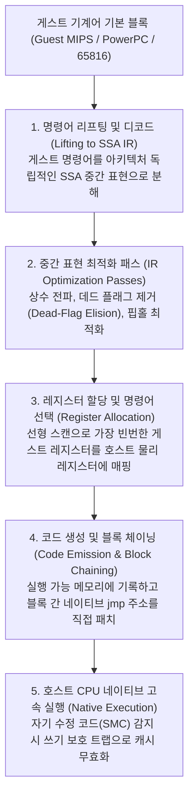
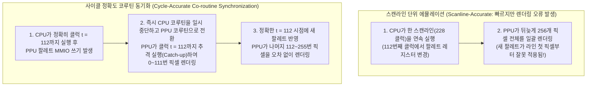

## 1. 실리콘에서 수학으로: 보편 튜링 기계와 하드웨어 유한 상태 기계의 동형성

1983년의 패미컴(NES), 1990년의 슈퍼패미컴(SNES), 2000년의 PlayStation 2, 2001년의 게임큐브(GameCube)는 범용 컴퓨터가 아니라 극도로 특화된 <strong>전용 커스텀 반도체(ASIC / Custom LSI)의 집합체</strong>였다. 그러나 오늘날 우리는 오리지널 실리콘 칩이 없어도 x86-64나 ARM64 프로세서를 탑재한 PC와 스마트폰에서 당시의 상용 게임 ROM을 비트 단위의 오차도 없이 실행할 수 있다. 이를 가능케 하는 소프트웨어 공학이 바로 <strong>하드웨어 에뮬레이션(Emulation)</strong>이다.

전혀 다른 명령어 세트와 버스 구조를 가진 컴퓨터가 어떻게 물리적 실리콘 회로를 완벽히 모방할 수 있을까? 그 수학적 근거는 1936년 영국의 수학자 <strong>앨런 튜링(Alan Turing)</strong>이 증명한 전산학의 제1원리인 <strong>보편 튜링 기계(Universal Turing Machine, UTM)</strong> 정리에 있다:

$$U(\langle M \rangle, x) = M(x)$$

<strong>처치-튜링 논제(Church-Turing Thesis)</strong>와 결합하면, 물리적 게임기 하드웨어를 기계 $M$, 그 논리 회로 명세를 기술한 에뮬레이터 소스 코드를 $\langle M \rangle$, 게임 ROM 데이터와 컨트롤러 입력을 $x$로 두었을 때, 튜링 완전한 호스트 컴퓨터 $U$는 원본 하드웨어의 출력 $M(x)$와 수학적으로 완전히 동일한 결과를 산출할 수 있다.

디지털 논리 회로의 관점에서 마스터 클럭에 의해 구동되는 모든 동기식 디지털 칩(CPU, PPU, APU)은 수학적으로 <strong>결정론적 유한 상태 기계(Deterministic Finite State Machine, FSM)</strong>로 환원된다. 클럭 틱 $t$에서의 모든 레지스터, 플래그, VRAM, WRAM 비트의 전체 상태 벡터를 $S_t \in \mathcal{S}$, 외부 입력 벡터를 $I_t \in \mathcal{I}$라 하면, 수백만 개의 논리 게이트가 다음 클럭 에지까지 계산하는 과정은 두 개의 순수 함수로 기술된다:

$$S_{t+1} = \delta(S_t, I_t), \qquad O_t = \lambda(S_t, I_t)$$

여기서 $\delta$는 상태 전이 함수이고 $\lambda$는 RGB 픽셀과 PCM 오디오 샘플을 생성하는 출력 함수다. 물리적 트랜지스터가 전압의 고저로 계산하는 불 대수(Boolean Algebra)는 호스트 CPU가 `uint32_t` 및 `uint64_t` 변수에 수행하는 비트 연산(`&`, `|`, `^`, `~`, `<<`)과 완벽한 <strong>수학적 동형(Isomorphic)</strong> 관계에 있다.

그러나 계산 가능성(Computability)과 실시간성(Real-Time)은 별개의 문제다. NTSC 슈퍼패미컴의 마스터 클럭은 $21.477272\,\text{MHz}$이며, 한 프레임은 $262$개의 스캔라인과 라인당 $1364$ 마스터 클럭으로 구성된다:

$$f_{\text{frame}} = \frac{21,477,272\,\text{Hz}}{262 \times 1364} \approx 60.0988\,\text{Hz} \implies T_{\text{frame}} \approx 16.639\,\text{ms}$$

실제 하드웨어에서는 CPU, PPU, APU의 수백만 게이트가 매 나노초마다 <strong>공간적 병렬(Spatially Parallel)</strong>로 동시에 상태를 갱신하지만, 에뮬레이터는 이를 호스트 CPU의 순차적 명령어 스트림으로 직렬화하여 <strong>$16.639\,\text{ms}$라는 엄격한 실시간 데드라인</strong> 안에 모두 계산해내야 한다.

---

## 2. CPU 에뮬레이션의 기초: 스위치 인터프리터에서 동적 바이너리 변환(JIT / Dynarec)까지

### 2.1 고전적 스위치 인터프리터와 분기 예측 페널티

가장 직관적인 CPU 에뮬레이션 방식은 `while` 루프 안에서 <strong>인출(Fetch) $\to$ 해독(Decode) $\to$ 실행(Execute)</strong> 단계를 거대한 `switch (opcode)` 문으로 구현하는 <strong>스위치 디스패치 인터프리터(Switch Interpreter)</strong>다.

하지만 이 구조는 현대 슈퍼스칼라 CPU에서 심각한 병목을 일으킨다. 거대한 `switch` 문은 기계어 수준에서 단 하나의 간접 점프 명령어(`jmp *[rax + rdx*8]`)로 컴파일된다. 게스트 명령어의 흐름은 매번 바뀌므로 호스트 CPU의 <strong>간접 분기 예측기(Indirect Branch Predictor / BTB)</strong>는 이 단일 점프 지점에서 끊임없이 예측 실패(Branch Misprediction)를 일으키며, 그때마다 14~20단계의 파이프라인이 플러시되어 수십 클럭이 낭비된다. GCC/Clang의 레이블 주소 확장(`goto *dispatch_table[opcode]`)을 이용한 <strong>다이렉트 스레디드 코드(Direct Threaded Code)</strong>로 간접 점프를 각 핸들러 끝에 분산시키면 분기 예측률은 향상되지만, 매 명령어마다 발생하는 페치·디코드 및 메모리 레지스터 접근 오버헤드는 여전히 남는다.

### 2.2 동적 바이너리 변환(JIT / Dynarec) 파이프라인과 데드 플래그 제거

이 한계를 돌파하기 위해 <strong>Dolphin</strong>, <strong>PCSX2</strong>, <strong>RPCS3</strong>, <strong>QEMU TCG</strong>, <strong>Apple Rosetta 2</strong> 등 현대의 고성능 에뮬레이터는 <strong>동적 재컴파일(JIT / Dynamic Recompilation, Dynarec)</strong> 아키텍처를 채택한다. 게스트 기계어를 <strong>기본 블록(Basic Block)</strong> 단위로 묶어 런타임에 호스트 네이티브 기계어(x86-64 / ARM64)로 변환한 뒤 코드 캐시(Code Cache)에서 직접 실행하는 것이다.



상용급 JIT 컴파일러의 핵심 최적화 기법은 다음과 같다:
1. <strong>데드 플래그 제거(Dead-Flag Elision)</strong>: 게스트 CPU의 산술 명령어는 매번 Z, N, C, V 상태 플래그를 갱신하지만, 뒤따르는 조건 분기는 그중 하나만 읽거나 다음 산술 명령어가 즉시 덮어쓰는 경우가 대다수다. SSA IR 상에서 역방향 활성 변수 분석(Liveness Analysis)을 수행하면 불필요한 플래그 연산의 $80\%$ 이상을 완벽히 제거할 수 있다.
2. <strong>물리 레지스터 할당(Register Allocation)</strong>: 선형 스캔(Linear Scan) 알고리즘을 통해 게스트 CPU의 주요 범용 레지스터를 호스트 x86-64/ARM64의 하드웨어 레지스터에 직접 상주시켜 메모리 구조체(`CPUState`) 접근을 제거한다.
3. <strong>블록 체이닝(Block Chaining)</strong>: 번역된 블록 A가 이미 번역된 블록 B로 분기할 때, 메인 디스패처 루프로 복귀하지 않고 블록 A 끝의 네이티브 `jmp` 명령어가 블록 B의 호스트 메모리 주소를 직접 가리키도록 런타임 패치한다.
4. <strong>자기 수정 코드(Self-Modifying Code, SMC) 무효화</strong>: 게임이 런타임에 코드 영역 메모리를 덮어쓸 때, 호스트 OS의 페이지 쓰기 보호(`mprotect` / `VirtualProtect`) 트랩이나 소프트웨어 쓰기 마스크를 통해 해당 주소의 JIT 블록을 즉시 무효화(Invalidate)하고 재컴파일한다.

| 비교 항목 | 스위치 인터프리터 (Interpreter) | 스레디드 인터프리터 (Threaded) | 동적 재컴파일 (JIT / Dynarec) |
| :--- | :--- | :--- | :--- |
| <strong>게스트 명령어당 비용</strong> | 호스트 명령어 $20 \sim 80+$개 | 호스트 명령어 $12 \sim 35$개 | <strong>호스트 네이티브 명령어 $1 \sim 4$개</strong> |
| <strong>분기 예측 친화성</strong> | 최악 (단일 간접 점프 병목) | 보통 (핸들러별 분산 점프) | <strong>최상 (네이티브 직접 점프 및 블록 체이닝)</strong> |
| <strong>데드 플래그 및 상수 최적화</strong> | 불가능 (명령어 간 문맥 부재) | 제한적 | <strong>완벽 지원 (SSA IR 기반 전역 제거)</strong> |
| <strong>구현 복잡도 및 이식성</strong> | 매우 단순, 표준 C/Rust로 이식 가능 | 컴파일러 확장 필요 | <strong>매우 높음 (호스트 아키텍처별 백엔드 필요)</strong> |
| <strong>사이클 정확도 제어</strong> | 매우 용이 (매 클럭 중단 가능) | 용이 | <strong>어려움 (기본 블록 경계에서 일괄 정산)</strong> |

---

## 3. 메모리 버스와 Fastmem: 호스트 하드웨어 MMU 하이재킹

콘솔 CPU는 일반 RAM뿐만 아니라 특정 주소에 매핑된 <strong>메모리 매핑 I/O(MMIO)</strong> 레지스터에 접근하여 PPU 렌더링이나 DMA를 제어한다. 모든 메모리 읽기/쓰기마다 소프트웨어 `if-else`나 테이블 조회로 MMIO 여부를 검사하면 JIT의 성능 이점이 반감된다.

현대 에뮬레이터는 호스트 OS의 가상 메모리와 하드웨어 MMU를 활용하는 <strong>Fastmem</strong> 기법으로 이를 해결한다:
1. 64비트 호스트 주소 공간에서 게스트의 전체 주소 공간 크기(예: 32비트 게스트라면 <strong>연속된 $4\,\text{GB}$ 가상 메모리</strong>)를 `mmap` / `VirtualAlloc`으로 통째로 예약하고, 그 시작 주소를 호스트 레지스터 `rbx`에 고정한다.
2. 일반 RAM 및 미러링 영역은 공유 메모리 매핑을 통해 읽기/쓰기 권한(`PROT_READ | PROT_WRITE`)을 부여하여 실제 백업 메모리에 연결한다.
3. <strong>MMIO 하드웨어 레지스터 영역</strong>에 해당하는 페이지들은 의도적으로 접근 불가 권한(<strong>`PROT_NONE` / `PAGE_NOACCESS`</strong>)으로 설정한다.

이제 JIT는 모든 게스트 메모리 로드를 아무런 조건 분기 없이 <strong>단 한 줄의 네이티브 명령어</strong>로 방출한다:

```nasm
; rbx = 4GB 게스트 가상 아레나 베이스, edi = 32비트 게스트 주소
mov eax, dword ptr [rbx + rdi]   ; 단 1개의 명령어로 주소 변환 및 로드 완료!
```

* <strong>패스트 패스(99.9%의 일반 RAM 접근)</strong>: 호스트 CPU의 하드웨어 MMU와 TLB가 소프트웨어 오버헤드 0으로 즉시 메모리를 읽는다.
* <strong>슬로우 패스(0.1%의 MMIO 접근)</strong>: `PROT_NONE` 페이지에 접근하는 순간 호스트 MMU가 하드웨어 페이지 폴트(POSIX `SIGSEGV`, Windows VEH `STATUS_ACCESS_VIOLATION`)를 발생시킨다. 에뮬레이터의 예외 핸들러가 이를 가로채어 명령어를 디코딩하고 C++ `mmio_read/write()` 함수를 호출한 뒤, 명령어 포인터 `RIP`를 다음 명령어로 전진시켜 실행을 재개한다.

---

## 4. 사이클 정확도(Cycle Accuracy)와 멀티칩 코루틴 동기화

전설적인 에뮬레이터 개발자 <strong>Near(byuu)</strong>는 왜 <strong>"고작 $3.58\,\text{MHz}$로 동작하던 슈퍼패미컴을 100% 사이클 정확도로 재현하는 데 $3\,\text{GHz}$의 현대 CPU가 필요했다"</strong>고 말했을까?

초기 <strong>스캔라인 기반(Scanline-based)</strong> 에뮬레이터는 CPU를 한 스캔라인(약 $228$ 클럭) 동안 먼저 실행한 뒤 PPU가 그 줄의 픽셀 256개를 한꺼번에 그렸다. 그러나 하드웨어 한계를 극한까지 활용한 게임들은 <strong>스캔라인이 화면 중앙을 지나가는 도중(Mid-Scanline)의 특정 클럭</strong>에 CPU나 HDMA로 팔레트나 스크롤 레지스터를 실시간 변경한다. 이를 클럭 단위로 동기화하지 않으면 그래픽이 깨지거나 게임이 멈춘다.



<strong>bsnes / higan / Ares</strong> 같은 사이클 정확도 에뮬레이터는 CPU, PPU, SMP, DSP를 각각 독립된 <strong>유저 공간 협력적 코루틴(Co-routines / Fibers, `libco`)</strong>으로 구동한다. 한 칩이 다른 칩에 영향을 줄 수 있는 버스 접근이나 인터럽트 신호를 발생시킬 때마다 `co_switch()`를 호출해 약 10개 내외의 어셈블리 명령어로 문맥을 전환하며 상대 칩을 정확한 클럭까지 추격 실행(Catch-up)시킨다.

나아가 현대 에뮬레이션 공학은 다음과 같은 영역으로 확장되고 있다:
* <strong>비표준 부동소수점(Non-IEEE-754) 처리</strong>: PS2의 Emotion Engine과 VU 벡터 유닛은 표준 IEEE-754와 달리 `Inf`나 `NaN`이 존재하지 않고 지수부가 모두 1인 비트 패턴도 유효한 큰 수로 취급하며 비정규수(Denormals)를 0으로 플러시한다. 에뮬레이터는 SIMD 클램핑과 비트 마스킹을 통해 물리 엔진의 발산을 막아야 한다.
* <strong>입력 지연을 제거하는 Run-Ahead</strong>: 매 프레임 컨트롤러 입력을 받은 직후 백그라운드에서 에뮬레이터를 $N$프레임(예: $2$프레임) 고속 실행하고 초고속 메모리 세이브스테이트(Savestate) 복원을 결합함으로써, 게임 자체의 내부 입력 버퍼 지연을 건너뛰어 실제 콘솔보다도 빠른 반응 속도를 구현한다.
* <strong>FPGA와 디지털 문화유산 보존</strong>: <strong>MiSTer FPGA</strong>처럼 Verilog/VHDL로 원본 칩의 게이트 회로를 FPGA에 직접 재구현하는 하드웨어 보존 프로젝트와 함께, 정밀 에뮬레이터의 소스 코드는 수명을 다해가는 실리콘 칩의 동작을 영구히 기록하는 <strong>실행 가능한 역사적 사료(Executable Hardware Documentation)</strong>로서 인류의 디지털 유산을 지키고 있다.
