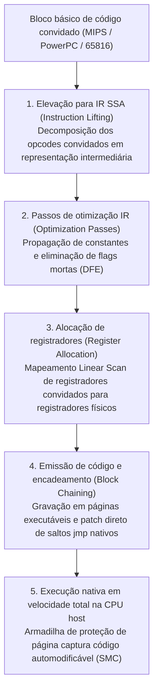
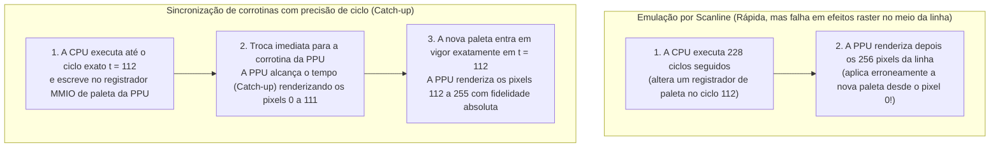

## 1. Do silício à matemática: A Máquina de Turing Universal e o isomorfismo de FSM

O Nintendo Entertainment System (1983), o Super Nintendo (1990), o PlayStation 2 (2000) e o GameCube (2001) não eram computadores de uso geral, mas sim <strong>conjuntos altamente especializados de circuitos integrados sob medida (ASICs e chips LSI customizados)</strong>. Ainda assim, hoje conseguimos executar suas imagens ROM originais em PCs e smartphones equipados com processadores x86-64 ou ARM64 com fidelidade exata de bits. A disciplina da ciência da computação que torna isso possível é a <strong>emulação de hardware</strong>.

Como um programa de software rodando em uma arquitetura completamente diferente consegue reproduzir o comportamento físico de milhões de transistores e osciladores de quartzo? O fundamento teórico vem do teorema primordial provado por <strong>Alan Turing</strong> em 1936: a <strong>Máquina de Turing Universal (UTM)</strong>:

$$U(\langle M \rangle, x) = M(x)$$

Combinada com a <strong>Tese de Church-Turing</strong>, essa equação garante que, se $M$ representa o hardware físico de um console, $\langle M \rangle$ o código-fonte do emulador descrevendo as regras lógicas exatas dos circuitos de $M$, e $x$ os dados da ROM somados aos comandos do controle, qualquer computador hospedeiro (Host) Turing-completo $U$ executando $\langle M \rangle$ produzirá exatamente a mesma sequência de estados e saídas audiovisuais $M(x)$ que o console original.

Sob a ótica de circuitos digitais, qualquer circuito lógico síncrono guiado por um clock mestre (CPU, PPU de vídeo, APU de áudio) reduz-se matematicamente a uma <strong>Máquina de Estados Finitos Determinística (FSM)</strong>. Seja $S_t \in \mathcal{S}$ o vetor de estado global reunindo todos os registradores, flags, VRAM e WRAM no pulso de clock discreto $t$, e $I_t \in \mathcal{I}$ o vetor de entrada externa. Entre os pulsos $t$ e $t+1$, a rede de portas lógicas combinacionais calcula duas funções matemáticas puras:

$$S_{t+1} = \delta(S_t, I_t), \qquad O_t = \lambda(S_t, I_t)$$

onde $\delta$ é a função de transição de estado e $\lambda$ é a função de saída que gera pixels RGB e amostras de áudio PCM. A álgebra booleana implementada fisicamente por tensões elétricas ($0\,\text{V}$ vs. $3,3\,\text{V}/5\,\text{V}$) em transistores CMOS é <strong>matematicamente isomorfa</strong> às operações bit a bit (`&`, `|`, `^`, `~`, `<<`) que uma CPU hospedeira executa sobre variáveis `uint32_t` e `uint64_t`.

Portanto, a grande barreira da emulação não é a *computabilidade*, mas a <strong>complexidade computacional sob uma restrição rígida de tempo real</strong>. Em um Super Nintendo NTSC com cristal mestre de $21,477272\,\text{MHz}$, cada quadro de vídeo possui $262$ linhas de varredura (scanlines) de $1364$ ciclos mestres:

$$f_{\text{frame}} = \frac{21.477.272\,\text{Hz}}{262 \times 1364} \approx 60,0988\,\text{Hz} \implies T_{\text{frame}} \approx 16,639\,\text{ms}$$

Enquanto no hardware físico milhões de portas lógicas avaliam $\delta(S_t, I_t)$ <strong>simultaneamente em paralelo espacial</strong> a cada nanossegundo, um emulador precisa serializar todo esse paralelismo em instruções sequenciais e concluir os $357.368$ ciclos do quadro em <strong>menos de $16,639\,\text{milissegundos}$</strong>.

---

## 2. Fundamentos de emulação de CPU: Do interpretador Switch à recompilação dinâmica (JIT / Dynarec)

### 2.1 O interpretador Switch clássico e a penalidade de predição de desvio

A abordagem mais direta para emular uma CPU convidada (Guest) é reproduzir seu ciclo <strong>Fetch $\to$ Decode $\to$ Execute</strong> dentro de um laço `while` contendo um grande `switch (opcode)`.

Embora simples, essa estrutura sofre um severo gargalo microarquitetural em CPUs superescalares modernas: todo o `switch` é compilado em uma única instrução de salto indireto (`jmp *[rax + rdx*8]`). Como os opcodes convidados mudam a todo instante, o <strong>preditor de desvios indiretos (BTB)</strong> da CPU hospedeira erra continuamente nesse ponto, esvaziando (flush) seu pipeline de 14 a 20 estágios e desperdiçando dezenas de ciclos a cada instrução. O uso de <strong>Direct Threaded Code</strong> via endereços de rótulos (`goto *dispatch_table[opcode]`) espalha os saltos indiretos pelo final de cada handler, melhorando a predição, mas não elimina o custo de decodificação individual.

### 2.2 Tradução binária dinâmica (JIT / Dynarec) e eliminação de flags mortas

Para superar esse limite, emuladores modernos de alto desempenho (<strong>Dolphin</strong>, <strong>PCSX2</strong>, <strong>RPCS3</strong>, <strong>QEMU TCG</strong>, <strong>Apple Rosetta 2</strong>) utilizam <strong>compilação Just-In-Time / Recompilação Dinâmica (Dynarec)</strong>: traduzem blocos básicos inteiros de código de máquina convidado para código nativo do hospedeiro (x86-64 / ARM64) em tempo de execução e os executam diretamente a partir de um cache de código.



As principais otimizações de um motor Dynarec incluem:
1. <strong>Eliminação de flags mortas (Dead-Flag Elision)</strong>: Instruções aritméticas atualizam constantemente as flags de status (Z, N, C, V), mas a maioria é sobrescrita pela instrução seguinte sem nunca ser lida. Por meio de análise de vivacidade (Liveness Analysis) na IR SSA, o JIT elimina mais de $80\,\%$ dos cálculos de flags redundantes.
2. <strong>Alocação física de registradores</strong>: Um alocador Linear Scan mantém os registradores convidados mais acessados diretamente nos registradores de hardware da CPU hospedeira, evitando leituras e escritas na estrutura `CPUState` na RAM.
3. <strong>Encadeamento de blocos (Block Chaining)</strong>: Quando um bloco compilado A salta para um bloco já compilado B, o JIT altera a instrução `jmp` final de A para apontar diretamente para o endereço nativo de B, contornando o loop despachante em C++.
4. <strong>Detecção de código automodificável (SMC)</strong>: Quando o jogo sobrescreve seu próprio código na RAM, o emulador intercepta a escrita via máscaras de software ou proteção de página somente leitura (`mprotect` / `VirtualProtect`) e invalida imediatamente os blocos JIT afetados.

| Critério de avaliação | Interpretador Switch | Interpretador Threaded | Recompilador dinâmico (JIT / Dynarec) |
| :--- | :--- | :--- | :--- |
| <strong>Custo por instrução convidada</strong> | $20 \sim 80+$ instruções host | $12 \sim 35$ instruções host | <strong>$1 \sim 4$ instruções nativas host</strong> |
| <strong>Predição de desvios</strong> | Muito ruim (gargalo único no BTB) | Média (saltos indiretos distribuídos) | <strong>Excelente (saltos diretos nativos e chaining)</strong> |
| <strong>Eliminação de flags mortas</strong> | Impossível (sem visão entre opcodes) | Muito limitada | <strong>Completa (análise global sobre IR SSA)</strong> |
| <strong>Complexidade e portabilidade</strong> | Muito simples, C/Rust padrão portável | Requer extensões do compilador | <strong>Muito alta (exige backend por arquitetura)</strong> |
| <strong>Controle de precisão de ciclo</strong> | Muito fácil (interrompível a cada ciclo) | Fácil | <strong>Difícil (contagem agrupada nas bordas do bloco)</strong> |

---

## 3. Barramento de memória e Fastmem: Sequestrando a MMU de hardware do hospedeiro

Em um console, a CPU controla vídeo, áudio e DMA lendo e escrevendo em registradores de <strong>E/S mapeada em memória (MMIO)</strong>. Verificar via software (`if-else`) em cada acesso à memória se o endereço pertence à RAM ou ao MMIO destruiria o desempenho do JIT.

A técnica <strong>Fastmem</strong> resolve esse gargalo utilizando a Unidade de Gerenciamento de Memória (MMU) de hardware do sistema operacional hospedeiro de 64 bits:
1. O emulador reserva no espaço virtual de 64 bits do hospedeiro uma arena contígua do tamanho exato do espaço de endereçamento convidado (por exemplo, <strong>$4\,\text{GB}$ via `mmap` / `VirtualAlloc`</strong> para um console de 32 bits) e mantém seu ponteiro base em um registrador hospedeiro (`rbx`).
2. As regiões de RAM física e seus espelhos são mapeadas com permissões de leitura e escrita (`PROT_READ | PROT_WRITE`).
3. Todas as páginas correspondentes a <strong>registradores MMIO de hardware</strong> são marcadas propositalmente sem permissão de acesso (<strong>`PROT_NONE` / `PAGE_NOACCESS`</strong>).

Dessa forma, o compilador JIT traduz qualquer leitura de memória convidada em <strong>uma única instrução de máquina nativa</strong>:

```nasm
; rbx = base da arena virtual de 4 GB, edi = endereço convidado de 32 bits
mov eax, dword ptr [rbx + rdi]   ; Tradução e leitura em 1 única instrução!
```

* <strong>Caminho rápido ($99,9\,\%$ dos acessos à RAM)</strong>: A MMU e o TLB físicos do processador hospedeiro resolvem o acesso em 3–4 ciclos com sobrecarga de software zero.
* <strong>Caminho lento ($0,1\,\%$ dos acessos a MMIO)</strong>: Ao tocar uma página `PROT_NONE`, a MMU hospedeira dispara uma falha de página por hardware (`SIGSEGV` no POSIX ou exceção vetorizada `STATUS_ACCESS_VIOLATION` no Windows). O tratador de sinais do emulador intercepta a falha, decodifica a instrução, chama a função C++ `mmio_read/write()`, atualiza o registrador de destino e avança o ponteiro de instrução `RIP`.

---

## 4. Precisão de ciclo (Cycle Accuracy) e sincronização de corrotinas

Por que o lendário desenvolvedor de emuladores <strong>Near (byuu)</strong> afirmou que <strong>emular um Super Nintendo de apenas $3,58\,\text{MHz}$ com 100% de precisão de ciclo exigia uma CPU moderna de $3\,\text{GHz}$</strong>?

Emuladores antigos <strong>baseados em scanlines</strong> executavam a CPU por uma linha inteira ($228$ ciclos) antes de a PPU desenhar os 256 pixels daquela linha de uma só vez. Contudo, muitos jogos alteram registradores gráficos (paletas, rolagem ou matrizes do Mode 7) <strong>exatamente no meio do desenho de uma linha (Mid-Scanline)</strong> via CPU ou HDMA. Sem sincronização no ciclo exato do pixel, ocorrem falhas gráficas ou travamentos.



Em emuladores precisos ao ciclo como <strong>bsnes / higan / Ares</strong>, CPU, PPU, SMP e DSP rodam como <strong>corrotinas cooperativas em espaço de usuário (`libco`)</strong>. Sempre que um chip realiza uma operação observável por outro, `co_switch()` alterna o contexto em cerca de 10 instruções assembly para que o chip alvo alcance exatamente o clock mestre atual.

Além disso, a engenharia moderna de emulação enfrenta três fronteiras avançadas:
* <strong>Ponto flutuante não IEEE-754</strong>: O Emotion Engine e as unidades vetoriais do PS2 não possuem `Inf` nem `NaN` e zeram números denormais, exigindo que o PCSX2 aplique máscaras e saturação SIMD para evitar explosões na física dos jogos.
* <strong>Run-Ahead para eliminação de latência</strong>: Ao simular silenciosamente $N$ quadros à frente em segundo plano com salvamentos de estado (Savestates) ultrarrápidos na RAM, o emulador pula o atraso do buffer interno do próprio jogo, respondendo mais rápido que o console original em uma TV de tubo (CRT).
* <strong>FPGA e preservação do patrimônio digital</strong>: Ao lado da reconstrução de portas lógicas em hardware via <strong>FPGA (MiSTer)</strong> em Verilog/VHDL, o código-fonte de emuladores precisos funciona como <strong>documentação de hardware executável</strong>, preservando a história da arte digital contra a inevitável degradação física dos chips de silício originais.
