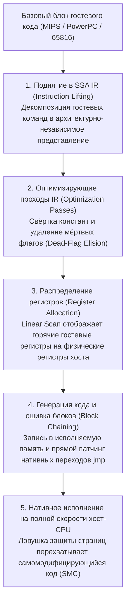
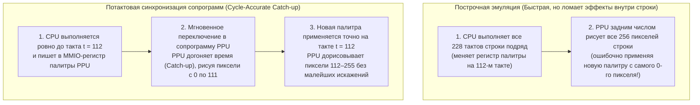

## 1. От кремния к математике: Универсальная машина Тьюринга и изоморфизм конечных автоматов

Nintendo Entertainment System (1983), Super Nintendo (1990), PlayStation 2 (2000) и GameCube (2001) не были универсальными компьютерами — они представляли собой <strong>ансамбли узкоспециализированных заказных микросхем (ASIC и кастомных БИС/LSI)</strong>. Тем не менее сегодня мы можем запускать их оригинальные образы ПЗУ (ROM) на современных ПК и смартфонах с архитектурой x86-64 или ARM64 с побитовой точностью. Программная дисциплина, делающая это возможным, называется <strong>аппаратной эмуляцией</strong>.

Как чистая программа на совершенно чужеродной архитектуре способна в точности воспроизвести физическое поведение миллионов транзисторов и кварцевых резонаторов? Теоретический фундамент этого явления заложил <strong>Алан Тьюринг</strong> в 1936 году, доказав существование <strong>Универсальной машины Тьюринга (UTM)</strong>:

$$U(\langle M \rangle, x) = M(x)$$

В сочетании с <strong>тезисом Чёрча — Тьюринга</strong> это равенство означает: если $M$ — физическое оборудование консоли, $\langle M \rangle$ — исходный код эмулятора, описывающий логику цепей $M$, а $x$ — данные картриджа/диска и нажатия кнопок геймпада, то любой тьюринг-полный хост-компьютер $U$, исполняющий $\langle M \rangle$, гарантированно породит ту же самую последовательность состояний и аудиовизуальных выходов $M(x)$, что и оригинальная приставка.

С точки зрения цифровой схемотехники любая синхронная цифровая схема (CPU, графический процессор PPU, звуковой процессор APU), тактируемая главным генератором, математически сводится к <strong>детерминированному конечному автомату (FSM)</strong>. Пусть $S_t \in \mathcal{S}$ — полный вектор состояния всех триггеров, регистров, флагов, видеопамяти VRAM и ОЗУ WRAM в дискретный такт $t$, а $I_t \in \mathcal{I}$ — вектор внешних входов. Тогда между тактами $t$ и $t+1$ комбинационная сеть логических вентилей вычисляет две чистые функции:

$$S_{t+1} = \delta(S_t, I_t), \qquad O_t = \lambda(S_t, I_t)$$

где $\delta$ — функция переходов состояний, а $\lambda$ — функция выхода, формирующая пиксели RGB и аудиоотсчёты PCM. Булева алгебра, физически реализуемая переключением напряжений ($0\,\text{В}$ и $3{,}3\,\text{В}/5\,\text{В}$) в КМОП-транзисторах, <strong>математически изоморфна</strong> побитовым операциям (`&`, `|`, `^`, `~`, `<<`), которые процессор хоста выполняет над переменными `uint32_t` и `uint64_t`.

Следовательно, главная проблема эмуляции — не *вычислимость*, а <strong>вычислительная сложность в жёстком реальном времени</strong>. В NTSC-консоли Super Nintendo с частотой мастер-кварца $21{,}477272\,\text{МГц}$ кадр состоит из $262$ строк развёртки (scanlines) по $1364$ мастер-такта:

$$f_{\text{frame}} = \frac{21\,477\,272\,\text{Гц}}{262 \times 1364} \approx 60{,}0988\,\text{Гц} \implies T_{\text{frame}} \approx 16{,}639\,\text{мс}$$

В реальном «железе» миллионы вентилей вычисляют $\delta(S_t, I_t)$ <strong>одновременно (пространственно параллельно)</strong> каждую наносекунду, тогда как эмулятор обязан сериализовать этот параллелизм в последовательный поток команд хост-CPU и уложиться в жёсткий лимит <strong>$16{,}639\,\text{миллисекунды}$ на кадр</strong>.

---

## 2. Основы эмуляции CPU: От Switch-интерпретатора к динамической рекомпиляции (JIT / Dynarec)

### 2.1 Классический Switch-интерпретатор и штрафы предсказателя ветвлений

Самый очевидный способ эмулировать гостевой процессор — воспроизвести цикл <strong>Выборка (Fetch) $\to$ Декодирование (Decode) $\to$ Исполнение (Execute)</strong> внутри цикла `while` с гигантским оператором `switch (opcode)`.

Однако на современных суперскалярных процессорах такой интерпретатор упирается в микроархитектурное бутылочное горлышко: весь `switch` компилируется в одну-единственную инструкцию косвенного перехода (`jmp *[rax + rdx*8]`). Поскольку гостевые опкоды постоянно меняются, <strong>предсказатель косвенных переходов (BTB)</strong> хост-процессора непрерывно ошибается в этой точке, вызывая сброс (flush) 14–20-ступенчатого конвейера и потерю десятков тактов на каждую команду. Переход к <strong>Direct Threaded Code</strong> через вычисляемые метки (`goto *dispatch_table[opcode]`) распределяет косвенные переходы по концам обработчиков, но не устраняет накладные расходы на пошаговое декодирование.

### 2.2 Динамическая двоичная трансляция (JIT / Dynarec) и удаление мёртвых флагов

Высокопроизводительные эмуляторы (<strong>Dolphin</strong>, <strong>PCSX2</strong>, <strong>RPCS3</strong>, <strong>QEMU TCG</strong>, <strong>Apple Rosetta 2</strong>) используют <strong>динамическую рекомпиляцию (JIT / Dynarec)</strong>: они переводят целые <strong>базовые блоки (Basic Blocks)</strong> гостевого машинного кода в нативный машинный код хоста (x86-64 / ARM64) прямо во время выполнения и запускают его из кэша кода.



Ключевые оптимизации промышленного JIT-компилятора включают:
1. <strong>Удаление мёртвых флагов (Dead-Flag Elision)</strong>: Арифметические команды гостя постоянно обновляют флаги состояния (Z, N, C, V), но большинство из них тут же перезаписывается следующей командой без чтения. Анализ живучести переменных (Liveness Analysis) на SSA-графе позволяет выбросить более $80\,\%$ бесполезных вычислений флагов.
2. <strong>Физическое распределение регистров</strong>: Алгоритм Linear Scan удерживает наиболее часто используемые регистры гостя непосредственно в аппаратных регистрах x86-64/ARM64, избавляя от обращений к структуре `CPUState` в памяти.
3. <strong>Сшивка блоков (Block Chaining)</strong>: Если скомпилированный блок A переходит к уже скомпилированному блоку B, JIT напрямую патчит инструкцию `jmp` в конце блока A на нативный адрес блока B, минуя диспетчерский цикл C++.
4. <strong>Перехват самомодифицирующегося кода (SMC)</strong>: Когда игра перезаписывает собственный код в ОЗУ, эмулятор фиксирует запись через программные маски или аппаратную защиту страниц от записи (`mprotect` / `VirtualProtect`) и мгновенно инвалидирует устаревшие JIT-блоки.

| Критерий сравнения | Switch-интерпретатор | Threaded-интерпретатор | Динамический рекомпилятор (JIT / Dynarec) |
| :--- | :--- | :--- | :--- |
| <strong>Затраты на 1 команду гостя</strong> | $20 \sim 80+$ команд хоста | $12 \sim 35$ команд хоста | <strong>$1 \sim 4$ нативные команды хоста</strong> |
| <strong>Предсказание ветвлений</strong> | Крайне плохое (одна точка отказа BTB) | Среднее (распределённые переходы) | <strong>Отличное (прямые нативные jmp и сшивка)</strong> |
| <strong>Удаление мёртвых флагов</strong> | Невозможно (нет контекста между опкодами) | Весьма ограниченно | <strong>Полное (глобальный анализ на SSA IR)</strong> |
| <strong>Сложность и переносимость</strong> | Простейшая, чистый стандартный C/Rust | Требует расширений компилятора | <strong>Огромная (нужен бэкенд под каждую ISA)</strong> |
| <strong>Потактовая точность</strong> | Очень легко (прерывание на любом такте) | Легко | <strong>Сложно (учёт тактов на границах блоков)</strong> |

---

## 3. Шина памяти и Fastmem: Перехват аппаратного MMU хоста

В консолях центральный процессор управляет графикой, звуком и DMA через регистры <strong>отображаемого в память ввода-вывода (MMIO)</strong>. Если при каждом чтении или записи программно проверять через `if-else`, попадает ли адрес в ОЗУ или в область MMIO, быстродействие JIT упадёт в разы.

Технология <strong>Fastmem</strong> решает эту проблему с помощью аппаратного блока управления памятью (MMU) 64-битной ОС хоста:
1. Эмулятор резервирует в 64-битном адресном пространстве хоста непрерывную виртуальную арену размером во всё адресное пространство гостя (например, <strong>$4\,\text{ГБ}$ через `mmap` / `VirtualAlloc`</strong> для 32-битной консоли) и хранит её базовый указатель в выделенном регистре хоста (`rbx`).
2. Страницы обычного ОЗУ и его зеркал отображаются с правами чтения и записи (`PROT_READ | PROT_WRITE`).
3. Все страницы, соответствующие <strong>аппаратным регистрам MMIO</strong>, намеренно помечаются как <strong>недоступные (`PROT_NONE` / `PAGE_NOACCESS`)</strong>.

Благодаря этому JIT-компилятор транслирует любое чтение гостевой памяти в <strong>одну-единственную нативную инструкцию</strong> без единого ветвления:

```nasm
; rbx = база 4 ГБ виртуальной арены, edi = 32-битный гостевой адрес
mov eax, dword ptr [rbx + rdi]   ; Трансляция адреса и чтение за 1 команду!
```

* <strong>Быстрый путь ($99{,}9\,\%$ обращений к ОЗУ)</strong>: Аппаратные MMU и TLB процессора хоста выполняют загрузку за 3–4 такта при нулевых программных накладных расходах.
* <strong>Медленный путь ($0{,}1\,\%$ обращений к MMIO)</strong>: При обращении к странице `PROT_NONE` аппаратный MMU мгновенно генерирует страничное прерывание (`SIGSEGV` в POSIX или векторное исключение `STATUS_ACCESS_VIOLATION` в Windows). Обработчик сигналов эмулятора перехватывает исключение, декодирует инструкцию, вызывает C++-функцию `mmio_read/write()`, записывает результат в регистр и сдвигает указатель команд `RIP`.

---

## 4. Потактовая точность (Cycle Accuracy) и синхронизация сопрограмм

Почему легендарный создатель эмуляторов <strong>Near (byuu)</strong> утверждал, что <strong>для 100%-но потактово точной эмуляции Super Nintendo с частотой всего $3{,}58\,\text{МГц}$ требовался современный процессор с частотой $3\,\text{ГГц}$</strong>?

Ранние <strong>построчные (Scanline-based)</strong> эмуляторы сначала выполняли CPU на протяжении всей строки развёртки ($228$ тактов), а затем PPU разом отрисовывал все 256 пикселей этой строки. Однако многие игры изменяют видеорегистры (палитру, скроллинг или матрицы Mode 7) <strong>прямо посреди отрисовки строки (Mid-Scanline)</strong> с помощью CPU или HDMA. Без синхронизации с точностью до пиксельного такта возникают графические артефакты или зависания.



В потактово точных эмуляторах вроде <strong>bsnes / higan / Ares</strong> чипы CPU, PPU, SMP и DSP работают как независимые кооперативные <strong>сопрограммы пользовательского пространства (Coroutines / Fibers, `libco`)</strong>. Как только один чип совершает действие, видимое другому, `co_switch()` переключает контекст всего за ~10 ассемблерных команд, позволяя целевому чипу догнать (Catch-up) эталонное время.

Наконец, современная инженерия эмуляции решает ещё три фундаментальные задачи:
* <strong>Нестандартная арифметика с плавающей запятой (Non-IEEE-754)</strong>: Процессор Emotion Engine и векторные блоки PS2 не поддерживают `Inf` и `NaN`, а денормализованные числа принудительно обнуляют. Эмулятору PCSX2 приходится маскировать и ограничивать SIMD-регистры хоста, чтобы физика в играх не «взрывалась».
* <strong>Упреждающее выполнение Run-Ahead</strong>: Скрытно просчитывая $N$ кадров вперёд в фоновом режиме и мгновенно загружая снимки состояния (Savestates) в ОЗУ, эмулятор устраняет внутреннюю буферную задержку самой игры, обеспечивая отклик быстрее оригинальной приставки на ЭЛТ-телевизоре.
* <strong>FPGA и сохранение цифрового наследия</strong>: Наряду с аппаратным воссозданием вентильных схем на базе <strong>FPGA (MiSTer)</strong> на языках Verilog/VHDL, открытый код точных эмуляторов служит <strong>исполняемой аппаратной документацией</strong>, спасающей интерактивное искусство человечества от необратимого физического старения кремниевых чипов XX века.
