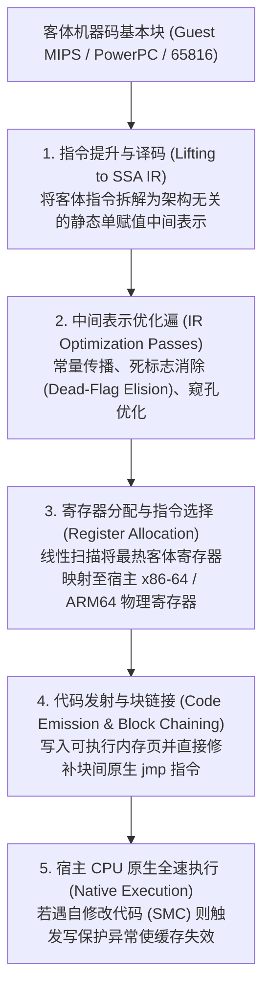
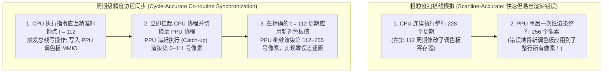

## 1. 从硅片到数学：通用图灵机与硬件的有限状态机同构

1983年的红白机（NES）、1990年的超级任天堂（SNES）、2000年的 PlayStation 2 以及2001年的 GameCube，并非通用个人电脑，而是高度特化的<strong>定制大规模集成电路（ASIC / Custom LSI）集合体</strong>。然而今天，即便没有这些物理芯片，我们依然能在搭载 x86-64 或 ARM64 处理器的现代 PC 与智能手机上，以比特级精度甚至更高分辨率运行当年的商业游戏 ROM。使这一切成为可能的软件工程技术便是<strong>硬件模拟器（Emulator）</strong>。

为什么一种架构的软件能够完美模仿另一种截然不同的物理硅芯片？其理论根基源于英国数学家<strong>艾伦·图灵（Alan Turing）</strong>在1936年证明的计算机科学第一原理——<strong>通用图灵机（Universal Turing Machine, UTM）</strong>定理：

$$U(\langle M \rangle, x) = M(x)$$

结合<strong>丘奇-图灵论题（Church-Turing Thesis）</strong>，只要将物理游戏机硬件视为状态机 $M$，将描述其电路逻辑规范的模拟器源码视为编码 $\langle M \rangle$，将游戏 ROM 与手柄输入视为数据 $x$，任何图灵完备的宿主计算机 $U$ 都必然能计算出与原机完全一致的视听输出 $M(x)$。

从数字电路视角来看，任何由主时钟驱动的同步数字逻辑电路（无论是 CPU、PPU 图像处理器还是 APU 音频处理器），在数学上都等价于一个<strong>确定性有限状态自动机（Deterministic Finite State Machine, FSM）</strong>。设游戏机在离散时钟周期 $t$ 的全部寄存器、标志位、VRAM、OAM 及主内存（WRAM）比特构成的总体状态向量为 $S_t \in \mathcal{S}$，外部手柄输入为 $I_t \in \mathcal{I}$，则芯片内部数百万个逻辑门在两个时钟沿之间执行的物理运算，严格对应两个纯数学函数：

$$S_{t+1} = \delta(S_t, I_t), \qquad O_t = \lambda(S_t, I_t)$$

其中 $\delta$ 为状态转移函数，$\lambda$ 为生成 RGB 像素与 PCM 音频采样的输出函数。物理 CMOS 晶体管通过高低电压实现的布尔代数，与宿主 CPU 在 `uint32_t` / `uint64_t` 变量上执行的位运算（`&`, `|`, `^`, `~`, `<<`）具有严格的<strong>数学同构性（Isomorphism）</strong>。

然而，可计算性并不等于实时性。以 NTSC 制式的超级任天堂为例，其主晶振频率为 $21.477272\,\text{MHz}$，每帧包含 $262$ 条扫描线、每行 $1364$ 个主时钟周期，帧率约为：

$$f_{\text{frame}} = \frac{21,477,272\,\text{Hz}}{262 \times 1364} \approx 60.0988\,\text{Hz} \implies T_{\text{frame}} \approx 16.639\,\text{ms}$$

实体硬件中，CPU、PPU、APU 的数百万个晶体管在每个纳秒周期内<strong>空间并行（Spatially Parallel）</strong>地同时演进；而模拟器必须在冯·诺依曼宿主 CPU 上将这种庞大的空间并行性序列化为指令流，并在严格的 <strong>$16.639\,\text{ms}$ 硬实时期限</strong>内完成全部计算。

---

## 2. CPU 模拟基础：从 Switch 解释器到动态二进制翻译（JIT / Dynarec）

### 2.1 经典 Switch 解释器与间接分支预测惩罚

最直观的 CPU 模拟方式是编写一个 `while` 循环，按照<strong>取指（Fetch）$\to$ 译码（Decode）$\to$ 执行（Execute）</strong>的顺序，用庞大的 `switch (opcode)` 语句逐条解释客体机（Guest）指令。

这种结构对于 8 位/16 位主机尚可胜任，但在模拟 PS2、GameCube 等复杂系统时会遭遇严重的微架构瓶颈：整个 `switch` 语句在底层会被编译为单条间接跳转指令（如 x86-64 的 `jmp *[rax + rdx*8]`）。由于客体指令序列高度动态，现代超标量 CPU 的<strong>分支目标缓冲器（BTB）与间接分支预测器</strong>在该跳转点会发生极高比例的预测失败（Branch Misprediction），每次失败都会冲刷长达 14～20 级的指令流水线，白白浪费数十个时钟周期。利用 GCC/Clang 的标签地址扩展（`goto *dispatch_table[opcode]`）构建<strong>直接线程化代码（Direct Threaded Code）</strong>，将间接跳转分散到每个操作码处理函数的末尾，可显著改善分支局部性，但仍无法消除逐条取指译码与内存保存客体寄存器的固有开销。

### 2.2 动态二进制翻译（JIT / Dynarec）流水线与死标志消除

为了跨越性能鸿沟，现代高性能模拟器（如 <strong>Dolphin</strong>、<strong>PCSX2</strong>、<strong>RPCS3</strong>、<strong>QEMU TCG</strong> 以及 <strong>Apple Rosetta 2</strong>）无一例外地采用了<strong>即时编译 / 动态重编译（JIT / Dynamic Recompilation, Dynarec）</strong>技术：以<strong>基本块（Basic Block）</strong>为单位，在运行时将客体机器码翻译为宿主原生机器码并缓存在代码缓存（Code Cache）中直接执行。



工业级 JIT 引擎的核心加速秘诀包括：
1. <strong>死标志消除（Dead-Flag Elision）与惰性标志求值</strong>：CPU 的算术指令通常会更新零（Z）、负（N）、进位（C）、溢出（V）四个状态标志，但后续条件分支往往只检查其中一个标志，其余标志立刻被下一条算术指令覆盖。通过在 SSA 中间表示上进行反向活跃变量分析（Liveness Analysis），JIT 可直接删去 $80\%$ 以上无用的标志位计算指令。
2. <strong>物理寄存器映射（Register Allocation）</strong>：利用线性扫描（Linear Scan）算法，将客体 CPU 最常用的通用寄存器直接驻留在宿主 x86-64（16个寄存器）或 ARM64（31个寄存器）的硬件寄存器中，消除反复读写 `CPUState` 内存结构体的开销。
3. <strong>基本块链接（Block Chaining）</strong>：当基本块 A 跳转到已编译的基本块 B 时，JIT 直接将块 A 末尾的跳转地址修补（Patch）为块 B 的宿主原生内存地址，彻底绕过 C++ 调度循环（Dispatcher）。
4. <strong>自修改代码（Self-Modifying Code, SMC）检测</strong>：当游戏向内存动态写入新代码（如运行时解压覆写层）时，模拟器通过软件写掩码或操作系统的内存页只读保护（`mprotect` / `VirtualProtect`）捕获写入异常，精准废除（Invalidate）对应的过时 JIT 代码块。

| 评估维度 | Switch 解释器 (Interpreter) | 直接线程化解释器 (Threaded) | 动态重编译 (JIT / Dynarec) |
| :--- | :--- | :--- | :--- |
| <strong>每条客体指令开销</strong> | $20 \sim 80+$ 条宿主指令 | $12 \sim 35$ 条宿主指令 | <strong>$1 \sim 4$ 条宿主原生指令</strong> |
| <strong>分支预测友好度</strong> | 极差（单一间接跳转热点） | 中等（分散间接跳转） | <strong>极高（原生直接跳转与块链接）</strong> |
| <strong>死标志与常量优化</strong> | 不可能（缺乏跨指令视野） | 极有限（仅限超级指令） | <strong>完备（基于 SSA IR 的全局消除）</strong> |
| <strong>实现复杂度与可移植性</strong> | 极简，纯标准 C/Rust 即可跨平台 | 依赖编译器扩展 | <strong>极高，需针对每种宿主架构编写后端</strong> |
| <strong>周期级精度控制</strong> | 极易（可在任意周期中断） | 较易 | <strong>困难（通常以基本块边界批量结算周期）</strong> |

---

## 3. 内存总线与 Fastmem：劫持宿主硬件 MMU

在游戏机中，CPU 不仅访问普通 RAM，还通过读写特定地址的<strong>内存映射 I/O（MMIO）</strong>寄存器来控制 PPU 画面合成、触发 DMA 传输或读取手柄状态。如果每次内存加载都用软件 `if-else` 或软件页表（Software TLB）检查地址是否落在 MMIO 区域，即便有 JIT 加持，内存访问也会比原生代码慢上数倍。

现代模拟器通过 <strong>Fastmem（硬件加速虚拟内存映射）</strong>彻底解决了这一瓶颈：
1. 模拟器向宿主 64 位操作系统申请一段与客体整个地址空间等大的连续虚拟内存区域——例如为 32 位客体机直接 `mmap` / `VirtualAlloc` 一整块 <strong>$4\,\text{GB}$ 的宿主虚拟地址空间</strong>，记其基址指针存储在宿主寄存器 `rbx` 中。
2. 对于普通物理 RAM 区域（及镜像区域），利用共享内存文件描述符（`mmap` / `MapViewOfFile`）将其直接映射到对应的宿主虚拟地址偏移上，并赋予读写权限（`PROT_READ | PROT_WRITE`）。
3. 对于所有的 <strong>MMIO 硬件寄存器区域</strong>，故意将其宿主页面权限设为<strong>不可访问（`PROT_NONE` / `PAGE_NOACCESS`）</strong>。

如此一来，JIT 编译器可以把客体的任何内存读取指令，无条件地编译为<strong>仅仅一条宿主原生机器指令</strong>：

```nasm
; rbx = 4GB 客体虚拟竞技场基址, edi = 32位客体虚拟地址
mov eax, dword ptr [rbx + rdi]   ; 1条指令完成地址转换与加载！
```

* <strong>快速路径（99.9% 的普通 RAM 访问）</strong>：宿主 CPU 的硬件 MMU 与 TLB 在 <strong>0 额外软件开销（3～4个时钟周期）</strong>下直接完成加载！
* <strong>慢速路径（0.1% 的 MMIO 寄存器访问）</strong>：当指令触碰 `PROT_NONE` 的 MMIO 页面时，宿主硬件 MMU 立即触发<strong>缺页异常（Page Fault：POSIX 下的 `SIGSEGV` 或 Windows 的 `STATUS_ACCESS_VIOLATION` 向量化异常 VEH）</strong>。模拟器的信号处理程序捕获该异常，解析故障指令，调用对应的 C++ `mmio_read/write()` 硬件处理函数，更新目标寄存器并将宿主指令指针 `RIP` 推进到下一条指令后恢复执行。

---

## 4. 周期级精度（Cycle Accuracy）与多芯片协程同步的深渊

为什么已故传奇模拟器开发者 <strong>Near（byuu）</strong> 曾指出：<strong>“以100%周期级精度完美模拟一台仅 $3.58\,\text{MHz}$ 的超级任天堂，需要高达 $3\,\text{GHz}$ 的现代台式机 CPU”</strong>？

在早期<strong>扫描线级（Scanline-based）</strong>模拟器（如 ZSNES）中，模拟器先让 CPU 连续跑完一整条扫描线（约 $228$ 个周期），然后再让 PPU 一次性把整条线的像素画出来。然而，许多极限榨干硬件机能的游戏（如《星之海洋》《超时空之轮》以及大量特殊光栅特效游戏）会在<strong>扫描线绘制到正中间（Mid-Scanline）的某一个精确时钟周期</strong>，突然通过 CPU 或 HDMA 修改 PPU 的调色板、卷轴偏移或 Mode 7 仿射变换矩阵！如果模拟器不是在精确的像素时钟点上交错更新 CPU 与 PPU，画面就会出现撕裂、闪烁甚至死锁。



在 <strong>bsnes / higan / Ares</strong> 等周期级精度模拟器中，CPU、PPU、SMP（音频 CPU）、DSP 各自作为独立的<strong>轻量级协作式用户态线程——协程（Co-routines / Fibers，`libco`）</strong>运行。每当一个芯片即将产生可能被其他芯片观测到的副作用（如共享总线读写、IRQ 中断线电平翻转），当前协程便调用 `co_switch()` 切换到目标芯片协程，让其严格追赶（Catch-up）到当前主时钟滴答数。由于每秒要发生数百万次跨芯片同步，为了避免操作系统内核线程切换（数千周期），极速用户态协程将上下文切换压缩到了约 10 条汇编指令以内。

此外，模拟器工程还必须在以下前沿领域攻克极限难题：
* <strong>非 IEEE-754 浮点数怪癖</strong>：PlayStation 2 的 Emotion Engine（R5900）与 VU 向量协处理器并不遵循标准 IEEE-754 浮点规范——它们不支持无穷大（`Inf`）与非数（`NaN`），指数全为 1 的位模式仍被视为正常大数，且非规格化数（Denormals）被硬件直接冲刷为零（FTZ）。PCSX2 必须通过宿主 SIMD 寄存器重缩放与位掩码软修补，才能防止游戏物理引擎因产生 `NaN` 而发生多边形爆炸或穿墙。
* <strong>超越原机延迟的 Run-Ahead（先行预测执行）</strong>：为了消除现代液晶显示器与操作系统的输入延迟，RetroArch 等前端引入了 Run-Ahead 技术：在每一帧采样手柄输入后，模拟器在后台静默地快进执行 $N$ 帧（例如 $N=2$），通过<strong>极速内存状态保存（Savestate）</strong>跳过游戏内部长达 1～3 帧的输入缓冲延迟，直接将第 $t+N$ 帧的画面呈现给玩家，使模拟器的操作响应速度甚至超越了连接 CRT 彩电的物理原机。
* <strong>FPGA 硬件重实现与数字文化遗产保存</strong>：除了纯软件模拟，以 <strong>MiSTer FPGA</strong> 为代表的开源项目通过 Verilog / VHDL 在现场可编程门阵列（FPGA）上直接重构原机的逻辑门电路，实现了真正的硬件级空间并行与零抖动输出。随着 20 世纪末的定制硅芯片因电迁移、电容漏液与光盘腐烂（Disc Rot）不可逆转地走向物理消亡，模拟器源码与 FPGA 网表已不再仅仅是运行老游戏的工具，而是将人类交互式数字艺术永久留存后世的<strong>可执行历史文献（Executable Hardware Documentation）</strong>。
