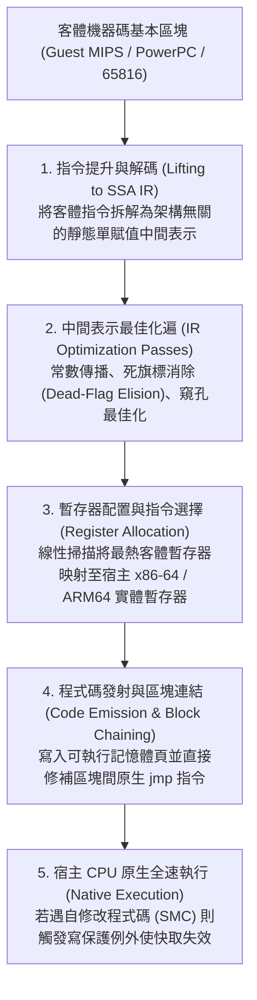
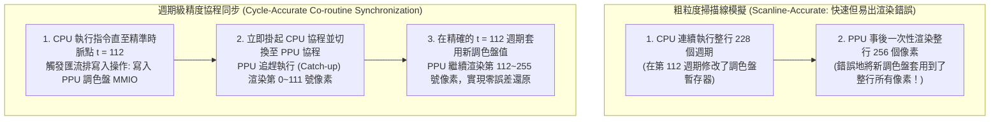

## 1. 從矽晶片到數學：通用圖靈機與硬體的有限狀態機同構

1983年的紅白機（NES）、1990年的超級任天堂（SNES）、2000年的 PlayStation 2 以及2001年的 GameCube，並非通用個人電腦，而是高度特化的<strong>客製化大型積體電路（ASIC / Custom LSI）集合體</strong>。然而今天，即便沒有這些實體晶片，我們依然能在搭載 x86-64 或 ARM64 處理器的現代 PC 與智慧型手機上，以位元級精度甚至更高解析度執行當年的商業遊戲 ROM。使這一切成為可能的軟體工程技術便是<strong>硬體模擬器（Emulator）</strong>。

為什麼一種架構的軟體能夠完美模仿另一種截然不同的物理矽晶片？其理論根基源於英國數學家<strong>艾倫·圖靈（Alan Turing）</strong>在1936年證明的計算機科學第一原理——<strong>通用圖靈機（Universal Turing Machine, UTM）</strong>定理：

$$U(\langle M \rangle, x) = M(x)$$

結合<strong>邱奇-圖靈論題（Church-Turing Thesis）</strong>，只要將實體遊戲機硬體視為狀態機 $M$，將描述其電路邏輯規範的模擬器原始碼視為編碼 $\langle M \rangle$，將遊戲 ROM 與手把輸入視為資料 $x$，任何圖靈完備的宿主電腦 $U$ 都必然能計算出與原機完全一致的視聽輸出 $M(x)$。

從數位電路視角來看，任何由主時脈驅動的同步數位邏輯電路（無論是 CPU、PPU 圖像處理器還是 APU 音訊處理器），在數學上都等價於一個<strong>確定性有限狀態自動機（Deterministic Finite State Machine, FSM）</strong>。設遊戲機在離散時脈週期 $t$ 的全部暫存器、旗標位、VRAM、OAM 及主記憶體（WRAM）位元構成的總體狀態向量為 $S_t \in \mathcal{S}$，外部手把輸入為 $I_t \in \mathcal{I}$，則晶片內部數百萬個邏輯閘在兩個時脈沿之間執行的物理運算，嚴格對應兩個純數學函數：

$$S_{t+1} = \delta(S_t, I_t), \qquad O_t = \lambda(S_t, I_t)$$

其中 $\delta$ 為狀態轉移函數，$\lambda$ 為產生 RGB 像素與 PCM 音訊取樣的輸出函數。實體 CMOS 電晶體透過高低電壓實現的布林代數，與宿主 CPU 在 `uint32_t` / `uint64_t` 變數上執行的位元運算（`&`, `|`, `^`, `~`, `<<`）具有嚴格的<strong>數學同構性（Isomorphism）</strong>。

然而，可計算性並不等於即時性。以 NTSC 制式的超級任天堂為例，其主晶振頻率為 $21.477272\,\text{MHz}$，每幀包含 $262$ 條掃描線、每行 $1364$ 個主時脈週期，幀率約為：

$$f_{\text{frame}} = \frac{21,477,272\,\text{Hz}}{262 \times 1364} \approx 60.0988\,\text{Hz} \implies T_{\text{frame}} \approx 16.639\,\text{ms}$$

實體硬體中，CPU、PPU、APU 的數百萬個電晶體在每個奈秒週期內<strong>空間平行（Spatially Parallel）</strong>地同時演進；而模擬器必須在馮·諾伊曼宿主 CPU 上將這種龐大的空間平行性序列化為指令流，並在嚴格的 <strong>$16.639\,\text{ms}$ 硬即時期限</strong>內完成全部計算。

---

## 2. CPU 模擬基礎：從 Switch 直譯器到動態二進制翻譯（JIT / Dynarec）

### 2.1 經典 Switch 直譯器與間接分支預測懲罰

最直觀的 CPU 模擬方式是編寫一個 `while` 迴圈，按照<strong>取指（Fetch）$\to$ 解碼（Decode）$\to$ 執行（Execute）</strong>的順序，用龐大的 `switch (opcode)` 語句逐條直譯客體機（Guest）指令。

這種結構對於 8 位元/16 位元主機尚可勝任，但在模擬 PS2、GameCube 等複雜系統時會遭遇嚴重的微架構瓶頸：整個 `switch` 語句在底層會被編譯為單條間接跳躍指令（如 x86-64 的 `jmp *[rax + rdx*8]`）。由於客體指令序列高度動態，現代超純量 CPU 的<strong>分支目標緩衝器（BTB）與間接分支預測器</strong>在該跳躍點會發生極高比例的預測失敗（Branch Misprediction），每次失敗都會沖刷長達 14～20 級的指令管線，白白浪費數十個時脈週期。利用 GCC/Clang 的標籤位址擴充（`goto *dispatch_table[opcode]`）建構<strong>直接執行緒化程式碼（Direct Threaded Code）</strong>，將間接跳躍分散到每個操作碼處理函數的末尾，可顯著改善分支局部性，但仍無法消除逐條取指解碼與記憶體保存客體暫存器的固有開銷。

### 2.2 動態二進制翻譯（JIT / Dynarec）管線與死旗標消除

為了跨越效能鴻溝，現代高效能模擬器（如 <strong>Dolphin</strong>、<strong>PCSX2</strong>、<strong>RPCS3</strong>、<strong>QEMU TCG</strong> 以及 <strong>Apple Rosetta 2</strong>）無一例外地採用了<strong>即時編譯 / 動態重編譯（JIT / Dynamic Recompilation, Dynarec）</strong>技術：以<strong>基本區塊（Basic Block）</strong>為單位，在執行期將客體機器碼翻譯為宿主原生機器碼並快取在程式碼快取（Code Cache）中直接執行。



工業級 JIT 引擎的核心加速秘訣包括：
1. <strong>死旗標消除（Dead-Flag Elision）與惰性旗標求值</strong>：CPU 的算術指令通常會更新零（Z）、負（N）、進位（C）、溢位（V）四個狀態旗標，但後續條件分支往往只檢查其中一個旗標，其餘旗標立刻被下一條算術指令覆寫。透過在 SSA 中間表示上進行反向活躍變數分析（Liveness Analysis），JIT 可直接刪去 $80\%$ 以上無用的旗標位元計算指令。
2. <strong>實體暫存器映射（Register Allocation）</strong>：利用線性掃描（Linear Scan）演算法，將客體 CPU 最常用的通用暫存器直接駐留在宿主 x86-64（16個暫存器）或 ARM64（31個暫存器）的硬體暫存器中，消除反覆讀寫 `CPUState` 記憶體結構體的開銷。
3. <strong>基本區塊連結（Block Chaining）</strong>：當基本區塊 A 跳躍到已編譯的基本區塊 B 時，JIT 直接將區塊 A 末尾的跳躍位址修補（Patch）為區塊 B 的宿主原生記憶體位址，徹底繞過 C++ 排程迴圈（Dispatcher）。
4. <strong>自修改程式碼（Self-Modifying Code, SMC）偵測</strong>：當遊戲向記憶體動態寫入新程式碼（如執行期解壓縮覆寫層）時，模擬器透過軟體寫遮罩或作業系統的記憶體頁唯讀保護（`mprotect` / `VirtualProtect`）捕獲寫入例外，精準廢除（Invalidate）對應的過時 JIT 程式碼區塊。

| 評估維度 | Switch 直譯器 (Interpreter) | 直接執行緒化直譯器 (Threaded) | 動態重編譯 (JIT / Dynarec) |
| :--- | :--- | :--- | :--- |
| <strong>每條客體指令開銷</strong> | $20 \sim 80+$ 條宿主指令 | $12 \sim 35$ 條宿主指令 | <strong>$1 \sim 4$ 條宿主原生指令</strong> |
| <strong>分支預測友善度</strong> | 極差（單一間接跳躍熱點） | 中等（分散間接跳躍） | <strong>極高（原生直接跳躍與區塊連結）</strong> |
| <strong>死旗標與常數最佳化</strong> | 不可能（缺乏跨指令視野） | 極有限（僅限超級指令） | <strong>完備（基於 SSA IR 的全域消除）</strong> |
| <strong>實作複雜度與可攜性</strong> | 極簡，純標準 C/Rust 即可跨平台 | 依賴編譯器擴充 | <strong>極高，需針對每種宿主架構編寫後端</strong> |
| <strong>週期級精度控制</strong> | 極易（可在任意週期中斷） | 較易 | <strong>困難（通常以基本區塊邊界批次結算週期）</strong> |

---

## 3. 記憶體匯流排與 Fastmem：劫持宿主硬體 MMU

在遊戲機中，CPU 不僅存取普通 RAM，還透過讀寫特定位址的<strong>記憶體映射 I/O（MMIO）</strong>暫存器來控制 PPU 畫面合成、觸發 DMA 傳輸或讀取手把狀態。如果每次記憶體載入都用軟體 `if-else` 或軟體分頁表（Software TLB）檢查位址是否落在 MMIO 區域，即便有 JIT 加持，記憶體存取也會比原生程式碼慢上數倍。

現代模擬器透過 <strong>Fastmem（硬體加速虛擬記憶體映射）</strong>徹底解決了這一瓶頸：
1. 模擬器向宿主 64 位元作業系統申請一段與客體整個位址空間等大的連續虛擬記憶體區域——例如為 32 位元客體機直接 `mmap` / `VirtualAlloc` 一整塊 <strong>$4\,\text{GB}$ 的宿主虛擬位址空間</strong>，記其基底位址指標儲存在宿主暫存器 `rbx` 中。
2. 對於普通實體 RAM 區域（及鏡像區域），利用共享記憶體檔案描述符（`mmap` / `MapViewOfFile`）將其直接映射到對應的宿主虛擬位址偏移上，並賦予讀寫權限（`PROT_READ | PROT_WRITE`）。
3. 對於所有的 <strong>MMIO 硬體暫存器區域</strong>，故意將其宿主分頁權限設為<strong>不可存取（`PROT_NONE` / `PAGE_NOACCESS`）</strong>。

如此一來，JIT 編譯器可以把客體的任何記憶體讀取指令，無條件地編譯為<strong>僅僅一條宿主原生機器指令</strong>：

```nasm
; rbx = 4GB 客體虛擬競技場基底位址, edi = 32位元客體虛擬位址
mov eax, dword ptr [rbx + rdi]   ; 1條指令完成位址轉換與載入！
```

* <strong>快速路徑（99.9% 的普通 RAM 存取）</strong>：宿主 CPU 的硬體 MMU 與 TLB 在 <strong>0 額外軟體開銷（3～4個時脈週期）</strong>下直接完成載入！
* <strong>慢速路徑（0.1% 的 MMIO 暫存器存取）</strong>：當指令觸碰 `PROT_NONE` 的 MMIO 分頁時，宿主硬體 MMU 立即觸發<strong>分頁錯誤例外（Page Fault：POSIX 下的 `SIGSEGV` 或 Windows 的 `STATUS_ACCESS_VIOLATION` 向量化例外 VEH）</strong>。模擬器的訊號處理常式捕獲該例外，解析故障指令，呼叫對應的 C++ `mmio_read/write()` 硬體處理函數，更新目標暫存器並將宿主指令指標 `RIP` 推進到下一條指令後恢復執行。

---

## 4. 週期級精度（Cycle Accuracy）與多晶片協程同步的深淵

為什麼已故傳奇模擬器開發者 <strong>Near（byuu）</strong> 曾指出：<strong>「以100%週期級精度完美模擬一台僅 $3.58\,\text{MHz}$ 的超級任天堂，需要高達 $3\,\text{GHz}$ 的現代桌上型電腦 CPU」</strong>？

在早期<strong>掃描線級（Scanline-based）</strong>模擬器（如 ZSNES）中，模擬器先讓 CPU 連續跑完一整條掃描線（約 $228$ 個週期），然後再讓 PPU 一次性把整條線的像素畫出來。然而，許多極限榨乾硬體機能的遊戲（如《星海遊俠》《超時空之鑰》以及大量特殊光柵特效遊戲）會在<strong>掃描線繪製到正中間（Mid-Scanline）的某一個精確時脈週期</strong>，突然透過 CPU 或 HDMA 修改 PPU 的調色盤、卷軸偏移或 Mode 7 仿射變換矩陣！如果模擬器不是在精確的像素時脈點上交錯更新 CPU 與 PPU，畫面就會出現撕裂、閃爍甚至死結。



在 <strong>bsnes / higan / Ares</strong> 等週期級精度模擬器中，CPU、PPU、SMP（音訊 CPU）、DSP 各自作為獨立的<strong>輕量級協作式使用者態執行緒——協程（Co-routines / Fibers，`libco`）</strong>運作。每當一個晶片即將產生可能被其他晶片觀測到的副作用（如共享匯流排讀寫、IRQ 中斷線電位翻轉），當前協程便呼叫 `co_switch()` 切換到目標晶片協程，讓其嚴格追趕（Catch-up）到當前主時脈滴答數。由於每秒要發生數百萬次跨晶片同步，為了避免作業系統核心執行緒切換（數千週期），極速使用者態協程將上下文切換壓縮到了約 10 條組合語言指令以內。

此外，模擬器工程還必須在以下前沿領域攻克極限難題：
* <strong>非 IEEE-754 浮點數怪癖</strong>：PlayStation 2 的 Emotion Engine（R5900）與 VU 向量協同處理器並不遵循標準 IEEE-754 浮點規範——它們不支援無窮大（`Inf`）與非數（`NaN`），指數全為 1 的位元模式仍被視為正常大數，且非正規化數（Denormals）被硬體直接沖刷為零（FTZ）。PCSX2 必須透過宿主 SIMD 暫存器重縮放與位元遮罩軟修補，才能防止遊戲物理引擎因產生 `NaN` 而發生多邊形爆炸或穿牆。
* <strong>超越原機延遲的 Run-Ahead（先行預測執行）</strong>：為了消除現代液晶顯示器與作業系統的輸入延遲，RetroArch 等前端引入了 Run-Ahead 技術：在每一幀取樣手把輸入後，模擬器在背景靜默地快轉執行 $N$ 幀（例如 $N=2$），透過<strong>極速記憶體狀態保存（Savestate）</strong>跳過遊戲內部高達 1～3 幀的輸入緩衝延遲，直接將第 $t+N$ 幀的畫面呈現給玩家，使模擬器的操作反應速度甚至超越了連接 CRT 電視的實體原機。
* <strong>FPGA 硬體重實現與數位文化遺產保存</strong>：除了純軟體模擬，以 <strong>MiSTer FPGA</strong> 為代表的開源專案透過 Verilog / VHDL 在現場可程式化邏輯閘陣列（FPGA）上直接重構原機的邏輯閘電路，實現了真正的硬體級空間平行與零抖動輸出。隨著 20 世紀末的客製化矽晶片因電遷移、電容漏液與光碟腐爛（Disc Rot）不可逆轉地走向物理消亡，模擬器原始碼與 FPGA 網表已不再僅僅是執行老遊戲的工具，而是將人類互動式數位藝術永久留存後世的<strong>可執行歷史文獻（Executable Hardware Documentation）</strong>。
