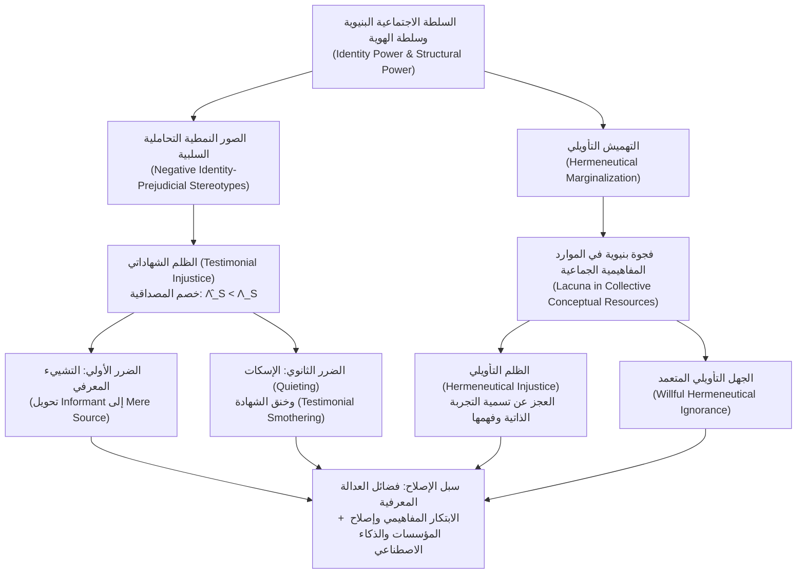

## مقدمة: حين تُنكر أهلية الإنسان بوصفه «ذاتاً عارفة» دون وجه حق

في الفلسفة السياسية والأخلاقية التقليدية، جرت العادة على تحليل مفهوم «الظلم (Injustice)» عبر فئتين رئيسيتين: أولاً، <strong>الظلم التوزيعي (Distributive Injustice)</strong> المتعلق بالتوزيع غير العادل للموارد المادية والثروة والرعاية الصحية والفرص التعليمية؛ وثانياً، <strong>الظلم الإجرائي (Procedural Injustice)</strong> المرتبط بالمحاباة في المحاكم أو في تطبيق القوانين. غير أن هناك شكلاً ثالثاً من الظلم يعمل في البنية العميقة للحياة الاجتماعية، وهو أكثر خفاءً لكنه لا يقل تدميراً: إذ يمكن اضطهاد الإنسان ليس فقط بحرمانه من الدخل أو الحقوق الانتخابية، بل لأن كلامه يتعرض لخصم منهجي في المصداقية بمجرد أن يفتح فمه بسبب هويته الاجتماعية، أو لأن اللغة المشتركة في مجتمعه تفتقر أصلاً إلى المفاهيم القادرة على تسمية وتفسير المعاناة التي يمر بها.

في عام 2007، أصدرت الفيلسوفة البريطانية <strong>ميراندا فريكر (Miranda Fricker)</strong> كتابها التأسيسي <em>Epistemic Injustice: Power and the Ethics of Knowing</em> («الظلم المعرفي: السلطة وأخلاقيات المعرفة»)، حيث جمعت لأول مرة بصورة منهجية بين نظرية المعرفة (الإبستمولوجيا) والأخلاق والنظرية السياسية للسلطة. صاغت فريكر مفهوم <strong>الظلم المعرفي (Epistemic Injustice)</strong> للإشارة إلى <strong>الضرر الذي يلحق بشخص ما تحديداً في صفته كذات عارفة (Knower) وناقلة للمعرفة</strong>.

ولكي نفهم لماذا لا يُعد عدم تصديق شخص ما أو افتقاره إلى الكلمات لشرح تجربته مجرد خلل تواصلي عابر، بل انتهاكاً أخلاقياً وسياسياً جسيماً، يتعين علينا الغوص في آليات الإبستمولوجيا الاجتماعية (Social Epistemology). تقسم فريكر الظلم المعرفي إلى صورتين أساسيتين: <strong>الظلم الشهاداتي (Testimonial Injustice)</strong> الذي يحدث أثناء التبادل الخطابي، و<strong>الظلم التأويلي أو الهرمنيوطيقي (Hermeneutical Injustice)</strong> الذي يكمن في الفجوات البنيوية للموارد المفاهيمية الجماعية. يستعرض هذا المقال البنية الكاملة لهذه النظرية، بدءاً من عمل سلطة الهوية والنمذجة البايزية لعجز المصداقية، وصولاً إلى التشييء المعرفي، وخنق الشهادة، والإقصاء الخوارزمي في الطب المعاصر والنماذج اللغوية الكبيرة (LLMs).

---

## الفصل الأول: السلطة الاجتماعية، سلطة الهوية، والعمل المعرفي للصور النمطية

### 1.1 السلطة الاجتماعية وسلطة الهوية (Identity Power)

تصورت الإبستمولوجيا الفردية الكلاسيكية ذات الجذور الديكارتية الذات العارفة كوعي معزول ومنتزع من سياقه التاريخي والاجتماعي («الكوجيتو»). أما في العالم الواقعي، فإن الغالبية العظمى من معارفنا تعتمد على <strong>شهادة الآخرين (Testimony)</strong> وعلى رصيد مشترك من المفاهيم اللغوية. المعرفة اجتماعية بطبيعتها، ومن ثم فهي مخترقة حتماً بعلاقات <strong>السلطة الاجتماعية (Social Power)</strong>.

تعرّف فريكر السلطة الاجتماعية بأنها «القدرة العملية أو الكامنة التي يمتلكها الفاعلون الاجتماعيون (أفراداً أو جماعات) داخل بيئة معينة للتأثير في أفعال وظروف فاعلين آخرين أو التحكم فيها». أما النمط المحدد من السلطة الاجتماعية الذي يولّد الظلم المعرفي مباشرة فهو <strong>سلطة الهوية (Identity Power)</strong>. لا تحتاج هذه السلطة إلى الإكراه المادي أو المراسيم الإدارية؛ إذ تعمل مباشرة عبر <strong>المخيال الاجتماعي الجماعي (Collective Social Imagination)</strong> — أي النصوص الثقافية المشتركة حول ما يعنيه أن يكون المرء رجلاً أو امرأة، أبيض أو ملوناً، طبيباً أو مريضاً، أكاديمياً نخبوياً أو عاملاً يدوياً. ويمكن أن تُمارس سلطة الهوية بصورة فاعلة (حين يُسكت شخص ذو سلطة أبوية امرأة بنظرة أو نبرة متعالية) أو بصورة بنيوية بحتة (حين تنسحب جماعة مهمشة مسبقاً من الإدلاء بشهادتها في المجال العام).

### 1.2 الصور النمطية الاستدلالية مقابل الصور النمطية التحاملية السلبية

في التواصل اليومي، يتعين على المستمع (Hearer, $H$) تقييم <strong>مصداقية (Credibility)</strong> المتحدث (Speaker, $S$) بصورة شبه لحظية. ونظراً لاستحالة إجراء تدقيق تجريبي شامل لسجل أمانة وكفاءة كل محاور قبل كل محادثة، يلجأ الإدراك البشري حتماً إلى <strong>الصور النمطية (Stereotypes)</strong> — وهي ارتباطات معممة بين جماعة اجتماعية وسمات موثوقية معينة — بوصفها <strong>أداة استدلالية معرفية (Heuristic)</strong>.

ليست كل صورة نمطية غير عقلانية أو غير أخلاقية؛ فالوثوق بعالمة فيزياء فلكية أكثر من منجّم فيما يخص الثقوب السوداء هو استدلال قائم على أساس تجريبي سليم. ينشأ الظلم الشهاداتي حين يتشوه حكم المستمع بفعل <strong>صورة نمطية تحاملية سلبية مرتبطة بالهوية (Negative Identity-Prejudicial Stereotype)</strong>، والتي تعرّفها فريكر بدقة بأنها:

> تعميم واسع الانتشار أو ارتباط ذهني بشأن جماعة اجتماعية يربط أعضاءها بسمات حاطة من القدر (ولا سيما نقص العقلانية، المبالغة العاطفية، عدم الأمانة، أو الدونية الفكرية)، دون الاستناد إلى أدلة تجريبية موضوعية، ويُظهر — بسبب شحنة انفعالية من العداء أو الشعور بالتفوق أو المصلحة المكتسبة — <strong>مقاومة شديدة للأدلة المضادة (Resistance to Counter-Evidence)</strong>.

---

## الفصل الثاني: الظلم الشهاداتي (Testimonial Injustice): عجز المصداقية وفائضها

### 2.1 الظلم الشهاداتي المنهجي مقابل العرضي

عندما يمنح المستمع، بدافع التحامل ضد الهوية الاجتماعية للمتحدث، لكلامه مصداقية أقل مما يستحقه وفق الأدلة المتاحة، يعاني المتحدث من <strong>عجز في المصداقية (Credibility Deficit)</strong>. وتميز فريكر بين حالتين:

1. <strong>الظلم الشهاداتي العرضي (Incidental Testimonial Injustice)</strong>: ينجم عن تحامل موضعي غير بنيوي (مثل لجنة علمية ترتاب دون مبرر في الباحثين المتخصصين في حشرة نادرة معينة). ورغم كونه غير عادل، فإن هذا التحامل لا يلاحق الباحث في مجالات حياته الأخرى (في المحكمة أو المستشفى أو البنك).
2. <strong>الظلم الشهاداتي المنهجي (Systematic Testimonial Injustice)</strong>: يمثل <strong>الحالة المركزية (Central Case)</strong> للنظرية. هنا يقوم التحامل المرتبط بالهوية (العنصرية، التمييز الجنسي، الطبقية، التمييز ضد ذوي الإعاقة) <strong>بملاحقة وتتبع (Tracks)</strong> الذات عبر أبعاد متعددة للبنية الاجتماعية — الاقتصادية والقانونية والسياسية والتعليمية والطبية. وهذا التتبع المنهجي العابر للقطاعات هو ما يحول الانحياز المعرفي إلى أداة للاضطهاد البنيوي.

### 2.2 حالتان كلاسيكيتان من الأدب والتاريخ: مارج شيروود وتوم روبنسون

لتوضيح كيفية عمل الظلم الشهاداتي المنهجي، تحلل فريكر مشهدين أدبيين شهيرين:

* <strong>مارج شيروود في رواية <em>السيد ريبلي الموهوب</em> (<em>The Talented Mr. Ripley</em>)</strong>: في إيطاليا خلال خمسينيات القرن العشرين، يُقتل الشاب الثري ديكي غرينليف على يد توم ريبلي. تعرف خطيبته مارج شيروود طباع ديكي وعاداته معرفة وثيقة. وعندما تكتشف خواتم ديكي بحوزة ريبلي وتربط بين عدة قرائن مادية، تستنتج بصورة عقلانية محكمة أن ديكي لم يكن لينتحر أبداً وأن ريبلي قد قتله. غير أن والد ديكي، هربرت غرينليف، يطيح باستدلالها بجملة أبوية شهيرة: <strong>«يا مارج، هناك الحدس الأنثوي، وهناك الحقائق (Marge, there's female intuition, and then there are facts).»</strong> إن الصورة النمطية الأبوية التي تصنف النساء ككائنات عاطفية وهستيرية تفتقر إلى المنطق تدفع هربرت إلى الحط من استنتاج عقلاني رصين واعتباره مجرد «حدس أنثوي»، فارضاً على مارج عجزاً فادحاً في المصداقية.
* <strong>توم روبنسون في رواية <em>أن تقتل طائراً بريئاً</em> (<em>To Kill a Mockingbird</em>)</strong>: في ولاية ألاباما عام 1935، يُتهم العامل الزراعي الأسود الشاب توم روبنسون زوراً باغتصاب امرأة بيضاء تدعى ماييلا يويل. يثبت محامي الدفاع أتيكوس فينش عبر أدلة مادية دامغة (ذراع توم اليسرى مشلولة بالكامل) استحالة أن يكون توم قد أحدث الإصابات الموجودة على جسد المدعية. لكن عندما يسأل المدعي العام توم عن سبب مساعدته المنتظمة لماييلا في أعمال المنزل دون مقابل، يجيب توم بصدق: «لقد شعرت بشفقة شديدة عليها (I felt right sorry for her).» في بنية سلطة الهوية القائمة على تفوق العرق الأبيض في حقبة قوانين جيم كرو، يثير تجرؤ رجل أسود على الشعور بالشفقة تجاه امرأة بيضاء غضباً عنصرياً فورياً لدى هيئة المحلفين المكونة بالكامل من البيض؛ ومع التحامل العنصري القائل بأن الرجال السود يكذبون دائماً في المسائل الجنسية، تعجز هيئة المحلفين (وترفض) تصديق شهادة توم، وتدينه بارتكاب الجريمة مما يقوده إلى حتفه.

### 2.3 فائض المصداقية (Credibility Excess) والرذائل المعرفية

الوجه المقابل لعجز المصداقية هو <strong>فائض المصداقية (Credibility Excess)</strong>: حين يحظى المتحدث، بفضل هويته الاجتماعية المتمتعة بالامتياز (رجل أبيض، ثري، خريج جامعات النخبة)، بثقة تفوق ما تبرره كفاءته الفعلية والأدلة الموضوعية.

وكما برهن الفيلسوف <strong>خوسيه ميدينا (José Medina)</strong> في كتابه <em>The Epistemology of Resistance</em> (2013)، فإن المصداقية <strong>مفهوم علائقي ومقارن وتنافسي</strong>. ففي قاعة المحكمة أو العيادة الطبية، يعني منح فائض مصداقية لصاحب الامتياز (مثل توم ريبلي أو عائلة يويل) حرمان المهمش مباشرة من مصداقيته. علاوة على ذلك، فإن العيش الدائم في كنف فائض المصداقية يفسد الطابع المعرفي لأصحاب الامتياز أنفسهم ويولّد ثلاث <strong>رذائل معرفية (Epistemic Vices)</strong>:
1. <strong>الغطرسة المعرفية (Epistemic Arrogance)</strong>: وهم الإحاطة بكل شيء والعصمة عن الخطأ.
2. <strong>الكسل المعرفي (Epistemic Laziness)</strong>: انعدام الدافع للبحث في مناطق العمى الخاصة بامتيازات الذات وفي واقع المضطهدين.
3. <strong>انغلاق الذهن (Closed-mindedness)</strong>: الرفض الدفاعي لأي شهادة تتحدى النظام القائم.

---

## الفصل الثالث: النموذج البايزي الصوري لخصم المصداقية

يمكننا صياغة عجز وفائض المصداقية رياضياً بدقة باستخدام <strong>تحديث المعتقدات البايزي (Bayesian Belief Updating)</strong>.

لنفترض أن مستمعاً يسند احتمالية قبلية (Prior) $P(H) \in (0, 1)$ إلى قضية $H$ (مثلاً: «المريضة تعاني من نقص تروية قلبي حاد» أو «المتهم بريء»). يقدم المتحدث $S$ الشهادة $E_S$ دعماً للقضية $H$. وفق مبرهنة بايز، تُعطى الاحتمالية البعدية (Posterior) بالمعادلة:

$$P(H \mid E_S) = \frac{P(E_S \mid H) P(H)}{P(E_S \mid H) P(H) + P(E_S \mid \neg H) P(\neg H)}$$

ليكن $c_S = P(E_S \mid H)$ الموثوقية الموضوعية للمتحدث عندما تكون $H$ صادقة (وهي تجمع بين <strong>الكفاءة Competence</strong> و<strong>الإخلاص Sincerity</strong>)، وليكن $f_S = P(E_S \mid \neg H)$ معدل الإيجابيات الكاذبة (الخطأ أو الكذب) عندما تكون $H$ كاذبة. إن <strong>نسبة الأرجحية (Likelihood Ratio)</strong> الموضوعية للشهادة هي:

$$\Lambda_S = \frac{P(E_S \mid H)}{P(E_S \mid \neg H)} = \frac{c_S}{f_S}$$

لدى الفاعل المعرفي المثالي الخالي من التحامل، يتطابق التقدير الذاتي $\hat{\Lambda}_S$ مع $\Lambda_S$. أما عندما يهيمن على المستمع معامل تحامل سلبي مرتبط بالهوية $\delta_{\text{bias}} \in [0, 1]$ ضد الجماعة الاجتماعية للمتحدث $S$، فإنه يقلل من تقدير كفاءة المتحدث وصدقيته ويبالغ في تقدير احتمالية خطئه أو خداعه، فتتدهور نسبة الأرجحية المدركة لتصبح:

$$\hat{\Lambda}_S(\delta_{\text{bias}}) = \frac{(1 - \delta_{\text{bias}}) c_S + \delta_{\text{bias}} f_S}{f_S + \delta_{\text{bias}} (c_S - f_S)}$$

ومن هذه الصيغة نستخلص ثلاث نتائج أساسية:
* عندما يكون $\delta_{\text{bias}} = 0$ (انعدام التحامل)، فإن $\hat{\Lambda}_S(0) = \frac{c_S}{f_S} = \Lambda_S$: يتم تحديث المعتقد بصورة عادلة وعقلانية.
* عندما يكون $0 < \delta_{\text{bias}} < 1$ و $c_S > f_S$، يتحقق قطعاً $\hat{\Lambda}_S(\delta_{\text{bias}}) < \Lambda_S$، مما يؤدي إلى اعتقاد بعدي أقل مما ينبغي موضوعياً: $\hat{P}(H \mid E_S) < P^*(H \mid E_S)$. ويقيس الفرق $\Delta C_S = \Lambda_S - \hat{\Lambda}_S(\delta_{\text{bias}}) > 0$ مقدار <strong>عجز المصداقية</strong>.
* عندما يؤول $\delta_{\text{bias}} \to 1$ (تحامل مطلق، كما في هيئة محلفين <em>أن تقتل طائراً بريئاً</em>)، فإن $\hat{\Lambda}_S(1) = 1$، بحيث يصبح $\hat{P}(H \mid E_S) = P(H)$: تتعرض الشهادة <strong>لإبطال معرفي تام (Epistemic Nullification)</strong>.

وبصيغة لوغاريتم الأرجحية (Log-Odds) بعد $T$ من الشهادات المتتابعة:

$$\log \frac{P_T(H)}{1 - P_T(H)} = \log \frac{P_0(H)}{1 - P_0(H)} + \sum_{t=1}^{T} w_{S_t} \log \Lambda_{S_t}$$

حين يتم خفض الأوزان الهوياتية للجماعات المهمشة منهجياً ($w_M \ll 1$) وتضخيم أوزان الجماعات الممتازة ($w_P > 1$)، ينحرف رصيد المعرفة العامة بنيوياً نحو تحيزات الطبقة المهيمنة.

---

## الفصل الرابع: الأضرار العميقة: من التشييء المعرفي إلى خنق الشهادة

### 4.1 الضرر الأولي: التشييء المعرفي (Epistemic Objectification)

تميز فريكر بين <strong>الضرر الأولي (الجوهري)</strong> و<strong>الأضرار الثانوية (النتائجية)</strong> للظلم الشهاداتي. يصيب الضرر الأولي صميم الكرامة الإنسانية: فبما أن العقلانية والقدرة على مشاركة المعرفة تشكلان جوهر إنسانيتنا، فإن الحط من شأن شخص ما كذات عارفة بسبب تحامل هوياتي يمثل نزعاً رمزياً لإنسانيته.

وبالاستناد إلى التمييز الشهير الذيوضعه الفيلسوف <strong>إدوارد كريغ (Edward Craig)</strong> في كتابه <em>Knowledge and the State of Nature</em> (1990)، تفرّق فريكر بين:
* <strong>المُخبِر أو الشاهد (Informant)</strong>: ذات عاقلة تُعامَل كشريك حواري كامل الأهلية داخل المجتمع المعرفي.
* <strong>مجرد مصدر للمعلومات (Mere Source of Information)</strong>: شيء أو حالة طبيعية — مثل حلقات جذع الشجرة التي تدل على عمرها أو آثار الأقدام في الوحل — نستخلص منها بيانات تجريبية دون أن نعترف لها بفاعلية عقلانية أو سلطة خطابية.

عندما يعامل هربرت غرينليف استنتاجات مارج باعتبارها مجرد «أعراض انفعالية لامرأة مفجوعة»، فإنه يحط من قدرها من <em>مُخبِرة</em> إلى <em>مجرد مصدر للمعلومات</em>. وهذا هو <strong>التشييء المعرفي (Epistemic Objectification)</strong>، المناظر للتشييء الجنسي في الأخلاق الكانطية.

### 4.2 الأضرار الثانوية، الإسكات (Quieting)، وخنق الشهادة (Smothering)

تشمل الأضرار الثانوية خسائر <strong>عملية</strong> (أحكام قضائية جائرة، إهمال طبي قاتل، إقصاء مهني) وخسائر <strong>معرفية</strong>: فالتآكل المستمر <strong>للثقة المعرفية بالذات (Epistemic Confidence)</strong> يجعل الضحية تشك في معتقداتها الصحيحة المسوغة، بل و<strong>تفقد فعلياً معارف كانت تمتلكها</strong>.

وقد حددت الفيلسوفة النسوية السوداء الأمريكية <strong>كريستي دوتسون (Kristie Dotson)</strong> (2011) آليتين إضافيتين للعنف المعرفي:
1. <strong>الإسكات الشهاداتي (Testimonial Quieting)</strong>: حين يخفق الجمهور، الواقع تحت هيمنة «الصور المتحكمة» النمطية (Controlling Images بحسب باتريشيا هيل كولينز)، في التعرف على المتحدثة كذات عارفة من الأساس.
2. <strong>خنق الشهادة (Testimonial Smothering)</strong>: شكل من أشكال <strong>الرقابة الذاتية القسرية</strong>. فعندما تدرك المتحدثة المهمشة أن شهادتها معقدة ومحفوفة بالمخاطر، وأن المستمع يعاني من <strong>عدم كفاءة شهاداتية (Testimonial Incompetence)</strong> واضحة ستدفعه حتماً إلى تحريف كلامها للإضرار بمجتمعها (مثل امرأة من أقلية عرقية تحجم عن الإبلاغ عن عنف أسري أمام شرطة أو وسائل إعلام عنصرية خشية تغذية الوصم العنصري ضد جماعتها)، فإنها تضطر إلى ابتلاع شهادتها وبتر حديثها بنفسها. ويضاف إلى ذلك ظاهرة <strong>«التفسير الذكوري المتعالي» (Mansplaining)</strong> التي حللتها <strong>ريبيكا سولنيت (Rebecca Solnit)</strong> (2014)، حيث يصطدم فائض المصداقية الذكوري بعجز المصداقية الأنثوي في الحياة اليومية.

---

## الفصل الخامس: الظلم التأويلي (Hermeneutical Injustice) والجهل المتعمد

### 5.1 التهميش التأويلي والفجوات المفاهيمية

بينما يقع الظلم الشهاداتي أثناء الفعل التواصلي بين الأفراد، يعمل <strong>الظلم التأويلي (Hermeneutical Injustice)</strong> على مستوى بنيوي أعمق: في رصيد <strong>الموارد التأويلية الجماعية (Collective Hermeneutical Resources)</strong> — أي المفردات والمفاهيم القانونية وأطر التفسير المتقاسمة في المجتمع.

ولأن الجماعات المتمتعة بالامتياز احتكرت تاريخياً الممارسات المولّدة للمعنى (التشريع، الطب، الصحافة، الأكاديميا)، عانت الجماعات الخاضعة من <strong>تهميش تأويلي (Hermeneutical Marginalization)</strong>، أي مشاركة غير متكافئة في صياغة المفاهيم العامة. ونتيجة لذلك، ينطوي المعجم الاجتماعي على <strong>فجوات تأويلية (Hermeneutical Lacunae)</strong> تحديداً في المواضع التي ينبغي أن تُسمّى فيها تجارب الاضطهاد الخاصة بالضعفاء.

تعرّف فريكر الظلم التأويلي بأنه <strong>الظلم المتمثل في بقاء حيز مهم من التجربة الاجتماعية لشخص ما غامضاً ومحتجباً عن فهمه الذاتي وفهم الآخرين بسبب فجوة منحازة بنيوياً في الموارد التأويلية الجماعية.</strong>

### 5.2 كارميتا وود وميلاد مفهوم «التحرش الجنسي»

المثال النموذجي الذي تورده فريكر هو قصة <strong>كارميتا وود (Carmita Wood)</strong> عام 1975. عملت وود موظفة إدارية في قسم الفيزياء النووية بجامعة كورنيل، وتحملت لسنوات ملامسات جسدية قسرية وإيحاءات بذيئة وملاحقات من أستاذ بارز. وبسبب آلام مزمنة حادة ناجمة عن التوتر، اضطرت إلى الاستقالة. لكنها حين تقدمت بطلب للحصول على إعانة البطالة وكان عليها تدوين سبب ترك العمل في الاستمارة الرسمية، اصطدمت بفراغ مفاهيمي مطلق: ففي اللغة الإنجليزية والقانون الأمريكي عام 1975 لم يكن يوجد سوى مصطلح «مغازلة مكتبية (flirting)» أو جريمة «الاغتصاب»، ولكن <strong>لم تكن هناك كلمة واحدة لتسمية الملاحقة الجنسية المنهجية في بيئة العمل</strong>. اضطرت إلى كتابة «أسباب شخصية»، فرُفض طلبها.

وعندما انضمت وود إلى مجموعة نسوية لرفع الوعي (<em>Consciousness-Raising Group</em>) بقيادة <strong>لين فارلي (Lin Farley)</strong>، اكتشفت النساء أنهن يتقاسمن المعاناة ذاتها، ونحتن معاً مفهوماً جديداً: <strong>«التحرش الجنسي» (Sexual Harassment)</strong>. وقد أتاح سد هذه الفجوة التأويلية فهم الظاهرة ومكافحتها قانونياً، تماماً كما حدث لاحقاً مع مفاهيم مثل «اكتئاب ما بعد الولادة»، و«التلاعب النفسي (Gaslighting)»، و«العدوان المصغر (Microaggression)»، و«التنوع العصبي».

### 5.3 الجهل التأويلي المتعمد (Willful Hermeneutical Ignorance)

كما أوضحت <strong>غيل بولهاوس (Gaile Pohlhaus Jr.)</strong> (2012) وكريستي دوتسون، غالباً ما تطوّر الجماعات المهمشة داخل مجتمعاتها موارد مفاهيمية بديلة غنية. غير أن المشكلة تكمن في أن الجماعات المهيمنة <strong>ترفض بنشاط تعلّم أو الاعتراف أو تبني الأدوات المفاهيمية التي أبدعها المضطهدون بالفعل</strong> — وهي ظاهرة تسميها بولهاوس <strong>الجهل التأويلي المتعمد (Willful Hermeneutical Ignorance)</strong> وتسميها دوتسون <strong>الظلم المساهمي (Contributory Injustice)</strong>.

---

## الفصل السادس: الآفاق المعاصرة: الطب السريري والذكاء الاصطناعي (AI)

| البعد المقارن | الظلم الشهاداتي | الظلم التأويلي | الجهل التأويلي المتعمد / المساهمي |
| :--- | :--- | :--- | :--- |
| <strong>مستوى العمل</strong> | التبادل الخطابي وتقييم الأدلة | الرصيد الجماعي للمفاهيم واللغة | الإقصاء السلطوي بين الأنظمة المفاهيمية |
| <strong>السبب المباشر</strong> | تحامل هوياتي سلبي لدى المستمع ($\delta_{\text{bias}} > 0$) | الإقصاء من ممارسات صناعة المعنى | رفض أصحاب الامتياز تبني مفاهيم الأقليات |
| <strong>الآلية المحورية</strong> | عجز ($\hat{\Lambda}_S < \Lambda_S$) وفائض المصداقية | الفجوة التأويلية (Hermeneutical Lacuna) | الدفاع المعرفي والاحتكار الإبستمولوجي |
| <strong>أمثلة نموذجية</strong> | مارج شيروود، توم روبنسون، تجاهل آلام المرضى | كارميتا وود قبل صياغة مفهوم «التحرش الجنسي» | إنكار العنصرية البنيوية أو المتلازمات المزمنة |
| <strong>مسارات التصحيح</strong> | الوعي النقدي الانعكاسي، فضيلة العدالة الشهاداتية | مجموعات رفع الوعي، الابتكار المفاهيمي | التواضع المعرفي، إصلاح المؤسسات والنماذج اللغوية |

### 6.1 الظلم المعرفي في الطب السريري والطب النفسي

أثبتت أبحاث <strong>هافي كاريل (Havi Carel)</strong> وإيان جيمس كيد كيف يعيد النظام الصحي إنتاج كلا الظلمين:
* <strong>الخصم المنهجي لشهادة المريض</strong>: تُصنَّف شكاوى الألم الحاد الصادرة عن النساء أو الأقليات العرقية أو مرضى المتلازمات المزمنة غير المرئية (مثل بطانة الرحم المهاجرة، الألم العضلي الليفي، وكوفيد طويل الأمد) بوصفها «قلقاً نفسياً» أو «مبالغة» بمعدلات أعلى بكثير مقارنة بشكاوى الرجال البيض.
* <strong>الاغتراب التأويلي</strong>: غالباً ما تطمس المقاييس الطبية الحيوية المعيارية التجربة الظاهراتية (الفينومينولوجية) الذاتية للمريض.

### 6.2 الظلم المعرفي الخوارزمي في النماذج اللغوية الكبيرة (LLMs)

في عصر الذكاء الاصطناعي التوليدي، يتم تشفير الظلم المعرفي داخل مصفوفات الأوزان الخاصة <strong>بالنماذج اللغوية الكبيرة (LLMs)</strong> وأنظمة صنع القرار الآلي:
1. <strong>الظلم الشهاداتي المؤتمت</strong>: الخوارزميات المستخدمة في الفرز الطبي أو الجدارة الائتمانية أو التقييم القضائي والمدربة على بيانات تاريخية متحيزة تمنح تلقائياً أوزان مصداقية أقل لإفادات الفئات الهشة.
2. <strong>المحو التأويلي الخوارزمي</strong>: نظراً لأن مدونات التدريب وعمليات المواءمة (RLHF) في النماذج اللغوية الكبيرة تهيمن عليها اللغة الإنجليزية والأطر المفاهيمية الغربية بصورة ساحقة، فإن لغات الشعوب الأصلية وإبستمولوجيات الجنوب العالمي وتجارب المجتمعات المحلية تُدفع إلى هامش فضاء التضمين المتجهي (Embedding Space)، مما يهدد بفرض تجانس تأويلي رقمي عالمي يمحو تجارب المهمشين.

---

## خاتمة: من أخلاقيات الفضيلة إلى الديمقراطية المعرفية البنيوية

لمواجهة الظلم المعرفي، تقترح ميراندا فريكر تنمية فضيلتين تصحيحيتين: <strong>فضيلة العدالة الشهاداتية</strong> (وعي نقدي انعكاسي يكتشف خصم المصداقية الناجم عن تحامل الهوية ويصححه صعوداً) و<strong>فضيلة العدالة التأويلية</strong> (إصغاء منفتح يدرك وجود فجوة في مواردنا المفاهيمية المشتركة وراء تعثر المتحدث في التعبير). غير أنه، كما تؤكد <strong>إليزابيث أندرسون (Elizabeth Anderson, 2012)</strong>، نظراً لأن التحيزات الضمنية تعمل بصورة غير واعية ولأن التهميش التأويلي متجذر في مؤسسات السلطة، فلا بد من قرن الفضائل الفردية <strong>بإصلاحات بنيوية شاملة</strong> في القضاء والطب وإنتاج المعرفة والحوكمة الديمقراطية للذكاء الاصطناعي.
