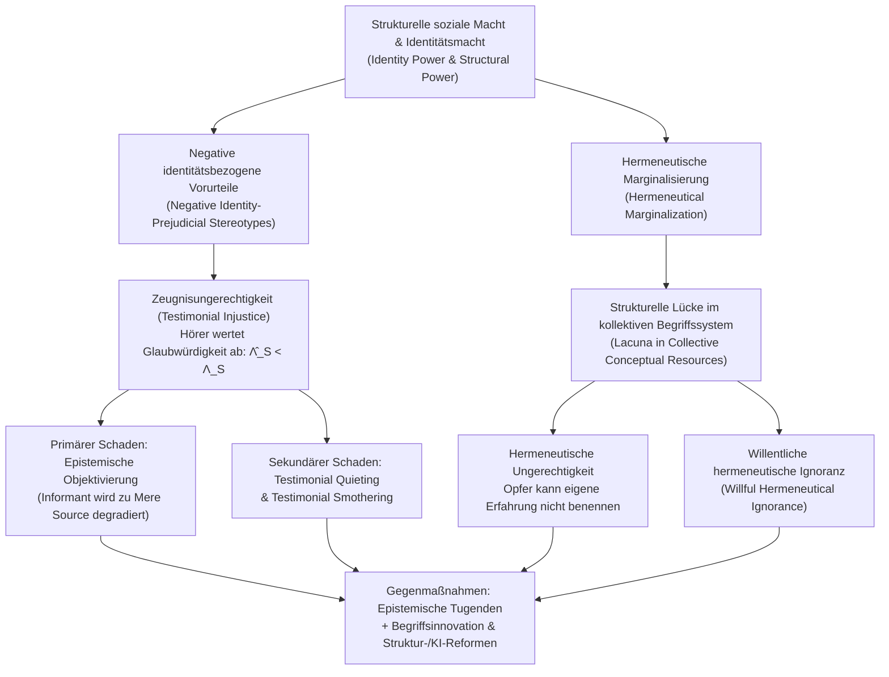

## Einleitung: Wenn die Fähigkeit als „Wissende(r)“ ungerechtfertigt aberkannt wird

In der klassischen politischen Philosophie und Ethik wird „Ungerechtigkeit“ zumeist in zwei Hauptkategorien unterteilt: erstens die <strong>distributive Ungerechtigkeit (Verteilungsungerechtigkeit)</strong>, die die ungleiche Verteilung materieller Güter, Einkommen, Bildungschancen oder medizinischer Versorgung betrifft; und zweitens die <strong>prozedurale Ungerechtigkeit (Verfahrensungerechtigkeit)</strong>, die sich auf Befangenheit in Gerichtsverfahren oder Gesetzesanwendungen bezieht. Doch tief in der Struktur menschlicher Gesellschaften wirkt eine dritte, subtilere und ebenso zerstörerische Form des Unrechts: Ein Mensch wird nicht nur dadurch unterdrückt, dass man ihm materielle Ressourcen vorenthält, sondern dadurch, dass seinem Wort aufgrund seiner sozialen Identität systematisch weniger Glauben geschenkt wird oder dass in der gemeinsamen Sprache einer Gesellschaft schlicht die Begriffe fehlen, um das eigene Leiden überhaupt zu benennen und verstehbar zu machen.

Im Jahr 2007 veröffentlichte die britische Philosophin <strong>Miranda Fricker</strong> ihr bahnbrechendes Werk <em>Epistemic Injustice: Power and the Ethics of Knowing</em> (dt. <em>Epistemische Ungerechtigkeit: Macht und die Ethik des Wissens</em>). Darin verband sie Erkenntnistheorie (Epistemologie), Ethik und Machttheorie zu einem neuen Grundbegriff: der <strong>epistemischen Ungerechtigkeit (Epistemic Injustice)</strong>.Darunter versteht Fricker ein Unrecht, das einer Person <strong>spezifisch in ihrer Eigenschaft als Wissende(r) (Knower) und als Übermittler(in) von Wissen</strong> zugefügt wird.

Um zu verstehen, warum das Nicht-Geglaubt-Werden oder das Fehlen von Begriffen für die eigene Erfahrung kein bloßes Kommunikationsproblem, sondern eine tiefgreifende ethische und politische Verletzung darstellt, müssen wir die Mechanismen der Sozialen Epistemologie (Social Epistemology) untersuchen. Fricker unterscheidet zwei Grundformen: die <strong>Zeugnisungerechtigkeit (Testimonial Injustice)</strong> auf der Ebene des interpersonellen Informationsaustauschs und die <strong>hermeneutische Ungerechtigkeit (Hermeneutical Injustice)</strong> auf der Ebene kollektiver Sinn- und Begriffsressourcen. Dieser Artikel analysiert beide Formen – von der Funktionsweise der Identitätsmacht über ein formales bayesianisches Modell der Glaubwürdigkeitsabwertung bis hin zu epistemischer Objektivierung, erzwungenem Schweigen und algorithmischen Verzerrungen in der modernen Medizin und in großen Sprachmodellen (LLMs).

---

## Kapitel 1: Soziale Macht, Identitätsmacht und die Epistemologie von Stereotypen

### 1.1 Soziale Macht und Identitätsmacht (Identity Power)

In der traditionellen cartesianischen Erkenntnistheorie wird das erkennende Subjekt als isoliertes, geschichts- und gesellschaftsloses Individuum („Cogito“) modelliert. In der realen Welt hingegen stammt der überwiegende Teil unseres Wissens aus dem <strong>Zeugnis anderer (Testimony)</strong> und stützt sich auf geteilte sprachliche Begriffe. Wissen ist konstitutiv sozial und daher untrennbar mit <strong>sozialer Macht (Social Power)</strong> verwoben.

Fricker definiert soziale Macht als das „praktische oder potenziell wirksame Vermögen sozialer Akteure (Individuen oder Gruppen), in einem gegebenen sozialen Umfeld die Handlungen und Lebensumstände anderer Akteure zu kontrollieren oder zu beeinflussen“. Die spezifische Form sozialer Macht, die epistemische Ungerechtigkeit hervorbringt, ist die <strong>Identitätsmacht (Identity Power)</strong>. Identitätsmacht bedarf keiner physischen Gewalt oder formellen Befehlsgewalt; sie operiert unmittelbar über die geteilte <strong>kollektive soziale Imagination (Collective Social Imagination)</strong> – also über kulturell verankerte Vorstellungen darüber, was es bedeutet, ein Mann oder eine Frau, weiß oder Schwarz, cis- oder transgeschlechtlich, Ärztin oder Patient, Akademiker oder Arbeiter zu sein. Identitätsmacht kann aktiv ausgeübt werden (etwa wenn ein patriarchaler Familienvater eine Frau durch eine herablassende Geste zum Schweigen bringt) oder rein strukturell wirken (wenn marginalisierte Gruppen aus Erfahrung wissen, dass ihnen ohnehin nicht geglaubt wird, und sich aus öffentlichen Debatten zurückziehen).

### 1.2 Heuristische Stereotype vs. negative identitätsbezogene Vorurteile

Im alltäglichen Gespräch muss die hörende Person (Hearer, $H$) in Sekundenbruchteilen die <strong>Glaubwürdigkeit (Credibility)</strong> der sprechenden Person (Speaker, $S$) einschätzen. Da wir im Alltag keine umfassende empirische Prüfung der bisherigen Zuverlässigkeit jedes Gesprächspartners durchführen können, nutzt die menschliche Kognition unweigerlich <strong>Stereotype</strong> – verallgemeinerte Assoziationen zwischen sozialen Gruppen und bestimmten Eigenschaften – als <strong>kognitive Heuristik</strong>.

Nicht jedes Stereotyp ist epistemisch irrational oder moralisch verwerflich. Wenn wir der Aussage einer Astrophysikerin über Schwarze Löcher mehr Gewicht beimessen als der eines Astrologen, stützen wir uns auf eine empirisch wohlbegründete Heuristik. Zeugnisungerechtigkeit entsteht erst dort, wo das Urteil durch ein <strong>negatives identitätsbezogenes Vorurteils-Stereotyp (Negative Identity-Prejudicial Stereotype)</strong> verzerrt wird. Fricker definiert dieses präzise als:

> Eine weitverbreitete Verallgemeinerung oder Assoziation über eine soziale Gruppe, die deren Mitglieder mit abwertenden Merkmalen verknüpft (insbesondere mangelnder Rationalität, übermäßiger Emotionalität, Unaufrichtigkeit oder intellektueller Inkompetenz), ohne auf belastbarer empirischer Evidenz zu beruhen, und die aufgrund affektiver Besetzung (Feindseligkeit, Überlegenheitsgefühl oder Eigeninteresse) eine ausgeprägte <strong>Resistenz gegenüber Gegenbeweisen (Resistance to Counter-Evidence)</strong> aufweist.

---

## Kapitel 2: Zeugnisungerechtigkeit (Testimonial Injustice): Glaubwürdigkeitsdefizit und -überschuss

### 2.1 Systematische vs. zufällige Zeugnisungerechtigkeit

Wenn eine hörende Person aufgrund eines identitätsbezogenen Vorurteils der sprechenden Person weniger Glaubwürdigkeit beimisst, als ihr nach den Belegen zustünde, erleidet die sprechende Person ein <strong>Glaubwürdigkeitsdefizit (Credibility Deficit)</strong>. Fricker unterscheidet hierbei zwei Typen:

1. <strong>Zufällige Zeugnisungerechtigkeit (Incidental Testimonial Injustice)</strong>: Sie entspringt einem lokal begrenzten, nicht-strukturellen Vorurteil. Wenn etwa ein Gutachtergremium Vorurteile gegen Forscher hegt, die sich mit einer obskuren Insektenart beschäftigen, und deren Aussagen ungerechtfertigt misstraut, liegt zwar ein epistemisches Unrecht vor. Dieses Vorurteil verfolgt die Forscher jedoch nicht in andere Lebensbereiche (vor Gericht, auf dem Wohnungsmarkt oder im Krankenhaus).
2. <strong>Systematische Zeugnisungerechtigkeit (Systematic Testimonial Injustice)</strong>: Sie bildet den <strong>Zentralfall (Central Case)</strong> der Theorie. Hier speist sich das Glaubwürdigkeitsdefizit aus Identitätsvorurteilen (wie Rassismus, Sexismus, Klassismus oder Ableismus), die das Subjekt <strong>systematisch durch verschiedenste Dimensionen der Sozialstruktur verfolgen (Track)</strong> – ökonomisch, juristisch, politisch, bildungsbezogen und medizinisch. Erst diese bereichsübergreifende Kopplung macht aus einer epistemischen Fehleinschätzung ein Instrument struktureller Unterdrückung.

### 2.2 Zwei klassische Fallstudien: Marge Sherwood und Tom Robinson

Zur Veranschaulichung analysiert Fricker zwei berühmte literarische Szenen:

* <strong>Marge Sherwood in <em>Der talentierte Mr. Ripley</em> (<em>The Talented Mr. Ripley</em>)</strong>: Im Italien der 1950er Jahre wird der wohlhabende Dickie Greenleaf von Tom Ripley ermordet. Dickies Verlobte Marge Sherwood kennt Dickies Gewohnheiten und Gefühle genau. Als sie Dickies Ringe bei Ripley entdeckt und zahlreiche Widersprüche bemerkt, schließt sie völlig rational, dass Dickie keinen Suizid begangen haben kann, sondern von Ripley getötet wurde. Doch Dickies Vater, Herbert Greenleaf, wischt ihre präzise Beweisführung mit einem einzigen paternalistischen Satz beiseite: <strong>„Marge, es gibt weibliche Intuition, und dann gibt es Fakten (Marge, there's female intuition, and then there are facts).“</strong> Das sexistische Stereotyp, das Frauen als emotional, hysterisch und unlogisch kodiert, führt dazu, dass Herbert ihre rationale Schlussfolgerung als bloße „weibliche Intuition“ entwertet und ihr ein massives Glaubwürdigkeitsdefizit zufügt.
* <strong>Tom Robinson in <em>Wer die Nachtigall stört</em> (<em>To Kill a Mockingbird</em>)</strong>: Im Alabama des Jahres 1935 steht der Schwarze Landarbeiter Tom Robinson vor Gericht, fälschlich angeklagt, die weiße Frau Mayella Ewell vergewaltigt zu haben. Verteidiger Atticus Finch beweist anhand eindeutiger physischer Fakten (Toms linker Arm ist vollständig verkrüppelt), dass Tom die Verletzungen des Opfers unmöglich verursacht haben kann. Als der Staatsanwalt Tom jedoch fragt, warum er Mayella regelmäßig unentgeltlich im Haushalt geholfen habe, antwortet Tom ehrlich: „Sie tat mir leid (I felt right sorry for her).“ In der rassistischen Identitätsmachtstruktur der Jim-Crow-Ära löst dieser Satz bei der rein weißen Jury sofortige Empörung und kognitive Abwehr aus: Dass ein Schwarzer Mann es wagt, Mitleid mit einer weißen Frau zu empfinden, gilt als unerträgliche Grenzüberschreitung; gepaart mit dem rassistischen Vorurteil, dass Schwarze Männer in sexuellen Dingen stets lügen, sind die Geschworenen unfähig und unwillig, Toms Zeugnis zu glauben. Er wird trotz erwiesener Unschuld verurteilt und später beim Fluchtversuch erschossen.

### 2.3 Glaubwürdigkeitsüberschuss (Credibility Excess) und epistemische Laster

Das Spiegelbild des Glaubwürdigkeitsdefizits ist der <strong>Glaubwürdigkeitsüberschuss (Credibility Excess)</strong>: Einer Person wird aufgrund ihrer privilegierten sozialen Identität (z. B. weiß, männlich, wohlhabend, akademischer Titel) mehr Glauben geschenkt, als durch ihre tatsächliche Kompetenz und die Faktenlage gerechtfertigt ist.

Wie der Philosoph <strong>José Medina</strong> in <em>The Epistemology of Resistance</em> (2013) überzeugend dargelegt hat, ist Glaubwürdigkeit eine <strong>relationale, komparative und oft kompetitive Ressource</strong>. Vor Gericht, in der Arztpraxis oder im Beruf bedeutet ein Glaubwürdigkeitsüberschuss für Privilegierte (wie Tom Ripley oder die weiße Anklägerin Ewell) unmittelbar ein tödliches Glaubwürdigkeitsdefizit für Marginalisierte. Zudem korrumpiert ein dauerhafter Glaubwürdigkeitsüberschuss den epistemischen Charakter der Privilegierten selbst und erzeugt drei <strong>epistemische Laster (Epistemic Vices)</strong>:
1. <strong>Epistemische Arroganz (Epistemic Arrogance)</strong>: Die Illusion der eigenen Allwissenheit und Unfehlbarkeit.
2. <strong>Epistemische Trägheit (Epistemic Laziness)</strong>: Das Fehlen jeglicher Motivation, sich über die Lebensrealität Unterdrückter zu informieren.
3. <strong>Geistige Verschlossenheit (Closed-mindedness)</strong>: Die aktive Abwehr von Perspektiven, die das eigene Weltbild infrage stellen.

---

## Kapitel 3: Formales bayesianisches Modell der Glaubwürdigkeitsabwertung

Die Verzerrung durch Zeugnisungerechtigkeit lässt sich mithilfe der <strong>bayesianischen Überzeugungsaktualisierung (Bayesian Belief Updating)</strong> präzise formalisieren.

Nehmen wir an, eine hörende Person weise einer Hypothese $H$ (z. B. „Die Patientin erleidet einen Herzinfarkt“ oder „Der Angeklagte sagt die Wahrheit“) eine A-priori-Wahrscheinlichkeit $P(H) \in (0, 1)$ zu. Die sprechende Person $S$ legt nun das Zeugnis $E_S$ zugunsten von $H$ ab. Nach dem Satz von Bayes lautet die A-posteriori-Wahrscheinlichkeit:

$$P(H \mid E_S) = \frac{P(E_S \mid H) P(H)}{P(E_S \mid H) P(H) + P(E_S \mid \neg H) P(\neg H)}$$

Sei $c_S = P(E_S \mid H)$ die objektive Zuverlässigkeit von $S$ (das Produkt aus <strong>Kompetenz Competence</strong> und <strong>Aufrichtigkeit Sincerity</strong>), wenn $H$ wahr ist, und sei $f_S = P(E_S \mid \neg H)$ die Falsch-Positiv-Rate (Irrtum oder Täuschung), wenn $H$ falsch ist. Das objektive <strong>Likelihood-Verhältnis (Likelihood Ratio)</strong> des Zeugnisses beträgt:

$$\Lambda_S = \frac{P(E_S \mid H)}{P(E_S \mid \neg H)} = \frac{c_S}{f_S}$$

Bei einem vorurteilsfreien Hörer stimmt das subjektiv zugeschriebene Likelihood-Verhältnis $\hat{\Lambda}_S$ mit $\Lambda_S$ überein. Wirkt jedoch ein identitätsbezogener Vorurteilsparameter $\delta_{\text{bias}} \in [0, 1]$ gegen die soziale Gruppe von $S$, wird die wahrgenommene Kompetenz abgewertet und die vermutete Täuschungs- oder Irrtumsrate erhöht:

$$\hat{\Lambda}_S(\delta_{\text{bias}}) = \frac{(1 - \delta_{\text{bias}}) c_S + \delta_{\text{bias}} f_S}{f_S + \delta_{\text{bias}} (c_S - f_S)}$$

Hieraus folgen drei zentrale Eigenschaften:
* Für $\delta_{\text{bias}} = 0$ (Vorurteilsfreiheit) gilt $\hat{\Lambda}_S(0) = \frac{c_S}{f_S} = \Lambda_S$; die Aktualisierung erfolgt epistemisch gerecht.
* Für $0 < \delta_{\text{bias}} < 1$ und $c_S > f_S$ gilt strikt $\hat{\Lambda}_S(\delta_{\text{bias}}) < \Lambda_S$. Die subjektive A-posteriori-Überzeugung bleibt systematisch hinter dem rational gebotenen Wert zurück: $\hat{P}(H \mid E_S) < P^*(H \mid E_S)$. Die Differenz $\Delta C_S = \Lambda_S - \hat{\Lambda}_S(\delta_{\text{bias}}) > 0$ quantifiziert das <strong>Glaubwürdigkeitsdefizit</strong>.
* Für $\delta_{\text{bias}} \to 1$ (totaler Vorurteilsblock wie bei der Jury in <em>To Kill a Mockingbird</em>) konvergiert $\hat{\Lambda}_S(1) = 1$. In diesem Grenzfall gilt $\hat{P}(H \mid E_S) = P(H)$: Das Zeugnis der sprechenden Person wird epistemisch vollständig <strong>annulliert (Epistemic Nullification)</strong>.

In der Log-Odds-Darstellung über $T$ aufeinanderfolgende Zeugnisse ergibt sich:

$$\log \frac{P_T(H)}{1 - P_T(H)} = \log \frac{P_0(H)}{1 - P_0(H)} + \sum_{t=1}^{T} w_{S_t} \log \Lambda_{S_t}$$

Wenn die Identitätsgewichte marginalisierter Gruppen systematisch gedämpft ($w_M \ll 1$) und jene privilegierter Gruppen überhöht werden ($w_P > 1$), driftet der kollektive Wissensbestand zwangsläufig in Richtung der Perspektive der Mächtigen.

---

## Kapitel 4: Die ethischen und epistemischen Schäden: Objektivierung und erzwungenes Schweigen

### 4.1 Der primäre Schaden: Epistemische Objektivierung (Epistemic Objectification)

Fricker unterscheidet zwischen dem <strong>primären (intrinsischen) Schaden</strong> und den <strong>sekundären (konsequenziellen) Schäden</strong> der Zeugnisungerechtigkeit. Der primäre Schaden trifft den Menschen in seinem Kern: Da Vernunft und das Teilen von Wissen konstitutiv für das Menschsein sind, bedeutet die vorurteilsbedingte Aberkennung des Status als Wissende(r) eine symbolische Entwürdigung.

Zur Präzisierung greift Fricker auf eine Unterscheidung des Philosophen <strong>Edward Craig</strong> aus <em>Knowledge and the State of Nature</em> (1990) zurück:
* <strong>Auskunftsperson / Informant(in) (Informant)</strong>: Ein rationales Subjekt, das als gleichberechtigter Teilnehmer in die kooperative Praxis des Wissensaustauschs einbezogen wird.
* <strong>Bloße Informationsquelle (Mere Source of Information)</strong>: Ein Zustand oder Objekt in der Welt – wie die Jahresringe eines gefällten Baumes oder Fußspuren im Schnee –, aus dem wir zwar Informationen ableiten, dem wir aber keine rationale Subjektivität oder diskursive Autorität zuerkennen.

Wenn Herbert Greenleaf Marges Argumente lediglich als „Symptom weiblicher Trauer und Hysterie“ betrachtet, degradiert er sie von einer <em>Informantin</em> zu einer <em>bloßen Informationsquelle</em>. Dies ist die <strong>epistemische Objektivierung (Epistemic Objectification)</strong>, das erkenntnistheoretische Analogon zur sexuellen Objektivierung in der kantischen Ethik.

### 4.2 Sekundäre Schäden, Testimonial Quieting und Testimonial Smothering

Die sekundären Schäden umfassen <strong>praktische Nachteile</strong> (Fehlurteile vor Gericht, tödliche Fehldiagnosen in der Medizin, Karriereverlust) sowie <strong>epistemische Schäden</strong>: Wer permanent mit Misstrauen konfrontiert wird, verliert sein <strong>epistemisches Selbstvertrauen (Epistemic Confidence)</strong>. Da Wissen nach vielen erkenntnistheoretischen Theorien eine hinreichend stabile Überzeugung voraussetzt, führt systematischer Selbstzweifel dazu, dass Opfer <strong>tatsächlich Wissen verlieren, das sie zuvor besaßen</strong>.

Die US-amerikanische Philosophin <strong>Kristie Dotson</strong> hat 2011 in <em>Tracking Epistemic Violence, Tracking Practices of Silencing</em> zwei Formen des systematischen Zum-Schweigen-Bringens herausgearbeitet:
1. <strong>Testimonial Quieting (Zeugnis-Stummschaltung)</strong>: Das Publikum nimmt die sprechende Person aufgrund verinnerlichter „kontrollierender Bilder“ (Controlling Images nach Patricia Hill Collins) überhaupt nicht als Wissende wahr.
2. <strong>Testimonial Smothering (Zeugnis-Erstickung)</strong>: Eine Form der <strong>erzwungenen Selbstzensur</strong>. Wenn eine marginalisierte Sprecherin erkennt, dass ihr Zeugnis hochsensibel ist und das Publikum aufgrund von <strong>Zeugnis-Inkompetenz (Testimonial Incompetence)</strong> ihre Aussage unweigerlich rassistisch oder sexistisch missbrauchen wird (z. B. wenn eine Schwarze Frau zögert, häusliche Gewalt in ihrer Community vor weißen Behörden anzuprangern, um rassistische Stereotype nicht zu bedienen), bricht sie ihr Zeugnis selbst ab. Dazu gesellt sich im Alltag das von <strong>Rebecca Solnit</strong> (2014) analysierte Phänomen des <strong>„Mansplaining“</strong>, bei dem männlicher Glaubwürdigkeitsüberschuss und weibliches Glaubwürdigkeitsdefizit unmittelbar kollidieren.

---

## Kapitel 5: Hermeneutische Ungerechtigkeit (Hermeneutical Injustice) und willentliche Ignoranz

### 5.1 Hermeneutische Marginalisierung und begriffliche Lücken

Während Zeugnisungerechtigkeit im Moment der Kommunikation auftritt, liegt die <strong>hermeneutische Ungerechtigkeit (Hermeneutical Injustice)</strong> eine Ebene tiefer: in der Struktur der <strong>kollektiven hermeneutischen Ressourcen (Collective Hermeneutical Resources)</strong> – also der geteilten Begriffe, Vokabulare, juristischen Kategorien und Deutungsmuster einer Gesellschaft.

Da gesellschaftlich mächtige Gruppen über Jahrhunderte hinweg die sinnstiftenden Institutionen (Rechtsprechung, Medizin, Wissenschaft, Journalismus) dominiert haben, befanden sich unterdrückte Gruppen in einem Zustand <strong>hermeneutischer Marginalisierung (Hermeneutical Marginalization)</strong>: Sie konnten nicht gleichberechtigt an der Prägung kollektiver Begriffe mitwirken. Folglich weist das gesellschaftliche Vokabular dort strukturelle Lücken (Hermeneutical Lacunae) auf, wo es um spezifische Unterdrückungs- und Leidenserfahrungen marginalisierter Gruppen geht.

Fricker definiert hermeneutische Ungerechtigkeit als <strong>das Unrecht, dass ein wesentlicher Bereich der sozialen Erfahrung einer Person aufgrund einer strukturell vorurteilsbedingten Lücke in den kollektiven hermeneutischen Ressourcen für sie selbst und für andere im Dunkeln bleibt und nicht adäquat artikuliert werden kann.</strong>

### 5.2 Carmita Wood und die Prägung des Begriffs „Sexuelle Belästigung“

Das paradigmatische Beispiel Frickers stammt aus dem Jahr 1975: <strong>Carmita Wood</strong> arbeitete als Verwaltungsangestellte am Institut für Kernphysik der Cornell University. Über Jahre hinweg wurde sie von einem prominenten Professor am Arbeitsplatz bedrängt, ungewollt berührt und mit obszönen Gesten konfrontiert. Sie entwickelte schwere psychosomatische Schmerzen und kündigte schließlich. Als sie Arbeitslosengeld beantragte und auf dem Formular den Grund ihrer Kündigung angeben musste, geriet sie in völlige Sprachlosigkeit: Im englischen Wortschatz und Rechtssystem von 1975 gab es nur den verharmlosenden Begriff „Flirten am Arbeitsplatz“ oder das Verbrechen der „Vergewaltigung“, aber <strong>keinen Begriff für systematische sexuelle Übergriffe durch Vorgesetzte</strong>. Sie trug verlegen „persönliche Gründe“ ein, woraufhin ihr Antrag abgelehnt wurde.

Erst als Wood sich einer feministischen <em>Consciousness-Raising</em>-Gruppe unter Leitung von <strong>Lin Farley</strong> anschloss und die Frauen erkannten, dass sie alle dieselbe Erfahrung teilten, schufen sie gemeinsam ein neues Wort: <strong>„Sexuelle Belästigung“ (Sexual Harassment)</strong>. Die Schließung dieser hermeneutischen Lücke verwandelte ein vermeintlich „privates Unbehagen“ in einen juristisch und politisch bekämpfbaren Tatbestand. Ähnliche hermeneutische Durchbrüche zeigen sich bei Begriffen wie „postpartale Depression“, „Gaslighting“, „Mikroaggression“ oder „Neurodiversität“.

### 5.3 Willentliche hermeneutische Ignoranz (Willful Hermeneutical Ignorance)

Wie <strong>Gaile Pohlhaus Jr.</strong> (2012) und Kristie Dotson gezeigt haben, verfügen marginalisierte Gemeinschaften intern oft längst über präzise Begriffe für ihre Erfahrungen (etwa in der Schwarzen Bürgerrechtsbewegung oder der Queer- und Disability-Theorie). Das Unrecht besteht dann nicht im absoluten Fehlen eines Begriffs, sondern darin, dass privilegierte Akteure sich <strong>aktiv weigern, die von Marginalisierten geschaffenen hermeneutischen Ressourcen anzuerkennen oder zu erlernen</strong>. Pohlhaus nennt dies <strong>willentliche hermeneutische Ignoranz (Willful Hermeneutical Ignorance)</strong>, Dotson spricht von <strong>kontributiver Ungerechtigkeit (Contributory Injustice)</strong>.

---

## Kapitel 6: Moderne Anwendungsfelder: Medizin und Künstliche Intelligenz (KI)

| Dimension | Zeugnisungerechtigkeit (Testimonial Injustice) | Hermeneutische Ungerechtigkeit (Hermeneutical Injustice) | Willentliche Ignoranz / Contributory Injustice |
| :--- | :--- | :--- | :--- |
| <strong>Ebene</strong> | Interpersoneller Diskurs & Evidenzbewertung | Kollektives Vokabular, Kategorien & Deutungsrahmen | Machtasymmetrie zwischen verschiedenen Begriffssystemen |
| <strong>Ursache</strong> | Negatives Identitätsvorurteil beim Hörer ($\delta_{\text{bias}} > 0$) | Ausschluss aus sinnstiftenden Institutionen | Aktive Weigerung Privilegierter, neue Begriffe zu übernehmen |
| <strong>Mechanismus</strong> | Glaubwürdigkeitsdefizit ($\hat{\Lambda}_S < \Lambda_S$) & -überschuss | Hermeneutische Lücke (Hermeneutical Lacuna) | Kognitive Abwehr und Monopolisierung des Diskurses |
| <strong>Fallbeispiele</strong> | Marge Sherwood, Tom Robinson, Schmerzabwertung | Carmita Wood vor Prägung von „Sexual Harassment“ (1975) | Leugnung von strukturellem Rassismus oder Long COVID |
| <strong>Korrektur</strong> | Reflexives Bewusstsein, Tugend der Zeugnisgerechtigkeit | Consciousness-Raising, Begriffsinnovation | Epistemische Demut, Reform von Institutionen & KI-Korpora |

### 6.1 Epistemische Ungerechtigkeit in der klinischen Medizin und Psychiatrie

Die Philosophin <strong>Havi Carel</strong> und Ian James Kidd haben nachgewiesen, wie stark das Gesundheitswesen von epistemischer Ungerechtigkeit geprägt ist:
* <strong>Systematische Abwertung von Patientenaussagen</strong>: Schmerzberichte von Frauen, ethnischen Minderheiten oder Menschen mit chronischen Multisystemerkrankungen (wie Endometriose, ME/CFS oder Long COVID) werden in Notaufnahmen signifikant häufiger als „psychosomatisch“, „hysterisch“ oder „übertrieben“ eingestuft als identische Berichte weißer Männer.
* <strong>Hermeneutische Entfremdung</strong>: Standardisierte medizinische Schmerzskalen und bürokratische Diagnosemanuale lassen oft keinen Raum für die gelebte Phänomenologie der Krankheit, wodurch Patientinnen und Patienten sprachlich marginalisiert werden.

### 6.2 Algorithmische epistemische Ungerechtigkeit in Großen Sprachmodellen (LLMs)

Im Zeitalter der Künstlichen Intelligenz werden beide Formen der Ungerechtigkeit in neuronale Netze und <strong>Large Language Models (LLMs)</strong> eingeschrieben:
1. <strong>Automatisierte Zeugnisungerechtigkeit</strong>: Wenn Algorithmen im Gesundheitswesen, bei der Kreditvergabe oder im Justizsystem auf historisch verzerrten Daten trainiert werden, weisen sie Selbstauskünften marginalisierter Gruppen automatisch geringere Gewichtungen zu.
2. <strong>Algorithmische hermeneutische Auslöschung</strong>: Da die Trainingskorpora und das Alignment (RLHF) großer Sprachmodelle überwiegend von englischsprachigen, westlichen und hegemonialen Diskursen dominiert werden, werden indigene Sprachen, lokale Wissenssysteme des Globalen Südens und subkulturelle Deutungsrahmen im hochdimensionalen Embedding-Raum an den Rand gedrängt. Wenn LLMs zur universellen Wissensschnittstelle der Menschheit werden, droht eine <strong>digitale hermeneutische Homogenisierung</strong>.

---

## Fazit: Von individuellen Tugenden zur strukturellen epistemischen Demokratie

Als Gegenmittel entwirft Fricker zwei korrigierende <strong>epistemisch-ethische Tugenden</strong>: die <strong>Tugend der Zeugnisgerechtigkeit (Virtue of Testimonial Justice)</strong> – eine reflexive kritische Sensibilität, die den Einfluss eigener Identitätsvorurteile erkennt und das Glaubwürdigkeitsurteil nach oben korrigiert – sowie die <strong>Tugend der hermeneutischen Gerechtigkeit (Virtue of Hermeneutical Justice)</strong>, die stockende Artikulationen nicht als Unvernunft abtut, sondern als Hinweis auf eine Lücke im kollektiven Vokabular begreift. Doch wie <strong>Elizabeth Anderson</strong> (2012) betont, reichen individuelle Tugenden allein nicht aus: Da implizite Vorurteile unbewusst wirken und hermeneutische Marginalisierung institutionell verankert ist, bedarf es tiefgreifender <strong>struktureller Reformen</strong> in Justiz, Medizin, Wissenschaft und KI-Governance, um echte epistemische Gerechtigkeit zu verwirklichen.
