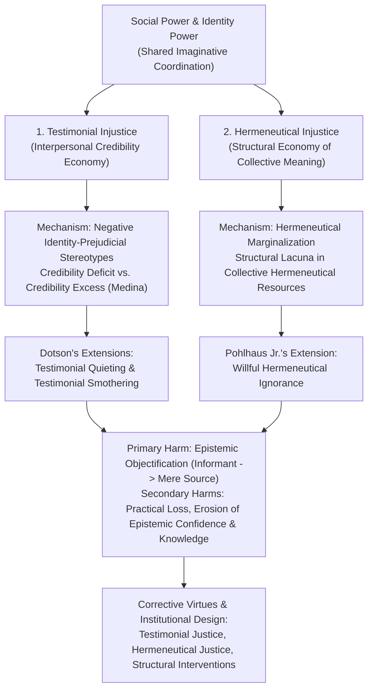
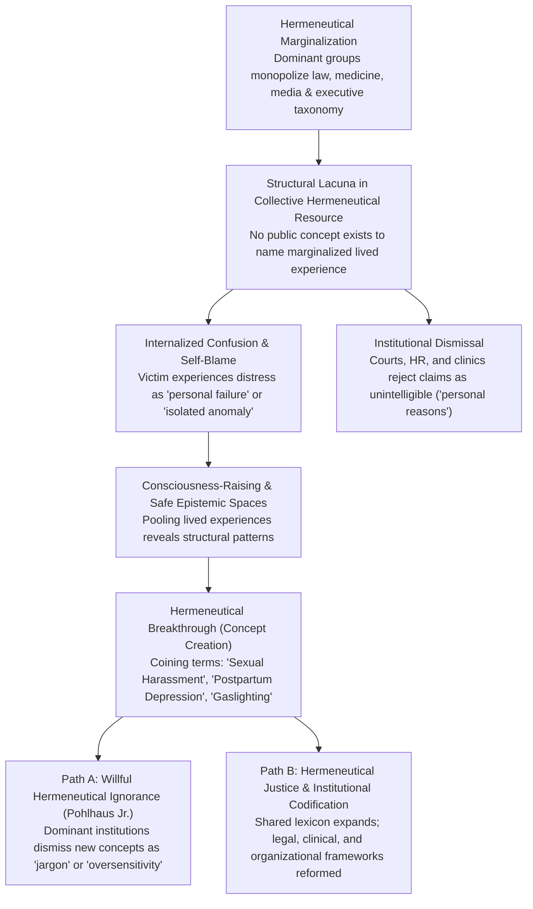

Imagine a high-stakes engineering review or corporate boardroom meeting. A junior analyst or female engineer raises a carefully reasoned warning about a latent structural vulnerability in the system architecture. The room responds with tepid silence, a patronizing smile, or a dismissive remark: *"Let's not get ahead of ourselves—we need hard facts, not anxiety."* Fifteen minutes later, a senior male executive restates the exact same technical concern in slightly different phrasing. Instantly, the atmosphere shifts: colleagues nod vigorously, take notes, and praise his penetrating strategic foresight.

Or consider a clinical examination room in which a patient describes debilitating, persistent physical pain, only to have the physician attribute the report to "stress," "somatization," or "emotional exaggeration"—delaying the diagnosis of a severe autoimmune disease by nearly a decade. Or consider a workplace survivor of systemic mistreatment who tries to explain why she was forced to resign, yet because her society has not yet forged a legal or linguistic concept for what happened to her, her experience is dismissed by institutional authorities—and even partially confused in her own mind—as a "private interpersonal misunderstanding."

Why does <strong>the exact same propositional content and evidential weight receive radically different degrees of belief depending on *who* utters it</strong>? And why do the lived realities of certain social groups remain trapped in conceptual blind spots, lacking the very vocabulary required to render them intelligible to the wider public?

In 2007, the British philosopher <strong>Miranda Fricker</strong> published her landmark monograph *Epistemic Injustice: Power and the Ethics of Knowing* (Oxford University Press), fundamentally transforming contemporary philosophy. Before Fricker, mainstream analytic epistemology largely operated with a formal, disembodied abstraction: *"Subject $S$ knows that proposition $p$ if and only if..."* In this classical schema, the knower $S$ was treated as a featureless, interchangeable placeholder, stripped of gender, race, class, accent, institutional rank, and bodily vulnerability.

Integrating insights from feminist epistemology (Lorraine Code, Patricia Hill Collins) and social epistemology, Fricker demonstrated that human knowledge practices are inextricably embedded within fields of social power. Consequently, there exists a distinctive class of ethical and epistemic wrong: <strong>Epistemic Injustice</strong>, defined as <strong>a wrong done to someone specifically in their capacity as a knower</strong>.

In this comprehensive study, we examine the full theoretical architecture of epistemic injustice: Fricker's twin pillars of <strong>Testimonial Injustice</strong> and <strong>Hermeneutical Injustice</strong>; canonical literary and historical case studies (*The Talented Mr. Ripley*, *To Kill a Mockingbird*, and Carmita Wood's 1975 struggle prior to the coining of "sexual harassment"); formal Bayesian and signal-detection models of biased credibility updating; critical extensions by José Medina, Kristie Dotson, and Gaile Pohlhaus Jr.; and contemporary manifestations across clinical medicine, organizational governance, and Large Language Models (LLMs).

---

## 1. The Architecture of Epistemic Injustice: Where Ethics and Epistemology Converge

When philosophers and legal theorists speak of "injustice," they traditionally focus on <strong>distributive injustice</strong> (the unfair allocation of material goods, wealth, or opportunities) or <strong>procedural injustice</strong> (the violation of due process and equal treatment before the law). By contrast, <strong>epistemic injustice</strong> targets a person's status as an epistemic agent—a subject capable of acquiring knowledge, conveying knowledge to others through testimony, and making sense of their own social experiences.

Fricker divides epistemic injustice into two foundational categories, each operating at a different level of our social-epistemic economy:

1. <strong>Testimonial Injustice</strong>: Occurs in interpersonal communicative exchanges when a hearer's <strong>identity prejudice</strong> causes them to give a deflated level of credibility (a <strong>credibility deficit</strong>) to a speaker's word.
2. <strong>Hermeneutical Injustice</strong>: Occurs at a prior, structural stage when a gap in society's shared pool of interpretive concepts (the <strong>collective hermeneutical resource</strong>)—caused by the historical exclusion of marginalized groups from meaning-making professions—puts someone at an unfair disadvantage when trying to comprehend and communicate a significant area of their own social experience.

The structural relationship between social power, these two primary mechanisms, their theoretical extensions, and their corrective remedies is mapped in the diagram below:

As this architecture illustrates, epistemic injustice is never merely an accidental communication breakdown or an isolated moral failing. It is a systemic distortion in how human communities generate, validate, and distribute knowledge.

---

## 2. The Anatomy of Social Power and Identity Power

To understand how power infiltrates the seemingly neutral act of believing or doubting a speaker, Fricker begins by defining <strong>social power</strong>: *"a practically socially situated capacity to control others' actions, where this capacity may be exercised (actively or passively) by particular social agents, or alternatively, it may operate purely structurally."*

Drawing partly on Michel Foucault's analysis of dispersed power relations while retaining an analytic commitment to moral agency, Fricker highlights that power does not require an explicit command or threat. It frequently operates through shared social imagination—shared conceptions of what it means to be a man or a woman, a citizen or a foreigner, a credentialed physician or an chronically ill patient.

Fricker terms this specific operation of power <strong>Identity Power</strong>:

> <strong>Identity Power</strong> is a form of social power which is directly dependent upon shared social-imaginative conceptions of the social identities of those implicated in the particular operation of power.

### Heuristics, Stereotypes, and Culpable Identity Prejudice

In everyday life, our dependence on the testimony of others is near-total. Because no hearer can independently verify every empirical claim made by colleagues, witnesses, or fellow citizens, epistemic cooperation requires a rapid, spontaneous perceptual mechanism to assess a speaker's <strong>trustworthiness</strong>, which consists of two components:
- <strong>Competence</strong>: Does the speaker genuinely know the truth regarding proposition $p$?
- <strong>Sincerity</strong>: Is the speaker conveying what they believe honestly, without deception or hidden agenda?

To make these real-time judgments, hearers inevitably rely on <strong>stereotypes</strong>—widely held associations between a given social group and one or more attributes—as cognitive heuristics. Many stereotypes are empirically reliable and epistemically benign (e.g., assuming that a certified structural engineer knows more about load-bearing beams than a layperson).

However, testimonial exchange becomes corrupted when the hearer's spontaneous credibility judgment is shaped by a <strong>negative identity-prejudicial stereotype</strong>, which Fricker defines with precision:

> A <strong>negative identity-prejudicial stereotype</strong> is a widely held disparaging association between a social group and one or more attributes, where this association embodies a generalization that displays some (typically, epistemically culpable) resistance to counter-evidence owing to an ethically bad affective investment.

Crucially, Fricker notes that such prejudices frequently operate *beneath* the threshold of conscious belief, residing instead in the <strong>collective social imagination</strong>. A self-described egalitarian judge, scientist, or manager may sincerely endorse the propositional belief that all demographic groups possess equal rational capacity, yet still harbor residual, unexamined perceptual habits that frame a marginalized speaker's tone as "defensive," "unreliable," "overly emotional," or "lacking gravitas."

---

## 3. Testimonial Injustice: Credibility Deficits, Excesses, and Canonical Case Studies

The central case of <strong>Testimonial Injustice</strong> occurs when a speaker suffers a <strong>credibility deficit</strong> owing to an identity prejudice in the hearer.

Fricker distinguishes between <strong>incidental</strong> and <strong>systematic</strong> testimonial injustice:
- <strong>Incidental Testimonial Injustice</strong> stems from localized prejudices that do not follow the victim beyond a narrow domain (for example, an academic researcher whose methodology is unfairly dismissed by a dogmatic conference panel, but who suffers no loss of civic or legal standing outside the university).
- <strong>Systematic Testimonial Injustice</strong> is driven by <strong>tracker prejudices</strong>—prejudices relating to social identity (gender, race, class, disability, caste) that *track* the subject through multiple dimensions of social activity: economic, educational, professional, sexual, legal, political, and medical.

To illuminate how systematic testimonial injustice operates in concrete human interactions, Fricker examines two famous literary-historical scenes.

### Case Study 1: Herbert Greenleaf and Marge Sherwood in *The Talented Mr. Ripley*

In Patricia Highsmith's novel *The Talented Mr. Ripley* (and Anthony Minghella's 1999 screenplay), the wealthy young American Dickie Greenleaf disappears mysteriously in Italy after being murdered by the sociopathic social climber Tom Ripley, who subsequently impersonates him and forges a suicide note.

Dickie's fiancée, <strong>Marge Sherwood</strong>, knows Dickie's habits, character, and attachments intimately. When she discovers Dickie's prized rings in Tom Ripley's possession—rings Dickie had sworn never to remove—and observes the glaring inconsistencies in Tom's narrative, she constructs a lucid, evidence-based inductive inference: Dickie did not commit suicide; Tom Ripley murdered him.

Yet when Marge attempts to communicate her findings to Dickie's father, the wealthy industrialist <strong>Herbert Greenleaf</strong>, she is met with patronizing dismissal. Taken in by Tom's deferential charm and operating within the patriarchal assumptions of 1950s gender norms, Herbert silences her with a devastating line:

> <strong>"Marge, there's female intuition, and then there are facts."</strong>

This exchange exemplifies how identity power executes testimonial injustice without overt hostility. Herbert Greenleaf is not shouting at Marge; he views himself as being gentle and protective toward a "grief-stricken, hysterical young woman." Yet by invoking the stereotype of *female intuition* contrasted against *facts*, he strips Marge's rational inference of its epistemic status, demoting a sharp evidential deduction into emotional delusion and expelling her from the collaborative inquiry into the truth.

### Case Study 2: Tom Robinson on Trial in *To Kill a Mockingbird*

A far deadlier manifestation of systematic testimonial injustice unfolds in Harper Lee's *To Kill a Mockingbird* (1960), set in 1935 Maycomb County, Alabama. <strong>Tom Robinson</strong>, a young Black man, is falsely accused of raping Mayella Ewell, a poor white woman.

At trial, defense attorney Atticus Finch establishes beyond any rational doubt that Tom Robinson is innocent: Mayella's bruises were inflicted by a left-handed assailant (her abusive father, Bob Ewell), whereas Tom's left arm was mangled in a cotton gin accident during childhood, leaving it twelve inches shorter than his right and entirely useless.

However, during cross-examination, the prosecutor Mr. Gilmer asks Tom why he repeatedly helped Mayella with her chores without payment. Speaking with complete honesty, Tom replies:

> <strong>"I felt right sorry for her, she seemed to try more'n the rest of 'em—"</strong>

Immediately, a palpable wave of revulsion passes through the all-white jury. Within the racialized hierarchy of Jim Crow Alabama, the notion that a Black man could feel *pity* or *sympathy* for a white woman violated the foundational axioms of white supremacy. The prosecutor seizes on the remark (*"You felt sorry for her, you felt sorry for her?"*). Blinded by visceral racial prejudice, the jurors are cognitively incapable of registering Tom's sincerity or processing the exculpatory physical facts. They convict him, leading directly to his fatal shooting during an attempted escape.

### José Medina's Relational Critique: Credibility Excess and Epistemic Vices

In her 2007 formulation, Fricker argued that because credibility is not a scarce distributive resource like land or money, giving someone a <strong>credibility excess</strong> (more credibility than the evidence warrants) does not directly cause a testimonial injustice on the spot.

In *The Epistemology of Resistance: Gender and Racial Oppression, Epistemic Injustice, and the Social Imagination* (2013), philosopher <strong>José Medina</strong> challenged this non-distributive assumption. Medina demonstrated that in virtually all real-world social arenas—courtrooms, hiring committees, clinical consultations, corporate boards—<strong>credibility assessments are inherently relational, comparative, and proportional</strong>.

In Maycomb County's courtroom, Tom Robinson's fatal credibility deficit was directly coupled to the unearned <strong>credibility excess</strong> bestowed upon Bob and Mayella Ewell simply by virtue of their whiteness. Moreover, Medina showed that habitual credibility excess inflicts severe <strong>epistemic vices</strong> upon privileged speakers themselves:
- <strong>Epistemic Arrogance</strong>: The delusional presumption that one's own perspective is authoritative and beyond challenge.
- <strong>Epistemic Laziness</strong>: A lack of motivation to verify facts or investigate alternative viewpoints because one's assertions are accepted without scrutiny.
- <strong>Closed-Mindedness</strong>: Active defensiveness against dissenting evidence from subordinates.

The table below synthesizes the distinct modalities of testimonial distortion:

| Modality of Testimonial Distortion | Credibility Impact | Underlying Mechanism | Paradigm Examples |
| :--- | :--- | :--- | :--- |
| <strong>Systematic Credibility Deficit</strong> | Severe downward discounting ($\delta_{	ext{bias}} \gg 0$) | <strong>Tracker prejudices</strong> (gender, race, class, disability) operating across legal, economic, and professional spheres | Tom Robinson's trial testimony; Marge Sherwood's rational inference dismissed as "female intuition" |
| <strong>Incidental Credibility Deficit</strong> | Localized downward discounting | Non-tracking prejudice confined to a narrow institutional or subcultural pocket | A scientist's valid findings dismissed at a single conference due to a reviewer's methodological dogmatism |
| <strong>Privileged Credibility Excess</strong> *(Medina)* | Unwarranted inflation ($\gamma_{	ext{excess}} > 1$) | Halo effect of elite credentials, dominant identity, or institutional charisma | A charismatic executive's unsubstantiated hunch treated as gospel, breeding epistemic arrogance |
| <strong>Pre-emptive Testimonial Injustice</strong> *(Fricker)* | Total exclusion prior to speech ($w_S = 0$) | Structural prejudice determines in advance that a group's perspective is not worth soliciting | Excluding front-line workers, patients, or marginalized communities from policy design and safety inquiries |

---

## 4. Formal Epistemology and Bayesian Modeling of Testimonial Distortion

To see with mathematical clarity how testimonial injustice corrupts rational belief formation and collective intelligence, we can formalize the hearer's belief update using <strong>Bayesian epistemology</strong> and signal-detection theory (building on Alvin Goldman, Luc Bovens & Stephan Hartmann, and Erik Olsson).

Suppose a decision-maker (Hearer $H_{	ext{agent}}$) is evaluating a binary hypothesis $H \in \{0, 1\}$ (e.g., *"The reactor seal is defective,"* *"The patient has an autoimmune disorder,"* or *"The suspect is innocent"*), with prior probability $P(H) \in (0, 1)$.

When Speaker $S$ delivers testimony $E_S$ asserting that $H$ is true, standard Bayesian updating yields the posterior probability:

$$P(H \mid E_S) = rac{P(E_S \mid H) P(H)}{P(E_S \mid H) P(H) + P(E_S \mid 
eg H) P(
eg H)}$$

The evidential force of $E_S$ is governed entirely by the speaker's objective <strong>likelihood ratio</strong> $\Lambda_S$:

$$\Lambda_S = rac{P(E_S \mid H)}{P(E_S \mid 
eg H)} = rac{c_S}{f_S}$$

where:
- $c_S = P(E_S \mid H) \in (0, 1)$ represents the speaker's <strong>competence / sensitivity</strong> (the probability that $S$ asserts $H$ when $H$ is genuinely true).
- $f_S = P(E_S \mid 
eg H) \in (0, 1)$ represents the speaker's <strong>false-alarm / insincerity rate</strong> (the probability that $S$ asserts $H$ due to panic, error, or deception when $H$ is actually false).

For any reliable epistemic informant, $c_S > f_S$, ensuring $\Lambda_S > 1$.

### Modeling the Identity-Prejudice Discount Parameter $\delta_{	ext{bias}}$

When a hearer harbors a negative identity prejudice against Speaker $S$'s social group, the hearer does not update on the objective parameters $(c_S, f_S)$. Instead, identity prejudice introduces a distortion parameter $\delta_{	ext{bias}} \in [0, 1]$ that simultaneously <strong>deflates perceived competence</strong> ($\hat{c}_S < c_S$) and <strong>inflates perceived false-alarm / emotional noise</strong> ($\hat{f}_S > f_S$):

$$\hat{c}_S = (1 - \delta_{	ext{bias}}) c_S + \delta_{	ext{bias}} f_S$$

$$\hat{f}_S = f_S + \delta_{	ext{bias}} (c_S - f_S)$$

Substituting these prejudiced perceptual estimates into the likelihood ratio yields the <strong>perceived likelihood ratio</strong> $\hat{\Lambda}_S(\delta_{	ext{bias}})$:

$$\hat{\Lambda}_S(\delta_{	ext{bias}}) = rac{\hat{c}_S}{\hat{f}_S} = rac{(1 - \delta_{	ext{bias}}) c_S + \delta_{	ext{bias}} f_S}{f_S + \delta_{	ext{bias}} (c_S - f_S)}$$

Taking the first derivative with respect to $\delta_{	ext{bias}}$ for $c_S > f_S$:

$$rac{\partial \hat{\Lambda}_S}{\partial \delta_{	ext{bias}}} = rac{-(c_S - f_S)(c_S + f_S)}{\left[f_S + \delta_{	ext{bias}}(c_S - f_S)
ight]^2} < 0$$

This formal model reveals three profound epistemic dynamics:

1. <strong>Unbiased Baseline ($\delta_{	ext{bias}} = 0$)</strong>: $\hat{\Lambda}_S(0) = rac{c_S}{f_S} = \Lambda_S$. The speaker's testimony moves the hearer's credence in exact proportion to its objective evidential merit.
2. <strong>The "Restatement Threshold" Effect ($0 < \delta_{	ext{bias}} < rac{1}{2}$)</strong>: Suppose an organization requires the posterior probability $P(H \mid E)$ to cross an action threshold $	au_{	ext{act}}$ before launching a safety investigation. When a marginalized engineer ($S_1$, with $\delta_{	ext{bias}} > 0$) speaks first, her discounted likelihood ratio $\hat{\Lambda}_{S_1}$ nudges the posterior from $P_0(H)$ to $P_1(H) < 	au_{	ext{act}}$—producing no organizational action. When a privileged colleague ($S_2$, with $\delta_{	ext{bias}} = 0$ or credibility excess $\gamma_{	ext{excess}} > 1$) repeats the identical point, his un-discounted update easily pushes the credence above $	au_{	ext{act}}$, creating the illusion that *he* alone catalyzed the insight.
3. <strong>Complete Epistemic Objectification ($\delta_{	ext{bias}} = rac{1}{2}$)</strong>: At $\delta_{	ext{bias}} = rac{1}{2}$, both numerator and denominator converge to $rac{c_S + f_S}{2}$, forcing <strong>$\hat{\Lambda}_S\left(rac{1}{2}
ight) = 1$</strong>. Consequently, $P(H \mid E_S) = P(H)$: <strong>the speaker's words are mathematically reduced to pure white noise</strong>. No matter how urgent or accurate the testimony, the hearer's belief remains completely invariant.

### Sequential Multi-Agent Aggregation and Organizational Blindness

In an organization or jury aggregating testimony across $T$ sequential speakers $S_1, S_2, \dots, S_T$, the posterior log-odds ratio takes the additive form:

$$\log rac{P_T(H)}{1 - P_T(H)} = \log rac{P_0(H)}{1 - P_0(H)} + \sum_{t=1}^{T} w_{S_t} \log \Lambda_{S_t}$$

where $w_{S_t} \ge 0$ is the institutional credibility weight assigned to agent $S_t$. In a hierarchy infected by testimonial injustice and credibility excess, front-line technicians, nurses, or minority whistleblowers who directly observe hazardous anomalies ($\log \Lambda_{S_{	ext{front}}} \gg 0$) are assigned near-zero weights ($w_{S_{	ext{front}}} 	o 0$), while a single senior executive insulated from ground truth who asserts that operations are safe ($\log \Lambda_{S_{	ext{exec}}} < 0$) is assigned an inflated weight $w_{S_{	ext{exec}}} = \gamma_{	ext{excess}} \gg 1$. The weighted sum remains negative, blinding the institution to impending catastrophe.

---

## 5. Primary and Secondary Epistemic Harms: Objectification and the Loss of Knowledge

Why does testimonial injustice cut so deeply into human flourishing? Fricker analyzes its impact through a careful distinction between <strong>primary (intrinsic) harms</strong> and <strong>secondary (consequential) harms</strong>.

### The Primary Harm: Epistemic Objectification (Informant vs. Source of Information)

Because human beings are fundamentally rational and social creatures, participating in the spread of knowledge is a constitutive pillar of human value. To be degraded in one's capacity as a knower is therefore to suffer an intrinsic symbolic and ethical wound.

To pinpoint the exact nature of this wound, Fricker adapts a foundational distinction from <strong>Edward Craig's</strong> *Knowledge and the State of Nature* (1990) between treating someone as an <strong>Informant</strong> versus treating them as a mere <strong>Source of Information</strong>:

- <strong>Source of Information</strong>: An observer extracts facts from an entity by treating it as a natural object governed by causal regularities—just as a forester infers a tree's age from its rings, or a detective infers that it is raining from the mud on a suspect's boots. A source of information is an *object* outside the intersubjective space of reasons.
- <strong>Informant</strong>: An interlocutor treats another person as an epistemic peer and fellow subject within the community of rational agents, accepting their assertion through interpersonal trust.

When Herbert Greenleaf dismisses Marge Sherwood's accusation against Tom Ripley, he still treats Marge as a *source of information*—inferring from her agitated speech the "fact" that grief has made her emotionally unstable. What he refuses to do is treat her as an *informant*. Fricker terms this demotion from epistemic subject (Informant) to mere observed thing (Source of Information) <strong>Epistemic Objectification</strong>, establishing a powerful structural parallel to Kantian and feminist critiques of sexual objectification.

### Secondary Harms: Practical Deprivation and the Destruction of Knowledge

Beyond the intrinsic wound of objectification, testimonial injustice generates compounding <strong>secondary harms</strong>:

1. <strong>Practical Secondary Harms</strong>: Wrongful criminal conviction (Tom Robinson), denial of unemployment benefits or career advancement, clinical misdiagnosis, and material impoverishment.
2. <strong>Epistemic Secondary Harms</strong>: When a speaker is persistently subjected to credibility deficits, the external doubt gradually migrates inward, corroding their <strong>epistemic confidence</strong> (self-trust in their own perceptual, memory, and inferential faculties).

This internal erosion produces a startling epistemological consequence. Under standard accounts of knowledge, for subject $S$ to *know* proposition $p$, $S$ must hold a sufficiently confident belief that $p$ is true (or possess the intellectual courage to sustain inquiry). When chronic testimonial injustice undermines $S$'s confidence to the point that $S$ begins to doubt her own judgment (*"Maybe I really am overreacting; maybe I didn't see what I thought I saw"*), <strong>she literally loses knowledge that she previously possessed</strong>. Epistemic injustice thus destroys knowledge twice: first by blocking its transmission to the hearer, and second by extinguishing it within the knower herself.

---

## 6. Kristie Dotson's Extensions: Epistemic Violence, Testimonial Quieting, and Testimonial Smothering

In her seminal 2011 *Hypatia* paper, *"Tracking Epistemic Violence, Tracking Practices of Silencing,"* philosopher <strong>Kristie Dotson</strong> expanded the taxonomy of testimonial oppression by bridging Gayatri Chakravorty Spivak's postcolonial concept of <strong>epistemic violence</strong> with Jennifer Hornsby's philosophy of language.

Hornsby demonstrated that successful linguistic communication requires <strong>reciprocity</strong>: a speaker cannot successfully perform an illocutionary act (such as warning, testifying, or informing) unless the audience possesses the competence and willingness to provide appropriate *uptake*. Dotson defines <strong>epistemic violence</strong> in testimony as *a refusal, intentional or unintentional, of an audience to communicatively reciprocate a linguistic exchange owing to pernicious ignorance*—where <strong>pernicious ignorance</strong> is any reliable ignorance that, in a given context, harms another person.

Dotson identifies two systematic practices of silencing that arise from pernicious ignorance:

### 1. Testimonial Quieting

<strong>Testimonial Quieting</strong> occurs when an audience fails to identify a speaker as a knower at all. Drawing on Black feminist sociologist <strong>Patricia Hill Collins's</strong> *Black Feminist Thought* (2000), Dotson shows how culturally entrenched "controlling images" (stereotypes that cast marginalized speakers as inherently irrational, subservient, or hyper-emotional) preemptively strip speakers of epistemic authority before they even finish a sentence.

### 2. Testimonial Smothering (Coerced Self-Silencing)

Dotson's most influential theoretical contribution is <strong>Testimonial Smothering</strong>: the truncating or withholding of one's own testimony in order to ensure that the testimony contains only content for which one's audience demonstrates testimonial competence.

Unlike overt censorship where a speaker is interrupted, in testimonial smothering the speaker *appears* to choose silence voluntarily. Yet Dotson proves that this silence is a form of coerced epistemic violence that occurs whenever a speaker perceives three interlocking conditions:
1. The content of the testimony is <strong>unsafe and risky</strong> (it carries a high probability of generating social, professional, or psychological harm if misunderstood);
2. The audience demonstrates <strong>testimonial incompetence</strong> regarding the content (an inability to accurately grasp the nuances and structural context of what is being said); and
3. That incompetence stems from <strong>pernicious ignorance</strong> situated in social asymmetries.

For example, when a woman of color considers discussing microaggressions or domestic abuse with an institutional panel that has already signaled hostility or stereotyping toward her community, she may rationally conclude that speaking the full truth will only reinforce damaging stereotypes or trigger retaliation. She therefore "smothers" her own testimony. Similarly, essayist <strong>Rebecca Solnit</strong> in *Men Explain Things to Me* (2014) analyzed how pervasive paternalistic interruption ("mansplaining") trains women and junior colleagues in self-doubt and self-silencing, effectively pricing their voices out of the public square.

---

## 7. Hermeneutical Injustice: When Society Lacks the Words for Your Experience

We now turn to the second grand pillar of Fricker's framework: <strong>Hermeneutical Injustice</strong>.

Whereas testimonial injustice occurs during the interpersonal *exchange* of knowledge, hermeneutical injustice operates at the structural level of <strong>social meaning and conceptual intelligibility</strong>. Fricker defines it as follows:

> <strong>Hermeneutical Injustice</strong> is the injustice of having some significant area of one's social experience obscured from collective understanding owing to a structural identity prejudice in the collective hermeneutical resource.

### Hermeneutical Marginalization and Structural Lacunae

Every society relies on a <strong>collective hermeneutical resource</strong>—a shared repertoire of words, legal categories, psychiatric diagnoses, stock narratives, and interpretive tropes that allow members to make sense of their lives. However, this shared dictionary is not authored equally by all citizens.

Historically, the professions that hold <strong>hermeneutical power</strong>—legislators, judges, physicians, journalists, academic theorists, and corporate executives—have been disproportionately dominated by privileged social strata. Subordinate groups have been subjected to <strong>Hermeneutical Marginalization</strong>: unequal participation in the social practices through which collective meanings are generated.

Because the collective interpretive resource is disproportionately tailored to the experiences of the powerful, it develops systematic blind spots—<strong>hermeneutical lacunae</strong> (gaps or "holes in the ozone layer" of shared meaning)—precisely over those regions of social life where marginalized people endure distinctive forms of exploitation, harassment, or suffering.

### Canonical Case Study 1: Carmita Wood and the Coining of "Sexual Harassment" (1975)

In Chapter 7 of *Epistemic Injustice*, Fricker reconstructs a pivotal historical episode documented in Susan Brownmiller's memoir *In Our Time* (1990): the experience of <strong>Carmita Wood</strong> at Cornell University in 1975.

Carmita Wood was a forty-four-year-old mother of four who worked for eight years as an administrative assistant in Cornell's department of nuclear physics. Throughout her tenure, an eminent professor repeatedly subjected her to unwanted physical and sexual intrusions: jiggling his crotch when standing near her desk, brushing against her breasts while reaching for mail, and cornering her in an elevator to force kisses upon her.

Wood went to extraordinary lengths to avoid him—taking the stairs instead of the elevator and hiding in restrooms—until the chronic stress triggered severe somatic symptoms, including debilitating nerve pain in her neck and back and numbness in her arm. Unable to endure the environment any longer, she resigned.

When Wood applied for state unemployment insurance, the claims investigator asked why she had left her stable university job. At that historical moment in early 1975, <strong>the English language lacked the concept and term "sexual harassment."</strong> Within the prevailing patriarchal hermeneutical resource, the professor's behavior was coded either as harmless "flirting" (if viewed through a male lens) or as an awkward "private romance gone sour." Embarrassed, confused, and lacking any recognized legal or linguistic category to articulate the systemic abuse she had suffered, Wood could only write down that she left for <strong>"personal reasons."</strong> Her claim for unemployment benefits was flatly denied.

The breakthrough occurred when Wood shared her story in a feminist <strong>consciousness-raising seminar</strong> led by Lin Farley at Cornell's Human Affairs Program. As women in the room compared their seemingly "isolated, personal" ordeals, they recognized a ubiquitous structural pattern of workplace coercion. Preparing for a public speak-out and Wood's unemployment appeal in the spring of 1975, Farley and her colleagues brainstormed eight candidate phrases—including "sexual intimidation," "sexual coercion," and "sexual exploitation on the job"—before finally forging the term <strong>"Sexual Harassment."</strong>

Fricker draws a subtle and profound philosophical lesson from Carmita Wood's ordeal:
- <strong>Cognitive Disadvantage is Shared, but Harm is Radically Asymmetric</strong>: Before the concept of *sexual harassment* existed, both the perpetrator (the professor) and the victim (Wood) suffered from hermeneutical lacunae—neither possessed a clear conceptual grasp of the ethical reality of the act. Yet this shared cognitive deficit suited the professor's interests perfectly (allowing him to view his behavior as benign dallying), while inflicting catastrophic psychological, physical, and financial ruin upon Wood.

### Canonical Case Study 2: Wendy Sanford and Postpartum Depression

Fricker pairs Wood's story with that of <strong>Wendy Sanford</strong>, an upper-class woman in the late 1960s who fell into clinical depression following the birth of her son. Before feminist health collectives named and publicized <strong>postpartum depression</strong>, mothers suffering from this condition possessed no medical or social framework to understand their distress; instead, they internalized crippling guilt, believing themselves to be morally defective, unnatural mothers. Discovering the shared concept in a forty-five-minute consciousness-raising group lifted years of solitary shame in a single afternoon.

### Gaile Pohlhaus Jr.: Willful Hermeneutical Ignorance

In a major 2012 paper, *"Relational Knowing and Epistemic Injustice: Toward a Theory of Willful Hermeneutical Ignorance,"* philosopher <strong>Gaile Pohlhaus Jr.</strong> refined Fricker's account. Pohlhaus pointed out that marginalized communities rarely wait passively in total confusion; they actively forge rich subcultural vocabularies and interpretive frameworks to understand their lived reality (e.g., concepts like *white privilege*, *ableism*, *emotional labor*, or *microaggressions*).

The persistence of hermeneutical injustice, Pohlhaus argued, is often driven not by a complete absence of concepts anywhere in society, but by <strong>Willful Hermeneutical Ignorance</strong>: the dominant group's active refusal to learn, validate, or adopt the epistemic resources developed by marginalized knowers, dismissing those concepts as "ideological jargon," "oversensitivity," or "victimhood culture."

The dynamic cycle of hermeneutical marginalization, conceptual invention, and institutional resistance is illustrated below:

To consolidate the theoretical landscape, the table below compares the four core forms of epistemic injustice and epistemic violence:

| Concept | Primary Theorist | Locus of Distortion | Core Mechanism | Experiential Manifestation |
| :--- | :--- | :--- | :--- | :--- |
| <strong>Testimonial Injustice</strong> | Miranda Fricker (2007) | Interpersonal credibility judgment | Hearer's identity prejudice causes a systematic credibility deficit ($\delta_{	ext{bias}} > 0$) | Speaker speaks clearly and truthfully, but is dismissed as emotional, unscientific, or dishonest |
| <strong>Testimonial Smothering</strong> | Kristie Dotson (2011) | Communicative reciprocity & self-censorship | Speaker detects audience's pernicious ignorance and truncates their own testimony to avoid harm | Speaker withholds crucial truth because "speaking up here will only be twisted against me" |
| <strong>Hermeneutical Injustice</strong> | Miranda Fricker (2007) | Collective hermeneutical resource (shared lexicon) | Historical exclusion from meaning-making leaves a conceptual hole (lacuna) over marginalized experience | Subject struggles to render their own suffering intelligible to themselves or to authorities |
| <strong>Willful Hermeneutical Ignorance</strong> | Gaile Pohlhaus Jr. (2012) | Dominant group's uptake of non-dominant concepts | Privileged agents refuse to adopt interpretive tools forged by marginalized communities | Marginalized group names a structural wrong, but dominant authorities mock or ignore the concept |

---

## 8. Epistemic Injustice in Medicine, Organizations, and Algorithmic AI Systems

Over the past decade, epistemic injustice has become an indispensable analytical framework across clinical medicine, organizational theory, and artificial intelligence ethics.

### 1. Healthcare and Psychiatry (Havi Carel & Ian James Kidd)

In a landmark series of papers (2014–2017), philosophers <strong>Havi Carel</strong> and <strong>Ian James Kidd</strong> demonstrated that ill persons and psychiatric patients are uniquely vulnerable to both forms of epistemic injustice:
- <strong>Pathocentric Testimonial Injustice</strong>: Because illness frequently involves pain, fatigue, anxiety, and cognitive distress, clinicians often unconsciously apply negative stereotypes that frame patients as emotionally labile, unreliable narrators of their own bodies. Empirical studies consistently document severe credibility deficits in the clinical treatment of women and racial minorities reporting acute pain, endometriosis, fibromyalgia, myalgic encephalomyelitis (ME/CFS), and Long COVID—resulting in years of diagnostic delay ("medical gaslighting").
- <strong>Biomedical Hermeneutical Injustice</strong>: Modern clinical institutions privilege third-person, quantitative biomarkers and standardized diagnostic checklists while marginalizing first-person phenomenological descriptions of the lived experience of illness. When a patient's suffering cannot be neatly mapped onto an existing ICD/DSM code or lab value, the patient is left hermeneutically stranded.

### 2. Organizational Governance and the Limits of "Psychological Safety"

In contemporary management theory, Amy Edmondson's concept of <strong>Psychological Safety</strong> encourages employees to speak up without fear of retribution. However, social epistemology reveals why psychological safety initiatives frequently fail when divorced from an analysis of epistemic power:
- Encouraging front-line staff to "speak up" accomplishes nothing if leadership suffers from <strong>testimonial vice</strong>—systematically discounting the warnings of lower-ranked technicians, contractors, or minority employees while granting <strong>credibility excess</strong> to senior management's optimistic projections.
- Furthermore, if an organization's reporting dashboards and KPI taxonomies are designed exclusively by executives, front-line employees suffer <strong>organizational hermeneutical injustice</strong>: the official reporting system literally lacks the categories needed to articulate qualitative erosion, ethical drift, or subtle safety hazards.

### 3. Algorithmic Epistemic Injustice in Modern AI and Large Language Models

As decision-making is increasingly delegated to machine learning classifiers and Large Language Models (LLMs), epistemic injustice is being automated and scaled into <strong>Algorithmic Epistemic Injustice</strong>:

1. <strong>Corpus-Level Hermeneutical Marginalization</strong>: Foundation models are trained on web-scale corpora predominantly authored by privileged, Western, English-speaking demographics. Consequently, the high-dimensional embedding space encodes rich semantic granularity for dominant cultural norms while compressing or erasing the linguistic registers, dialects, and conceptual frameworks of marginalized communities.
2. <strong>Automated Credibility Discounting</strong>: Predictive algorithms used in medical triage, credit scoring, fraud detection, and automated resume screening learn historical patterns of human prejudice embedded in training labels. When an algorithm assigns a higher risk or fraud score to applicants from marginalized backgrounds, it executes an automated credibility deficit ($\hat{w}_S \ll w_S$). Worse still, because algorithmic outputs are perceived by institutions as "objective mathematical facts," they create a virtually impenetrable shield of <strong>algorithmic Herbert Greenleafism</strong> (*"There are human complaints, and then there are algorithmic scores"*).

---

## 9. Corrective Virtues and Institutional Design: Toward Epistemic Justice

How can individuals, organizations, and technological systems overcome epistemic injustice? Fricker and subsequent theorists argue for a dual strategy combining <strong>personal virtue epistemology</strong> with <strong>structural institutional design</strong>.

### 1. The Virtue of Testimonial Justice: Reflexive Critical Openness

Because identity prejudices operate subconsciously within our perceptual apparatus, we cannot eliminate them simply by wishing them away. Fricker defines the corrective ethical-intellectual virtue of <strong>Testimonial Justice</strong> as a cultivated, reflexive critical awareness:

> When a virtuous hearer detects a tension between the low credibility they are spontaneously inclined to give a speaker and the speaker's marginalized social identity, they actively neutralize the impact of prejudice by <strong>adjusting their credibility judgment upward</strong>.

In our formal Bayesian framework, the virtuous hearer estimates the likely prejudice discount $\hat{\delta}_{	ext{reflexive}}(I_S, I_H)$ generated by the interaction between the speaker's identity $I_S$ and the hearer's own situated identity $I_H$, applying a conscious corrective boost to the speaker's epistemic weight:

$$w_S^{	ext{corrected}} = 	ext{clip}\left(\hat{w}_S + \hat{\delta}_{	ext{reflexive}}(I_S, I_H), \, 0, \, 1
ight)$$

### 2. The Virtue of Hermeneutical Justice: Listening for the Unsaid

Correspondingly, the virtue of <strong>Hermeneutical Justice</strong> is an alertness to the possibility that a speaker's struggle to make themselves intelligible is not a sign of dishonesty or irrationality, but rather a symptom of an objective gap in our shared interpretive resources. A virtuous hearer practices <strong>proactive, generative listening</strong>—suspending quick dismissal, creating a collaborative conversational space, and helping the speaker forge the concepts needed to articulate their lived reality.

### 3. Structural Epistemic Institutional Design (Elizabeth Anderson)

In her influential 2012 paper, *"Epistemic Justice as a Virtue of Social Institutions,"* philosopher <strong>Elizabeth Anderson</strong> demonstrated that individual virtue, while necessary, is cognitively fragile under time pressure and high cognitive load. Just as distributive justice requires fair tax and legal systems rather than mere personal charity, epistemic justice requires <strong>structural institutional safeguards</strong>:

- <strong>Blind Evaluation Protocols</strong>: Just as the introduction of opaque screens in symphony orchestra auditions dramatically increased the selection of female musicians, organizations should anonymize technical proposals, code reviews, grant applications, and peer reviews wherever feasible to sever identity prejudice from evidential evaluation.
- <strong>Deliberate Amplification Practices</strong>: In meetings and deliberative bodies, allies and leaders can practice structured *amplification*—explicitly crediting and restating insights raised by marginalized or junior colleagues (*"As Sarah just demonstrated with her failure-mode analysis..."*) to prevent testimonial quieting and idea appropriation.
- <strong>Participatory Hermeneutical Spaces</strong>: Healthcare systems, corporations, and AI developers must institutionalize bottom-up forums where patients, front-line workers, and marginalized communities co-design the diagnostic categories, safety metrics, and evaluation benchmarks used to govern them.

---

## Conclusion: Restoring the Knower, Expanding the Space of Reasons

Miranda Fricker's theory of epistemic injustice reveals that the pursuit of truth and the pursuit of ethical justice are not separate endeavors; they are two sides of the exact same coin.

Every time a hearer dismisses a valid argument because of the speaker's accent, gender, rank, or illness, two tragedies occur simultaneously: a human being is degraded from an epistemic subject into a mere object, and the community deprives itself of vital truth. And every time a society refuses to forge or accept the concepts needed to name systemic suffering, it condemns its most vulnerable members to solitary confusion.

Practicing epistemic justice—by auditing our spontaneous credibility judgments, dismantling unwarranted credibility excesses, resisting the urge to smother dissent, and listening intently at the edges of our shared vocabulary where new meanings are struggling to be born—is therefore both a fundamental ethical duty to human dignity and the highest possible realization of rationality itself.
