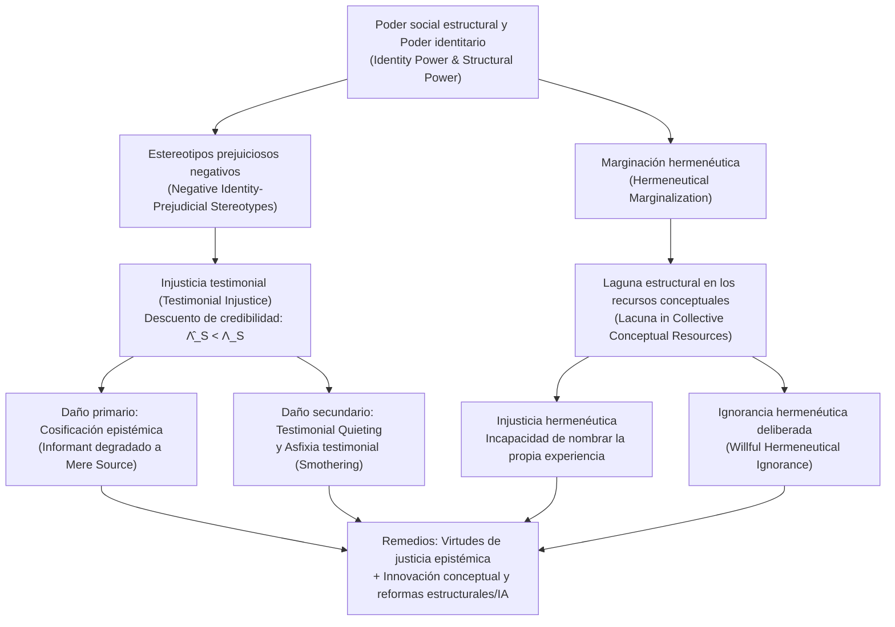

## Introducción: Cuando se niega injustamente la capacidad de ser un «sujeto cognoscente»

En la filosofía política y la ética tradicionales, la «injusticia» suele analizarse a través de dos grandes categorías: por un lado, la <strong>injusticia distributiva</strong>, referida al reparto desigual de recursos materiales, riqueza, atención sanitaria u oportunidades educativas; por otro, la <strong>injusticia procedimental</strong>, vinculada a la parcialidad en los tribunales o en la aplicación de las leyes. Sin embargo, en la estructura profunda de la vida social opera una tercera forma de injusticia, más sutil pero igualmente devastadora: una persona puede ser oprimida no solo porque se le nieguen ingresos o derechos electorales, sino porque, debido a su identidad social, su palabra sufre un descuento sistemático de credibilidad en cuanto abre la boca, o porque en el lenguaje compartido de su sociedad ni siquiera existen los conceptos necesarios para nombrar y comprender el sufrimiento que padece.

En 2007, la filósofa británica <strong>Miranda Fricker</strong> publicó su obra seminal <em>Epistemic Injustice: Power and the Ethics of Knowing</em> (<em>Injusticia epistémica: El poder y la ética del conocimiento</em>), entrelazando por primera vez de forma sistemática la epistemología, la ética y la teoría política del poder. Fricker acuñó el concepto de <strong>injusticia epistémica (Epistemic Injustice)</strong> para designar <strong>el daño que se inflige a alguien específicamente en su condición de sujeto cognoscente (Knower) y transmisor de conocimiento</strong>.

Para comprender por qué no ser creído o carecer de palabras para explicar la propia experiencia no es un mero fallo comunicativo, sino una grave lesión ética y política, debemos adentrarnos en la epistemología social (Social Epistemology). Fricker divide la injusticia epistémica en dos formas fundamentales: la <strong>injusticia testimonial (Testimonial Injustice)</strong>, que ocurre en el intercambio discursivo, y la <strong>injusticia hermenéutica (Hermeneutical Injustice)</strong>, que radica en las lagunas de los recursos conceptuales colectivos. Este artículo examina desde el funcionamiento del poder identitario y la modelización bayesiana del déficit de credibilidad hasta la cosificación epistémica, la asfixia testimonial y la exclusión algorítmica en la medicina contemporánea y en los grandes modelos de lenguaje (LLM).

---

## Capítulo 1: Poder social, poder identitario y la operación epistémica de los estereotipos

### 1.1 Poder social y poder identitario (Identity Power)

La epistemología individualista clásica de corte cartesiano concebía al sujeto del conocimiento como un individuo aislado y abstraído de su contexto histórico-social («el cogito»). En el mundo real, sin embargo, la inmensa mayoría de nuestros conocimientos depende del <strong>testimonio de los demás (Testimony)</strong> y de un repertorio compartido de conceptos lingüísticos. El conocimiento es intrínsecamente social y, por tanto, está atravesado por el <strong>poder social (Social Power)</strong>.

Fricker define el poder social como «la capacidad práctica o potencial que tienen los agentes sociales (individuos o grupos) dentro de un entorno determinado para influir o controlar las acciones y circunstancias de otros agentes». La modalidad específica de poder social que genera directamente la injusticia epistémica es el <strong>poder identitario (Identity Power)</strong>. Este poder no necesita recurrir a la fuerza física ni a decretos administrativos: opera directamente a través de la <strong>imaginación social colectiva (Collective Social Imagination)</strong> —es decir, los guiones culturales compartidos sobre qué significa ser hombre o mujer, blanco o racializado, cisgénero o transgénero, médico o paciente, académico o trabajador manual—. El poder identitario puede ejercerse de forma activa (cuando una figura de autoridad patriarcal silencia a una mujer con un gesto condescendiente) o puramente estructural (cuando un grupo marginado renuncia de antemano a testificar en la esfera pública).

### 1.2 Estereotipos heurísticos frente a estereotipos prejuiciosos de identidad

En la comunicación cotidiana, el oyente (Hearer, $H$) debe evaluar casi instantáneamente la <strong>credibilidad (Credibility)</strong> del hablante (Speaker, $S$). Dado que resulta imposible realizar una auditoría empírica completa del historial de fiabilidad de cada interlocutor antes de cada conversación, la cognición humana recurre inevitablemente a <strong>estereotipos</strong> —asociaciones generalizadas entre un grupo social y determinados rasgos de fiabilidad— como <strong>heurística cognitiva</strong>.

No todo estereotipo es irracional ni inmoral: confiar más en una astrofísica que en un astrólogo respecto a la evolución estelar es una heurística empíricamente fundada. La injusticia testimonial surge cuando el juicio del oyente está distorsionado por un <strong>estereotipo prejuicioso negativo de identidad (Negative Identity-Prejudicial Stereotype)</strong>, que Fricker define con precisión:

> Una generalización o asociación ampliamente extendida acerca de un grupo social que vincula a sus miembros con atributos despectivos (en especial falta de racionalidad, exceso emocional, deshonestidad o inferioridad intelectual), sin base en evidencia empírica objetiva, y que, debido a una carga afectiva (hostilidad, sentimiento de superioridad o interés creado), muestra una fuerte <strong>resistencia a la contra-evidencia (Resistance to Counter-Evidence)</strong>.

---

## Capítulo 2: Injusticia testimonial (Testimonial Injustice): Déficit y exceso de credibilidad

### 2.1 Injusticia testimonial sistemática frente a incidental

Cuando el oyente, debido a un prejuicio contra la identidad social del hablante, otorga a su palabra menos credibilidad de la que merece según la evidencia disponible, el hablante sufre un <strong>déficit de credibilidad (Credibility Deficit)</strong>. Fricker distingue dos modalidades:

1. <strong>Injusticia testimonial incidental (Incidental Testimonial Injustice)</strong>: Proviene de un prejuicio localizado y no estructural (por ejemplo, un tribunal académico que desconfía infundadamente de los entomólogos especializados en cierto insecto poco común). Aunque es injusto, ese prejuicio no persigue al investigador en otros ámbitos de su vida (en los juzgados, en el hospital o al pedir una hipoteca).
2. <strong>Injusticia testimonial sistemática (Systematic Testimonial Injustice)</strong>: Constituye el <strong>caso central (Central Case)</strong> de la teoría. Aquí el prejuicio identitario (racismo, sexismo, clasismo, capacitismo) <strong>persigue o rastrea (Tracks)</strong> al sujeto a través de múltiples dimensiones de la estructura social —económica, jurídica, política, educativa y médica—. Es este rastreo sistemático transversal lo que convierte un sesgo epistémico en una maquinaria de opresión estructural.

### 2.2 Dos casos literarios e históricos clásicos: Marge Sherwood y Tom Robinson

Para mostrar cómo opera la injusticia testimonial sistemática, Fricker examina dos escenas literarias emblemáticas:

* <strong>Marge Sherwood en <em>El talento de Mr. Ripley</em> (<em>The Talented Mr. Ripley</em>)</strong>: En la Italia de los años cincuenta, el joven adinerado Dickie Greenleaf es asesinado por Tom Ripley. Su prometida, Marge Sherwood, conoce a fondo el carácter y las costumbres de Dickie. Al descubrir los anillos de Dickie en poder de Ripley y atar cabos entre diversas anomalías, deduce de forma impecablemente racional que Dickie jamás se habría suicidado y que Ripley lo ha matado. Sin embargo, el padre de Dickie, Herbert Greenleaf, desestima su razonamiento con una frase paternalista lapidaria: <strong>«Marge, existe la intuición femenina, y luego están los hechos (Marge, there's female intuition, and then there are facts).»</strong> El estereotipo patriarcal que codifica a las mujeres como seres emocionales, histéricos y carentes de lógica lleva a Herbert a rebajar una inferencia racional rigurosa a mera «intuición femenina», imponiendo a Marge un grave déficit de credibilidad.
* <strong>Tom Robinson en <em>Matar a un ruiseñor</em> (<em>To Kill a Mockingbird</em>)</strong>: En el Alabama de 1935, el joven campesino negro Tom Robinson es acusado falsamente de violar a una mujer blanca, Mayella Ewell. Su abogado defensor, Atticus Finch, demuestra mediante pruebas físicas irrefutables (el brazo izquierdo de Tom está completamente lisiado) que era físicamente imposible que él causara las heridas de la denunciante. Pero cuando el fiscal pregunta a Tom por qué ayudaba regularmente a Mayella sin cobrar nada, Tom responde con honestidad: «Sentía mucha lástima por ella (I felt right sorry for her).» Dentro de la estructura de poder identitario supremacista blanco de la era de Jim Crow, que un hombre negro osara sentir compasión por una mujer blanca provoca una furia racial inmediata en el jurado íntegramente blanco; sumado al prejuicio racista de que todos los hombres negros mienten en cuestiones sexuales, el jurado es incapaz (y se niega) a creer el testimonio de Tom, declarándolo culpable y conduciéndolo a la muerte.

### 2.3 Exceso de credibilidad (Credibility Excess) y vicios epistémicos

La contraparte del déficit de credibilidad es el <strong>exceso de credibilidad (Credibility Excess)</strong>: cuando un hablante recibe, por su identidad social privilegiada (hombre blanco, adinerado, con títulos de élite), una confianza superior a la que justifican sus pruebas y su competencia real.

Como argumentó el filósofo <strong>José Medina</strong> en <em>The Epistemology of Resistance</em> (2013), la credibilidad es un <strong>concepto relacional, comparativo y competitivo</strong>. En un juicio o en una consulta médica, otorgar un exceso de credibilidad al privilegiado (como a Tom Ripley o a la familia Ewell) equivale directamente a despojar de credibilidad al marginado. Además, vivir permanentemente rodeado de un exceso de credibilidad corrompe el carácter epistémico de los privilegiados y engendra tres <strong>vicios epistémicos (Epistemic Vices)</strong>:
1. <strong>Arrogancia epistémica (Epistemic Arrogance)</strong>: La ilusión de omnisciencia e infalibilidad cognitiva.
2. <strong>Pereza epistémica (Epistemic Laziness)</strong>: La falta de motivación para investigar las propias lagunas de privilegio y la realidad de los oprimidos.
3. <strong>Cerrazón mental (Closed-mindedness)</strong>: El rechazo defensivo ante cualquier testimonio que cuestione el orden establecido.

---

## Capítulo 3: Modelo formal bayesiano del descuento de credibilidad

Podemos formalizar con precisión matemática el déficit y el exceso de credibilidad mediante la <strong>actualización bayesiana de creencias (Bayesian Belief Updating)</strong>.

Supongamos que un oyente asigna una probabilidad a priori $P(H) \in (0, 1)$ a una proposición $H$ (por ejemplo: «La paciente sufre un infarto agudo» o «El acusado es inocente»). El hablante $S$ aporta el testimonio $E_S$ a favor de $H$. Según el teorema de Bayes, la probabilidad a posteriori viene dada por:

$$P(H \mid E_S) = \frac{P(E_S \mid H) P(H)}{P(E_S \mid H) P(H) + P(E_S \mid \neg H) P(\neg H)}$$

Sea $c_S = P(E_S \mid H)$ la fiabilidad objetiva del hablante cuando $H$ es verdadera (combinando <strong>competencia Competence</strong> y <strong>sinceridad Sincerity</strong>), y sea $f_S = P(E_S \mid \neg H)$ la tasa de falsos positivos (error o engaño) cuando $H$ es falsa. La <strong>razón de verosimilitud (Likelihood Ratio)</strong> objetiva del testimonio es:

$$\Lambda_S = \frac{P(E_S \mid H)}{P(E_S \mid \neg H)} = \frac{c_S}{f_S}$$

En un agente epistémico ideal libre de prejuicios, la estimación subjetiva $\hat{\Lambda}_S$ coincide con $\Lambda_S$. Sin embargo, cuando el oyente está dominado por un parámetro de prejuicio identitario negativo $\delta_{\text{bias}} \in [0, 1]$ contra el grupo social de $S$, subestima la competencia y sinceridad del hablante y sobreestima su propensión al error o la mentira, degradando la razón de verosimilitud percibida a:

$$\hat{\Lambda}_S(\delta_{\text{bias}}) = \frac{(1 - \delta_{\text{bias}}) c_S + \delta_{\text{bias}} f_S}{f_S + \delta_{\text{bias}} (c_S - f_S)}$$

De esta formulación se desprenden tres consecuencias fundamentales:
* Cuando $\delta_{\text{bias}} = 0$ (sin prejuicios), $\hat{\Lambda}_S(0) = \frac{c_S}{f_S} = \Lambda_S$: la actualización de creencias es justa y racional.
* Cuando $0 < \delta_{\text{bias}} < 1$ y $c_S > f_S$, se cumple estrictamente $\hat{\Lambda}_S(\delta_{\text{bias}}) < \Lambda_S$, lo que provoca una creencia a posteriori inferior a la debida: $\hat{P}(H \mid E_S) < P^*(H \mid E_S)$. La diferencia $\Delta C_S = \Lambda_S - \hat{\Lambda}_S(\delta_{\text{bias}}) > 0$ cuantifica el <strong>déficit de credibilidad</strong>.
* Cuando $\delta_{\text{bias}} \to 1$ (prejuicio absoluto, como en el jurado de <em>Matar a un ruiseñor</em>), $\hat{\Lambda}_S(1) = 1$, de modo que $\hat{P}(H \mid E_S) = P(H)$: el testimonio sufre una <strong>anulación epistémica total (Epistemic Nullification)</strong>.

Expresado en logaritmo de probabilidades (Log-Odds) tras $T$ testimonios:

$$\log \frac{P_T(H)}{1 - P_T(H)} = \log \frac{P_0(H)}{1 - P_0(H)} + \sum_{t=1}^{T} w_{S_t} \log \Lambda_{S_t}$$

Cuando los pesos identitarios de los grupos marginados se deprimen sistemáticamente ($w_M \ll 1$) y los de los privilegiados se amplifican ($w_P > 1$), el acervo de conocimiento público converge inevitablemente hacia los sesgos de la élite dominante.

---

## Capítulo 4: Daños profundos: De la cosificación epistémica a la asfixia testimonial

### 4.1 El daño primario: Cosificación epistémica (Epistemic Objectification)

Fricker distingue entre el <strong>daño primario (intrínseco)</strong> y los <strong>daños secundarios (consecuenciales)</strong> de la injusticia testimonial. El daño primario ataca el núcleo mismo de la dignidad humana: dado que la racionalidad y la capacidad de compartir conocimiento nos definen como personas, ser degradado como sujeto cognoscente por un prejuicio identitario supone una deshumanización simbólica.

Apoyándose en la distinción formulada por el filósofo <strong>Edward Craig</strong> en <em>Knowledge and the State of Nature</em> (1990), Fricker diferencia entre:
* <strong>Informante (Informant)</strong>: Un sujeto racional tratado como interlocutor legítimo dentro de la comunidad epistémica.
* <strong>Mera fuente de información (Mere Source of Information)</strong>: Un objeto o estado natural —como los anillos de un tronco que revelan la edad del árbol o unas huellas en el barro— del cual extraemos datos empíricos sin reconocerle agencia racional ni autoridad discursiva.

Cuando Herbert Greenleaf trata las deducciones de Marge únicamente como «síntomas emocionales de una mujer alterada», la degrada de <em>informante</em> a <em>mera fuente de información</em>. Esta es la <strong>cosificación epistémica (Epistemic Objectification)</strong>, paralela a la cosificación sexual en la ética kantiana.

### 4.2 Daños secundarios, silenciamiento (Quieting) y asfixia testimonial (Smothering)

Los daños secundarios abarcan perjuicios <strong>prácticos</strong> (condenas injustas, negligencia médica letal, exclusión laboral) y <strong>epistémicos</strong>: la erosión continua de la <strong>confianza epistémica (Epistemic Confidence)</strong> hace que la víctima dude de sus propias creencias justificadas y llegue a <strong>perder conocimientos que realmente poseía</strong>.

La filósofa feminista negra estadounidense <strong>Kristie Dotson</strong> (2011) identificó dos mecanismos adicionales de violencia epistémica:
1. <strong>Silenciamiento testimonial (Testimonial Quieting)</strong>: El público, dominado por «imágenes de control» estereotipadas (Controlling Images, según Patricia Hill Collins), ni siquiera llega a reconocer a la hablante como sujeto cognoscente.
2. <strong>Asfixia testimonial (Testimonial Smothering)</strong>: Una <strong>autocensura forzada</strong>. Cuando la hablante marginada advierte que su testimonio es complejo y arriesgado, y que el oyente padece una evidente <strong>incompetencia testimonial (Testimonial Incompetence)</strong> que lo llevará a tergiversar sus palabras en contra de su propia comunidad (por ejemplo, una mujer perteneciente a una minoría racial que calla episodios de violencia doméstica ante policías o medios racistas para no alimentar la estigmatización de su grupo), opta por truncar su propio discurso. A ello se suma el fenómeno del <strong>«mansplaining»</strong> analizado por <strong>Rebecca Solnit</strong> (2014), donde el exceso de credibilidad masculino y el déficit femenino colisionan en la vida cotidiana.

---

## Capítulo 5: Injusticia hermenéutica (Hermeneutical Injustice) e ignorancia voluntaria

### 5.1 Marginación hermenéutica y lagunas conceptuales

Mientras que la injusticia testimonial acontece en el acto comunicativo entre individuos, la <strong>injusticia hermenéutica (Hermeneutical Injustice)</strong> opera en un nivel estructural previo: en el repertorio de los <strong>recursos hermenéuticos colectivos (Collective Hermeneutical Resources)</strong> —el vocabulario, los conceptos jurídicos y los marcos de interpretación compartidos por toda la sociedad—.

Dado que los grupos privilegiados han monopolizado históricamente las prácticas generadoras de significado (legislación, medicina, periodismo, academia), los grupos subordinados han sufrido una <strong>marginación hermenéutica (Hermeneutical Marginalization)</strong>: una participación desigual en la creación de conceptos públicos. Como resultado, el diccionario social presenta <strong>lagunas hermenéuticas (Hermeneutical Lacunae)</strong> exactamente allí donde deberían nombrarse las experiencias de opresión de los vulnerables.

Fricker define la injusticia hermenéutica como <strong>la injusticia de que una parcela significativa de la experiencia social de un sujeto quede oscurecida para su propia comprensión y la de los demás debido a una laguna estructuralmente prejuiciosa en los recursos hermenéuticos colectivos.</strong>

### 5.2 Carmita Wood y el nacimiento del concepto de «acoso sexual»

El caso paradigmático expuesto por Fricker es el de <strong>Carmita Wood</strong> en 1975. Empleada administrativa en el departamento de física nuclear de la Universidad de Cornell, Wood soportó durante años tocamientos no deseados, insinuaciones obscenas y acorralamientos por parte de un prestigioso profesor. Aquejada de graves dolores crónicos por el estrés, acabó renunciando a su puesto. Pero cuando acudió a solicitar el subsidio de desempleo y tuvo que especificar en el formulario la causa de su baja, se topó con un vacío conceptual absoluto: en el inglés y el derecho estadounidense de 1975 solo existían términos como «coqueteo de oficina (flirting)» o el delito extremo de «violación», pero <strong>ninguna palabra para nombrar el hostigamiento sexual sistemático en el trabajo</strong>. Tuvo que anotar «motivos personales» y su solicitud fue denegada.

Fue al integrarse en un grupo feminista de concienciación (<em>Consciousness-Raising Group</em>) impulsado por <strong>Lin Farley</strong> cuando Wood y otras mujeres descubrieron que compartían el mismo calvario y acuñaron colectivamente un nuevo concepto: <strong>«acoso sexual» (Sexual Harassment)</strong>. Colmar aquella laguna hermenéutica permitió comprender y combatir legalmente la violencia sufrida, tal como ocurrió con términos como «depresión posparto», «gaslighting», «microagresión» o «neurodiversidad».

### 5.3 Ignorancia hermenéutica deliberada (Willful Hermeneutical Ignorance)

Como han señalado <strong>Gaile Pohlhaus Jr.</strong> (2012) y Kristie Dotson, los grupos marginados suelen desarrollar dentro de sus propias comunidades ricos recursos conceptuales alternativos. El problema radica a menudo en que los grupos dominantes <strong>se niegan activamente a aprender, reconocer o adoptar las herramientas conceptuales ya creadas por los oprimidos</strong>, fenómeno que Pohlhaus denomina <strong>ignorancia hermenéutica deliberada (Willful Hermeneutical Ignorance)</strong> y Dotson llama <strong>injusticia contributiva (Contributory Injustice)</strong>.

---

## Capítulo 6: Fronteras contemporáneas: Medicina clínica e Inteligencia Artificial (IA)

| Dimensión | Injusticia testimonial | Injusticia hermenéutica | Ignorancia hermenéutica deliberada / Contributiva |
| :--- | :--- | :--- | :--- |
| <strong>Nivel operativo</strong> | Intercambio discursivo y evaluación de pruebas | Repertorio colectivo de conceptos y lenguaje | Exclusión de poder entre sistemas conceptuales |
| <strong>Causa directa</strong> | Prejuicio identitario negativo en el oyente ($\delta_{\text{bias}} > 0$) | Exclusión de las prácticas generadoras de sentido | Negativa privilegiada a adoptar conceptos minoritarios |
| <strong>Mecanismo clave</strong> | Déficit ($\hat{\Lambda}_S < \Lambda_S$) y exceso de credibilidad | Laguna hermenéutica (Hermeneutical Lacuna) | Defensa cognitiva y monopolio epistémico |
| <strong>Casos típicos</strong> | Marge Sherwood, Tom Robinson, desdén del dolor médico | Carmita Wood antes del término «acoso sexual» (1975) | Negación del racismo estructural o síndromes crónicos |
| <strong>Vías de corrección</strong> | Conciencia crítica reflexiva, virtud testimonial | Grupos de concienciación, innovación conceptual | Humildad epistémica, reforma institucional y de LLM |

### 6.1 Injusticia epistémica en la medicina clínica y la psiquiatría

Las investigaciones de <strong>Havi Carel</strong> e Ian James Kidd han demostrado cómo el sistema sanitario reproduce ambas injusticias:
* <strong>Descuento sistemático del testimonio del paciente</strong>: Los informes de dolor agudo de mujeres, minorías raciales o pacientes con enfermedades crónicas invisibles (endometriosis, fibromialgia, COVID persistente) son descartados con mucha mayor frecuencia como «ansiedad» o «exageración» que los de pacientes varones blancos.
* <strong>Alienación hermenéutica</strong>: Las escalas biomédicas estandarizadas suelen silenciar la experiencia fenomenológica subjetiva del enfermo.

### 6.2 Injusticia epistémica algorítmica en los Grandes Modelos de Lenguaje (LLM)

En la era de la inteligencia artificial generativa, la injusticia epistémica se codifica en los <strong>grandes modelos de lenguaje (LLM)</strong> y en los sistemas automatizados de decisión:
1. <strong>Injusticia testimonial automatizada</strong>: Los algoritmos de triaje médico, riesgo crediticio o evaluación judicial entrenados con datos históricos sesgados asignan automáticamente menor peso de credibilidad a las declaraciones de colectivos vulnerables.
2. <strong>Borrado hermenéutico algorítmico</strong>: Dado que los corpus de entrenamiento y el alineamiento (RLHF) de los LLM están masivamente dominados por el inglés y los marcos conceptuales hegemónicos occidentales, las lenguas indígenas, las epistemologías del Sur Global y las vivencias minoritarias quedan relegadas a la periferia del espacio de incrustación (Embedding Space), amenazando con imponer una homogeneización hermenéutica digital a escala planetaria.

---

## Conclusión: De la ética de las virtudes a la democracia epistémica estructural

Para combatir la injusticia epistémica, Miranda Fricker propone cultivar dos virtudes correctoras: la <strong>virtud de la justicia testimonial</strong> (una conciencia crítica reflexiva capaz de detectar y corregir a la alza el descuento de credibilidad causado por prejuicios identitarios) y la <strong>virtud de la justicia hermenéutica</strong> (una escucha abierta que reconoce, tras la dificultad expresiva de un hablante, un vacío en nuestros recursos conceptuales compartidos). No obstante, como subraya <strong>Elizabeth Anderson</strong> (2012), dado que los sesgos implícitos operan de forma inconsciente y la marginación hermenéutica está anclada en instituciones de poder, las virtudes individuales deben complementarse indispensablemente con <strong>reformas estructurales</strong> en la justicia, la medicina, la producción académica y la gobernanza democrática de la inteligencia artificial.
