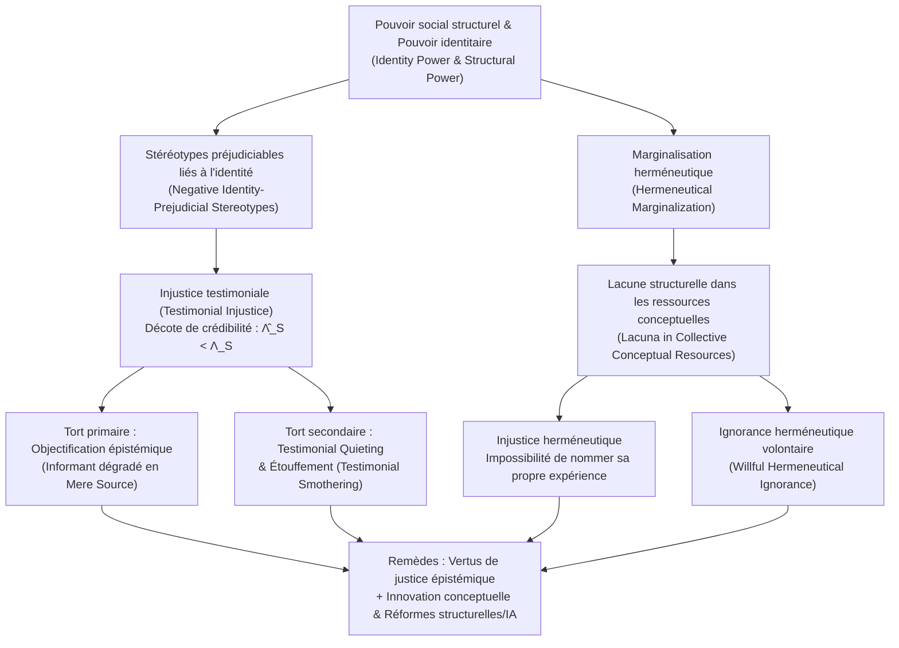

## Introduction : Quand la capacité d’être un « sujet sachant » est injustement niée

Dans la philosophie politique et morale classique, l’« injustice » est traditionnellement pensée selon deux grands axes : d’une part, l’<strong>injustice distributive</strong>, qui concerne la répartition inéquitable des ressources matérielles, des richesses, des soins ou des opportunités sociales ; d’autre part, l’<strong>injustice procédurale</strong>, qui touche à la partialité dans l’application des lois ou le déroulement des procès. Pourtant, au cœur même de la vie sociale opère une troisième forme d’injustice, plus insidieuse mais tout aussi dévastatrice : un individu peut être opprimé non seulement parce qu’on le prive de revenus ou de droits civiques, mais parce qu’en raison de son identité sociale, sa parole est systématiquement décrédibilisée dès qu’il s’exprime, ou parce que la langue commune de sa société ne possède tout simplement aucun concept permettant de nommer et de rendre intelligible la violence qu’il subit.

En 2007, la philosophe britannique <strong>Miranda Fricker</strong> a publié son ouvrage fondateur, <em>Epistemic Injustice: Power and the Ethics of Knowing</em> (traduit en français sous le titre <em>Injustice épistémique : Pouvoir et éthique du savoir</em>), articulant de manière inédite l’épistémologie, l’éthique et la théorie politique du pouvoir. Elle y définit l’<strong>injustice épistémique (Epistemic Injustice)</strong> comme <strong>un tort fait à quelqu’un spécifiquement dans sa capacité de sujet sachant (Knower) et de transmetteur de connaissance</strong>.

Pour comprendre pourquoi le fait de ne pas être cru ou de ne pas disposer des mots pour dire sa propre expérience dépasse le simple malentendu communicationnel pour constituer une atteinte éthique et politique majeure, il faut plonger au cœur de l’épistémologie sociale (Social Epistemology). Fricker distingue deux formes fondamentales : l’<strong>injustice testimoniale (Testimonial Injustice)</strong>, qui survient dans l’échange discursif, et l’<strong>injustice herméneutique (Hermeneutical Injustice)</strong>, qui affecte les ressources conceptuelles collectives. Cet article examine l’ensemble de cette architecture théorique, depuis le fonctionnement du pouvoir identitaire et la formalisation bayésienne du déficit de crédibilité jusqu’à l’objectification épistémique, l’étouffement testimonial et les biais algorithmiques dans la médecine contemporaine et les grands modèles de langage (LLM).

---

## Chapitre 1 : Pouvoir social, pouvoir identitaire et fonctionnement épistémique des stéréotypes

### 1.1 Pouvoir social et pouvoir identitaire (Identity Power)

L’épistémologie individualiste classique, héritée de Descartes, envisage le sujet de la connaissance comme une conscience isolée et abstraite de tout contexte historique (« le cogito »). Dans le monde réel, toutefois, l’immense majorité de nos savoirs repose sur le <strong>témoignage d’autrui (Testimony)</strong> et sur un répertoire partagé de concepts linguistiques. La connaissance est intrinsèquement sociale ; elle est dès lors traversée de part en part par le <strong>pouvoir social (Social Power)</strong>.

Fricker définit le pouvoir social comme « la capacité pratique ou potentielle qu’ont des agents sociaux (individus ou groupes), au sein d’un environnement donné, d’influencer ou de contrôler les actions et la situation d’autres agents ». Parmi les diverses modalités du pouvoir social, celle qui engendre directement l’injustice épistémique est le <strong>pouvoir identitaire (Identity Power)</strong>. Ce pouvoir n’a nul besoin de coercition physique ni de décret administratif : il opère directement à travers l’<strong>imaginaire social collectif (Collective Social Imagination)</strong> — c’est-à-dire les conceptions culturelles partagées sur ce que signifie le fait d’être un homme ou une femme, blanc ou racisé, cisgenre ou transgenre, médecin ou patient, universitaire ou ouvrier. Le pouvoir identitaire peut s’exercer de manière active (lorsqu’un notable réduit une interlocutrice au silence par un simple ton condescendant) ou purement structurelle (lorsqu’un groupe marginalisé s’autocensure par anticipation).

### 1.2 Stéréotypes heuristiques vs stéréotypes préjudiciables liés à l’identité

Dans l’échange quotidien d’informations, l’auditeur (Hearer, $H$) doit évaluer quasi instantanément la <strong>crédibilité (Credibility)</strong> du locuteur (Speaker, $S$). Ne pouvant procéder à un audit empirique exhaustif de la fiabilité passée de chaque interlocuteur, la cognition humaine recourt inévitablement à des <strong>stéréotypes</strong> — des associations généralisées reliant un groupe social à certains attributs de fiabilité — à titre d’<strong>heuristique cognitive</strong>.

Tout stéréotype n’est pas irrationnel ni injuste : accorder plus de crédit à une astrophysicienne qu’à un astrologue sur la physique des trous noirs relève d’une généralisation empiriquement fondée. L’injustice testimoniale surgit lorsque le jugement de l’auditeur est contaminé par un <strong>stéréotype préjudiciable négatif lié à l’identité (Negative Identity-Prejudicial Stereotype)</strong>, que Fricker définit avec rigueur :

> Une généralisation ou association largement répandue au sujet d’un groupe social, qui associe ses membres à des attributs dévalorisants (notamment le manque de rationalité, l’émotivité excessive, la malhonnêteté ou l’infériorité intellectuelle), sans fondement empirique objectif, et qui, en raison d’un investissement affectif (hostilité, sentiment de supériorité ou intérêt acquis), manifeste une forte <strong>résistance aux contre-exemples (Resistance to Counter-Evidence)</strong>.

---

## Chapitre 2 : L’injustice testimoniale (Testimonial Injustice) : Déficit et excès de crédibilité

### 2.1 Injustice testimoniale systématique vs incidente

Lorsque l’auditeur, sous l’effet d’un préjugé identitaire, accorde à la parole du locuteur moins de crédibilité que ce que justifient les preuves, le locuteur subit un <strong>déficit de crédibilité (Credibility Deficit)</strong>. Fricker distingue deux cas :

1. <strong>L’injustice testimoniale incidente (Incidental Testimonial Injustice)</strong> : Elle découle d’un préjugé localisé et non structurel (par exemple, un comité scientifique qui méprise sans raison les chercheurs travaillant sur telle espèce rare d’insectes). Bien qu’injuste, ce préjugé ne poursuit pas la victime dans les autres sphères de son existence (au tribunal, à l’hôpital ou à la banque).
2. <strong>L’injustice testimoniale systématique (Systematic Testimonial Injustice)</strong> : C’est le <strong>cas central (Central Case)</strong> de la théorie. Le préjugé identitaire (racisme, sexisme, classisme, validisme) <strong>poursuit (Tracks)</strong> le sujet à travers de multiples dimensions de la structure sociale — économique, juridique, politique, éducative et médicale. C’est cette traque systémique trans-sectorielle qui transforme un biais cognitif en oppression structurelle.

### 2.2 Deux études de cas classiques : Marge Sherwood et Tom Robinson

Pour illustrer cette mécanique, Fricker analyse deux scènes littéraires célèbres :

* <strong>Marge Sherwood dans <em>Monsieur Ripley</em> (<em>The Talented Mr. Ripley</em>)</strong> : Dans l’Italie des années 1950, le riche héritier Dickie Greenleaf est assassiné par Tom Ripley. Sa fiancée, Marge Sherwood, connaît intimement la psychologie et les habitudes de Dickie. Lorsqu’elle découvre les bagues de Dickie en possession de Ripley et relie entre eux plusieurs indices matériels, elle en déduit de façon parfaitement rationnelle que Dickie n’a pas pu se suicider et que Ripley l’a tué. Mais le père de Dickie, Herbert Greenleaf, balaye son raisonnement d’une phrase paternaliste restée célèbre : <strong>« Marge, il y a l’intuition féminine, et puis il y a les faits (Marge, there's female intuition, and then there are facts). »</strong> Ici, le stéréotype patriarcal qui réduit les femmes à des êtres irrationnels et gouvernés par l’émotion conduit Herbert à disqualifier une inférence logique rigoureuse en simple « intuition féminine hystérique », infligeant à Marge un sévère déficit de crédibilité.
* <strong>Tom Robinson dans <em>Ne tirez pas sur l’oiseau moqueur</em> (<em>To Kill a Mockingbird</em>)</strong> : En 1935, dans l’Alabama ségrégationniste, le jeune ouvrier agricole noir Tom Robinson est faussement accusé d’avoir violé une femme blanche, Mayella Ewell. Son avocat, Atticus Finch, démontre par des preuves physiques irréfutables (le bras gauche de Tom est totalement infirme) qu’il ne pouvait matériellement pas causer les blessures de la plaignante. Mais lorsque le procureur demande à Tom pourquoi il aidait régulièrement Mayella gratuitement dans ses tâches ménagères, Tom répond avec sincérité : « J’avais vraiment pitié d’elle (I felt right sorry for her). » Dans la structure de pouvoir identitaire suprémaciste blanche de l’ère Jim Crow, le fait qu’un homme noir ose éprouver de la compassion pour une femme blanche provoque une indignation immédiate chez les jurés blancs ; combiné au préjugé raciste selon lequel les hommes noirs mentent systématiquement sur les questions sexuelles, le jury refuse de croire le témoignage de Tom et le condamne à mort malgré l’évidence de son innocence.

### 2.3 L’excès de crédibilité (Credibility Excess) et les vices épistémiques

Le pendant du déficit de crédibilité est l’<strong>excès de crédibilité (Credibility Excess)</strong> : le fait qu’un locuteur jouisse, en raison de son identité sociale privilégiée (homme blanc, bourgeois, diplômé d’élite), d’une confiance supérieure à sa compétence réelle.

Comme l’a démontré le philosophe <strong>José Medina</strong> dans <em>The Epistemology of Resistance</em> (2013), la crédibilité fonctionne comme une <strong>ressource relationnelle, comparative et compétitive</strong>. Dans un procès ou un diagnostic médical, octroyer un excès de crédibilité au privilégié (Tom Ripley ou la famille Ewell) revient directement à infliger un déficit de crédibilité aux marginalisés. De plus, baigner en permanence dans un excès de crédibilité engendre chez les dominants trois <strong>vices épistémiques (Epistemic Vices)</strong> majeurs :
1. <strong>L’arrogance épistémique (Epistemic Arrogance)</strong> : La conviction illusoire de tout savoir sans jamais avoir besoin d’écouter autrui.
2. <strong>La paresse épistémique (Epistemic Laziness)</strong> : L’absence d’effort cognitif pour s’informer sur les réalités vécues par les groupes opprimés.
3. <strong>La fermeture d’esprit (Closed-mindedness)</strong> : Le rejet défensif de toute perspective remettant en cause l’ordre établi.

---

## Chapitre 3 : Modélisation bayésienne de la décote de crédibilité

Nous pouvons formaliser rigoureusement l’injustice testimoniale à l’aide du modèle de <strong>mise à jour bayésienne des croyances (Bayesian Belief Updating)</strong>.

Soit un auditeur attribuant une probabilité a priori $P(H) \in (0, 1)$ à une proposition $H$ (par exemple : « La patiente souffre d’une ischémie myocardique » ou « L’accusé dit la vérité »). Le locuteur $S$ apporte un témoignage $E_S$ appuyant $H$. D’après le théorème de Bayes, la probabilité a posteriori s’écrit :

$$P(H \mid E_S) = \frac{P(E_S \mid H) P(H)}{P(E_S \mid H) P(H) + P(E_S \mid \neg H) P(\neg H)}$$

Notons $c_S = P(E_S \mid H)$ la fiabilité objective du locuteur lorsque $H$ est vraie (alliant <strong>compétence Competence</strong> et <strong>sincérité Sincerity</strong>), et $f_S = P(E_S \mid \neg H)$ le taux de faux positifs (erreur ou mensonge) lorsque $H$ est fausse. Le <strong>rapport de vraisemblance (Likelihood Ratio)</strong> objectif du témoignage est :

$$\Lambda_S = \frac{P(E_S \mid H)}{P(E_S \mid \neg H)} = \frac{c_S}{f_S}$$

Chez un agent épistémique idéal dépourvu de préjugés, l’estimation subjective $\hat{\Lambda}_S$ égale $\Lambda_S$. Mais lorsque l’auditeur est gouverné par un paramètre de préjugé identitaire négatif $\delta_{\text{bias}} \in [0, 1]$ envers le groupe social de $S$, il sous-évalue $c_S$ et surévalue le risque d’erreur ou de tromperie, dégradant le rapport de vraisemblance perçu selon :

$$\hat{\Lambda}_S(\delta_{\text{bias}}) = \frac{(1 - \delta_{\text{bias}}) c_S + \delta_{\text{bias}} f_S}{f_S + \delta_{\text{bias}} (c_S - f_S)}$$

On en déduit immédiatement trois propriétés formelles :
* Si $\delta_{\text{bias}} = 0$ (absence de préjugé), $\hat{\Lambda}_S(0) = \frac{c_S}{f_S} = \Lambda_S$ : la mise à jour est juste et rationnelle.
* Si $0 < \delta_{\text{bias}} < 1$ et $c_S > f_S$, alors $\hat{\Lambda}_S(\delta_{\text{bias}}) < \Lambda_S$, d’où une croyance a posteriori amputée : $\hat{P}(H \mid E_S) < P^*(H \mid E_S)$. L’écart $\Delta C_S = \Lambda_S - \hat{\Lambda}_S(\delta_{\text{bias}}) > 0$ mesure exactement le <strong>déficit de crédibilité</strong>.
* Si $\delta_{\text{bias}} \to 1$ (préjugé total, à l’image du jury de <em>To Kill a Mockingbird</em>), alors $\hat{\Lambda}_S(1) = 1$, ce qui entraîne $\hat{P}(H \mid E_S) = P(H)$ : le témoignage du locuteur subit une <strong>annulation épistémique totale (Epistemic Nullification)</strong>.

En termes de logarithme de la cote (Log-Odds) sur une séquence de $T$ témoignages :

$$\log \frac{P_T(H)}{1 - P_T(H)} = \log \frac{P_0(H)}{1 - P_0(H)} + \sum_{t=1}^{T} w_{S_t} \log \Lambda_{S_t}$$

Lorsque les poids identitaires des groupes marginalisés sont systématiquement minorés ($w_M \ll 1$) et ceux des groupes privilégiés amplifiés ($w_P > 1$), le savoir public converge structurellement vers les biais de la classe dominante.

---

## Chapitre 4 : Les torts profonds : De l’objectification à l’étouffement testimonial

### 4.1 Le tort primaire : L’objectification épistémique (Epistemic Objectification)

Fricker distingue le <strong>tort primaire (intrinsèque)</strong> et les <strong>torts secondaires (conséquentiels)</strong> de l’injustice testimoniale. Le tort primaire atteint la personne dans son humanité même : puisque la raison et le partage du savoir sont au fondement de la dignité humaine, nier à quelqu’un le statut de sujet sachant en raison d’un préjugé identitaire revient à le dégrader symboliquement.

Pour formaliser ce mécanisme, Fricker reprend la distinction célèbre établie par le philosophe <strong>Edward Craig</strong> dans <em>Knowledge and the State of Nature</em> (1990) :
* <strong>L’informateur (Informant)</strong> : Un sujet rationnel traité comme un partenaire discursif à part entière au sein de la communauté épistémique.
* <strong>La simple source d’information (Mere Source of Information)</strong> : Un objet ou un état de choses naturel — tels les cernes d’un tronc d’arbre qui indiquent son âge ou des empreintes dans la boue — dont on extrait des indices factuels sans lui reconnaître d’autorité rationnelle ni de subjectivité.

Lorsque Herbert Greenleaf traite les arguments de Marge comme le simple symptôme émotionnel d’une femme éplorée, il la rétrograde du statut d’<em>informatrice</em> à celui de <em>simple source d’information</em>. C’est l’<strong>objectification épistémique (Epistemic Objectification)</strong>, pendant exact en épistémologie de l’objectification sexuelle dans l’éthique kantienne.

### 4.2 Torts secondaires, réduction au silence (Quieting) et étouffement (Smothering)

Les torts secondaires sont à la fois <strong>pratiques</strong> (condamnations judiciaires injustes, retards de diagnostic médical mortels, précarisation professionnelle) et <strong>épistémiques</strong> : confronté à un scepticisme permanent, le sujet perd sa <strong>confiance épistémique (Epistemic Confidence)</strong>, au point de douter de ses propres croyances vraies et de <strong>perdre effectivement des connaissances qu’il possédait</strong>.

La philosophe féministe noire américaine <strong>Kristie Dotson</strong> (2011) a mis en lumière deux pratiques systémiques de réduction au silence :
1. <strong>La réduction au silence testimoniale (Testimonial Quieting)</strong> : L’auditoire, aveuglé par des « images contrôlantes » (Controlling Images, selon Patricia Hill Collins), échoue purement et simplement à reconnaître la locutrice comme un sujet sachant.
2. <strong>L’étouffement testimonial (Testimonial Smothering)</strong> : Une forme d’<strong>autocensure contrainte</strong>. Lorsque la locutrice marginalisée perçoit que son propos est risqué et que l’auditoire souffre d’une <strong>incompétence testimoniale (Testimonial Incompetence)</strong> flagrante qui le conduira à déformer ses paroles contre sa propre communauté (par exemple, une femme issue d’une minorité ethnique qui tait des violences domestiques devant une police ou des médias racistes pour ne pas alimenter la stigmatisation de son groupe), elle ravale son témoignage. À cela s’ajoute le <strong>« mansplaining »</strong> analysé par <strong>Rebecca Solnit</strong> (2014), où l’excès de crédibilité masculin écrase simultanément la crédibilité féminine.

---

## Chapitre 5 : L’injustice herméneutique (Hermeneutical Injustice) et l’ignorance volontaire

### 5.1 Marginalisation herméneutique et lacunes conceptuelles

Tandis que l’injustice testimoniale se joue dans l’échange interpersonnel, l’<strong>injustice herméneutique (Hermeneutical Injustice)</strong> se situe en amont, dans la structure même des <strong>ressources herméneutiques collectives (Collective Hermeneutical Resources)</strong> — le lexique, les concepts juridiques et les grilles d’intelligibilité partagés par une société.

Parce que les groupes dominants ont historiquement monopolisé les professions génératrices de sens (droit, médecine, journalisme, université), les groupes subalternes ont subi une <strong>marginalisation herméneutique (Hermeneutical Marginalization)</strong> : une participation inégale à la fabrication des concepts communs. Il en résulte des <strong>lacunes herméneutiques (Hermeneutical Lacunae)</strong> là où il s’agit de nommer les expériences d’oppression propres aux dominés.

Fricker définit l’injustice herméneutique comme <strong>l’injustice consistant en ce qu’un pan significatif de l’expérience sociale d’un sujet est obscurci à sa propre compréhension et à celle d’autrui en raison d’un biais structurel dans les ressources herméneutiques collectives.</strong>

### 5.2 Carmita Wood et l’invention du concept de « harcèlement sexuel »

L’exemple paradigmatique analysé par Fricker est celui de <strong>Carmita Wood</strong> en 1975. Employée administrative au département de physique nucléaire de l’université Cornell, Wood subit pendant des années les attouchements délibérés, les allusions obscènes et le harcèlement d’un éminent professeur. Souffrant de douleurs chroniques sévères liées au stress, elle finit par démissionner. Mais lorsqu’elle demande des allocations de chômage et doit inscrire le motif de son départ sur le formulaire administratif, elle se heurte à un vide lexical total : dans la langue et le droit américains de 1975, il n’existait que le mot « flirt » ou le crime de « viol », mais <strong>aucun terme pour désigner la prédation sexuelle systémique au travail</strong>. Réduite à cocher « raisons personnelles », elle voit sa demande rejetée.

C’est en rejoignant un groupe féministe de prise de conscience (<em>Consciousness-Raising Group</em>) animé par <strong>Lin Farley</strong> que Wood et d’autres femmes découvrent le caractère collectif de leur épreuve et forgent ensemble un concept nouveau : le <strong>« harcèlement sexuel » (Sexual Harassment)</strong>. La création de ce concept a brisé l’isolement herméneutique et permis la reconnaissance juridique du phénomène — tout comme l’ont fait les concepts de « dépression post-partum », de « gaslighting », de « micro-agression » ou de « neurodiversité ».

### 5.3 L’ignorance herméneutique volontaire (Willful Hermeneutical Ignorance)

Comme l’ont souligné <strong>Gaile Pohlhaus Jr.</strong> (2012) et Kristie Dotson, les groupes marginalisés développent souvent au sein de leurs propres communautés de riches ressources conceptuelles alternatives. L’injustice provient alors du refus actif des groupes dominants d’apprendre ou de reconnaître ces concepts existants — un phénomène que Pohlhaus nomme <strong>ignorance herméneutique volontaire (Willful Hermeneutical Ignorance)</strong> et que Dotson qualifie d’<strong>injustice contributive (Contributory Injustice)</strong>.

---

## Chapitre 6 : Enjeux contemporains : Médecine clinique et Intelligence Artificielle (IA)

| Dimension | Injustice testimoniale | Injustice herméneutique | Ignorance herméneutique volontaire / Contributive |
| :--- | :--- | :--- | :--- |
| <strong>Niveau d’action</strong> | Échange discursif et évaluation des preuves | Répertoire collectif de concepts et de langage | Asymétrie de pouvoir entre systèmes conceptuels |
| <strong>Cause directe</strong> | Préjugé identitaire négatif chez l’auditeur ($\delta_{\text{bias}} > 0$) | Exclusion des pratiques génératrices de sens | Refus des dominants d’adopter les concepts minoritaires |
| <strong>Mécanisme clé</strong> | Déficit ($\hat{\Lambda}_S < \Lambda_S$) et excès de crédibilité | Lacune herméneutique (Hermeneutical Lacuna) | Défense cognitive et monopole épistémique |
| <strong>Cas typiques</strong> | Marge Sherwood, Tom Robinson, déni de douleur médicale | Carmita Wood avant le terme « harcèlement sexuel » | Rejet du racisme systémique ou des syndromes chroniques |
| <strong>Voies de remédiation</strong> | Conscience critique réflexive, vertu testimoniale | Groupes de conscience, innovation conceptuelle | Humilité épistémique, réforme institutionnelle et des LLM |

### 6.1 L’injustice épistémique en médecine et en psychiatrie

Les travaux de <strong>Havi Carel</strong> et Ian James Kidd ont montré l’omniprésence de ces injustices dans le système de santé :
* <strong>Décote systématique de la parole des patients</strong> : Les plaintes douloureuses des femmes, des minorités ethniques ou des patients atteints de pathologies chroniques complexes (endométriose, fibromyalgie, Covid long) sont beaucoup plus souvent attribuées à l’anxiété ou à l’exagération que celles des hommes blancs.
* <strong>Aliénation herméneutique</strong> : Les grilles d’évaluation biomédicales standardisées écrasent régulièrement le récit phénoménologique vécu par les malades.

### 6.2 L’injustice épistémique algorithmique dans les Grands Modèles de Langage (LLM)

À l’ère de l’intelligence artificielle générative, l’injustice épistémique s’automatise au cœur des <strong>grands modèles de langage (LLM)</strong> et des systèmes d’aide à la décision :
1. <strong>Injustice testimoniale automatisée</strong> : Les algorithmes de triage médical, d’octroi de crédit ou d’évaluation judiciaire entraînés sur des données historiques biaisées attribuent mécaniquement des scores de fiabilité inférieurs aux déclarations des groupes marginalisés.
2. <strong>Effacement herméneutique algorithmique</strong> : Parce que les corpus d’entraînement et les procédures d’alignement (RLHF) des LLM sont massivement dominés par l’anglais et les cadres conceptuels occidentaux hégémoniques, les langues autochtones, les épistémologies du Sud global et les savoirs minoritaires sont relégués à la périphérie de l’espace d’enchâssement (Embedding Space), menaçant de produire une standardisation herméneutique mondiale.

---

## Conclusion : De l’éthique des vertus à la démocratie épistémique structurelle

Pour contrer ces injustices, Miranda Fricker appelle à cultiver deux vertus correctrices : la <strong>vertu de justice testimoniale</strong> (une vigilance critique réflexive qui neutralise l’impact des préjugés identitaires sur nos jugements de crédibilité) et la <strong>vertu de justice herméneutique</strong> (une écoute attentive capable de discerner, derrière la difficulté d’un locuteur à s’exprimer, une lacune dans nos ressources conceptuelles communes). Toutefois, comme le rappelle <strong>Elizabeth Anderson</strong> (2012), face au caractère inconscient des biais implicites et à l’ampleur des asymétries institutionnelles, la vertu individuelle doit impérativement s’articuler à des <strong>réformes structurelles profondes</strong> dans la justice, la médecine, la recherche et la gouvernance des algorithmes.
