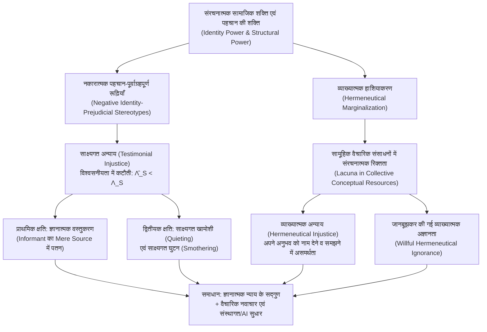

## प्रस्तावना: जब एक ‘ज्ञाता (Knower)’ के रूप में मनुष्य की क्षमता को अन्यायपूर्ण ढंग से नकार दिया जाता है

पारंपरिक राजनीतिक दर्शन और नीतिशास्त्र में ‘अन्याय (Injustice)’ को मुख्यतः दो श्रेणियों में बाँटकर देखा गया है: पहला, <strong>वितरणात्मक अन्याय (Distributive Injustice)</strong>, जो धन, स्वास्थ्य, शिक्षा और भौतिक संसाधनों के असमान वितरण से संबंधित है; और दूसरा, <strong>प्रक्रियात्मक अन्याय (Procedural Injustice)</strong>, जो न्यायिक प्रक्रियाओं या कानूनों के पक्षपातपूर्ण क्रियान्वयन से जुड़ा है। किंतु मानव समाज की गहरी संरचना में अन्याय का एक तीसरा, अधिक सूक्ष्म पर उतना ही विनाशकारी रूप भी सक्रिय रहता है: किसी व्यक्ति का दमन केवल इसलिए नहीं होता कि उसे वोट या आय से वंचित रखा गया है, बल्कि इसलिए भी होता है कि उसकी सामाजिक पहचान के कारण उसके बोलते ही उसकी बात की विश्वसनीयता को व्यवस्थित रूप से कम आँका जाता है, अथवा समाज की साझा भाषा में उसके द्वारा झेली जा रही पीड़ा को नाम देने और समझाने के लिए कोई अवधारणा या शब्द ही मौजूद नहीं होता।

वर्ष 2007 में ब्रिटिश दार्शनिक <strong>मिरांडा फ्रिकर (Miranda Fricker)</strong> ने अपनी युगांतरकारी पुस्तक <em>Epistemic Injustice: Power and the Ethics of Knowing</em> प्रकाशित की, जिसमें उन्होंने ज्ञानमीमांसा (Epistemology), नीतिशास्त्र और राजनीतिक शक्ति के सिद्धांत को एक साथ पिरोते हुए <strong>ज्ञानात्मक अन्याय (Epistemic Injustice)</strong> की अवधारणा प्रस्तुत की। फ्रिकर के अनुसार, ज्ञानात्मक अन्याय वह क्षति है जो <strong>किसी व्यक्ति को विशेष रूप से एक ‘ज्ञाता (Knower)’ और ज्ञान के संवाहक की हैसियत में पहुँचाई जाती है</strong>।

यह समझने के लिए कि किसी की बात पर विश्वास न किया जाना या अपने अनुभव को व्यक्त करने के लिए शब्दों का न होना मात्र संवाद की विफलता नहीं, बल्कि एक गंभीर नैतिक और राजनीतिक हिंसा क्यों है, हमें सामाजिक ज्ञानमीमांसा (Social Epistemology) के तंत्र को समझना होगा। फ्रिकर ज्ञानात्मक अन्याय को दो मूल रूपों में विभाजित करती हैं: पहला, संवाद और साक्ष्य के आदान-प्रदान के स्तर पर घटित होने वाला <strong>साक्ष्यगत अन्याय (Testimonial Injustice)</strong>; और दूसरा, सामूहिक वैचारिक संसाधनों के स्तर पर घटित होने वाला <strong>व्याख्यात्मक अन्याय (Hermeneutical Injustice)</strong>। इस लेख में हम पहचान की शक्ति (Identity Power), विश्वसनीयता घाटे के बेयसियन मॉडल, ज्ञानात्मक वस्तुकरण और साक्ष्यगत घुटन से लेकर आधुनिक चिकित्सा तथा बड़े भाषा मॉडलों (LLMs) में व्याप्त एल्गोरिदमिक बहिष्करण तक का गहन विश्लेषण करेंगे।

---

## अध्याय 1: सामाजिक शक्ति, पहचान की शक्ति और रूढ़ियों का ज्ञानात्मक संचालन

### 1.1 सामाजिक शक्ति और पहचान की शक्ति (Identity Power)

देकार्तवादी व्यक्तिवादी ज्ञानमीमांसा में ज्ञान प्राप्त करने वाले कर्ता को सामाजिक-ऐतिहासिक संदर्भों से कटे हुए एक स्वायत्त विवेकशील व्यक्ति (‘कोगिटो’) के रूप में देखा गया था। किंतु वास्तविक दुनिया में हमारे अधिकांश ज्ञान का आधार <strong>दूसरों का साक्ष्य या गवाही (Testimony)</strong> और समाज द्वारा साझा की जाने वाली भाषिक अवधारणाएँ होती हैं। ज्ञान स्वभावतः सामाजिक है, इसलिए वह अनिवार्य रूप से <strong>सामाजिक शक्ति (Social Power)</strong> के संबंधों से प्रभावित होता है।

फ्रिकर सामाजिक शक्ति को “किसी सामाजिक परिवेश में सामाजिक कर्ताओं (व्यक्तियों या समूहों) द्वारा अन्य कर्ताओं के कार्यों और परिस्थितियों को प्रभावित या नियंत्रित करने की व्यावहारिक या संभावित क्षमता” के रूप में परिभाषित करती हैं। सामाजिक शक्ति का वह विशिष्ट रूप जो सीधे तौर पर ज्ञानात्मक अन्याय को जन्म देता है, <strong>पहचान की शक्ति (Identity Power)</strong> कहलाता है। इस शक्ति को किसी भौतिक बल या प्रशासनिक आदेश की आवश्यकता नहीं होती; यह सीधे <strong>सामूहिक सामाजिक कल्पना (Collective Social Imagination)</strong> के माध्यम से कार्य करती है—अर्थात् समाज में व्याप्त वे सांस्कृतिक मान्यताएँ कि पुरुष या महिला होना, श्वेत या अश्वेत होना, सवर्ण या वंचित होना, डॉक्टर या मरीज़ होना, अथवा अभिजात विद्वान या साधारण श्रमिक होना क्या मायने रखता है। पहचान की शक्ति सक्रिय रूप से भी काम कर सकती है (जैसे पितृसत्तात्मक अधिकार रखने वाला कोई व्यक्ति केवल अपनी उपेक्षापूर्ण दृष्टि से किसी महिला को चुप करा दे) और विशुद्ध संरचनात्मक रूप से भी (जब हाशिए का समूह सार्वजनिक मंच पर बोलने से पहले ही स्वयं को पीछे खींच ले)।

### 1.2 अनुमानी रूढ़ियाँ बनाम नकारात्मक पहचान-पूर्वाग्रहपूर्ण रूढ़ियाँ

दैनिक संवाद में श्रोता (Hearer, $H$) को वक्ता (Speaker, $S$) की <strong>विश्वसनीयता (Credibility)</strong> का आकलन क्षण भर में करना पड़ता है। चूँकि प्रत्येक वार्तालाप से पूर्व हर वक्ता के पिछले रिकॉर्ड की संपूर्ण जाँच असंभव है, इसलिए मानवीय संज्ञान विश्वसनीयता के मूल्यांकन हेतु <strong>रूढ़ियों (Stereotypes)</strong>—किसी सामाजिक समूह और उसकी विश्वसनीयता के गुणों के बीच सामान्यीकृत जुड़ाव—का उपयोग एक <strong>संज्ञानात्मक अनुमान (Heuristic)</strong> के रूप में करता है।

सभी रूढ़ियाँ अतार्किक या अनैतिक नहीं होतीं: ब्रह्मांड विज्ञान के प्रश्नों पर किसी ज्योतिषी की तुलना में खगोल-भौतिकीविद् पर अधिक भरोसा करना अनुभवजन्य रूप से उचित है। साक्ष्यगत अन्याय तब पैदा होता है जब श्रोता का निर्णय <strong>नकारात्मक पहचान-पूर्वाग्रहपूर्ण रूढ़ि (Negative Identity-Prejudicial Stereotype)</strong> से दूषित हो जाता है, जिसे फ्रिकर इस प्रकार परिभाषित करती हैं:

> किसी सामाजिक समूह के बारे में एक व्यापक सामान्यीकरण या जुड़ाव जो उसके सदस्यों को अपमानजनक गुणों (विशेषकर तर्कहीनता, अत्यधिक भावुकता, बेईमानी या बौद्धिक हीनता) के साथ जोड़ता है; जिसका कोई वस्तुनिष्ठ अनुभवजन्य आधार नहीं होता, और जो श्रोता के भावनात्मक द्वेष, श्रेष्ठता-बोध या निहित स्वार्थ के कारण <strong>विपरीत प्रमाणों के प्रति तीव्र प्रतिरोध (Resistance to Counter-Evidence)</strong> प्रदर्शित करता है।

---

## अध्याय 2: साक्ष्यगत अन्याय (Testimonial Injustice): विश्वसनीयता घाटा और अतिरेक

### 2.1 व्यवस्थित बनाम आकस्मिक साक्ष्यगत अन्याय

जब श्रोता वक्ता की सामाजिक पहचान के प्रति पूर्वाग्रह के कारण उसके कथन को प्रमाणों की तुलना में कम विश्वसनीयता देता है, तो वक्ता को <strong>विश्वसनीयता घाटे (Credibility Deficit)</strong> का शिकार होना पड़ता है। फ्रिकर इसके दो प्रकार बताती हैं:

1. <strong>आकस्मिक साक्ष्यगत अन्याय (Incidental Testimonial Injustice)</strong>: यह किसी स्थानीय और गैर-संरचनात्मक पूर्वाग्रह से उपजता है (उदाहरण के लिए, कोई वैज्ञानिक समिति किसी दुर्लभ कीट पर शोध करने वाले वैज्ञानिकों को सनकी मानकर उनके साक्ष्य पर अविश्वास करे)। यह अन्यायपूर्ण तो है, किंतु यह पूर्वाग्रह उस वैज्ञानिक का पीछा अदालत, अस्पताल या बैंक जैसे जीवन के अन्य क्षेत्रों में नहीं करता।
2. <strong>व्यवस्थित साक्ष्यगत अन्याय (Systematic Testimonial Injustice)</strong>: यह इस सिद्धांत का <strong>केंद्रीय मामला (Central Case)</strong> है। यहाँ पहचान का पूर्वाग्रह (नस्लवाद, लिंगभेद, जातिवाद, वर्गभेद, दिव्यांगता-भेद) व्यक्ति का सामाजिक संरचना के अनेक आयामों—आर्थिक, कानूनी, राजनीतिक, शैक्षिक और चिकित्सीय—में निरंतर <strong>पीछा करता है (Tracks)</strong>। यही बहु-आयामी पीछा एक संज्ञानात्मक त्रुटि को संरचनात्मक दमन के तंत्र में बदल देता है।

### 2.2 दो क्लासिक उदाहरण: मार्ज शेरवुड और टॉम रॉबिन्सन

व्यवस्थित साक्ष्यगत अन्याय की कार्यप्रणाली को स्पष्ट करने के लिए फ्रिकर साहित्य के दो प्रसिद्ध प्रसंगों का सूक्ष्म विश्लेषण करती हैं:

* <strong><em>द टैलेंटेड मिस्टर रिप्ली</em> (<em>The Talented Mr. Ripley</em>) में मार्ज शेरवुड (Marge Sherwood)</strong>: 1950 के दशक के इटली की पृष्ठभूमि में धनी युवक डिकी ग्रीनलीफ की हत्या टॉम रिप्ली द्वारा कर दी जाती है। डिकी की मंगेतर मार्ज शेरवुड डिकी के स्वभाव और आदतों को गहराई से जानती है। जब वह डिकी की अंगूठियाँ रिप्ली के पास देखती है और कई विसंगतियों को जोड़ती है, तो वह पूरी तार्किकता से यह निष्कर्ष निकालती है कि डिकी आत्महत्या नहीं कर सकता और रिप्ली ने ही उसे मारा है। परंतु डिकी के पिता हर्बर्ट ग्रीनलीफ एक पितृसत्तात्मक वाक्य से उसके सारे तर्कों को खारिज कर देते हैं: <strong>“मार्ज, एक चीज़ होती है स्त्री-सुलभ अंतर्ज्ञान (female intuition), और दूसरी चीज़ होती है तथ्य (facts)।”</strong> यहाँ महिलाओं को भावुक, उन्मादी और तर्कहीन मानने वाली लैंगिक रूढ़ि के कारण हर्बर्ट मार्ज के ठोस तार्किक निष्कर्ष को मात्र ‘महिला अंतर्ज्ञान’ कहकर तुच्छ ठहरा देता है और उसे गंभीर विश्वसनीयता घाटे का शिकार बनाता है।
* <strong><em>टू किल अ मॉकिंगबर्ड</em> (<em>To Kill a Mockingbird</em>) में टॉम रॉबिन्सन (Tom Robinson)</strong>: 1935 के अलबामा (अमेरिका) की एक अदालत में अश्वेत युवक टॉम रॉबिन्सन पर एक श्वेत महिला मायेला यूएल के बलात्कार का झूठा आरोप लगाया जाता है। बचाव पक्ष के वकील एटिकस फिंच अकाट्य भौतिक प्रमाणों (टॉम का बायाँ हाथ पूरी तरह अपंग है) से सिद्ध कर देते हैं कि टॉम द्वारा वे चोटें पहुँचाना शारीरिक रूप से असंभव था। किंतु जब अभियोजक टॉम से पूछता है कि वह बिना पैसे लिए मायेला के घर के कामों में मदद क्यों करता था, तो टॉम ईमानदारी से उत्तर देता है: “मुझे उस पर बहुत तरस आता था (I felt right sorry for her)।” जिम क्रो युग की श्वेत वर्चस्ववादी पहचान-शक्ति संरचना में एक अश्वेत व्यक्ति द्वारा श्वेत महिला पर दया करने का साहस करना श्वेत जूरी के भीतर तत्काल नस्लीय आक्रोश पैदा कर देता है; और इस नस्लीय पूर्वाग्रह के कारण कि अश्वेत पुरुष यौन मामलों में हमेशा झूठ बोलते हैं, जूरी ठोस सबूतों के बावजूद टॉम की गवाही पर विश्वास करने से इनकार कर देती है और उसे दोषी ठहराती है, जो अंततः उसकी मृत्यु का कारण बनता है।

### 2.3 विश्वसनीयता अतिरेक (Credibility Excess) और ज्ञानात्मक दुर्गुण

विश्वसनीयता घाटे का दूसरा पहलू <strong>विश्वसनीयता अतिरेक (Credibility Excess)</strong> है: जब किसी वक्ता को उसकी विशेषाधिकार प्राप्त सामाजिक पहचान (श्वेत, उच्च वर्ग, पुरुष, अभिजात डिग्रीधारी) के कारण उसके वास्तविक कौशल और प्रमाणों से कहीं अधिक विश्वास प्राप्त होता है।

दार्शनिक <strong>जोसे मेदिना (José Medina)</strong> ने अपनी पुस्तक <em>The Epistemology of Resistance</em> (2013) में सिद्ध किया कि विश्वसनीयता एक <strong>संबंधपरक, तुलनात्मक और प्रतिस्पर्धी अवधारणा</strong> है। न्यायालय या चिकित्सा कक्ष में विशेषाधिकार प्राप्त व्यक्ति को अतिरिक्त विश्वसनीयता देना सीधे तौर पर वंचित समूह की विश्वसनीयता छीनने के बराबर है। इसके अलावा, निरंतर विश्वसनीयता अतिरेक के माहौल में रहने से विशेषाधिकार प्राप्त वर्ग में तीन <strong>ज्ञानात्मक दुर्गुण (Epistemic Vices)</strong> पनपते हैं:
1. <strong>ज्ञानात्मक अहंकार (Epistemic Arrogance)</strong>: यह भ्रम कि व्यक्ति सर्वज्ञ है और उसे दूसरों को सुनने की आवश्यकता नहीं है।
2. <strong>ज्ञानात्मक आलस्य (Epistemic Laziness)</strong>: अपने विशेषाधिकार के अंध-बिंदुओं और शोषितों के यथार्थ को जानने की प्रेरणा का अभाव।
3. <strong>संकीर्ण मानसिकता (Closed-mindedness)</strong>: स्थापित व्यवस्था को चुनौती देने वाले किसी भी साक्ष्य का रक्षात्मक बहिष्कार।

---

## अध्याय 3: विश्वसनीयता कटौती का औपचारिक बेयसियन मॉडल

साक्ष्यगत अन्याय में होने वाली विश्वसनीयता कटौती को हम <strong>बेयसियन विश्वास अद्यतन मॉडल (Bayesian Belief Updating)</strong> के माध्यम से गणितीय रूप में व्यक्त कर सकते हैं।

मान लीजिए कि श्रोता किसी कथन $H$ (जैसे “रोगी को तीव्र हृदयाघात है” या “अभियुक्त निर्दोष है”) के प्रति पूर्व प्रायिकता (Prior Probability) $P(H) \in (0, 1)$ रखता है। वक्ता $S$ कथन $H$ के समर्थन में साक्ष्य $E_S$ प्रस्तुत करता है। बेयस प्रमेय के अनुसार, साक्ष्य प्राप्त होने के बाद उत्तर प्रायिकता (Posterior Probability) होगी:

$$P(H \mid E_S) = \frac{P(E_S \mid H) P(H)}{P(E_S \mid H) P(H) + P(E_S \mid \neg H) P(\neg H)}$$

यहाँ $c_S = P(E_S \mid H)$ कथन $H$ के सत्य होने पर वक्ता की वस्तुनिष्ठ विश्वसनीयता (जिसमें <strong>सक्षमता Competence</strong> और <strong>ईमानदारी Sincerity</strong> दोनों शामिल हैं) को दर्शाता है, और $f_S = P(E_S \mid \neg H)$ कथन $H$ के असत्य होने पर वक्ता द्वारा भूल या झूठ बोलने की दर (False Positive Rate) को दर्शाता है। वक्ता के साक्ष्य का वस्तुनिष्ठ <strong>संभाव्यता अनुपात (Likelihood Ratio)</strong> है:

$$\Lambda_S = \frac{P(E_S \mid H)}{P(E_S \mid \neg H)} = \frac{c_S}{f_S}$$

पूर्वाग्रह-मुक्त आदर्श श्रोता के लिए व्यक्तिपरक आकलन $\hat{\Lambda}_S$ वस्तुनिष्ठ $\Lambda_S$ के बराबर होता है। किंतु जब श्रोता वक्ता के सामाजिक समूह के विरुद्ध नकारात्मक पहचान पूर्वाग्रह प्राचल $\delta_{\text{bias}} \in [0, 1]$ से ग्रस्त होता है, तो वह वक्ता की क्षमता और ईमानदारी को कम करके आँकता है तथा भ्रम या कपट की संभावना को बढ़ा-चढ़ाकर देखता है, जिससे अनुभूत संभाव्यता अनुपात घटकर यह रह जाता है:

$$\hat{\Lambda}_S(\delta_{\text{bias}}) = \frac{(1 - \delta_{\text{bias}}) c_S + \delta_{\text{bias}} f_S}{f_S + \delta_{\text{bias}} (c_S - f_S)}$$

इससे तीन स्पष्ट निष्कर्ष निकलते हैं:
* जब $\delta_{\text{bias}} = 0$ (पूर्वाग्रह शून्य) हो, तब $\hat{\Lambda}_S(0) = \frac{c_S}{f_S} = \Lambda_S$: विश्वास का अद्यतन न्यायपूर्ण और तार्किक होता है।
* जब $0 < \delta_{\text{bias}} < 1$ और $c_S > f_S$ हो, तब अनिवार्य रूप से $\hat{\Lambda}_S(\delta_{\text{bias}}) < \Lambda_S$ होता है, जिससे उत्तर प्रायिकता उचित स्तर से नीचे गिर जाती है: $\hat{P}(H \mid E_S) < P^*(H \mid E_S)$। इनका अंतर $\Delta C_S = \Lambda_S - \hat{\Lambda}_S(\delta_{\text{bias}}) > 0$ ही मात्रात्मक <strong>विश्वसनीयता घाटा</strong> है।
* जब $\delta_{\text{bias}} \to 1$ (चरम पूर्वाग्रह, जैसा <em>टू किल अ मॉकिंगबर्ड</em> की जूरी में था) हो, तब $\hat{\Lambda}_S(1) = 1$, अर्थात $\hat{P}(H \mid E_S) = P(H)$: वक्ता की गवाही का पूर्ण <strong>ज्ञानात्मक शून्यीकरण (Epistemic Nullification)</strong> हो जाता है।

लॉग-ऑड्स (Log-Odds) रूप में $T$ साक्ष्यों के बाद संचयी विश्वास अद्यतन इस प्रकार लिखा जा सकता है:

$$\log \frac{P_T(H)}{1 - P_T(H)} = \log \frac{P_0(H)}{1 - P_0(H)} + \sum_{t=1}^{T} w_{S_t} \log \Lambda_{S_t}$$

जब हाशिए के समूहों का पहचान-भार ($w_M \ll 1$) व्यवस्थित रूप से दबाया जाता है और विशेषाधिकार प्राप्त समूहों का भार ($w_P > 1$) बढ़ाया जाता है, तो समाज का सार्वजनिक ज्ञान कोष अनिवार्य रूप से प्रभुत्वशाली वर्ग के पूर्वाग्रहों की ओर झुक जाता है।

---

## अध्याय 4: गहन नैतिक व ज्ञानात्मक क्षतियाँ: वस्तुकरण से साक्ष्यगत घुटन तक

### 4.1 प्राथमिक क्षति: ज्ञानात्मक वस्तुकरण (Epistemic Objectification)

फ्रिकर साक्ष्यगत अन्याय की <strong>प्राथमिक (आंतरिक) क्षति</strong> और <strong>द्वितीयक (परिणामी) क्षतियों</strong> में अंतर करती हैं। प्राथमिक क्षति मानवीय गरिमा के मूल पर प्रहार करती है: चूँकि तर्कबुद्धि और ज्ञान साझा करने की क्षमता ही हमें मनुष्य बनाती है, इसलिए पहचान के पूर्वाग्रह के कारण किसी को ज्ञाता के पद से वंचित करना उसका प्रतीकात्मक अमानवीकरण है।

दार्शनिक <strong>एडवर्ड क्रेग (Edward Craig)</strong> की पुस्तक <em>Knowledge and the State of Nature</em> (1990) के प्रसिद्ध अंतर का उपयोग करते हुए फ्रिकर दो भूमिकाओं को स्पष्ट करती हैं:
* <strong>सूचनादाता या साक्षी (Informant)</strong>: एक विवेकशील कर्ता जिसे ज्ञानात्मक समुदाय में समान संवाद भागीदार के रूप में सम्मान दिया जाता है।
* <strong>मात्र सूचना का स्रोत (Mere Source of Information)</strong>: कोई जड़ वस्तु या प्राकृतिक अवस्था—जैसे कटे हुए पेड़ के तने के छल्ले जो उसकी आयु बताते हैं या गीली मिट्टी में बने पैरों के निशान—जिनसे हम तथ्य तो निकालते हैं, पर उन्हें तार्किक कर्ता या संवाद का अधिकारी नहीं मानते।

जब हर्बर्ट ग्रीनलीफ मार्ज के तार्किक निष्कर्षों को केवल ‘एक शोकाकुल महिला के भावनात्मक उन्माद के लक्षण’ के रूप में देखता है, तो वह उसे <em>सूचनादाता (Informant)</em> के पद से गिराकर <em>मात्र सूचना के स्रोत (Mere Source of Information)</em> में बदल देता है। यही <strong>ज्ञानात्मक वस्तुकरण (Epistemic Objectification)</strong> है, जो कांट के नीतिशास्त्र में वर्णित यौन वस्तुकरण के समानांतर है।

### 4.2 द्वितीयक क्षतियाँ, साक्ष्यगत खामोशी (Quieting) और साक्ष्यगत घुटन (Smothering)

द्वितीयक क्षतियों में <strong>व्यावहारिक नुकसान</strong> (गलत कानूनी सजा, चिकित्सा में दर्द की अनदेखी से मृत्यु, रोजगार में पिछड़ना) और <strong>ज्ञानात्मक नुकसान</strong> शामिल हैं: निरंतर अविश्वास का सामना करने से व्यक्ति अपना <strong>ज्ञानात्मक आत्मविश्वास (Epistemic Confidence)</strong> खो बैठता है और आत्म-संदेह के कारण <strong>उस वास्तविक ज्ञान को भी गँवा देता है जो उसके पास पहले से था</strong>।

अश्वेत नारीवादी दार्शनिक <strong>क्रिस्टी डॉटसन (Kristie Dotson)</strong> (2011) ने ज्ञानात्मक हिंसा द्वारा चुप कराए जाने के दो तंत्रों की पहचान की:
1. <strong>साक्ष्यगत खामोशी (Testimonial Quieting)</strong>: जब श्रोता रूढ़िवादी ‘नियंत्रक छवियों’ (Controlling Images, पैट्रिशिया हिल कॉलिन्स के अनुसार) से इतना अंधा हो जाता है कि वह वक्ता को एक ज्ञाता के रूप में पहचानता ही नहीं।
2. <strong>साक्ष्यगत घुटन (Testimonial Smothering)</strong>: यह <strong>बाध्यकारी आत्म-सेंसरशिप</strong> का रूप है। जब हाशिए का वक्ता यह देखता है कि उसकी बात संवेदनशील है और सामने वाला श्रोता <strong>साक्ष्यगत अक्षमता (Testimonial Incompetence)</strong> से ग्रस्त है, जिसके कारण वह उस गवाही का गलत अर्थ निकालकर स्वयं वक्ता के समुदाय को ही बदनाम करेगा (जैसे किसी अल्पसंख्यक महिला द्वारा नस्लवादी पुलिस के सामने घरेलू हिंसा की शिकायत न करना ताकि उसके पूरे समुदाय को अपराधी न ठहराया जाए), तब वक्ता बोलने से पहले ही अपनी बात का गला घोंट देता है। इसके साथ ही <strong>रेबेका सोलनित (Rebecca Solnit)</strong> (2014) द्वारा विश्लेषित <strong>‘मैनस्प्लेनिंग (Mansplaining)’</strong> भी पुरुष विश्वसनीयता अतिरेक और महिला विश्वसनीयता घाटे के टकराव का सटीक उदाहरण है।

---

## अध्याय 5: व्याख्यात्मक अन्याय (Hermeneutical Injustice) और जानबूझकर की गई अज्ञानता

### 5.1 व्याख्यात्मक हाशियाकरण और वैचारिक रिक्तता

जहाँ साक्ष्यगत अन्याय दो व्यक्तियों के बीच संवाद के क्षण में घटित होता है, वहीं <strong>व्याख्यात्मक अन्याय (Hermeneutical Injustice)</strong> उससे कहीं अधिक गहरे संरचनात्मक स्तर पर—समाज के <strong>सामूहिक व्याख्यात्मक संसाधनों (Collective Hermeneutical Resources)</strong> (शब्दावली, कानूनी श्रेणियाँ और व्याख्या के साझा ढाँचों) की संरचनात्मक रिक्तता में—घटित होता है।

चूँकि कानून, चिकित्सा, पत्रकारिता और अकादमिक जगत जैसे अर्थ-निर्माणकारी संस्थानों पर ऐतिहासिक रूप से विशेषाधिकार प्राप्त समूहों का एकाधिकार रहा है, इसलिए वंचित समूह <strong>व्याख्यात्मक हाशियाकरण (Hermeneutical Marginalization)</strong> के शिकार रहे हैं। परिणामस्वरूप, समाज के शब्दकोश में शक्तिशाली वर्ग के अनुभवों के लिए तो सूक्ष्म शब्द होते हैं, किंतु शोषित वर्ग की विशिष्ट पीड़ा को व्यक्त करने के लिए <strong>व्याख्यात्मक रिक्तता (Hermeneutical Lacuna)</strong> रह जाती है।

फ्रिकर व्याख्यात्मक अन्याय को इस प्रकार परिभाषित करती हैं: <strong>सामूहिक व्याख्यात्मक संसाधनों में संरचनात्मक पूर्वाग्रह से उत्पन्न रिक्तता के कारण किसी व्यक्ति के सामाजिक अनुभव के एक महत्वपूर्ण हिस्से का स्वयं उसकी और दूसरों की समझ से ओझल रह जाने का अन्याय।</strong>

### 5.2 कार्मिटा वुड और ‘यौन उत्पीड़न (Sexual Harassment)’ अवधारणा का जन्म

फ्रिकर द्वारा दिया गया सबसे प्रसिद्ध उदाहरण 1975 में <strong>कार्मिटा वुड (Carmita Wood)</strong> की वास्तविक घटना है। कॉर्नेल विश्वविद्यालय के परमाणु भौतिकी विभाग में प्रशासनिक कर्मचारी के रूप में कार्यरत वुड को एक वरिष्ठ प्रोफेसर द्वारा वर्षों तक अवांछित स्पर्श, अश्लील इशारों और प्रताड़ना का सामना करना पड़ा। गंभीर तनाव और शारीरिक दर्द के कारण उन्हें अंततः इस्तीफा देना पड़ा। किंतु जब उन्होंने बेरोजगारी भत्ते के लिए आवेदन किया और फॉर्म में नौकरी छोड़ने का कारण लिखना चाहा, तो उनके सामने पूर्ण भाषिक शून्य था: 1975 की अंग्रेजी शब्दावली और अमेरिकी कानून में या तो ‘दफ्तर की दिल्लगी (flirting)’ शब्द था या फिर ‘बलात्कार (rape)’, किंतु <strong>कार्यस्थल पर होने वाले इस व्यवस्थित यौन शोषण को नाम देने के लिए कोई शब्द ही अस्तित्व में नहीं था</strong>। मजबूरन उन्होंने ‘व्यक्तिगत कारण’ लिखा और उनका आवेदन खारिज कर दिया गया।

इसके बाद जब वुड <strong>लिन फार्ले (Lin Farley)</strong> द्वारा संचालित महिला चेतना-जागरण समूह (<em>Consciousness-Raising Group</em>) से जुड़ीं, तो महिलाओं ने पाया कि वे सभी एक जैसी पीड़ा से गुज़री हैं, और उन्होंने मिलकर एक नया शब्द गढ़ा: <strong>‘यौन उत्पीड़न’ (Sexual Harassment)</strong>। इस व्याख्यात्मक रिक्तता के भरने से पीड़ितों को अपनी पीड़ा समझने और कानूनी लड़ाई लड़ने की शक्ति मिली—ठीक वैसे ही जैसे बाद में ‘प्रसवोत्तर अवसाद (Postpartum Depression)’, ‘गैसलाइटिंग’, ‘माइक्रोएग्रेशन’ और ‘न्यूरोडाइवर्सिटी’ जैसी अवधारणाओं के बनने से हुआ।

### 5.3 जानबूझकर की गई व्याख्यात्मक अज्ञानता (Willful Hermeneutical Ignorance)

दार्शनिक <strong>गेल पोलहाउस (Gaile Pohlhaus Jr.)</strong> (2012) और क्रिस्टी डॉटसन ने दिखाया कि हाशिए के समुदाय अक्सर अपने भीतर वैकल्पिक वैचारिक संसाधन विकसित कर लेते हैं। समस्या तब यह होती है कि प्रभुत्वशाली समूह अपने विशेषाधिकारों की रक्षा के लिए <strong>वंचितों द्वारा विकसित उन वैचारिक उपकरणों को सीखने या स्वीकार करने से जानबूझकर इनकार कर देते हैं</strong>। पोलहाउस इसे <strong>जानबूझकर की गई व्याख्यात्मक अज्ञानता (Willful Hermeneutical Ignorance)</strong> और डॉटसन इसे <strong>योगदानात्मक अन्याय (Contributory Injustice)</strong> कहती हैं।

---

## अध्याय 6: समकालीन आयाम: नैदानिक चिकित्सा और कृत्रिम बुद्धिमत्ता (AI)

| तुलनात्मक आयाम | साक्ष्यगत अन्याय (Testimonial Injustice) | व्याख्यात्मक अन्याय (Hermeneutical Injustice) | जानबूझकर की गई व्याख्यात्मक अज्ञानता |
| :--- | :--- | :--- | :--- |
| <strong>क्रियान्वयन का स्तर</strong> | पारस्परिक संवाद और साक्ष्य मूल्यांकन | समाज की साझा शब्दावली और व्याख्यात्मक ढाँचा | विभिन्न वैचारिक प्रणालियों के बीच शक्ति-बहिष्करण |
| <strong>प्रत्यक्ष कारण</strong> | श्रोता में नकारात्मक पहचान पूर्वाग्रह ($\delta_{\text{bias}} > 0$) | अर्थ-निर्माणकारी संस्थाओं से वंचितों का बहिष्कार | विशेषाधिकार प्राप्त वर्ग द्वारा अल्पसंख्यक अवधारणाओं की अस्वीकृति |
| <strong>मुख्य तंत्र</strong> | विश्वसनीयता घाटा ($\hat{\Lambda}_S < \Lambda_S$) एवं अतिरेक | व्याख्यात्मक रिक्तता (Hermeneutical Lacuna) | संज्ञानात्मक बचाव और ज्ञानात्मक एकाधिकार |
| <strong>प्रमुख उदाहरण</strong> | मार्ज शेरवुड, टॉम रॉबिन्सन, मरीज़ के दर्द की उपेक्षा | 1975 से पूर्व कार्मिटा वुड द्वारा ‘यौन उत्पीड़न’ नाम न दे पाना | संरचनात्मक नस्लवाद/जातिवाद या जटिल बीमारियों को नकारना |
| <strong>सुधार के मार्ग</strong> | आत्म-निरीक्षणात्मक आलोचनात्मक चेतना, साक्ष्यगत सद्गुण | चेतना-जागरण समूह, वैचारिक नवाचार | ज्ञानात्मक विनम्रता, संस्थागत एवं LLM डेटा सुधार |

### 6.1 नैदानिक चिकित्सा और मनोचिकित्सा में ज्ञानात्मक अन्याय

दार्शनिक <strong>हावी करेल (Havi Carel)</strong> और इयान जेम्स किड ने स्वास्थ्य सेवाओं में व्याप्त ज्ञानात्मक अन्याय को उजागर किया है:
* <strong>रोगियों के साक्ष्य का व्यवस्थित अवमूल्यन</strong>: आपातकालीन कक्ष में महिलाओं, नस्लीय/जातीय अल्पसंख्यकों या जटिल दीर्घकालिक रोगों (एंडोमेट्रियोसिस, फाइब्रोमायल्जिया, लॉन्ग कोविड) से पीड़ित मरीजों की तीव्र पीड़ा की शिकायतों को श्वेत पुरुष मरीजों की तुलना में कहीं अधिक बार ‘मानसिक तनाव’ या ‘बढ़ा-चढ़ाकर की गई बात’ मानकर खारिज कर दिया जाता है।
* <strong>व्याख्यात्मक अलगाव</strong>: अस्पतालों के मानकीकृत पैमाने रोगी के वास्तविक आत्मगत अनुभव और पीड़ा को व्यक्त करने के लिए पर्याप्त स्थान नहीं देते।

### 6.2 कृत्रिम बुद्धिमत्ता और बड़े भाषा मॉडलों (LLMs) में एल्गोरिदमिक ज्ञानात्मक अन्याय

जनरेटिव AI के युग में ज्ञानात्मक अन्याय <strong>बड़े भाषा मॉडलों (Large Language Models - LLMs)</strong> और स्वचालित निर्णय प्रणालियों के भार-मैट्रिक्स (Weight Matrices) में कोडित हो रहा है:
1. <strong>स्वचालित साक्ष्यगत अन्याय</strong>: ऐतिहासिक रूप से पूर्वाग्रहपूर्ण डेटा पर प्रशिक्षित मेडिकल ट्रायज, ऋण मूल्यांकन या न्यायिक एल्गोरिदम वंचित समूहों के स्व-घोषित कथनों को स्वतः कम विश्वसनीयता अंक प्रदान करते हैं।
2. <strong>एल्गोरिदमिक व्याख्यात्मक विलोपन</strong>: चूँकि LLMs के प्रशिक्षण कॉर्पस और संरेखण (RLHF) पर अंग्रेजी भाषा और पश्चिमी अभिजात विमर्श का भारी प्रभुत्व है, इसलिए ग्लोबल साउथ, देशज भाषाओं, क्षेत्रीय बोलियों और हाशिए के समुदायों के वैचारिक ढाँचे एम्बेडिंग स्पेस (Embedding Space) के बाहरी कोनों में सिमट जाते हैं, जिससे डिजिटल युग में एक वैश्विक व्याख्यात्मक एकरूपता का खतरा पैदा हो गया है।

---

## निष्कर्ष: व्यक्तिगत सद्गुण नीतिशास्त्र से संरचनात्मक ज्ञानात्मक लोकतंत्र की ओर

ज्ञानात्मक अन्याय के प्रतिकार हेतु मिरांडा फ्रिकर दो सुधारात्मक सद्गुणों के विकास का प्रस्ताव रखती हैं: <strong>साक्ष्यगत न्याय का सद्गुण (Virtue of Testimonial Justice)</strong>—एक ऐसी आत्म-निरीक्षणात्मक चेतना जो अपनी विश्वसनीयता के निर्णय में पहचान के पूर्वाग्रह की पहचान कर उसे ऊपर की ओर संशोधित करे—और <strong>व्याख्यात्मक न्याय का सद्गुण (Virtue of Hermeneutical Justice)</strong>—एक ऐसी संवेदनशील श्रवण-क्षमता जो वक्ता की लड़खड़ाती अभिव्यक्ति के पीछे साझा भाषा की रिक्तता को पहचान सके। तथापि, जैसा कि <strong>एलिज़ाबेथ एंडरसन (Elizabeth Anderson, 2012)</strong> ज़ोर देती हैं, चूँकि अंतर्निहित पूर्वाग्रह अचेतन स्तर पर काम करते हैं और व्याख्यात्मक हाशियाकरण संस्थाओं में जड़ें जमाए हुए है, इसलिए व्यक्तिगत सद्गुणों को न्यायपालिका, चिकित्सा, अकादमिक ज्ञान-उत्पादन और कृत्रिम बुद्धिमत्ता के लोकतांत्रिक शासन के <strong>व्यापक संरचनात्मक सुधारों</strong> के साथ जोड़ना अनिवार्य है।
