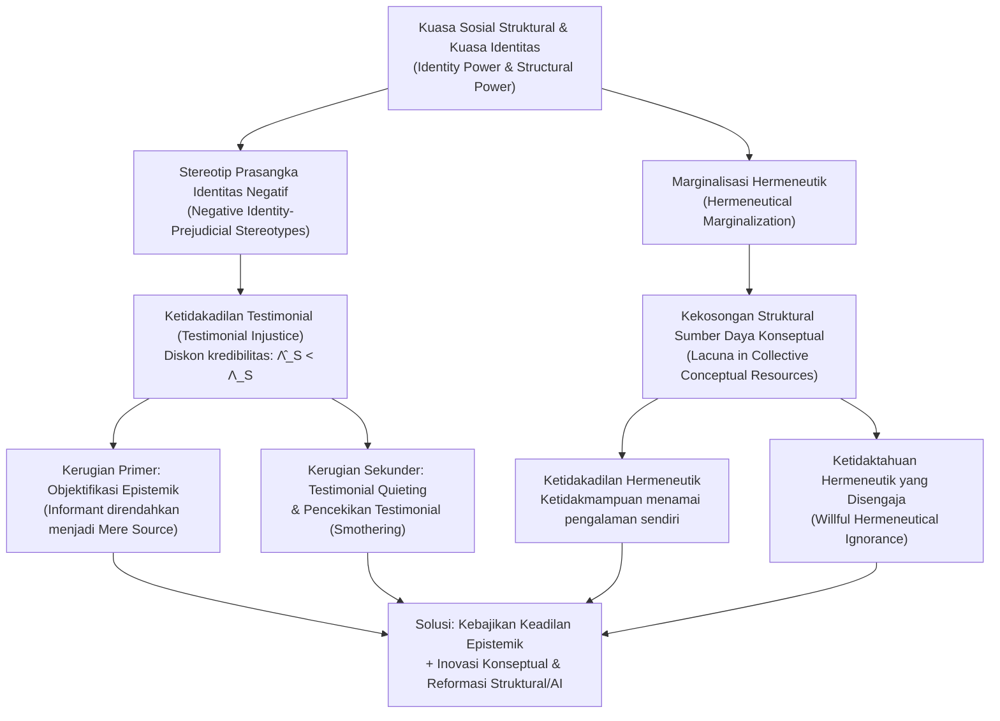

## Pendahuluan: Ketika Kapasitas sebagai “Subjek Penahu” Diingkari secara Tidak Adil

Dalam filsafat politik dan etika tradisional, “ketidakadilan (Injustice)” umumnya dianalisis melalui dua kategori besar: pertama, <strong>ketidakadilan distributif (Distributive Injustice)</strong> yang berkaitan dengan ketimpangan pembagian sumber daya material, kekayaan, layanan kesehatan, atau kesempatan pendidikan; kedua, <strong>ketidakadilan prosedural (Procedural Injustice)</strong> yang menyangkut keberpihakan dalam proses hukum atau penegakan aturan. Namun, di dalam struktur terdalam kehidupan sosial bekerja bentuk ketidakadilan ketiga yang lebih halus tetapi sama menghancurkannya: seseorang dapat ditindas bukan hanya karena dirampas pendapatannya atau hak pilihnya, melainkan karena—akibat identitas sosialnya—ucapannya secara sistematis diremehkan begitu ia membuka suara, atau karena di dalam bahasa bersama masyarakatnya sama sekali tidak tersedia konsep untuk menamai dan menjelaskan penderitaan yang dialaminya.

Pada tahun 2007, filsuf Inggris <strong>Miranda Fricker</strong> menerbitkan karya monumentalnya, <em>Epistemic Injustice: Power and the Ethics of Knowing</em>, yang untuk pertama kalinya merajut secara sistematis epistemologi, etika, dan teori kuasa politik. Fricker memperkenalkan konsep <strong>ketidakadilan epistemik (Epistemic Injustice)</strong> untuk menyebut <strong>kerugian atau kezaliman yang ditimpakan kepada seseorang secara spesifik dalam kapasitasnya sebagai subjek penahu (Knower) dan penyampai pengetahuan</strong>.

Untuk memahami mengapa “tidak dipercaya” atau “tidak memiliki kata untuk menjelaskan pengalaman sendiri” bukanlah sekadar kegagalan komunikasi biasa, melainkan pelanggaran etis dan politis yang serius, kita harus menyelami mekanisme epistemologi sosial (Social Epistemology). Fricker membagi ketidakadilan epistemik ke dalam dua bentuk utama: <strong>ketidakadilan testimonial (Testimonial Injustice)</strong> yang terjadi dalam pertukaran wacana, dan <strong>ketidakadilan hermeneutik (Hermeneutical Injustice)</strong> yang berakar pada kesenjangan sumber daya konseptual kolektif. Artikel ini mengkaji mulai dari cara kerja kuasa identitas dan pemodelan formal Bayes atas defisit kredibilitas hingga objektifikasi epistemik, pembungkaman testimonial, serta eksklusi algoritmik dalam dunia medis modern dan model bahasa besar (LLM).

---

## Bab 1: Kuasa Sosial, Kuasa Identitas, dan Operasi Epistemik Stereotip

### 1.1 Kuasa Sosial dan Kuasa Identitas (Identity Power)

Epistemologi individualis klasik bercorak Cartesian membayangkan subjek pengetahuan sebagai kesadaran terisolasi yang tercerabut dari konteks sosial-historisnya (“cogito”). Di dunia nyata, sebaliknya, sebagian besar pengetahuan kita bergantung pada <strong>kesaksian orang lain (Testimony)</strong> dan khazanah konsep bahasa yang dibagi bersama. Pengetahuan bersifat sosial secara intrinsik, sehingga tak terelakkan lagi selalu ditembus oleh <strong>kuasa sosial (Social Power)</strong>.

Fricker mendefinisikan kuasa sosial sebagai “kapasitas praktis maupun potensial yang dimiliki agen sosial (individu atau kelompok) dalam lingkungan tertentu untuk memengaruhi atau mengendalikan tindakan serta keadaan agen lainnya”. Bentuk spesifik dari kuasa sosial yang secara langsung melahirkan ketidakadilan epistemik adalah <strong>kuasa identitas (Identity Power)</strong>. Kuasa ini tidak memerlukan kekerasan fisik atau surat keputusan resmi; ia bekerja secara langsung melalui <strong>imajinasi sosial kolektif (Collective Social Imagination)</strong>—yakni skrip budaya bersama tentang apa artinya menjadi laki-laki atau perempuan, kulit putih atau kulit berwarna, cisgender atau transgender, dokter atau pasien, akademisi elit atau buruh kasar. Kuasa identitas dapat bekerja secara aktif (misalnya ketika figur otoritas patriarkal membungkam seorang perempuan hanya dengan tatapan merendahkan) maupun secara murni struktural (ketika kelompok terpinggirkan mengundurkan diri terlebih dahulu dari ruang kesaksian publik).

### 1.2 Stereotip Heuristik vs. Stereotip Prasangka Identitas Negatif

Dalam pertukaran informasi sehari-hari, pendengar (Hearer, $H$) harus menilai <strong>kredibilitas (Credibility)</strong> pembicara (Speaker, $S$) dalam hitungan detik. Karena mustahil melakukan audit empiris menyeluruh atas rekam jejak kejujuran dan kompetensi setiap lawan bicara sebelum bercakap-cakap, kognisi manusia mau tidak mau mengandalkan <strong>stereotip</strong>—asosiasi umum antara suatu kelompok sosial dan ciri keandalan tertentu—sebagai <strong>heuristik kognitif</strong>.

Tidak semua stereotip bersifat irasional atau tidak etis: lebih mempercayai ahli astrofisika daripada peramal bintang mengenai evolusi lubang hitam adalah heuristik yang berdasar secara empiris. Ketidakadilan testimonial muncul ketika penilaian pendengar didistorsi oleh <strong>stereotip prasangka identitas negatif (Negative Identity-Prejudicial Stereotype)</strong>, yang didefinisikan Fricker secara cermat sebagai:

> Suatu generalisasi atau asosiasi luas mengenai kelompok sosial tertentu yang mengaitkan anggota kelompok tersebut dengan atribut merendahkan (terutama kurangnya rasionalitas, emosionalitas berlebih, ketidakjujuran, atau inferioritas intelektual), tanpa landasan bukti empiris yang objektif, dan yang—karena muatan afektif berupa permusuhan, rasa superioritas, atau kepentingan pribadi—menunjukkan <strong>resistensi kuat terhadap bukti penyanggah (Resistance to Counter-Evidence)</strong>.

---

## Bab 2: Ketidakadilan Testimonial (Testimonial Injustice): Defisit dan Kelebihan Kredibilitas

### 2.1 Ketidakadilan Testimonial Sistematis vs. Insidental

Ketika pendengar, akibat prasangka terhadap identitas sosial pembicara, memberikan tingkat kepercayaan yang lebih rendah daripada yang seharusnya layak diterima berdasarkan bukti, pembicara tersebut mengalami <strong>defisit kredibilitas (Credibility Deficit)</strong>. Fricker membedakan dua kasus:

1. <strong>Ketidakadilan testimonial insidental (Incidental Testimonial Injustice)</strong>: Berasal dari prasangka lokal dan non-struktural (misalnya panel ilmiah yang secara tidak berdasar meremehkan peneliti serangga langka tertentu). Meskipun tidak adil, prasangka ini tidak membuntuti sang peneliti ke ranah kehidupan lainnya (di pengadilan, rumah sakit, atau bank).
2. <strong>Ketidakadilan testimonial sistematis (Systematic Testimonial Injustice)</strong>: Merupakan <strong>kasus sentral (Central Case)</strong> dari teori ini. Di sini prasangka identitas (rasisme, seksisme, klasisme, ableisme) <strong>melacak dan membuntuti (Tracks)</strong> subjek melintasi berbagai dimensi struktur sosial—ekonomi, hukum, politik, pendidikan, dan medis. Pelacakan lintas-sektor yang sistematis inilah yang mengubah bias kognitif menjadi mesin penindasan struktural.

### 2.2 Dua Studi Kasus Klasik: Marge Sherwood dan Tom Robinson

Untuk memperlihatkan cara kerja ketidakadilan testimonial sistematis, Fricker membedah dua adegan sastra yang sangat terkenal:

* <strong>Marge Sherwood dalam <em>The Talented Mr. Ripley</em></strong>: Berlatar Italia tahun 1950-an, pemuda kaya Dickie Greenleaf dibunuh oleh Tom Ripley. Tunangan Dickie, Marge Sherwood, mengenal karakter dan kebiasaan Dickie secara mendalam. Ketika ia menemukan cincin Dickie berada di tangan Ripley dan menghubungkan sejumlah kejanggalan faktual, ia menyimpulkan secara sangat rasional bahwa Dickie tidak mungkin bunuh diri dan pasti telah dibunuh oleh Ripley. Namun ayah Dickie, Herbert Greenleaf, menepis penalaran Marge dengan satu kalimat paternalistik yang terkenal: <strong>“Marge, ada intuisi perempuan, dan ada fakta (Marge, there's female intuition, and then there are facts).”</strong> Stereotip patriarkal yang mengodekan perempuan sebagai makhluk emosional, histeris, dan nirlogika membuat Herbert mereduksi inferensi rasional yang tajam menjadi sekadar “intuisi perempuan”, sehingga menjatuhkan defisit kredibilitas yang parah kepada Marge.
* <strong>Tom Robinson dalam <em>To Kill a Mockingbird</em></strong>: Di Alabama tahun 1935, pemuda kulit hitam Tom Robinson dituduh secara palsu memperkosa perempuan kulit putih, Mayella Ewell. Pengacaranya, Atticus Finch, membuktikan melalui fakta fisik yang tak terbantahkan (lengan kiri Tom lumpuh total) bahwa secara fisik mustahil Tom menyebabkan luka-luka pada tubuh pelapor. Namun ketika jaksa bertanya mengapa Tom sering membantu pekerjaan rumah Mayella tanpa dibayar, Tom menjawab dengan jujur: “Saya merasa sangat kasihan kepadanya (I felt right sorry for her).” Dalam struktur kuasa identitas supremasi kulit putih era Jim Crow, kenyataan bahwa seorang pria kulit hitam berani merasa iba kepada perempuan kulit putih langsung memicu kemarahan rasial di hati seluruh juri kulit putih; ditambah prasangka rasis bahwa semua pria kulit hitam berbohong soal seks, para juri tidak mampu (dan menolak) mempercayai kesaksian Tom, lalu memvonisnya bersalah hingga berujung pada kematiannya.

### 2.3 Kelebihan Kredibilitas (Credibility Excess) dan Keburukan Epistemik

Sisi balik dari defisit kredibilitas adalah <strong>kelebihan kredibilitas (Credibility Excess)</strong>: ketika seorang pembicara menerima kepercayaan melebihi kompetensi nyatanya semata-mata karena identitas sosialnya yang memiliki privilese (pria kulit putih, kaya, berpendidikan elit).

Sebagaimana dibuktikan oleh filsuf <strong>José Medina</strong> dalam <em>The Epistemology of Resistance</em> (2013), kredibilitas adalah <strong>konsep relasional, komparatif, dan kompetitif</strong>. Di ruang sidang atau ruang periksa medis, memberikan kelebihan kredibilitas kepada kelompok berprivilese (seperti Tom Ripley atau keluarga Ewell) secara langsung berarti merampas kredibilitas kelompok terpinggirkan. Lebih jauh lagi, hidup terus-menerus dalam buaian kelebihan kredibilitas merusak karakter epistemik kelompok berprivilese dan melahirkan tiga <strong>keburukan epistemik (Epistemic Vices)</strong>:
1. <strong>Arogansi epistemik (Epistemic Arrogance)</strong>: Ilusi kemahatahuan dan ketidakbersalahan kognitif.
2. <strong>Kemalasan epistemik (Epistemic Laziness)</strong>: Hilangnya motivasi untuk mempelajari titik buta privilese sendiri serta realitas kaum tertindas.
3. <strong>Ketertutupan pikiran (Closed-mindedness)</strong>: Penolakan defensif terhadap setiap kesaksian yang menggugat tatanan mapan.

---

## Bab 3: Model Formal Bayes untuk Diskon Kredibilitas

Kita dapat memformalkan secara matematis defisit dan kelebihan kredibilitas menggunakan <strong>pembaruan keyakinan Bayes (Bayesian Belief Updating)</strong>.

Misalkan seorang pendengar memberikan probabilitas awal (prior) $P(H) \in (0, 1)$ terhadap suatu proposisi $H$ (misalnya: “Pasien mengalami iskemia miokard akut” atau “Terdakwa tidak bersalah”). Pembicara $S$ memberikan kesaksian $E_S$ yang mendukung $H$. Berdasarkan teorema Bayes, probabilitas akhir (posterior) adalah:

$$P(H \mid E_S) = \frac{P(E_S \mid H) P(H)}{P(E_S \mid H) P(H) + P(E_S \mid \neg H) P(\neg H)}$$

Misalkan $c_S = P(E_S \mid H)$ menyatakan keandalan objektif pembicara ketika $H$ benar (menggabungkan <strong>kompetensi Competence</strong> dan <strong>ketulusan Sincerity</strong>), dan $f_S = P(E_S \mid \neg H)$ menyatakan tingkat positif palsu (kekeliruan atau kebohongan) ketika $H$ salah. <strong>Rasio kemungkinan (Likelihood Ratio)</strong> objektif dari kesaksian tersebut adalah:

$$\Lambda_S = \frac{P(E_S \mid H)}{P(E_S \mid \neg H)} = \frac{c_S}{f_S}$$

Pada agen epistemik ideal yang bebas prasangka, estimasi subjektif $\hat{\Lambda}_S$ sama dengan $\Lambda_S$. Namun, ketika pendengar dikuasai oleh parameter prasangka identitas negatif $\delta_{\text{bias}} \in [0, 1]$ terhadap kelompok sosial $S$, ia meremehkan kompetensi serta kejujuran pembicara dan melebih-lebihkan kemungkinan kekeliruan atau tipu daya, sehingga rasio kemungkinan yang dipersepsikan merosot menjadi:

$$\hat{\Lambda}_S(\delta_{\text{bias}}) = \frac{(1 - \delta_{\text{bias}}) c_S + \delta_{\text{bias}} f_S}{f_S + \delta_{\text{bias}} (c_S - f_S)}$$

Dari persamaan ini dapat diturunkan tiga implikasi utama:
* Ketika $\delta_{\text{bias}} = 0$ (tanpa prasangka), $\hat{\Lambda}_S(0) = \frac{c_S}{f_S} = \Lambda_S$: pembaruan keyakinan berlangsung adil dan rasional.
* Ketika $0 < \delta_{\text{bias}} < 1$ dan $c_S > f_S$, berlaku tegas $\hat{\Lambda}_S(\delta_{\text{bias}}) < \Lambda_S$, yang menghasilkan keyakinan posterior lebih rendah dari semestinya: $\hat{P}(H \mid E_S) < P^*(H \mid E_S)$. Selisih $\Delta C_S = \Lambda_S - \hat{\Lambda}_S(\delta_{\text{bias}}) > 0$ mengukur besaran <strong>defisit kredibilitas</strong>.
* Ketika $\delta_{\text{bias}} \to 1$ (prasangka mutlak, seperti pada juri <em>To Kill a Mockingbird</em>), $\hat{\Lambda}_S(1) = 1$, sehingga $\hat{P}(H \mid E_S) = P(H)$: kesaksian pembicara mengalami <strong>peniadaan epistemik total (Epistemic Nullification)</strong>.

Dalam bentuk log-odds setelah $T$ kesaksian berurutan:

$$\log \frac{P_T(H)}{1 - P_T(H)} = \log \frac{P_0(H)}{1 - P_0(H)} + \sum_{t=1}^{T} w_{S_t} \log \Lambda_{S_t}$$

Ketika bobot identitas kelompok marginal ditekan secara sistematis ($w_M \ll 1$) dan bobot kelompok berprivilese diperbesar ($w_P > 1$), khazanah pengetahuan publik secara struktural akan menyempit mengikuti bias kelas penguasa.

---

## Bab 4: Kerugian Mendalam: Dari Objektifikasi Epistemik hingga Pembungkaman Testimonial

### 4.1 Kerugian Primer: Objektifikasi Epistemik (Epistemic Objectification)

Fricker membedakan antara <strong>kerugian primer (intrinsik)</strong> dan <strong>kerugian sekunder (konsekuensial)</strong> dari ketidakadilan testimonial. Kerugian primer menghantam inti martabat manusia: karena akal budi dan kemampuan berbagi pengetahuan mendefinisikan kemanusiaan kita, direndahkan sebagai subjek penahu akibat prasangka identitas merupakan bentuk dehumanisasi simbolik.

Mengacu pada pembedaan terkenal dari filsuf <strong>Edward Craig</strong> dalam <em>Knowledge and the State of Nature</em> (1990), Fricker membedakan antara:
* <strong>Informan (Informant)</strong>: Subjek rasional yang diperlakukan sebagai mitra dialog setara dalam komunitas epistemik.
* <strong>Sekadar sumber informasi (Mere Source of Information)</strong>: Objek atau keadaan alamiah—seperti lingkaran tahun pada batang pohon yang menunjukkan usia pohon atau jejak kaki di lumpur—yang darinya kita mengekstrak data empiris tanpa mengakui agensi rasional maupun otoritas diskursifnya.

Ketika Herbert Greenleaf memperlakukan deduksi Marge semata-mata sebagai “gejala emosional perempuan yang sedang berduka”, ia menurunkan derajat Marge dari <em>informan</em> menjadi <em>sekadar sumber informasi</em>. Inilah <strong>objektifikasi epistemik (Epistemic Objectification)</strong>, paralel dengan objektifikasi seksual dalam etika Kantian.

### 4.2 Kerugian Sekunder, Pembungkaman (Quieting), dan Pencekikan Testimonial (Smothering)

Kerugian sekunder mencakup kerugian <strong>praktis</strong> (vonis hukum yang salah, keterlambatan diagnosis medis yang fatal, hambatan karier) dan kerugian <strong>epistemik</strong>: terkikisnya <strong>kepercayaan diri epistemik (Epistemic Confidence)</strong> secara terus-menerus membuat korban meragukan keyakinannya yang benar dan <strong>benar-benar kehilangan pengetahuan yang sebelumnya ia miliki</strong>.

Filsuf feminis kulit hitam Amerika <strong>Kristie Dotson</strong> (2011) mengidentifikasi dua mekanisme kekerasan epistemik:
1. <strong>Pembungkaman testimonial (Testimonial Quieting)</strong>: Audiens yang dikuasai oleh “citra pengendali” stereotipikal (Controlling Images menurut Patricia Hill Collins) gagal total mengenali pembicara sebagai subjek penahu.
2. <strong>Pencekikan testimonial (Testimonial Smothering)</strong>: Bentuk <strong>swasensor yang dipaksakan</strong>. Ketika pembicara dari kelompok marginal menyadari bahwa kesaksiannya sangat rumit dan berisiko, sementara pendengarnya mengidap <strong>inkompetensi testimonial (Testimonial Incompetence)</strong> yang nyata sehingga pasti akan memelintir ucapannya untuk merugikan komunitasnya sendiri (misalnya perempuan minoritas yang menahan diri melaporkan kekerasan dalam rumah tangga di hadapan polisi atau media rasis agar tidak memperkuat stigma terhadap kelompoknya), ia terpaksa menelan kembali kesaksiannya. Fenomena ini juga beririsan dengan <strong>“mansplaining”</strong> yang dianalisis oleh <strong>Rebecca Solnit</strong> (2014), di mana kelebihan kredibilitas laki-laki dan defisit kredibilitas perempuan bertabrakan secara langsung.

---

## Bab 5: Ketidakadilan Hermeneutik (Hermeneutical Injustice) dan Ketidaktahuan yang Disengaja

### 5.1 Marginalisasi Hermeneutik dan Kekosongan Konseptual

Jika ketidakadilan testimonial terjadi dalam tindak komunikasi antar-individu, <strong>ketidakadilan hermeneutik (Hermeneutical Injustice)</strong> bekerja pada tingkat struktural yang lebih mendasar: di dalam <strong>sumber daya hermeneutik kolektif (Collective Hermeneutical Resources)</strong>—kosakata, kategori hukum, dan kerangka interpretasi yang dimiliki bersama oleh masyarakat.

Karena kelompok berprivilese secara historis memonopoli praktik penciptaan makna (hukum, kedokteran, jurnalisme, akademisi), kelompok subordinat mengalami <strong>marginalisasi hermeneutik (Hermeneutical Marginalization)</strong>: ketidaksetaraan partisipasi dalam membentuk konsep publik. Akibatnya, kamus sosial menyisakan <strong>kekosongan hermeneutik (Hermeneutical Lacunae)</strong> tepat pada bagian yang seharusnya menamai pengalaman penindasan kaum rentan.

Fricker mendefinisikan ketidakadilan hermeneutik sebagai <strong>ketidakadilan ketika bagian penting dari pengalaman sosial seseorang menjadi kabur bagi pemahaman dirinya sendiri maupun orang lain akibat adanya kekosongan yang bias secara struktural dalam sumber daya hermeneutik kolektif.</strong>

### 5.2 Carmita Wood dan Lahirnya Konsep “Pelecehan Seksual”

Kasus paradigmatik yang diangkat Fricker adalah kisah <strong>Carmita Wood</strong> pada tahun 1975. Bekerja sebagai staf administrasi di departemen fisika nuklir Universitas Cornell, Wood selama bertahun-tahun mengalami sentuhan fisik paksa, sindiran cabul, dan intimidasi dari seorang profesor ternama. Menderita nyeri kronis parah akibat stres, ia akhirnya mengundurkan diri. Namun saat mengajukan tunjangan pengangguran dan harus mengisi alasan berhenti bekerja pada formulir resmi, ia terbentur pada kekosongan konseptual mutlak: dalam bahasa Inggris dan hukum Amerika tahun 1975 hanya dikenal istilah “godaan kantor (flirting)” atau kejahatan ekstrem “pemerkosaan”, tetapi <strong>tidak ada satu kata pun untuk menamai intimidasi seksual sistematis di tempat kerja</strong>. Terpaksa menulis “alasan pribadi”, permohonannya pun ditolak.

Barulah setelah bergabung dengan kelompok penyadaran feminis (<em>Consciousness-Raising Group</em>) yang dipandu oleh <strong>Lin Farley</strong>, Wood dan perempuan lainnya menyadari bahwa mereka mengalami mimpi buruk yang sama, lalu bersama-sama menempa konsep baru: <strong>“pelecehan seksual” (Sexual Harassment)</strong>. Ditemukannya konsep tersebut meruntuhkan isolasi hermeneutik dan membuka jalan bagi perlindungan hukum—sebagaimana istilah “depresi pascapersalinan”, “gaslighting”, “mikroagresi”, dan “neurodiversitas”.

### 5.3 Ketidaktahuan Hermeneutik yang Disengaja (Willful Hermeneutical Ignorance)

Sebagaimana ditunjukkan oleh <strong>Gaile Pohlhaus Jr.</strong> (2012) dan Kristie Dotson, kelompok marginal sering kali telah mengembangkan sumber daya konseptual alternatif yang kaya di dalam komunitas mereka sendiri. Masalahnya sering kali terletak pada penolakan aktif kelompok dominan untuk mempelajari, mengakui, atau mengadopsi perangkat konseptual yang telah diciptakan oleh kelompok tertindas tersebut—fenomena yang disebut Pohlhaus sebagai <strong>ketidaktahuan hermeneutik yang disengaja (Willful Hermeneutical Ignorance)</strong> dan disebut Dotson sebagai <strong>ketidakadilan kontributif (Contributory Injustice)</strong>.

---

## Bab 6: Tantangan Kontemporer: Kedokteran Klinis dan Kecerdasan Buatan (AI)

| Dimensi | Ketidakadilan Testimonial | Ketidakadilan Hermeneutik | Ketidaktahuan Hermeneutik yang Disengaja / Kontributif |
| :--- | :--- | :--- | :--- |
| <strong>Tingkat operasi</strong> | Pertukaran wacana dan evaluasi bukti | Repertoar kolektif konsep dan bahasa | Eksklusi kuasa antar-sistem konseptual |
| <strong>Penyebab langsung</strong> | Prasangka identitas negatif pada pendengar ($\delta_{\text{bias}} > 0$) | Eksklusi dari praktik penciptaan makna | Penolakan kelompok dominan mengadopsi konsep minoritas |
| <strong>Mekanisme kunci</strong> | Defisit ($\hat{\Lambda}_S < \Lambda_S$) dan kelebihan kredibilitas | Kekosongan hermeneutik (Hermeneutical Lacuna) | Pertahanan kognitif dan monopoli epistemik |
| <strong>Kasus tipikal</strong> | Marge Sherwood, Tom Robinson, pengabaian nyeri medis | Carmita Wood sebelum istilah “pelecehan seksual” (1975) | Penyangkalan rasisme struktural atau sindrom kronis |
| <strong>Jalur koreksi</strong> | Kesadaran kritis reflektif, kebajikan testimonial | Kelompok penyadaran, inovasi konseptual | Kerendahan hati epistemik, reformasi institusi & LLM |

### 6.1 Ketidakadilan Epistemik dalam Kedokteran Klinis dan Psikiatri

Penelitian <strong>Havi Carel</strong> dan Ian James Kidd membuktikan betapa sistem layanan kesehatan mereproduksi kedua ketidakadilan ini:
* <strong>Diskon sistematis atas kesaksian pasien</strong>: Keluhan nyeri hebat dari perempuan, minoritas rasial, atau pasien penyakit kronis tak kasatmata (endometriosis, fibromialgia, Long COVID) jauh lebih sering dianggap sebagai “kecemasan” atau “dramatisasi” dibandingkan keluhan serupa dari pasien pria kulit putih.
* <strong>Alienasi hermeneutik</strong>: Skala biomedis standar kerap membungkam pengalaman fenomenologis subjektif yang dialami pasien.

### 6.2 Ketidakadilan Epistemik Algoritmik dalam Model Bahasa Besar (LLM)

Di era kecerdasan buatan generatif, ketidakadilan epistemik dikodekan ke dalam matriks bobot <strong>model bahasa besar (LLM)</strong> dan sistem keputusan otomatis:
1. <strong>Ketidakadilan testimonial terotomatisasi</strong>: Algoritma triase medis, kelayakan kredit, atau penilaian peradilan yang dilatih dengan data historis yang bias secara otomatis memberikan bobot kredibilitas lebih rendah pada laporan kelompok rentan.
2. <strong>Penghapusan hermeneutik algoritmik</strong>: Karena korpus pelatihan dan penyelarasan (RLHF) LLM didominasi secara masif oleh bahasa Inggris dan kerangka konseptual hegemonik Barat, bahasa masyarakat adat, epistemologi Selatan Global (Global South), dan pengalaman komunitas lokal terpinggirkan ke tepi ruang penyematan (Embedding Space), mengancam terjadinya homogenisasi hermeneutik digital berskala global.

---

## Kesimpulan: Dari Etika Kebajikan menuju Demokrasi Epistemik Struktural

Untuk melawan ketidakadilan epistemik, Miranda Fricker mengusulkan pengembangan dua kebajikan korektif: <strong>kebajikan keadilan testimonial</strong> (kesadaran kritis reflektif untuk mendeteksi dan mengoreksi ke atas diskon kredibilitas akibat prasangka identitas) dan <strong>kebajikan keadilan hermeneutik</strong> (kepekaan mendengarkan yang mengenali adanya kekosongan konsep bersama di balik kesulitan bicara seseorang). Namun, sebagaimana ditegaskan <strong>Elizabeth Anderson</strong> (2012), karena bias implisit bekerja di bawah sadar dan marginalisasi hermeneutik berakar pada institusi kekuasaan, kebajikan individual wajib dipadukan dengan <strong>reformasi struktural</strong> di bidang hukum, kedokteran, produksi pengetahuan, serta tata kelola kecerdasan buatan yang demokratis.
