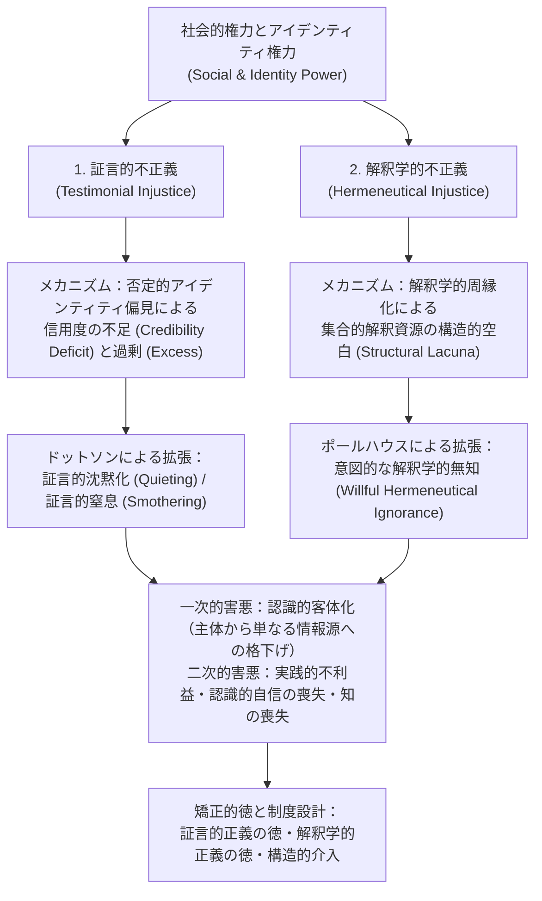
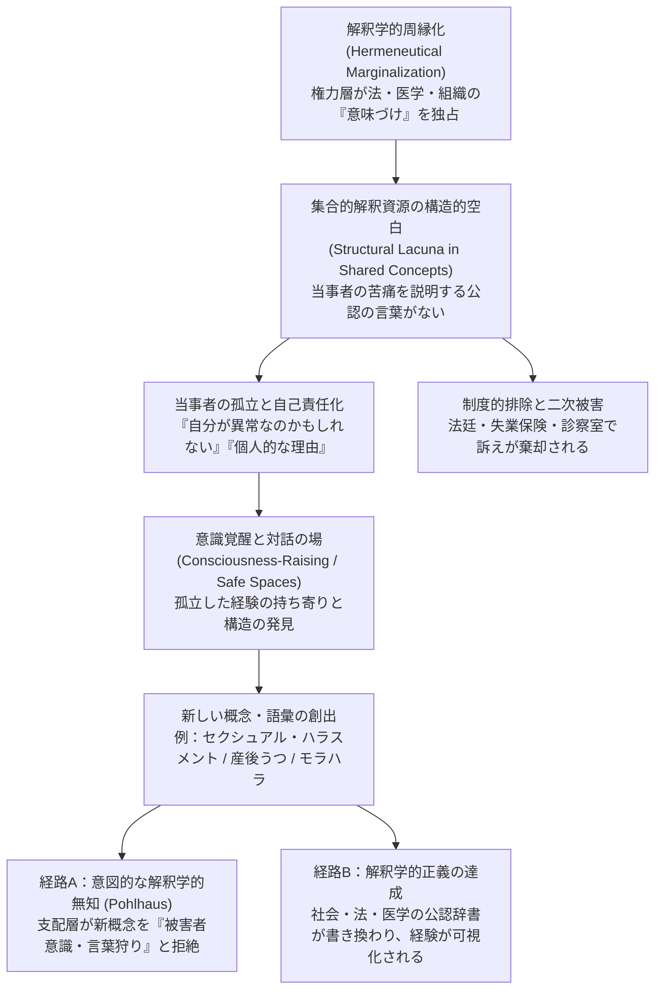

会議室である若手社員や女性エンジニアが、プロジェクトの致命的な構造欠陥について論理的な懸念を表明する。しかし、周囲の参加者は微妙な沈黙を保つか、「少し心配しすぎではないか」「感覚的な話ではなくデータで語ろう」と軽く受け流す。ところがその15分後、ベテランの男性管理職がまったく同じ懸念を別の言葉で繰り返した瞬間、会議室中の空気が一変し、「さすがの洞察だ」「すぐに調査チームを立ち上げよう」と絶賛される——。

あるいは、診察室で患者が自らの身体の激しい痛みや違和感を必死に訴えているにもかかわらず、医師から「ストレスや気のせいでしょう」「大げさに考えすぎです」と取り合ってもらえず、数年後に初めて重篤な自己免疫疾患であったことが判明する。あるいは、ハラスメントや構造的な搾取を受けている当事者が、自分の身に起きている苦痛を説明しようとしても、社会にまだそれを指し示す適切な「概念」や「語彙」が存在しないために、「ただの被害妄想」「個人的な人間関係のもつれ」として片付けられてしまう。

なぜ、<strong>まったく同じ論理的構造と証拠価値を持つ発言であっても、「誰が語るか」によってこれほど残酷なまでに信用度の格差が生じるのでしょうか</strong>。また、なぜ特定の社会集団の経験だけが、長年にわたって「語ることすらできない空白」として放置されてきたのでしょうか。

2007年、イギリスの哲学者<strong>ミランダ・フリッカー（Miranda Fricker）</strong>は、オックスフォード大学出版局から刊行された記念碑的著作『認識的不正義——権力と知ることの倫理（*Epistemic Injustice: Power and the Ethics of Knowing*）』において、この現象に明確な哲学的概念と分析枠組みを与えました。それが<strong>「認識的不正義（Epistemic Injustice）」</strong>です。

それまでの伝統的な分析認識論（Analytic Epistemology）は、「主体 $S$ が命題 $p$ を知っている（$S$ knows that $p$）」という条件を分析する際、認識主体 $S$ を性別・人種・階級・肩書き・身体的属性から切り離された「抽象的で交換可能な記号」として扱ってきました。しかしフリッカーは、フェミニスト認識論や社会認識論（Social Epistemology）の知見を統合し、現実の知識伝達は常に<strong>社会的権力（Social Power）</strong>の磁場の中で行われており、人間が<strong>「知る主体（知の伝達者）としての能力において固有の仕方で傷つけられる不正義」</strong>が存在することを暴き出したのです。

本稿では、フリッカーが定式化した二つの柱——<strong>「証言的不正義（Testimonial Injustice）」</strong>と<strong>「解釈学的不正義（Hermeneutical Injustice）」</strong>——を軸に、パトリシア・ハイスミスやハーパー・リーの文学的事例、セクシュアル・ハラスメント概念誕生の歴史、ベイズ主義認識論による信用度歪曲の数理モデル、クリスティ・ドットソンやホセ・メディナによる批判的拡張、さらには現代の医療・組織マネジメント・AI（大規模言語モデル）における認識的不正義までを包括的に徹底解説します。

---

## 1. 認識的不正義の全体像：知識と倫理が交差する場所

私たちが「不正義（Injustice）」という言葉を聞くとき、通常思い浮かべるのは、富や資源や機会が不公平に配分される「分配的不正義（Distributive Injustice）」や、法の下の平等が踏みにじられる「手続き的不正義（Procedural Injustice）」です。これに対し、ミランダ・フリッカーが提起した<strong>認識的不正義（Epistemic Injustice）</strong>とは、ある人物に対して、特に<strong>「認識者（knower：知識を持ち、他者に知識を伝え、自らの経験を理解する主体）としての資格や能力においてなされる不正義」</strong>を指します。

フリッカーは、認識的不正義を大きく二つの形態に分類しました。

1. <strong>証言的不正義（Testimonial Injustice）</strong>：聞き手（Hearer）が抱くアイデンティティ上の偏見（Identity Prejudice）によって、話し手（Speaker）の言葉に対する<strong>信用度（Credibility）が不当に低く見積もられること</strong>で生じる不正義。たとえば、女性であること、マイノリティであること、非正規雇用であること、訛りがあることなどを理由に、その人の証言や専門的判断が軽く扱われるケースです。
2. <strong>解釈学的不正義（Hermeneutical Injustice）</strong>：社会全体が共有している「概念や語彙の資源（集合的解釈資源：Collective Hermeneutical Resource）」に構造的な欠落があるために、周縁化された人々が<strong>自分自身の社会的経験を理解したり、他者に伝達可能な言葉で表現したりする上で不当な不利益を被る不正義</strong>。たとえば、「セクシュアル・ハラスメント」や「産後うつ」という言葉が存在しなかった時代に、被害者が自分の苦痛をうまく言語化できず孤立していたケースです。

まずは、認識的不正義の全体アーキテクチャを以下の構造図で確認しましょう。

この図が示す通り、認識的不正義は単なる「個人のコミュニケーション不全」や「たまたま相手が話を聞いてくれなかったという不運」ではありません。その背後には、社会の想像力を規定する<strong>アイデンティティ権力（Identity Power）</strong>と、誰が社会の「意味や語彙」を作るプロセスに参加できているかという構造的非対称性が横たわっています。

---

## 2. 社会的権力とアイデンティティ権力の解剖学

なぜ聞き手は、目の前の話し手の言葉をありのままの証拠価値で評価できないのでしょうか。フリッカーはこの問いに答えるため、まず<strong>「社会的権力（Social Power）」</strong>の概念を精緻化します。

彼女によれば、社会的権力とは「社会的行為者が他者の行動をコントロールするために持つ、実践的かつ社会的に位置づけられた能力」です。重要なのは、権力には特定の人物が意図的に行使する<strong>「能動的（Agential）な側面」</strong>だけでなく、誰も直接命令していないにもかかわらず社会の構造や共有されたイメージによって自動的に作動する<strong>「受動的・構造的（Structural）な側面」</strong>があるという点です。

この社会的権力のうち、特に「共有された社会的想像力におけるアイデンティティの捉え方（ジェンダー、人種、階級、年齢、学歴、職位、障害の有無など）」に直接依存して作動する権力を、フリッカーは<strong>「アイデンティティ権力（Identity Power）」</strong>と呼びます。

### 証言交換におけるヒューリスティクスとステレオタイプ

私たちが 일상生活や職場で他者の発言（証言：Testimony）から知識を得ようとするとき、すべての発言の裏付けデータをゼロから自分で検証する時間はありません。したがって聞き手は、話し手が<strong>「能力（Competence：真実を知っているか）」</strong>と<strong>「誠実さ（Sincerity：嘘をついていないか）」</strong>を備えているかを、瞬時に見積もる必要があります。

このとき人間の認知システムは、相手の外見、話し方、肩書き、属性などから信用度を推論する<strong>ステレオタイプ（Stereotypes）</strong>をヒューリスティクス（近道計算）として利用します。「白衣を着た医師の言うことは医学的に正確だろう」「地元の漁師が言うなら今日の海は荒れるのだろう」といった信頼できるステレオタイプは、日常の認識的実践において不可欠です。

しかし、このヒューリスティクスに<strong>「否定的アイデンティティ偏見的ステレオタイプ（Negative Identity-Prejudicial Stereotype）」</strong>が混入したとき、認識システムは深刻な機能不全を起こします。フリッカーは偏見（Prejudice）を単なる「事前判断（Pre-judgment）」から区別し、次のように定義します。

> <strong>否定的アイデンティティ偏見（Negative Identity Prejudice）</strong>とは、特定の社会集団と一つ以上の否定的属性（非論理的、感情的、知的に劣る、不誠実など）とを結びつける広く共有された連想であり、<strong>何らかの情動的・利害的な投資（Affective Investment）によって、反証（Counter-evidence）に対して有責な抵抗を示す判断</strong>である。

ここでの核心は、偏見がしばしば<strong>「当人の意識的な信念（Belief）と矛盾して作動する」</strong>という点です。たとえば、意識の上では「男女は知的に完全に平等であり、女性エンジニアも男性と全く同じ能力を持っている」と心から信じているリベラルな管理職であっても、社会の集合的想像力に刷り込まれたステレオタイプ（男性＝論理的・権威的、女性＝感情的・補助的）が<strong>暗黙の知覚的判断（Perceptual Judgment）</strong>として作動し、女性エンジニアの発言を聞いた瞬間に「なんだか根拠が薄そうだ」「ヒステリックに聞こえる」と感じてしまうのです。

---

## 3. 証言的不正義（Testimonial Injustice）：信用度の不足・過剰と古典的事例分析

聞き手の側のアイデンティティ偏見によって、話し手の発言に対する信用度が本来与えられるべき水準よりも不当に割り引かれる現象——これが<strong>「信用度の不足（Credibility Deficit）」</strong>であり、証言的不正義の中心事例です。

フリッカーは、あらゆる信用度の不足が同じ重みを持つわけではないとし、<strong>「偶発的（Incidental）な証言的不正義」</strong>と<strong>「体系的（Systematic）な証言的不正義」</strong>を明確に区別します。

たとえば、ある科学会議で特定のマイナーな研究手法をとる学者が、査読者の狭い学派的偏見のせいで不当に発表を軽視されたとします。これは局所的な証言的不正義ではありますが、その学者が会議室を一歩出て、銀行でローンを組んだり、警察に被害届を出したり、病院で診察を受けたりする場面にまでその偏見が追いかけてくるわけではありません。

これに対し、人種やジェンダーや貧困などに基づく偏見は、経済・教育・司法・医療・政治といった社会のあらゆる領域にわたって当事者を追跡します。フリッカーはこれを<strong>「追跡型偏見（Tracker Prejudice）」</strong>と呼び、追跡型偏見によって引き起こされる<strong>体系的な証言的不正義</strong>こそが、個人の人生と尊厳を根底から蝕む中心的な不正義であると論じました。

フリッカーが『認識的不正義』の中で詳細に分析した、文学・映画史上の二つの象徴的な事例を見てみましょう。

### 事例1：『リプリー（The Talented Mr. Ripley）』におけるマージ・シャーウッドの沈黙化

パトリシア・ハイスミスの小説およびアンソニー・ミンゲラ監督の映画『リプリー』において、富豪の息子ディッキー・グリーンリーフがイタリアで謎の失踪を遂げます（実際には、親友を装ったトム・リプリーによって殺害され、成り代わられています）。

ディッキーの恋人であった<strong>マージ・シャーウッド（Marge Sherwood）</strong>は、ディッキーの性格や日常の習慣を誰よりも深く知っていました。彼女は、ディッキーが決して外さないはずの指輪がトムの部屋から見つかったことや、ディッキーの自殺説の不自然さなど、数々の客観的・状況的証拠を積み上げ、「彼を殺したのはトム・リプリーに違いない」という極めて合理的で正しい推論に到達します。

しかし、ディッキーの父親である大富豪<strong>ハーバート・グリーンリーフ（Herbert Greenleaf）</strong>は、トム・リプリーの巧みなごまかしを信じ込み、必死に真相を訴えるマージに対して、優しく、しかし決定的な拒絶を込めてこう言い放ちます。

> <strong>「マージ、女性の直感というものがある。そして、事実というものがあるのだよ（Marge, there's female intuition, and then there are facts.）」</strong>

この短いセリフの中に、アイデンティティ権力と証言的不正義の恐るべきメカニズムが凝縮されています。ハーバートはマージを怒鳴りつけたり暴力で脅したりしているわけではありません。むしろ「恋人を失って取り乱している繊細な女性」をなだめる温情主義的（パターナリスティック）な態度をとっています。しかし、そのジェンダー・ステレオタイプによって、マージが提示した<strong>「事実と論理に基づく推論」は自動的に「女性の直感（＝非合理的で感情的な思い込み）」へと格下げ</strong>され、彼女は「事実を語り、推論を共有する理性的主体」の輪から完全に排除されてしまったのです。

### 事例2：『アラバマ物語（To Kill a Mockingbird）』におけるトム・ロビンソンの裁判

さらに過酷で命に関わる事例が、ハーパー・リーの小説『アラバマ物語』に描かれた1935年アメリカ南部アラバマ州メイコム郡での裁判です。黒人青年<strong>トム・ロビンソン（Tom Robinson）</strong>は、白人女性メイエラ・ユーエルを強姦したという無実の罪で起訴されます。

弁護士アティカス・フィンチは法廷で、メイエラの顔の殴打痕が左利きの人間によるものであること、そしてトム・ロビンソンの左腕は幼少期に綿繰り機の事故で完全に機能を失っており、物理的に犯行が不可能であることを完璧に立証します。実際、メイエラを殴ったのは彼女の父親ボブ・ユーエルでした。

しかし、検察官から「なぜお前は頼まれるままに何度もメイエラの家の家事を手伝ったのか」と問われた際、トムは正直に<strong>「彼女がとても気の毒に思えたからです（I felt right sorry for her）」</strong>と証言します。その瞬間、白人全員で構成された陪審員たちの間に激しい嫌悪と動揺が走ります。当時の人種差別的なアイデンティティ権力の下では、「黒人が白人に対して同情（sorry）を抱く」という事態そのものが、白人優位の秩序を脅かす傲慢な越権行為として知覚されたのです。

結果として陪審員たちは、物理的証拠とトムの誠実な証言を一切受け入れることができず、有罪評決を下します。後にトムは脱走を試みて射殺されます。ここでは、人種的偏見による極限の「信用度の不足」が、一人の人間の認識的主体性を破壊しただけでなく、文字通りその生命を奪う結果へと直結しました。

### ホセ・メディナによる批判的展開：「信用度の過剰（Credibility Excess）」と比例的視点

フリッカーは当初、証言的不正義の本質はあくまで「信用度の不足（Deficit）」にあり、逆に特権的な立場にある人物が実力以上に信用される<strong>「信用度の過剰（Credibility Excess）」</strong>は、長期的にはその人物を甘やかして傲慢にする弊害はあるものの、それ自体が「その瞬間に当人を傷つける認識的不正義」とは言えないと論じました。なぜなら、信用度とは富やパイのように総量が決まっている有限財ではなく、誰かを多く信用したからといって別の誰かの信用が減るわけではないと考えたからです。

これに対し、社会認識論者の<strong>ホセ・メディナ（José Medina）</strong>は著書『抵抗の認識論（*The Epistemology of Resistance*）』（2013年）において、鋭い批判を展開しました。メディナは、現実の社会的文脈（法廷での原告と被告の対決、会議室での企画採用、医療現場での医師と患者の対話）において、<strong>信用度の評価は常に「比較と相互作用（Interactive & Comparative）」の中で行われている</strong>と指摘します。

トム・ロビンソンの信用度が不当にゼロへと切り下げられたのは、まさに白人であるユーエル父娘に対して不当な「信用度の過剰（白人なのだから黒人に対して嘘をつくはずがないという盲信）」が与えられていたことと表裏一体です。また、組織のトップやカリスマ的専門家に過剰な信用（無謬性の神話）が付与され続けると、その人物は他者の反論に耳を貸さない<strong>「認識的傲慢さ（Epistemic Arrogance）」</strong>や<strong>「認識的怠惰（Epistemic Laziness）」</strong>という悪徳（Epistemic Vices）を内面化し、結果として周囲のスタッフの証言を構造的に押し潰すようになります。

以下の表は、証言的歪曲の4つの類型を整理したものです。

| 証言的歪曲の類型 | 信用度への作用 | 作動するメカニズム | 代表的な具体例 |
| :--- | :--- | :--- | :--- |
| <strong>体系的な信用度の不足</strong> *(Systematic Credibility Deficit)* | 大幅な割引 ($\delta_{	ext{bias}} \gg 0$) | ジェンダー・人種・階層などの「追跡型偏見（Tracker Prejudice）」が全生活領域で作動 | トム・ロビンソンの法廷証言、マージの推論の却下、女性・マイノリティ研究者の業績過小評価 |
| <strong>偶発的な信用度の不足</strong> *(Incidental Credibility Deficit)* | 局所的な割引 | 特定の狭い専門領域や一時的な文脈でのみ作動する非追跡型の偏見 | 特定のマイナーな研究手法をとる学者に対する学会内での一時的な冷遇 |
| <strong>特権的な信用度の過剰</strong> *(Credibility Excess)* | 不当な水増し ($\gamma_{	ext{excess}} > 1$) | 権威・肩書き・マジョリティ属性に対する盲目的な信頼と無謬視 | カリスマ経営者や高学歴エリートの発言が根拠薄弱でも無批判に採用され、認識的傲慢を生む現象 |
| <strong>事前の証言的排除</strong> *(Pre-emptive Testimonial Injustice)* | 証言機会そのものの剥奪 ($w_S = 0$) | 偏見に基づき「そもそもこの集団に意見を聞く必要はない」と最初から情報収集の対象外にする | 現場の非正規労働者や当事者を最初から意思決定会議やヒアリングに呼ばない組織慣行 |

---

## 4. 形式認識論とベイズ更新による証言歪曲の数理モデル

ここで、証言的不正義が私たちの「合理的推論」や「組織の意思決定精度」をどのように破壊するのかを、<strong>形式認識論（Formal Epistemology）およびベイズ統計学（Bayesian Updating）</strong>の枠組みを用いて数理的に定式化してみましょう。

ある仮説 $H$（例：「この設計には重大な欠陥がある」「この患者は重篤な疾患を抱えている」「容疑者は無実である」）の真偽を、聞き手（意思決定者）が判断する状況を考えます。聞き手が事前に持っている仮説 $H$ の事前確率を $P(H) \in (0, 1)$ とします。

ここで、話し手 $S$ が「仮説 $H$ は真である」という証言（証拠）$E_S$ を提示したとします。ベイズの定理によれば、証言 $E_S$ を受け取った後の事後確率 $P(H \mid E_S)$ は次のように表されます。

$$P(H \mid E_S) = rac{P(E_S \mid H) P(H)}{P(E_S \mid H) P(H) + P(E_S \mid 
eg H) P(
eg H)}$$

この式の挙動を決定づけるのは、以下の二つの条件付き確率から成る<strong>尤度比（Likelihood Ratio）</strong> $\Lambda_S$ です。

* <strong>真陽性率（能力・感度：Competence）</strong>：$c_S = P(E_S \mid H)$。実際に仮説 $H$ が真であるときに、話し手 $S$ がそれを正しく検知して「$H$ である」と証言する確率。
* <strong>偽陽性率（誤報・不誠実・ノイズ率：False Alarm / Insincerity）</strong>：$f_S = P(E_S \mid 
eg H)$。実際には仮説 $H$ が偽（$
eg H$）であるにもかかわらず、話し手 $S$ が勘違いやパニックや嘘によって「$H$ である」と証言してしまう確率。

客観的に信頼できる情報提供者であれば、$c_S > f_S$ であり、客観的な尤度比 $\Lambda_S = rac{c_S}{f_S} > 1$ となります。

### アイデンティティ偏見パラメータ $\delta_{	ext{bias}}$ による尤度比の歪曲

ところが、聞き手が話し手 $S$ の社会的属性に対して<strong>アイデンティティ偏見パラメータ $\delta_{	ext{bias}} \in [0, 1]$</strong> を抱いている場合、聞き手は客観的な $(c_S, f_S)$ をそのまま使うのではなく、主観的に歪められた知覚パラメータ $(\hat{c}_S, \hat{f}_S)$ を用いてベイズ更新を行います。

具体的には、偏見 $\delta_{	ext{bias}}$ は話し手の知的能力を割り引き（$\hat{c}_S$ の低下）、同時に「感情的で大げさに騒いでいるだけだ（偽陽性が高い）」という見積もりを水増し（$\hat{f}_S$ の上昇）させます。これを線形補間モデルで表すと次のようになります。

$$\hat{c}_S = (1 - \delta_{	ext{bias}}) c_S + \delta_{	ext{bias}} f_S$$

$$\hat{f}_S = f_S + \delta_{	ext{bias}} (c_S - f_S)$$

このとき、聞き手が知覚する主観的尤度比 $\hat{\Lambda}_S$ は次のように減衰します。

$$\hat{\Lambda}_S(\delta_{	ext{bias}}) = rac{\hat{c}_S}{\hat{f}_S} = rac{(1 - \delta_{	ext{bias}}) c_S + \delta_{	ext{bias}} f_S}{f_S + \delta_{	ext{bias}} (c_S - f_S)}$$

この式から、極めて重要な3つの極限的性質が導かれます。

1. <strong>偏見がない理想状態（$\delta_{	ext{bias}} = 0$）</strong>：$\hat{\Lambda}_S(0) = rac{c_S}{f_S} = \Lambda_S$ となり、話し手の証言は客観的な証拠価値どおりに事後確率を引き上げます。
2. <strong>中程度の偏見（$0 < \delta_{	ext{bias}} < rac{1}{2}$）</strong>：$1 < \hat{\Lambda}_S < \Lambda_S$ となり、同じ発言であっても偏見を持たれない特権的話し手（$\delta_{	ext{bias}} = 0$）に比べて、事後確率の更新幅が著しく小さくなります。そのため、「彼女が言ったときは動かなかったのに、その後で男性管理職が言ったら初めて閾値を超えて採用された」という現象が数学的に説明されます。
3. <strong>極限的な証言的排除・客体化（$\delta_{	ext{bias}} = rac{1}{2}$）</strong>：分子と分母がともに $rac{c_S + f_S}{2}$ となり、<strong>$\hat{\Lambda}_S\left(rac{1}{2}
ight) = 1$</strong> となります。尤度比が $1$ になるとき、ベイズ更新式は $P(H \mid E_S) = P(H)$ となり、<strong>話し手がどれほど必死に言葉を重ねても、聞き手の信念は $1$ ミリも動かない（証言が完全なホワイトノイズとして処理される）</strong>という「認識的抹消」が発生します。

### 組織内での逐次証言集約と対数オッズ比の崩壊

さらに、組織内で複数のメンバー $t = 1, 2, \dots, T$ が順番に発言していく集団的意思決定を、対数オッズ比（Log-Odds）の加法モデルで表現してみましょう。各話し手 $S_t$ に対する聞き手の主観的な信用重みを $w_{S_t} \ge 0$ とすると、$T$ 人の発言を経た後の組織の事後対数オッズは次式で与えられます。

$$\log rac{P_T(H)}{1 - P_T(H)} = \log rac{P_0(H)}{1 - P_0(H)} + \sum_{t=1}^{T} w_{S_t} \log \Lambda_{S_t}$$

ここで、現場の最前線で異常（$\Lambda_{S_t} \gg 1$）を直接目撃している若手エンジニア、看護師、非正規スタッフたちの信用重み $w_{S_{	ext{frontline}}}$ がアイデンティティ偏見によって $w_{S_{	ext{frontline}}} pprox 0$ に抑え込まれ、逆に現場の実態を知らないまま「問題ない（$\Lambda_{S_{	ext{exec}}} < 1$）」と楽観論を語る経営陣や上級管理職に過剰な信用重み $w_{S_{	ext{exec}}} = \gamma_{	ext{excess}} \gg 1$ が与えられているとします。

すると、現場から何十件もの危険シグナルが上がっているにもかかわらず、上層部のたった一人の「大丈夫だろう」という発言（負の対数尤度比 $	imes \gamma_{	ext{excess}}$）がそれらをすべて打ち消し、組織全体が破局的事故（チャレンジャー号爆発事故、医療過誤、不正会計の隠蔽など）へと突き進むことになります。つまり、<strong>認識的不正義とは単なる道徳的な不道徳であるだけでなく、組織や社会の集合知（Collective Intelligence）のセンサーを自ら破壊する致命的な認識論的バグ</strong>なのです。

---

## 5. 一次的害悪と二次的害悪：認識的客体化と自己不信のスパイラル

証言的不正義が被害者にもたらす傷（Harm）について、フリッカーは<strong>「一次的害悪（Primary Harm）」</strong>と<strong>「二次的害悪（Secondary Harm）」</strong>の二層構造で分析しています。

### 一次的害悪：情報提供者（Informant）から単なる情報源（Source of Information）への転落

一次的害悪とは、その不正義そのものに内在する本質的な害悪です。人間にとって「理性を働かせ、知識を他者に伝え、共同体の知識のプールに貢献すること」は、人間としての尊厳の最も中核的な能力の一つです。証言的不正義を受けるとき、人はまさにこの「人間としての根源的な能力」において侮辱され、傷つけられます。

フリッカーはここで、哲学者エドワード・クレイグ（Edward Craig）の『知識と自然状態（*Knowledge and the State of Nature*）』（1990年）の議論を援用し、<strong>「情報提供者（Informant）」</strong>と<strong>「単なる情報源（Source of Information）」</strong>という極めて重要な区別を導入します。

* <strong>単なる情報源（Source of Information）</strong>：切り株の年輪を見て樹齢を推測したり、泥のついた靴を見て「外は雨が降っている」と推測したりするように、<strong>対象を「意図や理性を持たないモノ（客体）」として観察し、そこから勝手に情報を読み取る態度</strong>です。
* <strong>情報提供者（Informant）</strong>：相手を「自分と同じく理性と判断力を持つ認識的主体（仲間）」として尊重し、相手が発する言葉を「理由の空間（Space of Reasons）」における証言として受け取る態度です。

たとえば、先ほどの『リプリー』のハーバート・グリーンリーフがマージの発言を聞いたとき、彼はマージから「情報」を引き出してはいます——ただしそれは、「ディッキーを殺したのはトムだ」という彼女の証言内容としてではなく、「ああ、マージは悲しみのあまり精神的に不安定になって妄想を抱いているのだな」という<strong>症状（情報源）として彼女を観察している</strong>にすぎません。

フリッカーはこれを<strong>「認識的客体化（Epistemic Objectification）」</strong>と呼びます。対話のパートナー（主体）であったはずの人間を、観察対象となるモノ（客体）へと引きずり下ろすこと——これが証言的不正義の一次的害悪です。

### 二次的害悪：実践的不利益と「認識的自信」の崩壊

二次的害悪はさらに<strong>「実践的（Practical）害悪」</strong>と<strong>「認識的（Epistemic）害悪」</strong>に分かれます。実践的害悪とは、無実の罪で有罪になる、正当な昇進や評価を逃す、適切な医療を受けられないといった具体的な不利益です。

しかし、それに劣らず深刻なのが二次的な<strong>「認識的害悪」</strong>です。人は誰しも、孤立した真空の中で自分の知的能力を確信し続けることはできません。自分の発言や判断が、周囲から繰り返し「考えすぎだ」「根拠がない」「感情的だ」と却下され続けると、被害者は次第に<strong>「認識的自信（Epistemic Confidence）」</strong>を失い、自分自身の知覚や推論能力そのものを疑うようになります。

認識論において、「主体 $S$ が命題 $p$ を知っている」と言えるためには、少なくとも「$S$ が $p$ を信じている（確信している）」という信念条件が必要です。もし持続的な証言的不正義によって $S$ が自信を喪失し、「自分の考えが間違っているのかもしれない」と信念 $p$ を手放してしまったなら、<strong>$S$ は本来持っていたはずの「知識（Knowledge）」そのものを文字通り奪われた（破壊された）</strong>ことになります。さらに長期的には、知的な勇気（Intellectual Courage）や探究心が萎縮し、教育や専門キャリアから撤退してしまうという「自己成就的予言」の罠に陥るのです。

---

## 6. クリスティ・ドットソンによる拡張：証言的沈黙化と証言的窒息

フリッカーの理論をさらに急進化させ、現代の社会認識論に決定的な影響を与えたのが、黒人フェミニスト哲学者<strong>クリスティ・ドットソン（Kristie Dotson）</strong>の論文「認識的暴力を追跡する、沈黙化の実践を追跡する（*Tracking Epistemic Violence, Tracking Practices of Silencing*）」（2011年）です。

ドットソンは、ガヤトリ・スピヴァクの「認識的暴力（Epistemic Violence）」の概念とジェニファー・ホーンズビーの言語行為論を結びつけ、発話（証言）が成功するためには「話し手」だけでなく「聞き手の適切な受け止め（Reciprocity / Uptake）」が不可欠であると論じました。聞き手側が構造的な無知——特に、他者を傷つける結果をもたらす<strong>「有害な無知（Pernicious Ignorance）」</strong>——を抱えているとき、そこには二つの異なる「沈黙化（Silencing）」の暴力が生じます。

### 1. 証言的沈黙化（Testimonial Quieting）

一つ目は、聞き手が話し手をそもそも「知識を持つ主体（Knower）」として認識することに失敗する<strong>「証言的沈黙化（Testimonial Quieting）」</strong>です。社会学者パトリシア・ヒル・コリンズが指摘したように、社会にはマイノリティや女性に対する「支配的イメージ（Controlling Images）」が流通しています。聞き手がそのステレオタイプの色眼鏡を通してしか相手を見ないとき、話し手がどれほど言葉を尽くしても、それは最初から「知識の表明」としてカウントされません。

### 2. 証言的窒息（Testimonial Smothering）：強制された自己検閲

ドットソンの最大の貢献は、二つ目の<strong>「証言的窒息（Testimonial Smothering）」</strong>を定式化したことにあります。これは、聞き手が発言を却下する以前に、<strong>話し手自身が「この聞き手に本当のことを話しても、正しく理解されないばかりか、かえって歪曲されて自分や仲間が傷つくだけだ」と察知し、自ら発言を切り詰めたり沈黙したりする（自己検閲する）現象</strong>です。

ドットソンによれば、証言的窒息は以下の3つの条件が揃ったときに発生します。

1. 語ろうとしている証言の内容が、社会的・感情的に<strong>リスクを含み、安全ではない（Unsafe and risky）</strong>こと。
2. 聞き手が、その内容を理解する上で<strong>証言的無능（Testimonial Incompetence：理解力の欠如）</strong>を示していること。
3. その理解力の欠如が、単なる知識不足ではなく、社会的立場に起因する<strong>有害な無知（Pernicious Ignorance）</strong>から生じていること。

たとえば、職場での微妙な人種差別やジェンダーバイアスについて、マイノリティの社員が上司に相談しようとしたとします。しかし、その上司が普段から「最近の若者はすぐハラスメントだと騒ぐ」といった態度（証言的無能のシグナル）を見せている場合、社員は「ここで被害を語れば、かえって『問題社員』というレッテルを貼られるだけだ」と判断し、「いえ、何でもありません」と自分の言葉を飲み込みます。

外側から見れば、その社員は「自分の意志で黙った（何も言わなかった）」ように見えます。しかしドットソンは、それを自発的な沈黙ではなく、有害な無知に満ちた環境によって<strong>自分の手で自分の口を塞ぐことを強いられた「窒息（Smothering）」という名の暴力</strong>であると喝破したのです。

同様に、作家の<strong>レベッカ・ソルニット（Rebecca Solnit）</strong>がエッセイ集『説教したがる男たち（*Men Explain Things to Me*）』（2014年）で描き出した現象——あるパーティーで年配の男性がソルニットに対し、今年出たばかりの非常に重要な本について延々と上から目線で解説し始めたが、実はその本の著者こそが目の前にいるソルニット本人であったという逸話——も、女性を最初から「教えられる客体」と見なす証言的沈黙化と、それによって当事者が発言意欲を削がれる構造を鮮やかに照射しています。

---

## 7. 解釈学的不正義（Hermeneutical Injustice）：経験を語る言葉が社会に存在しないとき

ここから、フリッカーのもう一つの巨大な柱である<strong>「解釈学的不正義（Hermeneutical Injustice）」</strong>へと議論を進めましょう。

証言的不正義が「個人対個人のコミュニケーションの場面」で信用度が割り引かれる問題であったのに対し、解釈学的不正義はさらに手前の段階——<strong>「そもそも自分の経験を自分自身で理解し、他者に伝えるための『言葉や概念』が社会に存在するかどうか」</strong>という構造的レベルの不正義です。

フリッカーは解釈学的不正義を次のように定義します。

> <strong>解釈学的不正義</strong>とは、集合的解釈資源における構造的なアイデンティティ偏見に起因して、<strong>自己の社会的経験の重要な領域が集合的理解から覆い隠されてしまう（意味不明瞭なまま放置される）という不正義</strong>である。

### 解釈学的周縁化（Hermeneutical Marginalization）と構造的空白

社会の中で共有されている語彙、概念、法的カテゴリー、医学的診断名、メタファーの総体を<strong>「集合的解釈資源（Collective Hermeneutical Resource）」</strong>と呼びます。では、この辞書や概念のプールは誰が作ってきたのでしょうか。

歴史的に見て、法律、医学、ジャーナリズム、学術研究、政治、企業経営といった「社会的な意味を生成し、公認のラベルを貼る力を持つ職業・制度」は、特定の特権的な社会集団によって独占されてきました。その結果、権力を持たない周縁化された集団（女性、労働者階級、性的マイノリティ、障害者、慢性疾患患者など）は、社会全体の「意味づけの実践（Meaning-making practices）」に平等に参加することができませんでした。フリッカーはこれを<strong>「解釈学的周縁化（Hermeneutical Marginalization）」</strong>と呼びます。

その結果どうなるか。支配的集団の経験に合致する事象には精密な概念や法律用語が次々と作られる一方で、周縁化された集団だけが被る固有の苦痛や搾取の経験が存在する場所には、<strong>ぽっかりと「概念の空白（Lacuna：穴）」が空いたまま放置される</strong>のです。フリッカーはこれを、「本来あるべき言葉が存在しない場所にある、オゾン層の穴のようなものだ」と表現しています。

### 古典的事例1：カーミタ・ウッドと「セクシュアル・ハラスメント」概念の誕生（1975年）

フリッカーが『認識的不正義』の第7章で最も劇的な事例として挙げているのが、スーザン・ブラウンミラーの回想録『私たちの時代に（*In Our Time*）』（1990年）に記録された、1975年のアメリカ・コーネル大学における<strong>カーミタ・ウッド（Carmita Wood）</strong>の事例です。

当時44歳で4人の子どもを育てていたカーミタ・ウッドは、コーネル大学の原子力物理学部門で8年間、行政アシスタントとして真面目に働いていました。しかし、部門の著名な教授が彼女に対して執拗な身体的接触を繰り返すようになります。彼女の目の前で股間を揺らす、エレベーターで追い詰めて無理やりキスをする、胸や腰に触れるといった行為が日常的に続きました。

ウッドはエレベーターを使わずに階段で移動し、トイレに隠れるなどして必死に自衛しましたが、強烈なストレスから首と背中に慢性的な神経痛と手足のしびれを発症し、ついに退職に追い込まれます。

その後、生活のために彼女が州の失業保険（Unemployment Insurance）を申請した際、決定的な壁が立ちはだかりました。窓口の調査官から「なぜ前職を辞めたのか」と問われたウッドは、自分が体験したおぞましい出来事を説明する<strong>公認の言葉（概念）を何一つ持っていなかった</strong>のです。当時のアメリカ社会には、まだ「セクシュアル・ハラスメント」という概念が存在しませんでした。そのため、職場でのそうした行為は「男が女を口説いている（Flirting）」「オフィスロマンスのもつれ」「過剰反応」という既存の歪んだフレームでしか解釈されませんでした。

言葉に詰まったウッドは、申請理由欄にただ<strong>「個人的な理由（Personal reasons）」</strong>と書くことしかできず、結果として「自己都合退職」と見なされ、失業保険の給付申請は却下されてしまいました。

転機が訪れたのは、コーネル大学の女性問題講師であったリン・ファーリー（Lin Farley）らが主宰する<strong>意識覚醒グループ（Consciousness-Raising Group）</strong>で、ウッドが自らの経験を打ち明けたときでした。話を聞いた女性たちは次々と「実は私も前の職場で全く同じ目に遭った」と語り始めました。彼女たちはそこで初めて、これが「個人の不運や自意識過剰」ではなく、職場における構造的な権力の乱用であることを集団的に突き止めたのです。

1975年春、彼女たちはウッドの失業保険不服申し立てを支援し、公聴会（Speak-out）を開くにあたって、この現象を的確に名指すための言葉をブレインストーミングしました。「経済的強制」「性的脅迫」などの候補の中から、最終的に選ばれたのが<strong>「セクシュアル・ハラスメント（Sexual Harassment）」</strong>という全く新しい概念でした。

この事例が示す哲学的洞察は極めて深遠です。「セクシュアル・ハラスメント」という言葉が存在しなかった時点では、加害者である教授も、被害者であるウッドも、失業保険の調査官も、全員が「同じ概念の空白（認知的不利）」の中にいました。しかし、<strong>その空白によって人生と健康と経済的基盤を破壊されていたのは圧倒的に被害者であるウッドの側でした</strong>。概念の欠落という一見「中立な空白」が、権力の非対称性と結びつくことで、弱者に対してのみ壊滅的な不利益として襲いかかる——これこそが解釈学的不正義の核心です。

### 古典的事例2：ウェンディ・サンフォードと「産後うつ（Postpartum Depression）」

もう一つの象徴的な事例が、1960年代後半のボストンで行われた女性の健康ワークショップにおける<strong>ウェンディ・サンフォード（Wendy Sanford）</strong>の体験です。出産後、深刻な無気力と抑うつ状態に陥っていた彼女は、周囲からも自分自身からも「生まれたばかりの我が子を無条件に愛せないなんて、母親として失格だ、人間として欠陥がある」と責め苛まれていました。

しかし、他の母親たちとの対話セッションの中で<strong>「産後うつ（Postpartum Depression）」</strong>という医学的・社会的名称に出会った瞬間、彼女の人生を覆っていた暗い霧が晴れました。「45分間の話し合いの中で、私がずっと自分のせいだと恥じていたものが、実は名前のある生理的・社会的現象だったと知ったのです」——名前（概念）を獲得することは、単なるラベル貼りではなく、<strong>理不尽な自己責任論と孤立から当事者を救い出し、認識的主体性を回復する解放のプロセス</strong>なのです。

### ゲイル・ポールハウス・ジュニア：「意図的な解釈学的無知（Willful Hermeneutical Ignorance）」

ここで、哲学者<strong>ゲイル・ポールハウス・ジュニア（Gaile Pohlhaus Jr.）</strong>が2012年の論文で提起した極めて重要な批判的発展、<strong>「意図的な解釈学的無知（Willful Hermeneutical Ignorance）」</strong>についても触れておく必要があります。

フリッカーの議論では、あたかも「社会全体が共通のたった一つの辞書（集合的解釈資源）を使っており、そこにまだ言葉が存在しない」かのように描かれていました。しかしポールハウスは、「周縁化された当事者たちは、自分たちのコミュニティの内部では、自分たちの苦痛や抑圧を表す豊かな言葉や概念をすでに作り出していることが多い」と指摘します。

問題は、社会に言葉が全く存在しないことではなく、<strong>特権的なマジョリティの側が、マイノリティや現場の人々が作り出した概念・語彙を「学ぶ必要のない特殊で主観的なスラング」「大げさな被害者意識の言葉」として拒絶し、理解しようとしないこと</strong>にあります。自らの特権的立場を守るために、他者の世界理解のツール（解釈資源）を受け入れることを能動的に拒むこの態度こそが、「意図的な解釈学的無知」です。

解釈学的不正義の発生から、概念の創出による解放（あるいは意図的無知による拒絶）までのダイナミズムを図解すると、次のようになります。

ここまで登場した4つの主要な認識的不正義・暴力の概念を、以下の比較マトリクスで整理しておきましょう。

| 概念名称 | 提唱者 | 問題の所在（ロカス） | 発生メカニズム | 当事者に起きる現象 |
| :--- | :--- | :--- | :--- | :--- |
| <strong>証言的不正義</strong> *(Testimonial Injustice)* | ミランダ・フリッカー (2007) | 聞き手の知覚・信用度評価システム | 聞き手のアイデンティティ偏見により、話し手の発言の信用度が不当に割り引かれる | 正しい事実や推論を語っても「感情的」「根拠薄弱」として退けられ、認識的に客体化される |
| <strong>証言的窒息</strong> *(Testimonial Smothering)* | クリスティ・ドットソン (2011) | 話し手と聞き手の関係性（有害な無知の察知） | 聞き手の有害な無知と理解不能性を察知した話し手が、二次被害を防ぐため自ら発言を断念する | 「言っても無駄・危険だ」と自己検閲し、外見上は自発的に沈黙しているように見える |
| <strong>解釈学的不正義</strong> *(Hermeneutical Injustice)* | ミランダ・フリッカー (2007) | 社会全体の集合的解釈資源（共有語彙・概念） | 解釈学的周縁化により、弱者の固有の経験を名指す概念が社会の辞書から欠落している | 自分が何の被害に遭っているのかを自分でもうまく理解・説明できず、孤立・自責に陥る |
| <strong>意図的な解釈学的無知</strong> *(Willful Hermeneutical Ignorance)* | ゲイル・ポールハウス Jr. (2012) | 支配的集団の概念受容態度 | 当事者集団がせっかく生み出した新しい概念や語彙を、マジョリティ側が学ぶことを拒絶する | 当事者が適切な言葉で構造的問題を訴えても、「大げさな造語」「被害妄想」と一蹴される |

---

## 8. 医療・組織・AIアルゴリズムにおける現代的展開

認識的不正義の理論は、今や哲学の枠を超え、医学哲学・組織論・AI倫理（人工知能の公平性研究）において最も強力な分析ツールとして応用されています。

### 1. 医療と精神医学における認識的不正義（ハヴィ・カレル＆イアン・ジェームズ・キッド）

医療哲学者<strong>ハヴィ・カレル（Havi Carel）</strong>と<strong>イアン・ジェームズ・キッド（Ian James Kidd）</strong>は、2014年以降の一連の共同研究において、医療現場こそが証言的不正義と解釈学的不正義の温床になりやすい構造を持っていることを明らかにしました。

* <strong>医療における証言的不正義</strong>：患者は病気や痛みによって肉体的・精神的に脆弱な状態にあるため、医療従事者から「認知的に不安定で、感情的で、客観性に欠ける存在」というステレオタイプを貼られやすくなります。特に女性の慢性疼痛、子宮内膜症、線維筋痛症、筋痛性脳脊髄炎（ME/CFS）、あるいは新型コロナ後遺症（Long COVID）などの患者が自らの激しい症状を訴えても、血液検査や画像診断に明確な数値が出ない限り、「心因性のもの」「ストレスのせい」として信用度を割り引かれ、診断までに平均して数年〜十数年もの歳月が費やされるケースが世界中で報告されています。
* <strong>医療における解釈学的不正義</strong>：近代生物医学（Biomedicine）の言語空間は、三人称的・定量的・機械論的なバイオマーカーを中心に構築されています。そのため、患者が一人称で生きている「病いの現象学的経験（Lived Experience of Illness：世界との関わり方の変容や実存的な違和感）」を語るための語彙が医学制度の側に決定的に不足しており、カルテの定型フォーマットから零れ落ちてしまうのです。

### 2. 組織マネジメントと「心理的安全性」の限界

近年の組織論では、エイミー・エドモンドソンが提唱した<strong>「心理的安全性（Psychological Safety）」</strong>——誰もが罰や恥を恐れずに発言できる環境——の重要性が広く叫ばれています。しかし、認識的不正義の観点から見ると、「現場の人にどんどん発言させよう」というスローガンだけでは問題は決して解決しません。

なぜなら、たとえ現場の社員が勇気を振り絞って発言したとしても、受け取る管理職の側に<strong>アイデンティティ偏見（正社員 vs 非正規、本社 vs 現場、エンジニア vs 営業、年長者 vs 若手）</strong>があれば、その発言は証言的不正義によって静かに割引・却下され、やがて社員たちは<strong>「証言的窒息（言っても無駄だから黙っていよう）」</strong>へと追い込まれるからです。さらに、組織の評価指標（KPI）や報告書フォーマットそのものが経営層の視点だけで作られていれば、現場で起きている構造的疲弊や倫理的リスクを記述するカテゴリー自体が存在しない（解釈学的不正義）という事態に陥ります。

### 3. アルゴリズム的認識的不正義（Algorithmic Epistemic Injustice）と大規模言語モデル

さらに今日、最も切実なフロンティアとなっているのが、AIや機械学習アルゴリズム、大規模言語モデル（LLM）における<strong>「アルゴリズム的認識的不正義（Algorithmic Epistemic Injustice）」</strong>です。

1. <strong>学習データにおける解釈学的周縁化</strong>：LLMの事前学習コーパスは、インターネット上に存在する膨大なテキストから構築されますが、そのテキストの大半は先進国の英語圏・都市部・高学歴層の書き手によって生産されたものです。そのため、少数言語や方言、周縁化されたコミュニティの生活経験や概念体系はベクトル空間（Embedding Space）において希薄にしか表現されず、AIによる要約や検索の過程で「標準的ではないノイズ」として消去されてしまいます。
2. <strong>スコアリングAIによる証言的客体化の自動化</strong>：医療トリアージAI、採用選考AI、融資審査AI、あるいは生活保護不正受給検知アルゴリズムなどが、過去の差別的バイアスを含んだデータを学習すると、特定の属性を持つ人々の自己申告（証言）に対して自動的に高いリスクスコア（低い信用重み $\hat{w}_S$）を割り当てます。しかも、人間の偏見であれば「あの審査官は偏見を持っている」と批判できますが、アルゴリズムの出力は<strong>「客観的で中立な数理計算の結果（Facts）」という権威の衣をまとっているため、被害者が異議申し立てを行うこと自体がこれまで以上に困難になる</strong>という二重の罠が生じるのです。

---

## 9. 矯正的徳と制度設計：認識的正義（Epistemic Justice）への処方箋

では、私たちはこの根深い認識的不正義に対して、個人として、また組織や社会としてどのように立ち向かうことができるのでしょうか。フリッカーおよび後続の社会認識論者たちは、<strong>「個人の認識的徳（Epistemic Virtues）の涵養」</strong>と<strong>「構造的・制度的デザイン（Institutional Design）」</strong>の両輪が必要であると結論づけています。

### 1. 証言的正義の徳（The Virtue of Testimonial Justice）：反省的・批判的開放性

聞き手である私たちは、自分の脳内に刷り込まれた社会のステレオタイプをボタン一つで消去することはできません。フリッカーが求める<strong>「証言的正義の徳」</strong>とは、自分自身の「自然な直感的信用度判断」を無批判に信じるのではなく、<strong>「今、私がこの人の話を胡散臭い（あるいは逆に、無条件に素晴らしい）と感じているのは、相手の社会的アイデンティティに対する私の偏見や権威主義が作用しているからではないか？」とメタ認知的に反省し、割引された信用度を意識的に上方修正する習慣的感受性</strong>です。

先ほどのベイズ更新の数理モデルで言えば、自らの内なる偏見による割引量 $\hat{\delta}_{	ext{reflexive}}$ を自己監視によって推定し、主観的信用重み $\hat{w}_S$ に対して次のような<strong>矯正的補正（Corrective Adjustment）</strong>を施すことに相当します。

$$w_S^{	ext{corrected}} = 	ext{clip}\left(\hat{w}_S + \hat{\delta}_{	ext{reflexive}}(I_S, I_H), \, 0, \, 1
ight)$$

ここで $I_S$ は話し手のアイデンティティ、$I_H$ は聞き手自身のアイデンティティです。「自分の直感をそのまま信じない」という認識的謙虚さ（Epistemic Humility）こそが、証言的正義の第一歩となります。

### 2. 解釈学的正義の徳（The Virtue of Hermeneutical Justice）：まだ言葉にならない苦痛への傾聴

一方、目の前の相手が何かを訴えようとしているのに、話が支離滅裂に見えたり、既存のどんなカテゴリーにも当てはまらなかったりするとき、私たちはつい「この人は何を言いたいのか分からない」「単なる個人的な愚痴だ」と切り捨ててしまいがちです。

フリッカーが説く<strong>「解釈学的正義の徳」</strong>とは、相手がうまく言葉を紡げないときに、<strong>「それは話し手の知的能力の欠如や嘘のせいではなく、私たちが共有している社会の辞書（解釈資源）の側に、まだその経験を言い表す言葉が欠けているからではないか？」と警戒し、相手と共に新しい言葉を探すように耳を傾ける態度</strong>です。

### 3. 構造的・制度的デザイン（エリザベス・アンダーソンの制度的認識論）

最後に、哲学者<strong>エリザベス・アンダーソン（Elizabeth Anderson）</strong>が論文「社会制度の徳としての認識的正義（*Epistemic Justice as a Virtue of Social Institutions*）」（2012年）で強調したように、個人の道徳的努力（徳）だけに頼るのではなく、偏見が自動的に中和されるような<strong>制度的アーキテクチャ</strong>を構築することが不可欠です。

* <strong>属性情報のブラインド化（Blind Review）</strong>：オーケストラのオーディションで衝立（スクリーン）を導入したことで女性奏者の合格率が劇的に向上した有名な事例のように、論文査読、採用選考、社内提案制度などにおいて、可能な限り提案者の肩書き・性別・年齢・所属を伏せた状態で議論の中身だけを評価する仕組みを導入すること。
* <strong>「復唱・増幅（Amplification）」の連帯プラクティス</strong>：オバマ政権下のホワイトハウスで女性スタッフたちが実践した手法として知られるように、会議でマイノリティや若手のメンバーが重要な発言をした際、周囲のメンバーが意識的に「今、〇〇さんが指摘した点は極めて重要ですね。〇〇さんの提案によれば……」と<strong>発言者の名前と功績を明示して復唱・増幅し、信用の横取り（Hepeating）や黙殺を防ぐ</strong>こと。
* <strong>解釈学的インキュベーター（対話空間）の制度化</strong>：既存のKPIや業務日報のチェックリストだけで現場を管理するのではなく、現場の当事者や患者やマイノリティ同士が「まだ名前のついていない違和感や摩耗」を安全な環境で語り合い、そこからボトムアップで組織の新しい概念や評価軸を作り出せるフィードバック回路を設けること。

---

## 結びに代えて：「誰が語っているか」の呪縛を解き、「まだ語られていない言葉」を聴くために

ミランダ・フリッカーが切り拓いた「認識的不正義」の哲学は、私たち一人ひとりに対して、極めて鋭い倫理的・認識論的な問いを突きつけています。

私たちは日々、誰かの言葉を「論理的で説得力がある」と称賛し、別の誰かの言葉を「感情的で取るに足らない」と切り捨てています。また、既存の社会の語彙でうまく説明できない他者の苦しみを、「大げさだ」「自己責任だ」と片付けてしまう誘惑に常にさらされています。

しかし、もし私たちのその「もっともらしさの感覚（Credibility Judgment）」そのものが、不平等なアイデンティティ権力によって歪められたレンズを通したものであり、もし私たちが使っている「常識的な言葉の辞書」そのものが、歴史的な排除の上に作られた穴だらけの辞書なのだとしたらどうでしょうか。

他者の声に正当な重みを返し、まだ名前のない苦痛に新しい言葉を共に与えていくこと——それは単なる「優しさ」や「配慮」にとどまるものではありません。それは、他者を「モノ（情報源）」から「対等な理性的主体（情報提供者）」へと回復させる最も根源的な倫理的実践であり、同時に、私たち自身の社会をより深い真理と確かな知識へと開いていくための、唯一にして最良の認識論的戦略なのです。
