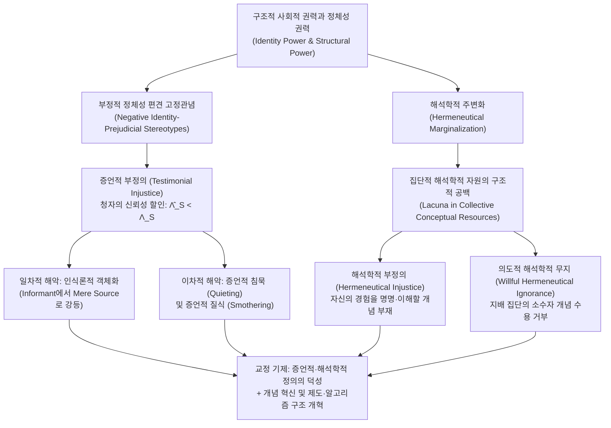

## 서론: ‘아는 주체(Knower)’로서의 자격이 부당하게 부정당할 때

전통적인 정치철학과 윤리학에서 ‘부정의(Injustice)’는 주로 두 가지 범주로 논의되어 왔다. 하나는 부, 의료, 교육 등 물질적 자원과 사회적 기회의 불평등한 배분을 다루는 <strong>분배적 부정의(Distributive Injustice)</strong>이며, 다른 하나는 법적 절차나 계약 집행의 편파성을 다루는 <strong>절차적 부정의(Procedural Injustice)</strong>이다. 그러나 인간 사회의 심층 구조에는 세 번째의, 훨씬 더 교묘하면서도 치명적인 부정의가 작동하고 있다. 어떤 사람이 단지 투표권이나 소득을 박탈당해서가 아니라, 자신의 사회적 정체성 때문에 말을 꺼내는 순간 그 발언의 무게가 체계적으로 깎아내려지거나, 부당한 고통을 겪고도 사회 전체의 언어 체계 안에 자신의 경험을 명명하고 설명할 개념 자체가 존재하지 않는 상태에 놓이는 것이다.

2007년 영국의 철학자 <strong>미란다 프리커(Miranda Fricker)</strong>는 기념비적 저서 『인식론적 부정의: 권력과 앎의 윤리』(<em>Epistemic Injustice: Power and the Ethics of Knowing</em>)를 출간하며 인식론과 윤리학, 정치권력 이론을 유기적으로 결합한 <strong>인식론적 부정의(Epistemic Injustice)</strong>라는 핵심 개념을 제시했다. 인식론적 부정의란 <strong>어떤 사람이 특별히 ‘아는 주체(Knower)’ 또는 ‘지식 전달자’로서의 자격과 능력에 있어서 부당하게 입는 해악</strong>을 뜻한다.

왜 누군가의 말을 믿어주지 않거나 자신의 경험을 설명할 단어를 갖지 못하는 것이 단순한 의사소통의 실패를 넘어 심각한 윤리적·정치적 폭력이 되는지를 이해하려면, 사회인식론(Social Epistemology)의 핵심 메커니즘을 살펴보아야 한다. 프리커는 인식론적 부정의를 담화 교환의 층위에서 발생하는 <strong>증언적 부정의(Testimonial Injustice)</strong>와 집단적 개념 자원의 층위에서 발생하는 <strong>해석학적 부정의(Hermeneutical Injustice)</strong>라는 두 가지 기본 형태로 구분한다. 본고에서는 정체성 권력의 작동 방식, 신뢰성 평가의 베이지안 형식 모델, 인식론적 객체화의 윤리적 해악부터 현대 의료 현장과 대규모 언어 모델(LLM)의 알고리즘적 배제에 이르기까지 인식론적 부정의의 전모를 체계적으로 고찰한다.

---

## 제1장 사회적 권력, 정체성 권력, 그리고 고정관념의 인식론적 작동

### 1.1 사회적 권력과 정체성 권력(Identity Power)

고전적인 데카르트적 개인주의 인식론에서 인식 주체는 사회적·역사적 맥락으로부터 분리된 고립된 이성적 개인(‘코기토’)으로 추상화되었다. 그러나 현실 세계에서 우리가 획득하는 지식의 대다수는 타인의 증언(Testimony)과 사회가 공유하는 언어적 개념 체계에 의존한다. 지식은 본질적으로 사회적이며, 따라서 필연적으로 <strong>사회적 권력(Social Power)</strong>에 의해 매개된다.

프리커는 사회적 권력을 “사회적 행위자(개인 또는 집단)가 특정 사회적 환경에서 다른 행위자들의 행동과 처지에 영향을 미칠 수 있는 실제적 또는 잠재적 능력”으로 정의한다. 다양한 사회적 권력의 형태 중 인식론적 부정의를 직접적으로 촉발하는 것은 <strong>정체성 권력(Identity Power)</strong>이다. 정체성 권력은 물리적 폭력이나 행정 명령에 의존하지 않으며, 행위자들 사이에 공유된 ‘집단적 사회적 상상(Collective Social Imagination)’—즉 남성이나 여성, 백인이나 유색인종, 시스젠더나 트랜스젠더, 의사나 환자, 엘리트 학자나 비정규직 노동자로 존재한다는 것이 무엇을 의미하는지에 관한 문화적 각본과 암묵적 전제—에 의존하여 작동한다. 정체성 권력은 능동적일 수도 있고(예: 가부장적 권위를 지닌 남성이 눈빛이나 말투만으로 젊은 여성의 발언을 제지하는 경우), 순수하게 구조적일 수도 있다(예: 소외 계층이 발언권의 무력함을 내면화하여 공적 영역에서 증언하기를 스스로 포기하는 경우).

### 1.2 발견법적 고정관념과 부정적 정체성 편견 고정관념

일상적인 정보 교환에서 청자(Hearer, $H$)는 화자(Speaker, $S$)의 <strong>신뢰성(Credibility)</strong>을 즉각적으로 평가해야 한다. 청자가 매 대화마다 화자의 과거 정직성 기록이나 전문성을 완벽히 검증하는 것은 불가능하므로, 인간의 인지는 불가피하게 <strong>고정관념(Stereotypes)</strong>—특정 사회적 집단과 그 신뢰성 특성에 관한 일반화된 연상—을 신뢰성 평가의 <strong>인지적 발견법(Heuristic)</strong>으로 사용한다.

모든 고정관념이 비합리적이거나 비윤리적인 것은 아니다. “천체물리학자가 우주론 문제에서 점성술사보다 신뢰할 만하다”거나 “지역 어부가 연안 조류에 대해 관광객보다 정확히 안다”는 경험적 일반화에 기대어 경청하는 것은 합리적인 발견법이다. 증언적 부정의를 일으키는 주범은 <strong>부정적 정체성 편견 고정관념(Negative Identity-Prejudicial Stereotype)</strong>이다. 프리커는 이를 다음과 같이 엄밀하게 정의한다.

> 특정 사회적 집단에 대한 광범위한 일반화 또는 연상으로서, 그 집단의 구성원을 비하적인 속성(특히 비이성적임, 감정적 과잉, 부정직함, 지적 열등함 등)과 결합시키는 것. 이 일반화는 객관적 경험 증거에 기반하지 않으며, 청자의 정서적 적대감이나 우월감, 기득권과 맞물려 있기 때문에 반증 사례(Counter-Evidence)에 직면하더라도 <strong>수정에 강하게 저항하는 성질(Resistance to Counter-Evidence)</strong>을 지닌다.

이러한 부정적 정체성 편견이 청자의 신뢰성 지각에 개입할 때, 화자의 말은 그 논리적 타당성과 무관하게 구조적으로 왜곡된다.

---

## 제2장 증언적 부정의(Testimonial Injustice): 신뢰성 결핍과 과잉

### 2.1 체계적 증언적 부정의와 우발적 증언적 부정의

청자가 화자의 사회적 정체성에 대한 편견 때문에 화자의 발언에 마땅히 부여해야 할 것보다 낮은 신뢰성을 부여할 때, 화자는 <strong>신뢰성 결핍(Credibility Deficit)</strong>을 겪는다. 프리커는 이를 두 가지 유형으로 구분한다.

1. <strong>우발적 증언적 부정의(Incidental Testimonial Injustice)</strong>: 국지적이고 비구조적인 편견에서 비롯된다. 예를 들어 학술 심사위원이 특정 희귀 곤충을 연구하는 학자들을 근거 없이 ‘괴짜이고 엄밀하지 못하다’고 편견을 가져 그 학자의 증언을 불신하는 경우이다. 이는 부당하지만, 그 편견이 해당 학자를 법정, 병원, 은행 등 삶의 다른 영역까지 집요하게 따라다니며 억압하지는 않는다.
2. <strong>체계적 증언적 부정의(Systematic Testimonial Injustice)</strong>: 인식론적 부정의의 <strong>핵심 사례(Central Case)</strong>이다. 신뢰성 결핍을 유발하는 정체성 편견(인종차별, 성차별, 계급차별, 장애인차별 등)이 주체를 사회 구조의 여러 차원(경제, 법률, 정치, 교육, 의료)에 걸쳐 지속적으로 <strong>추적(Track)</strong>하며 불리한 위치에 놓이게 만든다. 바로 이 영역 간 체계적 추적성이 단순한 인지적 오류를 구조적 사회 억압으로 전환시킨다.

### 2.2 두 가지 고전적 사례: 마지 셔우드와 톰 로빈슨

체계적 증언적 부정의의 메커니즘을 구체화하기 위해 프리커는 문학 속 두 가지 대표적 장면을 정밀하게 분석한다.

* <strong>『리플리』(<em>The Talented Mr. Ripley</em>)의 마지 셔우드(Marge Sherwood)</strong>: 1950년대를 배경으로 한 이 작품에서 부유한 청년 디키 그린리프는 톰 리플리에게 살해당한다. 디키의 약혼녀 마지는 디키의 성격과 습관을 누구보다 깊이 알고 있었다. 그녀는 디키가 절대 빼지 않던 반지가 리플리의 손에 있는 것을 발견하고 일련의 정황 증거를 종합하여 디키가 자살했을 리 없으며 리플리에게 살해당했음을 추론한다. 그녀의 추론은 인식론적으로 매우 치밀하고 타당했다. 그러나 디키의 아버지 허버트 그린리프(Herbert Greenleaf)는 남성 연대의 체면을 지키기 위해 가부장적인 한마디로 마지의 증언을 묵살한다. <strong>“마지, 세상에는 여자의 직관이라는 게 있고, 객관적인 사실이라는 게 있단다(Marge, there's female intuition, and then there are facts).”</strong> 여기서 여성을 ‘감정적이고 비논리적이며 직관에나 의존하는 존재’로 규정하는 가부장적 정체성 편견은, 마지의 합리적 추론을 ‘히스테리컬한 여성의 직관’으로 격하시키고 심각한 신뢰성 결핍을 부과한다.
* <strong>『앵무새 죽이기』(<em>To Kill a Mockingbird</em>)의 톰 로빈슨(Tom Robinson)</strong>: 1935년 미국 앨라배마주의 법정에서 흑인 청년 톰은 백인 여성 마옐라 유웰을 강간했다는 무고를 당한다. 변호사 애티커스 핀치는 톰의 왼팔이 완전히 마비되어 원고의 상처를 입히는 것이 물리적으로 불가능함을 명백한 증거로 입증했다. 그러나 검사가 왜 마옐라의 집안일을 대가 없이 도와주었느냐고 추궁하자, 톰은 정직하게 답한다. “그녀가 참 안쓰럽게 느껴졌습니다(I felt right sorry for her).” 이 말은 전원 백인으로 구성된 배심원단에게 즉각적인 인종주의적 분노와 인지적 거부감을 불러일으켰다. 짐 크로(Jim Crow) 시대의 백인 우월주의 정체성 권력 구조 안에서 ‘흑인이 감히 백인을 동정한다’는 것은 용납할 수 없는 월권이었고, ‘모든 흑인 남성은 성적인 문제에서 거짓말을 한다’는 것은 뿌리 깊은 인종 편견이었다. 배심원단은 완벽한 무죄 증거 앞에서도 톰의 증언을 믿을 수 없었고(또한 믿기를 거부했고), 결국 유죄 평결을 내려 그를 죽음으로 내몰았다.

### 2.3 신뢰성 과잉(Credibility Excess)과 인식론적 악덕

신뢰성 결핍의 반대편에는 <strong>신뢰성 과잉(Credibility Excess)</strong>이 존재한다. 화자가 특권적 사회적 정체성(백인, 시스젠더 남성, 명문대 엘리트, 고위 관료 등)을 가졌다는 이유만으로 객관적 증거나 실제 전문성 이상으로 과도한 신뢰를 부여받는 현상이다.

철학자 <strong>호세 메디나(José Medina)</strong>는 『저항의 인식론』(<em>The Epistemology of Resistance</em>, 2013)에서 신뢰성이 본질적으로 <strong>관계적·비교적·경쟁적 개념(Relational and Comparative Concept)</strong>임을 논증했다. 법정 공방이나 의료 진료, 직장 내 평가와 같은 상황에서 특권 집단에게 과잉 신뢰를 부여하는 것(예: 톰 리플리나 백인 원고 유웰의 말을 무조건 믿어주는 것)은 곧바로 소외 집단의 신뢰성을 박탈하는 결과를 낳는다. 나아가 평생 신뢰성 과잉의 온실 속에서 살아온 특권 주체는 자신의 발언이 정당한 비판에 직면한 적이 없기 때문에 세 가지 치명적인 <strong>인식론적 악덕(Epistemic Vices)</strong>에 빠지게 된다.
1. <strong>인식론적 오만(Epistemic Arrogance)</strong>: 자신이 모든 것을 알고 있으며 타인의 관점을 경청할 필요가 없다고 믿는 태도.
2. <strong>인식론적 나태(Epistemic Laziness)</strong>: 자신의 특권적 사각지대나 피억압자의 현실을 탐구하려는 인지적 동기의 결여.
3. <strong>인식론적 폐쇄성(Closed-mindedness)</strong>: 기존 질서에 도전하는 이견을 방어적으로 배척하는 태도.

---

## 제3장 신뢰성 할인과 편견 가중치의 베이지안 형식 모델

형식 인식론의 <strong>베이지안 신념 갱신 모델(Bayesian Belief Updating)</strong>을 활용하면 증언적 부정의에서의 신뢰성 결핍과 과잉을 수학적으로 엄밀하게 정식화할 수 있다.

청자가 특정 명제 $H$(예: “환자에게 급성 심근허혈이 있다” 또는 “피고인은 무죄이다”)에 대해 사전 확률 $P(H) \in (0, 1)$을 가지고 있다고 하자. 화자 $S$가 명제 $H$를 뒷받침하는 증언 $E_S$를 제공했을 때, 베이즈 정리에 따른 사후 확률은 다음과 같다.

$$P(H \mid E_S) = \frac{P(E_S \mid H) P(H)}{P(E_S \mid H) P(H) + P(E_S \mid \neg H) P(\neg H)}$$

여기서 $c_S = P(E_S \mid H)$는 명제 $H$가 참일 때 화자가 올바르게 증언할 신뢰도(<strong>능력 Competence</strong>과 <strong>성실성 Sincerity</strong>의 결합)이며, $f_S = P(E_S \mid \neg H)$는 명제 $H$가 거짓일 때 화자가 착오나 거짓말로 증언할 위양성률(False Positive Rate)이다. 화자 증언의 객관적 <strong>우도비(Likelihood Ratio)</strong>는 다음과 같이 정의된다.

$$\Lambda_S = \frac{P(E_S \mid H)}{P(E_S \mid \neg H)} = \frac{c_S}{f_S}$$

정체성 편견이 없는 이상적인 인식 주체라면 화자에 대한 주관적 신뢰성 추정치 $\hat{\Lambda}_S$는 객관적 우도비 $\Lambda_S$와 일치해야 한다. 그러나 청자가 화자의 집단 정체성에 대한 부정적 편견 파라미터 $\delta_{\text{bias}} \in [0, 1]$에 지배될 때, 청자는 무의식적으로 화자의 능력과 성실성을 낮게 평가하고 감정적 왜곡이나 기만 가능성을 높게 잡는다. 그 결과 주관적으로 지각된 우도비는 다음과 같이 왜곡된다.

$$\hat{\Lambda}_S(\delta_{\text{bias}}) = \frac{(1 - \delta_{\text{bias}}) c_S + \delta_{\text{bias}} f_S}{f_S + \delta_{\text{bias}} (c_S - f_S)}$$

이 수식으로부터 다음과 같은 인식론적 귀결이 도출된다.
* $\delta_{\text{bias}} = 0$(무편견)일 때: $\hat{\Lambda}_S(0) = \frac{c_S}{f_S} = \Lambda_S$가 되어 공정하고 합리적인 신념 갱신이 이루어진다.
* $0 < \delta_{\text{bias}} < 1$(부정적 정체성 편견 존재)이고 $c_S > f_S$일 때: 엄밀하게 $\hat{\Lambda}_S(\delta_{\text{bias}}) < \Lambda_S$가 성립하며, 주관적 사후 확률은 객관적으로 마땅한 수준보다 낮아진다($\hat{P}(H \mid E_S) < P^*(H \mid E_S)$). 두 값의 차이인 $\Delta C_S = \Lambda_S - \hat{\Lambda}_S(\delta_{\text{bias}}) > 0$이 바로 정량화된 <strong>신뢰성 결핍</strong>이다.
* $\delta_{\text{bias}} \to 1$(극단적 편견, 예: 『앵무새 죽이기』의 백인 배심원단)일 때: $\hat{\Lambda}_S(1) = 1$이 된다. 이 경우 화자의 증언이 객관적으로 아무리 확실하더라도 사후 확률은 사전 확률에 그대로 머물며($\hat{P}(H \mid E_S) = P(H)$), 화자의 증언은 인식론적으로 완전히 <strong>무효화(Epistemic Nullification)</strong>된다.

로그 승산(Log-Odds) 형태에서 $T$번의 증언 교환을 거친 누적 신념 갱신은 다음과 같이 표현된다.

$$\log \frac{P_T(H)}{1 - P_T(H)} = \log \frac{P_0(H)}{1 - P_0(H)} + \sum_{t=1}^{T} w_{S_t} \log \Lambda_{S_t}$$

여기서 $w_{S_t}$는 청자가 $t$번째 화자에게 부여하는 정체성 가중치이다. 소외 집단 $M$의 가중치가 체계적으로 억눌리고($w_M \ll 1$) 특권 집단 $P$의 가중치가 증폭될 때($w_P > 1$), 사회의 공적 지식 체계는 필연적으로 지배 집단의 편견으로 수렴하게 된다.

---

## 제4장 증언적 부정의의 심층 해악: 인식론적 객체화에서 증언적 질식까지

### 4.1 일차적 해악: 인식론적 객체화(Epistemic Objectification)

왜 누군가의 말을 믿어주지 않는 것이 그토록 깊은 도덕적 상처를 남기는가? 프리커는 증언적 부정의의 <strong>일차적 해악(Primary Harm)</strong>과 <strong>이차적 해악(Secondary Harm)</strong>을 구분한다.

일차적 해악은 <strong>내재적(Intrinsic)</strong>이다. 아리스토텔레스 이래로 이성과 지식을 나누는 능력은 인간 존엄성의 핵심으로 간주되어 왔다. 정체성 편견 때문에 지식 전달자로서의 자격을 부정당할 때, 그 사람은 상징적으로 ‘온전한 인간 이하의 존재’로 격하된다.

이를 정밀하게 설명하기 위해 프리커는 영국의 철학자 <strong>에드워드 크레이그(Edward Craig)</strong>가 『지식과 자연 상태』(<em>Knowledge and the State of Nature</em>, 1990)에서 제시한 핵심 구분을 도입한다.
* <strong>정보 제공자 / 증인(Informant)</strong>: 이성과 주체성, 판단력을 지닌 대화 파트너로 대우받는 존재로서, 인식 공동체의 신념 형성에 함께 참여하는 주체이다.
* <strong>단순한 정보원(Mere Source of Information)</strong>: 나무의 나이테가 수령을 알려주거나 진흙 위의 발자국이 누군가 지나갔음을 알려주듯, 객관적 정보를 추출할 뿐 이성적 대화 상대자로는 대우하지 않는 대상이다.

허버트 그린리프가 마지의 추론을 단지 ‘슬픔에 빠진 여성이 보이는 신경과민의 징후’로만 관찰할 때, 화자는 ‘인식 주체(Informant)’에서 ‘관찰되는 사물(Mere Source of Information)’로 강등된다. 이것이 칸트 윤리학의 성적 객체화(Sexual Objectification)에 대응하는 <strong>인식론적 객체화(Epistemic Objectification)</strong>이다.

### 4.2 이차적 해악: 실천적 박탈과 인식론적 자신감의 붕괴

이차적 해악은 <strong>실천적 차원(Practical Dimension)</strong>과 <strong>인식론적 차원(Epistemic Dimension)</strong>으로 나뉜다.
* <strong>실천적 해악</strong>: 억울한 유죄 판결과 투옥, 응급실에서 통증 호소가 묵살되어 발생하는 치료 지연과 사망, 직장에서의 부당한 평가 절하 등이다.
* <strong>인식론적 해악</strong>: 만성적인 신뢰성 결핍 환경에 노출된 주체는 점차 <strong>인식론적 자신감(Epistemic Confidence)</strong>을 상실한다. 지식이 성립하기 위해서는 주체가 확고한 신념을 유지해야 하는데, 끊임없는 외부의 불신으로 자기 의심이 내면화되면 피해자는 <strong>자신이 원래 정당하게 알고 있던 지식마저 실제로 상실</strong>하게 되며, 자아 형성(Bildung)의 과정이 파괴된다.

### 4.3 증언적 침묵(Quieting)과 증언적 질식(Smothering)

미국의 흑인 페미니스트 철학자 <strong>크리스티 닷슨(Kristie Dotson)</strong>은 2011년 논문 「인식론적 폭력의 추적」(<em>Tracking Epistemic Violence, Tracking Practices of Silencing</em>)에서 화행 이론(Speech Act Theory)을 바탕으로 두 가지 체계적 침묵화 기제를 규명했다.

1. <strong>증언적 침묵화(Testimonial Quieting)</strong>: 청자가 화자의 정체성에 대한 고정관념(예: 패트리샤 힐 콜린스가 분석한 흑인 여성에 대한 ‘복지 여왕’, ‘화난 흑인 여성’ 등의 통제 이미지 Controlling Images)을 내면화하여 화자를 아예 <strong>인식 주체로 식별하지조차 못하는 현상</strong>이다.
2. <strong>증언적 질식(Testimonial Smothering)</strong>: 이는 <strong>강요된 자기 검열(Coerced Self-Silencing)</strong>이다. 소외 집단 화자가 첫째, 자신이 말하려는 내용이 위험하고 복잡하며, 둘째, 눈앞의 청자가 명백한 <strong>증언적 무능(Testimonial Incompetence)</strong>을 보여 그 발언을 편견에 찬 방식으로 오독하고 오히려 소수자 집단 전체를 해칠 위험이 있음을 감지할 때(예: 소수인종 여성이 백인 경찰 앞에서 공동체 내부의 가정폭력을 증언할 경우 인종차별적 낙인이 강화될까 두려워하는 상황), 화자는 입을 열기 전에 스스로 말을 삼켜버린다. 겉으로는 자발적 침묵처럼 보이지만 실제로는 구조적 폭력이 목을 조르는 질식이다.

아울러 <strong>리베카 솔닛(Rebecca Solnit)</strong>이 『남자들은 자꾸 나를 가르치려 든다』(<em>Men Explain Things to Me</em>, 2014)에서 분석한 <strong>‘맨스플레인(Mansplaining)’</strong>은 가부장적 정체성 권력이 만들어낸 ‘남성의 신뢰성 과잉’과 ‘여성의 신뢰성 결핍’이 일상 대화에서 동시에 폭발하는 대표적 사례이다.

---

## 제5장 해석학적 부정의(Hermeneutical Injustice): 집단적 의미의 공백과 의도적 무지

### 5.1 해석학적 주변화와 개념적 공백

증언적 부정의가 개인 간의 의사소통 단계에서 발생한다면, <strong>해석학적 부정의(Hermeneutical Injustice)</strong>는 그보다 더 근원적인 구조적 층위—사회 전체가 공유하는 <strong>집단적 해석학적 자원(Collective Hermeneutical Resources)</strong>(어휘, 개념, 은유, 법적 범주, 사회적 설명 틀) 자체에 구조적 결락이 존재하는 상태—에서 발생한다.

왜 사회의 사전에는 특정 경험을 가리키는 단어가 빠져 있는가? 법률, 의학 진단 기준, 주류 언론, 학문 등 의미를 생성하고 공인하는 실천(Meaning-Making Practices)을 역사적으로 지배 집단이 독점해 왔기 때문이다. 피억압 집단은 이러한 과정에 동등하게 참여하지 못하는 <strong>해석학적 주변화(Hermeneutical Marginalization)</strong>를 겪는다. 그 결과 집단적 개념 체계는 강자의 경험은 정교하게 개념화하면서도 약자 특유의 고통과 억압 경험에 대해서는 거대한 <strong>해석학적 공백(Hermeneutical Lacuna)</strong>을 남겨둔다.

프리커는 해석학적 부정의를 다음과 같이 정의한다. <strong>집단적 해석학적 자원에 존재하는 구조적 정체성 권력 편향의 공백으로 인해, 특정 사회적 집단이 자신의 중대한 사회적 경험을 스스로 이해하고 타인에게 전달하려 할 때 겪게 되는 부당하고 심각한 인지적 불이익.</strong>

### 5.2 카미타 우드(Carmita Wood)와 ‘성희롱(Sexual Harassment)’ 개념의 탄생

프리커는 수전 브라운밀러의 기록에 등장하는 실존 인물 <strong>카미타 우드(Carmita Wood)</strong>의 사례를 해석학적 부정의의 전형으로 제시한다.

1975년 미국 코넬 대학교 핵물리학과 행정 직원이었던 카미타 우드는 저명한 원로 교수로부터 지속적인 신체 접촉과 음란한 암시, 엘리베이터 가로막기 등의 괴롭힘을 당했다. 극심한 스트레스와 만성 통증에 시달리던 그녀는 결국 사직서를 내고 노동청에 실업급여를 신청했다. 그러나 담당 직원이 퇴사 사유를 물었을 때 그녀는 극심한 당혹감과 실어증에 빠졌다. 1975년의 영어 어휘와 법적 개념 안에는 ‘상호 합의하의 사내 연애/장난(Flirting)’이나 극단적인 ‘강간(Rape)’만 있었을 뿐, <strong>직장 내 권력 관계를 이용한 이러한 체계적 침해를 가리키는 단어가 아예 존재하지 않았기 때문</strong>이다. 그녀는 어쩔 수 없이 ‘개인적 사유’라고 적었고, 실업급여 신청은 기각되었다.

이후 우드는 <strong>린 팔리(Lin Farley)</strong>가 이끄는 여성 의식 고양 모임(Consciousness-Raising Group)에 참여하여 수많은 여성들이 똑같은 고통을 겪어왔음을 확인했다. 그녀들은 공청회를 준비하며 이 현상을 정확히 지칭할 새로운 개념을 함께 주조해 냈는데, 그것이 바로 <strong>‘성희롱(Sexual Harassment)’</strong>이었다. 개념의 탄생은 피해자들이 자신의 고통을 이해하고 법적·정치적 투쟁을 전개할 수 있게 만든 인식론적 해방이었다. ‘산후우울증’, ‘마이크로어그레션(미세차별)’, ‘가스라이팅’ 등의 개념 역시 동일한 해석학적 저항의 산물이다.

### 5.3 의도적 해석학적 무지(Willful Hermeneutical Ignorance)

철학자 <strong>게일 폴하우스(Gaile Pohlhaus Jr.)</strong>(2012)와 크리스티 닷슨은 프리커의 모델을 한 단계 더 확장했다. 소외 집단은 오랜 저항 속에서 이미 자신들만의 풍부한 <strong>대안적 해석학적 자원(Alternative Hermeneutical Resources)</strong>을 발전시켜 왔다. 문제는 개념이 아예 없는 것이 아니라, 특권 집단이 자신의 기득권을 지키기 위해 <strong>소외 집단이 이미 만들어낸 개념 도구들을 배우거나 인정하기를 적극적으로 거부</strong>하며 이를 ‘피해망상’이나 ‘정치적 올바름의 과잉’으로 치부한다는 점이다. 폴하우스는 이를 <strong>의도적 해석학적 무지(Willful Hermeneutical Ignorance)</strong>라 불렀고, 닷슨은 이를 제3의 범주인 <strong>기여적 부정의(Contributory Injustice)</strong>로 명명했다.

---

## 제6장 현대적 확장: 의료 보건과 인공지능(AI)에서의 인식론적 부정의

| 비교 차원 | 증언적 부정의 (Testimonial Injustice) | 해석학적 부정의 (Hermeneutical Injustice) | 의도적 해석학적 무지 / 기여적 부정의 (Contributory Injustice) |
| :--- | :--- | :--- | :--- |
| <strong>발생 층위</strong> | 개인·기관 간의 담화 교환 및 증거 평가 | 사회가 공유하는 집단적 개념·언어·설명 틀 | 다원적 개념 체계 간의 권력 배제 및 제도적 봉쇄 |
| <strong>직접적 원인</strong> | 청자의 부정적 정체성 편견 작동 ($\delta_{\text{bias}} > 0$) | 소외 집단의 의미 생성 실천으로부터의 배제 | 지배 집단이 소외 집단의 기존 개념 자원을 거부함 |
| <strong>핵심 메커니즘</strong> | 신뢰성 결핍 ($\hat{\Lambda}_S < \Lambda_S$) 및 신뢰성 과잉 | 집단적 해석학적 공백 (Hermeneutical Lacuna) | 편향된 해석학적 자원의 고집과 인지적 방어 |
| <strong>대표적 사례</strong> | 마지 셔우드, 톰 로빈슨, 응급실 통증 호소 묵살 | 1975년 이전 카미타 우드의 ‘성희롱’ 명명 불가 | 구조적 인종차별이나 만성 희귀질환 개념의 부정 |
| <strong>교정 및 해결책</strong> | 성찰적 비판 의식, 증언적 정의의 덕성, 절차 개혁 | 의식 고양 공동체, 개념 혁신, 지식 생산의 민주화 | 인식론적 겸손, 다원적 관점 수용, AI 코퍼스 및 제도 개혁 |

### 6.1 임상 의학과 정신의학에서의 인식론적 부정의

철학자 <strong>하비 카렐(Havi Carel)</strong>과 이언 키드(Ian James Kidd)는 의료 현장에서 발생하는 인식론적 부정의를 심도 있게 규명했다.
* <strong>환자 증언의 체계적 할인</strong>: 생물의학적 권위 구조 속에서 만성 통증 환자(섬유근육통, 자궁내막증, 롱코비드 등)나 여성·소수인종·정신질환 환자의 증상 보고는 흔히 ‘감정적 과장’이나 ‘심리적 불안’으로 치부된다. 실제로 응급실에서 동일한 통증을 호소하더라도 여성과 흑인 환자는 백인 남성보다 진통제를 처방받기까지 훨씬 오랜 시간이 걸린다는 실증 연구가 이를 뒷받침한다.
* <strong>질병 경험의 해석학적 공백</strong>: 병원의 표준화된 통증 척도(1~10점)와 기계적 진단명은 환자가 겪는 실존적 고통과 신체적 소외감을 담아내지 못하며, 환자의 고유한 현상학적 서사를 주변화한다.

### 6.2 인공지능과 대규모 언어 모델(LLM)의 알고리즘적 인식론적 부정의

생성형 AI 시대에 인식론적 부정의는 <strong>대규모 언어 모델(LLM)</strong>과 자동화된 의사결정 시스템의 가중치 행렬 속으로 코드화되고 있다.
1. <strong>자동화된 증언적 부정의(Automated Testimonial Injustice)</strong>: 의료 분류 알고리즘, 신용 평가 모델, 사법 보석 심사 AI가 역사적 편견이 담긴 데이터로 학습될 때, 특정 성별·인종·거주지 집단의 자기 보고나 소명 데이터에 낮은 신뢰 가중치를 부여하여 정체성 편견을 ‘객관적 수학 점수’로 세탁한다.
2. <strong>알고리즘적 해석학적 삭제(Algorithmic Hermeneutical Erasure)</strong>: LLM의 사전 학습 코퍼스와 인간 피드백 기반 강화학습(RLHF)은 서구·영어권·주류 엘리트 담론에 극단적으로 편중되어 있다. 그 결과 글로벌 사우스(Global South), 소수 언어, 지역 방언 및 주변부 공동체의 개념 틀은 임베딩 공간(Embedding Space)의 외곽으로 밀려나며, AI가 사회의 기본 지식 중재자가 될수록 소수자의 삶과 경험은 디지털 공론장에서 다시금 ‘말할 수 없고 검색되지 않는 유령’으로 지워질 위험에 처한다.

---

## 결론: 개인적 덕 윤리에서 구조적 인식론적 민주주의로

인식론적 부정의에 맞서기 위해 프리커는 청자가 함양해야 할 두 가지 반(反)편견의 덕성, 즉 <strong>증언적 정의의 덕성(Virtue of Testimonial Justice)</strong>—자신의 신뢰성 판단에 정체성 편견이 개입했는지를 성찰적으로 검열하고 할인된 신뢰성을 상향 교정하는 능력—과 <strong>해석학적 정의의 덕성(Virtue of Hermeneutical Justice)</strong>—화자의 어눌한 표현 이면에 집단적 개념 자원의 공백이 있음을 감지하고 열린 태도로 경청하는 능력—을 제시했다.

그러나 엘리자베스 앤더슨(Elizabeth Anderson, 2012)이 지적하듯 암묵적 편견과 구조적 배제는 개인의 도덕적 성찰만으로는 극복될 수 없다. 진정한 인식론적 정의는 개인의 덕 윤리를 넘어 사법·의료 제도의 개혁, 지식 생산 주체의 민주화, 그리고 AI 학습 데이터와 정렬(Alignment) 과정의 다원적 거버넌스라는 <strong>구조적 개혁</strong>과 결합되어야만 완성될 수 있다.
