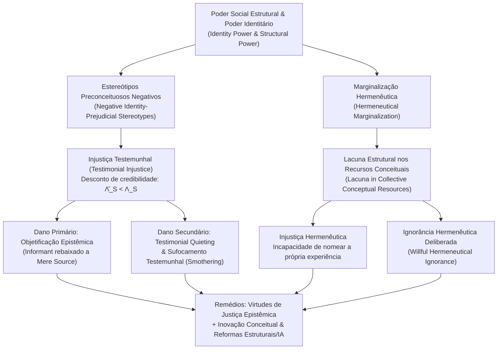

## Introdução: Quando a capacidade de ser um “sujeito cognoscente” é injustamente negada

Na filosofia política e na ética tradicionais, a “injustiça” costuma ser analisada sob duas grandes categorias: de um lado, a <strong>injustiça distributiva</strong>, que diz respeito à repartição desigual de bens materiais, renda, assistência médica ou oportunidades educacionais; de outro, a <strong>injustiça procedimental</strong>, ligada à parcialidade nos tribunais ou na aplicação das leis. Contudo, na estrutura profunda da vida social opera uma terceira forma de injustiça, mais sutil, porém igualmente devastadora: uma pessoa pode ser oprimida não apenas porque lhe negam recursos materiais ou direitos políticos, mas porque, em razão de sua identidade social, sua palavra sofre um desconto sistemático de credibilidade assim que ela começa a falar, ou porque no vocabulário compartilhado de sua sociedade sequer existem os conceitos necessários para nomear e tornar inteligível o sofrimento que ela vivencia.

Em 2007, a filósofa britânica <strong>Miranda Fricker</strong> publicou sua obra seminal <em>Epistemic Injustice: Power and the Ethics of Knowing</em> (<em>Injustiça Epistêmica: O Poder e a Ética do Conhecimento</em>), articulando de modo inédito a epistemologia, a ética e a teoria política do poder. Fricker cunhou o conceito de <strong>injustiça epistêmica (Epistemic Injustice)</strong> para designar <strong>um dano infligido a alguém especificamente em sua capacidade como sujeito cognoscente (Knower) e transmissor de conhecimento</strong>.

Para compreender por que não ser acreditado ou não dispor de palavras para explicar a própria experiência não é uma mera falha de comunicação, mas uma grave lesão ética e política, precisamos examinar os mecanismos da epistemologia social (Social Epistemology). Fricker divide a injustiça epistêmica em duas formas fundamentais: a <strong>injustiça testemunhal (Testimonial Injustice)</strong>, que ocorre na troca discursiva, e a <strong>injustiça hermenêutica (Hermeneutical Injustice)</strong>, que reside nas lacunas dos recursos conceituais coletivos. Este artigo analisa desde a operação do poder identitário e a modelagem bayesiana do déficit de credibilidade até a objetificação epistêmica, o sufocamento testemunhal e a exclusão algorítmica na medicina contemporânea e nos grandes modelos de linguagem (LLMs).

---

## Capítulo 1: Poder social, poder identitário e a operação epistêmica dos estereótipos

### 1.1 Poder social e poder identitário (Identity Power)

A epistemologia individualista clássica, de matriz cartesiana, concebia o sujeito do conhecimento como uma consciência isolada e abstraída de seu contexto histórico-social (“o cogito”). No mundo real, entretanto, a imensa maioria de nossos conhecimentos depende do <strong>testemunho alheio (Testimony)</strong> e de um repertório compartilhado de conceitos linguísticos. O conhecimento é intrinsecamente social e, portanto, inevitavelmente atravessado pelo <strong>poder social (Social Power)</strong>.

Fricker define o poder social como “a capacidade prática ou potencial que agentes sociais (indivíduos ou grupos) possuem dentro de determinado ambiente para influenciar ou controlar as ações e circunstâncias de outros agentes”. A modalidade específica de poder social que gera diretamente a injustiça epistêmica é o <strong>poder identitário (Identity Power)</strong>. Esse poder não precisa recorrer à coerção física nem a decretos administrativos: ele opera diretamente por meio da <strong>imaginação social coletiva (Collective Social Imagination)</strong> — isto é, os roteiros culturais compartilhados sobre o que significa ser homem ou mulher, branco ou negro, cisgênero ou transgênero, médico ou paciente, acadêmico ou trabalhador braçal. O poder identitário pode ser exercido de forma ativa (quando uma figura de autoridade patriarcal silencia uma mulher com um olhar ou tom condescendente) ou puramente estrutural (quando um grupo marginalizado desiste de antemão de testemunhar na esfera pública).

### 1.2 Estereótipos heurísticos versus estereótipos preconceituosos de identidade

Na comunicação cotidiana, o ouvinte (Hearer, $H$) precisa avaliar quase instantaneamente a <strong>credibilidade (Credibility)</strong> do falante (Speaker, $S$). Como é impossível realizar uma auditoria empírica completa do histórico de confiabilidade de cada interlocutor antes de cada conversa, a cognição humana recorre inevitavelmente a <strong>estereótipos</strong> — associações generalizadas entre um grupo social e determinados traços de confiabilidade — como <strong>heurística cognitiva</strong>.

Nem todo estereótipo é irracional ou imoral: confiar mais em uma astrofísica do que em um astrólogo sobre a física de buracos negros é uma heurística empiricamente fundamentada. A injustiça testemunhal surge quando o julgamento do ouvinte é distorcido por um <strong>estereótipo preconceituoso negativo de identidade (Negative Identity-Prejudicial Stereotype)</strong>, que Fricker define com rigor:

> Uma generalização ou associação amplamente difundida acerca de um grupo social que vincula seus membros a atributos depreciativos (especialmente falta de racionalidade, emotividade excessiva, desonestidade ou inferioridade intelectual), sem base em evidências empíricas objetivas, e que, devido a um investimento afetivo (hostilidade, sentimento de superioridade ou interesse adquirido), apresenta uma forte <strong>resistência à contraevidência (Resistance to Counter-Evidence)</strong>.

---

## Capítulo 2: Injustiça Testemunhal (Testimonial Injustice): Déficit e excesso de credibilidade

### 2.1 Injustiça testemunhal sistemática versus incidental

Quando o ouvinte, movido por um preconceito contra a identidade social do falante, atribui à sua palavra menos credibilidade do que ela merece segundo as evidências, o falante sofre um <strong>déficit de credibilidade (Credibility Deficit)</strong>. Fricker distingue dois casos:

1. <strong>Injustiça testemunhal incidental (Incidental Testimonial Injustice)</strong>: Decorre de um preconceito localizado e não estrutural (por exemplo, uma banca científica que desconfia infundadamente de pesquisadores dedicados a uma espécie rara de inseto). Embora injusto, esse preconceito não persegue o pesquisador em outras esferas de sua vida (nos tribunais, no hospital ou no banco).
2. <strong>Injustiça testemunhal sistemática (Systematic Testimonial Injustice)</strong>: Constitui o <strong>caso central (Central Case)</strong> da teoria. Aqui, o preconceito identitário (racismo, sexismo, classismo, capacitismo) <strong>rastreia e persegue (Tracks)</strong> o sujeito através de múltiplas dimensões da estrutura social — econômica, jurídica, política, educacional e médica. É esse rastreamento sistemático transversal que transforma um viés epistêmico em opressão estrutural.

### 2.2 Dois casos clássicos da literatura e da história: Marge Sherwood e Tom Robinson

Para demonstrar como opera a injustiça testemunhal sistemática, Fricker analisa duas cenas literárias emblemáticas:

* <strong>Marge Sherwood em <em>O Talentoso Ripley</em> (<em>The Talented Mr. Ripley</em>)</strong>: Na Itália dos anos 1950, o jovem rico Dickie Greenleaf é assassinado por Tom Ripley. Sua noiva, Marge Sherwood, conhece profundamente a psicologia e os hábitos de Dickie. Ao descobrir os anéis de Dickie em posse de Ripley e conectar diversas anomalias factuais, ela deduz de maneira perfeitamente racional que Dickie jamais teria cometido suicídio e que Ripley o matou. No entanto, o pai de Dickie, Herbert Greenleaf, descarta seu raciocínio com uma frase paternalista lapidar: <strong>“Marge, existe a intuição feminina, e existem os fatos (Marge, there's female intuition, and then there are facts).”</strong> O estereótipo patriarcal que codifica as mulheres como seres emocionais, histéricos e desprovidos de lógica leva Herbert a rebaixar uma inferência racional rigorosa à condição de mera “intuição feminina”, impondo a Marge um severo déficit de credibilidade.
* <strong>Tom Robinson em <em>O Sol é para Todos</em> (<em>To Kill a Mockingbird</em>)</strong>: No Alabama de 1935, o jovem trabalhador rural negro Tom Robinson é falsamente acusado de estuprar uma mulher branca, Mayella Ewell. Seu advogado de defesa, Atticus Finch, comprova por meio de provas físicas irrefutáveis (o braço esquerdo de Tom é totalmente atrofiado) que era fisicamente impossível que ele tivesse causado os ferimentos da acusadora. Mas, quando o promotor pergunta a Tom por que ele ajudava Mayella regularmente nas tarefas domésticas sem cobrar nada, Tom responde com sinceridade: “Eu sentia muita pena dela (I felt right sorry for her).” Na estrutura de poder identitário supremacista branca da era Jim Crow, o fato de um homem negro ousar sentir compaixão por uma mulher branca provoca indignação imediata no júri inteiramente branco; somado ao preconceito racista de que homens negros sempre mentem sobre questões sexuais, o júri é incapaz (e se recusa) a acreditar no testemunho de Tom, condenando-o à morte apesar da evidência cabal de sua inocência.

### 2.3 Excesso de credibilidade (Credibility Excess) e vícios epistêmicos

O reverso do déficit de credibilidade é o <strong>excesso de credibilidade (Credibility Excess)</strong>: quando um falante recebe, por sua identidade social privilegiada (homem branco, rico, diplomado em instituições de elite), uma confiança superior àquela justificada por sua competência real.

Como demonstrou o filósofo <strong>José Medina</strong> em <em>The Epistemology of Resistance</em> (2013), a credibilidade é um <strong>conceito relacional, comparativo e competitivo</strong>. Em um julgamento ou diagnóstico médico, conceder excesso de credibilidade ao privilegiado (como Tom Ripley ou a família Ewell) equivale diretamente a retirar credibilidade do marginalizado. Além disso, viver permanentemente cercado de excesso de credibilidade corrompe o caráter epistêmico dos privilegiados e gera três <strong>vícios epistêmicos (Epistemic Vices)</strong>:
1. <strong>Arrogância epistêmica (Epistemic Arrogance)</strong>: A ilusão de onisciência e infalibilidade cognitiva.
2. <strong>Preguiça epistêmica (Epistemic Laziness)</strong>: A falta de motivação para investigar as próprias zonas de cegueira privilegiada e a realidade dos oprimidos.
3. <strong>Fechamento mental (Closed-mindedness)</strong>: A rejeição defensiva de qualquer testemunho que desafie a ordem estabelecida.

---

## Capítulo 3: Modelo formal bayesiano do desconto de credibilidade

Podemos formalizar matematicamente o déficit e o excesso de credibilidade utilizando a <strong>atualização bayesiana de crenças (Bayesian Belief Updating)</strong>.

Suponhamos que um ouvinte atribua uma probabilidade a priori $P(H) \in (0, 1)$ a uma proposição $H$ (por exemplo: “A paciente sofre de isquemia miocárdica aguda” ou “O réu é inocente”). O falante $S$ apresenta o testemunho $E_S$ em favor de $H$. Pelo teorema de Bayes, a probabilidade a posteriori é:

$$P(H \mid E_S) = \frac{P(E_S \mid H) P(H)}{P(E_S \mid H) P(H) + P(E_S \mid \neg H) P(\neg H)}$$

Seja $c_S = P(E_S \mid H)$ a confiabilidade objetiva do falante quando $H$ é verdadeira (combinando <strong>competência Competence</strong> e <strong>sinceridade Sincerity</strong>), e seja $f_S = P(E_S \mid \neg H)$ a taxa de falsos positivos (erro ou mentira) quando $H$ é falsa. A <strong>razão de verossimilhança (Likelihood Ratio)</strong> objetiva do testemunho é:

$$\Lambda_S = \frac{P(E_S \mid H)}{P(E_S \mid \neg H)} = \frac{c_S}{f_S}$$

Em um agente epistêmico ideal livre de preconceitos, a estimativa subjetiva $\hat{\Lambda}_S$ iguala $\Lambda_S$. Contudo, quando o ouvinte é dominado por um parâmetro de preconceito identitário negativo $\delta_{\text{bias}} \in [0, 1]$ contra o grupo social de $S$, ele subestima a competência e a sinceridade do falante e superestima sua propensão ao erro ou à fraude, degradando a razão de verossimilhança percebida para:

$$\hat{\Lambda}_S(\delta_{\text{bias}}) = \frac{(1 - \delta_{\text{bias}}) c_S + \delta_{\text{bias}} f_S}{f_S + \delta_{\text{bias}} (c_S - f_S)}$$

Dessa equação decorrem três propriedades fundamentais:
* Quando $\delta_{\text{bias}} = 0$ (ausência de preconceito), $\hat{\Lambda}_S(0) = \frac{c_S}{f_S} = \Lambda_S$: a atualização é justa e racional.
* Quando $0 < \delta_{\text{bias}} < 1$ e $c_S > f_S$, tem-se estritamente $\hat{\Lambda}_S(\delta_{\text{bias}}) < \Lambda_S$, resultando em uma crença a posteriori inferior à devida: $\hat{P}(H \mid E_S) < P^*(H \mid E_S)$. A diferença $\Delta C_S = \Lambda_S - \hat{\Lambda}_S(\delta_{\text{bias}}) > 0$ quantifica o <strong>déficit de credibilidade</strong>.
* Quando $\delta_{\text{bias}} \to 1$ (preconceito absoluto, como no júri de <em>O Sol é para Todos</em>), $\hat{\Lambda}_S(1) = 1$, de modo que $\hat{P}(H \mid E_S) = P(H)$: o testemunho sofre uma <strong>anulação epistêmica total (Epistemic Nullification)</strong>.

Em termos de logaritmo de chances (Log-Odds) após $T$ testemunhos:

$$\log \frac{P_T(H)}{1 - P_T(H)} = \log \frac{P_0(H)}{1 - P_0(H)} + \sum_{t=1}^{T} w_{S_t} \log \Lambda_{S_t}$$

Quando os pesos identitários de grupos marginalizados são sistematicamente comprimidos ($w_M \ll 1$) e os dos grupos privilegiados são amplificados ($w_P > 1$), o conhecimento público converge estruturalmente para os vieses da classe dominante.

---

## Capítulo 4: Danos profundos: Da objetificação epistêmica ao sufocamento testemunhal

### 4.1 O dano primário: Objetificação epistêmica (Epistemic Objectification)

Fricker distingue entre o <strong>dano primário (intrínseco)</strong> e os <strong>danos secundários (consequenciais)</strong> da injustiça testemunhal. O dano primário atinge o âmago da dignidade humana: uma vez que a racionalidade e a partilha de conhecimento nos constituem enquanto pessoas, ser rebaixado como sujeito cognoscente por um preconceito identitário representa uma desumanização simbólica.

Baseando-se na distinção proposta pelo filósofo <strong>Edward Craig</strong> em <em>Knowledge and the State of Nature</em> (1990), Fricker diferencia entre:
* <strong>Informante (Informant)</strong>: Um sujeito racional tratado como parceiro discursivo legítimo na comunidade epistêmica.
* <strong>Mera fonte de informação (Mere Source of Information)</strong>: Um objeto ou estado natural — como os anéis de um tronco que indicam a idade da árvore ou pegadas na lama — do qual extraímos dados empíricos sem lhe reconhecer agência racional nem autoridade discursiva.

Quando Herbert Greenleaf trata as deduções de Marge apenas como “sintomas emocionais de uma mulher abalada”, ele a rebaixa de <em>informante</em> a <em>mera fonte de informação</em>. Trata-se da <strong>objetificação epistêmica (Epistemic Objectification)</strong>, análoga à objetificação sexual na ética kantiana.

### 4.2 Danos secundários, silenciamento (Quieting) e sufocamento testemunhal (Smothering)

Os danos secundários abrangem prejuízos <strong>práticos</strong> (condenações injustas, negligência médica letal, exclusão profissional) e <strong>epistêmicos</strong>: a erosão contínua da <strong>confiança epistêmica (Epistemic Confidence)</strong> leva a vítima a duvidar de suas próprias crenças verdadeiras e a <strong>perder efetivamente conhecimentos que possuía</strong>.

A filósofa feminista negra norte-americana <strong>Kristie Dotson</strong> (2011) identificou dois mecanismos adicionais de violência epistêmica:
1. <strong>Silenciamento testemunhal (Testimonial Quieting)</strong>: O público, dominado por “imagens de controle” estereotipadas (Controlling Images, segundo Patricia Hill Collins), sequer reconhece a falante como sujeito cognoscente.
2. <strong>Sufocamento testemunhal (Testimonial Smothering)</strong>: Uma forma de <strong>autocensura forçada</strong>. Quando a falante marginalizada percebe que seu relato é complexo e arriscado, e que o ouvinte padece de evidente <strong>incompetência testemunhal (Testimonial Incompetence)</strong> que o levará a distorcer suas palavras contra sua própria comunidade (por exemplo, uma mulher pertencente a uma minoria racial que silencia episódios de violência doméstica perante autoridades ou mídias racistas para não alimentar a estigmatização de seu grupo), ela decide truncar seu próprio discurso. Soma-se a isso o <strong>“mansplaining”</strong> analisado por <strong>Rebecca Solnit</strong> (2014), em que o excesso de credibilidade masculino e o déficit feminino colidem no cotidiano.

---

## Capítulo 5: Injustiça Hermenêutica (Hermeneutical Injustice) e ignorância deliberada

### 5.1 Marginalização hermenêutica e lacunas conceituais

Enquanto a injustiça testemunhal ocorre no ato comunicativo entre indivíduos, a <strong>injustiça hermenêutica (Hermeneutical Injustice)</strong> opera em um nível estrutural anterior: no repertório dos <strong>recursos hermenêuticos coletivos (Collective Hermeneutical Resources)</strong> — o vocabulário, os conceitos jurídicos e os marcos interpretativos compartilhados por toda a sociedade.

Como os grupos privilegiados monopolizaram historicamente as práticas geradoras de sentido (direito, medicina, jornalismo, academia), os grupos subordinados sofreram uma <strong>marginalização hermenêutica (Hermeneutical Marginalization)</strong>: uma participação desigual na criação de conceitos públicos. Como resultado, o dicionário social apresenta <strong>lacunas hermenêuticas (Hermeneutical Lacunae)</strong> exatamente onde deveriam ser nomeadas as experiências de opressão dos vulneráveis.

Fricker define a injustiça hermenêutica como <strong>a injustiça de ter uma parcela significativa da própria experiência social obscurecida para a compreensão coletiva e individual devido a uma lacuna estruturalmente preconceituosa nos recursos hermenêuticos coletivos.</strong>

### 5.2 Carmita Wood e o nascimento do conceito de “assédio sexual”

O caso paradigmático analisado por Fricker é o de <strong>Carmita Wood</strong> em 1975. Funcionária administrativa no departamento de física nuclear da Universidade Cornell, Wood suportou durante anos toques indesejados, insinuações obscenas e intimidações por parte de um renomado professor. Acometida por graves dores crônicas decorrentes do estresse, acabou pedindo demissão. Porém, quando solicitou o seguro-desemprego e precisou preencher no formulário o motivo de sua saída, deparou-se com um vazio conceitual absoluto: na língua inglesa e no direito norte-americano de 1975, existiam apenas termos como “flerte de escritório (flirting)” ou o crime extremo de “estupro”, mas <strong>nenhuma palavra para nomear a perseguição sexual sistemática no ambiente de trabalho</strong>. Forçada a anotar “motivos pessoais”, teve seu pedido negado.

Foi ao ingressar em um grupo feminista de conscientização (<em>Consciousness-Raising Group</em>) liderado por <strong>Lin Farley</strong> que Wood e outras mulheres descobriram que partilhavam o mesmo tormento e cunharam coletivamente um novo conceito: <strong>“assédio sexual” (Sexual Harassment)</strong>. Preencher aquela lacuna hermenêutica permitiu compreender e combater juridicamente a violência sofrida, tal como ocorreu com termos como “depressão pós-parto”, “gaslighting”, “microagressão” e “neurodiversidade”.

### 5.3 Ignorância hermenêutica deliberada (Willful Hermeneutical Ignorance)

Como apontaram <strong>Gaile Pohlhaus Jr.</strong> (2012) e Kristie Dotson, grupos marginalizados frequentemente desenvolvem dentro de suas próprias comunidades ricos recursos conceituais alternativos. O problema reside muitas vezes no fato de que os grupos dominantes <strong>recusam-se ativamente a aprender, reconhecer ou adotar as ferramentas conceituais já criadas pelos oprimidos</strong> — fenômeno que Pohlhaus denomina <strong>ignorância hermenêutica deliberada (Willful Hermeneutical Ignorance)</strong> e Dotson chama de <strong>injustiça contributiva (Contributory Injustice)</strong>.

---

## Capítulo 6: Fronteiras contemporâneas: Medicina clínica e Inteligência Artificial (IA)

| Dimensão | Injustiça Testemunhal | Injustiça Hermenêutica | Ignorância Hermenêutica Deliberada / Contributiva |
| :--- | :--- | :--- | :--- |
| <strong>Nível operacional</strong> | Troca discursiva e avaliação de evidências | Repertório coletivo de conceitos e linguagem | Exclusão de poder entre sistemas conceituais |
| <strong>Causa direta</strong> | Preconceito identitário negativo no ouvinte ($\delta_{\text{bias}} > 0$) | Exclusão das práticas geradoras de sentido | Recusa privilegiada em adotar conceitos minoritários |
| <strong>Mecanismo-chave</strong> | Déficit ($\hat{\Lambda}_S < \Lambda_S$) e excesso de credibilidade | Lacuna hermenêutica (Hermeneutical Lacuna) | Defesa cognitiva e monopólio epistêmico |
| <strong>Casos típicos</strong> | Marge Sherwood, Tom Robinson, descaso com dor médica | Carmita Wood antes do termo “assédio sexual” (1975) | Negação do racismo estrutural ou síndromes crônicas |
| <strong>Vias de correção</strong> | Consciência crítica reflexiva, virtude testemunhal | Grupos de conscientização, inovação conceitual | Humildade epistêmica, reforma institucional e de LLMs |

### 6.1 Injustiça epistêmica na medicina clínica e na psiquiatria

As pesquisas de <strong>Havi Carel</strong> e Ian James Kidd demonstraram como o sistema de saúde reproduz ambas as injustiças:
* <strong>Desconto sistemático do relato do paciente</strong>: Queixas de dor aguda feitas por mulheres, minorias raciais ou pacientes com doenças crônicas invisíveis (endometriose, fibromialgia, COVID longa) são descartadas com muito mais frequência como “ansiedade” ou “exagero” do que as de pacientes homens brancos.
* <strong>Alienação hermenêutica</strong>: Escalas biomédicas padronizadas frequentemente silenciam a experiência fenomenológica subjetiva da pessoa enferma.

### 6.2 Injustiça epistêmica algorítmica nos Grandes Modelos de Linguagem (LLMs)

Na era da inteligência artificial generativa, a injustiça epistêmica é codificada nos <strong>grandes modelos de linguagem (LLMs)</strong> e nos sistemas automatizados de decisão:
1. <strong>Injustiça testemunhal automatizada</strong>: Algoritmos de triagem médica, risco de crédito ou avaliação judicial treinados com dados históricos enviesados atribuem automaticamente menor peso de credibilidade às declarações de grupos vulneráveis.
2. <strong>Apagamento hermenêutico algorítmico</strong>: Como os corpora de treinamento e o alinhamento (RLHF) dos LLMs são massivamente dominados pelo inglês e pelos marcos conceituais hegemônicos ocidentais, línguas indígenas, epistemologias do Sul Global e vivências minoritárias ficam relegadas à periferia do espaço de incorporação (Embedding Space), ameaçando impor uma homogeneização hermenêutica digital em escala global.

---

## Conclusão: Da ética das virtudes à democracia epistêmica estrutural

Para combater a injustiça epistêmica, Miranda Fricker propõe cultivar duas virtudes corretivas: a <strong>virtude da justiça testemunhal</strong> (uma consciência crítica reflexiva capaz de detectar e corrigir para cima o desconto de credibilidade causado por preconceitos identitários) e a <strong>virtude da justiça hermenêutica</strong> (uma escuta aberta que reconhece, por trás da dificuldade expressiva de um falante, um vazio em nossos recursos conceituais compartilhados). Não obstante, como sublinha <strong>Elizabeth Anderson</strong> (2012), visto que os vieses implícitos operam de modo inconsciente e a marginalização hermenêutica está ancorada em instituições de poder, as virtudes individuais devem ser indispensavelmente acompanhadas por <strong>reformas estruturais</strong> na justiça, na medicina, na produção acadêmica e na governança democrática da inteligência artificial.
