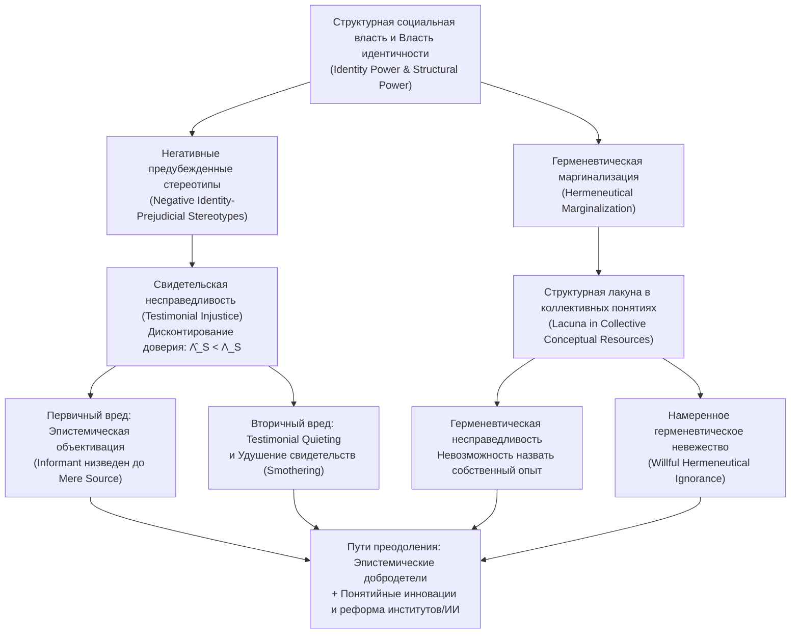

## Введение: Когда человеку несправедливо отказывают в статусе «познающего субъекта»

В традиционной политической философии и этике понятие «несправедливость» обычно рассматривается в двух основных плоскостях: во-первых, как <strong>распределительная (дистрибутивная) несправедливость</strong>, связанная с неравным доступом к материальным благам, доходам, медицине или образованию; во-вторых, как <strong>процедурная несправедливость</strong>, проявляющаяся в предвзятости судов или нарушении правовых норм. Однако в глубинной структуре общественной жизни действует третья, более скрытая, но не менее разрушительная форма угнетения: человек может страдать не только от лишения ресурсов или избирательных прав, но и от того, что из-за его социальной идентичности его словам систематически не верят, или от того, что в общем языке общества попросту отсутствуют понятия, способные назвать и объяснить переживаемое им страдание.

В 2007 году британский философ <strong>Миранда Фрикер (Miranda Fricker)</strong> опубликовала фундаментальный труд <em>Epistemic Injustice: Power and the Ethics of Knowing</em> («Эпистемическая несправедливость: власть и этика познания»), впервые объединив теорию познания, этику и политическую философию власти. Фрикер ввела понятие <strong>эпистемической несправедливости (Epistemic Injustice)</strong>, определив его как <strong>вред, причиняемый человеку именно в его качестве познающего субъекта (Knower) и носителя знания</strong>.

Чтобы понять, почему недоверие к чьим-то словам или отсутствие слов для описания собственного опыта является не просто сбоем коммуникации, а глубокой этической и политической травмой, необходимо обратиться к механизмам социальной эпистемологии (Social Epistemology). Фрикер выделяет две базовые формы эпистемической несправедливости: <strong>свидетельскую несправедливость (Testimonial Injustice)</strong>, возникающую при передаче информации от говорящего к слушающему, и <strong>герменевтическую несправедливость (Hermeneutical Injustice)</strong>, коренящуюся в структурных пробелах коллективных понятийных ресурсов. В данной статье мы рассмотрим всю архитектуру этой теории — от функционирования власти идентичности и байесовской модели дисконтирования доверия до эпистемической объективации, удушения свидетельств и алгоритмической дискриминации в современной медицине и больших языковых моделях (LLM).

---

## Глава 1. Социальная власть, власть идентичности и эпистемология стереотипов

### 1.1 Социальная власть и власть идентичности (Identity Power)

Классическая картезианская эпистемология представляла субъекта познания как изолированного, внеисторического индивида («cogito»). В реальном мире, однако, подавляющая часть наших знаний опирается на <strong>свидетельства других людей (Testimony)</strong> и общий фонд языковых концептов. Знание по своей природе социально, а значит, неизбежно пронизано отношениями <strong>социальной власти (Social Power)</strong>.

Фрикер определяет социальную власть как «практическую или потенциальную способность социальных агентов (индивидов или групп) в определенной социальной среде влиять на действия и положение других агентов». Той конкретной разновидностью социальной власти, которая непосредственно порождает эпистемическую несправедливость, является <strong>власть идентичности (Identity Power)</strong>. Она не нуждается в физическом насилии или административных приказах, поскольку действует напрямую через разделяемое участниками <strong>коллективное социальное воображение (Collective Social Imagination)</strong> — культурные сценарии и негласные представления о том, что значит быть мужчиной или женщиной, белым или темнокожим, цисгендерным или трансгендерным человеком, врачом или пациентом, академиком или рабочим. Власть идентичности может осуществляться активно (когда патриархальный авторитет заставляет женщину замолчать одним снисходительным взглядом) или чисто структурно (когда маргинализированная группа заранее отказывается от выступления в публичном пространстве).

### 1.2 Эвристические стереотипы и негативные предубежденные стереотипы идентичности

В повседневном общении слушающий (Hearer, $H$) вынужден мгновенно оценивать <strong>правдоподобие и надежность (Credibility)</strong> говорящего (Speaker, $S$). Поскольку мы не можем проводить полный эмпирический аудит биографии каждого собеседника перед началом разговора, человеческое мышление неизбежно использует <strong>стереотипы</strong> — обобщенные ассоциации между социальными группами и характеристиками надежности — в качестве <strong>когнитивной эвристики</strong>.

Не всякий стереотип иррационален или аморален: доверять астрофизику больше, чем астрологу, в вопросах эволюции звезд — это эмпирически обоснованная эвристика. Свидетельская несправедливость возникает тогда, когда суждение слушающего искажается <strong>негативным предубежденным стереотипом идентичности (Negative Identity-Prejudicial Stereotype)</strong>, которому Фрикер дает строгое определение:

> Широко распространенное обобщение или ассоциация в отношении определенной социальной группы, связывающая ее членов с уничижительными качествами (прежде всего с недостатком рациональности, избыточной эмоциональностью, нечестностью или интеллектуальной неполноценностью) без опоры на объективные эмпирические данные и проявляющая — в силу эмоциональной враждебности, чувства превосходства или корыстного интереса — стойкую <strong>устойчивость к опровергающим фактам (Resistance to Counter-Evidence)</strong>.

---

## Глава 2. Свидетельская несправедливость (Testimonial Injustice): дефицит и избыток доверия

### 2.1 Систематическая и случайная свидетельская несправедливость

Когда слушающий из-за предубеждения против социальной идентичности говорящего наделяет его слова меньшим доверием, чем они заслуживают по существу доказательств, говорящий испытывает <strong>дефицит доверия (Credibility Deficit)</strong>. Фрикер разграничивает два случая:

1. <strong>Случайная свидетельская несправедливость (Incidental Testimonial Injustice)</strong>: порождается локальным, неструктурным предубеждением (например, когда члены научной комиссии безосновательно считают исследователей редкого вида насекомых чудаками и не доверяют их докладу). Хотя это несправедливо, подобное предубеждение не преследует ученого в других сферах жизни (в суде, больнице или банке).
2. <strong>Систематическая свидетельская несправедливость (Systematic Testimonial Injustice)</strong>: представляет собой <strong>центральный случай (Central Case)</strong> теории. Здесь предубеждения идентичности (расизм, сексизм, классизм, эйблизм) <strong>систематически преследуют (Track)</strong> субъекта во множестве измерений социальной структуры — экономическом, правовом, политическом, образовательном и медицинском. Именно эта межсекторальная связанность превращает когнитивное искажение в механизм структурного угнетения.

### 2.2 Два классических примера: Мардж Шервуд и Том Робинсон

Для иллюстрации механизма систематической свидетельской несправедливости Фрикер детально разбирает две знаменитые литературные сцены:

* <strong>Мардж Шервуд в романе <em>«Талантливый мистер Рипли»</em> (<em>The Talented Mr. Ripley</em>)</strong>: В Италии 1950-х годов богатый наследник Дикки Гринлиф убит Томом Рипли. Невеста Дикки, Мардж Шервуд, прекрасно знает характер и привычки жениха. Обнаружив кольца Дикки у Рипли и сопоставив ряд фактов, она делает безупречно логичный вывод: Дикки не мог покончить с собой, его убил Рипли. Однако отец Дикки, Герберт Гринлиф, отмахивается от ее аргументов одной патерналистской фразой: <strong>«Мардж, есть женская интуиция, а есть факты (Marge, there's female intuition, and then there are facts)».</strong> Патриархальный стереотип, кодирующий женщин как эмоциональных, истеричных и неспособных к строгой логике существ, заставляет Герберта обесценить рациональное умозаключение Мардж до уровня «женской интуиции», навязывая ей острый дефицит доверия.
* <strong>Том Робинсон в романе <em>«Убить пересмешника»</em> (<em>To Kill a Mockingbird</em>)</strong>: В Алабаме 1935 года темнокожий рабочий Том Робинсон ложно обвинен в изнасиловании белой женщины Мэйеллы Юэлл. Адвокат Аттикус Финч с помощью неопровержимых физических улик (левая рука Тома полностью искалечена) доказывает, что Том физически не мог нанести потерпевшей побои. Но когда прокурор спрашивает Тома, почему тот регулярно бесплатно помогал Мэйелле по хозяйству, Том честно отвечает: «Мне было очень жаль ее (I felt right sorry for her)». В расистской системе власти идентичности эпохи законов Джима Кроу сама мысль о том, что темнокожий мужчина смеет испытывать жалость к белой женщине, вызывает у полностью белого жюри присяжных мгновенную ярость; в сочетании с расистским предубеждением о том, что все темнокожие мужчины лгут в сексуальных вопросах, присяжные оказываются неспособны (и отказываются) поверить свидетельству Тома, вынося ему обвинительный приговор, ведущий к гибели.

### 2.3 Избыток доверия (Credibility Excess) и эпистемические пороки

Оборотной стороной дефицита доверия выступает <strong>избыток доверия (Credibility Excess)</strong>: ситуация, когда говорящий благодаря своей привилегированной идентичности (белый цисгендерный мужчина, представитель элиты, обладатель высокого статуса) получает больше доверия, чем оправдано его реальной компетентностью и фактами.

Как убедительно показал философ <strong>Хосе Медина (José Medina)</strong> в книге <em>The Epistemology of Resistance</em> (2013), доверие — это <strong>реляционный, сравнительный и конкурентный ресурс</strong>. В зале суда или в медицинском кабинете предоставление избытка доверия привилегированному лицу (Тому Рипли или семье Юэлл) напрямую означает лишение доверия угнетенного. Более того, постоянное пребывание в тепличных условиях избытка доверия развращает эпистемический характер самих привилегированных субъектов, порождая три <strong>эпистемических порока (Epistemic Vices)</strong>:
1. <strong>Эпистемическое высокомерие (Epistemic Arrogance)</strong>: иллюзия собственного всеведения и непогрешимости.
2. <strong>Эпистемическая лень (Epistemic Laziness)</strong>: отсутствие мотивации изучать слепые зоны своих привилегий и реальность угнетенных групп.
3. <strong>Узость мышления (Closed-mindedness)</strong>: защитное отторжение любых свидетельств, ставящих под сомнение существующий порядок.

---

## Глава 3. Формальная байесовская модель дисконтирования доверия

Искажение оценок при свидетельской несправедливости можно строго формализовать с помощью <strong>байесовского обновления убеждений (Bayesian Belief Updating)</strong>.

Пусть слушающий приписывает гипотезе $H$ (например, «у пациентки острый инфаркт миокарда» или «подсудимый невиновен») априорную вероятность $P(H) \in (0, 1)$. Говорящий $S$ предоставляет свидетельство $E_S$ в пользу $H$. Согласно теореме Байеса, апостериорная вероятность равна:

$$P(H \mid E_S) = \frac{P(E_S \mid H) P(H)}{P(E_S \mid H) P(H) + P(E_S \mid \neg H) P(\neg H)}$$

Обозначим через $c_S = P(E_S \mid H)$ объективную надежность говорящего при истинности $H$ (включающую <strong>компетентность Competence</strong> и <strong>искренность Sincerity</strong>), а через $f_S = P(E_S \mid \neg H)$ — вероятность ложноположительного свидетельства (ошибки или лжи) при ложности $H$. Объективное <strong>отношение правдоподобия (Likelihood Ratio)</strong> свидетельства имеет вид:

$$\Lambda_S = \frac{P(E_S \mid H)}{P(E_S \mid \neg H)} = \frac{c_S}{f_S}$$

У непредвзятого слушающего субъективная оценка $\hat{\Lambda}_S$ совпадает с $\Lambda_S$. Однако если слушающий подвержен параметру негативного предубеждения идентичности $\delta_{\text{bias}} \in [0, 1]$ против социальной группы говорящего $S$, он занижает оценку компетентности и завышает оценку склонности к обману или эмоциональной ошибке, в результате чего воспринимаемое отношение правдоподобия деградирует до:

$$\hat{\Lambda}_S(\delta_{\text{bias}}) = \frac{(1 - \delta_{\text{bias}}) c_S + \delta_{\text{bias}} f_S}{f_S + \delta_{\text{bias}} (c_S - f_S)}$$

Отсюда строго выводятся три следствия:
* При $\delta_{\text{bias}} = 0$ (отсутствие предубеждений) $\hat{\Lambda}_S(0) = \frac{c_S}{f_S} = \Lambda_S$: обновление убеждений происходит справедливо и рационально.
* При $0 < \delta_{\text{bias}} < 1$ и $c_S > f_S$ строго выполняется $\hat{\Lambda}_S(\delta_{\text{bias}}) < \Lambda_S$, что ведет к заниженной апостериорной вероятности: $\hat{P}(H \mid E_S) < P^*(H \mid E_S)$. Разность $\Delta C_S = \Lambda_S - \hat{\Lambda}_S(\delta_{\text{bias}}) > 0$ количественно выражает <strong>дефицит доверия</strong>.
* При $\delta_{\text{bias}} \to 1$ (абсолютное предубеждение, как у присяжных в <em>«Убить пересмешника»</em>) $\hat{\Lambda}_S(1) = 1$, откуда $\hat{P}(H \mid E_S) = P(H)$: свидетельство подвергается полному <strong>эпистемическому обнулению (Epistemic Nullification)</strong>.

В форме логарифма шансов (Log-Odds) после $T$ свидетельств кумулятивное обновление записывается как:

$$\log \frac{P_T(H)}{1 - P_T(H)} = \log \frac{P_0(H)}{1 - P_0(H)} + \sum_{t=1}^{T} w_{S_t} \log \Lambda_{S_t}$$

Когда весовые коэффициенты маргинализированных групп систематически подавляются ($w_M \ll 1$), а привилегированных — завышаются ($w_P > 1$), коллективное знание общества неизбежно смещается в сторону предрассудков правящего класса.

---

## Глава 4. Глубинный вред: от эпистемической объективации до удушения свидетельств

### 4.1 Первичный вред: эпистемическая объективация (Epistemic Objectification)

Фрикер разделяет <strong>первичный (внутренний) вред</strong> и <strong>вторичный (косвенный) вред</strong> свидетельской несправедливости. Первичный вред поражает саму суть человеческого достоинства: поскольку разум и способность передавать знания конституируют нас как личностей, отказ человеку в статусе познающего субъекта из-за предрассудков идентичности означает его символическое расчеловечивание.

Опираясь на различие, введенное философом <strong>Эдвардом Крейгом (Edward Craig)</strong> в работе <em>Knowledge and the State of Nature</em> (1990), Фрикер противопоставляет две роли:
* <strong>Информант / свидетель (Informant)</strong>: рациональный субъект, признаваемый полноправным участником диалога в эпистемическом сообществе.
* <strong>Простой источник информации (Mere Source of Information)</strong>: природный объект или состояние вещей — подобно годовым кольцам на спиле дерева или следам на снегу, — из которого мы извлекаем фактические сведения, не признавая за ним рациональной субъектности и дискурсивного авторитета.

Когда Герберт Гринлиф воспринимает логические доводы Мардж лишь как «симптом женской истерики и горя», он низводит ее с позиции <em>информанта</em> до положения <em>простого источника информации</em>. Это и есть <strong>эпистемическая объективация (Epistemic Objectification)</strong> — теоретико-познавательный аналог сексуальной объективации в кантовской этике.

### 4.2 Вторичный вред, замалчивание (Quieting) и удушение свидетельств (Smothering)

Вторичный вред включает <strong>практические потери</strong> (неправосудные приговоры, врачебные ошибки со смертельным исходом, карьерную дискриминацию) и <strong>эпистемические потери</strong>: постоянное столкновение с недоверием разрушает <strong>эпистемическую уверенность (Epistemic Confidence)</strong> человека, заставляя его сомневаться в собственных обоснованных убеждениях и <strong>буквально терять знания, которыми он ранее обладал</strong>.

Американский философ <strong>Кристи Дотсон (Kristie Dotson)</strong> (2011) выделила две формы систематического принуждения к молчанию:
1. <strong>Свидетельское замалчивание (Testimonial Quieting)</strong>: аудитория, находясь во власти стереотипных «контролирующих образов» (Controlling Images, по Патриции Хилл Коллинз), вообще не распознает в говорящей познающего субъекта.
2. <strong>Свидетельское удушение (Testimonial Smothering)</strong>: форма <strong>вынужденной самоцензуры</strong>. Когда представительница уязвимой группы понимает, что ее свидетельство сложно и рискованно, а слушатель страдает явной <strong>свидетельской некомпетентностью (Testimonial Incompetence)</strong> и неизбежно использует ее слова во вред ее же сообществу (например, когда темнокожая женщина не решается заявить о домашнем насилии белым полицейским, опасаясь усиления расистской стигматизации своего сообщества), она сама обрывает свою речь. К этому примыкает феномен <strong>«менсплейнинга» (Mansplaining)</strong>, проанализированный <strong>Ребеккой Солнит (Rebecca Solnit)</strong> (2014), где мужской избыток доверия напрямую подавляет женский авторитет.

---

## Глава 5. Герменевтическая несправедливость (Hermeneutical Injustice) и намеренное невежество

### 5.1 Герменевтическая маргинализация и понятийные лакуны

Если свидетельская несправедливость совершается в акте межличностной коммуникации, то <strong>герменевтическая несправедливость (Hermeneutical Injustice)</strong> коренится на более глубоком структурном уровне — в <strong>коллективных герменевтических ресурсах (Collective Hermeneutical Resources)</strong> общества (общем словаре, юридических категориях и схемах интерпретации).

Поскольку привилегированные группы исторически монополизировали институты производства смыслов (юриспруденцию, медицину, журналистику, академическую науку), угнетенные группы оказались в состоянии <strong>герменевтической маргинализации (Hermeneutical Marginalization)</strong> — неравного участия в создании общих понятий. Вследствие этого в общественном языке образуются <strong>герменевтические лакуны (Hermeneutical Lacunae)</strong> как раз там, где требуется назвать специфический опыт страдания и угнетения уязвимых слоев.

Фрикер определяет герменевтическую несправедливость как <strong>несправедливость, при которой существенная область социального опыта человека остается неясной для его собственного понимания и понимания окружающих из-за структурно предвзятого пробела в коллективных герменевтических ресурсах.</strong>

### 5.2 Кармита Вуд и рождение понятия «сексуальное домогательство»

Хрестоматийный пример Фрикер — история <strong>Кармиты Вуд (Carmita Wood)</strong> в 1975 году. Работая администратором на кафедре ядерной физики Корнеллского университета, Вуд годами подвергалась навязчивым прикосновениям, непристойным намекам и преследованиям со стороны влиятельного профессора. Из-за тяжелого стресса и хронических болей она была вынуждена уволиться. Однако при подаче заявления на пособие по безработице, когда потребовалось указать причину ухода, она столкнулась с полным понятийным вакуумом: в английском языке и праве США 1975 года существовали лишь слова «служебный флирт» или крайнее преступление «изнасилование», но <strong>не было ни одного термина для обозначения систематического сексуального принуждения на рабочем месте</strong>. Ей пришлось написать «по личным обстоятельствам», и в пособии ей отказали.

Лишь присоединившись к феминистской группе повышения самосознания (<em>Consciousness-Raising Group</em>) под руководством <strong>Лин Фарли (Lin Farley)</strong>, Вуд и другие женщины обнаружили массовый характер этой травмы и совместно выковали новое понятие — <strong>«сексуальное домогательство» (Sexual Harassment)</strong>. Заполнение этой герменевтической лакуны позволило осмыслить проблему и добиться ее правового признания — точно так же, как позже произошло с понятиями «послеродовая депрессия», «газлайтинг», «микроагрессия» и «нейроразнообразие».

### 5.3 Намеренное герменевтическое невежество (Willful Hermeneutical Ignorance)

Как показали <strong>Гейл Полхаус (Gaile Pohlhaus Jr.)</strong> (2012) и Кристи Дотсон, маргинализированные сообщества часто создают внутри своей среды богатые альтернативные понятийные ресурсы. Проблема нередко заключается в том, что доминирующие группы <strong>активно отказываются изучать, признавать или использовать концептуальные инструменты, уже выработанные угнетенными</strong>. Полхаус назвала это <strong>намеренным герменевтическим невежеством (Willful Hermeneutical Ignorance)</strong>, а Дотсон — <strong>контрибутивной несправедливостью (Contributory Injustice)</strong>.

---

## Глава 6. Современные рубежи: клиническая медицина и искусственный интеллект (ИИ)

| Измерение | Свидетельская несправедливость | Герменевтическая несправедливость | Намеренное герменевтическое невежество |
| :--- | :--- | :--- | :--- |
| <strong>Уровень проявления</strong> | Межличностный дискурс и оценка доказательств | Коллективный словарь, категории и рамки толкования | Силовая блокада между понятийными системами |
| <strong>Непосредственная причина</strong> | Негативное предубеждение у слушающего ($\delta_{\text{bias}} > 0$) | Исключение из практик производства смыслов | Отказ привилегированных принимать понятия меньшинств |
| <strong>Ключевой механизм</strong> | Дефицит ($\hat{\Lambda}_S < \Lambda_S$) и избыток доверия | Герменевтическая лакуна (Hermeneutical Lacuna) | Когнитивная защита и эпистемическая монополия |
| <strong>Типичные примеры</strong> | Мардж Шервуд, Том Робинсон, игнорирование боли | Кармита Вуд до появления термина «харассмент» (1975) | Отрицание структурного расизма или хронических синдромов |
| <strong>Пути исправления</strong> | Рефлексивное критическое сознание, добродетель | Группы самосознания, концептуальные инновации | Эпистемическое смирение, реформа институтов и LLM |

### 6.1 Эпистемическая несправедливость в клинической медицине и психиатрии

Исследования <strong>Хави Карел (Havi Carel)</strong> и Иэна Джеймса Кидда продемонстрировали масштаб эпистемической несправедливости в здравоохранении:
* <strong>Систематическое обесценивание жалоб пациентов</strong>: сообщения об острой боли от женщин, этнических меньшинств или пациентов со сложными хроническими заболеваниями (эндометриоз, фибромиалгия, затяжной COVID) значительно чаще списываются врачами на «тревожность» или «истерическое преувеличение», чем аналогичные жалобы белых мужчин.
* <strong>Герменевтическое отчуждение</strong>: стандартизированные биомедицинские шкалы и протоколы часто вытесняют субъективный феноменологический опыт страдания самого пациента.

### 6.2 Алгоритмическая эпистемическая несправедливость в больших языковых моделях (LLM)

В эпоху генеративного искусственного интеллекта эпистемическая несправедливость кодируется в весовых матрицах <strong>больших языковых моделей (LLM)</strong> и алгоритмов принятия решений:
1. <strong>Автоматизированная свидетельская несправедливость</strong>: алгоритмы медицинской сортировки, кредитного скоринга или судебной оценки рисков, обученные на исторически предвзятых данных, автоматически присваивают меньший вес заявлениям представителей уязвимых групп.
2. <strong>Алгоритмическое герменевтическое стирание</strong>: поскольку обучающие корпуса и процедуры выравнивания (RLHF) современных LLM подавляющим образом доминируются английским языком и западноцентричными дискурсами, языки коренных народов, эпистемологии Глобального Юга и опыт локальных сообществ вытесняются на периферию векторного пространства представлений (Embedding Space), создавая угрозу глобальной цифровой герменевтической гомогенизации.

---

## Заключение: от этики личных добродетелей к структурной эпистемической демократии

В качестве противоядия Миранда Фрикер предлагает развивать две корректирующие добродетели: <strong>добродетель свидетельской справедливости</strong> (рефлексивную критическую чуткость, позволяющую распознать влияние предрассудков идентичности и скорректировать оценку доверия вверх) и <strong>добродетель герменевтической справедливости</strong> (внимательное слушание, способное увидеть за косноязычием собеседника пробел в общих понятийных ресурсах). Однако, как подчеркивает <strong>Элизабет Андерсон (Elizabeth Anderson, 2012)</strong>, поскольку неявные предубеждения действуют бессознательно, а герменевтическая маргинализация закреплена институционально, личные добродетели необходимо дополнить <strong>масштабными структурными реформами</strong> судебной системы, медицины, науки и демократического управления искусственным интеллектом.
