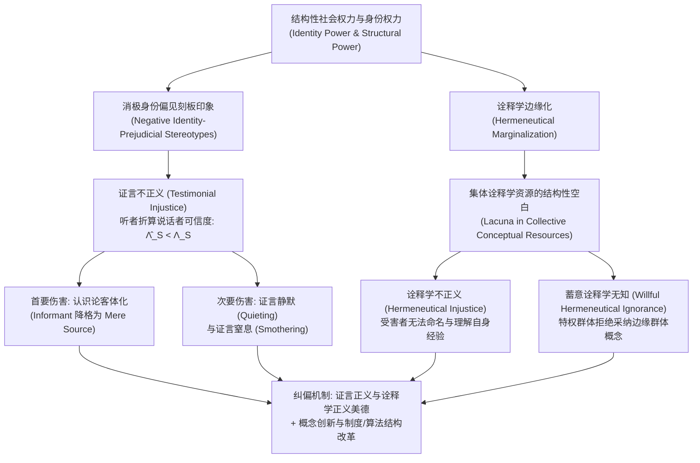

## 导论：当“作为求知者的能力”遭受不正当否定

在传统政治哲学与伦理学中，“不正义（Injustice）”通常被划分为两类：一是关乎财富、医疗、教育等物质资源与社会机会分配不公的<strong>分配不正义（Distributive Injustice）</strong>；二是关乎法律程序、量刑或契约执行偏颇的<strong>程序不正义（Procedural Injustice）</strong>。然而，在人类社会生活的深层结构中，还存在着第三种更为隐蔽却同样具有毁灭性的不公——一个人并非仅仅因为被剥夺了选票或收入而遭受压迫，而是因为其社会身份，在开口说话时其话语的分量被系统性地打折，或者在遭受痛苦时发现整个社会的语言中根本不存在能够命名和解释自身经历的概念。

2007年，英国哲学家<strong>米兰达·弗里克（Miranda Fricker）</strong>出版了里程碑式的专著《认识论的不正义：权力与求知的伦理》（*Epistemic Injustice: Power and the Ethics of Knowing*），首次将认识论与伦理学、政治权力理论严密结合，提出了<strong>认识论的不正义（Epistemic Injustice）</strong>这一核心范畴。所谓认识论的不正义，是指<strong>一个人专门在其作为“求知者（Knower）”或“知识传递者”的资格与能力上遭受的不正当伤害</strong>。

要理解为什么“不被相信”或“无法理解自身经验”不仅是沟通失误，而且是一场深刻的伦理与政治灾难，我们必须深入社会认识论（Social Epistemology）的核心机制。弗里克将认识论的不正义划分为两种基本形态：发生在话语交流层面的<strong>证言不正义（Testimonial Injustice）</strong>，以及发生在集体概念资源层面的<strong>诠释学不正义（Hermeneutical Injustice）</strong>。本文将从身份权力的运作机制、可信度评估的贝叶斯形式模型、认识论客体化的伦理伤害，一直探讨到当代数字算法与大语言模型（LLM）中的认识论排斥。

---

## 第一章 社会权力、身份权力与刻板印象的认识论运作

### 1.1 社会权力与身份权力（Identity Power）

在古典笛卡尔式的个人主义认识论中，求知主体被抽象为脱离社会历史脉络的孤立理性人（“我思”）。然而在现实世界中，绝大多数知识的获取与传递都依赖于他人的证言（Testimony）以及共享的语言概念库。知识天然具有社会性，因而不可避免地被<strong>社会权力（Social Power）</strong>所渗透。

弗里克将社会权力定义为：“社会行动者（个体或群体）在特定社会环境中影响其他行动者行为与处境的实际或潜在能力。”在众多社会权力形态中，直接引发认识论不正义的是<strong>身份权力（Identity Power）</strong>。身份权力无需依赖有形的暴力或行政命令，它的运作完全依赖于行动者之间共享的“集体社会想象（Collective Social Imagination）”——即关于“身为男性或女性、白人或有色人种、顺性别者或跨性别者、医生或患者、精英学者或普通劳工究竟意味着什么”的文化脚本与隐性预设。身份权力既可以是能动的（例如一位掌握传统权威的族长仅凭眼神就让年轻女性闭嘴），也可以是纯粹结构性的（例如特定群体因长期缺乏发声渠道而自动放弃在公共领域作证）。

### 1.2 启发式刻板印象与消极身份偏见刻板印象

在日常信息交流中，听者（Hearer, $H$）必须在极短时间内评估说话者（Speaker, $S$）的<strong>可信度（Credibility）</strong>。由于听者不可能在每次对话前都对说话者的过往诚实记录与专业水准进行彻底的经验审计，人类认知不可避免地依赖<strong>刻板印象（Stereotypes）</strong>——即关于特定社会群体及其可靠性特征的广泛联想——作为评估可信度的<strong>认知启发法（Heuristic）</strong>。

并非所有刻板印象都是不道德或非理性的。如果一个人带着“天体物理学家在宇宙学问题上通常比占星师更可靠”或“当地老渔民对近海潮汐的判断比游客更准确”的经验概括去倾听，这是一种具有经验根据的可靠启发。真正引发证言不正义的，是<strong>消极身份偏见刻板印象（Negative Identity-Prejudicial Stereotype）</strong>。弗里克对其给出了精确定义：

> 一种针对特定社会群体的广泛概括或联想，它将该群体成员与某种贬低性的属性（尤其是缺乏理性、情绪化、不诚实、智力低下或认知狭隘）绑定在一起；这种概括并非建立在客观经验证据之上，并且由于听者抱有情感上的恶意、优越感或既得利益，使其在面对相反的经验证据时表现出强烈的<strong>抗拒修正性（Resistance to Counter-Evidence）</strong>。

当这种消极身份偏见渗入听者的可信度判断时，听者对说话者的感知便发生了结构性扭曲。

---

## 第二章 证言不正义（Testimonial Injustice）：可信度赤字与过剩

### 2.1 系统性证言不正义与偶然性证言不正义

当听者因为针对说话者社会身份的偏见，给予说话者的话语低于其应得的可信度评价时，说话者便遭受了<strong>可信度赤字（Credibility Deficit）</strong>。然而，并非所有的可信度赤字都具有同等的核心地位。弗里克区分了两种情形：

1. <strong>偶然性证言不正义（Incidental Testimonial Injustice）</strong>：由局部的、非结构性的偏见引起。例如，一个学术评审委员会的成员恰好对研究某种冷门昆虫的学者抱有毫无根据的偏见（认为研究这种昆虫的人都很古怪且不严谨），从而无理怀疑该学者的证言。这虽然也是不公的，但这种偏见并不会追踪该学者进入生活的其他领域（如法庭、医院、银行或职场）。
2. <strong>系统性证言不正义（Systematic Testimonial Injustice）</strong>：这是认识论不正义的<strong>核心范例（Central Case）</strong>。引发可信度赤字的身份偏见（如种族主义、性别歧视、阶级歧视、残障歧视），会将主体在社会结构的多个维度（经济、法律、政治、教育、医疗）中持续地追踪（Track）并置于不利地位。正是这种跨领域的系统性追踪，将单纯的认知偏差转化为了结构性的社会压迫。

### 2.2 两个经典文学与历史案例：玛吉·舍伍德与汤姆·罗宾逊

为了具象化系统性证言不正义的运作，弗里克深入剖析了两个极具代表性的文学场景：

* <strong>《天才瑞普利》（*The Talented Mr. Ripley*）中的玛吉·舍伍德（Marge Sherwood）</strong>：在1950年代的背景下，富家子弟迪基·格林利夫（Dickie Greenleaf）被汤姆·瑞普利谋杀。迪基的未婚妻玛吉对迪基的习性与情感有着极其敏锐、深入的了解。当她发现迪基的戒指等私人物品出现在瑞普利手中，并结合一系列反常迹象推断出迪基绝不可能自杀、极可能已被瑞普利杀害时，她的推理在认识论上是高度严密的。然而，迪基的父亲赫伯特·格林利夫（Herbert Greenleaf）为了维护男性同盟的体面，用一句居高临下的家长式名言直接抹杀了玛吉的证言：<strong>“玛吉，世上有女人的直觉，但也有客观事实（Marge, there's female intuition, and then there are facts）。”</strong>在这里，父权制下将女性编码为“情绪化、非理性、仅有直觉而无逻辑”的消极身份偏见，使赫伯特将玛吉基于确凿证据的理性推论贬低为“歇斯底里的女性直觉”，赋予了她严重的可信度赤字。
* <strong>《杀死一只知更鸟》（*To Kill a Mockingbird*）中的汤姆·罗宾逊（Tom Robinson）</strong>：在1935年美国阿拉巴马州的法庭上，黑人青年汤姆被诬告强奸白人女性梅耶拉·尤厄尔（Mayella Ewell）。辩护律师阿蒂克斯·芬奇（Atticus Finch）已经通过无可辩驳的物证与生理事实证明汤姆左手完全残废，根本不可能造成原告身上的伤痕。然而，当检察官质问汤姆为何经常无偿帮助梅耶拉干家务活时，汤姆诚实地回答：“我觉得她很可怜（I felt right sorry for her）。”这句话立刻在全体白人陪审团心中引发了强烈的种族主义震怒与认知排斥——在吉姆·克劳法（Jim Crow）时代的白人至上主义身份权力结构中，“一个黑人竟然敢同情一个白人”是不可容忍的越界，而“所有黑人男子都会在性问题上撒谎”则是根深蒂固的种族偏见。陪审团在证据确凿的情况下依然无法（且拒绝）相信汤姆的证言，最终判处他有罪并导致其死亡。

### 2.3 可信度过剩（Credibility Excess）与认识论恶习

与可信度赤字相对应的是<strong>可信度过剩（Credibility Excess）</strong>：由于说话者拥有特权社会身份（如白人、顺性别男性、名校精英、高管），听者给予其话语超出了客观证据与实际专业水平所应得的信任。

弗里克最初认为，在单次孤立交流中，可信度过剩通常是对说话者的不当优待而非伤害。但哲学家<strong>何塞·梅迪纳（José Medina）</strong>在《抗争的认识论》（*The Epistemology of Resistance*, 2013）中有力地论证道：可信度是一个<strong>关系性、比较性与竞争性的概念（Relational and Comparative Concept）</strong>。首先，在法庭抗辩、医疗问诊或职场竞争等零和博弈场景中，赋予特权者过剩的可信度（如无条件相信汤姆·瑞普利或白人原告尤厄尔），直接等同于剥夺边缘群体应得的可信度。其次，长期处于可信度过剩环境中的特权主体，由于其言论从不遭遇有效质疑，会不可避免地滋生出三大<strong>认识论恶习（Epistemic Vices）</strong>：
1. <strong>认识论傲慢（Epistemic Arrogance）</strong>：自诩全知全能，认为自己无需倾听他人观点。
2. <strong>认识论懒惰（Epistemic Laziness）</strong>：缺乏探究自身特权盲区与受压迫者真实处境的认知动力。
3. <strong>认识论封闭（Closed-mindedness）</strong>：对任何挑战既定秩序的异议采取防御性排斥。

---

## 第三章 可信度折算与偏见权重的贝叶斯形式模型

我们可以借助形式认识论中的<strong>贝叶斯信念更新模型（Bayesian Belief Updating）</strong>，将证言不正义中的可信度赤字与过剩精确化。

假设听者对某一命题 $H$（例如“患者患有急性心肌缺血”或“被告是无辜的”）持有先验概率 $P(H) \in (0, 1)$。说话者 $S$ 提供了支持命题 $H$ 的证言 $E_S$。根据贝叶斯定理，听者在接收证言后的后验概率为：

$$P(H \mid E_S) = \frac{P(E_S \mid H) P(H)}{P(E_S \mid H) P(H) + P(E_S \mid \neg H) P(\neg H)}$$

令 $c_S = P(E_S \mid H)$ 表示当命题 $H$ 为真时说话者作出该证言的可靠性（涵盖<strong>能力 Competence</strong> 与<strong>诚实性 Sincerity</strong>），令 $f_S = P(E_S \mid \neg H)$ 表示当命题 $H$ 为假时说话者误报或撒谎的假阳性率。说话者证言的客观<strong>似然比（Likelihood Ratio）</strong>为：

$$\Lambda_S = \frac{P(E_S \mid H)}{P(E_S \mid \neg H)} = \frac{c_S}{f_S}$$

在没有身份偏见的理想认识论主体那里，听者对说话者可信度的主观估计 $\hat{\Lambda}_S$ 应当等于其客观可靠性 $\Lambda_S$。然而，当听者受到针对说话者群体身份的消极偏见参数 $\delta_{\text{bias}} \in [0, 1]$ 支配时，听者会在潜意识中压低对说话者能力与诚实度的评估，同时抬高对其情绪化或欺骗可能性的估计，使得主观感知似然比退化为：

$$\hat{\Lambda}_S(\delta_{\text{bias}}) = \frac{(1 - \delta_{\text{bias}}) c_S + \delta_{\text{bias}} f_S}{f_S + \delta_{\text{bias}} (c_S - f_S)}$$

由此我们可以严格导出以下认识论效应：
* 当 $\delta_{\text{bias}} = 0$（无偏见）时，$\hat{\Lambda}_S(0) = \frac{c_S}{f_S} = \Lambda_S$，听者实现公正的理性更新。
* 当 $0 < \delta_{\text{bias}} < 1$（存在消极身份偏见）且 $c_S > f_S$ 时，严格有 $\hat{\Lambda}_S(\delta_{\text{bias}}) < \Lambda_S$，从而导致主观后验信念严重低于客观应有水平：$\hat{P}(H \mid E_S) < P^*(H \mid E_S)$。两者之差 $\Delta C_S = \Lambda_S - \hat{\Lambda}_S(\delta_{\text{bias}}) > 0$ 即为量化后的<strong>可信度赤字</strong>。
* 当 $\delta_{\text{bias}} \to 1$（极端偏见，如《杀死一只知更鸟》中的白人陪审团）时，$\hat{\Lambda}_S(1) = 1$。此时无论说话者的证言在客观上多么确凿，听者的后验概率始终等于先验概率 $\hat{P}(H \mid E_S) = P(H)$——说话者的证言在认识论上被彻底<strong>归零（Epistemic Nullification）</strong>。

在对数赔率（Log-Odds）形式下，经过 $T$ 次证言交流后的累积信念更新可表示为：

$$\log \frac{P_T(H)}{1 - P_T(H)} = \log \frac{P_0(H)}{1 - P_0(H)} + \sum_{t=1}^{T} w_{S_t} \log \Lambda_{S_t}$$

其中 $w_{S_t}$ 是听者赋予第 $t$ 位说话者的身份权重。当边缘群体 $M$ 的权重被系统性压低（$w_M \ll 1$），而特权群体 $P$ 的权重被系统性放大（$w_P > 1$）时，公共知识库将不可避免地向特权阶层的偏见收敛。

---

## 第四章 证言不正义的深层伤害：从客体化到证言窒息

### 4.1 首要伤害：认识论客体化（Epistemic Objectification）

为什么不被相信会造成如此深重的道德伤害？弗里克区分了证言不正义的<strong>首要伤害（Primary Harm）</strong>与<strong>次要伤害（Secondary Harm）</strong>。

首要伤害是<strong>内在的（Intrinsic）</strong>：它直接打击了人的核心本质。自亚里士多德以来，理性与传递知识的能力就被视为人类尊严的根基。当一个人因为身份偏见而在作为知识传递者的资格上被否定时，他/她在象征意义上被贬低为了“次等人类（Less than fully human）”。

为了精确刻画这一过程，弗里克引入了英国哲学家<strong>爱德华·克雷格（Edward Craig）</strong>在《知识与自然状态》（*Knowledge and the State of Nature*, 1990）中提出的著名区分：
* <strong>信息提供者 / 证人（Informant）</strong>：被我们作为拥有理性、主体性与判断力的对话伙伴来对待的人；我们与他共同参与求知共同体的信念协商。
* <strong>单纯的信息源（Mere Source of Information）</strong>：就像树干上的年轮告诉我们树木的年龄，或者泥地里的脚印告诉我们有人经过一样，我们从中提取客观信息，但并不将其视为拥有理性主体性的对话者。

当赫伯特·格林利夫把玛吉的推论仅仅当作“一个悲伤女人情绪失控的症状”来观察，或者当侦探把受害者的陈述仅仅当作提取物证线索的物理声学信号而拒绝采信其判断时，说话者就被从“求知主体（Informant）”强行降格为了“被观察的客体（Mere Source of Information）”。这就是与康德伦理学中的性客体化（Sexual Objectification）相平行的<strong>认识论客体化（Epistemic Objectification）</strong>。

### 4.2 次要伤害：实践剥夺与认识论信心的瓦解

次要伤害分为<strong>实践层面（Practical Dimension）</strong>与<strong>认识论层面（Epistemic Dimension）</strong>：
* <strong>实践伤害</strong>：蒙受不白之冤入狱、在医疗分诊中因疼痛陈述不被采信而延误救治致死、在职场因创意不被认可而丧失晋升机会。
* <strong>认识论伤害</strong>：当一个人长期生活在可信度赤字的环境中，持续遭遇他人的轻视与怀疑，他会逐渐丧失<strong>认识论信心（Epistemic Confidence）</strong>。根据知识需要满足“主体持有稳固信念”的条件，当自我怀疑侵蚀了信念的稳定性时，受害者甚至会<strong>真正丧失自己原本拥有的知识</strong>，并最终被排斥在塑造自我发展（Bildung）的公共理性对话之外。

### 4.3 证言静默（Quieting）与证言窒息（Smothering）

美国黑人女性主义哲学家<strong>克里斯蒂·多特森（Kristie Dotson）</strong>在2011年的经典论文《追踪认识论暴力》（*Tracking Epistemic Violence, Tracking Practices of Silencing*）中，借助言语行为理论（Speech Act Theory）中的“语力受挫（Illocutionary Frustration）”，揭示了两种由认识论暴力导致的系统性失声机制：

1. <strong>证言静默（Testimonial Quieting）</strong>：听者由于内化了针对说话者身份的刻板印象（例如帕特里夏·希尔·柯林斯 Patricia Hill Collins 所分析的针对黑人女性的“福利女王”、“愤怒的黑人女性”等控制性意象 Controlling Images），根本<strong>未能将说话者识别为求知主体</strong>，导致说话者虽然发出了声音，却在听者那里如同静音。
2. <strong>证言窒息（Testimonial Smothering）</strong>：这是一种<strong>被迫的自我审查（Coerced Self-Silencing）</strong>。当边缘群体的说话者察觉到：第一，自己即将讲述的内容高度复杂且带有风险；第二，眼前的听者存在明显的<strong>证言无能（Testimonial Incompetence）</strong>——即听者缺乏理解该证言的必要认知框架，且极可能用带有偏见的方式曲解该证言，从而反而加深对边缘群体的伤害（例如少数族裔女性在面对白人警察或主流媒体时，担心揭露社区内部的家庭暴力会被种族主义者利用来污名化整个少数族裔群体）。于是，说话者被迫在开口前主动咽下自己的证言。这种表面上的“自愿沉默”，实质上是结构性暴力强加的窒息。

此外，美国作家<strong>丽贝卡·索尔尼特（Rebecca Solnit）</strong>在《爱说教的男人》（*Men Explain Things to Me*, 2014）中剖析的<strong>“男性说教（Mansplaining）”</strong>，正是性别身份权力导致“男性可信度过剩”与“女性可信度赤字”在日常对话中同时发作的典型交汇：说教者预设眼前的女性在认知上是空白的，甚至向书籍的亲笔女作者本人傲慢地“科普”她自己写的书。

---

## 第五章 诠释学不正义（Hermeneutical Injustice）：集体意义的空白与蓄意无知

### 5.1 诠释学边缘化与概念空白

如果说证言不正义发生在个体间的信息传递环节，那么<strong>诠释学不正义（Hermeneutical Injustice）</strong>则发生在更底层的结构层面——即整个社会共享的<strong>集体诠释学资源（Collective Hermeneutical Resources）</strong>（包括词汇、概念、隐喻、法律范畴与社会解释模型）本身存在结构性的缺口。

为什么社会的词典里会缺少某些特定经验的词汇？因为概念的创造与普及（如法律条文、医学诊断手册、主流新闻报道、学术研究）历来是由占据支配地位的社会群体主导的。弱势群体由于长期被排斥在这些“意义生成实践（Meaning-Making Practices）”之外，处于<strong>诠释学边缘化（Hermeneutical Marginalization）</strong>的状态。其结果是：集体概念库对特权群体的生活经验（如商业契约、战场荣誉、有产者权益）有着极其精细的命名，而在涉及弱势群体特有的痛苦与压迫经验时，却留下一片空白（Hermeneutical Lacuna）。

弗里克将诠释学不正义定义为：<strong>由于集体诠释学资源中存在受结构性身份权力偏见支配的空白，导致某一社会群体在试图理解并向他人传达其重要的社会经验时，处于严重且不公正的认知劣势。</strong>

### 5.2 卡米塔·伍德（Carmita Wood）与“性骚扰”概念的诞生

弗里克引述了苏珊·布朗米勒（Susan Brownmiller）在《我们的时代：美国女性革命回忆录》中记载的真实历史事件，作为诠释学不正义的典范案例：

1975年，在美国康奈尔大学核物理系担任行政职员的<strong>卡米塔·伍德（Carmita Wood）</strong>，长期遭受系里一位著名资深教授的故意身体触碰、下流暗示与电梯堵截。长期的屈辱使伍德患上了严重的慢性颈背剧痛与神经衰弱，最终被迫辞职。然而，当她去劳工局申请失业救济金，被办事员问及离职原因时，她陷入了彻底的失语与尴尬——在1975年的英语词汇与法律概念中，只有“两厢情愿的办公室调情（Flirting）”或极端的“强奸（Rape）”，<strong>根本不存在任何一个词能够命名她所遭受的这种系统性职场侵害</strong>。她只能含糊地填写“个人原因”，结果失业金申请以“无正当工程或健康理由自愿离职”被驳回。

随后，伍德参加了由<strong>林·法利（Lin Farley）</strong>主持的女性意识觉醒小组（Consciousness-Raising Group）。在小组中，女性们惊讶地发现彼此都经历过完全相同的职场梦魇。为了向公众和法庭指认这种普遍存在的侵害，她们在讨论中共同锻造出了一个全新的概念——<strong>“性骚扰（Sexual Harassment）”</strong>。

在这个案例中，在“性骚扰”一词诞生之前，施害教授同样不知道这个概念，但这种概念空白对教授而言是极其有利的（掩盖了他的恶行），而对卡米塔·伍德却造成了毁灭性的认知与实践不对称：她甚至无法向自己和他人清晰地解释自己究竟遭遇了什么。正是通过边缘群体打破诠释学孤立、建立意识觉醒共同体，才填补了集体概念库的这一结构性空白。同样的机制也体现在“产后抑郁症（Postpartum Depression）”、“微歧视（Microaggression）”、“煤气灯效应（Gaslighting）”以及神经多样性（Neurodiversity）等概念的诞生史中。

### 5.3 蓄意诠释学无知（Willful Hermeneutical Ignorance）

弗里克最初假定整个社会只共享一套单一的集体诠释学资源。然而，哲学家<strong>盖尔·波尔豪斯（Gaile Pohlhaus Jr.）</strong>（2012）、查尔斯·米尔斯（Charles Mills，提出“白人无知 White Ignorance”）与克里斯蒂·多特森敏锐地指出：边缘群体在长期的生存抗争中，其实早已在自己的社群内部创造出了极其丰富的<strong>另类诠释学资源（Alternative Hermeneutical Resources）</strong>（如女性主义理论、批判种族理论、酷儿与残障社群词汇）。

真正的问题往往不在于“世界上还没有这个词”，而在于占据支配地位的特权群体出于维护自身利益的动机，<strong>主动拒绝学习、承认或采纳边缘群体已经发展出来的概念工具</strong>，并傲慢地宣称那些概念“只是政治正确”、“太矫情”或“没有客观依据”。波尔豪斯将这种现象命名为<strong>蓄意诠释学无知（Willful Hermeneutical Ignorance）</strong>，多特森则称之为<strong>第三类认识论不正义（Contributory Injustice，贡献性不正义）</strong>。

---

## 第六章 当代前沿：医疗保健与人工智能（AI）中的认识论不正义

| 维度 | 证言不正义 (Testimonial Injustice) | 诠释学不正义 (Hermeneutical Injustice) | 蓄意诠释学无知 / 贡献性不正义 (Contributory Injustice) |
| :--- | :--- | :--- | :--- |
| <strong>发生层面</strong> | 个体/机构间的话语交流与证据评估 | 集体共享的概念库、语言与解释框架 | 多元概念体系之间的权力排斥与制度封锁 |
| <strong>直接成因</strong> | 听者受消极身份偏见支配（$\delta_{\text{bias}} > 0$） | 边缘群体被排斥在意义生成实践之外 | 特权主体拒绝采纳边缘群体已有的概念资源 |
| <strong>核心机制</strong> | 可信度赤字（$\hat{\Lambda}_S < \Lambda_S$）与可信度过剩 | 集体诠释学空白（Hermeneutical Lacuna） | 结构性偏见的诠释学资源与认知防御 |
| <strong>典型案例</strong> | 玛吉·舍伍德、汤姆·罗宾逊、医疗疼痛忽视 | 1975年前卡米塔·伍德无法命名“性骚扰” | 拒绝承认系统性种族主义或慢性隐性病痛概念 |
| <strong>纠偏路径</strong> | 反思性批判意识、证言正义美德、程序改革 | 意识觉醒共同体、概念创新、民主化知识生产 | 认识论谦逊、倾听多元视角、重构训练语料与制度 |

### 6.1 临床医学与精神医学中的认识论不正义

英国哲学家<strong>哈维·卡雷尔（Havi Carel）</strong>与伊恩·基德（Ian James Kidd）深入研究了医疗保健系统中的认识论不正义：
* <strong>患者证言的系统性折算</strong>：在现代生物医学模式中，医生拥有绝对的专业权威与制度权力，而重症患者、慢性疼痛患者（如纤维肌痛症、子宫内膜异位症、长新冠 Long COVID 患者）或精神障碍患者则常常被贴上“情绪不稳、夸大痛苦、缺乏医学常识”的刻板印象标签。实证医学研究反复证实，女性患者与少数族裔患者在急诊室报告剧烈疼痛时，获得止痛药的概率显著低于同等症状的白人男性患者，且更容易被误诊为“焦虑症”或“心理作用”。
* <strong>疾病体验的诠释学空白</strong>：医院现行的标准化量表（如1到10的数字疼痛评分）与冰冷的病理学术语，往往无法容纳患者对身体异化、尊严丧失与慢性痛苦的现象学体验。患者被迫用医学体制规定的刚性语言去裁剪自己的真实感受，否则就会被视为“不配合治疗”或“语无伦次”。

### 6.2 人工智能与大语言模型（LLM）中的算法认识论不正义

进入生成式人工智能时代，认识论不正义正在被编码进自动化决策系统与<strong>大语言模型（Large Language Models, LLMs）</strong>的权重矩阵中：
1. <strong>自动化证言不正义（Automated Testimonial Injustice）</strong>：当医疗分诊算法、信贷风控模型、司法保释评估系统或福利欺诈检测系统以历史带有偏见的数据进行训练时，算法会将特定邮政编码、性别或族裔群体的自我申报与申诉赋予极低的置信度权重，将历史上的身份偏见固化为看似“客观中立”的数学评分。
2. <strong>算法诠释学抹除（Algorithmic Hermeneutical Erasure）</strong>：大语言模型通过海量互联网语料库进行预训练，并通过基于人类反馈的强化学习（RLHF）进行对齐。由于全球数字语料库高度偏向英语、西方工业化国家与主流精英话语，全球南方（Global South）、原住民语言、方言群体以及边缘亚文化的概念框架在嵌入空间（Embedding Space）中处于极度稀疏的边缘位置。当大模型被用作全社会的搜索引擎、写作助手、教育导师与知识仲裁者时，它不仅会复现主流偏见，更会在全社会范围内制造一场<strong>数字时代的诠释学同质化</strong>——那些未被主流语料充分表征的边缘生活经验，在算法生成的新世界图景中再次沦为“不可言说、不可检索、不可理解”的幽灵。

---

## 结语：从个人美德伦理走向结构性认识论民主

面对认识论的不正义，我们应当如何回应？弗里克在书中提出，听者需要培养两种反偏见的<strong>混合型美德（Hybrid Virtues——兼具智性美德与道德美德）</strong>：
* <strong>证言正义美德（The Virtue of Testimonial Justice）</strong>：听者养成一种<strong>反身性批判意识（Reflexive Critical Awareness）</strong>。当自己在倾听某位说话者时感到直觉性的怀疑或轻视，能够立刻警觉并自问：“我对他/她的低可信度评价，究竟是基于客观证据，还是因为我作为特定社会身份的听者，受到了针对其社会身份的刻板印象的影响？”并主动向上修正被偏见压低的可信度估计。
* <strong>诠释学正义美德（The Virtue of Hermeneutical Justice）</strong>：当听者面对一个表达支吾、逻辑似乎不够顺畅、情绪激动的说话者（尤其是在涉及创伤、压迫或罕见病痛的语境下）时，不急于将其归咎于说话者的愚蠢或撒谎，而是敏锐地意识到：“这很可能是因为我们现有的公共语言中缺乏能够准确表达其处境的概念工具”，从而以开放、耐心的倾听姿态，与说话者共同培育新的理解空间。

然而，正如伊丽莎白·安德森（Elizabeth Anderson, 2012）等政治哲学家所强调的，由于隐性偏见（Implicit Bias）往往在无意识层面自动运作，而诠释学边缘化更是植根于宏观的制度权力分配，仅仅依靠个体的内省与道德修养是远远不够的。真正的认识论正义，必须将<strong>个人美德伦理</strong>与<strong>大规模的结构性制度变革</strong>结合起来——包括司法采信规则的改革、医疗问诊中对患者叙事医学（Narrative Medicine）的制度化尊重、学术与媒体知识生产群体的多元化，以及人工智能训练数据与对齐机制的民主化治理。唯有当每一个人都能作为平等的求知者被倾听、每一种人类苦难都能在公共语言中找到清晰的名字时，一个真正公正的社会才可能实现。
