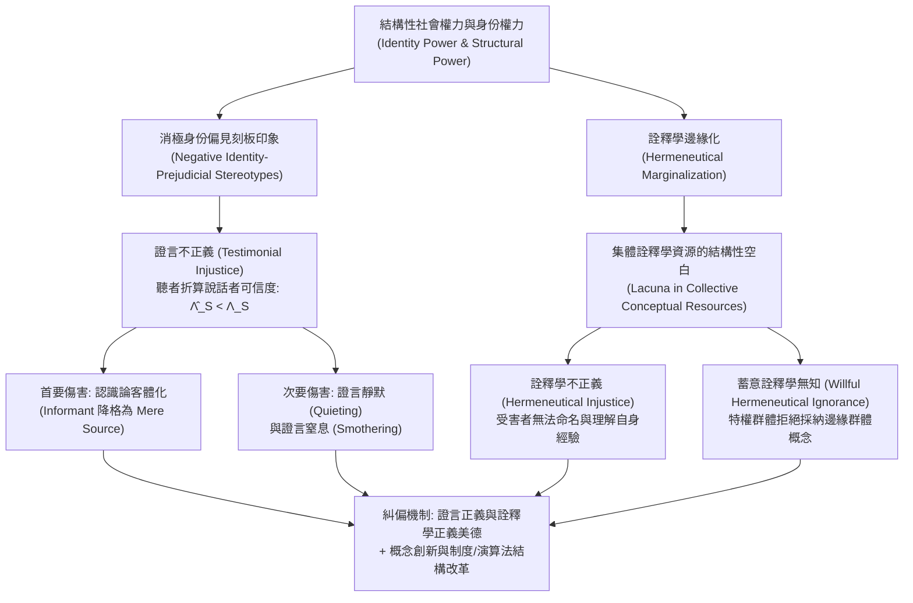

## 導論：當「作為求知者的能力」遭受不正當否定

在傳統政治哲學與倫理學中，「不正義（Injustice）」通常被劃分為兩類：一是關乎財富、醫療、教育等物質資源與社會機會分配不公的<strong>分配不正義（Distributive Injustice）</strong>；二是關乎法律程序、量刑或契約執行偏頗的<strong>程序不正義（Procedural Injustice）</strong>。然而，在人類社會生活的深層結構中，還存在著第三種更為隱蔽卻同樣具有毀滅性的不公——一個人並非僅僅因為被剝奪了選票或收入而遭受壓迫，而是因為其社會身份，在開口說話時其話語的分量被系統性地打折，或者在遭受痛苦時發現整個社會的語言中根本不存在能夠命名和解釋自身經歷的概念。

2007年，英國哲學家<strong>米蘭達·弗里克（Miranda Fricker）</strong>出版了里程碑式的專著《認識論的不正義：權力與求知的倫理》（*Epistemic Injustice: Power and the Ethics of Knowing*），首次將認識論與倫理學、政治權力理論嚴密結合，提出了<strong>認識論的不正義（Epistemic Injustice）</strong>這一核心範疇。所謂認識論的不正義，是指<strong>一個人專門在其作為「求知者（Knower）」或「知識傳遞者」的資格與能力上遭受的不正當傷害</strong>。

要理解為什麼「不被相信」或「無法理解自身經驗」不僅是溝通失誤，而且是一場深刻的倫理與政治災難，我們必須深入社會認識論（Social Epistemology）的核心機制。弗里克將認識論的不正義劃分為兩種基本形態：發生在話語交流層面的<strong>證言不正義（Testimonial Injustice）</strong>，以及發生在集體概念資源層面的<strong>詮釋學不正義（Hermeneutical Injustice）</strong>。本文將從身份權力的運作機制、可信度評估的貝氏形式模型、認識論客體化的倫理傷害，一直探討到當代數位演算法與大型語言模型（LLM）中的認識論排斥。

---

## 第一章 社會權力、身份權力與刻板印象的認識論運作

### 1.1 社會權力與身份權力（Identity Power）

在古典笛卡兒式的個人主義認識論中，求知主體被抽象為脫離社會歷史脈絡的孤立理性人（「我思」）。然而在現實世界中，絕大多數知識的獲取與傳遞都依賴於他人的證言（Testimony）以及共享的語言概念庫。知識天然具有社會性，因而不可避免地被<strong>社會權力（Social Power）</strong>所滲透。

弗里克將社會權力定義為：「社會行動者（個體或群體）在特定社會環境中影響其他行動者行為與處境的實際或潛在能力。」在眾多社會權力形態中，直接引發認識論不正義的是<strong>身份權力（Identity Power）</strong>。身份權力無需依賴有形的暴力或行政命令，它的運作完全依賴於行動者之間共享的「集體社會想像（Collective Social Imagination）」——即關於「身為男性或女性、白人或有色人種、順性別者或跨性別者、醫生或患者、精英學者或普通勞工究竟意味著什麼」的文化腳本與隱性預設。身份權力既可以是能動的（例如一位掌握傳統權威的族長僅憑眼神就讓年輕女性閉嘴），也可以是純粹結構性的（例如特定群體因長期缺乏發聲管道而自動放棄在公共領域作證）。

### 1.2 啟發式刻板印象與消極身份偏見刻板印象

在日常資訊交流中，聽者（Hearer, $H$）必須在極短時間內評估說話者（Speaker, $S$）的<strong>可信度（Credibility）</strong>。由於聽者不可能在每次對話前都對說話者的過往誠實記錄與專業水準進行徹底的經驗審計，人類認知不可避免地依賴<strong>刻板印象（Stereotypes）</strong>——即關於特定社會群體及其可靠性特徵的廣泛聯想——作為評估可信度的<strong>認知啟發法（Heuristic）</strong>。

並非所有刻板印象都是不道德或非理性的。如果一個人帶著「天體物理學家在宇宙學問題上通常比占星師更可靠」或「當地老漁民對近海潮汐的判斷比遊客更準確」的經驗概括去傾聽，這是一種具有經驗根據的可靠啟發。真正引發證言不正義的，是<strong>消極身份偏見刻板印象（Negative Identity-Prejudicial Stereotype）</strong>。弗里克對其給出了精確定義：

> 一種針對特定社會群體的廣泛概括或聯想，它將該群體成員與某種貶低性的屬性（尤其是缺乏理性、情緒化、不誠實、智力低下或認知狹隘）綁定在一起；這種概括並非建立在客觀經驗證據之上，並且由於聽者抱有情感上的惡意、優越感或既得利益，使其在面對相反的經驗證據時表現出強烈的<strong>抗拒修正性（Resistance to Counter-Evidence）</strong>。

當這種消極身份偏見滲入聽者的可信度判斷時，聽者對說話者的感知便發生了結構性扭曲。

---

## 第二章 證言不正義（Testimonial Injustice）：可信度赤字與過剩

### 2.1 系統性證言不正義與偶然性證言不正義

當聽者因為針對說話者社會身份的偏見，給予說話者的話語低於其應得的可信度評價時，說話者便遭受了<strong>可信度赤字（Credibility Deficit）</strong>。然而，並非所有的可信度赤字都具有同等的核心地位。弗里克區分了兩種情形：

1. <strong>偶然性證言不正義（Incidental Testimonial Injustice）</strong>：由局部的、非結構性的偏見引起。例如，一個學術評審委員會的成員恰好對研究某種冷門昆蟲的學者抱有毫無根據的偏見（認為研究這種昆蟲的人都很古怪且不嚴謹），從而無理懷疑該學者的證言。這雖然也是不公的，但這種偏見並不會追蹤該學者進入生活的其他領域（如法庭、醫院、銀行或職場）。
2. <strong>系統性證言不正義（Systematic Testimonial Injustice）</strong>：這是認識論不正義的<strong>核心範例（Central Case）</strong>。引發可信度赤字的身份偏見（如種族主義、性別歧視、階級歧視、身心障礙歧視），會將主體在社會結構的多個維度（經濟、法律、政治、教育、醫療）中持續地追蹤（Track）並置於不利地位。正是這種跨領域的系統性追蹤，將單純的認知偏差轉化為了結構性的社會壓迫。

### 2.2 兩個經典文學與歷史案例：瑪吉·舍伍德與湯姆·羅賓遜

為了具象化系統性證言不正義的運作，弗里克深入剖析了兩個極具代表性的文學場景：

* <strong>《天才雷普利》（*The Talented Mr. Ripley*）中的瑪吉·舍伍德（Marge Sherwood）</strong>：在1950年代的背景下，富家子弟迪基·格林利夫（Dickie Greenleaf）被湯姆·雷普利謀殺。迪基的未婚妻瑪吉對迪基的習性與情感有著極其敏銳、深入的了解。當她發現迪基的戒指等私人物品出現在雷普利手中，並結合一系列反常跡象推斷出迪基絕不可能自殺、極可能已被雷普利殺害時，她的推理在認識論上是高度嚴密的。然而，迪基的父親赫伯特·格林利夫（Herbert Greenleaf）為了維護男性同盟的體面，用一句居高臨下的家長式名言直接抹殺了瑪吉的證言：<strong>「瑪吉，世上有女人的直覺，但也有客觀事實（Marge, there's female intuition, and then there are facts）。」</strong>在這裡，父權制下將女性編碼為「情緒化、非理性、僅有直覺而無邏輯」的消極身份偏見，使赫伯特將瑪吉基於確鑿證據的理性推論貶低為「歇斯底里的女性直覺」，賦予了她嚴重的可信度赤字。
* <strong>《梅岡城故事》（*To Kill a Mockingbird*）中的湯姆·羅賓遜（Tom Robinson）</strong>：在1935年美國阿拉巴馬州的法庭上，黑人青年湯姆被誣告強姦白人女性梅耶拉·尤厄爾（Mayella Ewell）。辯護律師亞提克斯·芬奇（Atticus Finch）已經透過無可辯駁的物證與生理事實證明湯姆左手完全殘廢，根本不可能造成原告身上的傷痕。然而，當檢察官質問湯姆為何經常無償幫助梅耶拉做家事時，湯姆誠實地回答：「我覺得她很可憐（I felt right sorry for her）。」這句話立刻在全體白人陪審團心中引發了強烈的種族主義震怒與認知排斥——在吉姆·克勞法（Jim Crow）時代的白人至上主義身份權力結構中，「一個黑人竟然敢同情一個白人」是不可容忍的越界，而「所有黑人男子都會在性問題上撒謊」則是根深蒂固的種族偏見。陪審團在證據確鑿的情況下依然無法（且拒絕）相信湯姆的證言，最終判處他有罪並導致其死亡。

### 2.3 可信度過剩（Credibility Excess）與認識論惡習

與可信度赤字相對應的是<strong>可信度過剩（Credibility Excess）</strong>：由於說話者擁有特權社會身份（如白人、順性別男性、名校精英、高階主管），聽者給予其話語超出了客觀證據與實際專業水準所應得的信任。

弗里克最初認為，在單次孤立交流中，可信度過剩通常是對說話者的不當優待而非傷害。但哲學家<strong>何塞·梅迪納（José Medina）</strong>在《抗爭的認識論》（*The Epistemology of Resistance*, 2013）中有力地論證道：可信度是一個<strong>關係性、比較性與競爭性的概念（Relational and Comparative Concept）</strong>。首先，在法庭抗辯、醫療問診或職場競爭等零和博弈場景中，賦予特權者過剩的可信度（如無條件相信湯姆·雷普利或白人原告尤厄爾），直接等同於剝奪邊緣群體應得的可信度。其次，長期處於可信度過剩環境中的特權主體，由於其言論從不遭遇有效質疑，會不可避免地滋生出三大<strong>認識論惡習（Epistemic Vices）</strong>：
1. <strong>認識論傲慢（Epistemic Arrogance）</strong>：自詡全知全能，認為自己無需傾聽他人觀點。
2. <strong>認識論懶惰（Epistemic Laziness）</strong>：缺乏探究自身特權盲區與受壓迫者真實處境的認知動力。
3. <strong>認識論封閉（Closed-mindedness）</strong>：對任何挑戰既定秩序的異議採取防禦性排斥。

---

## 第三章 可信度折算與偏見權重的貝氏形式模型

我們可以借助形式認識論中的<strong>貝氏信念更新模型（Bayesian Belief Updating）</strong>，將證言不正義中的可信度赤字與過剩精確化。

假設聽者對某一命題 $H$（例如「患者患有急性心肌缺血」或「被告是無辜的」）持有先驗機率 $P(H) \in (0, 1)$。說話者 $S$ 提供了支持命題 $H$ 的證言 $E_S$。根據貝氏定理，聽者在接收證言後的後驗機率為：

$$P(H \mid E_S) = \frac{P(E_S \mid H) P(H)}{P(E_S \mid H) P(H) + P(E_S \mid \neg H) P(\neg H)}$$

令 $c_S = P(E_S \mid H)$ 表示當命題 $H$ 為真時說話者作出該證言的可靠性（涵蓋<strong>能力 Competence</strong> 與<strong>誠實性 Sincerity</strong>），令 $f_S = P(E_S \mid \neg H)$ 表示當命題 $H$ 為假時說話者誤報或撒謊的偽陽性率。說話者證言的客觀<strong>似然比（Likelihood Ratio）</strong>為：

$$\Lambda_S = \frac{P(E_S \mid H)}{P(E_S \mid \neg H)} = \frac{c_S}{f_S}$$

在沒有身份偏見的理想認識論主體那裡，聽者對說話者可信度的主觀估計 $\hat{\Lambda}_S$ 應當等於其客觀可靠性 $\Lambda_S$。然而，當聽者受到針對說話者群體身份的消極偏見參數 $\delta_{\text{bias}} \in [0, 1]$ 支配時，聽者會在潛意識中壓低對說話者能力與誠實度的評估，同時抬高對其情緒化或欺騙可能性的估計，使得主觀感知似然比退化為：

$$\hat{\Lambda}_S(\delta_{\text{bias}}) = \frac{(1 - \delta_{\text{bias}}) c_S + \delta_{\text{bias}} f_S}{f_S + \delta_{\text{bias}} (c_S - f_S)}$$

由此我們可以嚴格導出以下認識論效應：
* 當 $\delta_{\text{bias}} = 0$（無偏見）時，$\hat{\Lambda}_S(0) = \frac{c_S}{f_S} = \Lambda_S$，聽者實現公正的理性更新。
* 當 $0 < \delta_{\text{bias}} < 1$（存在消極身份偏見）且 $c_S > f_S$ 時，嚴格有 $\hat{\Lambda}_S(\delta_{\text{bias}}) < \Lambda_S$，從而導致主觀後驗信念嚴重低於客觀應有水準：$\hat{P}(H \mid E_S) < P^*(H \mid E_S)$。兩者之差 $\Delta C_S = \Lambda_S - \hat{\Lambda}_S(\delta_{\text{bias}}) > 0$ 即為量化後的<strong>可信度赤字</strong>。
* 當 $\delta_{\text{bias}} \to 1$（極端偏見，如《梅岡城故事》中的白人陪審團）時，$\hat{\Lambda}_S(1) = 1$。此時無論說話者的證言在客觀上多麼確鑿，聽者的後驗機率始終等於先驗機率 $\hat{P}(H \mid E_S) = P(H)$——說話者的證言在認識論上被徹底<strong>歸零（Epistemic Nullification）</strong>。

在對數勝算（Log-Odds）形式下，經過 $T$ 次證言交流後的累積信念更新可表示為：

$$\log \frac{P_T(H)}{1 - P_T(H)} = \log \frac{P_0(H)}{1 - P_0(H)} + \sum_{t=1}^{T} w_{S_t} \log \Lambda_{S_t}$$

其中 $w_{S_t}$ 是聽者賦予第 $t$ 位說話者的身份權重。當邊緣群體 $M$ 的權重被系統性壓低（$w_M \ll 1$），而特權群體 $P$ 的權重被系統性放大（$w_P > 1$）時，公共知識庫將不可避免地向特權階層的偏見收斂。

---

## 第四章 證言不正義的深層傷害：從客體化到證言窒息

### 4.1 首要傷害：認識論客體化（Epistemic Objectification）

為什麼不被相信會造成如此深重的道德傷害？弗里克區分了證言不正義的<strong>首要傷害（Primary Harm）</strong>與<strong>次要傷害（Secondary Harm）</strong>。

首要傷害是<strong>內在的（Intrinsic）</strong>：它直接打擊了人的核心本質。自亞里斯多德以來，理性與傳遞知識的能力就被視為人類尊嚴的根基。當一個人因為身份偏見而在作為知識傳遞者的資格上被否定時，他/她在象徵意義上被貶低為了「次等人類（Less than fully human）」。

為了精確刻畫這一過程，弗里克引入了英國哲學家<strong>愛德華·克雷格（Edward Craig）</strong>在《知識與自然狀態》（*Knowledge and the State of Nature*, 1990）中提出的著名區分：
* <strong>資訊提供者 / 證人（Informant）</strong>：被我們作為擁有理性、主體性與判斷力的對話夥伴來對待的人；我們與他共同參與求知共同體的信念協商。
* <strong>單純的資訊源（Mere Source of Information）</strong>：就像樹幹上的年輪告訴我們樹木的年齡，或者泥地裡的腳印告訴我們有人經過一樣，我們從中提取客觀資訊，但並不將其視為擁有理性主體性的對話者。

當赫伯特·格林利夫把瑪吉的推論僅僅當作「一個悲傷女人情緒失控的症狀」來觀察，或者當偵探把受害者的陳述僅僅當作提取物證線索的物理聲學訊號而拒絕採信其判斷時，說話者就被從「求知主體（Informant）」強行降格為了「被觀察的客體（Mere Source of Information）」。這就是與康德倫理學中的性客體化（Sexual Objectification）相平行的<strong>認識論客體化（Epistemic Objectification）</strong>。

### 4.2 次要傷害：實踐剝奪與認識論信心的瓦解

次要傷害分為<strong>實踐層面（Practical Dimension）</strong>與<strong>認識論層面（Epistemic Dimension）</strong>：
* <strong>實踐傷害</strong>：蒙受不白之冤入獄、在醫療分診中因疼痛陳述不被採信而延誤救治致死、在職場因創意不被認可而喪失晉升機會。
* <strong>認識論傷害</strong>：當一個人長期生活在可信度赤字的環境中，持續遭遇他人的輕視與懷疑，他會逐漸喪失<strong>認識論信心（Epistemic Confidence）</strong>。根據知識需要滿足「主體持有穩固信念」的條件，當自我懷疑侵蝕了信念的穩定性時，受害者甚至會<strong>真正喪失自己原本擁有的知識</strong>，並最終被排斥在塑造自我發展（Bildung）的公共理性對話之外。

### 4.3 證言靜默（Quieting）與證言窒息（Smothering）

美國黑人女性主義哲學家<strong>克里斯蒂·多特森（Kristie Dotson）</strong>在2011年的經典論文《追蹤認識論暴力》（*Tracking Epistemic Violence, Tracking Practices of Silencing*）中，借助言語行為理論（Speech Act Theory）中的「語力受挫（Illocutionary Frustration）」，揭示了兩種由認識論暴力導致的系統性失聲機制：

1. <strong>證言靜默（Testimonial Quieting）</strong>：聽者由於內化了針對說話者身份的刻板印象（例如帕特里夏·希爾·柯林斯 Patricia Hill Collins 所分析的針對黑人女性的「福利女王」、「憤怒的黑人女性」等控制性意象 Controlling Images），根本<strong>未能將說話者識別為求知主體</strong>，導致說話者雖然發出了聲音，卻在聽者那裡如同靜音。
2. <strong>證言窒息（Testimonial Smothering）</strong>：這是一種<strong>被迫的自我審查（Coerced Self-Silencing）</strong>。當邊緣群體的說話者察覺到：第一，自己即將講述的內容高度複雜且帶有風險；第二，眼前的聽者存在明顯的<strong>證言無能（Testimonial Incompetence）</strong>——即聽者缺乏理解該證言的必要認知框架，且極可能用帶有偏見的方式曲解該證言，從而反而加深對邊緣群體的傷害（例如少數族裔女性在面對白人警察或主流媒體時，擔心揭露社區內部的家庭暴力會被種族主義者利用來污名化整個少數族裔群體）。於是，說話者被迫在開口前主動咽下自己的證言。這種表面上的「自願沉默」，實質上是結構性暴力強加的窒息。

此外，美國作家<strong>麗貝卡·索爾尼特（Rebecca Solnit）</strong>在《愛說教的男人》（*Men Explain Things to Me*, 2014）中剖析的<strong>「男性說教（Mansplaining）」</strong>，正是性別身份權力導致「男性可信度過剩」與「女性可信度赤字」在日常對話中同時發作的典型交匯：說教者預設眼前的女性在認知上是空白的，甚至向書籍的親筆女作者本人傲慢地「科普」她自己寫的書。

---

## 第五章 詮釋學不正義（Hermeneutical Injustice）：集體意義的空白與蓄意無知

### 5.1 詮釋學邊緣化與概念空白

如果說證言不正義發生在個體間的資訊傳遞環節，那麼<strong>詮釋學不正義（Hermeneutical Injustice）</strong>則發生在更底層的結構層面——即整個社會共享的<strong>集體詮釋學資源（Collective Hermeneutical Resources）</strong>（包括詞彙、概念、隱喻、法律範疇與社會解釋模型）本身存在結構性的缺口。

為什麼社會的詞典裡會缺少某些特定經驗的詞彙？因為概念的創造與普及（如法律條文、醫學診斷手冊、主流新聞報導、學術研究）歷來是由佔據支配地位的社會群體主導的。弱勢群體由於長期被排斥在這些「意義生成實踐（Meaning-Making Practices）」之外，處於<strong>詮釋學邊緣化（Hermeneutical Marginalization）</strong>的狀態。其結果是：集體概念庫對特權群體的生活經驗（如商業契約、戰場榮譽、有產者權益）有著極其精細的命名，而在涉及弱勢群體特有的痛苦與壓迫經驗時，卻留下一片空白（Hermeneutical Lacuna）。

弗里克將詮釋學不正義定義為：<strong>由於集體詮釋學資源中存在受結構性身份權力偏見支配的空白，導致某一社會群體在試圖理解並向他人傳達其重要的社會經驗時，處於嚴重且不公正的認知劣勢。</strong>

### 5.2 卡米塔·伍德（Carmita Wood）與「性騷擾」概念的誕生

弗里克引述了蘇珊·布朗米勒（Susan Brownmiller）在《我們的時代：美國女性革命回憶錄》中記載的真實歷史事件，作為詮釋學不正義的典範案例：

1975年，在美國康乃爾大學核物理系擔任行政職員的<strong>卡米塔·伍德（Carmita Wood）</strong>，長期遭受系裡一位著名資深教授的故意身體觸碰、下流暗示與電梯堵截。長期的屈辱使伍德患上了嚴重的慢性頸背劇痛與神經衰弱，最終被迫辭職。然而，當她去勞工局申請失業救濟金，被辦事員問及離職原因時，她陷入了徹底的失語與尷尬——在1975年的英語詞彙與法律概念中，只有「兩廂情願的辦公室調情（Flirting）」或極端的「強姦（Rape）」，<strong>根本不存在任何一個詞能夠命名她所遭受的這種系統性職場侵害</strong>。她只能含糊地填寫「個人原因」，結果失業金申請以「無正當工程或健康理由自願離職」被駁回。

隨後，伍德參加了由<strong>林·法利（Lin Farley）</strong>主持的女性意識覺醒小組（Consciousness-Raising Group）。在小組中，女性們驚訝地發現彼此都經歷過完全相同的職場夢魘。為了向公眾和法庭指認這種普遍存在的侵害，她們在討論中共同鍛造出了一個全新的概念——<strong>「性騷擾（Sexual Harassment）」</strong>。

在這個案例中，在「性騷擾」一詞誕生之前，施害教授同樣不知道這個概念，但這種概念空白對教授而言是極其有利的（掩蓋了他的惡行），而對卡米塔·伍德卻造成了毀滅性的認知與實踐不對稱：她甚至無法向自己和他人清晰地解釋自己究竟遭遇了什麼。正是透過邊緣群體打破詮釋學孤立、建立意識覺醒共同體，才填補了集體概念庫的這一結構性空白。同樣的機制也體現在「產後憂鬱症（Postpartum Depression）」、「微歧視（Microaggression）」、「煤氣燈效應（Gaslighting）」以及神經多樣性（Neurodiversity）等概念的誕生史中。

### 5.3 蓄意詮釋學無知（Willful Hermeneutical Ignorance）

弗里克最初假定整個社會只共享一套單一的集體詮釋學資源。然而，哲學家<strong>蓋爾·波爾豪斯（Gaile Pohlhaus Jr.）</strong>（2012）、查爾斯·米爾斯（Charles Mills，提出「白人無知 White Ignorance」）與克里斯蒂·多特森敏銳地指出：邊緣群體在長期的生存抗爭中，其實早已在自己的社群內部創造出了極其豐富的<strong>另類詮釋學資源（Alternative Hermeneutical Resources）</strong>（如女性主義理論、批判種族理論、酷兒與身心障礙社群詞彙）。

真正的問題往往不在於「世界上還沒有這個詞」，而在於佔據支配地位的特權群體出於維護自身利益的動機，<strong>主動拒絕學習、承認或採納邊緣群體已經發展出來的概念工具</strong>，並傲慢地宣稱那些概念「只是政治正確」、「太矯情」或「沒有客觀依據」。波爾豪斯將這種現象命名為<strong>蓄意詮釋學無知（Willful Hermeneutical Ignorance）</strong>，多特森則稱之為<strong>第三類認識論不正義（Contributory Injustice，貢獻性不正義）</strong>。

---

## 第六章 當代前沿：醫療保健與人工智慧（AI）中的認識論不正義

| 維度 | 證言不正義 (Testimonial Injustice) | 詮釋學不正義 (Hermeneutical Injustice) | 蓄意詮釋學無知 / 貢獻性不正義 (Contributory Injustice) |
| :--- | :--- | :--- | :--- |
| <strong>發生層面</strong> | 個體/機構間的話語交流與證據評估 | 集體共享的概念庫、語言與解釋框架 | 多元概念體系之間的權力排斥與制度封鎖 |
| <strong>直接成因</strong> | 聽者受消極身份偏見支配（$\delta_{\text{bias}} > 0$） | 邊緣群體被排斥在意義生成實踐之外 | 特權主體拒絕採納邊緣群體已有的概念資源 |
| <strong>核心機制</strong> | 可信度赤字（$\hat{\Lambda}_S < \Lambda_S$）與可信度過剩 | 集體詮釋學空白（Hermeneutical Lacuna） | 結構性偏見的詮釋學資源與認知防禦 |
| <strong>典型案例</strong> | 瑪吉·舍伍德、湯姆·羅賓遜、醫療疼痛忽視 | 1975年前卡米塔·伍德無法命名「性騷擾」 | 拒絕承認系統性種族主義或慢性隱性病痛概念 |
| <strong>糾偏路徑</strong> | 反思性批判意識、證言正義美德、程序改革 | 意識覺醒共同體、概念創新、民主化知識生產 | 認識論謙遜、傾聽多元視角、重構訓練語料與制度 |

### 6.1 臨床醫學與精神醫學中的認識論不正義

英國哲學家<strong>哈維·卡雷爾（Havi Carel）</strong>與伊恩·基德（Ian James Kidd）深入研究了醫療保健系統中的認識論不正義：
* <strong>患者證言的系統性折算</strong>：在現代生物醫學模式中，醫生擁有絕對的專業權威與制度權力，而重症患者、慢性疼痛患者（如纖維肌痛症、子宮內膜異位症、長新冠 Long COVID 患者）或精神障礙患者則常常被貼上「情緒不穩、誇大痛苦、缺乏醫學常識」的刻板印象標籤。實證醫學研究反覆證實，女性患者與少數族裔患者在急診室報告劇烈疼痛時，獲得止痛藥的機率顯著低於同等症狀的白人男性患者，且更容易被誤診為「焦慮症」或「心理作用」。
* <strong>疾病體驗的詮釋學空白</strong>：醫院現行的標準化量表（如1到10的數字疼痛評分）與冰冷的病理學術語，往往無法容納患者對身體異化、尊嚴喪失與慢性痛苦的現象學體驗。患者被迫用醫學體制規定的剛性語言去裁剪自己的真實感受，否則就會被視為「不配合治療」或「語無倫次」。

### 6.2 人工智慧與大型語言模型（LLM）中的演算法認識論不正義

進入生成式人工智慧時代，認識論不正義正在被編碼進自動化決策系統與<strong>大型語言模型（Large Language Models, LLMs）</strong>的權重矩陣中：
1. <strong>自動化證言不正義（Automated Testimonial Injustice）</strong>：當醫療分診演算法、信貸風控模型、司法保釋評估系統或福利欺詐檢測系統以歷史帶有偏見的資料進行訓練時，演算法會將特定郵遞區號、性別或族裔群體的自我申報與申訴賦予極低的信賴度權重，將歷史上的身份偏見固化為看似「客觀中立」的數學評分。
2. <strong>演算法詮釋學抹除（Algorithmic Hermeneutical Erasure）</strong>：大型語言模型透過海量網際網路語料庫進行預訓練，並透過基於人類回饋的強化學習（RLHF）進行對齊。由於全球數位語料庫高度偏向英語、西方工業化國家與主流精英話語，全球南方（Global South）、原住民語言、方言群體以及邊緣次文化的概念框架在嵌入空間（Embedding Space）中處於極度稀疏的邊緣位置。當大模型被用作全社會的搜尋引擎、寫作助手、教育導師與知識仲裁者時，它不僅會復現主流偏見，更會在全社會範圍內製造一場<strong>數位時代的詮釋學同質化</strong>——那些未被主流語料充分表徵的邊緣生活經驗，在演算法生成的新世界圖景中再次淪為「不可言說、不可檢索、不可理解」的幽靈。

---

## 結語：從個人美德倫理走向結構性認識論民主

面對認識論的不正義，我們應當如何回應？弗里克在書中提出，聽者需要培養兩種反偏見的<strong>混合型美德（Hybrid Virtues——兼具智性美德與道德美德）</strong>：
* <strong>證言正義美德（The Virtue of Testimonial Justice）</strong>：聽者養成一種<strong>反身性批判意識（Reflexive Critical Awareness）</strong>。當自己在傾聽某位說話者時感到直覺性的懷疑或輕視，能夠立刻警覺並自問：「我對他/她的低可信度評價，究竟是基於客觀證據，還是因為我作為特定社會身份的聽者，受到了針對其社會身份的刻板印象的影響？」並主動向上修正被偏見壓低的可信度估計。
* <strong>詮釋學正義美德（The Virtue of Hermeneutical Justice）</strong>：當聽者面對一個表達支吾、邏輯似乎不夠順暢、情緒激動的說話者（尤其是在涉及創傷、壓迫或罕見病痛的語境下）時，不急於將其歸咎於說話者的愚蠢或撒謊，而是敏銳地意識到：「這很可能是因為我們現有的公共語言中缺乏能夠準確表達其處境的概念工具」，從而以開放、耐心的傾聽姿態，與說話者共同培育新的理解空間。

然而，正如伊麗莎白·安德森（Elizabeth Anderson, 2012）等政治哲學家所強調的，由於隱性偏見（Implicit Bias）往往在無意識層面自動運作，而詮釋學邊緣化更是植根於宏觀的制度權力分配，僅僅依靠個體的內省與道德修養是遠遠不夠的。真正的認識論正義，必須將<strong>個人美德倫理</strong>與<strong>大規模的結構性制度變革</strong>結合起來——包括司法採信規則的改革、醫療問診中對患者敘事醫學（Narrative Medicine）的制度化尊重、學術與媒體知識生產群體的多元化，以及人工智慧訓練資料與對齊機制的民主化治理。唯有當每一個人都能作為平等的求知者被傾聽、每一種人類苦難都能在公共語言中找到清晰的名字時，一個真正公正的社會才可能實現。
