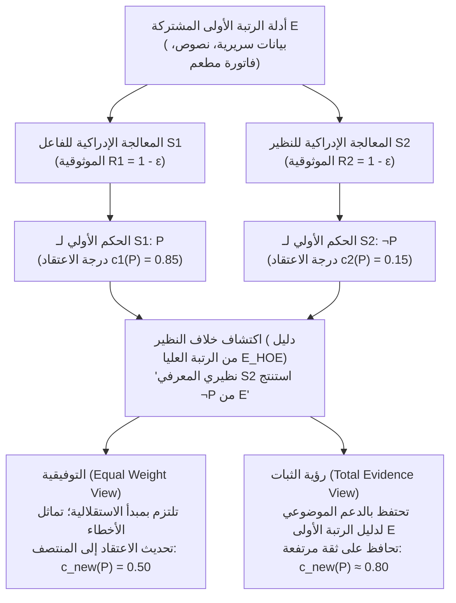
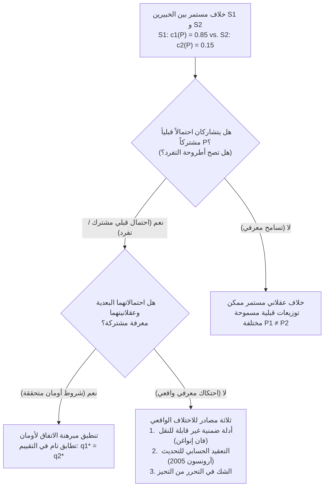

## 1. مقدمة: صدمة الاختلاف العقلاني وتلاشي الأعذار المعرفية

في الحياة اليومية، والطب السريري، والقضاء، والسياسات الكلية، والعلوم التجريبية، والفلسفة ذاتها، نصطدم باستمرار بأشخاص يرفضون أعمق قناعاتنا المدروسة. وفي الغالبية العظمى من الخلافات العادية، لا يؤدي اكتشاف وجود من يخالفنا الرأي إلى زعزعة ثقتنا لأن لدينا مخزوناً جاهزاً من التفسيرات الكاسرة للتماثل — أي ما يمكن تسميته «الأعذار المعرفية». نقول لأنفسنا إن محاورنا لم يقرأ أحدث الدراسات التجريبية، أو يفتقر إلى التدريب الإحصائي الدقيق، أو تعميه التحيزات الأيديولوجية والمالية. وطالما أمكننا تصنيف خصمنا بوصفه <strong>أدنى معرفياً (Epistemic Inferior)</strong> في المسألة المطروحة، فإن الاحتفاظ باعتقادنا الأولي يبدو أمراً يسيراً.

ولكن ماذا يحدث عندما تتلاشى كل تلك الأعذار المريحة؟

لنفترض أنك وزميلة لك عملتما جنباً إلى جنب طوال عشر سنوات في نفس الحقل العلمي أو الفلسفي. لقد فحصتما نفس الأدبيات الأولية، ونفس البيانات التجريبية، ونفس البراهين الرياضية (مجموعة مشتركة من الأدلة $E$). وعلاوة على ذلك، تعلم يقيناً أن زميلتك تضاهيك في الذكاء، والدقة التحليلية، والنزاهة الفكرية، واليقظة، والتحرر من التحيز. في المصطلح التقني لـ <strong>الإبستمولوجيا الاجتماعية (Social Epistemology)</strong> المعاصرة، تُعَد هذه الزميلة <strong>نظيراً معرفياً ($\text{Peer}(S_1, S_2)$)</strong> لك.

بعد تقييم الأدلة المشتركة $E$ بشكل مستقل، تتوصل أنت إلى قناعة راسخة بأن القضية $P$ صادقة، مانحاً إياها درجة اعتقاد (*credence*) قدرها $c_1(P) = 0.85$. أما نظيرتك المعرفية، وبعد تقييم نفس الأدلة $E$ بعناية مماثلة، فتعلن النتيجة المعاكسة تماماً: إنها تعتقد بصدق $\neg P$، ولا تمنح $P$ سوى درجة اعتقاد $c_2(P) = 0.15$.

في اللحظة التي تكتشف فيها هذا الاختلاف بين الأقران، <strong>ماذا تقتضي منك العقلانية المعرفية؟</strong>

1. <strong>النزعة التوفيقية / رؤية الوزن المتساوي (Conciliationism / Equal Weight View)</strong>: بما أنك ونظيرتك معالجان متساويان في الموثوقية للأدلة $E$، وبما أن أحدكما على الأقل قد ارتكب خطأً إدراكياً في هذه المرة، فإن تفضيل حكمك الشخصي لمجرد أنه *حكمك أنت* يُعَد ضرباً من الدوغمائية والأنانية المعرفية. يتعين عليك مراجعة ثقتك جوهرياً نحو نقطة المنتصف ($c_{\text{new}}(P) = 0.50$) وتعليق الحكم.
2. <strong>رؤية الثبات / اللاتوفيقية (The Steadfast View / Non-Conciliationism)</strong>: حتى في مواجهة خلاف النظير، إذا كانت أدلة الرتبة الأولى $E$ تدعم موضوعياً القضية $P$ وكنت قد استدللت بشكل سليم من $E$ إلى $P$، فلست ملزماً بالتخلي عن اعتقاد مسوَّغ جيداً لمجرد أن نظيرك عانى من بقعة عمياء عابرة.

منذ منتصف العقد الأول من القرن الحادي والعشرين، تربع هذا السؤال — الذي صاغه ريتشارد فيلدمان، وديفيد كريستنسن، وآدم إلغا، وتوماس كيلي، وجينيفر لاكي، وميريام شونفيلد — في قلب نظرية المعرفة التحليلية.

---

## 2. الصياغة الصورية للندية المعرفية والهندسة ثنائية المستوى للأدلة

### 2.1 التساوي في الأدلة والتساوي الإدراكي

وفقاً لتوماس كيلي (2005، *"The Epistemic Significance of Disagreement"*) وريتشارد فيلدمان (2007)، يكون الفاعلان $S_1$ و $S_2$ <strong>نظيرين معرفيين</strong> بالنسبة إلى قضية $P$ إذا تحقق شرطا تماثل صارمان:

1. <strong>التساوي في الأدلة (Evidential Equality)</strong>: يمتلك $S_1$ و $S_2$ نفس المجموعة تماماً من الأدلة الجوهرية من الرتبة الأولى $E$ المتعلقة بقيمة صدق $P$ ($E_1 = E_2 = E$).
2. <strong>التساوي الإدراكي (Cognitive Equality)</strong>: يتساوى $S_1$ و $S_2$ في الكفاءات المعرفية العامة (الذكاء، الصرامة المنطقية، الخلفية العلمية) والفضائل الإبستمولوجية (النزاهة الفكرية، الانفتاح الذهني، التحرر من الهوى) اللازمة لتقييم $E$، بحيث تتساوى معدلات موثوقيتهما العامة $R(S_1) \approx R(S_2)$.

### 2.2 أدلة الرتبة الأولى ($E$) مقابل أدلة الرتبة العليا ($E_{\text{HOE}}$)

يرتكز المحرك التحليلي لهذا النقاش على التمييز بين <strong>أدلة الرتبة الأولى ($E$)</strong> و<strong>أدلة الرتبة العليا ($E_{\text{HOE}}$)</strong> (Christensen 2010; Kelly 2010):

- <strong>أدلة الرتبة الأولى ($E$)</strong>: هي الأدلة التي تنصب مباشرة على صدق القضية $P$ في العالم الخارجي (كالبيانات السريرية، أو السلاسل الزمنية الاقتصادية، أو المخطوطات التاريخية، أو الأرقام المسجلة في فاتورة مطعم).
- <strong>أدلة الرتبة العليا ($E_{\text{HOE}}$)</strong>: هي أدلة فوقية تدور حول *موثوقية جهازنا الإدراكي أثناء معالجة $E$* أو حول ما إذا كانت $E$ تدعم $P$ حقاً.

في <strong>حالة العقار المشوِّه للتفكير</strong> الكلاسيكية (Christensen 2010)، إذا أخبرك طبيب موثوق أن قهوتك الصباحية قد مُزجت بمادة كيميائية تسبب هلوسات منطقية غير مرئية لدى $80\%$ من الأشخاص فور انتهائك من استنباط مبرهنة رياضية $P$ من مسلّمات $E$، فإن شهادة الطبيب لا تقدم دليلاً ضد المبرهنة الرياضية $P$ ذاتها، بل تعمل بوصفها <strong>ناقضاً مقوِّضاً من الرتبة العليا ($E_{\text{HOE}}$)</strong> يلزمك بخفض ثقتك في استنتاجك. إن اكتشاف أن نظيرك المعرفي استنتج $\neg P$ من $E$ يمثل بالضبط دليلاً من الرتبة العليا يفيد بأن أحد الجهازين الإدراكيين على الأقل قد تعرض لخلل في الأداء.

---

## 3. المعسكر التوفيقي: فاتورة المطعم، الوزن المتساوي، ومبدأ الاستقلالية

### 3.1 تجربة فاتورة المطعم لديفيد كريستنسن (2007)

في ورقته الشهيرة *"Epistemology of Disagreement: The Good News"* (2007)، قدم ديفيد كريستنسن تجربة فكرية باتت مرجعاً أساسياً هي <strong>حالة فاتورة المطعم (The Restaurant Check Case)</strong>: يخرج خمسة أصدقاء لتناول العشاء ويتفقون على تقسيم الفاتورة بالتساوي بعد إضافة $20\%$ إكرامية. تقوم أنت وصديقتك — التي تماثلك تماماً في سرعة ودقة الحساب الذهني — بفحص الفاتورة ($E$). تحسب في ذهنك نصيب الفرد فتجده <strong>$\$43$</strong> بثقة عالية ($c_1(P) = 0.95$)، لكن صديقتك تعلن بثقة مماثلة أن نصيب الفرد هو <strong>$\$45$</strong> ($c_2(P) = 0.05$).

لو حاججت قائلاً: *«لقد حسبت الفاتورة فوجدتها $\$43$، إذن الإجابة الصحيحة هي $\$43$؛ وبما أن صديقتي قالت $\$45$، فلا بد أنها أخطأت في الحساب اليوم، ولذا سأظل واثقاً بنسبة $95\%$»*، لكان هذا الاستدلال قمة اللاعقلانية والغرور المعرفي. فبما أن احتمال الهفوة الحسابية الذهنية $\varepsilon > 0$ متماثل لديكما، تقتضي العقلانية خفض ثقتك في $\$43$ إلى نحو $50\%$.

### 3.2 رؤية الوزن المتساوي لآدم إلغا والدمج الخطي البايزي

عمم آدم إلغا (2007، *"Reflection and Disagreement"*) هذه البصيرة في <strong>رؤية الوزن المتساوي (Equal Weight View)</strong>، التي تفرض <strong>دمجاً خطياً للآراء (Linear Opinion Pooling)</strong> بأوزان متساوية $w_1 = w_2 = \frac{1}{2}$:

$$c_{\text{new}}(P) = \frac{1}{2} c_1(P) + \frac{1}{2} c_2(P)$$

وفي نموذج التحديث البايزي القياسي باحتمال قبلي $\mathbb{P}(P) = p_0$ حيث يمتلك كل فاعل دقة تشخيصية قدرها $1 - \varepsilon$ ($\varepsilon \in (0, 1/2)$)، فإن الاحتمال البعدي للقضية $P$ بشرط وقوع الحدث المشترك $\{D_1 = P, D_2 = \neg P\}$ يعطى بالمعادلة:

$$\mathbb{P}(P \mid D_1 = P, D_2 = \neg P) = \frac{p_0 (1 - \varepsilon)\varepsilon}{p_0 (1 - \varepsilon)\varepsilon + (1 - p_0)\varepsilon(1 - \varepsilon)} = p_0$$

يُختزل المقدار $(1 - \varepsilon)\varepsilon$ بالكامل بين البسط والمقام، مما يعيد الاحتمال البعدي إلى الاحتمال القبلي المحايد $p_0$ ($0.50$)، وهو ما يترجم مباشرة إلى <strong>تعليق الحكم</strong> الذي يدافع عنه ريتشارد فيلدمان (2006).

### 3.3 مبدأ الاستقلالية لكريستنسن

لمنع المصادرة على المطلوب في استبعاد حكم النظير، صاغ كريستنسن (2009، 2011) <strong>مبدأ الاستقلالية (Independence Principle)</strong>:

> <strong>[مبدأ الاستقلالية (Christensen 2009)]</strong>
> عند تقييم الجدارة المعرفية لاعتقاد شخص آخر حول $P$ من أجل تحديد كيفية (أو ما إذا كان ينبغي) تعديل اعتقادي الخاص حول $P$، <strong>يجب أن أفعل ذلك بطريقة لا تعتمد على الاستدلال الذي يقوم عليه اعتقادي الأولي حول $P$</strong>.

إن انتهاك مبدأ الاستقلالية يوقع الفاعل في دور منطقي مفرغ يطابق بنيوياً <strong>مفارقة الدوغمائية</strong> (Harman 1973; Kripke 2011).

---

## 4. معسكر الثبات: الدليل الكلي، المعلومات الشخصية، وتقويض الذات

### 4.1 رؤية الدليل الكلي لتوماس كيلي (2010)

يعترض توماس كيلي (2005، 2010) بأن التوفيقية تسمح للدليل السيكولوجي من الرتبة العليا ($E_{\text{HOE}}$) بأن <strong>يطمس أو يبتلع (swamp)</strong> الدليل الجوهري من الرتبة الأولى $E$. فإذا كان $E$ يدعم موضوعياً $P$، فإن <strong>الدليل الكلي ($E_{\text{total}}$)</strong> لدى $S_1$ يتألف من ثلاثة عناصر:

$$E_{\text{total}} = \underbrace{E}_{\text{دليل الرتبة الأولى الجوهري}} \cup \underbrace{\{S_1 \text{ حكم بـ } P \text{ بناءً على } E\}}_{\text{الواقعة النفسية 1}} \cup \underbrace{\{S_2 \text{ حكم بـ } \neg P \text{ بناءً على } E\}}_{\text{الواقعة النفسية 2}}$$

ورغم أن الواقعتين النفسيتين متماثلتان، <strong>فإن العنصر الأول — أي الدليل الجوهري $E$ ذاته — ليس متماثلاً!</strong> بل يشير موضوعياً نحو $P$. ووفقاً لـ <strong>رؤية الدليل الكلي (Total Evidence View)</strong> لكيلي، يمنع حضور $E$ المباشر انهيار درجة الاعتقاد العقلانية إلى $0.50$.

### 4.2 الرؤية التسويغية لجينيفر لاكي واعتراض تقويض الذات

توضح جينيفر لاكي (2010) عبر <strong>الحالات القصوى</strong> (كأن ينكر زميلك أن $2 + 2 = 4$ أو ينكر وجود صديقة تجلس أمامكما مباشرة على المائدة) أنك تمتلك <strong>معلومات شخصية (Personal Information)</strong> استبطانية مباشرة من منظور الشخص الأول حول يقظتك وسلامتك الإدراكية، مما يكسر التماثل بصورة مشروعة عندما يكون التسويغ الأولي فائق القوة.

فضلاً عن ذلك، تواجه التوفيقية <strong>اعتراض تقويض الذات (Self-Defeat Objection)</strong> (Elga 2010): فبما أن كبار فلاسفة المعرفة أنفسهم (وهم أقران معرفيون) منقسمون بشدة حول صدق التوفيقية $C$، فإن التوفيقي ملزم بتطبيق قاعدته $C$ على $C$ ذاتها، وبالتالي التخلي عن ثقته في التوفيقية!

---

## 5. الانقسام الميتا-إبستمولوجي: أطروحة التفرد مقابل التسامح المعرفي

- <strong>أطروحة التفرد (Uniqueness Thesis — Feldman 2007; Roger White 2005)</strong>: بالنظر إلى مجموع الأدلة $E$، يوجد <strong>موقف دوكساستيكي واحد على الأكثر</strong> بالغ العقلانية $c(P \mid E)$. ومن خلال <strong>حجة الحبة السحرية</strong>، يجادل روجر وايت بأنه لو كان المعياران $R_1, R_2$ متساويين في العقلانية، لكان التمسك بـ $P$ لمجرد دراستك في جامعة تلقن $R_1$ اعتباطياً تماماً كابتلاع حبة دوائية تولد اعتقاداً عشوائياً.
- <strong>التسامح المعرفي (Epistemic Permissivism — Gideon Rosen 2001; Miriam Schoenfield 2014)</strong>: أمام الأدلة المركبة $E$، توجد عائلة من التوزيعات الاحتمالية القبلية المسموح بها عقلانياً $\{\mathbb{P}_\theta\}_{\theta \in \Theta}$. وترد ميريام شونفيلد (2014) بأن أحداً لا يستطيع تقييم الأدلة من فراغ خارج كل المعايير؛ فبالحكم في ضوء المعيار المتسق $R_1$ الخاص بـ $S_1$، يظل $R_1$ أكثر إفضاءً إلى الحقيقة من $R_2$، مما يجعل <strong>الاختلاف بلا خطأ (Faultless Disagreement)</strong> ممكناً.

| البعد التحليلي | Equal Weight View (توفيقية صارمة) | Total Evidence View (ثبات معتدل) | Justificationist View (نموذج هجين غير متماثل) | الثبات التسامحي (ثبات جذري) |
| :--- | :--- | :--- | :--- | :--- |
| <strong>أبرز الفلاسفة</strong> | د. كريستنسن، أ. إلغا، ر. فيلدمان | توماس كيلي (2010) | جينيفر لاكي (2010) | ج. روزن، م. شونفيلد، ب. فان إنواغن |
| <strong>المقدمة الميتا-إبستمولوجية</strong> | أطروحة التفرد الصارمة | دعم استدلالي موضوعي | حساس للسياق (معلومات شخصية) | التسامح المعرفي ($\{\mathbb{P}_\theta\}$) |
| <strong>مبدأ الاستقلالية</strong> | مطبق بصرامة | مرفوض / مقيد | يُتجاوز عند قوة التسويغ الأولي | يسمح بتقييم المعايير المنافسة عبر $R_1$ |
| <strong>الحكم في فاتورة المطعم</strong> | قسمة الفرق للمنتصف ($c_{\text{new}} = 0.50$) | توفيق جوهري | توفيق | توفيق (قاعدة حسابية وحيدة) |
| <strong>الحكم في الخلافات العلمية والفلسفية</strong> | تعليق الحكم (لاأدرية) | من استدل بصواب يحتفظ بثقة عالية | ثبات عند التحقق العميق | يحق لكلا النظيرين الثبات عقلانياً |

---

## 6. نظرية الألعاب ومبرهنة الاتفاق لروبرت أومان (1976)

في ورقته التأسيسية *"Agreeing to Disagree"* (1976)، أثبت الحائز على جائزة نوبل <strong>روبرت أومان (Robert J. Aumann)</strong> في فضاء احتمالي $(\Omega, \mathcal{F}, \mathbb{P})$ ذي <strong>احتمال قبلي مشترك (Common Prior)</strong> $\mathbb{P}$ وتجزئتين للمعلومات الخاصة $\mathcal{P}_1, \mathcal{P}_2$ أنه إذا أصبحت الاحتمالات البعدية $q_1(\omega) = \mathbb{P}(A \mid \mathcal{P}_1(\omega)) = a$ و $q_2(\omega) = \mathbb{P}(A \mid \mathcal{P}_2(\omega)) = b$ <strong>معرفة مشتركة (Common Knowledge)</strong> في الحالة $\omega^* \in C \in \mathcal{P}_1 \wedge \mathcal{P}_2$، فإنه بالضرورة:

$$\mathbb{P}(A \cap C) = a\,\mathbb{P}(C) = b\,\mathbb{P}(C) \implies a = b$$

<strong>لا يمكن للفاعلين البايزيين الذين يتشاركون احتمالاً قبلياً واحداً أن «يتفقوا على الاختلاف»!</strong> وعندما يستمر الخبراء الواقعيون في الاختلاف، فلا بد أن أحد شروط أومان قد اختل: (1) غياب الاحتمال القبلي المشترك ($\mathbb{P}_1 \neq \mathbb{P}_2$، التسامح المعرفي)، أو (2) المعرفة الضمنية والأدلة غير القابلة للنقل (فان إنواغن 1996)، أو (3) الاستعصاء الحسابي (NP-hard) لعكس النموذج الذهني للنظير (سكوت آرونسون 2005).

