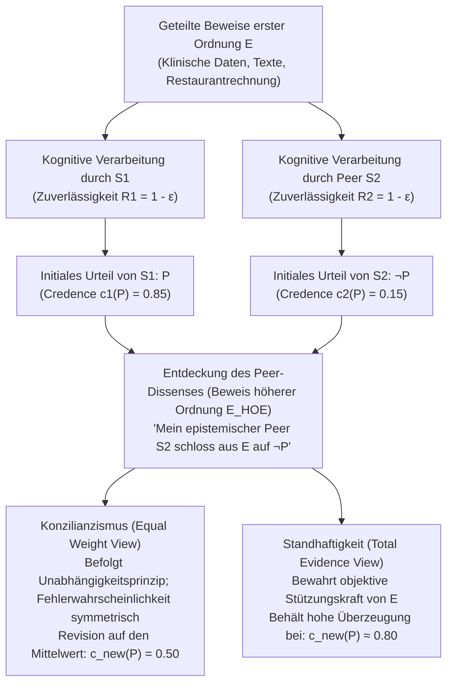
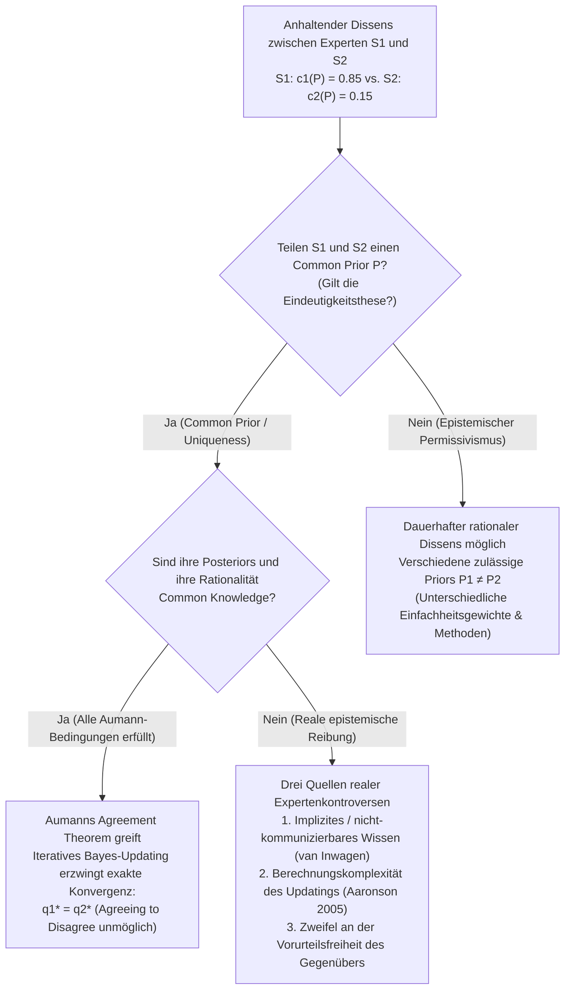

## 1. Einleitung: Der Schock des rationalen Dissenses und das Verschwinden epistemischer Ausreden

Im Alltag wie auch in der klinischen Medizin, der Geldpolitik, der Rechtsprechung, den empirischen Wissenschaften und der Philosophie begegnen wir ständig Menschen, die unsere wohlüberlegten Überzeugungen ablehnen. In den meisten alltäglichen Kontroversen erschüttert dieser Widerspruch unser Selbstvertrauen kaum, weil uns bequeme, symmetriebrechende Erklärungen – gewissermaßen „epistemische Ausreden“ – zur Verfügung stehen: Wir unterstellen, dass unser Gegenüber die neuesten Studien nicht kennt, über keine ausreichende methodische Ausbildung verfügt oder durch ideologische bzw. finanzielle Interessen voreingenommen ist. Solange wir den anderen als <strong>epistemisch Unterlegenen (Epistemic Inferior)</strong> einstufen können, fällt es leicht, an der eigenen Überzeugung festzuhalten.

Was aber geschieht, wenn all diese beruhigenden Ausreden wegfallen?

Nehmen wir an, Sie und eine Kollegin forschen seit zehn Jahren auf demselben Fachgebiet. Sie haben exakt dieselbe Primärliteratur, dieselben empirischen Datensätze und dieselben mathematischen Beweise – kurz: dieselbe Beweismenge $E$ – durchgearbeitet. Zudem wissen Sie aus jahrelanger Zusammenarbeit, dass Ihre Kollegin Ihnen an Intelligenz, analytischer Schärfe, intellektueller Redlichkeit, Aufmerksamkeit und Vorurteilsfreiheit vollkommen ebenbürtig ist. In der Terminologie der modernen <strong>Sozialen Erkenntnistheorie (Social Epistemology)</strong> ist diese Kollegin Ihr <strong>epistemisch Ebenbürtiger (Epistemic Peer, $\text{Peer}(S_1, S_2)$)</strong>.

Nach unabhängiger Prüfung der gemeinsamen Beweise $E$ gelangen Sie zu der festen Überzeugung, dass die Proposition $P$ wahr ist (mit einem subjektiven Überzeugungsgrad bzw. Credence von $c_1(P) = 0.85$). Ihre epistemisch ebenbürtige Kollegin hingegen gelangt auf Basis derselben Beweise $E$ zu dem entgegengesetzten Schluss $\neg P$ ($c_2(P) = 0.15$).

Was verlangt die <strong>epistemische Rationalität</strong> in dem Moment, in dem Sie diesen Dissens entdecken?

1. <strong>Konzilianzismus / Ansicht des gleichen Gewichts (Conciliationism / Equal Weight View)</strong>: Da Sie und Ihre Kollegin gleichermaßen zuverlässige Beurteiler von $E$ sind und mindestens einer von Ihnen in diesem Fall einen kognitiven Fehler begangen hat, wäre es reiner Dogmatismus, dem eigenen Urteil nur deshalb Vorrang einzuräumen, weil es das *eigene* ist. Sie müssen Ihren Überzeugungsgrad drastisch senken und sich in der Mitte treffen ($c_{\text{new}}(P) = 0.50$, Urteilsenthaltung).
2. <strong>Standhaftigkeitsansicht / Nicht-Konzilianzismus (The Steadfast View)</strong>: Selbst angesichts des Widerspruchs eines Ebenbürtigen gilt: Wenn die Beweise erster Ordnung $E$ objektiv die Proposition $P$ stützen und Sie tatsächlich korrekt von $E$ auf $P$ geschlossen haben, sind Sie nicht verpflichtet, eine wohlbegründete Überzeugung aufzugeben, nur weil Ihr Gegenüber einem kognitiven blinden Fleck erlegen ist.

Seit Mitte der 2000er Jahre bildet diese Debatte – geprägt durch Richard Feldman, David Christensen, Adam Elga, Thomas Kelly, Jennifer Lackey und Miriam Schoenfield – eines der dynamischsten Zentren der analytischen Erkenntnistheorie.

---

## 2. Formale Definition der epistemischen Ebenbürtigkeit und Beweise höherer Ordnung

### 2.1 Evidenzielle und kognitive Gleichheit

Nach Thomas Kelly (2005, *"The Epistemic Significance of Disagreement"*) und Richard Feldman (2007) sind zwei Subjekte $S_1$ und $S_2$ bezüglich einer Proposition $P$ genau dann <strong>epistemisch Ebenbürtige ($\text{Peer}(S_1, S_2, P)$)</strong>, wenn zwei Symmetriebedingungen erfüllt sind:

1. <strong>Evidenzielle Gleichheit (Evidential Equality)</strong>: Beide verfügen über exakt dieselbe Menge an substantiellen Beweisen erster Ordnung $E$ bezüglich $P$ ($E_1 = E_2 = E$).
2. <strong>Kognitive Gleichheit (Cognitive Equality)</strong>: Beide verfügen über das gleiche Maß an allgemeinen kognitiven Fähigkeiten (Intelligenz, logische Strenge, Fachwissen) und epistemischen Tugenden (Intellektuelle Redlichkeit, Unvoreingenommenheit), sodass ihre allgemeine Zuverlässigkeit $R(S_1) \approx R(S_2)$ erfüllt.

### 2.2 Beweise erster Ordnung ($E$) vs. Beweise höherer Ordnung ($E_{\text{HOE}}$)

Entscheidend für die Analyse ist die Unterscheidung zwischen <strong>Beweisen erster Ordnung (First-Order Evidence, $E$)</strong> und <strong>Beweisen höherer Ordnung (Higher-Order Evidence, $E_{\text{HOE}}$)</strong> (Christensen 2010; Kelly 2010):

- <strong>Beweise erster Ordnung ($E$)</strong> beziehen sich direkt auf den Wahrheitswert von $P$ in der Welt (z. B. Labordaten, historische Dokumente, Zahlen auf einer Restaurantrechnung).
- <strong>Beweise höherer Ordnung ($E_{\text{HOE}}$)</strong> sind Meta-Beweise über *die eigene kognitive Zuverlässigkeit bei der Auswertung von $E$* oder darüber, ob $E$ tatsächlich $P$ stützt.

Wenn ein Arzt Ihnen mitteilt, dass Ihr Morgenkaffee mit einer Substanz versetzt wurde, die bei $80\%$ der Probanden unbemerkte logische Fehlschlüsse verursacht, spricht dies nicht direkt gegen den mathematischen Satz $P$, den Sie gerade bewiesen haben; es fungiert jedoch als mächtiger <strong>untergrabender Anfechtungsgrund höherer Ordnung (Undermining Defeater, $E_{\text{HOE}}$)</strong>. Die Entdeckung, dass ein epistemisch Ebenbürtiger aus $E$ auf $\neg P$ schließt, ist genau ein solcher Beweis höherer Ordnung dafür, dass mindestens eines der beiden kognitiven Systeme versagt hat.

---

## 3. Das Lager des Konzilianzismus: Restaurantrechnung, gleiches Gewicht und Unabhängigkeit

### 3.1 David Christensens „Restaurantrechnungs-Fall“ (2007)

In *"Epistemology of Disagreement: The Good News"* (2007) präsentierte David Christensen das berühmte Gedankenexperiment der <strong>Restaurantrechnung (Restaurant Check Case)</strong>: Fünf Freunde teilen eine Abendessensrechnung inklusive $20\%$ Trinkgeld gleichmäßig auf. Sie und Ihre im Kopfrechnen ebenso geübte Freundin prüfen dieselbe Rechnung ($E$). Sie errechnen im Kopf einen Anteil von <strong>$\$43$</strong> ($c_1(P) = 0.95$); Ihre Freundin verkündet ebenso überzeugt <strong>$\$45$</strong> ($c_2(P) = 0.05$).

Würden Sie nun argumentieren: *„Ich habe $\$43$ errechnet, also ist $\$43$ richtig; da meine Freundin $\$45$ sagt, muss sie sich verrechnet haben, weshalb ich zu $95\%$ bei $\$43$ bleibe“*, wäre dies offenkundig irrational. Da Ihnen beiden mit einer symmetrischen Fehlerrate $\varepsilon > 0$ ein Rechenfehler unterlaufen sein kann, müssen Sie Ihre Sicherheit auf etwa $50\%$ reduzieren.

### 3.2 Adam Elgas „Equal Weight View“ und Bayes’sches lineares Pooling

Adam Elga (2007, *"Reflection and Disagreement"*) verallgemeinerte dies zur <strong>Ansicht des gleichen Gewichts (Equal Weight View)</strong>, die einem linearen Meinungs-Pooling mit gleichen Gewichten $w_1 = w_2 = \frac{1}{2}$ entspricht:

$$c_{\text{new}}(P) = \frac{1}{2} c_1(P) + \frac{1}{2} c_2(P)$$

Im Bayes’schen Modell mit A-priori-Wahrscheinlichkeit $\mathbb{P}(P) = p_0$ und symmetrischer Diagnosegenauigkeit $1 - \varepsilon$ beider Agenten kürzt sich bei entgegengesetzten Urteilen $\{D_1 = P, D_2 = \neg P\}$ der Zuverlässigkeitsfaktor $(1 - \varepsilon)\varepsilon$ im Zähler und Nenner exakt heraus:

$$\mathbb{P}(P \mid D_1 = P, D_2 = \neg P) = \frac{p_0 (1 - \varepsilon)\varepsilon}{p_0 (1 - \varepsilon)\varepsilon + (1 - p_0)\varepsilon(1 - \varepsilon)} = p_0$$

Die Urteile neutralisieren sich gegenseitig vollständig und führen zu Richard Feldmans (2006) Forderung nach <strong>Urteilsenthaltung (Suspension of Judgment)</strong>.

### 3.3 Christensens Unabhängigkeitsprinzip (Independence Principle)

Um zirkuläre Abwertungen des Gegenübers auszuschließen, formulierte Christensen (2009, 2011) das <strong>Unabhängigkeitsprinzip</strong>:

> <strong>[Unabhängigkeitsprinzip (Independence)]</strong>
> Bei der Bewertung der epistemischen Glaubwürdigkeit der von einer anderen Person geäußerten Überzeugung bezüglich $P$ (um zu bestimmen, ob und wie ich meine eigene Überzeugung bezüglich $P$ modifizieren sollte), <strong>darf ich mich nicht auf genau jene Überlegungen stützen, die meiner eigenen ursprünglichen Überzeugung bezüglich $P$ zugrunde liegen</strong>.

Ein Verstoß gegen die Unabhängigkeit käme einer epistemischen *Petitio Principii* (Begging the Question) gleich, analog zum bekannten <strong>Dogmatismus-Paradoxon</strong> (Harman 1973; Kripke 2011).

---

## 4. Das Lager der Standhaftigkeit: Gesamtbeweise, persönliche Information und Selbstwiderlegung

### 4.1 Thomas Kellys „Total Evidence View“ (2010)

Thomas Kelly (2005, 2010) hält dem Konzilianzismus entgegen, dass er die objektive Stützungskraft der Beweise erster Ordnung $E$ durch psychologische Fakten höherer Ordnung vollständig <strong>überfluten (swamp)</strong> lässt. Wenn $E$ objektiv $P$ stützt und $S_1$ dies korrekt erkannt hat, umfasst die <strong>Gesamtbeweislage ($E_{\text{total}}$)</strong> zum Zeitpunkt $t_1$ drei Elemente:

$$E_{\text{total}} = \underbrace{E}_{\text{Substantieller Beweis 1. Ordnung}} \cup \underbrace{\{S_1 \text{ urteilte } P \text{ auf Basis von } E\}}_{\text{Psychologisches Faktum 1}} \cup \underbrace{\{S_2 \text{ urteilte } \neg P \text{ auf Basis von } E\}}_{\text{Psychologisches Faktum 2}}$$

Während die beiden psychologischen Fakten symmetrisch sind, <strong>ist der Beweis erster Ordnung $E$ selbst keineswegs symmetrisch!</strong> Da $E$ weiterhin objektiv auf $P$ verweist, darf der Überzeugungsgrad von $S_1$ laut Kellys <strong>Gesamtbeweisansicht (Total Evidence View)</strong> zwar moderat sinken (z. B. von $0.90$ auf $0.78$), fällt aber nicht auf $0.50$ zurück.

### 4.2 Jennifer Lackeys „Justificationist View“ und Extremfälle

Jennifer Lackey (2010) zeigt anhand von <strong>Extremfällen</strong>, wohin eine blinde Anwendung des Unabhängigkeitsprinzips führt: Wenn Ihr langjähriger, stets zuverlässiger Kollege Harry am helllichten Tag behauptet, $2 + 2 = 5$, oder ernsthaft bestreitet, dass Ihre gemeinsame Freundin Sarah direkt vor Ihnen am Tisch sitzt, müsste der strikte Konzilianzist zu $50\%$ daran zweifeln, ob $2+2=4$ ist oder ob Sarah im Raum ist! Lackey erklärt die legitime Asymmetrie durch <strong>persönliche Information (Personal Information)</strong>: Sie haben direkten introspektiven Zugang erster Person zu Ihrer eigenen kognitiven Nüchternheit und Wachheit, während Sie Harrys Geisteszustand nur induktiv von außen erschließen. Bei extrem hoher initialer Rechtfertigung durchbricht diese persönliche Information das Unabhängigkeitsprinzip.

### 4.3 Der Einwand der Selbstwiderlegung (Self-Defeat Objection)

Ein schwerwiegender dialektischer Einwand lautet, dass der Konzilianzismus <strong>sich selbst untergräbt (self-undermining)</strong> (Elga 2010, *"How to Disagree about How to Disagree"*; Kelly 2005): Da führende Erkenntnistheoretiker (epistemische Peers) über die Wahrheit des Konzilianzismus $C$ selbst tief gespalten sind, müsste ein Konzilianzist nach seiner eigenen Regel $C$ sein Vertrauen in den Konzilianzismus drastisch reduzieren! Adam Elgas (2010) Ausweg eines <strong>„dogmatischen Konzilianzismus“</strong> – wonach jede fundamentale epistemische Methode bezüglich ihrer eigenen Richtigkeit dogmatisch sein muss – wird von Kritikern als *ad hoc* zurückgewiesen.

---

## 5. Meta-Epistemologie: Eindeutigkeitsthese vs. Epistemischer Permissivismus

- <strong>Die Eindeutigkeitsthese (Uniqueness Thesis — Feldman 2007; Roger White 2005)</strong>: Zu einer Gesamtbeweislage $E$ und einer Proposition $P$ gibt es <strong>höchstens eine</strong> maximal rationale doxastische Haltung $c(P \mid E)$. Roger White (2005) argumentiert mit seinem <strong>Willkür- bzw. Pillen-Argument</strong>: Wenn zwei Standards $R_1$ (ergibt $P$) und $R_2$ (ergibt $\neg P$) gleichermaßen rational wären, käme das Vertrauen auf den zufällig in der eigenen Ausbildung erlernten Standard $R_1$ der Einnahme einer zufälligen „Überzeugungspille“ gleich.
- <strong>Epistemischer Permissivismus (Permissivism — Gideon Rosen 2001; Miriam Schoenfield 2014)</strong>: Komplexe Beweismengen $E$ lassen eine <strong>Familie rational erlaubter A-priori-Wahrscheinlichkeitsverteilungen $\{\mathbb{P}_\theta\}_{\theta \in \Theta}$</strong> zu. Miriam Schoenfield (2014, *"Permission to Believe"*) erwidert White, dass kein Subjekt alle epistemischen Standards verlassen kann, um sie von einem „Blickwinkel von Nirgendwo“ aus zu prüfen; gemessen am eigenen kohärenten Standard $R_1$ ist $R_1$ wahrheitsförderlicher als $R_2$, was <strong>fehlerfreien Dissens (Faultless Disagreement)</strong> ermöglicht.

| Analytische Dimension | Equal Weight View (Strikter Konzilianzismus) | Total Evidence View (Moderate Standhaftigkeit) | Justificationist View (Asymmetrisches Hybridmodell) | Permissivistische Standhaftigkeit |
| :--- | :--- | :--- | :--- | :--- |
| <strong>Hauptvertreter</strong> | D. Christensen, A. Elga, R. Feldman | Thomas Kelly (2010) | Jennifer Lackey (2010) | G. Rosen, M. Schoenfield, P. van Inwagen |
| <strong>Meta-Epistemologische Prämisse</strong> | Strikte Eindeutigkeitsthese (Uniqueness) | Objektive Beweisstützung | Kontextsensitiv (Asymmetrie persönlicher Info) | Epistemischer Permissivismus ($\{\mathbb{P}_\theta\}$) |
| <strong>Status des Unabhängigkeitsprinzips</strong> | Strikt durchgesetzt | Abgelehnt / Eingeschränkt ($E$ zählt weiter) | Bei hoher Rechtfertigung & persönlicher Info aufgehoben | Bewertung fremder Standards im Lichte von $R_1$ erlaubt |
| <strong>Verhältnis von $E$ und $E_{\text{HOE}}$</strong> | $E_{\text{HOE}}$ neutralisiert Asymmetrie von $E$ | $E$ und $E_{\text{HOE}}$ bilden zusammen $E_{\text{total}}$ | Dynamische Gewichtung nach Rechtfertigungsgrad | $E$ stützt $P$ relativ zum jeweiligen Standard $R_i$ |
| <strong>Urteil im Restaurant-Kopfrechenfall</strong> | Differenz halbieren ($c_{\text{new}} = 0.50$) | Deutliche Konzilianz | Deutliche Konzilianz | Deutliche Konzilianz (eindeutige Rechenregel) |
| <strong>Urteil bei komplexen Fachkontroversen</strong> | Urteilsenthaltung (Agnostizismus) | Korrekt Schließender behält hohe Sicherheit | Standhaftigkeit bei tief geprüften Überzeugungen | Beide Peers dürfen rational standhaft bleiben |

---

## 6. Spieltheorie und Bayes’sche Epistemologie: Robert Aumanns „Agreement Theorem“ (1976)

Einen tiefen mathematischen Einblick in den Experten-Dissens liefert das berühmte Theorem des Nobelpreisträgers <strong>Robert J. Aumann (1976, *"Agreeing to Disagree"*)</strong>.

Sei $(\Omega, \mathcal{F}, \mathbb{P})$ ein Wahrscheinlichkeitsraum mit einem <strong>gemeinsamen Prior (Common Prior)</strong> $\mathbb{P}$ für zwei Bayes’sche Agenten $S_1, S_2$, deren private Informationen durch Partitionen $\mathcal{P}_1$ und $\mathcal{P}_2$ von $\Omega$ gegeben sind. Ihre A-posteriori-Wahrscheinlichkeiten für ein Ereignis $A \in \mathcal{F}$ im Zustand $\omega$ lauten:

$$q_1(\omega) = \mathbb{P}(A \mid \mathcal{P}_1(\omega)), \quad q_2(\omega) = \mathbb{P}(A \mid \mathcal{P}_2(\omega))$$

> <strong>[Aumanns Agreement Theorem (1976)]</strong>
> Wenn im Weltzustand $\omega^* \in \Omega$ die Tatsache, dass $q_1(\omega) = a$ und $q_2(\omega) = b$ gilt, <strong>gemeinsames Wissen (Common Knowledge)</strong> zwischen $S_1$ und $S_2$ ist, dann folgt zwingend:
> $$a = b \quad (q_1 = q_2)$$

<strong>Beweisskizze</strong>: Da das Common-Knowledge-Ereignis $C = \{q_1 = a \cap q_2 = b\}$ im Schnitt $\mathcal{P}_1 \wedge \mathcal{P}_2$ liegt, lässt sich $C$ sowohl als disjunkte Vereinigung von Zellen $P_{1,i} \in \mathcal{P}_1$ als auch von Zellen $P_{2,j} \in \mathcal{P}_2$ darstellen. Auf jeder Zelle $P_{1,i} \subseteq C$ gilt $\mathbb{P}(A \cap P_{1,i}) = a\mathbb{P}(P_{1,i})$, woraus durch Summation $\mathbb{P}(A \cap C) = a\mathbb{P}(C)$ folgt. Analog liefert die Zerlegung über $\mathcal{P}_2$ die Gleichung $\mathbb{P}(A \cap C) = b\mathbb{P}(C)$. Wegen $\mathbb{P}(C) > 0$ folgt unmittelbar <strong>$a = b$</strong>.

Das bedeutet: <strong>Bayes’sche Agenten mit gemeinsamem Prior können nicht „vereinbaren, uneins zu sein“ (cannot agree to disagree)!</strong> Wenn reale Experten in Wissenschaft, Medizin oder KI-Sicherheit dennoch dauerhaft uneins bleiben, muss mindestens eine Annahme Aumanns verletzt sein:
1. <strong>Verletzung des Common Prior (Permissivismus)</strong>: Unterschiedliche induktive Priors ($\mathbb{P}_1 \neq \mathbb{P}_2$).
2. <strong>Implizites Wissen und nicht-kommunizierbare Evidenz (Polanyi; van Inwagen 1996)</strong>: Jahrzehntelange klinische oder philosophische Erfahrung lässt sich nicht verlustfrei in propositionale Datenpakete serialisieren ($E_1 \neq E_2$).
3. <strong>Berechnungskomplexität (Scott Aaronson 2005, *"The Complexity of Agreement"*)</strong>: Das Invertieren des Weltmodells des Gegenübers zur exakten Bayes’schen Aktualisierung ist in hochdimensionalen Räumen berechnungstheoretisch unlösbar (NP-schwer).

---

## 7. Fazit: Zwischen Dogmatismus und rückgratlosem Skeptizismus

Die Epistemologie des Dissenses bewahrt uns vor zwei intellektuellen Extremen: Vor dem <strong>Dogmatismus</strong>, der jeden Widerspruch zirkulär als Fehler des anderen abtut, schützt uns Christensens Unabhängigkeitsprinzip, insbesondere bei geschlossenen, fehleranfälligen Routineaufgaben vom Typ der Restaurantrechnung. Vor einem <strong>rückgratlosen Skeptizismus</strong>, der bei jeder komplexen wissenschaftlichen oder philosophischen Kontroverse sofort in eine $50\%$-Agnozie flüchtet, bewahren uns Kellys Gesamtbeweisansicht und der epistemische Permissivismus: Widerspruch unter Ebenbürtigen ist kein Befehl zur intellektuellen Kapitulation, sondern ein hochkarätiger Beweis höherer Ordnung, der zur präzisen Selbstprüfung und zur Offenlegung unserer tiefsten induktiven Annahmen auffordert.
