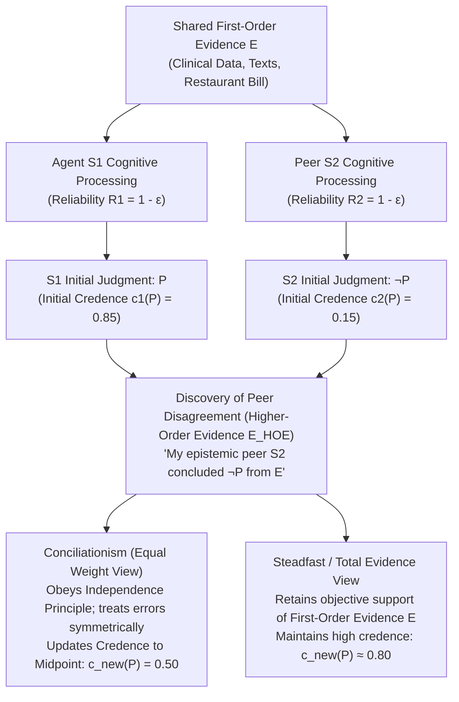
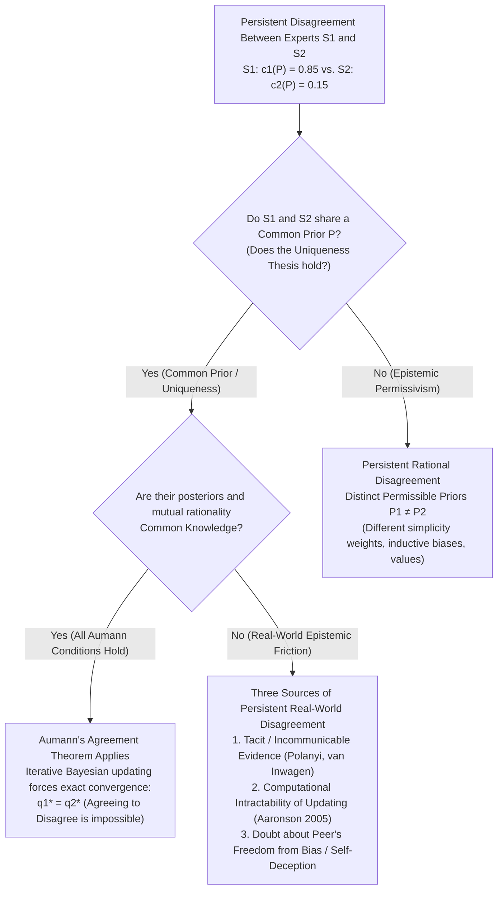

## 1. Introduction: The Shock of Rational Disagreement and the Vanishing of Excuses

Across ordinary life, clinical medicine, appellate jurisprudence, macroeconomic policy, empirical science, and philosophy itself, we constantly confront people who reject our most carefully considered convictions. In the vast majority of everyday disputes, discovering that someone disagrees with us fails to shake our confidence because we have a ready supply of symmetry-breaking explanations—what we might call "epistemic excuses." We tell ourselves that our interlocutor has not read the latest empirical studies, lacks rigorous training in statistical inference, is careless with logical distinctions, or is blinded by partisan, financial, or ideological bias. Whenever we can plausibly classify our opponent as an <strong>epistemic inferior</strong> with respect to the question at hand, retaining our initial belief feels effortless.

But what happens when every single one of those comforting excuses is stripped away?

Suppose you and a colleague have spent the last decade working side by side in the same scholarly or scientific field. You have examined the exact same body of primary literature, experimental datasets, and mathematical proofs (let us call this shared body of evidence $E$). Moreover, through years of close collaboration, you know beyond a shadow of a doubt that your colleague matches you in raw intelligence, analytical thoroughness, intellectual honesty, alertness, and freedom from ideological distortion. In the technical vocabulary of contemporary <strong>Social Epistemology</strong>, this colleague is your <strong>epistemic peer ($\text{Peer}(S_1, S_2)$)</strong>.

Now suppose that after independently evaluating the shared evidence $E$, you arrive at a firm conviction that proposition $P$ is true—assigning it a subjective probability or credence of $c_1(P) = 0.85$. Your epistemic peer, having evaluated the exact same evidence $E$ with equal care, announces the opposite conclusion: she believes $\neg P$, assigning $P$ a credence of only $c_2(P) = 0.15$.

At the exact moment you discover this peer disagreement, <strong>what does epistemic rationality require you to do?</strong>

1. <strong>Conciliationism (The Equal Weight View)</strong>: Because you and your peer are equally reliable processors of evidence $E$ and at least one of you has committed a cognitive error on this occasion, privileging your own judgment over hers simply because it is *yours* is a form of epistemic egoism or dogmatism. You are rationally required to substantially revise your credence toward hers—splitting the difference to $c_{\text{new}}(P) = 0.50$ and suspending judgment.
2. <strong>The Steadfast View (Non-Conciliationism)</strong>: Even in the face of peer disagreement, if the first-order evidence $E$ objectively supports $P$ and you actually reasoned correctly from $E$ to $P$, you are not obligated to abandon a well-founded belief merely because your peer suffered a cognitive blind spot. You may rationally retain high confidence in $P$ (or make at most a minor adjustment) while acknowledging the disagreement.

Since the mid-2000s, this question—known as <strong>the Epistemology of Disagreement</strong>—has stood at the center of analytic epistemology, shaped by foundational contributions from Richard Feldman, David Christensen, Adam Elga, Thomas Kelly, Jennifer Lackey, Ernest Sosa, Roger White, and Miriam Schoenfield. Far from being an isolated puzzle, peer disagreement forces us to confront the deepest questions in the theory of knowledge: How does <strong>higher-order evidence</strong> (evidence about our own cognitive reliability) interact with <strong>first-order evidence</strong> (evidence directly about the world)? Does a body of evidence uniquely determine a single rational attitude (<strong>The Uniqueness Thesis</strong>), or can identical evidence rationally permit multiple competing worldviews (<strong>Epistemic Permissivism</strong>)? And why, in light of <strong>Robert Aumann's (1976) "Agreeing to Disagree" Theorem</strong>, do real-world experts fail to converge?

In this article, we undertake a rigorous, comprehensive examination of peer disagreement, tracing its formal architecture from philosophical thought experiments to Bayesian probability theory and game-theoretic common knowledge.

---

## 2. Formalizing Epistemic Peerhood and the Two-Tiered Architecture of Evidence

### 2.1 Evidential Equality and Cognitive Equality

To prevent the debate from dissolving into trivial disputes about whether one party secretly possesses superior data, Thomas Kelly (2005, *"The Epistemic Significance of Disagreement"*) and Richard Feldman (2006, 2007) define <strong>epistemic peerhood</strong> between two agents $S_1$ and $S_2$ relative to a proposition $P$ as the conjunction of two strict symmetry conditions:

1. <strong>Evidential Equality</strong>: $S_1$ and $S_2$ possess the exact same body of substantive, first-order evidence $E$ bearing on the truth value of $P$ ($E_1 = E_2 = E$). Neither agent enjoys private access to unshared observations, secret archives, or proprietary experimental results.
2. <strong>Cognitive Equality (Equality of Epistemic Virtues)</strong>: $S_1$ and $S_2$ are equals with respect to the general cognitive competencies and epistemic virtues required to evaluate evidence of type $E$—including intelligence, logical rigor, background domain training, open-mindedness, intellectual honesty, and freedom from emotional or mercenary bias. Formally, their general reliability rates or track records on propositions in this domain satisfy $R(S_1) \approx R(S_2)$.

Critics occasionally object that strict epistemic peerhood is an idealization rarely realized in messy human affairs, where no two brains share identical life histories. While true, this idealization serves the exact same theoretical role in epistemology that frictionless planes and ideal gases serve in physics: it isolates the pure normative force of disagreement itself once all confounding asymmetries of data and skill are controlled for. Moreover, even when exact peerhood is relaxed to *approximate* peerhood, the core dilemma remains intact.

### 2.2 First-Order Evidence ($E$) vs. Higher-Order Evidence ($E_{\text{HOE}}$)

The central analytical engine of the disagreement literature is the distinction between <strong>First-Order Evidence ($E$)</strong> and <strong>Higher-Order Evidence ($E_{\text{HOE}}$)</strong> (Christensen 2010; Feldman 2005; Kelly 2010; Lasonen-Aarnio 2014):

- <strong>First-Order Evidence ($E$)</strong> is evidence that bears directly on the truth of the target proposition $P$ in the world—for instance, histological slides of a tumor, macroeconomic time-series data, historical manuscripts, or the itemized numbers on a restaurant bill.
- <strong>Higher-Order Evidence ($E_{\text{HOE}}$)</strong> is evidence about *the epistemic status of one's own doxastic state*—specifically, evidence about whether one's first-order evidence $E$ actually supports $P$, or whether one's cognitive faculties functioned reliably when processing $E$.

To see how higher-order evidence operates independently of first-order evidence, consider a classic <strong>Reason-Distorting Drug Case</strong> (Christensen 2010). Suppose you are a logician who has just worked through a complex deduction from axioms $E$ to theorem $P$, arriving at a credence $c(P) = 0.99$. Immediately afterward, a trustworthy physician informs you that your morning coffee was spiked with a subtle neurochemical that induces undetectable logical hallucinations in $80\%$ of subjects, causing them to perceive invalid deductions as airtight proofs (without affecting their memory of the axioms $E$).

Notice that the physician's testimony provides zero evidence against the truth of the mathematical theorem $P$ itself; mathematical truths do not depend on what is in your coffee. Rather, the testimony is <strong>higher-order defeating evidence ($E_{\text{HOE}}$)</strong>: it gives you powerful reason to believe that your cognitive apparatus malfunctioned when evaluating the connection between $E$ and $P$. Rationality clearly requires you to bracket your confidence in $P$ and lower your credence dramatically until you can verify the proof independently.

Discovering that an epistemic peer disagrees with you is a quintessential instance of acquiring <strong>higher-order evidence</strong>. The fact that $S_2$ examined $E$ and judged $\neg P$ is evidence that *at least one of the two cognitive systems ($S_1$ or $S_2$) suffered a performance error on this trial*.

---

## 3. The Conciliationist Camp: The Equal Weight View and the Independence Principle

Let us first examine the case for <strong>Conciliationism</strong>—the view that discovering peer disagreement mandates a substantial revision of one's credence toward the peer's position. Its flagship proponents include David Christensen (2007, 2009), Adam Elga (2007), Richard Feldman (2006, 2007), Bryan Frances (2014), and Jonathan Matheson (2015).

### 3.1 David Christensen's Restaurant Check Case (2007)

In his seminal paper *"Epistemology of Disagreement: The Good News"* (2007), David Christensen introduced a thought experiment designed to elicit an overwhelming Conciliationist intuition: <strong>The Restaurant Check Case</strong>.

> <strong>[Thought Experiment: The Restaurant Check]</strong>
> Five friends go out to dinner together and agree to split the bill equally after adding a $20\%$ tip. You and your friend—whom you know to be just as quick, accurate, and practiced at mental arithmetic as you are—both inspect the check ($E$) and calculate each person's share in your heads. Neither of you is particularly tired or distracted.
> After a moment of mental calculation, you become highly confident ($c_1(P) = 0.95$) that each person's share is <strong>$\$43$</strong>. Seconds later, your friend announces with equal confidence ($c_2(P) = 0.05$) that each person's share is <strong>$\$45$</strong>.

How should you react upon hearing your friend say "$\$45$"?
Suppose you were to reason as follows:

> "I carefully inspected the bill and calculated that the true share is $\$43$. Since the true share is $\$43$, and my friend concluded $\$45$ ($\neq \$43$), it follows logically that my friend committed an arithmetic blunder on this occasion, whereas I calculated correctly. Because her calculation is demonstrably flawed, I have no reason to lower my confidence; I remain $95\%$ sure the answer is $\$43$."

As Christensen observes, this line of reasoning is transparently <strong>irrational and epistemically arrogant</strong>. Both you and your friend are fallible human calculators with some non-zero probability $\varepsilon > 0$ of making a mental carry error. Once the disagreement surfaces, you know with certainty that *someone* blundered, and you possess no independent symmetry-breaker indicating that the blunder was hers rather than yours. Rationality requires you to drop your confidence in $\$43$ to roughly $50\%$ (matching your credence in $\$45$) until you pull out a calculator or re-compute the bill together on paper.

### 3.2 Adam Elga's Equal Weight View and Bayesian Linear Pooling

In *"Reflection and Disagreement"* (2007), Adam Elga generalized this insight into the <strong>Equal Weight View</strong>:

> When you learn that an epistemic peer $S_2$ has arrived at a different credence in $P$ on the basis of shared evidence $E$, you should give <strong>equal weight</strong> to her assessment and your own prior assessment.

In the formal language of probabilistic opinion aggregation, the Equal Weight View prescribes <strong>linear opinion pooling</strong> with symmetric weights $w_1 = w_2 = \frac{1}{2}$:

$$c_{\text{new}}(P) = \frac{1}{2} c_1(P) + \frac{1}{2} c_2(P)$$

In the Restaurant Check Case, where $c_1(P) = 0.95$ and $c_2(P) = 0.05$, linear pooling yields:

$$c_{\text{new}}(P) = \frac{1}{2}(0.95) + \frac{1}{2}(0.05) = 0.50$$

We can also derive this exact neutralization result within a standard <strong>Bayesian conditionalization model</strong> of fallible diagnostic judgment. Let $\mathbb{P}(P) = p_0$ be the prior probability of $P$ before evaluating the complex evidence $E$. Model each agent $S_i$ ($i \in \{1, 2\}$) as an epistemic detector with symmetric accuracy $1 - \varepsilon$ (where $\varepsilon \in (0, 1/2)$ is the probability of a cognitive processing error when evaluating $E$):

$$\mathbb{P}(D_i = P \mid P) = 1 - \varepsilon, \quad \mathbb{P}(D_i = \neg P \mid P) = \varepsilon$$

$$\mathbb{P}(D_i = \neg P \mid \neg P) = 1 - \varepsilon, \quad \mathbb{P}(D_i = P \mid \neg P) = \varepsilon$$

Assuming conditional independence of cognitive slips given the truth value of $P$, what is the posterior probability of $P$ given the joint event $D = \{D_1 = P,\; D_2 = \neg P\}$ that $S_1$ judged $P$ while peer $S_2$ judged $\neg P$? By Bayes' Theorem:

$$\mathbb{P}(P \mid D_1 = P, D_2 = \neg P) = \frac{\mathbb{P}(P)\,\mathbb{P}(D_1 = P \mid P)\,\mathbb{P}(D_2 = \neg P \mid P)}{\mathbb{P}(P)\,\mathbb{P}(D_1 = P \mid P)\,\mathbb{P}(D_2 = \neg P \mid P) + \mathbb{P}(\neg P)\,\mathbb{P}(D_1 = P \mid \neg P)\,\mathbb{P}(D_2 = \neg P \mid \neg P)}$$

Substituting the reliability terms $(1 - \varepsilon)$ and $\varepsilon$:

$$\mathbb{P}(P \mid D_1 = P, D_2 = \neg P) = \frac{p_0 (1 - \varepsilon)\varepsilon}{p_0 (1 - \varepsilon)\varepsilon + (1 - p_0)\varepsilon(1 - \varepsilon)} = p_0$$

Because $(1 - \varepsilon)\varepsilon$ appears identically in both terms of the denominator and numerator, it cancels out completely! The positive evidential boost of $S_1$'s judgment ($D_1 = P$) is <strong>exactingly neutralized</strong> by the negative evidential pull of $S_2$'s opposing judgment ($D_2 = \neg P$), returning the posterior probability to the uninformative baseline prior $p_0$ (which is $0.50$ under indifference). In Richard Feldman's (2006, 2007) coarse-grained triad of doxastic attitudes—*belief*, *disbelief*, and *suspension of judgment*—this mathematical cancellation translates directly into the requirement that both peers adopt <strong>suspension of judgment</strong>.

### 3.3 Christensen's Independence Principle

Why, then, do steadfast philosophers think an agent can ever resist this $50/50$ split? The most tempting steadfast maneuver is to argue: *"Prior to the dispute, I regarded $S_2$ as my peer. However, the very fact that $S_2$ looked at $E$ and concluded $\neg P$—when $E$ actually supports $P$!—proves that $S_2$ failed to appreciate the force of $E$ on this specific occasion. Therefore, I should downgrade $S_2$'s epistemic weight on this question."*

To block this circular dismissal, David Christensen (2009, 2011) formulated the foundational normative constraint of the Conciliationist literature: <strong>The Independence Principle</strong>.

> <strong>[The Independence Principle (Christensen 2009)]</strong>
> In evaluating the epistemic credentials of another's expressed belief about $P$, in order to determine how (or whether) to modify my own belief about $P$, I should do so <strong>in a way that doesn't rely on the reasoning behind my initial belief about $P$</strong>.

Independence does *not* forbid you from ever discounting a peer's opinion. If you discover that your friend at the restaurant has had four glasses of wine, or forgot her reading glasses, or stands to profit financially if the bill is $\$45$, you may legitimately discount her calculation—because intoxication, poor vision, and financial conflict of interest are <strong>dispute-independent symmetry-breakers</strong>. What Independence strictly forbids is using *the very first-order reasoning from $E$ to $P$ that is currently called into question by the disagreement* as your premise for concluding that your peer made the mistake.

Violating Independence is structurally identical to the notorious <strong>Dogmatism Paradox</strong> (Harman 1973; Kripke 2011). If I believe $P$, I am committed to the proposition that any future evidence $E'$ against $P$ is *misleading evidence*; yet if I use my current belief in $P$ to dismiss every piece of incoming counter-evidence $E'$ as misleading, my belief becomes completely unfalsifiable and immune to rational correction. By the same token, using my initial assessment of $E$ to adjudicate a dispute about whether my initial assessment of $E$ was accurate is blatant <strong>epistemic begging the question</strong>.

---

## 4. The Steadfast Camp: First-Order Evidence, Total Evidence, and Anti-Conciliationism

Despite the elegance of the Conciliationist argument, a formidable coalition of epistemologists—including Thomas Kelly (2005, 2010), Peter van Inwagen (1996, 2010), Gideon Rosen (2001), Ralph Wedgwood (2007), Ernest Sosa (2010), and Jennifer Lackey (2010)—argues that uncompromising Conciliationism distorts the relationship between evidence and belief, leading to unacceptable skepticism and internal incoherence.

### 4.1 Thomas Kelly's Total Evidence View (2010): Why First-Order Evidence Doesn't Vanish

In *"The Epistemic Significance of Disagreement"* (2005) and his landmark follow-up *"Peer Disagreement and Higher-Order Evidence"* (2010), Thomas Kelly diagnoses a profound structural flaw in the Equal Weight View.

Suppose that, as an objective normative fact, the shared first-order evidence $E$ genuinely and strongly supports proposition $P$ ($\text{Support}(E, P) = 0.90$). Suppose further that $S_1$ correctly perceived and reasoned through this evidential connection, whereas $S_2$ suffered a subtle cognitive slip and concluded $\neg P$.

When $S_1$ and $S_2$ meet and disclose their conclusions at time $t_1$, what is the <strong>total body of evidence ($E_{\text{total}}$)</strong> possessed by $S_1$? Kelly points out that $E_{\text{total}}$ consists of three distinct components:

$$E_{\text{total}} = \underbrace{E}_{\text{Substantive First-Order Evidence}} \cup \underbrace{\{S_1 \text{ judged } P \text{ on the basis of } E\}}_{\text{Higher-Order Psychological Fact 1}} \cup \underbrace{\{S_2 \text{ judged } \neg P \text{ on the basis of } E\}}_{\text{Higher-Order Psychological Fact 2}}$$

Now observe what the Equal Weight View does: because "Higher-Order Psychological Fact 1" and "Higher-Order Psychological Fact 2" are completely symmetrical, the Equal Weight View concludes that $E_{\text{total}}$ is symmetrical between $P$ and $\neg P$, forcing $c_{\text{new}}(P) = 0.50$.

*"Wait a minute!"* Kelly objects. The two psychological reports are symmetrical, <strong>but the first element of $E_{\text{total}}$—namely, the substantive first-order evidence $E$ itself—is NOT symmetrical!</strong> By hypothesis, $E$ objectively points toward $P$, not toward $\neg P$. If $S_1$ moves all the way to $0.50$, $S_1$ is treating $E_{\text{total}}$ as if $E$ itself had been erased from her memory, leaving her with nothing but the bare memory that she once said $P$ and her peer once said $\neg P$!

In Kelly's terminology, the Equal Weight View allows higher-order psychological evidence ($E_{\text{HOE}}$) to completely <strong>swamp (or screen off)</strong> the substantive first-order evidence $E$. According to Kelly's <strong>Total Evidence View</strong>, rational belief revision requires weighing *both* first-order evidence and higher-order evidence together. Because $S_2$'s dissent is genuine higher-order evidence against $P$, $S_1$ should typically lower her confidence somewhat (say, from $0.90$ down to $0.75$ or $0.80$). However, because the first-order evidence $E$ remains directly present to $S_1$'s mind and genuinely supports $P$, $E$ prevents her rational credence from collapsing all the way to the $0.50$ midpoint.

### 4.2 The "Swamping" Objection in Extreme Cases and Jennifer Lackey's Justificationist View

The implausibility of screening off first-order evidence becomes unmistakable when we move from tricky mental arithmetic to <strong>Extreme Cases</strong>, analyzed with great precision by Jennifer Lackey (2010, *"A Justificationist View of Disagreement's Epistemic Significance"*).

> <strong>[Thought Experiment: Elementary Arithmetic and Clear Perception]</strong>
> You are sitting at a well-lit dining table across from your colleague Harry, whom you have known for twenty years to be an epistemic peer of impeccable honesty, sanity, and eyesight.
> 1. <strong>Elementary Math</strong>: You add $2 + 2 = 4$. Harry looks at the same numbers and sincerely insists that $2 + 2 = 5$.
> 2. <strong>Clear Perception</strong>: Your mutual friend Sarah is sitting right between you, eating lunch and talking. Harry looks directly at her chair and sincerely declares that Sarah is not in the room and the chair is empty.

What happens if we apply Christensen's <strong>Independence Principle</strong> and Elga's <strong>Equal Weight View</strong> strictly to these cases?
Under strict Independence, when deciding whether Harry has suddenly lost his mind or is playing an elaborate prank, <strong>you are forbidden from relying on the reasoning behind your initial belief that $2 + 2 = 4$ or that Sarah is sitting at the table!</strong> If you bracket your perception of Sarah and your grasp of $2 + 2 = 4$, all you have left is your background knowledge that you and Harry have equally spotless twenty-year track records of sanity. Consequently, strict Equal Weight forces you to become $50\%$ uncertain whether $2 + 2 = 4$ and $50\%$ uncertain whether Sarah is sitting right in front of you!

That is manifestly absurd. In reality, upon hearing Harry deny that Sarah is at the table, you are rationally entitled to retain nearly $100\%$ credence that Sarah is there, and to infer *from the fact that Sarah is obviously there* that Harry is suffering from an acute neurological episode, a hallucination, or a bizarre joke.

Jennifer Lackey (2010) explains why this inference is completely rational without collapsing into vicious dogmatism: it relies on a crucial asymmetry in <strong>Personal Information</strong>. You possess direct, first-personal introspective access to your own current cognitive functioning—you know that you are wide awake, sober, not experiencing visual aura, not taking hallucinogens, and not executing a prank. You do *not* have direct introspective access to Harry's current internal state; you know Harry's reliability only inductively through past external behavior.

When your initial belief enjoys a <strong>very high degree of justification</strong> grounded in transparent first-order evidence plus robust personal information about your own cognitive sobriety, that combination legitimately breaks the symmetry between you and your peer. Lackey's <strong>Justificationist View</strong> thus provides a principled spectrum:
- When initial justification is modest and error-prone (as in splitting a $\$215.40$ restaurant bill in your head), personal information cannot rule out a silent slip on your part, so <strong>substantial conciliation</strong> is required.
- When initial justification is extraordinarily high and backed by transparent personal information, <strong>steadfastness</strong> (coupled with downgrading the peer's current reliability) is rationally justified.

### 4.3 The Self-Defeat (Self-Undermining) Objection to Conciliationism

Perhaps the most dialectically devastating objection to Conciliationism is that <strong>Conciliationism appears to refute itself</strong> (Elga 2010, *"How to Disagree about How to Disagree"*; Kelly 2005; Plantinga; Weatherson).

Consider the following deductive argument:

1. Let $C$ be the philosophical thesis of <strong>Conciliationism</strong>: *Whenever an agent discovers that an epistemic peer disagrees with her about a proposition $P$, rationality requires her to move her credence in $P$ substantially toward her peer's credence (suspending judgment).*
2. Within contemporary analytic epistemology, the top experts who have spent decades studying the exact same arguments and thought experiments (shared evidence $E$) are deeply divided over whether $C$ is true: philosophers like Christensen, Elga, and Feldman affirm $C$, while epistemic peers like Kelly, van Inwagen, Sosa, Lackey, and Schoenfield reject $C$ ($\neg C$).
3. Therefore, any well-informed Conciliationist knows that she faces epistemic peers who believe $\neg C$.
4. By applying her own thesis $C$ to the proposition $P = C$, the Conciliationist is rationally required to <strong>substantially lower her credence in Conciliationism itself</strong> (abandoning confidence in $C$)!
5. Conversely, if the Conciliationist remains steadfastly confident that $C$ is true despite her peers' dissent, she violates her own normative principle $C$.

In short, Conciliationism is <strong>epistemically self-undermining</strong>: in a world where smart epistemologists disagree about disagreement, you cannot rationally and consistently believe Conciliationism!

In his famous paper *"How to Disagree about How to Disagree"* (2010), Adam Elga confronted this paradox head-on and argued that Conciliationism must be formulated as <strong>"Dogmatic Conciliationism"</strong>—that is, a view that mandates conciliation on all ordinary propositions, *except* when the dispute concerns the correctness of Conciliationism itself! To justify this seemingly ad hoc exception, Elga proved a general structural result: <strong>every coherent inductive method or fundamental epistemic rule must be dogmatic with respect to its own correctness</strong>. If Scientific Induction were required to split the difference whenever it encountered an astrological or counter-inductive rule, Scientific Induction would cease to be Scientific Induction; to remain self-consistent, a fundamental rule of belief updating must evaluate competing rules *by its own lights*, assigning $100\%$ weight to itself.

Yet Steadfast theorists reply that Elga's defense gives away the store: if fundamental epistemic rules are entitled to evaluate rival rules "by their own lights" rather than splitting the difference, why aren't an agent's broader epistemic standards and holistic evaluations of evidence similarly entitled to operate by their own lights? This question leads directly to the meta-epistemological heart of the debate.

---

## 5. The Deep Meta-Epistemological Divide: The Uniqueness Thesis vs. Epistemic Permissivism

Beneath the surface clash between Conciliationists and Steadfast theorists lies a fundamental disagreement about the architecture of epistemic rationality itself: the battle between <strong>The Uniqueness Thesis</strong> and <strong>Epistemic Permissivism</strong>.

### 5.1 The Uniqueness Thesis and Roger White's Arbitrariness Argument

Formulated explicitly by Richard Feldman (2007) and Roger White (2005, *"Epistemic Permissiveness"*, 2013), the <strong>Uniqueness Thesis</strong> states:

> <strong>[The Uniqueness Thesis]</strong>
> Given a total body of evidence $E$ and a proposition $P$, there is <strong>at most one</strong> maximally rational doxastic attitude (or precise rational credence $c(P \mid E) \in [0, 1]$) that an agent may take toward $P$.

Under Uniqueness, the evidential support relation $\mathbb{P}(P \mid E)$ is an objective, single-valued function. Consequently, if $S_1$ and $S_2$ possess the exact same total evidence $E$ and arrive at conflicting credences $c_1(P) = 0.85$ and $c_2(P) = 0.15$, <strong>it is a mathematical impossibility for both of them to be maximally rational</strong>. At least one peer has miscalculated the evidential bearing of $E$ on $P$. And once we admit that at least one peer has erred, symmetry (in the absence of dispute-independent evidence of who erred) immediately drives us toward Conciliationism.

Why believe Uniqueness? In *"Epistemic Permissiveness"* (2005), Roger White mounted his celebrated <strong>Arbitrariness / Magical Pill Argument</strong> against Permissivism. Suppose Permissivism were true, so that relative to a complex body of trial evidence $E$, two distinct epistemic standards (or prior probability functions) $R_1$ and $R_2$ are *both completely rational*, where $R_1(E)$ yields belief in Guilty ($P$) and $R_2(E)$ yields belief in Innocent ($\neg P$).

Suppose you are a juror who knows that $R_1$ and $R_2$ are equally rational ways of weighing $E$, and you also know that you happen to endorse standard $R_1$ only because you attended Law School A (which inculcates $R_1$) rather than Law School B (which inculcates $R_2$). White compares this to swallowing a <strong>Random Belief-Inducing Pill</strong>: if you know that your current conviction $P$ was determined by an arbitrary causal factor (which school you attended) selecting between two standards $R_1$ and $R_2$, neither of which is objectively more truth-conducive than the other, how can you rationally maintain high confidence that $P$ is *actually true*? Discovering that an equally rational peer used $R_2$ to reach $\neg P$ exposes the arbitrariness of your starting point and destroys your justification for remaining confident in $P$.

### 5.2 Epistemic Permissivism and Miriam Schoenfield's Defense

Against Uniqueness, philosophers such as Gideon Rosen (2001), Thomas Kelly (2013), and Miriam Schoenfield (2014, *"Permission to Believe: Why Permissivism Is True and What It Tells Us About Irrelevant Influences on Belief"*) defend <strong>Epistemic Permissivism</strong>:

> <strong>[Epistemic Permissivism]</strong>
> There exist bodies of evidence $E$ and propositions $P$ such that more than one doxastic attitude (or a non-degenerate interval of credences $[c_{\min}, c_{\max}]$, generated by a family of rationally permissible prior distributions $\{\mathbb{P}_\theta\}_{\theta \in \Theta}$) is maximally rational given $E$.

Why is Permissivism so attractive in complex domains like science, history, law, and philosophy? Because raw evidence $E$ never interprets itself in a vacuum. In Bayesian epistemology, computing a posterior probability $\mathbb{P}_\theta(P \mid E)$ requires a prior probability distribution $\mathbb{P}_\theta$ that encodes inductive biases: how to trade off parsimony (Occam's Razor) against explanatory power, how to weigh mechanistic plausibility against statistical correlations, and how to project past regularities into novel regimes. Deductive logic and the axioms of probability theory constrain $\mathbb{P}_\theta$ to be coherent, <strong>but they do not single out a unique prior $\mathbb{P}^*$ as the only rational one in the universe</strong>.

In her influential paper *"Permission to Believe"* (2014), Miriam Schoenfield dismantled White's Magical Pill analogy by exposing a subtle confusion about how epistemic standards work. White assumes that a rational agent must be able to step *outside* her own epistemic standards $R_1$, view $R_1$ and $R_2$ from a neutral "God's-eye view," and find an independent proof that $R_1$ is more reliable than $R_2$.

Schoenfield points out that stepping outside all epistemic standards is impossible—from a standard-free vacuum, you cannot evaluate anything at all! Rational inquiry always begins *from within* a coherent set of epistemic standards $R_1$. And <strong>judged by the lights of $S_1$'s own permissible standard $R_1$, standard $R_1$ is more truth-conducive than $R_2$</strong> (because $R_1$ assigns high probability to the worlds where $R_1$'s outputs are true!). Unlike swallowing a random pill—which has no internal rational structure connecting evidence to truth—using your coherent inductive standards $R_1$ to weigh evidence $E$ is the very essence of rational thought. Thus, under Permissivism, peer disagreement can be a <strong>faultless disagreement</strong>: $S_1$ can recognize that $S_2$ is fully rational in following $R_2$, while rationally continuing to trust her own standard $R_1$ and remaining steadfast in believing $P$.

### 5.3 Comparative Matrix of the Four Major Frameworks

To synthesize the theoretical landscape, the table below compares the four leading positions across six foundational dimensions:

| Analytical Dimension | Equal Weight View (Strict Conciliationism) | Total Evidence View (Moderate Steadfastness) | Justificationist View (Hybrid / Asymmetric) | Permissivist Steadfastness (Radical Steadfastness) |
| :--- | :--- | :--- | :--- | :--- |
| <strong>Primary Proponents</strong> | D. Christensen, A. Elga, R. Feldman | Thomas Kelly (2010) | Jennifer Lackey (2010) | G. Rosen, M. Schoenfield, P. van Inwagen |
| <strong>Meta-Epistemological Premise</strong> | Strict Uniqueness Thesis | Objective Evidential Support (Moderate Uniqueness) | Context-Sensitive (Asymmetry of Personal Info) | Epistemic Permissivism ($\{\mathbb{P}_\theta\}_{\theta \in \Theta}$) |
| <strong>Status of Independence Principle</strong> | Strictly Enforced (No reliance on initial reasoning) | Rejected / Restricted (First-order $E$ retains force) | Overridden when initial justification & personal info are high | Permissible to evaluate rival standards by lights of one's own $R_1$ |
| <strong>Interaction of $E$ and $E_{\text{HOE}}$</strong> | $E_{\text{HOE}}$ screens off / neutralizes asymmetry of $E$ | Both $E$ and $E_{\text{HOE}}$ are aggregated into $E_{\text{total}}$ | Relative weight shifts dynamically with justification level | $E$ continues to justify $P$ relative to standard $R_1$ |
| <strong>Verdict on Restaurant Check Case</strong> | Split the difference ($c_{\text{new}} = 0.50$) |Substantial conciliation (since mental math is opaque) | Conciliate (personal info cannot rule out arithmetic slip) | Conciliate (arithmetic admits a unique objective rule) |
| <strong>Verdict on Complex Scientific / Philosophical Disputes</strong> | Suspend judgment (Agnosticism) | Agent who reasoned rightly from $E$ remains largely confident | Steadfast if belief is deeply verified and grounded | Both peers may rationally remain steadfast |

---

## 6. Game Theory and Bayesian Epistemology: Robert Aumann's "Agreeing to Disagree" Theorem

The philosophical debate over peer disagreement gains extraordinary mathematical clarity when connected to a landmark result in game theory and mathematical economics: <strong>Robert J. Aumann's (1976) Agreement Theorem (*"Agreeing to Disagree"*, The Annals of Statistics)</strong>. Aumann's theorem reveals the exact formal conditions under which rational Bayesian agents *must* converge to identical beliefs—and, by contraposition, pinpoints the exact mechanisms that sustain persistent disagreement among real-world experts.

### 6.1 Mathematical Formulation and Proof of Aumann's Agreement Theorem (1976)

Let $(\Omega, \mathcal{F}, \mathbb{P})$ be a probability space, where $\Omega$ is a finite (or countable) set of possible states of the world, and $\mathbb{P}$ is a <strong>Common Prior</strong> probability measure shared by two Bayesian agents $S_1$ and $S_2$. (Note that the Common Prior Assumption is the exact mathematical counterpart of the Uniqueness Thesis: given identical information, both agents compute the exact same conditional probability.)

Remarkably, Aumann does *not* even require that $S_1$ and $S_2$ share the same first-order evidence! Instead, suppose that $S_1$'s private information is represented by a partition $\mathcal{P}_1$ of $\Omega$, and $S_2$'s private information is represented by a distinct partition $\mathcal{P}_2$ of $\Omega$. When the true state of the world is $\omega^* \in \Omega$, agent $S_1$ observes the cell $\mathcal{P}_1(\omega^*)$ containing $\omega^*$, and agent $S_2$ observes the cell $\mathcal{P}_2(\omega^*)$ containing $\omega^*$.

For any target proposition (event) $A \in \mathcal{F}$, the agents form their respective posterior probabilities (credences) via Bayes' rule:

$$q_1(\omega) = \mathbb{P}(A \mid \mathcal{P}_1(\omega)), \quad q_2(\omega) = \mathbb{P}(A \mid \mathcal{P}_2(\omega))$$

Now suppose that without even sharing their underlying raw datasets $\mathcal{P}_1(\omega^*)$ and $\mathcal{P}_2(\omega^*)$, the two agents simply announce their numerical posteriors to one another, so that it becomes <strong>Common Knowledge</strong> at state $\omega^*$ that $q_1 = a$ and $q_2 = b$. Recall that an event $C \subseteq \Omega$ is *common knowledge* at $\omega^*$ if both agents know $C$, both know that both know $C$, ad infinitum—which, in partition mathematics, means that $\omega^* \in C$ and $C$ belongs to the <strong>meet ($\mathcal{P}_1 \wedge \mathcal{P}_2$)</strong> of the two partitions (i.e., $C$ can be expressed simultaneously as a disjoint union of cells of $\mathcal{P}_1$ and as a disjoint union of cells of $\mathcal{P}_2$).

> <strong>[Aumann's Agreement Theorem (1976)]</strong>
> Let $S_1$ and $S_2$ be Bayesian agents sharing a common prior $\mathbb{P}$ on $(\Omega, \mathcal{F})$. If at state $\omega^* \in \Omega$ it is <strong>Common Knowledge</strong> that $q_1(\omega) = a$ and $q_2(\omega) = b$, then necessarily:
> $$a = b \quad (q_1 = q_2)$$

<strong>Proof</strong>:
Let $C = \{\omega \in \Omega \mid \text{It is common knowledge at } \omega \text{ that } q_1 = a \text{ and } q_2 = b\}$. Because $C \in \mathcal{P}_1 \wedge \mathcal{P}_2$, we can write $C$ as a disjoint union of cells from $S_1$'s partition: $C = \bigsqcup_{i} P_{1, i}$ where each $P_{1, i} \in \mathcal{P}_1$.
On every cell $P_{1, i} \subseteq C$, $S_1$'s posterior probability is constant and equal to $a$:

$$\mathbb{P}(A \mid P_{1, i}) = a \implies \mathbb{P}(A \cap P_{1, i}) = a\,\mathbb{P}(P_{1, i})$$

Summing over all disjoint cells $P_{1, i}$ that compose $C$:

$$\mathbb{P}(A \cap C) = \sum_{i} \mathbb{P}(A \cap P_{1, i}) = a \sum_{i} \mathbb{P}(P_{1, i}) = a\,\mathbb{P}(C)$$

By complete symmetry, $C$ is also a disjoint union of cells from $S_2$'s partition: $C = \bigsqcup_{j} P_{2, j}$ where each $P_{2, j} \in \mathcal{P}_2$, and on each cell $\mathbb{P}(A \mid P_{2, j}) = b$. Summing over $j$ yields:

$$\mathbb{P}(A \cap C) = \sum_{j} \mathbb{P}(A \cap P_{2, j}) = b \sum_{j} \mathbb{P}(P_{2, j}) = b\,\mathbb{P}(C)$$

Equating the two expressions for $\mathbb{P}(A \cap C)$ gives $a\,\mathbb{P}(C) = b\,\mathbb{P}(C)$. Since $\omega^* \in C$ has positive probability ($\mathbb{P}(C) > 0$), dividing by $\mathbb{P}(C)$ immediately yields <strong>$a = b$</strong>. $\blacksquare$

The philosophical punchline of Aumann's theorem is breathtaking: <strong>Bayesian agents with common priors cannot agree to disagree!</strong> Even if $S_1$ and $S_2$ start with completely different bodies of private evidence ($\mathcal{P}_1 \neq \mathcal{P}_2$), the mere public disclosure of their numerical credences forces them to iteratively update on the information contained in each other's opinions (Geanakoplos & Polemarchakis 1982, *"We Can't Disagree Forever"*) until their posteriors become strictly identical ($q_1 = q_2$).

### 6.2 Diagnosing Real-World Expert Disagreement via Aumann's Theorem

Why, then, do world-class experts—in climate sensitivity modeling, oncology treatment protocols, monetary policy, constitutional law, and artificial intelligence alignment—persistently disagree even after reading the same journals and debating at the same conferences? Aumann's theorem provides an exhaustive diagnostic checklist: whenever two experts fail to converge, <strong>at least one of Aumann's three structural assumptions must be failing</strong>:

1. <strong>Violation of the Common Prior Assumption (Epistemic Permissivism in Action)</strong>:
   In frontier science and philosophy, where empirical data underdetermines theory, experts operate with genuinely different prior distributions ($\mathbb{P}_1 \neq \mathbb{P}_2$). For instance, an AI safety researcher who assigns high prior weight to instrumental convergence arguments will update on current large language model capabilities very differently from a researcher whose prior prioritizes historical base rates of incremental engineering fixes. Without a common prior, Aumann's proof breaks down at the first step.
2. <strong>Tacit Knowledge and Incommunicable Evidence (Polanyi 1966; van Inwagen 1996)</strong>:
   In *"It Is Wrong, Everywhere, Always, and for Anyone, to Believe Anything upon Insufficient Evidence"* (1996), Peter van Inwagen argued that philosophers and senior clinicians often possess <strong>incommunicable insight</strong>—subtle, non-propositional evidence accumulated over decades of pattern recognition that cannot be fully verbalized or transferred in a 30-minute seminar. Because $S_1$ has direct experiential access to her own tacit evidence while $S_2$ receives only a lossy verbal summary, their total evidence is never truly equal ($E_1 \neq E_2$), and $S_1$ may know that $S_2$'s lower credence reflects this transmission loss rather than superior information.
3. <strong>Computational Complexity and Bounded Rationality (Scott Aaronson 2005)</strong>:
   In his landmark theoretical computer science paper *"The Complexity of Agreement"* (2005), Scott Aaronson demonstrated that even when two agents share a common prior, updating one's belief upon hearing another agent's credence $q_2$ requires knowing the exact mapping $\omega \mapsto q_2(\omega)$ across the entire state space $\Omega$. In high-dimensional problems, simulating how your peer's neural network or mental model processes every possible world state is <strong>computationally intractable (NP-hard / #P-hard)</strong>. Real human beings cannot perform Aumannian updates simply because they cannot invert each other's cognitive functions!

---

## 7. Practical Epistemology: Navigating Peer Disagreement in Science and Daily Life

How should a rational scientist, engineer, policymaker, or reflective citizen synthesize the lessons of Conciliationism, Steadfastness, and Aumann's Agreement Theorem? We can distill three actionable normative principles:

### 7.1 Domain Calibration: "Restaurant Check" vs. "Holistic Synthesis"

When confronted with a dissenting peer, your first task is <strong>domain calibration</strong>:

- <strong>Type I: Restaurant Check Domains (Closed, Algorithmic, Noise-Prone)</strong>: When a question has a well-defined decision procedure (arithmetic calculations, code debugging, standard radiological measurements, factual lookups) and disagreement almost certainly stems from a transient lapse of attention or working memory, <strong>Christensen and Elga's Equal Weight View governs</strong>. Refusing to conciliate in Type I domains is pure cognitive hubris; immediately drop your confidence and audit the calculation.
- <strong>Type II: Holistic Synthesis Domains (Open-Ended, Multi-Attribute, Underdetermined)</strong>: When a disagreement concerns complex theoretical synthesis, long-horizon forecasting, ethical tradeoffs, or philosophical foundations, blindly averaging credences ($0.5 c_1 + 0.5 c_2$) throws away valuable informational structure. Instead of mechanically suspending judgment, treat the disagreement as a prompt to decompose the dispute: *Is our disagreement driven by an unnoticed difference in first-order evidence ($E_1 \neq E_2$), a slip in deductive/statistical inference, or a deeper divergence in permissible inductive priors ($\mathbb{P}_1 \neq \mathbb{P}_2$)?*

### 7.2 Shared vs. Independent Evidence and Extremizing Aggregation

Second, contemporary research on <strong>Judgmental Forecasting and Superforecasting</strong> (Philip Tetlock; Baron et al. 2014; Dietrich & List) highlights a crucial refinement to linear pooling.

Simple averaging ($w_1 c_1 + w_2 c_2$) is optimal only when two peers base their judgments on $100\%$ overlapping information. When two peers possess <strong>partially independent evidence or diverse analytical models</strong> ($E_1 \neq E_2$) and both arrive at the *same* directional conclusion—say, both independently estimate $c_1(P) = 0.75$ and $c_2(P) = 0.75$—rational Bayesian aggregation (such as logarithmic opinion pooling of log-odds ratios) requires <strong>extremizing</strong> the combined credence above $0.75$ (e.g., to $0.88$)! Conversely, when peers with partially independent information sets disagree, the dissent carries *double* weight: not only is it higher-order evidence of a potential reasoning error (Conciliationism), it is also a signal (via Aumann's theorem) that your peer may have observed crucial first-order counter-evidence that you lack.

### 7.3 Conclusion: Between Dogmatism and Spineless Skepticism

The Epistemology of Disagreement ultimately charts a middle course between two intellectual pathologies.

On one side lies <strong>Dogmatism</strong>: the comforting illusion that because we can see our own reasoning from the inside, anyone who reaches a different conclusion must be biased, foolish, or misinformed. Christensen's Independence Principle stands as a permanent safeguard against this self-sealing echo chamber.

On the other side lies <strong>Spineless Skepticism</strong>: the view that whenever an intelligent colleague disagrees with us on any controversial political, scientific, or philosophical question, we must immediately abandon our convictions and retreat into paralyzed agnosticism. As Kelly, Lackey, and Schoenfield demonstrate, our direct grasp of first-order evidence, our personal knowledge of our own cognitive care, and the plurality of permissible epistemic standards allow us to maintain reasoned convictions even in a divided world.

To treat an epistemic peer's disagreement neither as noise to be dismissed nor as an automatic veto over one's own mind, but as high-powered higher-order evidence demanding rigorous self-audit—that is the hallmark of epistemic maturity.

---

## References and Further Reading

- Aaronson, S. (2005). "The Complexity of Agreement." *Proceedings of the 37th Annual ACM Symposium on Theory of Computing (STOC)*, 634–643.
- Aumann, R. J. (1976). "Agreeing to Disagree." *The Annals of Statistics*, 4(6), 1236–1239.
- Christensen, D. (2007). "Epistemology of Disagreement: The Good News." *The Philosophical Review*, 116(2), 187–217.
- Christensen, D. (2009). "Disagreement as Evidence: The Epistemology of Controversy." *Philosophy Compass*, 4(5), 756–767.
- Christensen, D. (2010). "Higher-Order Evidence." *Philosophy and Phenomenological Research*, 81(1), 185–215.
- Elga, A. (2007). "Reflection and Disagreement." *Noûs*, 41(3), 478–502.
- Elga, A. (2010). "How to Disagree about How to Disagree." In R. Feldman & T. A. Warfield (Eds.), *Disagreement* (pp. 175–186). Oxford University Press.
- Feldman, R. (2006). "Epistemological Puzzles about Disagreement." In S. Hetherington (Ed.), *Epistemology Futures* (pp. 216–236). Oxford University Press.
- Feldman, R. (2007). "Reasonable Religious Disagreements." In L. M. Antony (Ed.), *Philosophers Without Gods* (pp. 194–214). Oxford University Press.
- Geanakoplos, J. D., & Polemarchakis, H. M. (1982). "We Can't Disagree Forever." *Journal of Economic Theory*, 28(1), 192–200.
- Kelly, T. (2005). "The Epistemic Significance of Disagreement." *Oxford Studies in Epistemology*, 1, 167–196.
- Kelly, T. (2010). "Peer Disagreement and Higher-Order Evidence." In R. Feldman & T. A. Warfield (Eds.), *Disagreement* (pp. 111–174). Oxford University Press.
- Lackey, J. (2010). "A Justificationist View of Disagreement's Epistemic Significance." In A. Haddock, A. Millar, & D. Pritchard (Eds.), *Social Epistemology* (pp. 298–325). Oxford University Press.
- Schoenfield, M. (2014). "Permission to Believe: Why Permissivism Is True and What It Tells Us About Irrelevant Influences on Belief." *Noûs*, 48(2), 193–218.
- van Inwagen, P. (1996). "It Is Wrong, Everywhere, Always, and for Anyone, to Believe Anything upon Insufficient Evidence." In J. Jordan & D. Howard-Snyder (Eds.), *Faith, Freedom, and Rationality* (pp. 137–153). Rowman & Littlefield.
- White, R. (2005). "Epistemic Permissiveness." *Philosophical Perspectives*, 19(1), 445–459.
