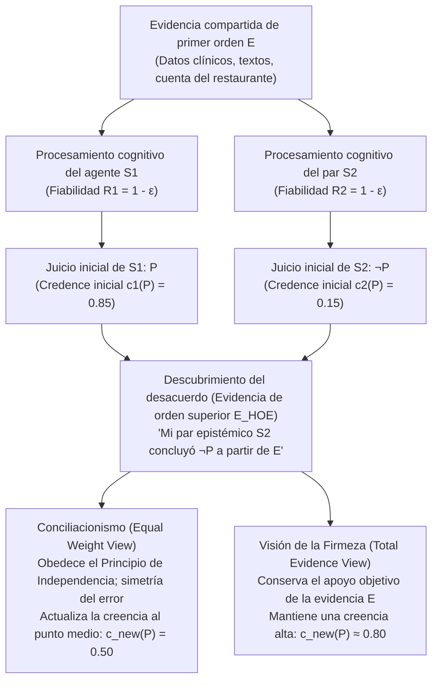
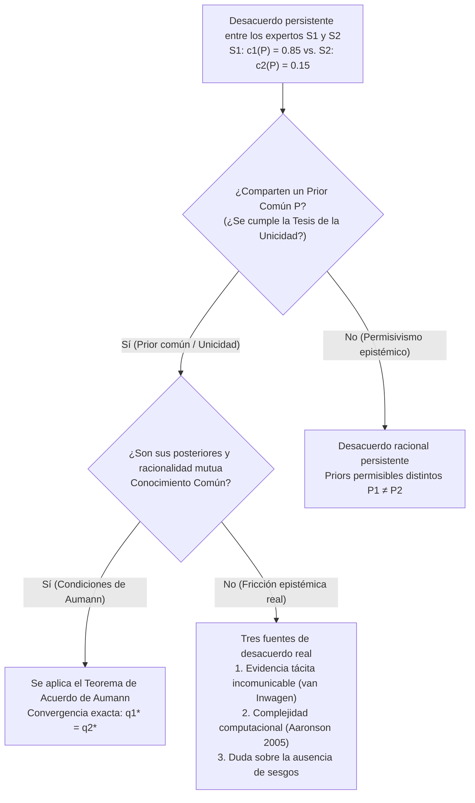

## 1. Introducción: El choque del desacuerdo racional y la desaparición de las excusas

En la vida cotidiana, la medicina clínica, la jurisprudencia, la política macroeconómica, las ciencias empíricas y la propia filosofía, nos enfrentamos constantemente a personas que rechazan nuestras convicciones más meditadas. En la gran mayoría de las disputas ordinarias, descubrir ese desacuerdo no socava nuestra confianza porque disponemos de explicaciones cómodas que rompen la simetría: auténticas «excusas epistémicas». Nos decimos que nuestro interlocutor no ha leído los últimos estudios empíricos, carece de formación estadística rigurosa o está cegado por un sesgo ideológico o financiero. Mientras podamos clasificar al oponente como un <strong>inferior epistémico (Epistemic Inferior)</strong> respecto a la cuestión debatida, conservar nuestra creencia inicial resulta sencillo.

Pero ¿qué ocurre cuando desaparecen todas esas excusas reconfortantes?

Supongamos que usted y una colega han trabajado codo con codo durante diez años en la misma disciplina científica o filosófica. Ambos han examinado exactamente el mismo corpus de literatura primaria, los mismos datos experimentales y las mismas demostraciones matemáticas (un conjunto compartido de evidencia $E$). Además, sabe con certeza que su colega le iguala en inteligencia, rigor analítico, honestidad intelectual, atención e imparcialidad. En el vocabulario técnico de la <strong>epistemología social (Social Epistemology)</strong> contemporánea, esa colega es su <strong>par epistémico ($\text{Peer}(S_1, S_2)$)</strong>.

Tras evaluar independientemente la evidencia compartida $E$, usted llega a la firme convicción de que la proposición $P$ es verdadera, asignándole un grado de creencia o *credence* de $c_1(P) = 0.85$. Su par epistémico, habiendo evaluado exactamente la misma evidencia $E$ con igual cuidado, anuncia la conclusión opuesta: cree $\neg P$, asignando a $P$ apenas $c_2(P) = 0.15$.

En el instante en que descubre este desacuerdo entre pares, <strong>¿qué le exige la racionalidad epistémica?</strong>

1. <strong>El conciliacionismo / La visión del peso igual (Conciliationism / Equal Weight View)</strong>: Puesto que usted y su par son procesadores igualmente fiables de la evidencia $E$ y al menos uno de los dos ha cometido un error cognitivo en esta ocasión, privilegiar su propio juicio solo porque es *el suyo* constituye una forma de dogmatismo. Debe revisar sustancialmente su confianza hacia el punto medio ($c_{\text{new}}(P) = 0.50$) y suspender el juicio.
2. <strong>La visión de la firmeza (The Steadfast View / Non-Conciliationism)</strong>: Incluso frente al desacuerdo de un par, si la evidencia de primer orden $E$ apoya objetivamente $P$ y usted razonó correctamente de $E$ a $P$, no está obligado a abandonar una creencia bien fundada solo porque su par haya sufrido un punto ciego puntual.

Desde mediados de la década de 2000, este problema —articulado por Richard Feldman, David Christensen, Adam Elga, Thomas Kelly, Jennifer Lackey y Miriam Schoenfield— ocupa el centro de la epistemología analítica.

---

## 2. Formalización de la paridad epistémica y arquitectura de la evidencia en dos niveles

### 2.1 Igualdad evidencial e igualdad cognitiva

Siguiendo a Thomas Kelly (2005, *"The Epistemic Significance of Disagreement"*) y Richard Feldman (2007), dos agentes $S_1$ y $S_2$ son <strong>pares epistémicos</strong> respecto a una proposición $P$ si cumplen dos condiciones de simetría:

1. <strong>Igualdad evidencial (Evidential Equality)</strong>: $S_1$ y $S_2$ poseen exactamente el mismo cuerpo de evidencia sustantiva de primer orden $E$ relevante para la verdad de $P$ ($E_1 = E_2 = E$).
2. <strong>Igualdad cognitiva (Cognitive Equality)</strong>: $S_1$ y $S_2$ son iguales en las competencias cognitivas generales (inteligencia, rigor lógico, formación en el dominio) y virtudes epistémicas (honestidad intelectual, apertura mental, ausencia de sesgos) necesarias para evaluar $E$, con tasas de fiabilidad equivalentes $R(S_1) \approx R(S_2)$.

### 2.2 Evidencia de primer orden ($E$) frente a evidencia de orden superior ($E_{\text{HOE}}$)

El motor analítico del debate reside en la distinción entre <strong>evidencia de primer orden ($E$)</strong> y <strong>evidencia de orden superior ($E_{\text{HOE}}$)</strong> (Christensen 2010; Kelly 2010):

- <strong>Evidencia de primer orden ($E$)</strong>: Evidencia que incide directamente sobre la verdad de la proposición $P$ en el mundo (datos clínicos, series macroeconómicas, manuscritos históricos o las cifras de una cuenta de restaurante).
- <strong>Evidencia de orden superior ($E_{\text{HOE}}$)</strong>: Meta-evidencia acerca de *la fiabilidad de nuestro propio funcionamiento cognitivo al procesar $E$* o sobre si $E$ apoya realmente a $P$.

En el clásico <strong>caso del fármaco distorsionador del razonamiento</strong> (Christensen 2010), si un médico le informa de que su café matutino contenía una sustancia que provoca alucinaciones lógicas indetectables en el $80\%$ de los sujetos tras haber deducido un teorema $P$ a partir de axiomas $E$, ese testimonio no refuta directamente el teorema matemático $P$, sino que actúa como un <strong>derrotador socavador de orden superior ($E_{\text{HOE}}$)</strong> que le obliga a reducir su confianza en su propio cálculo. Descubrir que un par epistémico concluyó $\neg P$ a partir de $E$ funciona exactamente como evidencia de orden superior de que al menos uno de los dos sistemas cognitivos sufrió un fallo de rendimiento.

---

## 3. El campo conciliacionista: La cuenta del restaurante, el peso igual y la independencia

### 3.1 El caso de la cuenta del restaurante de David Christensen (2007)

En *"Epistemology of Disagreement: The Good News"* (2007), David Christensen formuló el célebre experimento mental de <strong>la cuenta del restaurante (The Restaurant Check Case)</strong>: cinco amigos cenan juntos y acuerdan dividir la factura en partes iguales añadiendo un $20\%$ de propina. Usted y su amiga —igual de hábil y precisa en aritmética mental— revisan la cuenta ($E$). Usted calcula mentalmente que cada uno debe pagar <strong>$\$43$</strong> ($c_1(P) = 0.95$), pero su amiga anuncia con idéntica seguridad que la cuota es <strong>$\$45$</strong> ($c_2(P) = 0.05$).

Razonar diciendo: *«Yo calculé $\$43$, luego la respuesta correcta es $\$43$; como mi amiga dijo $\$45$, ella cometió un error aritmético hoy y yo sigo seguro al $95\%$»* es patentemente irracional y dogmático. Dado que ambos tienen una probabilidad simétrica $\varepsilon > 0$ de cometer un desliz mental, la racionalidad exige rebajar la confianza en $\$43$ al $50\%$.

### 3.2 La visión del peso igual de Adam Elga y la agregación lineal bayesiana

Adam Elga (2007, *"Reflection and Disagreement"*) generalizó esta intuición en la <strong>visión del peso igual (Equal Weight View)</strong>, que prescribe una <strong>agregación lineal de opiniones (Linear Opinion Pooling)</strong> con pesos simétricos $w_1 = w_2 = \frac{1}{2}$:

$$c_{\text{new}}(P) = \frac{1}{2} c_1(P) + \frac{1}{2} c_2(P)$$

En un modelo bayesiano con probabilidad a priori $\mathbb{P}(P) = p_0$ donde cada agente tiene una fiabilidad diagnóstica $1 - \varepsilon$ ($\varepsilon \in (0, 1/2)$), la probabilidad a posteriori de $P$ dado el evento conjunto $\{D_1 = P, D_2 = \neg P\}$ es:

$$\mathbb{P}(P \mid D_1 = P, D_2 = \neg P) = \frac{p_0 (1 - \varepsilon)\varepsilon}{p_0 (1 - \varepsilon)\varepsilon + (1 - p_0)\varepsilon(1 - \varepsilon)} = p_0$$

El factor $(1 - \varepsilon)\varepsilon$ se cancela exactamente en el numerador y el denominador, devolviendo la creencia a la probabilidad previa $p_0$ ($0.50$), lo que equivale a la <strong>suspensión del juicio</strong> defendida por Richard Feldman (2006).

### 3.3 El Principio de Independencia de Christensen

Para bloquear la descalificación circular del par, Christensen (2009, 2011) formuló el <strong>Principio de Independencia (Independence Principle)</strong>:

> <strong>[Principio de Independencia (Christensen 2009)]</strong>
> Al evaluar las credenciales epistémicas de la creencia expresada por otro sobre $P$ para determinar cómo (o si debo) modificar mi propia creencia sobre $P$, <strong>debo hacerlo de un modo que no dependa del razonamiento que respalda mi creencia inicial sobre $P$</strong>.

Violar la Independencia incurre en una petición de principio epistémica (*begging the question*), análoga a la <strong>paradoja del dogmatismo</strong> (Harman 1973; Kripke 2011).

---

## 4. El campo de la firmeza: Evidencia total, información personal y autorrefutación

### 4.1 La visión de la evidencia total de Thomas Kelly (2010)

Thomas Kelly (2005, 2010) objeta que el conciliacionismo permite que la evidencia psicológica de orden superior ($E_{\text{HOE}}$) <strong>inunde o eclipse (swamp)</strong> la evidencia sustantiva de primer orden $E$. Si $E$ apoya objetivamente a $P$, la <strong>evidencia total ($E_{\text{total}}$)</strong> de $S_1$ consta de tres elementos:

$$E_{\text{total}} = \underbrace{E}_{\text{Evidencia sustantiva de 1er orden}} \cup \underbrace{\{S_1 \text{ juzgó } P \text{ basándose en } E\}}_{\text{Hecho psicológico 1}} \cup \underbrace{\{S_2 \text{ juzgó } \neg P \text{ basándose en } E\}}_{\text{Hecho psicológico 2}}$$

Aunque los dos hechos psicológicos son simétricos, <strong>el primer elemento —la evidencia $E$ misma— no es simétrico</strong>, sino que apunta objetivamente hacia $P$. Según la <strong>visión de la evidencia total (Total Evidence View)</strong> de Kelly, $E$ impide que la creencia racional caiga hasta $0.50$.

### 4.2 La visión justificacionista de Jennifer Lackey y la autorrefutación

Jennifer Lackey (2010) demuestra mediante <strong>casos extremos</strong> (como cuando un colega niega que $2 + 2 = 4$ o que una amiga visible está sentada a la mesa) que usted posee <strong>información personal (Personal Information)</strong> introspectiva de primera persona sobre su propia sobriedad y alerta cognitiva, lo cual rompe legítimamente la simetría cuando la justificación inicial es altísima.

Además, el conciliacionismo afronta la <strong>objeción de autorrefutación (Self-Defeat Objection)</strong> (Elga 2010): dado que los propios epistemólogos pares discrepan sobre si el conciliacionismo $C$ es verdadero, ¡un conciliacionista debería aplicar $C$ a $C$ y dejar de creer en el conciliacionismo!

---

## 5. La división meta-epistemológica: Tesis de la Unicidad frente a Permisivismo Epistémico

- <strong>Tesis de la Unicidad (Uniqueness Thesis — Feldman 2007; Roger White 2005)</strong>: Dada una evidencia total $E$, existe <strong>a lo sumo una</strong> actitud doxástica máximamente racional $c(P \mid E)$. Mediante el <strong>argumento de la píldora mágica</strong>, White sostiene que mantener $P$ si dos estándares $R_1, R_2$ fueran igualmente racionales sería tan arbitrario como tragar una píldora aleatoria.
- <strong>Permisivismo Epistémico (Epistemic Permissivism — Gideon Rosen 2001; Miriam Schoenfield 2014)</strong>: Ante evidencias complejas $E$, existe una familia de distribuciones previas racionalmente permisibles $\{\mathbb{P}_\theta\}_{\theta \in \Theta}$. Schoenfield (2014) replica que nadie puede evaluar la evidencia desde fuera de todo estándar epistémico; juzgado a la luz del propio estándar coherente $R_1$ de $S_1$, $R_1$ es más conducente a la verdad que $R_2$, haciendo posible un <strong>desacuerdo sin culpa (Faultless Disagreement)</strong>.

| Dimensión analítica | Equal Weight View (Conciliacionismo estricto) | Total Evidence View (Firmeza moderada) | Justificationist View (Híbrido asimétrico) | Firmeza Permisivista (Firmeza radical) |
| :--- | :--- | :--- | :--- | :--- |
| <strong>Defensores principales</strong> | D. Christensen, A. Elga, R. Feldman | Thomas Kelly (2010) | Jennifer Lackey (2010) | G. Rosen, M. Schoenfield, P. van Inwagen |
| <strong>Premisa meta-epistemológica</strong> | Tesis estricta de la Unicidad | Apoyo evidencial objetivo | Sensible al contexto (info personal) | Permisivismo epistémico ($\{\mathbb{P}_\theta\}$) |
| <strong>Principio de Independencia</strong> | Estrictamente aplicado | Rechazado / Restringido | Superado con alta justificación inicial | Permite evaluar estándares rivales desde $R_1$ |
| <strong>Veredicto en la cuenta del restaurante</strong> | Dividir la diferencia ($c_{\text{new}} = 0.50$) | Conciliación sustancial | Conciliar | Conciliar (regla aritmética única) |
| <strong>Veredicto en disputas científicas/filosóficas</strong> | Suspender el juicio (agnosticismo) | Quien razonó bien mantiene alta confianza | Firmeza si está profundamente verificado | Ambos pares pueden mantenerse firmes |

---

## 6. Teoría de juegos y el Teorema de Acuerdo de Robert Aumann (1976)

En *"Agreeing to Disagree"* (1976), <strong>Robert J. Aumann</strong> demostró en un espacio de probabilidad $(\Omega, \mathcal{F}, \mathbb{P})$ con una <strong>probabilidad a priori común (Common Prior)</strong> $\mathbb{P}$ y particiones de información privada $\mathcal{P}_1, \mathcal{P}_2$ que si las probabilidades posteriores $q_1(\omega) = \mathbb{P}(A \mid \mathcal{P}_1(\omega)) = a$ y $q_2(\omega) = \mathbb{P}(A \mid \mathcal{P}_2(\omega)) = b$ son <strong>conocimiento común (Common Knowledge)</strong> en $\omega^* \in C \in \mathcal{P}_1 \wedge \mathcal{P}_2$, entonces:

$$\mathbb{P}(A \cap C) = a\,\mathbb{P}(C) = b\,\mathbb{P}(C) \implies a = b$$

<strong>¡Los agentes bayesianos con un prior común no pueden acordar estar en desacuerdo!</strong> Cuando los expertos reales persisten en discrepar, falla al menos una condición de Aumann: (1) ausencia de prior común ($\mathbb{P}_1 \neq \mathbb{P}_2$, permisivismo), (2) evidencia tácita e incomunicable (van Inwagen 1996), o (3) intratabilidad computacional (NP-difícil) al invertir el modelo mental ajeno (Scott Aaronson 2005).

