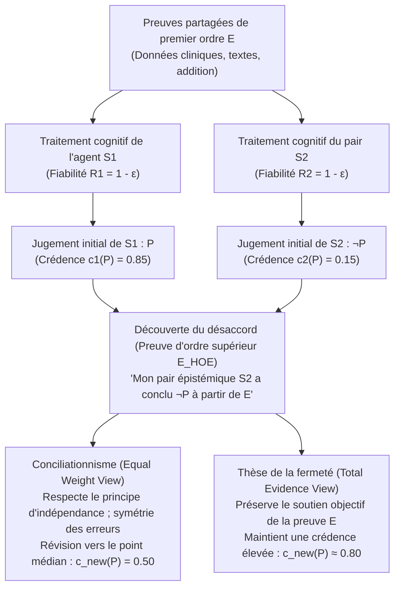
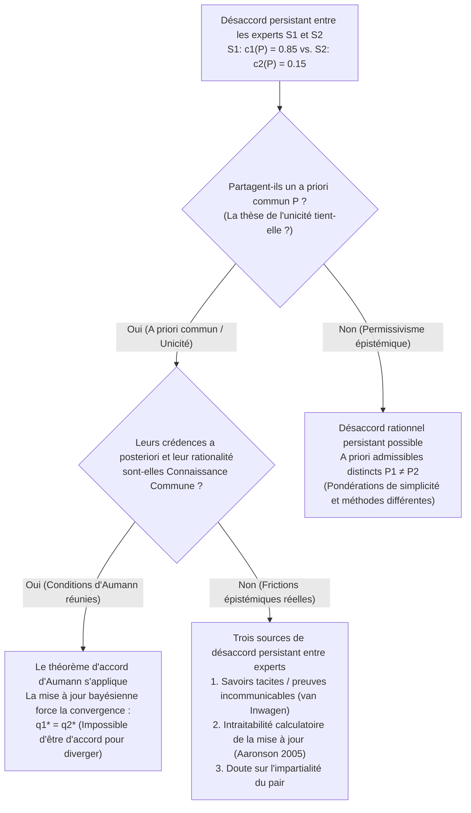

## 1. Introduction : Le choc du désaccord rationnel et la disparition des excuses épistémiques

Dans la vie quotidienne comme en médecine clinique, en politique monétaire, dans la jurisprudence, les sciences empiriques ou la philosophie, nous sommes constamment confrontés à des interlocuteurs qui rejettent nos convictions les plus réfléchies. Dans la grande majorité des controverses ordinaires, ce désaccord n’ébranle guère notre confiance, car nous disposons d’explications commodes permettant de briser la symétrie — de véritables « excuses épistémiques ». Nous nous disons que notre contradicteur n’a pas lu les dernières études, manque de rigueur statistique ou est aveuglé par un biais idéologique ou financier. Tant que nous pouvons classer autrui comme un <strong>inférieur épistémique (Epistemic Inferior)</strong> sur la question traitée, maintenir notre croyance initiale semble naturel.

Mais que se passe-t-il lorsque toutes ces excuses rassurantes disparaissent ?

Supposons que vous et une collègue travailliez côte à côte depuis dix ans dans la même discipline. Vous avez examiné exactement le même corpus de littérature primaire, les mêmes données expérimentales et les mêmes démonstrations mathématiques (soit un ensemble partagé de preuves $E$). De plus, vous savez avec certitude que votre collègue vous égale en intelligence, en rigueur analytique, en honnêteté intellectuelle, en vigilance et en impartialité. Dans le vocabulaire de l’<strong>épistémologie sociale (Social Epistemology)</strong> contemporaine, cette collègue est votre <strong>pair épistémique (Epistemic Peer, $\text{Peer}(S_1, S_2)$)</strong>.

Or, après avoir évalué indépendamment les preuves partagées $E$, vous parvenez à la ferme conviction que la proposition $P$ est vraie (avec un degré de croyance ou *credence* $c_1(P) = 0.85$), tandis que votre pair épistémique aboutit à la conclusion diamétralement opposée $\neg P$ ($c_2(P) = 0.15$).

À l’instant précis où vous découvrez ce désaccord entre pairs, <strong>qu’exige de vous la rationalité épistémique ?</strong>

1. <strong>Le conciliationnisme / La thèse du poids égal (Conciliationism / Equal Weight View)</strong> : Puisque vous et votre pair êtes des évaluateurs également fiables de $E$ et qu’au moins l’un d’entre vous a commis une erreur cognitive cette fois-ci, privilégier votre propre jugement uniquement parce qu’il est *le vôtre* relève du dogmatisme. Vous devez réduire drastiquement votre confiance et couper la poire en deux ($c_{\text{new}}(P) = 0.50$, suspension du jugement).
2. <strong>La thèse de la fermeté / Le non-conciliationnisme (The Steadfast View)</strong> : Même face au désaccord d’un pair, si les preuves de premier ordre $E$ soutiennent objectivement $P$ et que vous avez correctement raisonné de $E$ à $P$, vous n’êtes pas tenu d’abandonner une croyance bien fondée simplement parce que votre pair a subi une défaillance ponctuelle.

Depuis le milieu des années 2000, ce débat — structuré par Richard Feldman, David Christensen, Adam Elga, Thomas Kelly, Jennifer Lackey et Miriam Schoenfield — occupe le cœur de l’épistémologie analytique.

---

## 2. Définition formelle de la parité épistémique et architecture à deux niveaux de la preuve

### 2.1 Égalité évidentielle et égalité cognitive

Suivant Thomas Kelly (2005, *"The Epistemic Significance of Disagreement"*) et Richard Feldman (2007), deux agents $S_1$ et $S_2$ sont des <strong>pairs épistémiques ($\text{Peer}(S_1, S_2, P)$)</strong> relativement à une proposition $P$ si deux conditions de symétrie sont réunies :

1. <strong>Égalité évidentielle (Evidential Equality)</strong> : $S_1$ et $S_2$ possèdent exactement le même ensemble de preuves substantielles de premier ordre $E$ portant sur la valeur de vérité de $P$ ($E_1 = E_2 = E$).
2. <strong>Égalité cognitive (Cognitive Equality)</strong> : $S_1$ et $S_2$ sont égaux quant aux compétences cognitives générales (intelligence, rigueur logique, formation) et aux vertus épistémiques (honnêteté, ouverture d’esprit, absence de biais) requises pour évaluer $E$, soit une fiabilité générale équivalente $R(S_1) \approx R(S_2)$.

### 2.2 Preuves de premier ordre ($E$) vs Preuves d’ordre supérieur ($E_{\text{HOE}}$)

Le moteur analytique de cette littérature repose sur la distinction entre <strong>preuves de premier ordre (First-Order Evidence, $E$)</strong> et <strong>preuves d’ordre supérieur (Higher-Order Evidence, $E_{\text{HOE}}$)</strong> (Christensen 2010 ; Kelly 2010) :

- <strong>Les preuves de premier ordre ($E$)</strong> portent directement sur la vérité de la proposition $P$ dans le monde (données cliniques, séries macroéconomiques, manuscrits historiques, chiffres sur une addition de restaurant).
- <strong>Les preuves d’ordre supérieur ($E_{\text{HOE}}$)</strong> sont des méta-preuves portant sur *la fiabilité de notre propre fonctionnement cognitif lors du traitement de $E$* ou sur la question de savoir si $E$ soutient réellement $P$.

Si un médecin vous apprend que votre café du matin contenait une substance provoquant chez $80\%$ des sujets des illusions logiques indétectables, cette information ne porte pas sur le théorème mathématique $P$ que vous venez de démontrer, mais agit comme un puissant <strong>défaiseur sapant d’ordre supérieur (Undermining Defeater, $E_{\text{HOE}}$)</strong>. Découvrir qu’un pair épistémique a conclu $\neg P$ à partir de $E$ constitue exactement une telle preuve d’ordre supérieur indiquant qu’au moins l’un des deux systèmes cognitifs a commis une erreur de performance.

---

## 3. Le camp conciliationniste : L’addition au restaurant, le poids égal et l’indépendance

### 3.1 Le cas de l’addition au restaurant de David Christensen (2007)

Dans *"Epistemology of Disagreement: The Good News"* (2007), David Christensen propose l’expérience de pensée célèbre de <strong>l’addition au restaurant (The Restaurant Check Case)</strong> : cinq amis dînent ensemble et conviennent de partager équitablement la note majorée de $20\%$ de pourboire. Vous et votre amie — tout aussi douée et attentive que vous en calcul mental — examinez la même facture ($E$). Vous calculez mentalement <strong>$43\$$</strong> par personne ($c_1(P) = 0.95$), tandis que votre amie annonce avec la même assurance <strong>$45\$$</strong> ($c_2(P) = 0.05$).

Raisonner ainsi : *« J’ai trouvé $43\$$, donc la vraie réponse est $43\$$ ; puisque mon amie dit $45\$$, elle s’est nécessairement trompée cette fois-ci, je garde donc une confiance de $95\%$ en $43\$$ »* serait manifestement irrationnel et arrogant. Vos probabilités d’erreur de calcul mental $\varepsilon > 0$ étant symétriques, vous devez abaisser votre confiance aux alentours de $50\%$.

### 3.2 La thèse du poids égal d’Adam Elga et la fusion linéaire bayésienne

Adam Elga (2007, *"Reflection and Disagreement"*) généralise cette intuition dans la <strong>thèse du poids égal (Equal Weight View)</strong>, qui prescrit une <strong>fusion linéaire des opinions (Linear Opinion Pooling)</strong> avec des poids égaux $w_1 = w_2 = \frac{1}{2}$ :

$$c_{\text{new}}(P) = \frac{1}{2} c_1(P) + \frac{1}{2} c_2(P)$$

Dans un modèle bayésien standard de probabilité a priori $\mathbb{P}(P) = p_0$ où chaque agent possède une fiabilité diagnostique $1 - \varepsilon$ ($\varepsilon \in (0, 1/2)$), la probabilité a posteriori de $P$ sachant le désaccord $\{D_1 = P, D_2 = \neg P\}$ s’écrit :

$$\mathbb{P}(P \mid D_1 = P, D_2 = \neg P) = \frac{p_0 (1 - \varepsilon)\varepsilon}{p_0 (1 - \varepsilon)\varepsilon + (1 - p_0)\varepsilon(1 - \varepsilon)} = p_0$$

Le terme de fiabilité $(1 - \varepsilon)\varepsilon$ s’annule exactement au numérateur et au dénominateur ! L’appui évidentiel positif du jugement de $S_1$ est neutralisé par le jugement opposé de $S_2$, ramenant la crédence à la probabilité a priori $p_0$ ($0.50$), ce qui correspond à la <strong>suspension du jugement</strong> défendue par Richard Feldman (2006).

### 3.3 Le principe d’indépendance de Christensen (Independence Principle)

Pour interdire la disqualification circulaire du pair, Christensen (2009, 2011) formule le <strong>principe d’indépendance</strong> :

> <strong>[Principe d’indépendance (Independence)]</strong>
> En évaluant les références épistémiques de la croyance exprimée par autrui au sujet de $P$ afin de déterminer comment (ou si je dois) modifier ma propre croyance au sujet de $P$, <strong>je dois procéder d’une manière qui ne repose pas sur le raisonnement sous-jacent à ma croyance initiale au sujet de $P$</strong>.

Violer l’indépendance revient à commettre une pétition de principe épistémique (*begging the question*), structurellement identique au <strong>paradoxe du dogmatisme</strong> (Harman 1973 ; Kripke 2011).

---

## 4. Le camp de la fermeté : Preuve totale, information personnelle et auto-réfutation

### 4.1 La « Total Evidence View » de Thomas Kelly (2010)

Thomas Kelly (2005, 2010) objecte que le conciliationnisme laisse la preuve psychologique d’ordre supérieur ($E_{\text{HOE}}$) <strong>submerger (swamp)</strong> la preuve substantielle de premier ordre $E$. Si $E$ soutient objectivement $P$ et que $S_1$ a raisonné correctement, la <strong>preuve totale ($E_{\text{total}}$)</strong> dont dispose $S_1$ comprend trois éléments :

$$E_{\text{total}} = \underbrace{E}_{\text{Preuve substantielle de 1er ordre}} \cup \underbrace{\{S_1 \text{ a jugé } P \text{ sur la base de } E\}}_{\text{Fait psychologique 1}} \cup \underbrace{\{S_2 \text{ a jugé } \neg P \text{ sur la base de } E\}}_{\text{Fait psychologique 2}}$$

Si les deux faits psychologiques sont symétriques, <strong>le premier élément — la preuve $E$ elle-même — n’est nullement symétrique !</strong> $E$ continue de pointer objectivement vers $P$. Selon la <strong>thèse de la preuve totale (Total Evidence View)</strong> de Kelly, $S_1$ doit certes modérer légèrement sa confiance (par exemple de $0.90$ à $0.78$), mais la présence directe de $E$ empêche sa crédence de s’effondrer jusqu’à $0.50$.

### 4.2 La vue justificationniste de Jennifer Lackey et les cas extrêmes

Jennifer Lackey (2010) illustre l’absurdité d’une Indépendance sans restriction à l’aide de <strong>cas extrêmes</strong> : si votre collègue Harry, toujours fiable depuis vingt ans, affirme soudainement que $2 + 2 = 5$ ou nie que votre amie commune Sarah est assise juste en face de vous à table, la thèse du poids égal vous obligerait à douter à $50\%$ que $2+2=4$ ou que Sarah est devant vos yeux ! Lackey explique cette asymétrie légitime par l’<strong>information personnelle (Personal Information)</strong> : vous avez un accès introspectif direct en première personne à votre propre sobriété cognitive, à votre éveil et à votre sincérité, alors que vous n’avez qu’une connaissance inductive externe de l’état mental actuel de Harry. Lorsque la justification initiale est extrêmement élevée, cette information personnelle brise légitimement la symétrie.

### 4.3 L’objection d’auto-réfutation (Self-Defeat Objection)

L’objection dialectique la plus redoutable contre le conciliationnisme est qu’il est <strong>auto-sapant (self-undermining)</strong> (Elga 2010, *"How to Disagree about How to Disagree"* ; Kelly 2005) : puisque les meilleurs épistémologues contemporains (qui sont des pairs épistémiques) sont profondément divisés sur la vérité du conciliationnisme $C$ lui-même, un conciliationniste devrait, en vertu de sa propre règle $C$, perdre confiance dans le conciliationnisme ! La parade d’Adam Elga (2010) — un <strong>« conciliationnisme dogmatique »</strong> affirmant que toute règle épistémique fondamentale doit être dogmatique quant à sa propre validité sous peine d’incohérence — est critiquée par les partisans de la fermeté comme une exception *ad hoc*.

---

## 5.Le clivage méta-épistémologique : Thèse de l’unicité vs Permissivisme épistémique

- <strong>La thèse de l’unicité (The Uniqueness Thesis — Feldman 2007 ; Roger White 2005)</strong> : Étant donné un ensemble total de preuves $E$ et une proposition $P$, il existe <strong>au plus une</strong> attitude doxastique maximalement rationnelle $c(P \mid E)$. Par son <strong>argument de la pilule magique (Arbitrariness Argument)</strong>, Roger White (2005) soutient que si deux standards $R_1$ (menant à $P$) et $R_2$ (menant à $\neg P$) étaient également rationnels, maintenir $P$ simplement parce que notre université nous a inculqué $R_1$ serait aussi arbitraire que d’avaler une pilule induisant une croyance au hasard.
- <strong>Le permissivisme épistémique (Epistemic Permissivism — Gideon Rosen 2001 ; Miriam Schoenfield 2014)</strong> : Face à des preuves complexes $E$, il existe une <strong>famille de distributions de probabilités a priori rationnellement admissibles $\{\mathbb{P}_\theta\}_{\theta \in \Theta}$</strong>. Miriam Schoenfield (2014, *"Permission to Believe"*) répond à White qu’aucun agent ne peut sortir de tous ses standards épistémiques pour les juger depuis un « point de vue de nulle part » ; évalué à la lumière du propre standard cohérent $R_1$ de $S_1$, $R_1$ est plus propice à la vérité que $R_2$, ce qui rend possible un <strong>désaccord sans faute (Faultless Disagreement)</strong>.

| Dimension analytique | Equal Weight View (Conciliationnisme strict) | Total Evidence View (Fermeté modérée) | Justificationist View (Modèle hybride asymétrique) | Fermeté permissiviste (Fermeté radicale) |
| :--- | :--- | :--- | :--- | :--- |
| <strong>Principaux auteurs</strong> | D. Christensen, A. Elga, R. Feldman | Thomas Kelly (2010) | Jennifer Lackey (2010) | G. Rosen, M. Schoenfield, P. van Inwagen |
| <strong>Prémisse méta-épistémologique</strong> | Thèse stricte de l’unicité | Soutien évidentiel objectif | Sensible au contexte (info personnelle) | Permissivisme épistémique ($\{\mathbb{P}_\theta\}$) |
| <strong>Statut du principe d’indépendance</strong> | Strictement appliqué | Rejeté / Restreint ($E$ conserve sa force) | Surpassé en cas de haute justification initiale | Évaluation des standards rivaux via $R_1$ autorisée |
| <strong>Interaction entre $E$ et $E_{\text{HOE}}$</strong> | $E_{\text{HOE}}$ neutralise l’asymétrie de $E$ | $E$ et $E_{\text{HOE}}$ sont agrégés dans $E_{\text{total}}$ | Pondération dynamique selon la justification | $E$ soutient $P$ relativement au standard $R_i$ |
| <strong>Verdict sur l’addition au restaurant</strong> | Couper la poire en deux ($c_{\text{new}} = 0.50$) |Forte conciliation | Forte conciliation | Forte conciliation (règle arithmétique unique) |
| <strong>Verdict sur les controverses scientifiques/philosophiques</strong> | Suspension du jugement (agnosticisme) | Celui qui raisonne juste garde une haute crédence | Fermeté si la croyance est profondément vérifiée | Les deux pairs peuvent rester rationnellement fermes |

---

## 6. Théorie des jeux et épistémologie bayésienne : Le théorème d’accord d’Aumann (1976)

Le débat philosophique s’éclaire remarquablement lorsqu’on le relie au théorème fondamental du prix Nobel d’économie <strong>Robert J. Aumann (1976, *"Agreeing to Disagree"*)</strong>.

Soit $(\Omega, \mathcal{F}, \mathbb{P})$ un espace probabilisé muni d’une <strong>probabilité a priori commune (Common Prior)</strong> $\mathbb{P}$ partagée par deux agents bayésiens $S_1, S_2$, dont les informations privées sont représentées par des partitions $\mathcal{P}_1$ et $\mathcal{P}_2$ de $\Omega$. Leurs probabilités a posteriori pour un événement $A \in \mathcal{F}$ à l’état $\omega$ sont :

$$q_1(\omega) = \mathbb{P}(A \mid \mathcal{P}_1(\omega)), \quad q_2(\omega) = \mathbb{P}(A \mid \mathcal{P}_2(\omega))$$

> <strong>[Théorème d’accord d’Aumann (1976)]</strong>
> Si, à l’état du monde $\omega^* \in \Omega$, le fait que $q_1(\omega) = a$ et $q_2(\omega) = b$ est une <strong>connaissance commune (Common Knowledge)</strong> entre $S_1$ et $S_2$, alors nécessairement :
> $$a = b \quad (q_1 = q_2)$$

<strong>Esquisse de la preuve</strong> : L’événement de connaissance commune $C = \{q_1 = a \cap q_2 = b\}$ appartient à la partition intersection $\mathcal{P}_1 \wedge \mathcal{P}_2$ ; il s’écrit donc comme union disjointe de cellules $P_{1,i} \in \mathcal{P}_1$ sur chacune desquelles $\mathbb{P}(A \cap P_{1,i}) = a\mathbb{P}(P_{1,i})$, d’où en sommant $\mathbb{P}(A \cap C) = a\mathbb{P}(C)$. Par symétrie sur les cellules $P_{2,j} \in \mathcal{P}_2$, on obtient $\mathbb{P}(A \cap C) = b\mathbb{P}(C)$. Comme $\mathbb{P}(C) > 0$, il s’ensuit immédiatement <strong>$a = b$</strong>.

En bref : <strong>des agents bayésiens partageant un a priori commun ne peuvent pas « être d’accord pour être en désaccord » (cannot agree to disagree) !</strong> Si les experts réels (en climatologie, oncologie, économie ou sécurité de l’IA) persistent néanmoins à diverger, c’est qu’au moins une hypothèse d’Aumann est mise en défaut :
1. <strong>Absence d’a priori commun (Permissivisme)</strong> : Biais inductifs ou pondérations méthodologiques distincts ($\mathbb{P}_1 \neq \mathbb{P}_2$).
2. <strong>Connaissances tacites et preuves incommunicables (Polanyi ; van Inwagen 1996)</strong> : L’intuition clinique ou philosophique accumulée sur des décennies ne se laisse pas sérialiser sans perte dans un énoncé propositionnel $E$ ($E_1 \neq E_2$).
3. <strong>Complexité computationnelle (Scott Aaronson 2005, *"The Complexity of Agreement"*)</strong> : Inverser le modèle mental d’autrui sur tout l’espace d’états $\Omega$ pour effectuer la mise à jour bayésienne est calculatoirement intraitable (NP-difficile).

---

## 7. Conclusion : Entre dogmatisme et scepticisme invertébré

L’épistémologie du désaccord trace une voie exigeante entre deux écueils : contre le <strong>dogmatisme</strong> qui disqualifie circulairement tout contradicteur, le principe d’indépendance de Christensen nous impose une salutaire humilité, en particulier dans les tâches algorithmiques ou factuelles analogues au calcul d’une addition. Mais contre un <strong>scepticisme invertébré</strong> qui nous condamnerait à l’agnosticisme dès qu’un collègue brillant conteste nos conclusions scientifiques ou philosophiques, la preuve totale de Kelly et le permissivisme de Schoenfield montrent que le désaccord d’un pair n’est pas un droit de veto automatique sur notre raison, mais une preuve d’ordre supérieur nous invitant à auditer rigoureusement nos inférences et nos présupposés inductifs.
