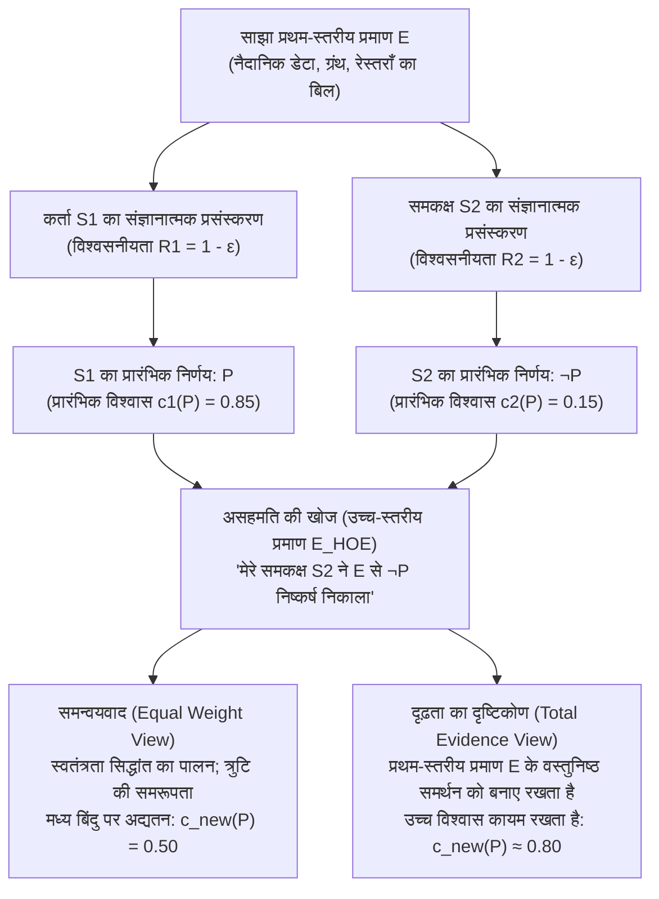
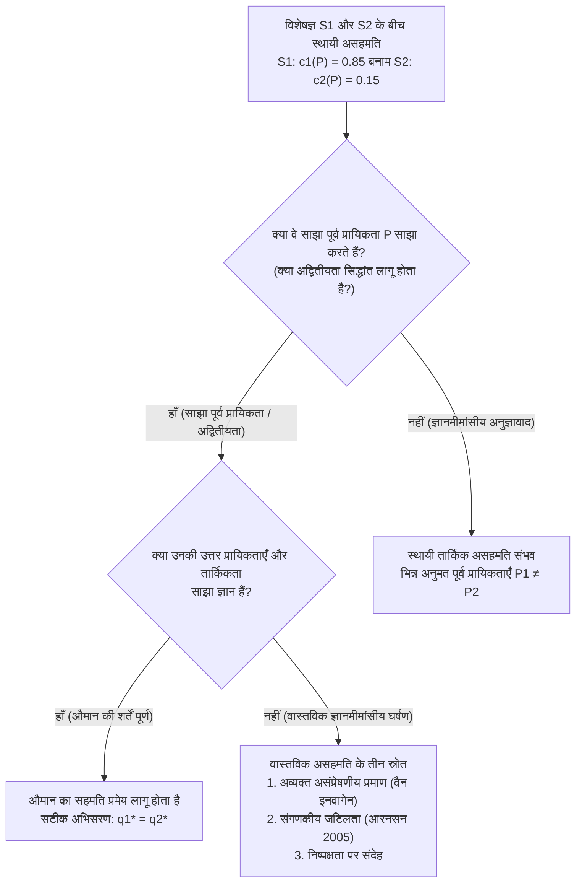

## 1. परिचय: तार्किक असहमति का आघात और ज्ञानमीमांसीय बहानों का अंत

दैनिक जीवन, नैदानिक चिकित्सा, न्यायशास्त्र, समष्टि आर्थिक नीति, आनुभविक विज्ञान और स्वयं दर्शनशास्त्र में हमारा निरंतर ऐसे लोगों से सामना होता है जो हमारे सबसे सुविचारित विश्वासों को अस्वीकार कर देते हैं। अधिकांश सामान्य विवादों में किसी की असहमति से हमारा आत्मविश्वास नहीं डगमगाता, क्योंकि हमारे पास समरूपता को तोड़ने वाले सुविधाजनक स्पष्टीकरण—अर्थात् "ज्ञानमीमांसीय बहाने" (epistemic excuses)—मौजूद होते हैं। हम स्वयं से कहते हैं कि हमारे प्रतिद्वंद्वी ने नवीनतम शोध नहीं पढ़ा है, उसे सांख्यिकीय अनुमान का कठोर प्रशिक्षण प्राप्त नहीं है, या वह वैचारिक अथवा वित्तीय पूर्वाग्रह से ग्रस्त है। जब तक हम सामने वाले को उस प्रश्न के संदर्भ में <strong>ज्ञानमीमांसीय रूप से कमतर (Epistemic Inferior)</strong> मान सकते हैं, तब तक अपने प्रारंभिक विश्वास पर टिके रहना सहज लगता है।

किंतु तब क्या होता है जब ये सारे आश्वस्त करने वाले बहाने समाप्त हो जाते हैं?

मान लीजिए कि आप और आपकी एक सहकर्मी पिछले दस वर्षों से एक ही वैज्ञानिक या दार्शनिक क्षेत्र में साथ-साथ काम कर रहे हैं। आप दोनों ने बिल्कुल एक ही प्राथमिक साहित्य, प्रयोगात्मक डेटासेट और गणितीय प्रमाणों (साझा प्रमाण $E$) का परीक्षण किया है। इसके अलावा, आप भली-भाँति जानते हैं कि आपकी सहकर्मी बुद्धिमत्ता, विश्लेषणात्मक सूक्ष्मता, बौद्धिक ईमानदारी, सतर्कता और निष्पक्षता में पूरी तरह आपके बराबर है। समकालीन <strong>सामाजिक ज्ञानमीमांसा (Social Epistemology)</strong> की तकनीकी शब्दावली में वह सहकर्मी आपकी <strong>ज्ञानमीमांसीय समकक्ष (Epistemic Peer, $\text{Peer}(S_1, S_2)$)</strong> है।

साझा प्रमाण $E$ का स्वतंत्र रूप से मूल्यांकन करने के बाद आप इस दृढ़ निष्कर्ष पर पहुँचते हैं कि प्रतिज्ञप्ति $P$ सत्य है, और उसे $c_1(P) = 0.85$ की विश्वास-मात्रा (*credence*) प्रदान करते हैं। आपकी ज्ञानमीमांसीय समकक्ष, उसी प्रमाण $E$ का समान सावधानी से मूल्यांकन करने के पश्चात, ठीक विपरीत निष्कर्ष घोषित करती है: वह $\neg P$ को सत्य मानती है और $P$ को केवल $c_2(P) = 0.15$ का विश्वास देती है।

जिस क्षण आपको इस समकक्ष असहमति का पता चलता है, <strong>ज्ञानमीमांसीय तार्किकता (epistemic rationality) आपसे क्या माँग करती है?</strong>

1. <strong>समन्वयवाद / समान भार दृष्टिकोण (Conciliationism / Equal Weight View)</strong>: चूँकि आप और आपकी समकक्ष दोनों ही प्रमाण $E$ के समान रूप से विश्वसनीय मूल्यांकनकर्ता हैं और इस अवसर पर आप दोनों में से कम से कम एक से संज्ञानात्मक त्रुटि हुई है, इसलिए केवल *अपना* होने के कारण अपने निर्णय को प्राथमिकता देना हठधर्मिता (dogmatism) है। आपको अपने विश्वास को घटाकर मध्य बिंदु ($c_{\text{new}}(P) = 0.50$) पर लाना चाहिए और निर्णय स्थगित कर देना चाहिए।
2. <strong>दृढ़ता का दृष्टिकोण (The Steadfast View / Non-Conciliationism)</strong>: समकक्ष की असहमति के बावजूद, यदि प्रथम-स्तरीय प्रमाण $E$ वस्तुनिष्ठ रूप से $P$ का समर्थन करता है और आपने वास्तव में $E$ से $P$ तक सही तर्क किया है, तो केवल इसलिए अपने सुस्थापित विश्वास को त्यागना आवश्यक नहीं है कि आपके समकक्ष से कोई तात्कालिक चूक हो गई है।

2000 के दशक के मध्य से रिचर्ड फेल्डमैन, डेविड क्रिस्टेंसेन, एडम एल्गा, थॉमस केली, जेनिफर लैकी और मिरियम शॉनफील्ड द्वारा आकार दिया गया यह विवाद विश्लेषणात्मक ज्ञानमीमांसा के केंद्र में रहा है।

---

## 2. ज्ञानमीमांसीय समकक्षता का औपचारिक स्वरूप और प्रमाण की द्वि-स्तरीय संरचना

### 2.1 साक्ष्यगत समानता और संज्ञानात्मक समानता

थॉमस केली (2005, *"The Epistemic Significance of Disagreement"*) और रिचर्ड फेल्डमैन (2007) के अनुसार, दो कर्ता $S_1$ और $S_2$ किसी प्रतिज्ञप्ति $P$ के सापेक्ष <strong>ज्ञानमीमांसीय समकक्ष</strong> कहलाते हैं यदि वे समरूपता की दो शर्तें पूरी करते हैं:

1. <strong>साक्ष्यगत समानता (Evidential Equality)</strong>: $S_1$ और $S_2$ के पास $P$ के सत्य-मूल्य से संबंधित बिल्कुल समान प्रथम-स्तरीय मौलिक प्रमाण $E$ उपलब्ध हैं ($E_1 = E_2 = E$)।
2. <strong>संज्ञानात्मक समानता (Cognitive Equality)</strong>: $S_1$ और $S_2$ प्रमाण $E$ के मूल्यांकन हेतु आवश्यक सामान्य संज्ञानात्मक दक्षताओं (बुद्धिमत्ता, तार्किक कठोरता, विषयगत प्रशिक्षण) और ज्ञानमीमांसीय सद्गुणों (बौद्धिक ईमानदारी, खुलापन, पूर्वाग्रह से मुक्ति) में समान हैं, अर्थात् उनकी सामान्य विश्वसनीयता दर समान है: $R(S_1) \approx R(S_2)$।

### 2.2 प्रथम-स्तरीय प्रमाण ($E$) बनाम उच्च-स्तरीय प्रमाण ($E_{\text{HOE}}$)

इस संपूर्ण विमर्श का मुख्य विश्लेषणात्मक इंजन <strong>प्रथम-स्तरीय प्रमाण ($E$)</strong> और <strong>उच्च-स्तरीय प्रमाण ($E_{\text{HOE}}$)</strong> के बीच का अंतर है (Christensen 2010; Kelly 2010):

- <strong>प्रथम-स्तरीय प्रमाण ($E$)</strong> वह प्रमाण है जो सीधे जगत में प्रतिज्ञप्ति $P$ की सत्यता से संबंधित है (जैसे नैदानिक डेटा, समष्टि आर्थिक आँकड़े, ऐतिहासिक पांडुलिपियाँ या रेस्तराँ के बिल की संख्याएँ)।
- <strong>उच्च-स्तरीय प्रमाण ($E_{\text{HOE}}$)</strong> वह मेटा-प्रमाण है जो *प्रमाण $E$ का प्रसंस्करण करते समय हमारी अपनी संज्ञानात्मक प्रणाली की विश्वसनीयता* या इस बात से संबंधित है कि क्या $E$ वास्तव में $P$ का समर्थन करता है।

प्रसिद्ध <strong>तर्क-विकृत करने वाली औषधि के उदाहरण (Reason-Distorting Drug Case)</strong> (Christensen 2010) में, यदि आप स्वयंसिद्धों $E$ से प्रमेय $P$ को सिद्ध करते हैं और तुरंत बाद एक विश्वसनीय चिकित्सक आपको बताता है कि आपकी सुबह की कॉफी में एक ऐसा रसायन मिला दिया गया था जो $80\%$ लोगों में अदृश्य तार्किक मतिभ्रम पैदा करता है, तो चिकित्सक का कथन स्वयं गणितीय प्रमेय $P$ के विरुद्ध कोई साक्ष्य नहीं देता, किंतु वह एक <strong>उच्च-स्तरीय खंडनकर्ता ($E_{\text{HOE}}$)</strong> के रूप में कार्य करता है जो आपको अपने निष्कर्ष में विश्वास घटाने के लिए बाध्य करता है। यह जानना कि आपके ज्ञानमीमांसीय समकक्ष ने $E$ से $\neg P$ निष्कर्ष निकाला है, ठीक ऐसा ही उच्च-स्तरीय प्रमाण है जो बताता है कि दोनों संज्ञानात्मक प्रणालियों में से कम से कम एक में निष्पादन त्रुटि हुई है।

---

## 3. समन्वयवादी खेमा: रेस्तराँ का बिल, समान भार और स्वतंत्रता का सिद्धांत

### 3.1 डेविड क्रिस्टेंसेन का रेस्तराँ बिल विचार-प्रयोग (2007)

*"Epistemology of Disagreement: The Good News"* (2007) में डेविड क्रिस्टेंसेन ने प्रसिद्ध <strong>रेस्तराँ बिल प्रकरण (The Restaurant Check Case)</strong> प्रस्तुत किया: पाँच मित्र साथ में रात्रिभोज करते हैं और $20\%$ टिप जोड़कर बिल को बराबर बाँटने पर सहमत होते हैं। आप और आपकी मित्र—जो मानसिक अंकगणित में आपके जितनी ही तेज़ और सटीक है—एक ही बिल ($E$) की जाँच करते हैं। आप मन में गणना करके <strong>$\$43$</strong> प्रति व्यक्ति ($c_1(P) = 0.95$) पर पहुँचते हैं, जबकि आपकी मित्र उतने ही आत्मविश्वास से <strong>$\$45$</strong> ($c_2(P) = 0.05$) घोषित करती है।

यदि आप यह तर्क दें कि *"मैंने $\$43$ निकाला है, इसलिए सही उत्तर $\$43$ है; चूँकि मेरी मित्र ने $\$45$ कहा है, इसलिए आज उसी से गणना में गलती हुई है और मैं $95\%$ आश्वस्त रहूँगा"*—तो यह स्पष्ट रूप से अतार्किक और अहंकारी है। चूँकि मानसिक गणना में चूक की संभावना $\varepsilon > 0$ दोनों के लिए समरूप है, इसलिए तार्किकता आपसे $\$43$ में अपने विश्वास को घटाकर लगभग $50\%$ करने की माँग करती है।

### 3.2 एडम एल्गा का समान भार दृष्टिकोण और बेयसियन रैखिक एकीकरण

एडम एल्गा (2007, *"Reflection and Disagreement"*) ने इस अंतर्दृष्टि को <strong>समान भार दृष्टिकोण (Equal Weight View)</strong> में सामान्यीकृत किया, जो समान भार $w_1 = w_2 = \frac{1}{2}$ के साथ <strong>रैखिक मत एकीकरण (Linear Opinion Pooling)</strong> निर्धारित करता है:

$$c_{\text{new}}(P) = \frac{1}{2} c_1(P) + \frac{1}{2} c_2(P)$$

एक मानक बेयसियन मॉडल में जहाँ पूर्व प्रायिकता $\mathbb{P}(P) = p_0$ है और प्रत्येक कर्ता की नैदानिक सटीकता $1 - \varepsilon$ ($\varepsilon \in (0, 1/2)$) है, संयुक्त घटना $\{D_1 = P, D_2 = \neg P\}$ दिए जाने पर $P$ की उत्तर प्रायिकता (posterior probability) है:

$$\mathbb{P}(P \mid D_1 = P, D_2 = \neg P) = \frac{p_0 (1 - \varepsilon)\varepsilon}{p_0 (1 - \varepsilon)\varepsilon + (1 - p_0)\varepsilon(1 - \varepsilon)} = p_0$$

अंश और हर में $(1 - \varepsilon)\varepsilon$ पूर्णतः कट जाता है, जिससे विश्वास वापस पूर्व प्रायिकता $p_0$ ($0.50$) पर आ जाता है, जो रिचर्ड फेल्डमैन (2006) द्वारा समर्थित <strong>निर्णय के स्थगन (suspension of judgment)</strong> के समतुल्य है।

### 3.3 क्रिस्टेंसेन का स्वतंत्रता सिद्धांत (Independence Principle)

समकक्ष को चक्रीय तर्क द्वारा खारिज करने से रोकने के लिए क्रिस्टेंसेन (2009, 2011) ने <strong>स्वतंत्रता का सिद्धांत</strong> प्रतिपादित किया:

> <strong>[स्वतंत्रता का सिद्धांत (Christensen 2009)]</strong>
> $P$ के बारे में अपने विश्वास को संशोधित करने (या न करने) का निर्णय लेने हेतु किसी अन्य व्यक्ति द्वारा व्यक्त विश्वास की ज्ञानमीमांसीय साख का मूल्यांकन करते समय, <strong>मुझे ऐसा उस तर्क पर निर्भर हुए बिना करना चाहिए जो $P$ के बारे में मेरे प्रारंभिक विश्वास के पीछे था</strong>।

स्वतंत्रता के सिद्धांत का उल्लंघन करना आत्माश्रय दोष (*begging the question*) है, जो संरचनात्मक रूप से <strong>हठधर्मिता के विरोधाभास (Dogmatism Paradox)</strong> (Harman 1973; Kripke 2011) जैसा है।

---

## 4. दृढ़तावादी खेमा: कुल प्रमाण, व्यक्तिगत जानकारी और आत्म-खंडन

### 4.1 थॉमस केली का कुल प्रमाण दृष्टिकोण (2010)

थॉमस केली (2005, 2010) आपत्ति जताते हैं कि समन्वयवाद उच्च-स्तरीय मनोवैज्ञानिक प्रमाण ($E_{\text{HOE}}$) को प्रथम-स्तरीय मौलिक प्रमाण $E$ को पूरी तरह <strong>निगल जाने या ढक लेने (swamp)</strong> देता है। यदि $E$ वस्तुनिष्ठ रूप से $P$ का समर्थन करता है, तो $S_1$ के पास <strong>कुल प्रमाण ($E_{\text{total}}$)</strong> के तीन घटक हैं:

$$E_{\text{total}} = \underbrace{E}_{\text{प्रथम-स्तरीय मौलिक प्रमाण}} \cup \underbrace{\{S_1 \text{ ने } E \text{ के आधार पर } P \text{ माना}\}}_{\text{मनोवैज्ञानिक तथ्य 1}} \cup \underbrace{\{S_2 \text{ ने } E \text{ के आधार पर } \neg P \text{ माना}\}}_{\text{मनोवैज्ञानिक तथ्य 2}}$$

यद्यपि दोनों मनोवैज्ञानिक तथ्य समरूप हैं, <strong>किंतु पहला घटक—स्वयं मौलिक प्रमाण $E$—समरूप नहीं है!</strong> केली के <strong>कुल प्रमाण दृष्टिकोण (Total Evidence View)</strong> के अनुसार, $E$ की प्रत्यक्ष उपस्थिति तार्किक विश्वास को $0.50$ तक गिरने से रोकती है।

### 4.2 जेनिफर लैकी का औचित्यवादी दृष्टिकोण और आत्म-खंडन की आपत्ति

जेनिफर लैकी (2010) <strong>चरम उदाहरणों</strong> (जैसे जब कोई सहकर्मी कहे कि $2 + 2 = 5$ या यह नकार दे कि आपके सामने मेज पर बैठी मित्र वहाँ मौजूद है) के माध्यम से दिखाती हैं कि आपके पास अपनी संज्ञानात्मक सजगता के बारे में प्रथम-पुरुष अंतर्निरीक्षणात्मक <strong>व्यक्तिगत जानकारी (Personal Information)</strong> होती है, जो प्रारंभिक औचित्य अत्यंत उच्च होने पर समरूपता को वैध रूप से तोड़ देती है।

इसके अतिरिक्त, समन्वयवाद को <strong>आत्म-खंडन की आपत्ति (Self-Defeat Objection)</strong> (Elga 2010) का सामना करना पड़ता है: चूँकि स्वयं शीर्ष ज्ञानमीमांसक (जो एक-दूसरे के समकक्ष हैं) समन्वयवाद $C$ की सत्यता पर विभाजित हैं, इसलिए एक समन्वयवादी को अपने ही नियम $C$ को $C$ पर लागू करके समन्वयवाद में अपना विश्वास छोड़ देना चाहिए!

---

## 5. मेटा-ज्ञानमीमांसीय विभाजन: अद्वितीयता का सिद्धांत बनाम ज्ञानमीमांसीय अनुज्ञावाद

- <strong>अद्वितीयता का सिद्धांत (Uniqueness Thesis — Feldman 2007; Roger White 2005)</strong>: कुल प्रमाण $E$ दिए जाने पर, किसी प्रतिज्ञप्ति $P$ के प्रति <strong>अधिक से अधिक एक</strong> अधिकतम तार्किक दृष्टिकोण $c(P \mid E)$ हो सकता है। <strong>जादुई गोली के तर्क (Magical Pill Argument)</strong> द्वारा रॉजर व्हाइट कहते हैं कि यदि दो मानक $R_1, R_2$ समान रूप से तार्किक होते, तो केवल अपने विश्वविद्यालय द्वारा सिखाए गए $R_1$ के कारण $P$ पर टिके रहना किसी यादृच्छिक गोली को निगलने जितना मनमाना होगा।
- <strong>ज्ञानमीमांसीय अनुज्ञावाद (Epistemic Permissivism — Gideon Rosen 2001; Miriam Schoenfield 2014)</strong>: जटिल प्रमाण $E$ के लिए तार्किक रूप से अनुमत पूर्व प्रायिकता बंटनों का एक परिवार $\{\mathbb{P}_\theta\}_{\theta \in \Theta}$ अस्तित्व में होता है। मिरियम शॉनफील्ड (2014) उत्तर देती हैं कि कोई भी व्यक्ति सभी मानकों से बाहर निकलकर शून्य से मूल्यांकन नहीं कर सकता; $S_1$ के अपने सुसंगत मानक $R_1$ के आलोक में $R_1$ सत्य की ओर अधिक उन्मुख है, जिससे <strong>दोषरहित असहमति (Faultless Disagreement)</strong> संभव होती है।

| विश्लेषणात्मक आयाम | Equal Weight View (कठोर समन्वयवाद) | Total Evidence View (संतुलित दृढ़ता) | Justificationist View (असममित संकर मॉडल) | अनुज्ञावादी दृढ़ता (रेडिकल दृढ़ता) |
| :--- | :--- | :--- | :--- | :--- |
| <strong>प्रमुख दार्शनिक</strong> | डी. क्रिस्टेंसेन, ए. एल्गा, आर. फेल्डमैन | थॉमस केली (2010) | जेनिफर लैकी (2010) | जी. रोज़ेन, एम. शॉनफील्ड, पी. वैन इनवागेन |
| <strong>मेटा-ज्ञानमीमांसीय आधार</strong> | कठोर अद्वितीयता सिद्धांत | वस्तुनिष्ठ साक्ष्यगत समर्थन | संदर्भ-संवेदनशील (व्यक्तिगत जानकारी) | ज्ञानमीमांसीय अनुज्ञावाद ($\{\mathbb{P}_\theta\}$) |
| <strong>स्वतंत्रता का सिद्धांत</strong> | कठोरता से लागू | अस्वीकृत / सीमित | उच्च प्रारंभिक औचित्य होने पर निरस्त | अपने मानक $R_1$ से मूल्यांकन की अनुमति |
| <strong>रेस्तराँ बिल प्रकरण पर निर्णय</strong> | अंतर को आधा करना ($c_{\text{new}} = 0.50$) | पर्याप्त समन्वय | समन्वय | समन्वय (एकल अंकगणितीय नियम) |
| <strong>वैज्ञानिक/दार्शनिक विवादों पर निर्णय</strong> | निर्णय का स्थगन (अज्ञेयवाद) | सही तर्क करने वाला उच्च विश्वास रखता है | गहन सत्यापन होने पर दृढ़ता | दोनों समकक्ष तार्किक रूप से दृढ़ रह सकते हैं |

---

## 6. खेल सिद्धांत और रॉबर्ट औमान का सहमति प्रमेय (1976)

अपने ऐतिहासिक शोधपत्र *"Agreeing to Disagree"* (1976) में नोबेल पुरस्कार विजेता <strong>रॉबर्ट जे. औमान (Robert J. Aumann)</strong> ने सिद्ध किया कि यदि किसी प्रायिकता समष्टि $(\Omega, \mathcal{F}, \mathbb{P})$ पर दो बेयसियन कर्ता एक <strong>साझा पूर्व प्रायिकता (Common Prior)</strong> $\mathbb{P}$ साझा करते हैं, उनके पास निजी सूचना विभाजन $\mathcal{P}_1, \mathcal{P}_2$ हैं, और उनकी उत्तर प्रायिकताएँ $q_1(\omega) = \mathbb{P}(A \mid \mathcal{P}_1(\omega)) = a$ तथा $q_2(\omega) = \mathbb{P}(A \mid \mathcal{P}_2(\omega)) = b$ अवस्था $\omega^* \in C \in \mathcal{P}_1 \wedge \mathcal{P}_2$ में <strong>साझा ज्ञान (Common Knowledge)</strong> बन जाती हैं, तो अनिवार्यतः:

$$\mathbb{P}(A \cap C) = a\,\mathbb{P}(C) = b\,\mathbb{P}(C) \implies a = b$$

<strong>साझा पूर्व प्रायिकता वाले बेयसियन कर्ता "असहमत होने के लिए सहमत" (agree to disagree) नहीं हो सकते!</strong> जब वास्तविक दुनिया के विशेषज्ञ असहमत बने रहते हैं, तो औमान की शर्तों में से कम से कम एक विफल होती है: (1) साझा पूर्व प्रायिकता का अभाव ($\mathbb{P}_1 \neq \mathbb{P}_2$, अनुज्ञावाद), (2) अव्यक्त ज्ञान और असंप्रेषणीय साक्ष्य (वैन इनवागेन 1996), या (3) दूसरे के संज्ञानात्मक मॉडल को उलटने की संगणकीय जटिलता (NP-hard) (स्कॉट आरनसन 2005)।

