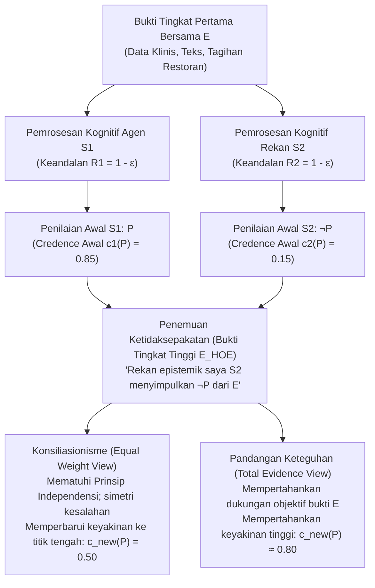
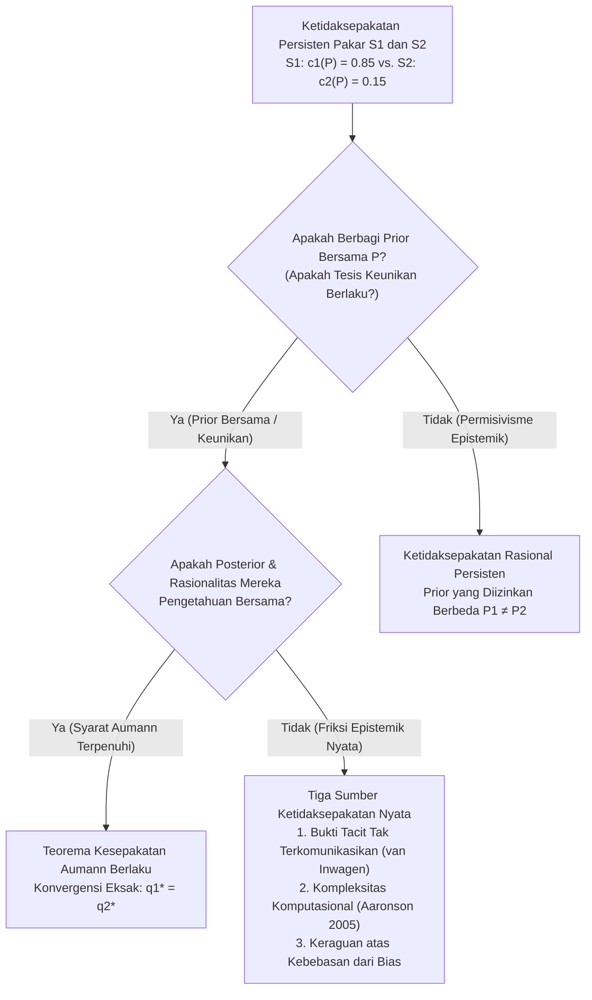

## 1. Pendahuluan: Guncangan Ketidaksepakatan Rasional dan Hilangnya Dalih Epistemik

Dalam kehidupan sehari-hari, kedokteran klinis, yurisprudensi, kebijakan makroekonomi, sains empiris, maupun filsafat, kita terus-menerus berhadapan dengan orang yang menolak keyakinan kita yang paling matang. Dalam sebagian besar perdebatan biasa, mengetahui adanya ketidaksepakatan tidak menggoyahkan keyakinan kita karena kita memiliki persediaan penjelasan pemecah simetri—semacam "dalih epistemik". Kita berkata pada diri sendiri bahwa lawan bicara kita belum membaca studi empiris terbaru, kurang terlatih dalam inferensi statistik, atau dibutakan oleh bias ideologis dan finansial. Selama kita dapat mengklasifikasikan lawan bicara sebagai <strong>inferior epistemik (Epistemic Inferior)</strong> terkait persoalan tersebut, mempertahankan keyakinan awal terasa mudah.

Namun, apa yang terjadi ketika seluruh dalih yang menenangkan itu lenyap?

Bayangkan Anda dan seorang kolega telah bekerja berdampingan selama sepuluh tahun di bidang ilmiah atau filosofis yang sama. Anda berdua telah memeriksa korpus literatur primer, kumpulan data eksperimental, dan bukti matematis yang persis sama (kumpulan bukti bersama $E$). Lebih jauh lagi, Anda tahu pasti bahwa kolega Anda setara dengan Anda dalam kecerdasan, ketelitian analitis, kejujuran intelektual, kewaspadaan, dan kebebasan dari distorsi ideologis. Dalam kosakata teknis <strong>Epistemologi Sosial (Social Epistemology)</strong> kontemporer, kolega ini adalah <strong>rekan epistemik ($\text{Peer}(S_1, S_2)$)</strong> Anda.

Setelah mengevaluasi bukti bersama $E$ secara independen, Anda sampai pada keyakinan kuat bahwa proposisi $P$ benar, dengan memberikan tingkat keyakinan (*credence*) sebesar $c_1(P) = 0.85$. Rekan epistemik Anda, setelah mengevaluasi bukti $E$ yang persis sama dengan kehati-hatian setara, mengumumkan kesimpulan sebaliknya: ia meyakini $\neg P$, dan hanya memberikan nilai $c_2(P) = 0.15$ pada $P$.

Pada detik Anda menyadari ketidaksepakatan rekan sejawat ini, <strong>apa yang dituntut oleh rasionalitas epistemik dari Anda?</strong>

1. <strong>Konsiliasionisme / Pandangan Bobot Setara (Conciliationism / Equal Weight View)</strong>: Karena Anda dan rekan Anda adalah pemroses bukti $E$ yang sama-sama andal dan setidaknya salah satu dari Anda telah melakukan kesalahan kognitif kali ini, mengistimewakan penilaian Anda sendiri semata-mata karena itu *milik Anda* adalah bentuk dogmatisme. Anda wajib merevisi keyakinan secara substansial menuju titik tengah ($c_{\text{new}}(P) = 0.50$) dan menangguhkan penilaian.
2. <strong>Pandangan Keteguhan (The Steadfast View / Non-Conciliationism)</strong>: Bahkan di hadapan ketidaksepakatan rekan sejawat, jika bukti tingkat pertama $E$ secara objektif mendukung $P$ dan Anda benar-benar bernalar secara tepat dari $E$ ke $P$, Anda tidak wajib meninggalkan keyakinan yang berdasar kuat hanya karena rekan Anda mengalami titik buta kognitif sesaat.

Sejak pertengahan 2000-an, perdebatan yang dibentuk oleh Richard Feldman, David Christensen, Adam Elga, Thomas Kelly, Jennifer Lackey, dan Miriam Schoenfield ini berdiri di jantung epistemologi analitik.

---

## 2. Formalisasi Kesetaraan Epistemik dan Arsitektur Bukti Dua Tingkat

### 2.1 Kesetaraan Evidensial dan Kesetaraan Kognitif

Mengikuti Thomas Kelly (2005, *"The Epistemic Significance of Disagreement"*) dan Richard Feldman (2007), dua agen $S_1$ dan $S_2$ adalah <strong>rekan epistemik</strong> terhadap proposisi $P$ jika memenuhi dua syarat simetri:

1. <strong>Kesetaraan Evidensial (Evidential Equality)</strong>: $S_1$ dan $S_2$ memiliki kumpulan bukti substantif tingkat pertama $E$ yang persis sama terkait nilai kebenaran $P$ ($E_1 = E_2 = E$).
2. <strong>Kesetaraan Kognitif (Cognitive Equality)</strong>: $S_1$ dan $S_2$ setara dalam kompetensi kognitif umum (kecerdasan, ketajaman logika, pelatihan domain) serta kebajikan epistemik (kejujuran intelektual, keterbukaan pikiran, kebebasan dari bias) yang diperlukan untuk menilai $E$, sehingga tingkat keandalan umum mereka setara: $R(S_1) \approx R(S_2)$.

### 2.2 Bukti Tingkat Pertama ($E$) vs. Bukti Tingkat Tinggi ($E_{\text{HOE}}$)

Mesin analitis utama literatur ini adalah pembedaan antara <strong>Bukti Tingkat Pertama ($E$)</strong> dan <strong>Bukti Tingkat Tinggi ($E_{\text{HOE}}$)</strong> (Christensen 2010; Kelly 2010):

- <strong>Bukti Tingkat Pertama ($E$)</strong> adalah bukti yang berkaitan langsung dengan kebenaran proposisi $P$ di dunia (data klinis, deret waktu makroekonomi, naskah sejarah, atau angka-angka pada tagihan restoran).
- <strong>Bukti Tingkat Tinggi ($E_{\text{HOE}}$)</strong> adalah meta-bukti mengenai *keandalan fungsi kognitif kita sendiri saat memproses $E$* atau apakah $E$ benar-benar mendukung $P$.

Dalam <strong>Kasus Obat Pendistorsi Penalaran</strong> klasik (Christensen 2010), jika seorang dokter memberi tahu bahwa kopi pagi Anda dicampur zat kimia yang memicu halusinasi logis tak terdeteksi pada $80\%$ subjek sesaat setelah Anda membuktikan teorema $P$ dari aksioma $E$, kesaksian dokter tersebut tidak membantah teorema matematika $P$ secara langsung, melainkan bekerja sebagai <strong>penggugur tingkat tinggi ($E_{\text{HOE}}$)</strong> yang mengharuskan Anda menurunkan keyakinan secara drastis. Mengetahui bahwa rekan epistemik menyimpulkan $\neg P$ dari $E$ adalah contoh murni bukti tingkat tinggi bahwa setidaknya salah satu dari dua sistem kognitif mengalami kegagalan kinerja.

---

## 3. Kubu Konsiliasionis: Tagihan Restoran, Bobot Setara, dan Prinsip Independensi

### 3.1 Kasus Tagihan Restoran David Christensen (2007)

Dalam *"Epistemology of Disagreement: The Good News"* (2007), David Christensen memperkenalkan eksperimen pikiran terkenal <strong>Kasus Tagihan Restoran (The Restaurant Check Case)</strong>: lima sekawan makan malam bersama dan sepakat membagi tagihan secara rata setelah ditambah tip $20\%$. Anda dan teman Anda—yang sama cepat dan akuratnya dalam berhitung di luar kepala—memeriksa tagihan yang sama ($E$). Anda menghitung di kepala bahwa bagian tiap orang adalah <strong>$\$43$</strong> ($c_1(P) = 0.95$), tetapi teman Anda dengan keyakinan setara mengumumkan bahwa bagiannya adalah <strong>$\$45$</strong> ($c_2(P) = 0.05$).

Bernalar bahwa: *"Saya sudah menghitung $\$43$, jadi jawaban benarnya $\$43$; karena teman saya menyebut $\$45$, pasti dia yang salah hitung malam ini, sehingga saya tetap yakin $95\%$"* jelas tidak rasional dan arogan secara epistemik. Karena peluang selip hitung $\varepsilon > 0$ bersifat simetris, rasionalitas menuntut Anda menurunkan keyakinan menjadi sekitar $50\%$.

### 3.2 Pandangan Bobot Setara Adam Elga dan Penggabungan Linear Bayesian

Adam Elga (2007, *"Reflection and Disagreement"*) menggeneralisasi intuisi ini menjadi <strong>Pandangan Bobot Setara (Equal Weight View)</strong>, yang menetapkan <strong>penggabungan opini linear (Linear Opinion Pooling)</strong> dengan bobot simetris $w_1 = w_2 = \frac{1}{2}$:

$$c_{\text{new}}(P) = \frac{1}{2} c_1(P) + \frac{1}{2} c_2(P)$$

Dalam model kondisionalisasi Bayesian standar dengan probabilitas awal $\mathbb{P}(P) = p_0$ di mana setiap agen memiliki akurasi diagnostik $1 - \varepsilon$ ($\varepsilon \in (0, 1/2)$), probabilitas posterior $P$ mengingat kejadian gabungan $\{D_1 = P, D_2 = \neg P\}$ adalah:

$$\mathbb{P}(P \mid D_1 = P, D_2 = \neg P) = \frac{p_0 (1 - \varepsilon)\varepsilon}{p_0 (1 - \varepsilon)\varepsilon + (1 - p_0)\varepsilon(1 - \varepsilon)} = p_0$$

Suku $(1 - \varepsilon)\varepsilon$ saling menghilangkan secara eksak pada pembilang dan penyebut, mengembalikan probabilitas posterior ke prior awal $p_0$ ($0.50$), yang setara dengan <strong>penangguhan penilaian (suspension of judgment)</strong> menurut Richard Feldman (2006).

### 3.3 Prinsip Independensi Christensen

Untuk mencegah pendiskualifikasian rekan secara sirkular, Christensen (2009, 2011) merumuskan <strong>Prinsip Independensi (Independence Principle)</strong>:

> <strong>[Prinsip Independensi (Christensen 2009)]</strong>
> Dalam mengevaluasi kredensial epistemik dari keyakinan orang lain tentang $P$ guna menentukan bagaimana (atau apakah) saya harus memodifikasi keyakinan saya sendiri tentang $P$, <strong>saya harus melakukannya dengan cara yang tidak bergantung pada penalaran di balik keyakinan awal saya tentang $P$</strong>.

Melanggar Independensi sama saja dengan melakukan penalaran melingkar (*begging the question*), yang identik secara struktural dengan <strong>Paradoks Dogmatisme</strong> (Harman 1973; Kripke 2011).

---

## 4. Kubu Keteguhan: Bukti Total, Informasi Personal, dan Sanggahan Diri

### 4.1 Pandangan Bukti Total Thomas Kelly (2010)

Thomas Kelly (2005, 2010) menyanggah bahwa konsiliasionisme membiarkan bukti psikologis tingkat tinggi ($E_{\text{HOE}}$) <strong>menenggelamkan (swamp)</strong> bukti substantif tingkat pertama $E$. Jika $E$ secara objektif mendukung $P$, maka <strong>bukti total ($E_{\text{total}}$)</strong> milik $S_1$ mencakup tiga unsur:

$$E_{\text{total}} = \underbrace{E}_{\text{Bukti Substantif Tingkat Pertama}} \cup \underbrace{\{S_1 \text{ menilai } P \text{ berdasarkan } E\}}_{\text{Fakta Psikologis 1}} \cup \underbrace{\{S_2 \text{ menilai } \neg P \text{ berdasarkan } E\}}_{\text{Fakta Psikologis 2}}$$

Meski kedua fakta psikologis bersifat simetris, <strong>unsur pertama—yakni bukti $E$ itu sendiri—tidaklah simetris!</strong> Menurut <strong>Pandangan Bukti Total (Total Evidence View)</strong> Kelly, keberadaan langsung $E$ mencegah keyakinan rasional runtuh sepenuhnya ke titik tengah $0.50$.

### 4.2 Pandangan Justifikasionis Jennifer Lackey dan Sanggahan Diri

Jennifer Lackey (2010) melalui <strong>kasus-kasus ekstrem</strong> (misalnya ketika kolega Anda menyangkal bahwa $2 + 2 = 4$ atau menyangkal bahwa teman Anda sedang duduk tepat di depan mata Anda) menunjukkan bahwa Anda memiliki <strong>informasi personal (Personal Information)</strong> introspektif orang pertama mengenai kewarasan dan kesadaran kognitif Anda sendiri, yang secara sah memecah simetri ketika justifikasi awal sangat tinggi.

Selain itu, konsiliasionisme menghadapi <strong>Keberatan Menggugurkan Diri Sendiri (Self-Defeat Objection)</strong> (Elga 2010): karena para ahli epistemologi terkemuka sendiri berbeda pendapat mengenai kebenaran konsiliasionisme $C$, seorang konsiliasionis berdasarkan aturannya sendiri $C$ wajib menurunkan keyakinannya terhadap konsiliasionisme itu sendiri!

---

## 5. Pembelahan Meta-Epistemologis: Tesis Keunikan vs. Permisivisme Epistemik

- <strong>Tesis Keunikan (Uniqueness Thesis — Feldman 2007; Roger White 2005)</strong>: Mengingat bukti total $E$, terdapat <strong>paling banyak satu</strong> sikap doksastik rasional maksimal $c(P \mid E)$. Melalui <strong>argumen pil ajaib</strong>, White berargumen bahwa mempertahankan $P$ jika dua standar $R_1, R_2$ sama-sama rasional sama sewenang-wenangnya dengan menelan pil penginduksi keyakinan acak.
- <strong>Permisivisme Epistemik (Epistemic Permissivism — Gideon Rosen 2001; Miriam Schoenfield 2014)</strong>: Untuk bukti kompleks $E$, terdapat keluarga distribusi prior yang diizinkan secara rasional $\{\mathbb{P}_\theta\}_{\theta \in \Theta}$. Schoenfield (2014) menjawab bahwa tak seorang pun dapat menilai bukti dari ruang hampa di luar seluruh standar epistemik; dinilai dari sudut pandang standar koheren $R_1$ milik $S_1$, $R_1$ lebih kondusif bagi kebenaran daripada $R_2$, sehingga memungkinkan terjadinya <strong>ketidaksepakatan tanpa kesalahan (Faultless Disagreement)</strong>.

| Dimensi Analitis | Equal Weight View (Konsiliasionisme Ketat) | Total Evidence View (Keteguhan Moderat) | Justificationist View (Hibrida Asimetris) | Keteguhan Permisivis (Keteguhan Radikal) |
| :--- | :--- | :--- | :--- | :--- |
| <strong>Tokoh Utama</strong> | D. Christensen, A. Elga, R. Feldman | Thomas Kelly (2010) | Jennifer Lackey (2010) | G. Rosen, M. Schoenfield, P. van Inwagen |
| <strong>Premis Meta-Epistemologis</strong> | Tesis Keunikan Ketat | Dukungan Evidensial Objektif | Peka Konteks (Info Personal) | Permisivisme Epistemik ($\{\mathbb{P}_\theta\}$) |
| <strong>Prinsip Independensi</strong> | Diterapkan secara ketat | Ditolak / Dibatasi | Dilampaui saat justifikasi awal tinggi | Mengizinkan evaluasi standar rival via $R_1$ |
| <strong>Putusan Tagihan Restoran</strong> | Bagi rata selisih ($c_{\text{new}} = 0.50$) | Konsiliasi substansial | Konsiliasi | Konsiliasi (aturan aritmetika tunggal) |
| <strong>Putusan Sengketa Sains/Filsafat</strong> | Tangguhkan penilaian (agnostisisme) | Yang bernalar tepat tetap yakin | Teguh jika terverifikasi mendalam | Kedua rekan dapat tetap teguh secara rasional |

---

## 6. Teori Permainan dan Teorema Kesepakatan Robert Aumann (1976)

Dalam karya klasiknya *"Agreeing to Disagree"* (1976), <strong>Robert J. Aumann</strong> membuktikan pada ruang probabilitas $(\Omega, \mathcal{F}, \mathbb{P})$ dengan <strong>probabilitas prior bersama (Common Prior)</strong> $\mathbb{P}$ dan partisi informasi privat $\mathcal{P}_1, \mathcal{P}_2$ bahwa jika probabilitas posterior $q_1(\omega) = \mathbb{P}(A \mid \mathcal{P}_1(\omega)) = a$ dan $q_2(\omega) = \mathbb{P}(A \mid \mathcal{P}_2(\omega)) = b$ menjadi <strong>pengetahuan bersama (Common Knowledge)</strong> pada keadaan $\omega^* \in C \in \mathcal{P}_1 \wedge \mathcal{P}_2$, maka:

$$\mathbb{P}(A \cap C) = a\,\mathbb{P}(C) = b\,\mathbb{P}(C) \implies a = b$$

<strong>Agen Bayesian dengan prior bersama tidak dapat "sepakat untuk tidak sepakat"!</strong> Ketika para pakar di dunia nyata terus berbeda pendapat, setidaknya satu asumsi Aumann gagal: (1) ketiadaan prior bersama ($\mathbb{P}_1 \neq \mathbb{P}_2$, permisivisme), (2) pengetahuan tacit dan bukti yang tak terkomunikasikan (van Inwagen 1996), atau (3) ketidakmungkinan komputasional (NP-hard) dalam membalik fungsi kognitif rekan (Scott Aaronson 2005).

