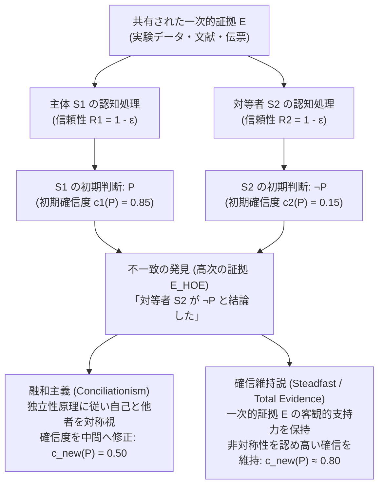
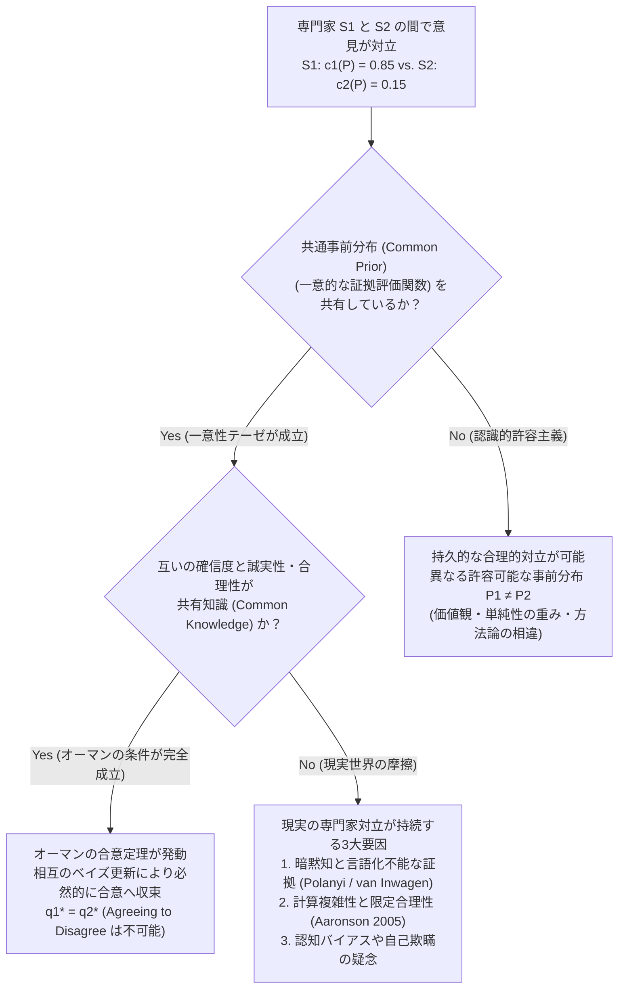

## 1. 序論：理性的不一致の衝撃と「言い訳」の消失

私たちは日常生活から科学研究、臨床医療、金融政策、法廷での事実認定、さらには哲学や倫理の議論に至るまで、絶えず他者との<strong>意見の不一致（Disagreement）</strong>に直面している。たいていの場合、私たちはそうした不一致に直面しても自らの信念を大きく揺るがせることはない。なぜなら、日常的な不一致の多くには「都合の良い言い訳（対称性を崩す説明）」が用意されているからである。「相手はまだ最新のデータを読んでいないのだ」「相手は統計学の基礎訓練を受けていない」「相手には特定の政治的・経済的ポジショントーク（認知バイアス）がある」——このように相手を自分より<strong>認識的に劣位（Epistemic Inferior）</strong>に置くことができれば、自分の確信を維持することは容易である。

しかし、もしそうした快適な言い訳がすべて封じられたとしたらどうなるだろうか。

あなたとあなたの同僚が、同じ専門分野で10年間まったく同じ水準の訓練を積み、同じ一次文献と実験データ（証拠集合 $E$）を隅々まで精査したとする。あなたはその同僚が、知性・論理的思考力・誠実さ・注意力・バイアスからの自由度のいずれにおいても、自分と完全に同等であることを熟知している。現代の<strong>社会認識論（Social Epistemology）</strong>の専門用語で言えば、この同僚はあなたにとっての<strong>認識的対等者（Epistemic Peer）</strong>である。

ところが、同じ証拠 $E$ を徹底的に分析した結果、あなたは命題 $P$ が真であると強く確信した（主観的確率すなわち確信度 $c_1(P) = 0.85$）のに対し、その認識的対等者は独立にまったく逆の結論 $\neg P$ に到達した（$c_2(P) = 0.15$）ことが判明した。

この瞬間——すなわち<strong>「自分と同等の証拠と能力を持つ相手が、自分とは正反対の結論を下した」という事実を知った瞬間</strong>——認識的合理性（Epistemic Rationality）はあなたに何を命じるだろうか？

1. <strong>融和主義（Conciliationism / 歩み寄り説）</strong>：相手が間違えた確率と自分が間違えた確率は対称的である以上、自分の最初の確信に固執するのは独断的（Dogmatic）である。あなたは確信度を大幅に引き下げ、相手との中間点（$c_{\text{new}}(P) = 0.50$ 付近、すなわち判断保留）へと歩み寄らなければならない。
2. <strong>確信維持説（The Steadfast View / 非融和主義）</strong>：たとえ対等者が反対意見を述べようとも、もし元の証拠 $E$ が客観的に命題 $P$ を支持しており、あなたが実際に正しい推論によって $P$ に到達していたのであれば、他者の誤謬によって自らの正当な信念を放棄する必要はない。あなたは（一定の慎重さを保ちつつも）$P$ への高い確信を合理的に維持しうる。

2000年代半ば以降、リチャード・フェルドマン（Richard Feldman）、デイヴィッド・クリステンセン（David Christensen）、アダム・エルガ（Adam Elga）、トーマス・ケリー（Thomas Kelly）、ジェニファー・ラッキー（Jennifer Lackey）、ミリアム・シェーンフィールド（Miriam Schoenfield）ら現代分析哲学の第一線の認識論者たちによって火花が散らされてきたこの<strong>「不一致の認識論（The Epistemology of Disagreement）」</strong>は、単なるパズルではない。それは、「証拠が信念を正当化するとはどういうことか」「高次の証拠（Higher-Order Evidence）はいかに一次の証拠を覆すか」「合理的な思考には唯一の正解しか許されないのか（一意性テーゼ vs. 認識的許容主義）」という認識論の根幹を揺るがす一大論争なのである。

本稿では、認識的対等者の厳密な定式化から出発し、融和主義の核心的論証、確信維持説による反撃、背景にあるメタ認識論的対立、そしてロバート・オーマン（Robert Aumann）の「合意定理（Agreeing to Disagree）」を用いたベイズ的・ゲーム理論的解剖までを体系的に掘り下げる。

---

## 2. 「認識的対等者」の厳密な定義と証拠の二層構造

### 2.1 証拠的対等性と認知的対等性

議論を精密化するため、まず2人の認識主体 $S_1$ と $S_2$ が命題 $P$ に関して<strong>認識的対等者（$\text{Peer}(S_1, S_2, P)$）</strong>であるとはいかなる状態かを、トーマス・ケリー（Kelly 2005, *"The Epistemic Significance of Disagreement"*）およびリチャード・フェルドマン（Feldman 2007）に従って定義しよう。認識的対等性は、以下の2つの条件の連言として定式化される。

1. <strong>証拠的対等性（Evidential Equality）</strong>：$S_1$ と $S_2$ は、命題 $P$ の真偽に関連するまったく同一の一次的証拠の集合 $E$ を共有している（$E_1 = E_2 = E$）。どちらかが秘密の観察データや未公開文書を隠し持っているといった情報の非対称性は存在しない。
2. <strong>認知的対等性（Cognitive Equality / 認識的美徳の対等性）</strong>：$S_1$ と $S_2$ は、証拠 $E$ を評価して命題 $P$ に関する判断を下すための一般的な認知能力（知性、推論の厳密さ、背景知識の運用力）および認識的性格（誠実さ、開かれた心、確証バイアスや利害関係からの自由度）において同等である。すなわち、同種の問題に対する過去の正解率（Track Record）や信頼性 $R(S_1), R(S_2)$ に関して、$R(S_1) \approx R(S_2)$ が成り立つ。

もちろん、現実世界においてこれら2条件が文字通り100%の精度で成立する「完全な双子」のような状況は稀である。しかし、これは物理学における「摩擦のない斜面」と同じ理想化モデル（Idealization）である。理想化された完全な対等者においてさえ合理的な態度がどうあるべきかを解明できなければ、現実の複雑な専門家間の対立を分析する規範的基準を持つことはできない。

### 2.2 一次的証拠（First-Order Evidence）と高次の証拠（Higher-Order Evidence）

不一致の認識論を理解する上で決定的な鍵となるのが、<strong>一次的証拠（First-Order Evidence, $E_1$）</strong>と<strong>高次の証拠（Higher-Order Evidence, $E_{\text{HOE}}$）</strong>の区別である（Christensen 2010; Feldman 2005; Kelly 2010）。

- <strong>一次的証拠 $E$</strong>：世界における命題 $P$ の真理値に直接関わる証拠である。たとえば、「患者の血液検査の数値とCT画像」「インフレ率と失業率の時系列データ」「レストランの伝票に印字された金額」などがこれにあたる。
- <strong>高次の証拠 $E_{\text{HOE}}$</strong>：命題 $P$ そのものではなく、<strong>「証拠 $E$ が命題 $P$ をどの程度支持しているか（証拠的関係）」あるいは「主体 $S$ が証拠 $E$ を正しく評価できる認知状態にあるか（自己の認知的信頼性）」に関するメタレベルの証拠</strong>である。

たとえば、あなたが複雑な数学の定理 $P$ の証明を書き上げ、「$P$ は真である」と99%確信したとする。ここであなたの一次的証拠 $E$ はその証明ステップそのものである。ところが直後に、あなたの指導教官から「実はさっき君が飲んだコーヒーには、論理的思考力を一時的に低下させ、誤った推論を正しいと錯覚させる新薬が混入していた（ただし副作用は自覚できない）」と告げられたとしよう。

この「コーヒーに薬が入っていた」という情報は、数学の定理 $P$ の真偽そのもの（一次的証拠）には何ら関係がない。しかし、それは<strong>「自分が一次的証拠 $E$ を正しく処理できたかどうか」に関する強力な高次の証拠（敗北因 / Undermining Defeater）</strong>として機能し、あなたの $P$ に対する確信度を大幅に引き下げさせるはずである。

認識的対等者との不一致の発見とは、まさにこの<strong>高次の証拠 $E_{\text{HOE}}$ の獲得</strong>にほかならない。「自分と同等の能力を持つ対等者 $S_2$ が、同じ証拠 $E$ を見て $\neg P$ と判断した」という事実（$E_{\text{HOE}}$）は、「私か彼かの少なくとも一方が、今回 $E$ の評価において認知的エラー（Performance Error）を犯した」というメタ証拠なのである。

---

## 3. 融和主義（Conciliationism）：等重み見解と独立性原理

まず、不一致に直面した際には大幅な譲歩（確信度の修正）が合理的に要求されると主張する<strong>融和主義（Conciliationism）</strong>の陣営を検討しよう。代表的な論者にはデイヴィッド・クリステンセン（David Christensen）、アダム・エルガ（Adam Elga）、リチャード・フェルドマン（Richard Feldman）、ブライアン・フランシス（Bryan Frances）らがいる。

### 3.1 クリステンセンの「レストランの割り勘事例」（2007）

クリステンセンは2007年の記念碑的論文 *"Epistemology of Disagreement: The Good News"* において、誰もが融和主義の直観を受け入れざるを得ない強力な思考実験を提示した。それが<strong>レストランの割り勘事例（The Restaurant Check Case）</strong>である。

> <strong>【思考実験：レストランの割り勘】</strong>
> あなたと友人を含む5人のグループがレストランで夕食をとった。会計の際、合計金額に20%のチップを上乗せした総額を5人で均等に割り勘にすることになった。あなたと友人は、ともに暗算の得意さも注意力も同程度（認識的対等者）であり、同じ伝票（証拠 $E$）を手にとって、それぞれ頭の中で1人あたりの支払額を計算した。
> しばらくして、あなたは「1人あたり<strong>43ドル</strong>だ」と確信（$c_1(\$43) = 0.95$）した。ところがその直後、友人は「1人あたり<strong>45ドル</strong>だね」と自信を持って言った（$c_2(\$43) = 0.05$）。

さて、友人が「45ドルだ」と発言するのを聞いた直後、あなたはどう反応すべきだろうか？
もしあなたが次のように推論したらどう見えるだろうか。

> 「私は伝票を正しく計算して43ドルという結論を得た。したがって、正解は43ドルである。ところが友人は45ドルと言っている。45ドルは43ドルではないから、友人は今回の暗算で計算ミスを犯したに違いない。ゆえに友人の意見は無視してよく、私は引き続き43ドル説を95%確信し続ける」

クリステンセンが指摘するように、このような態度は明らかに<strong>不合理であり、認識的傲慢（Epistemic Hubris）</strong>である。あなたも友人も人間である以上、暗算で繰り上がりを間違える確率 $\varepsilon > 0$ を等しく抱えている。「43ドルと45ドルで食い違った」という事実が判明した時点で、あなたには「2人のうちどちらかが暗算ミスをした」という強力な証拠があるが、「ミスをしたのが自分ではなく友人の方である」と信じるべき<strong>独立した根拠（対称性を破る理由）</strong>は何一つない。したがって、あなたは43ドルに対する確信度を50%近くまで一気に引き下げ、伝票をもう一度2人で計算し直すか、紙とペン（あるいは電卓）を取り出すべきなのである。

### 3.2 等重み見解（The Equal Weight View）とベイズ的定式化

アダム・エルガ（Elga 2007, *"Reflection and Disagreement"*）は、この直観を一般化し、<strong>等重み見解（The Equal Weight View）</strong>を提唱した。

等重み見解によれば、認識的対等者 $S_2$ が命題 $P$ について自分と異なる判断を下したことを知ったとき、$S_1$ は<strong>自分自身の初期判断と対等者の初期判断に「等しい重み（Equal Weight）」を与えなければならない</strong>。

これを確率論的な意見集約（Opinion Pooling）として表現すれば、重み $w_1 = w_2 = \frac{1}{2}$ を用いた<strong>線形プーリング（Linear Pooling）</strong>となる。

$$c_{\text{new}}(P) = \frac{1}{2} c_1(P) + \frac{1}{2} c_2(P)$$

たとえばレストランの事例で $c_1(P) = 0.95, c_2(P) = 0.05$ であったなら、不一致を知った後の合理的な確信度は以下の通りとなる。

$$c_{\text{new}}(P) = \frac{1}{2}(0.95) + \frac{1}{2}(0.05) = 0.50$$

この結論は、標準的な<strong>ベイズ的条件付け（Bayesian Conditionalization）</strong>からも自然に導出できる。事前確率を $\mathbb{P}(P) = p_0$ とし、主体 $S_1, S_2$ が証拠 $E$ を評価して正しい真理値を見抜く信頼性（感度・特異度）がともに $1 - \varepsilon$（ただし誤り率 $\varepsilon \in (0, 1/2)$）であるとしよう。条件付き独立性を仮定すると、$S_1$ が $D_1 = P$ と判断し、$S_2$ が $D_2 = \neg P$ と判断したという事象 $D = \{D_1 = P, D_2 = \neg P\}$ が起きたとき、命題 $P$ が真である事後確率はベイズの定理より次のように計算される。

$$\mathbb{P}(P \mid D_1 = P, D_2 = \neg P) = \frac{\mathbb{P}(P) \, \mathbb{P}(D_1 = P \mid P) \, \mathbb{P}(D_2 = \neg P \mid P)}{\mathbb{P}(P) \, \mathbb{P}(D_1 = P \mid P) \, \mathbb{P}(D_2 = \neg P \mid P) + \mathbb{P}(\neg P) \, \mathbb{P}(D_1 = P \mid \neg P) \, \mathbb{P}(D_2 = \neg P \mid \neg P)}$$

ここに $\mathbb{P}(D_1 = P \mid P) = 1 - \varepsilon$、$\mathbb{P}(D_2 = \neg P \mid P) = \varepsilon$、および対称的な誤り率 $\mathbb{P}(D_1 = P \mid \neg P) = \varepsilon$、$\mathbb{P}(D_2 = \neg P \mid \neg P) = 1 - \varepsilon$ を代入すると、驚くべきことに分子と分母で $(1 - \varepsilon)\varepsilon$ が完全に約分されて消去される。

$$\mathbb{P}(P \mid D_1 = P, D_2 = \neg P) = \frac{p_0 (1 - \varepsilon)\varepsilon}{p_0 (1 - \varepsilon)\varepsilon + (1 - p_0)\varepsilon(1 - \varepsilon)} = p_0$$

つまり、$S_1$ の判断（$P$）が持つ正の証拠価値と、$S_2$ の判断（$\neg P$）が持つ負の証拠価値が<strong>完全に相殺（Cancel Out）</strong>され、事後確率は証拠 $E$ を見る前の無情報な事前確率 $p_0$（対称的なら $0.50$）へと引き戻されるのである。リチャード・フェルドマン（Feldman 2006）が定性的信念（信じる・否定する・判断保留するの三値モデル）において導いた<strong>「不一致の後の唯一の合理的態度は判断保留（Suspension of Judgment）である」</strong>という結論は、まさにこの数理的相殺に対応している。

### 3.3 クリステンセンの「独立性原理（Independence Principle）」

では、なぜ私たちは日常や学術論争において、「相手は今回に限って推論を誤ったのだ」と主張して自分の確信を守りたくなるのだろうか？ 相手を格下げ（Downgrade）しようとするこの誘惑を封じるためにクリステンセンが定式化した規範的原理こそが、不一致の認識論における最重要概念である<strong>独立性原理（Independence Principle）</strong>である（Christensen 2009, 2011）。

> <strong>【独立性原理（Independence）】</strong>
> 命題 $P$ に関する自分の信念をどのように（あるいはそもそも）修正すべきかを決定するために、他者が表明した $P$ に関する信念の認識的信頼性（Epistemic Credentials）を評価する際、<strong>私自身の $P$ に関する初期信念の背後にある推論そのものに依拠してはならない</strong>。

なぜ独立性原理が必要なのか。もし独立性原理を棄却してよいなら、いかなる人も決して他者との不一致によって自らの信念を修正する必要がなくなってしまう。なぜなら、どれほど優秀な対等者 $S_2$ が反対意見を述べようとも、$S_1$ は常に「私の元の推論によれば $P$ である $\rightarrow$ ゆえに $\neg P$ と言う $S_2$ は今回間違えている $\rightarrow$ ゆえに $S_2$ の意見は無視してよい」という<strong>認識的論点先取（Epistemic Begging the Question / 悪循環）</strong>を実行できてしまうからである。

これは認識論における有名な<strong>「独断主義のパラドックス（The Dogmatism Paradox）」</strong>（Gilbert Harman 1973; Saul Kripke; Ernest Sosa）と同型である。「もし私が $P$ を知っているなら、$P$ は真である。もし $P$ が真なら、将来現れるいかなる $P$ への反証データ $E'$ もすべて『誤導的な偽の証拠（Misleading Evidence）』である。ゆえに私は、将来いかなる反証データが現れようとも最初からそれを無視してよい」——この推論が科学的精神の崩壊を意味するのと同様に、対等者との不一致によってまさに「自分の元の推論が正しかったかどうか」が疑いに付されている局面で、その元の推論自体を根拠にして相手の誤りを断定することは許されない。相手の信頼性を割り引くためには、「相手は今日ひどく睡眠不足である」「相手はこの問題に金銭的利害を持っている」といった、<strong>命題 $P$ の推論とは独立した理由（Dispute-Independent Reason）</strong>が不可欠なのである。

---

## 4. 確信維持説（The Steadfast View）：一次的証拠の非対称性と融和主義への反撃

クリステンセンやエルガの議論は一見すると鉄壁に見える。しかし、トーマス・ケリー（Thomas Kelly）、ピーター・ヴァン・インワーゲン（Peter van Inwagen）、ギデオン・ローゼン（Gideon Rosen）、ラルフ・ウェッジウッド（Ralph Wedgwood）、ジェニファー・ラッキー（Jennifer Lackey）らは、融和主義が<strong>「一次的証拠 $E$ の客観的な力」</strong>や<strong>「一人称的知識の非対称性」</strong>を決定的に見落としているとして鋭い反撃を展開した。

### 4.1 トーマス・ケリーの「全証拠説（The Total Evidence View）」

トーマス・ケリーは2005年の論文で初期の確信維持説（<strong>正統理由説 / The Right Reasons View</strong>）を提示した後、2010年の長大論文 *"Peer Disagreement and Higher-Order Evidence"* において、より洗練された<strong>全証拠説（The Total Evidence View）</strong>を構築した。

ケリーはまず、次の非対称的な事実に注目する。仮に、共有された一次的証拠 $E$ が、客観的な論理的・確率的関係として実際に命題 $P$ を強く支持していたとしよう（$\text{Support}(E, P) = 0.9$）。そして主体 $S_1$ は $E$ から正しく $P$ を導き出したのに対し、対等者 $S_2$ は（普段は優秀であるにもかかわらず）今回たまたま微妙な論理の飛躍を犯して $\neg P$ と結論したとする。

このとき、不一致が判明した後の時点 $t_1$ において、$S_1$ が持つ<strong>全証拠（Total Evidence, $E_{\text{total}}$）</strong>は次の3つの要素から構成される。

$$E_{\text{total}} = \underbrace{E}_{\text{一次的証拠}} \cup \underbrace{\{\text{私が } E \text{ に基づいて } P \text{ と判断した}\}}_{\text{高次の心理的事実 1}} \cup \underbrace{\{\text{対等者が } E \text{ に基づいて } \neg P \text{ と判断した}\}}_{\text{高次の心理的事実 2}}$$

ケリーが突く融和主義（等重み見解）の致命的欠陥はこうである。融和主義者は、2つの「高次の心理的事実」が対称的であることに目を奪われるあまり、<strong>最初の要素である一次的証拠 $E$ そのものが持つ客観的な証拠力を完全に消去（Swamp / 呑み込み）してしまっている</strong>！

「私が $P$ と判断した」という事実と「対等者が $\neg P$ と判断した」という事実は確かに対称的であり、互いに相殺し合うかもしれない。しかし、<strong>元の証拠 $E$ 自体は対称的ではない</strong>。$E$ は依然として $P$ を支持しているのであって、$\neg P$ を支持しているのではない。もし不一致を知った後に確信度を $0.50$ にしなければならないとしたら、それはあたかも「自分と対等者はともに証拠 $E$ の中身を完全に忘れてしまい、『かつて自分が $P$ と言い、相手が $\neg P$ と言った』という2つの証言記録だけを手元に残している状態」と同じになってしまう。だが実際には、$E$ は今なお目の前に存在し、$S_1$ は $E$ がなぜ $P$ を含意するのかを直接把握しているのである。

したがってケリーの全証拠説によれば、高次の証拠（対等者の反対）は一定の重みを持つため、$S_1$ の確信度は $0.90$ から多少は低下する（たとえば $0.75 \sim 0.80$ へ）べきだが、一次的証拠 $E$ の貢献が生き残る以上、<strong>中間点 $0.50$ まで完全に譲歩する必要はまったくない</strong>のである。

### 4.2 「呑み込み問題（Swamping Problem）」とジェニファー・ラッキーの正当化主義

等重み見解と独立性原理を極限まで推し進めると、極めて奇妙な帰結が生じる。ジェニファー・ラッキー（Lackey 2010, *"A Justificationist View of Disagreement's Epistemic Significance"*）やクリステンセン自身が議論した<strong>「極端な事例（Extreme Cases）」</strong>を見てみよう。

> <strong>【思考実験：単純な足し算と知覚の不一致】</strong>
> あなたと、長年一緒に研究してきた極めて優秀で誠実な同僚ハリー（認識的対等者）がカフェで向かい合って座っている。
> 1. <strong>単純計算の事例</strong>：あなたが紙の上で $2 + 2 = 4$ という初等的な計算を確認したとき、ハリーが真剣な表情で「いや、$2 + 2 = 5$ だよ」と主張した。
> 2. <strong>明証的知覚の事例</strong>：目の前のテーブルに共通の友人サラが座ってコーヒーを飲んでおり、あなたにはサラの姿がはっきりと見えている。ところがハリーは「サラなんてここにはいないよ、この席は空席だ」と真顔で主張した。

もしクリステンセンの<strong>独立性原理</strong>とエルガの<strong>等重み見解</strong>を文字通り無制限に適用するならば、あなたはどうすべきか？
独立性原理によれば、「ハリーが今回に限って狂った、あるいは冗談を言っている」と判定する際に、<strong>「だって $2+2=4$ だから」「だって私の目にサラが見えているから」という自分の初期判断の根拠を使ってはならない</strong>。もしそれを使わずにハリーの過去の信頼性（これまで常に正常で誠実だったという記録）だけを見るなら、ハリーとあなたは対称的であり、あなたは「もしかすると $2+2=5$ なのかもしれない（確信度50%）」「もしかすると私が幻覚を見ていてサラはいないのかもしれない（確信度50%）」と歩み寄らなければならなくなる！

しかし、これは明らかに常軌を逸している。この事例において、あなたは「$2+2=4$ である」という信念を揺るがせるどころか、即座に<strong>「ハリーに何か深刻な神経学的異常が起きたか、手が込んだドッキリを仕掛けているに違いない」</strong>と結論するはずであり、それが完全に合理的な反応である。

ラッキー（2010）は、なぜここで対称性が崩れるのかを<strong>「個人的情報（Personal Information）」の非対称性</strong>によって鮮やかに説明した。
あなたは自分自身について、「今、自分は意識が清明であり、薬物も摂取しておらず、視力も正常で、ふざけてもいない」という膨大な<strong>一人称的・内観的な背景知識（Personal Information）</strong>を直接持っている。一方、ハリーの内部状態については、過去の行動から帰納的に推測する三人称的知識しか持っていない。

したがって、初期信念の認識的「正当化の度合い（Degree of Justification）」が極めて高い場合（かつ自分の認知機能の正常さに関する個人的情報がある場合）、その高い正当化自体が「相手の方に機能不全が起きた」と推論するための正当な非対称的根拠となる。ラッキーの<strong>正当化主義的見解（Justificationist View）</strong>は、レストランの暗算のように初期の正当化が中程度で誤りやすいケースでは大幅な融和（Conciliation）を命じ、深い検証を経た確固たる信念のケースでは確信維持（Steadfastness）を認めるという、極めて現実的なハイブリッド理論を提供している。

### 4.3 融和主義の「自己論駁（Self-Defeat / Self-Undermining）問題」

確信維持派が融和主義に突きつけるもう一つの鋭利な刃が、<strong>自己論駁（あるいは自己弱体化）のパラドックス</strong>である（Elga 2010, *"How to Disagree about How to Disagree"*; Kelly 2005; Plantinga; Weatherson）。

その論理構造は驚くほどシンプルで破壊的である。

1. 命題 $C$ を「<strong>融和主義（認識的対等者と意見が割れたら、自分の確信度を大幅に引き下げるべきである）は真である</strong>」という認識論のテーゼとする。
2. 現実の分析哲学界を見渡すと、不一致の認識論に関するあらゆる文献・論証（証拠 $E$）を熟知した第一線の認識論者たち（認識的対等者）の間で、命題 $C$ が真であるか否かについて<strong>意見が真っ二つに割れている</strong>（クリステンセンやエルガは $C$ を信じ、ケリーやヴァン・インワーゲンやラッキーやシェーンフィールドは $\neg C$ を信じている）。
3. したがって、もし融和主義 $C$ が正しいならば、融和主義者は「自分と同等の認識的対等者たちが $\neg C$ と判断している」という事実に直面している以上、<strong>自らの理論 $C$ に従って、融和主義 $C$ に対する確信度を大幅に引き下げなければならない（融和主義について不可知論にならなければならない）</strong>！
4. 逆に、もし融和主義者が対等者の反対にもかかわらず「いや、それでも融和主義 $C$ は正しい！」と確信を維持し続けるならば、その態度自体が<strong>融和主義の命じる規則に違反している</strong>ことになる。

すなわち、融和主義は「もしそれが正しく適用されるならば、それを強く信じること自体が不合理になる」という<strong>自己弱体化（Self-Undermining）</strong>に陥るのである。

この深刻なパラドックスに対し、アダム・エルガ（Elga 2010）は<strong>「独断的融和主義（Dogmatic Conciliationism）」</strong>という驚くべき解決策を提示した。エルガは、いかなる根本的な認識的規則（ベイズ更新であれ、科学的帰納法であれ、融和主義であれ）も、<strong>「自分自身の正しさ」に関するメタレベルの対立に直面したときには、自分自身に対して特別扱い（独断的固執）を許さざるを得ない</strong>と論じた。なぜなら、もしある推論規則 $R$ が、自分と競合する別の推論規則 $R'$（たとえば占星術や反帰納法）との間で重み付け平均を取ろうとすれば、その重み付けの方法自体にメタ規則が必要となり、無限後退か論理的自己矛盾に陥るからである。そのため、融和主義は「一階のあらゆる命題 $P$ については対等者に譲歩せよ。ただし『融和主義という規則それ自体』についての不一致においては譲歩するな」という例外規定（あるいは階層化）を持たざるを得ない。しかし確信維持派からは、「なぜ認識論のメタ規則だけが特別扱いを許され、他の十分に検討された哲学的・科学的信念にはそれが許されないのか、恣意的（Ad Hoc）である」という厳しい批判が続いている。

---

## 5. メタ認識論的深層：一意性テーゼ（Uniqueness） vs. 認識的許容主義（Permissivism）

なぜ、融和主義者と確信維持派の対立はこれほどまでに根深いのか。その理由は、この論争のすぐ下に<strong>「そもそも証拠と合理的信念の関係とはいかなるものか」</strong>というメタ認識論の巨大な断層が走っているからである。それが<strong>一意性テーゼ（The Uniqueness Thesis）</strong>と<strong>認識的許容主義（Epistemic Permissivism）</strong>の対立である。

### 5.1 一意性テーゼ（Uniqueness Thesis）とロジャー・ホワイトの「恣意性論証」

リチャード・フェルドマン（Feldman 2007）やロジャー・ホワイト（Roger White 2005, *"Epistemic Permissiveness"*）が擁護する<strong>一意性テーゼ</strong>は、次のように主張する。

> <strong>【一意性テーゼ（Uniqueness Thesis）】</strong>
> 与えられた全証拠の集合 $E$ と任意の命題 $P$ に対して、主体が $P$ に対して抱くことが認識的に合理的（正当化される）であるような信念的態度（Doxastic Attitude：信じる・否定する・判断保留、あるいは精密な確信度 $c(P \mid E) \in [0, 1]$）は、<strong>高々ただ1つ（At most one）</strong>しか存在しない。

一意性テーゼの世界観では、証拠 $E$ が与えられれば、合理的な確信度の値は客観的な関数 $c(P \mid E)$ によって一意に定まる。したがって、同じ証拠 $E$ を持つ2人の対等者 $S_1$ と $S_2$ がそれぞれ $P$ と $\neg P$ という異なる結論に達したならば、<strong>論理的必然として、少なくともどちらか一方は認識的過誤（ Irrationality / Error）を犯している</strong>ことになる。だからこそ、どちらが間違えたか分からない以上、双方が歩み寄らなければならない（融和主義）。

ロジャー・ホワイト（White 2005）は、もし一意性テーゼを否定して「同じ証拠 $E$ から $P$ を信じることも $\neg P$ を信じることも、どちらも等しく合理的である」と認めてしまうと、信念の形成が<strong>「魔法の信念カプセル（Magical Belief-Inducing Pill）」</strong>を飲むのと同じくらい恣意的（Arbitrary）になってしまうという強力な論証（<strong>恣意性論証 / Belief-Toggling Argument</strong>）を展開した。

たとえば、陪審員であるあなたが事件の全証拠 $E$ を見る前に、「証拠 $E$ を評価する際には、等しく合理的な2つの認識的基準（事前分布）$R_1$ と $R_2$ が存在する。$R_1$ を使えば被告は『有罪（$P$）』になり、$R_2$ を使えば『無罪（$\neg P$）』になる」と知らされたとしよう。そして、あなたがたまたま卒業した法科大学院の文化によって、あなたは基準 $R_1$ を内面化していたとする。このとき、「私は基準 $R_1$ を持っており、$R_1(E) = P$ だから、被告は実際に有罪である！」と強く信じることはできるだろうか？ ホワイトによれば、もし $R_1$ と $R_2$ が真理到達性において優劣のない「等しく合理的な基準」であるなら、たまたま自分が持っていた $R_1$ の出力だけを真理だと信じるのは、コイントスで有罪・無罪を決めておきながら「コインが表を出したから彼は本当に犯人だ！」と確信するのと同じくらい不合理なのである。

### 5.2 認識的許容主義（Epistemic Permissivism）とシェーンフィールドの反論

これに対し、ギデオン・ローゼン（Rosen 2001）、トーマス・ケリー（Kelly 2013）、ミリアム・シェーンフィールド（Miriam Schoenfield 2014, *"Permission to Believe"*）らは、一意性テーゼはあまりにも硬直した科学主義的幻想であると批判し、<strong>認識的許容主義（Epistemic Permissivism）</strong>を擁護する。

> <strong>【認識的許容主義（Epistemic Permissivism）】</strong>
> 少なくとも十分に複雑で多面的な証拠集合 $E$（科学の最先端、歴史解釈、法廷での状況証拠、哲学・倫理的問題など）においては、証拠 $E$ に対する<strong>合理的に許容可能な複数の異なる認識的基準（Epistemic Standards）や事前確率分布 $\{\mathbb{P}_\theta\}_{\theta \in \Theta}$</strong> が存在する。そのため、2人の主体が同じ証拠 $E$ を共有しながら、互いに一切の推論ミスを犯すことなく、合理的に異なる確信度 $\mathbb{P}_{\theta_1}(P \mid E) \neq \mathbb{P}_{\theta_2}(P \mid E)$ に到達しうる。

たとえば、ある新薬の臨床試験データ $E$ を見たとき、統計学者 $S_1$ は「理論的メカニズムの妥当性（事前確率）」を重視するベイズ的基準 $R_1$ を持ち、統計学者 $S_2$ は「大規模ランダム化比較試験のp値と多重比較補正」を厳格に重視する基準 $R_2$ を持っていたとする。証拠 $E$ の中に「どの基準で証拠を重み付けすべきか」を最後まで一意に決定するメタ証拠は含まれていない（もし含まれていても、そのメタ証拠の重み付けにさらに高次の基準が要る）。

ミリアム・シェーンフィールド（Schoenfield 2014）は、ホワイトの「カプセル論証」に対して次のように鮮やかに応答した。ホワイトの議論は、あたかも私たちが「自分自身の認識的基準 $R_1$ の外側（神の視点 / View from Nowhere）」に立って、基準 $R_1$ と基準 $R_2$ を中立的に眺められるかのように想定している。しかし、いかなる認識主体も、何かを推論するためには<strong>まず自分自身の認識的基準 $R_1$ を用いて世界を評価するしかない</strong>。そして、$S_1$ 自身の基準 $R_1$ の内部から評価すれば、証拠 $E$ のもとで真理に最も近い確率を与えているのは $R_1$ であり、対等者の基準 $R_2$ ではないのである。したがって、許容主義のもとでは、「あなたも合理的であり、私も合理的である。しかし私の認識的基準に照らせば、今回の証拠 $E$ は $P$ を支持しているため、私は $P$ を信じ続ける」という<strong>「過誤なき不一致（Faultless Disagreement）」と確信維持</strong>が完全に両立するのである。

### 5.3 主要4立場の体系的比較

ここまでの議論を整理するため、不一致の認識論における代表的な4つの理論的立場を6つの評価軸で比較しよう。

| 評価軸 / 理論的立場 | 等重み見解 (Equal Weight View) | 全証拠説 (Total Evidence View) | 正当化主義的見解 (Justificationist View) | 許容主義的確信維持 (Permissivist Steadfastness) |
| :--- | :--- | :--- | :--- | :--- |
| <strong>代表的論者</strong> | D. Christensen, A. Elga, R. Feldman | Thomas Kelly (2010) | Jennifer Lackey (2010) | G. Rosen, M. Schoenfield, P. van Inwagen |
| <strong>メタ認識論的前提</strong> | 強い一意性テーゼ (Uniqueness) | 穏健な一意性 / 客観的証拠支持関係 | 文脈依存的（個人的情報の非対称性） | 認識的許容主義 (Permissivism) |
| <strong>独立性原理の扱い</strong> | 厳格に遵守（初期推論への依拠を禁止） | 棄却または制限（一次的証拠 $E$ の力を保持） | 高正当化・個人的情報がある場合は破れる | 自己の許容可能な認識的基準 $R_1$ の使用を許容 |
| <strong>一次的証拠 $E$ と高次証拠 $E_{\text{HOE}}$ の関係</strong> | $E_{\text{HOE}}$ が $E$ の非対称性を遮断（相殺） | $E$ と $E_{\text{HOE}}$ の双方を合算（$E$ は消えない） | 初期正当化の強さと個人的情報で重みが変動 | $E$ は各主体の基準 $R_i$ を通じて評価され続ける |
| <strong>レストランの暗算事例への処方箋</strong> | 確信度を $0.50$ へ大幅に引き下げる | 一次的証拠が曖昧なため大幅な譲歩を認める | 個人的情報だけでは暗算ミスを否定できず譲歩 | 算術には一意的正解があるためエラーを疑い譲歩 |
| <strong>科学・哲学の深い対立への処方箋</strong> | 判断保留（不可知論・懐疑主義への接近） | 実際に正しい推論をした側は高い確信を維持可 | 徹底検証された信念であれば確信を維持可 | 双方とも合理的に自らの確信を維持可能 |

---

## 6. ベイズ認識論とゲーム理論による解剖：オーマンの「合意定理」

哲学における「認識的対等者の不一致」の問題は、実は数理経済学・ゲーム理論・計算機科学の分野において、ノーベル経済学賞受賞者<strong>ロバート・オーマン（Robert J. Aumann）</strong>が1976年に証明した金字塔的定理——<strong>「オーマンの合意定理（Aumann's Agreement Theorem: "Agreeing to Disagree"）」</strong>——と深い双対関係にある。この定理を導入することで、専門家同士の対立がなぜ起き、いつ解消されるのかを数理的に極限まで明晰化できる。

### 6.1 オーマンの合意定理（1976）の数学的定式化

確率空間を $(\Omega, \mathcal{F}, \mathbb{P})$ とする。ここで $\Omega$ は起こりうる世界の全状態の集合であり、$\mathbb{P}$ は2人のベイズ的主体 $S_1, S_2$ が共有する<strong>共通事前分布（Common Prior）</strong>である（これは認識論における「認知的対等性＋一意性テーゼ」に対応する）。

興味深いことに、オーマンの設定では、2人が最初から同じ一次的証拠を持っていること（証拠的対等性）さえ仮定しない！
主体 $S_1$ は世界の状態に関する情報分割（Partition）$\mathcal{P}_1$ を観測し、主体 $S_2$ は別の情報分割 $\mathcal{P}_2$ を観測するとしよう。真の世界の状態が $\omega^* \in \Omega$ であるとき、$S_1$ は事象 $\mathcal{P}_1(\omega^*)$ が起きたことを知り、$S_2$ は事象 $\mathcal{P}_2(\omega^*)$ が起きたことを知る。

ある命題（事象）$A \in \mathcal{F}$ について、各主体の事後確率（確信度）は条件付き確率として定義される。

$$q_1(\omega) = \mathbb{P}(A \mid \mathcal{P}_1(\omega)), \quad q_2(\omega) = \mathbb{P}(A \mid \mathcal{P}_2(\omega))$$

いま、2人が互いの具体的な生データ $\mathcal{P}_1(\omega^*), \mathcal{P}_2(\omega^*)$ を交換しなくとも、ただ<strong>「私の $A$ に対する事後確率は $q_1 = a$ です」「私の $A$ に対する事後確率は $q_2 = b$ です」と確信度の数値だけを伝え合い、それが2人の間で共有知識（Common Knowledge）になった</strong>としよう。ここで事象 $C = \{\omega \in \Omega \mid q_1(\omega) = a \text{ かつ } q_2(\omega) = b\}$ が $\omega^*$ において共有知識であるとは、双方が $C$ を知り、双方が「双方が $C$ を知っていること」を知り……という無限の階層が成立することであり、数学的には $C$ が $\mathcal{P}_1$ と $\mathcal{P}_2$ の共通細分（Meet）$\mathcal{P}_1 \wedge \mathcal{P}_2$ の要素（すなわち $\mathcal{P}_1$ のいくつかのセルの和集合であり、同時に $\mathcal{P}_2$ のいくつかのセルの和集合でもある）に含まれることを意味する。

このとき、オーマン（1976）は次の驚くべき定理を証明した。

> <strong>【オーマンの合意定理（Aumann 1976）】</strong>
> 2人のベイズ的合理的主体 $S_1, S_2$ が共通事前分布 $\mathbb{P}$ を持つとする。もしある世界の状態 $\omega^*$ において、「$S_1$ の事後確率 $q_1$ が $a$ であり、かつ $S_2$ の事後確率 $q_2$ が $b$ である」という事実が両者の間で<strong>共有知識（Common Knowledge）</strong>であるならば、必然的に次が成り立つ。
> $$a = b \quad (q_1 = q_2)$$

<strong>証明の骨格</strong>：
共有知識の定義より、事象 $C = \{q_1 = a \cap q_2 = b\}$ は主体 $S_1$ の情報分割 $\mathcal{P}_1$ の互いに素なセル $P_{1, i}$ の和集合として表せる（$C = \bigcup_i P_{1, i}$）。各セル $P_{1, i} \subseteq C$ の上では $q_1(\omega) = \mathbb{P}(A \mid P_{1, i}) = a$ が成り立つため、すべての $i$ について $\mathbb{P}(A \cap P_{1, i}) = a \mathbb{P}(P_{1, i})$ である。これを $i$ について足し合わせると、

$$\mathbb{P}(A \cap C) = \sum_i \mathbb{P}(A \cap P_{1, i}) = a \sum_i \mathbb{P}(P_{1, i}) = a \mathbb{P}(C)$$

まったく同様にして、$C$ は主体 $S_2$ の情報分割 $\mathcal{P}_2$ のセル $P_{2, j}$ の和集合としても表せる（$C = \bigcup_j P_{2, j}$）ため、各セル上で $q_2(\omega) = \mathbb{P}(A \mid P_{2, j}) = b$ であることから、

$$\mathbb{P}(A \cap C) = \sum_j \mathbb{P}(A \cap P_{2, j}) = b \sum_j \mathbb{P}(P_{2, j}) = b \mathbb{P}(C)$$

したがって $a \mathbb{P}(C) = b \mathbb{P}(C)$ となり、$\mathbb{P}(C) > 0$ より直ちに <strong>$a = b$</strong> が得られる（証明終）。

この定理の哲学的含意は極めて強烈である。<strong>「共通事前分布を持つベイズ的主体たちは、『意見が異なることに合意する（Agree to disagree）』ことが論理的に不可能である」</strong>！
もしあなたが $a = 0.85$ と言い、相手が $b = 0.15$ と言ったなら、相手が $0.15$ と言ったという事実自体があなたにとっての新たな情報となり、あなたは自らの確率を更新する。すると相手もあなたが更新したという事実からさらに更新し……という対話のキャッチボール（Geanakoplos & Polemarchakis 1982, *"We Can't Disagree Forever"*）が有限回繰り返された末に、2人の確信度は必ず<strong>完全に同一の値 $a^* = b^*$ へと収束する</strong>のである。

### 6.2 なぜ現実の専門家たちは合意に収束しないのか？

オーマンの合意定理は、裏を返せば<strong>「なぜ現実の科学者、医師、経済学者、AI安全性の研究者、哲学者たちは、何年間議論しても合意に達しないのか」</strong>を診断するための精密なリトマス試験紙となる。現実の専門家間で不一致が持続するとき、オーマンの定理の前提条件のどれかが必ず破れている。

1. <strong>共通事前分布の不在（認識的許容主義の領域）</strong>：
   マクロ経済学における財政出動の効果や、AIのアライメント問題における破局的リスクの確率評価のように、歴史的データのサンプル数が限られている領域では、研究者ごとに依拠する理論的枠組み（事前分布 $\mathbb{P}_1 \neq \mathbb{P}_2$）そのものが異なる。共通事前分布が存在しなければ、同じデータ $E$ を見てベイズ更新を行っても、事後確率は決して一致しない。
2. <strong>暗黙知（Tacit Knowledge）と言語化不能な証拠（Incommunicable Evidence）</strong>：
   ピーター・ヴァン・インワーゲン（van Inwagen 1996）やマイケル・ポランニー（Michael Polanyi）が強調したように、熟練した専門家が持つ「証拠」の多くは、論文や数値データとして完全に直列化（Serialize）できる命題的知識だけではない。30年間で何万枚もの病理画像を見てきた医師の直観や、長年の哲学的思索によって培われた「ある前提が持つ微妙な不自然さの感覚（哲学的洞察）」は、相手に言葉で100%伝達することができない。このとき、2人は表面的には同じ論文リスト $E$ を共有しているように見えても、実際には内部的な全証拠が異なっているのである（$E_1 \neq E_2$）。
3. <strong>計算複雑性と限定合理性（Computational Complexity of Agreement）</strong>：
   計算機科学者のスコット・アーロンソン（Scott Aaronson 2005, *"The Complexity of Agreement"*）は、オーマンの合意定理を計算量理論の観点から分析した。たとえ2人が共通事前分布を持っていても、相手の確信度 $q_2$ を聞いて自分の確信度を正しくベイズ更新するためには、「相手がどのような状態 $\omega$ でどのような推論関数を計算して $q_2$ を出力したか」という巨大な逆問題を解かなければならない。現実の複雑な世界モデルにおいてこの更新を厳密に実行することは計算量的に実行不可能（Intractable）であり、限定合理的な人間は完全な合意に到達する前に計算資源を使い果たす。

---

## 7. 実践的応用：専門家の対立と集合知をどう生き抜くか

不一致の認識論と社会認識論の知見は、私たちが日常の意思決定や専門的判断を行う上で、極めて実践的な指針を与えてくれる。

### 7.1 「レストラン型領域」と「複合的解釈領域」の識別

私たちが誰かと意見が割れたとき、最初に問うべきは<strong>「この問題はレストランの暗算型か、それとも複合的解釈型か」</strong>という領域の診断（Domain Calibration）である。

- <strong>レストラン型領域（定型的・閉じた問題）</strong>：計算、事実確認、明確な診断基準がある画像読影、プログラムのバグ特定など、客観的な一意的正解と共有された評価手順が存在し、不一致の原因がほぼ確実に「どちらかの一時的なケアレスミス（Performance Error）」に帰着する領域。ここでは<strong>融和主義（クリステンセン・エルガ）が全面的に正しい</strong>。自分の直観に固執することはただの慢心であり、即座に確信度を下げて再検証を行うべきである。
- <strong>複合的解釈領域（開放的・多変量問題）</strong>：科学のフロンティアにおける仮説選択、複雑な法解釈、長期的な技術予測、倫理的・哲学的価値判断など、膨大な証拠の重み付けや暗黙の背景知識が関与する領域。ここでは対等者との不一致に直面しても、機械的に「足して2で割る（判断保留にする）」ことが最善とは限らない。むしろ、<strong>「なぜ相手は同じデータから異なる結論に至ったのか、相手が見ているどの局所的証拠や前提の重み付けが自分と異なるのか」</strong>を解剖し、一次的証拠 $E$ の構造そのものを深く掘り下げることが求められる。

### 7.2 独立した証拠の集約と「極端化（Extremizing）」の数理

さらに、社会認識論と予測市場（Prediction Markets）やフィリップ・テトロック（Philip Tetlock）の「超予測者（Superforecasting）」の研究が明らかにした重要な知見がある。

等重み見解の単純平均 $c_{\text{new}}(P) = \frac{1}{2} c_1(P) + \frac{1}{2} c_2(P)$ は、2人が<strong>まったく同一の証拠 $E$ だけを持っている場合</strong>には妥当な近似となる。しかし、もし2人が共通の証拠 $E_{\text{shared}}$ に加えて、それぞれ<strong>部分的に独立した固有の視点や証拠 $E_1, E_2$</strong> を持っており、その結果として2人ともが同じ方向（たとえば $c_1(P) = 0.70, c_2(P) = 0.70$）に傾いたとしたらどうなるだろうか？

もし単純平均を取れば $\frac{1}{2}(0.70) + \frac{1}{2}(0.70) = 0.70$ のままである。しかしベイズ統計学（対数オッズ比の加算 / Logarithmic Opinion Pooling）が教えるところでは、独立した証拠源からともに $0.70$ という支持が得られたなら、統合後の合理的な確信度は $0.70$ よりもさらに高い値（たとえば $0.84$）へと<strong>極端化（Extremize）</strong>されなければならない！ 逆に、異なる背景知識を持つ対等者と意見が真っ向から割れたときには、相手は「自分がまだ知らない決定的な反証データ $E_2$」を握っている可能性（オーマン的情報非対称性）があるため、単なる計算ミスの相殺以上に真剣に相手の根拠を聴取しなければならないのである。

### 7.3 結論：独断主義と懐疑主義の狭間で

「同じ知識を持つ相手と意見が割れたら、自分の確信を弱めるべきか」という問いに対する現代認識論の答えは、もはや単純な二者択一ではない。

もし私たちが対等者の異論に対して一切耳を貸さず、自らの初期推論だけを盾に相手を「間違っている」と切り捨てるならば、私たちはクリステンセンが警告した<strong>認識的独断主義（Dogmatism）</strong>とエコーチェンバーの罠に堕ちる。しかし逆に、誰かと意見が割れるたびに一次的証拠の客観的な論理や自らの熟慮をすべて放棄して機械的に「確信度50%の不可知論」へと退却するならば、私たちはケリーやラッキーが批判した<strong>全面的な懐疑主義（Spineless Skepticism）</strong>に陥り、複雑な問題についていかなる信念も持てなくなってしまう。

認識的対等者との不一致とは、私たちの理性を麻痺させるための脅威ではなく、<strong>「自分の推論のどこに暗黙の前提（許容主義的バイアス）や計算ミス（高次の敗北因）が潜んでいるか」を照らし出す最も貴重な認識的鏡</strong>である。自分の一次的証拠の重みを誠実に保持しつつも、対等者の異論を自己点検のための高次の証拠として正面から受け止める<strong>知的謙虚さ（Intellectual Humility）と知的勇気（Intellectual Courage）の動的均衡</strong>——それこそが、不一致に満ちた世界を生きる理性的主体に求められる真の態度なのである。

---

## 参考文献・主要論考

- Aumann, R. J. (1976). "Agreeing to Disagree." *The Annals of Statistics*, 4(6), 1236–1239.
- Christensen, D. (2007). "Epistemology of Disagreement: The Good News." *The Philosophical Review*, 116(2), 187–217.
- Christensen, D. (2009). "Disagreement as Evidence: The Epistemology of Controversy." *Philosophy Compass*, 4(5), 756–767.
- Christensen, D. (2010). "Higher-Order Evidence." *Philosophy and Phenomenological Research*, 81(1), 185–215.
- Elga, A. (2007). "Reflection and Disagreement." *Noûs*, 41(3), 478–502.
- Elga, A. (2010). "How to Disagree about How to Disagree." In R. Feldman & T. A. Warfield (Eds.), *Disagreement* (pp. 175–186). Oxford University Press.
- Feldman, R. (2006). "Epistemological Puzzles about Disagreement." In S. Hetherington (Ed.), *Epistemology Futures* (pp. 216–236). Oxford University Press.
- Feldman, R. (2007). "Reasonable Religious Disagreements." In L. M. Antony (Ed.), *Philosophers Without Gods* (pp. 194–214). Oxford University Press.
- Kelly, T. (2005). "The Epistemic Significance of Disagreement." *Oxford Studies in Epistemology*, 1, 167–196.
- Kelly, T. (2010). "Peer Disagreement and Higher-Order Evidence." In R. Feldman & T. A. Warfield (Eds.), *Disagreement* (pp. 111–174). Oxford University Press.
- Lackey, J. (2010). "A Justificationist View of Disagreement's Epistemic Significance." In A. Haddock, A. Millar, & D. Pritchard (Eds.), *Social Epistemology* (pp. 298–325). Oxford University Press.
- Schoenfield, M. (2014). "Permission to Believe: Why Permissivism Is True and What It Tells Us About Irrelevant Influences on Belief." *Noûs*, 48(2), 193–218.
- White, R. (2005). "Epistemic Permissiveness." *Philosophical Perspectives*, 19(1), 445–459.
