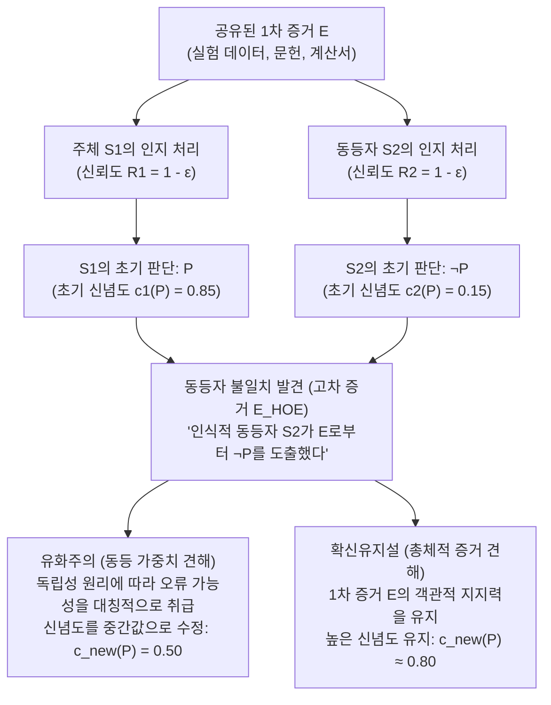
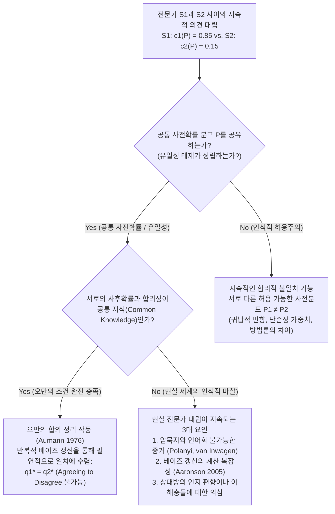

## 1. 서론: 합리적 불일치의 충격과 ‘인식적 핑계’의 소멸

일상생활에서부터 임상의학, 거시경제 정책, 법정의 사실인정, 최첨단 과학, 그리고 철학적 논쟁에 이르기까지 우리는 끊임없이 타인과의 <strong>의견 불일치(Disagreement)</strong>에 직면한다. 대다수의 일상적 논쟁에서 타인이 나와 다른 의견을 가진다는 사실은 우리의 확신을 크게 흔들지 못한다. 왜냐하면 우리에게는 대칭성을 깨뜨릴 수 있는 편리한 ‘인식적 핑계’가 늘 준비되어 있기 때문이다. “상대방은 아직 최신 실험 데이터를 읽지 못했어”, “그 사람은 통계적 추론 훈련이 부족해”, 혹은 “저 사람은 정치적·경제적 이해관계(인지 편향)에 눈이 멀었어”라고 생각하며 상대를 <strong>인식적 열위자(Epistemic Inferior)</strong>로 분류할 수만 있다면, 내 원래 신념을 유지하는 것은 아주 쉬운 일이다.

그러나 만약 이 모든 안락한 핑계가 완전히 사라진다면 어떻게 될까?

당신과 당신의 동료가 같은 전문 분야에서 10년 동안 똑같은 수준의 훈련을 받고, 동일한 1차 문헌과 실험 데이터 및 수학적 증명(공유된 증거 집합 $E$)을 샅샅이 검토했다고 가정해 보자. 당신은 오랜 협업을 통해 그 동료가 지성, 논리적 엄밀성, 학문적 정직성, 주의력, 편향으로부터의 자유로움 등 모든 면에서 당신과 완전히 대등하다는 사실을 잘 알고 있다. 현대 <strong>사회인식론(Social Epistemology)</strong>의 전문 용어로 이 동료는 당신의 <strong>인식적 동등자(Epistemic Peer, $\text{Peer}(S_1, S_2)$)</strong>이다.

그런데 동일한 증거 $E$를 독립적으로 면밀히 분석한 결과, 당신은 명제 $P$가 참이라고 강하게 확신(주관적 확률 즉 신념도 $c_1(P) = 0.85$)한 반면, 당신의 인식적 동등자는 정반대의 결론인 $\neg P$에 도달($c_2(P) = 0.15$)했다는 사실이 밝혀졌다.

인식적 동등자와의 불일치를 발견한 바로 이 순간, <strong>인식적 합리성(Epistemic Rationality)은 당신에게 무엇을 요구하는가?</strong>

1. <strong>유화주의 / 동등 가중치 견해(Conciliationism / The Equal Weight View)</strong>: 당신과 동등자가 증거 $E$를 평가하는 신뢰성이 동일하고 두 사람 중 적어도 한 명이 이번에 인지적 오류를 범했다면, 단지 그 판단이 ‘나의 것’이라는 이유만으로 특권을 부여하는 것은 독단주의(Dogmatism)이다. 합리성은 당신이 $P$에 대한 확신도를 대폭 낮추어 상대방과의 중간 지점($c_{\text{new}}(P) = 0.50$, 즉 판단 보류)으로 타협할 것을 명령한다.
2. <strong>확신유지설 / 비유화주의(The Steadfast View / Non-Conciliationism)</strong>: 비록 동등자가 반대 의견을 제시하더라도, 만약 1차 증거 $E$가 객관적으로 명제 $P$를 지지하고 있고 당신이 실제로 올바른 추론을 통해 $P$에 도달했다면, 타인의 일시적 인지적 맹점 때문에 자신의 정당화된 신념을 포기할 의무는 없다. 당신은 불일치를 인정하면서도 $P$에 대한 높은 확신을 합리적으로 유지할 수 있다.

2000년대 중반 이후 리처드 펠드먼(Richard Feldman), 데이비드 크리스텐슨(David Christensen), 애덤 엘가(Adam Elga), 토머스 켈리(Thomas Kelly), 제니퍼 래키(Jennifer Lackey), 미리엄 쇤필드(Miriam Schoenfield) 등 현대 분석철학의 핵심 인식론자들이 치열하게 격돌해 온 <strong>‘불일치의 인식론(The Epistemology of Disagreement)’</strong>은 지식과 정당화의 본질을 묻는 가장 핵심적인 논쟁이다.

---

## 2. ‘인식적 동등자’의 엄밀한 정의와 증거의 이중 구조

### 2.1 증거적 동등성과 인지적 동등성

토머스 켈리(Kelly 2005, *"The Epistemic Significance of Disagreement"*)와 펠드먼(Feldman 2007)의 고전적 정의에 따르면, 두 인식 주체 $S_1$과 $S_2$가 명제 $P$에 관해 <strong>인식적 동등자($\text{Peer}(S_1, S_2, P)$)</strong>라는 것은 다음 두 가지 대칭성 조건을 동시에 만족함을 의미한다.

1. <strong>증거적 동등성(Evidential Equality)</strong>: $S_1$과 $S_2$는 명제 $P$의 진리값과 관련된 완전히 동일한 1차적·실질적 증거 집합 $E$를 공유한다($E_1 = E_2 = E$). 어느 한쪽만 비밀 데이터를 독점하는 정보 비대칭성이 존재하지 않는다.
2. <strong>인지적 동등성(Cognitive Equality)</strong>: $S_1$과 $S_2$는 증거 $E$를 처리하고 평가하는 데 필요한 일반적 인지 능력(지능, 추론의 치밀함, 배경 훈련)과 인식적 덕성(성실성, 개방성, 확증 편향으로부터의 자유)에서 동등하다. 즉 해당 영역에서의 과거 적중률과 일반적 신뢰도가 $R(S_1) \approx R(S_2)$를 만족한다.

### 2.2 1차 증거($E$)와 고차 증거($E_{\text{HOE}}$)

동등자 불일치를 해부하는 핵심 도구는 <strong>1차 증거(First-Order Evidence, $E$)</strong>와 <strong>고차 증거(Higher-Order Evidence, $E_{\text{HOE}}$)</strong>의 구분이다(Christensen 2010; Kelly 2010).

- <strong>1차 증거 $E$</strong>: 세계의 사태 및 명제 $P$의 진리값에 직접 관련되는 증거(예: 환자의 혈액 검사 수치와 CT 영상, 거시경제 시계열 데이터, 식당 계산서에 찍힌 금액).
- <strong>고차 증거 $E_{\text{HOE}}$</strong>: 명제 $P$ 자체가 아니라, <strong>“1차 증거 $E$가 명제 $P$를 어느 정도로 지지하는가” 혹은 “주체 $S$가 증거 $E$를 올바르게 평가할 수 있는 인지적 상태에 있었는가(자신의 인지적 신뢰성)”에 관한 메타 수준의 증거</strong>이다.

크리스텐슨(2010)의 유명한 <strong>‘추론 왜곡 약물 사례’</strong>를 생각해 보자. 당신이 복잡한 수학 정리 $P$의 증명(1차 증거 $E$)을 마치고 $P$가 참임을 $99\%$ 확신했다. 그런데 직후 의사로부터 “방금 마신 커피에 자각 증상 없이 논리적 착각을 일으켜 잘못된 증명을 올바른 증명으로 믿게 만드는 약물이 들어 있었다”는 말을 들었다. 이 정보는 수학 정리 $P$ 자체의 진리값과는 무관하지만, 내가 1차 증거 $E$를 제대로 처리했는지를 뒤흔드는 강력한 <strong>고차 패배인(Undermining Defeater, $E_{\text{HOE}}$)</strong>으로 작용하여 $P$에 대한 확신도를 대폭 낮추게 만든다.

인식적 동등자가 나와 정반대의 결론($\neg P$)을 내렸다는 사실을 발견하는 것은 전형적인 <strong>고차 증거 $E_{\text{HOE}}$의 획득</strong>이다. 그것은 동등한 신뢰도를 가진 두 인지 시스템($S_1, S_2$) 중 적어도 하나가 이번 시행에서 수행 오류(Performance Error)를 범했음을 알려주는 메타 증거이기 때문이다.

---

## 3. 유화주의 진영: 레스토랑 더치페이 사례, 동등 가중치 견해, 독립성 원리

### 3.1 크리스텐슨의 ‘레스토랑 더치페이 사례’(2007)

데이비드 크리스텐슨은 *"Epistemology of Disagreement: The Good News"*(2007)에서 유화주의적 직관을 강력히 일깨우는 <strong>레스토랑 계산서 사례(The Restaurant Check Case)</strong>를 제시했다.

> <strong>【사고실험: 레스토랑 더치페이】</strong>
> 다섯 명의 친구가 저녁 식사를 마치고 식대에 $20\%$의 팁을 더한 총액을 5등분하기로 했다. 암산 능력과 주의력이 완전히 대등한 당신과 친구(인식적 동등자)는 똑같은 계산서($E$)를 보고 머릿속으로 1인당 부담액을 계산했다. 당신은 1인당 <strong>$43$달러</strong>라고 확신($c_1(P) = 0.95$)한 반면, 친구는 1인당 <strong>$45$달러</strong>라고 똑같이 확신에 차서 말했다($c_2(P) = 0.05$).

이 상황에서 만약 당신이 “내가 계산해 보니 정답은 $43$달러다. 친구는 $45$달러라고 했으니 이번에 친구가 암산 실수를 한 것이 분명하다. 따라서 친구의 말은 무시하고 나는 계속 $43$달러라는 데 $95\%$의 확신을 유지하겠다”라고 추론한다면, 이는 명백히 불합리하고 독단적인 태도이다. 누가 실수했는지 알려주는 독립적인 근거가 없는 이상, 당신은 $43$달러에 대한 확신도를 즉시 $0.50$ 부근으로 낮추어야 한다.

### 3.2 엘가의 ‘동등 가중치 견해’와 베이즈 선형 풀링

애덤 엘가(Elga 2007, *"Reflection and Disagreement"*)는 이를 일반화하여 <strong>동등 가중치 견해(The Equal Weight View)</strong>를 정식화했다. 동등자와의 불일치가 발생하면 자신의 초기 판단과 상대의 초기 판단에 똑같은 가중치($w_1 = w_2 = \frac{1}{2}$)를 부여해 선형 평균(Linear Pooling)해야 한다는 것이다.

$$c_{\text{new}}(P) = \frac{1}{2} c_1(P) + \frac{1}{2} c_2(P)$$

표준적인 베이즈 조건화 모형에서도 동일한 결과가 도출된다. 명제 $P$의 사전확률을 $\mathbb{P}(P) = p_0$라 하고, 두 주체 $S_1, S_2$가 증거 $E$를 올바르게 판별할 신뢰도를 모두 $1 - \varepsilon$(오류율 $\varepsilon \in (0, 1/2)$)이라 하자. $S_1$은 $D_1 = P$, $S_2$는 $D_2 = \neg P$라고 판단한 불일치 사건 $D$가 주어졌을 때 $P$의 사후확률은 다음과 같다.

$$\mathbb{P}(P \mid D_1 = P, D_2 = \neg P) = \frac{p_0 (1 - \varepsilon)\varepsilon}{p_0 (1 - \varepsilon)\varepsilon + (1 - p_0)\varepsilon(1 - \varepsilon)} = p_0$$

분자와 분모에서 $(1 - \varepsilon)\varepsilon$ 항이 완벽히 약분되어 사라진다! 즉 $S_1$의 판단이 갖는 긍정적 증거 가치와 $S_2$의 판단이 갖는 부정적 증거 가치가 정확히 상쇄(Cancel Out)되어 사후확률은 원래의 사전확률 $p_0$(대칭적일 경우 $0.50$)로 되돌아가며, 이는 펠드먼(Feldman 2006)이 주장한 <strong>판단 보류(Suspension of Judgment)</strong>와 정확히 일치한다.

### 3.3 크리스텐슨의 ‘독립성 원리(Independence Principle)’

자신의 원래 추론을 근거로 상대방을 격하하려는 유혹을 차단하기 위해 크리스텐슨(Christensen 2009, 2011)은 핵심 규범인 <strong>독립성 원리</strong>를 제시했다.

> <strong>【독립성 원리(Independence)】</strong>
> 명제 $P$에 관한 내 신념을 어떻게(혹은 과연) 수정할지 결정하기 위해 타인이 표명한 $P$에 관한 신념의 인식적 자격을 평가할 때, <strong>내 자신의 초기 신념 $P$의 배후에 있는 추론 그 자체에 의존해서는 안 된다</strong>.

만약 독립성 원리를 어기면 “내 추론에 따르면 $P$가 참이다 $\rightarrow$ 그러므로 $\neg P$라고 말하는 상대방이 이번에 틀렸다 $\rightarrow$ 그러므로 상대방의 반론은 무시해도 된다”라는 악순환적 <strong>논점 선취(Epistemic Begging the Question)</strong>에 빠지게 되며, 이는 길버트 하먼과 솔 크립키가 분석한 <strong>독단주의 역설(The Dogmatism Paradox)</strong>과 동일한 오류이다.

---

## 4. 확신유지설 진영: 총체적 증거설, 개인적 정보의 비대칭성, 자기논박 역설

### 4.1 토머스 켈리의 ‘총체적 증거설(The Total Evidence View)’

토머스 켈리(Kelly 2005, 2010)는 동등 가중치 견해가 고차 심리적 증거($E_{\text{HOE}}$)로 하여금 1차 증거 $E$의 객관적 지지력을 완전히 <strong>삼켜버리게(Swamp / Screen Off)</strong> 만든다고 비판한다.

만약 공유된 1차 증거 $E$가 객관적으로 $P$를 강력히 지지하고 있고 $S_1$이 이를 정확히 파악한 반면 $S_2$가 추론 실수를 범했다면, 불일치 발견 후 $S_1$이 가진 <strong>총체적 증거(Total Evidence, $E_{\text{total}}$)</strong>는 다음 세 요소로 구성된다.

$$E_{\text{total}} = \underbrace{E}_{\text{실질적 1차 증거}} \cup \underbrace{\{S_1\text{이 } E\text{에 기초해 } P\text{라 판단함}\}}_{\text{고차 심리적 사실 1}} \cup \underbrace{\{S_2\text{가 } E\text{에 기초해 } \neg P\text{라 판단함}\}}_{\text{고차 심리적 사실 2}}$$

켈리는 두 개의 ‘고차 심리적 사실’은 대칭적이지만, <strong>첫 번째 요소인 1차 증거 $E$ 자체는 결코 대칭적이지 않다</strong>고 지적한다! $E$는 여전히 $\neg P$가 아니라 $P$를 가리키고 있다. 따라서 고차 증거를 반영해 확신도를 약간 낮추더라도(예: $0.90$에서 $0.75 \sim 0.80$으로), 1차 증거 $E$의 힘이 살아있는 이상 $0.50$까지 후퇴할 필요가 없다는 것이다.

### 4.2 제니퍼 래키의 ‘정당화주의 견해(Justificationist View)’와 극단적 사례

제니퍼 래키(Lackey 2010)는 <strong>극단적 사례(Extreme Cases)</strong>를 통해 무제한적 독립성 원리의 부조리함을 폭로한다. 20년간 완벽히 성실하고 이성적이었던 동료 해리가 당신 앞에서 진지하게 “$2 + 2 = 5$”라고 주장하거나, 바로 눈앞의 의자에 앉아 커피를 마시고 있는 친구 사라를 보며 “사라는 이 방에 없다”고 주장한다고 해보자.

독립성 원리를 기계적으로 적용하면, 해리가 미쳤는지 판단할 때 “내 눈에 사라가 보인다”거나 “$2+2=4$이다”라는 초기 근거를 사용할 수 없으므로, 당신은 사라가 눈앞에 있다는 사실이나 $2+2=4$라는 사실에 대해 $50\%$의 회의주의에 빠져야 한다! 래키는 우리가 자기 자신의 현재 인지 상태(깨어 있음, 약물을 복용하지 않음, 시력이 정상임, 장난치지 않음)에 대해 방대한 1인칭 내성적 <strong>개인적 정보(Personal Information)</strong>를 직접 갖고 있는 반면, 타인의 내면 상태에 대해서는 3인칭 귀납적 추론만 가능하다는 비대칭성을 지적한다. 초기 정당화의 정도가 압도적으로 높고 개인적 정보가 뒷받침될 때 확신 유지는 완전히 합리적이다.

### 4.3 유화주의의 ‘자기논박 / 자기약화 역설(Self-Defeat Objection)’

유화주의에 대한 가장 치명적인 메타 반박은 <strong>자기약화 역설(Self-Undermining Paradox)</strong>이다(Elga 2010; Kelly 2005).

1. 명제 $C$를 “유화주의는 참이다”라고 하자.
2. 현대 분석인식론계에서 동일한 논증을 연구한 최정상급 인식론자들(인식적 동등자들)은 $C$의 진위를 두고 반으로 갈라져 있다.
3. 따라서 만약 유화주의 $C$가 옳다면, 유화주의자는 $\neg C$를 믿는 인식적 동등자들 앞에서 <strong>자기 자신의 이론 $C$에 따라 유화주의 $C$ 자체에 대한 확신도를 대폭 낮추어야 한다(유화주의에 대해 불가지론자가 되어야 한다)!</strong>

애덤 엘가(Elga 2010, *"How to Disagree about How to Disagree"*)는 이를 피하기 위해 모든 근본적인 인식 규칙은 자기 자신의 정당성에 대해서만큼은 독단적이어야 한다는 <strong>‘독단적 유화주의(Dogmatic Conciliationism)’</strong>를 제안했으나, 확신유지론자들은 왜 인식론적 메타 규칙에만 그러한 예외적 특권이 허용되어야 하는지 강하게 비판한다.

---

## 5. 메타인식론적 심층 대립: 유일성 테제 vs. 인식적 허용주의

- <strong>유일성 테제(The Uniqueness Thesis — Feldman 2007; Roger White 2005)</strong>: 주어진 전체 증거 집합 $E$와 명제 $P$에 대해, 최대로 합리적인 신념적 태도(또는 정확한 신념도 $c(P \mid E)$)는 <strong>기껏해야 단 하나뿐</strong>이다. 로저 화이트(White 2005)는 만약 동일한 증거 $E$에서 $P$를 도출하는 기준 $R_1$과 $\neg P$를 도출하는 기준 $R_2$가 똑같이 합리적이라면, 우연히 자신이 배운 기준 $R_1$을 따라 $P$를 믿는 것은 <strong>‘마법의 신념 캡슐(Magical Pill)’</strong>을 무작위로 삼키고서 그 결과를 진리라고 믿는 것만큼이나 자의적(Arbitrary)이라고 논증한다.
- <strong>인식적 허용주의(Epistemic Permissivism — Gideon Rosen 2001; Miriam Schoenfield 2014)</strong>: 복잡한 증거 집합 $E$에 대해서는 합리적으로 허용 가능한 <strong>복수의 사전확률 분포 가족 $\{\mathbb{P}_\theta\}_{\theta \in \Theta}$(혹은 인식적 기준들)</strong>이 존재한다. 미리엄 쇤필드(Schoenfield 2014, *"Permission to Believe"*)는 어떠한 인식 주체도 자신의 인식적 기준 바깥(‘신의 관점’)으로 걸어 나와 기준들을 중립적으로 비교할 수 없으며, 오직 자신의 내적으로 정합적인 기준 $R_1$의 빛에 비추어 세계를 평가할 수밖에 없음을 보여준다. 따라서 허용주의 하에서는 두 동등자 모두 아무런 추론 오류를 범하지 않고 각자의 확신을 유지하는 <strong>‘결함 없는 불일치(Faultless Disagreement)’</strong>가 성립한다.

| 비교 차원 | 동등 가중치 견해 (엄격한 유화주의) | 총체적 증거설 (온건한 확신유지) | 정당화주의 견해 (비대칭 하이브리드) | 허용주의적 확신유지 (근본적 확신유지) |
| :--- | :--- | :--- | :--- | :--- |
| <strong>대표 학자</strong> | D. Christensen, A. Elga, R. Feldman | Thomas Kelly (2010) | Jennifer Lackey (2010) | G. Rosen, M. Schoenfield, P. van Inwagen |
| <strong>메타인식론적 전제</strong> | 강한 유일성 테제 (Uniqueness) | 객관적 증거 지지 관계 | 맥락 민감성 (개인적 정보의 비대칭성) | 인식적 허용주의 (Permissivism) |
| <strong>독립성 원리의 지위</strong> | 엄격히 준수 (초기 추론 의존 금지) | 기각 또는 제한 (1차 증거 $E$의 힘 유지) | 높은 초기 정당화와 개인적 정보 시 돌파 | 자신의 허용 가능한 기준 $R_1$ 사용 정당화 |
| <strong>$E$와 $E_{\text{HOE}}$의 상호작용</strong> | $E_{\text{HOE}}$가 $E$의 비대칭성을 상쇄 | $E$와 $E_{\text{HOE}}$를 모두 $E_{\text{total}}$에 합산 | 초기 정당화 강도에 따라 가중치 이동 | 각자의 기준 $R_i$를 통해 $E$가 $P$를 지속 지지 |
| <strong>레스토랑 암산 사례 판결</strong> | 정확히 절충 ($c_{\text{new}} = 0.50$) | 대폭 양보 (암산 과정은 불투명하므로) | 대폭 양보 (개인적 정보로 암산 실수 배제 불가) | 대폭 양보 (산술에는 유일한 규칙이 존재) |
| <strong>복잡한 과학·철학 논쟁 판결</strong> | 판단 보류 (불가지론) | 올바르게 추론한 주체는 높은 확신 유지 | 깊이 검증된 신념이라면 확신 유지 가능 | 양측 모두 합리적으로 확신 유지 가능 |

---

## 6. 게임이론과 베이즈 인식론: 로버트 오만의 ‘합의 정리(Agreement Theorem)’

철학의 동등자 불일치 논쟁은 노벨 경제학상 수상자 <strong>로버트 오만(Robert J. Aumann)</strong>이 1976년 논문 *"Agreeing to Disagree"*에서 증명한 <strong>오만의 합의 정리(Aumann's Agreement Theorem)</strong>와 완벽한 수리적 쌍대성을 이룬다.

### 6.1 오만의 합의 정리(1976)의 정식화와 증명

확률공간 $(\Omega, \mathcal{F}, \mathbb{P})$에서 두 베이즈 주체 $S_1, S_2$가 <strong>공통 사전확률 분포(Common Prior)</strong> $\mathbb{P}$를 공유하고, 각자 세계의 상태 $\Omega$에 대한 사적 정보 분할(Partitions) $\mathcal{P}_1, \mathcal{P}_2$를 관측한다고 하자. 사건 $A \in \mathcal{F}$에 대한 두 주체의 사후확률은 다음과 같다.

$$q_1(\omega) = \mathbb{P}(A \mid \mathcal{P}_1(\omega)), \quad q_2(\omega) = \mathbb{P}(A \mid \mathcal{P}_2(\omega))$$

> <strong>【오만의 합의 정리(Aumann 1976)】</strong>
> 만약 세계의 실제 상태 $\omega^* \in \Omega$에서 “$q_1(\omega) = a$이고 $q_2(\omega) = b$이다”라는 사실이 두 주체 사이에 <strong>공통 지식(Common Knowledge)</strong>이 된다면, 필연적으로 다음이 성립한다.
> $$a = b \quad (q_1 = q_2)$$

<strong>증명 핵심</strong>: 공통 지식 사건 $C = \{q_1 = a \cap q_2 = b\}$는 $\mathcal{P}_1$과 $\mathcal{P}_2$의 공통 세분(Meet)에 속하므로, $\mathcal{P}_1$의 서로소인 셀들의 합집합 $C = \bigsqcup_i P_{1,i}$로 표현된다. 각 셀 위에서 $\mathbb{P}(A \mid P_{1,i}) = a$이므로 모두 더하면 $\mathbb{P}(A \cap C) = a\mathbb{P}(C)$이다. 대칭적으로 $\mathcal{P}_2$의 셀들로 분해하면 $\mathbb{P}(A \cap C) = b\mathbb{P}(C)$를 얻는다. $\mathbb{P}(C) > 0$이므로 즉시 <strong>$a = b$</strong>가 도출된다!

즉, <strong>공통 사전확률을 공유하는 베이즈 합리적 주체들은 ‘의견이 다르다는 데 합의하는 것(Agree to disagree)’이 논리적으로 불가능하다</strong>.

### 6.2 현실의 전문가들은 왜 합의로 수렴하지 않는가?

오만의 정리는 기후 모델링, 종양학, 통화 정책, 인공지능 안전성 등에서 전문가들의 의견이 수렴하지 않는 이유를 정확히 진단해 준다.
1. <strong>공통 사전확률의 부재(인식적 허용주의)</strong>: 데이터가 이론을 과소결정하는 최전선 영역에서 연구자들은 서로 다른 귀납적 사전분포($\mathbb{P}_1 \neq \mathbb{P}_2$)를 사용한다.
2. <strong>암묵지(Tacit Knowledge)와 전달 불가능한 통찰(van Inwagen 1996)</strong>: 숙련된 전문가의 증거 중 상당 부분은 수십 년간 축적된 비명제적 직관과 패턴 인식으로, 논문이나 언어로 $100\%$ 직렬화하여 전달할 수 없다($E_1 \neq E_2$).
3. <strong>합의의 계산 복잡성(Scott Aaronson 2005, *"The Complexity of Agreement"*)</strong>: 스콧 애런슨이 증명했듯이, 상대방의 사후확률 $q_2$를 듣고 자신의 신념을 정확히 갱신하려면 상대방의 전체 세계 모형 함수를 역산해야 하는데, 이는 고차원 공간에서 계산적으로 불가능(NP-hard)하다.

---

## 7. 결론: 독단주의와 무기력한 회의주의를 넘어서

“같은 지식을 가진 상대와 의견이 갈릴 때 내 확신을 낮추어야 하는가?”에 대한 현대 인식론의 해답은 정교한 영역 구분(Domain Calibration)을 요구한다. 암산이나 정형화된 사실 확인처럼 일시적 수행 오류가 원인인 <strong>‘레스토랑 계산서 영역’</strong>에서는 크리스텐슨과 엘가의 유화주의에 따라 즉시 확신을 낮추고 재검산해야 한다. 반면 복잡한 과학적·철학적 종합이 요구되는 <strong>‘열린 해석 영역’</strong>에서는 기계적으로 $50\%$의 불가지론으로 후퇴하기보다, 1차 증거의 객관적 무게를 유지하면서 동등자의 반론을 자신의 암묵적 전제를 성찰하는 강력한 <strong>고차 증거(자체 감사 신호)</strong>로 삼는 지적 겸손과 지적 용기의 균형이 필요하다.
