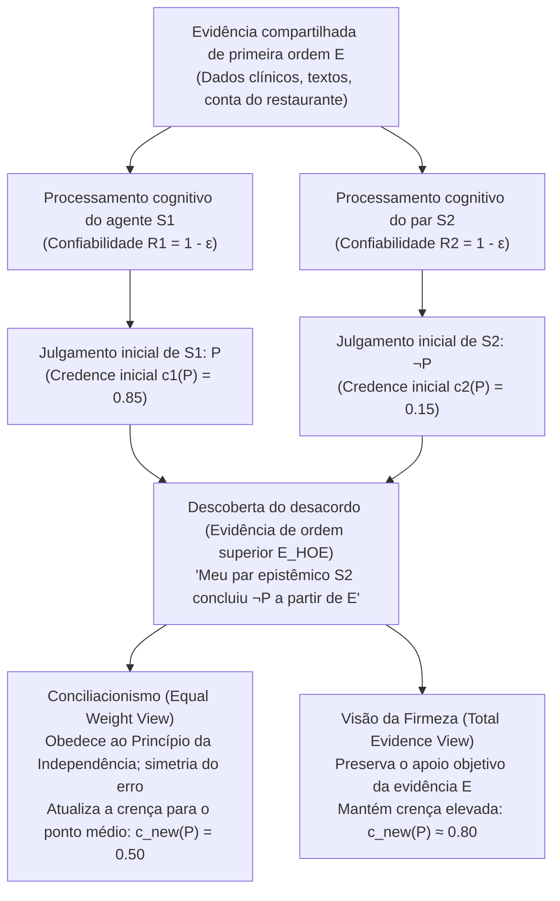
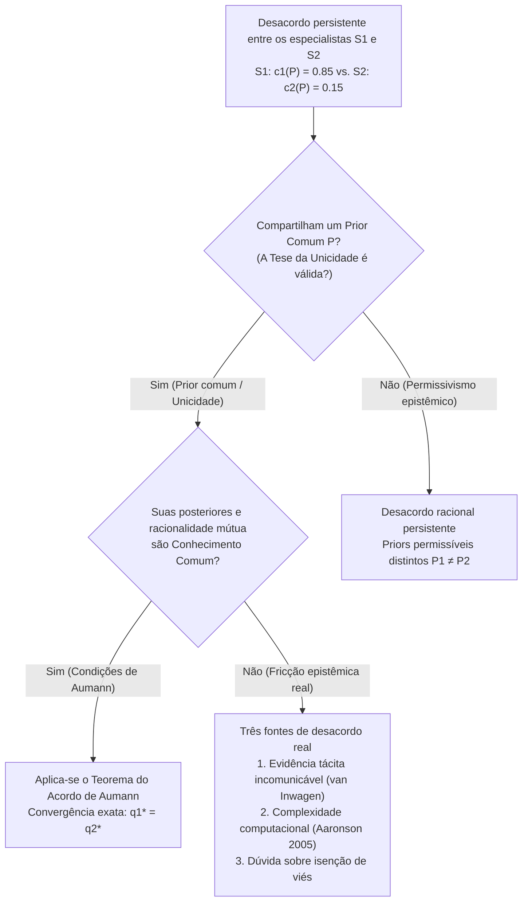

## 1. Introdução: O Choque do Desacordo Racional e o Fim das Desculpas Epistêmicas

Na vida cotidiana, na medicina clínica, na jurisprudência, na política macroeconômica, nas ciências empíricas e na própria filosofia, deparamo-nos constantemente com pessoas que rejeitam nossas convicções mais cuidadosamente refletidas. Na grande maioria das disputas comuns, descobrir que alguém discorda de nós não abala nossa confiança porque dispomos de explicações convenientes que quebram a simetria — verdadeiras «desculpas epistêmicas». Dizemos a nós mesmos que nosso interlocutor não leu os estudos mais recentes, carece de treinamento estatístico rigoroso ou está cego por um viés ideológico ou financeiro. Sempre que podemos classificar nosso oponente como um <strong>inferior epistêmico (Epistemic Inferior)</strong> em relação à questão em pauta, manter nossa crença inicial parece natural.

Mas o que acontece quando todas essas desculpas reconfortantes desaparecem?

Suponha que você e uma colega trabalhem lado a lado há dez anos no mesmo campo científico ou filosófico. Vocês examinaram exatamente o mesmo corpo de literatura primária, os mesmos dados experimentais e as mesmas demonstrações matemáticas (um conjunto compartilhado de evidências $E$). Além disso, você sabe com certeza que sua colega se iguala a você em inteligência, rigor analítico, honestidade intelectual, atenção e imparcialidade. No vocabulário técnico da <strong>Epistemologia Social (Social Epistemology)</strong> contemporânea, essa colega é seu <strong>par epistêmico ($\text{Peer}(S_1, S_2)$)</strong>.

Após avaliar independentemente a evidência compartilhada $E$, você chega à firme convicção de que a proposição $P$ é verdadeira, atribuindo-lhe um grau de crença (*credence*) de $c_1(P) = 0.85$. Seu par epistêmico, tendo avaliado exatamente a mesma evidência $E$ com igual cuidado, anuncia a conclusão oposta: ela acredita em $\neg P$, atribuindo a $P$ apenas $c_2(P) = 0.15$.

No exato momento em que você descobre esse desacordo entre pares, <strong>o que a racionalidade epistêmica exige que você faça?</strong>

1. <strong>Conciliacionismo / Visão do Peso Igual (Conciliationism / Equal Weight View)</strong>: Como você e seu par são processadores igualmente confiáveis da evidência $E$ e pelo menos um de vocês cometeu um erro cognitivo nesta ocasião, privilegiar seu próprio julgamento apenas porque é *o seu* é uma forma de dogmatismo. Você deve revisar substancialmente sua confiança em direção ao ponto médio ($c_{\text{new}}(P) = 0.50$) e suspender o juízo.
2. <strong>Visão da Firmeza (The Steadfast View / Non-Conciliationism)</strong>: Mesmo diante do desacordo de um par, se a evidência de primeira ordem $E$ apoia objetivamente $P$ e você raciocinou corretamente de $E$ para $P$, você não é obrigado a abandonar uma crença bem fundamentada apenas porque seu par sofreu um ponto cego pontual.

Desde meados dos anos 2000, essa questão — estruturada por Richard Feldman, David Christensen, Adam Elga, Thomas Kelly, Jennifer Lackey e Miriam Schoenfield — ocupa o centro da epistemologia analítica.

---

## 2. Formalizando a Paridade Epistêmica e a Arquitetura da Evidência em Dois Níveis

### 2.1 Igualdade Evidencial e Igualdade Cognitiva

Seguindo Thomas Kelly (2005, *"The Epistemic Significance of Disagreement"*) e Richard Feldman (2007), dois agentes $S_1$ e $S_2$ são <strong>pares epistêmicos</strong> em relação a uma proposição $P$ se satisfazem duas condições de simetria:

1. <strong>Igualdade Evidencial (Evidential Equality)</strong>: $S_1$ e $S_2$ possuem exatamente o mesmo conjunto de evidências substantivas de primeira ordem $E$ relevantes para o valor de verdade de $P$ ($E_1 = E_2 = E$).
2. <strong>Igualdade Cognitiva (Cognitive Equality)</strong>: $S_1$ e $S_2$ são iguais quanto às competências cognitivas gerais (inteligência, rigor lógico, formação na área) e virtudes epistêmicas (honestidade intelectual, abertura mental, isenção de viés) necessárias para avaliar $E$, apresentando confiabilidade equivalente $R(S_1) \approx R(S_2)$.

### 2.2 Evidência de Primeira Ordem ($E$) vs. Evidência de Ordem Superior ($E_{\text{HOE}}$)

O motor analítico do debate reside na distinção entre <strong>Evidência de Primeira Ordem ($E$)</strong> e <strong>Evidência de Ordem Superior ($E_{\text{HOE}}$)</strong> (Christensen 2010; Kelly 2010):

- <strong>Evidência de Primeira Ordem ($E$)</strong>: Evidência que incide diretamente sobre a verdade da proposição $P$ no mundo (dados clínicos, séries macroeconômicas, manuscritos históricos ou os números de uma conta de restaurante).
- <strong>Evidência de Ordem Superior ($E_{\text{HOE}}$)</strong>: Meta-evidência sobre *a confiabilidade do nosso próprio funcionamento cognitivo ao processar $E$* ou sobre se $E$ realmente sustenta $P$.

No clássico <strong>caso da droga distorcedora da razão</strong> (Christensen 2010), se um médico lhe informa que seu café da manhã continha uma substância que induz alucinações lógicas indetectáveis em $80\%$ dos indivíduos logo após você deduzir um teorema $P$ a partir de axiomas $E$, esse testemunho não refuta diretamente o teorema matemático $P$, mas atua como um <strong>derrotador solapador de ordem superior ($E_{\text{HOE}}$)</strong> que exige reduzir drasticamente sua confiança. Descobrir que um par epistêmico concluiu $\neg P$ a partir de $E$ funciona exatamente como evidência de ordem superior de que pelo menos um dos dois sistemas cognitivos sofreu uma falha de desempenho.

---

## 3. O Campo Conciliacionista: A Conta do Restaurante, Peso Igual e Independência

### 3.1 O Caso da Conta do Restaurante de David Christensen (2007)

Em *"Epistemology of Disagreement: The Good News"* (2007), David Christensen propôs o famoso experimento mental da <strong>Conta do Restaurante (The Restaurant Check Case)</strong>: cinco amigos jantam juntos e concordam em dividir a conta igualmente acrescentando $20\%$ de gorjeta. Você e sua amiga — tão rápida e precisa quanto você em cálculo mental — examinam a mesma conta ($E$). Você calcula mentalmente que a parte de cada um é <strong>$\$43$</strong> ($c_1(P) = 0.95$), mas sua amiga anuncia com igual confiança que o valor é <strong>$\$45$</strong> ($c_2(P) = 0.05$).

Raciocinar dizendo: *«Eu calculei $\$43$, logo a resposta certa é $\$43$; como minha amiga disse $\$45$, ela errou a conta hoje e continuo $95\%$ seguro»* é flagrantemente irracional e arrogante. Como ambos possuem uma probabilidade simétrica $\varepsilon > 0$ de cometer um deslize mental, a racionalidade exige reduzir sua confiança em $\$43$ para cerca de $50\%$.

### 3.2 A Visão do Peso Igual de Adam Elga e a Agregação Linear Bayesiana

Adam Elga (2007, *"Reflection and Disagreement"*) generalizou essa intuição na <strong>Visão do Peso Igual (Equal Weight View)</strong>, que prescreve uma <strong>agregação linear de opiniões (Linear Opinion Pooling)</strong> com pesos iguais $w_1 = w_2 = \frac{1}{2}$:

$$c_{\text{new}}(P) = \frac{1}{2} c_1(P) + \frac{1}{2} c_2(P)$$

Em um modelo bayesiano com probabilidade a priori $\mathbb{P}(P) = p_0$ onde cada agente tem precisão diagnóstica $1 - \varepsilon$ ($\varepsilon \in (0, 1/2)$), a probabilidade a posteriori de $P$ dado o evento conjunto $\{D_1 = P, D_2 = \neg P\}$ é:

$$\mathbb{P}(P \mid D_1 = P, D_2 = \neg P) = \frac{p_0 (1 - \varepsilon)\varepsilon}{p_0 (1 - \varepsilon)\varepsilon + (1 - p_0)\varepsilon(1 - \varepsilon)} = p_0$$

O fator $(1 - \varepsilon)\varepsilon$ cancela-se perfeitamente no numerador e no denominador, retornando a crença à probabilidade a priori $p_0$ ($0.50$), o que corresponde à <strong>suspensão do juízo</strong> defendida por Richard Feldman (2006).

### 3.3 O Princípio da Independência de Christensen

Para bloquear a desqualificação circular do par, Christensen (2009, 2011) formulou o <strong>Princípio da Independência (Independence Principle)</strong>:

> <strong>[Princípio da Independência (Christensen 2009)]</strong>
> Ao avaliar as credenciais epistêmicas da crença expressa por outra pessoa sobre $P$ para determinar como (ou se devo) modificar minha própria crença sobre $P$, <strong>devo fazê-lo de uma maneira que não dependa do raciocínio por trás da minha crença inicial sobre $P$</strong>.

Violar a Independência equivale a cometer uma petição de princípio epistêmica (*begging the question*), análoga ao <strong>Paradoxo do Dogmatismo</strong> (Harman 1973; Kripke 2011).

---

## 4. O Campo da Firmeza: Evidência Total, Informação Pessoal e Autorrefutação

### 4.1 A Visão da Evidência Total de Thomas Kelly (2010)

Thomas Kelly (2005, 2010) objeta que o conciliacionismo permite que a evidência psicológica de ordem superior ($E_{\text{HOE}}$) <strong>engula ou ofusque (swamp)</strong> a evidência substantiva de primeira ordem $E$. Se $E$ apoia objetivamente $P$, a <strong>evidência total ($E_{\text{total}}$)</strong> de $S_1$ consiste em três elementos:

$$E_{\text{total}} = \underbrace{E}_{\text{Evidência substantiva de 1ª ordem}} \cup \underbrace{\{S_1 \text{ julgou } P \text{ com base em } E\}}_{\text{Fato psicológico 1}} \cup \underbrace{\{S_2 \text{ julgou } \neg P \text{ com base em } E\}}_{\text{Fato psicológico 2}}$$

Embora os dois fatos psicológicos sejam simétricos, <strong>o primeiro elemento — a própria evidência $E$ — não é simétrico</strong>, pois aponta objetivamente para $P$. Segundo a <strong>Visão da Evidência Total (Total Evidence View)</strong> de Kelly, a presença direta de $E$ impede que a crença racional desabe até $0.50$.

### 4.2 A Visão Justificacionista de Jennifer Lackey e a Autorrefutação

Jennifer Lackey (2010) mostra por meio de <strong>casos extremos</strong> (como quando um colega nega que $2 + 2 = 4$ ou que uma amiga visível está sentada à mesa) que você possui <strong>informação pessoal (Personal Information)</strong> introspectiva de primeira pessoa sobre sua própria sobriedade e alerta cognitivo, o que quebra legitimamente a simetria quando a justificação inicial é altíssima.

Além disso, o conciliacionismo enfrenta a <strong>objeção da autorrefutação (Self-Defeat Objection)</strong> (Elga 2010): visto que os próprios epistemólogos pares discordam sobre a verdade do conciliacionismo $C$, um conciliacionista deveria aplicar $C$ a $C$ e abandonar a confiança no próprio conciliacionismo!

---

## 5. A Divisão Meta-Epistemológica: Tese da Unicidade vs. Permissivismo Epistêmico

- <strong>Tese da Unicidade (Uniqueness Thesis — Feldman 2007; Roger White 2005)</strong>: Dada uma evidência total $E$, existe <strong>no máximo uma</strong> atitude doxástica maximamente racional $c(P \mid E)$. Pelo <strong>argumento da pílula mágica</strong>, White sustenta que manter $P$ se dois padrões $R_1, R_2$ fossem igualmente racionais seria tão arbitrário quanto engolir uma pílula aleatória.
- <strong>Permissivismo Epistêmico (Epistemic Permissivism — Gideon Rosen 2001; Miriam Schoenfield 2014)</strong>: Diante de evidências complexas $E$, existe uma família de distribuições a priori racionalmente permissíveis $\{\mathbb{P}_\theta\}_{\theta \in \Theta}$. Schoenfield (2014) responde que ninguém pode avaliar evidências fora de todo padrão epistêmico; julgado à luz do próprio padrão coerente $R_1$ de $S_1$, $R_1$ é mais conducente à verdade do que $R_2$, tornando possível um <strong>desacordo sem culpa (Faultless Disagreement)</strong>.

| Dimensão Analítica | Equal Weight View (Conciliacionismo estrito) | Total Evidence View (Firmeza moderada) | Justificationist View (Híbrido assimétrico) | Firmeza Permissivista (Firmeza radical) |
| :--- | :--- | :--- | :--- | :--- |
| <strong>Principais Defensores</strong> | D. Christensen, A. Elga, R. Feldman | Thomas Kelly (2010) | Jennifer Lackey (2010) | G. Rosen, M. Schoenfield, P. van Inwagen |
| <strong>Premissa Meta-Epistemológica</strong> | Tese estrita da Unicidade | Apoio evidencial objetivo | Sensível ao contexto (info pessoal) | Permissivismo epistêmico ($\{\mathbb{P}_\theta\}$) |
| <strong>Princípio da Independência</strong> | Estritamente aplicado | Rejeitado / Restrito | Superado com alta justificação inicial | Permite avaliar padrões rivais via $R_1$ |
| <strong>Veredito na Conta do Restaurante</strong> | Dividir a diferença ($c_{\text{new}} = 0.50$) | Conciliação substancial | Conciliar | Conciliar (regra aritmética única) |
| <strong>Veredito em Disputas Científicas/Filosóficas</strong> | Suspender o juízo (agnosticismo) | Quem raciocinou certo mantém alta confiança | Firmeza se profundamente verificado | Ambos os pares podem manter-se firmes |

---

## 6. Teoria dos Jogos e o Teorema do Acordo de Robert Aumann (1976)

Em *"Agreeing to Disagree"* (1976), <strong>Robert J. Aumann</strong> provou em um espaço de probabilidade $(\Omega, \mathcal{F}, \mathbb{P})$ com uma <strong>probabilidade a priori comum (Common Prior)</strong> $\mathbb{P}$ e partições de informação privada $\mathcal{P}_1, \mathcal{P}_2$ que se as probabilidades a posteriori $q_1(\omega) = \mathbb{P}(A \mid \mathcal{P}_1(\omega)) = a$ e $q_2(\omega) = \mathbb{P}(A \mid \mathcal{P}_2(\omega)) = b$ forem <strong>conhecimento comum (Common Knowledge)</strong> em $\omega^* \in C \in \mathcal{P}_1 \wedge \mathcal{P}_2$, então:

$$\mathbb{P}(A \cap C) = a\,\mathbb{P}(C) = b\,\mathbb{P}(C) \implies a = b$$

<strong>Agentes bayesianos com um prior comum não podem concordar em discordar!</strong> Quando especialistas reais persistem em divergir, falha ao menos uma condição de Aumann: (1) ausência de prior comum ($\mathbb{P}_1 \neq \mathbb{P}_2$, permissivismo), (2) evidência tácita e incomunicável (van Inwagen 1996), ou (3) intratabilidade computacional (NP-difícil) ao inverter o modelo mental alheio (Scott Aaronson 2005).

