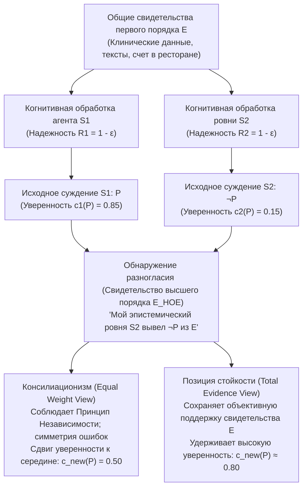
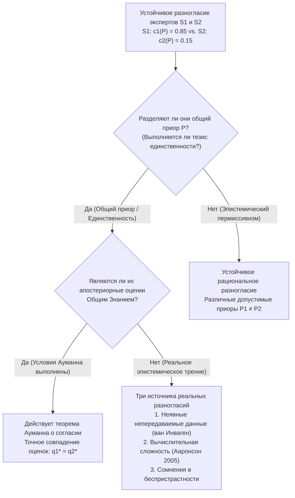

## 1. Введение: Шок рационального разногласия и исчезновение эпистемических оправданий

В повседневной жизни, клинической медицине, юриспруденции, макроэкономической политике, эмпирической науке и самой философии мы постоянно сталкиваемся с людьми, отвергающими наши самые взвешенные убеждения. В подавляющем большинстве обычных споров обнаружение несогласия не колеблет нашей уверенности, поскольку у нас наготове есть удобные объяснения, нарушающие симметрию, — своего рода «эпистемические отговорки». Мы говорим себе, что наш оппонент не читал последних исследований, не владеет строгими статистическими методами или ослеплен идеологической и финансовой предвзятостью. Пока мы можем классифицировать собеседника как <strong>эпистемически нижестоящего (Epistemic Inferior)</strong> в данном вопросе, сохранять исходное убеждение легко.

Но что происходит, когда все эти утешительные оправдания исчезают?

Представьте, что вы и ваша коллега десять лет работаете бок о бок в одной научной или философской области. Вы изучили один и тот же корпус первоисточников, экспериментальных данных и математических доказательств (общий массив свидетельств $E$). Более того, вы твердо знаете, что коллега не уступает вам в интеллекте, аналитической строгости, интеллектуальной честности, внимательности и беспристрастности. На языке современной <strong>социальной эпистемологии (Social Epistemology)</strong> эта коллега — ваш <strong>эпистемический ровня ($\text{Peer}(S_1, S_2)$)</strong>.

Независимо оценив общие свидетельства $E$, вы приходите к твердому убеждению в истинности суждения $P$, присваивая ему субъективную вероятность (степень уверенности, *credence*) $c_1(P) = 0.85$. Ваша коллега, столь же тщательно проанализировав те же данные $E$, объявляет противоположный вывод: она убеждена в $\neg P$, оценивая вероятность $P$ лишь в $c_2(P) = 0.15$.

В тот самый момент, когда вы обнаруживаете это разногласие с ровней, <strong>чего требует от вас эпистемическая рациональность?</strong>

1. <strong>Консилиационизм / Подход равного веса (Conciliationism / Equal Weight View)</strong>: Поскольку вы и ваш ровня — одинаково надежные интерпретаторы свидетельств $E$, и по крайней мере один из вас допустил когнитивную ошибку в данном случае, отдавать предпочтение собственному суждению только потому, что оно *ваше*, — значит впадать в догматизм. Вы обязаны существенно скорректировать свою уверенность к среднему значению ($c_{\text{new}}(P) = 0.50$) и воздержаться от суждения.
2. <strong>Позиция стойкости (The Steadfast View / Non-Conciliationism)</strong>: Даже перед лицом несогласия ровни, если свидетельства первого порядка $E$ объективно подтверждают $P$ и вы действительно рассуждали правильно от $E$ к $P$, вы не обязаны отказываться от обоснованного убеждения лишь потому, что у вашего коллеги возникло когнитивное слепое пятно.

С середины 2000-х годов эта проблема — сформулированная Ричардом Фельдманом, Дэвидом Кристенсеном, Адамом Элгой, Томасом Келли, Дженнифер Лаки и Мириам Шёнфилд — находится в самом центре аналитической эпистемологии.

---

## 2. Формализация эпистемического равенства и двухуровневая архитектура свидетельств

### 2.1 Эвиденциальное равенство и когнитивное равенство

Следуя Томасу Келли (2005, *"The Epistemic Significance of Disagreement"*) и Ричарду Фельдману (2007), два агента $S_1$ и $S_2$ являются <strong>эпистемическими ровнями</strong> относительно суждения $P$, если выполняются два условия симметрии:

1. <strong>Эвиденциальное равенство (Evidential Equality)</strong>: $S_1$ и $S_2$ располагают строго одинаковым корпусом содержательных свидетельств первого порядка $E$, относящихся к истинности $P$ ($E_1 = E_2 = E$).
2. <strong>Когнитивное равенство (Cognitive Equality)</strong>: $S_1$ и $S_2$ равны по общим когнитивным компетенциям (интеллект, логическая строгость, профессиональная подготовка) и эпистемическим добродетелям (интеллектуальная честность, непредвзятость), необходимым для оценки $E$, т. е. их общая надежность одинакова: $R(S_1) \approx R(S_2)$.

### 2.2 Свидетельства первого порядка ($E$) и свидетельства высшего порядка ($E_{\text{HOE}}$)

Главный аналитический механизм дискуссии основан на различении <strong>свидетельств первого порядка ($E$)</strong> и <strong>свидетельств высшего порядка ($E_{\text{HOE}}$)</strong> (Christensen 2010; Kelly 2010):

- <strong>Свидетельства первого порядка ($E$)</strong> непосредственно касаются истинности суждения $P$ в мире (клинические анализы, макроэкономические ряды, исторические рукописи или цифры в ресторанном счете).
- <strong>Свидетельства высшего порядка ($E_{\text{HOE}}$)</strong> — это мета-свидетельства о *надежности функционирования нашего собственного когнитивного аппарата при обработке $E$* или о том, действительно ли $E$ подтверждает $P$.

В классическом <strong>мысленном эксперименте с препаратом, искажающим мышление</strong> (Christensen 2010), если после вывода теоремы $P$ из аксиом $E$ врач сообщает вам, что в ваш утренний кофе было подмешано вещество, вызывающее у $80\%$ испытуемых незаметные для них самих логические иллюзии, слова врача не опровергают саму математическую теорему $P$, но действуют как мощный <strong>подрывающий дефитер высшего порядка ($E_{\text{HOE}}$)</strong>, обязывающий вас резко снизить уверенность в правильности своего вывода. Обнаружение того, что эпистемический ровня вывел $\neg P$ из $E$, является именно таким свидетельством высшего порядка, указывающим, что по крайней мере одна из двух когнитивных систем дала сбой.

---

## 3. Лагерь консилиационистов: Счет в ресторане, равный вес и принцип независимости

### 3.1 Случай со счетом в ресторане Дэвида Кристенсена (2007)

В статье *"Epistemology of Disagreement: The Good News"* (2007) Дэвид Кристенсен предложил знаменитый мысленный эксперимент — <strong>«Счет в ресторане» (The Restaurant Check Case)</strong>: пятеро друзей ужинают вместе и договариваются разделить счет поровну, добавив $20\%$ чаевых. Вы и ваша подруга — столь же быстро и точно считающая в уме — изучаете один и тот же чек ($E$). Вы в уме получаете <strong>$\$43$</strong> с человека ($c_1(P) = 0.95$), а подруга с такой же уверенностью называет <strong>$\$45$</strong> ($c_2(P) = 0.05$).

Рассуждать так: *«Я насчитал $\$43$, значит, правильный ответ — $\$43$; раз подруга получила $\$45$, она сегодня ошиблась в арифметике, поэтому я остаюсь при уверенности $95\%$»* — явно иррационально и самонадеянно. Поскольку вероятность случайной ошибки в устном счете $\varepsilon > 0$ у вас симметрична, рациональность требует снизить уверенность в ответе $\$43$ примерно до $50\%$.

### 3.2 Подход равного веса Адама Элги и байесовское линейное объединение

Адам Элга (2007, *"Reflection and Disagreement"*) обобщил эту интуицию в <strong>подходе равного веса (Equal Weight View)</strong>, предписывающем <strong>линейное объединение мнений (Linear Opinion Pooling)</strong> с равными весами $w_1 = w_2 = \frac{1}{2}$:

$$c_{\text{new}}(P) = \frac{1}{2} c_1(P) + \frac{1}{2} c_2(P)$$

В стандартной байесовской модели с априорной вероятностью $\mathbb{P}(P) = p_0$, где каждый агент обладает диагностической точностью $1 - \varepsilon$ ($\varepsilon \in (0, 1/2)$), апостериорная вероятность $P$ при совместном событии $\{D_1 = P, D_2 = \neg P\}$ равна:

$$\mathbb{P}(P \mid D_1 = P, D_2 = \neg P) = \frac{p_0 (1 - \varepsilon)\varepsilon}{p_0 (1 - \varepsilon)\varepsilon + (1 - p_0)\varepsilon(1 - \varepsilon)} = p_0$$

Множитель $(1 - \varepsilon)\varepsilon$ полностью сокращается в числителе и знаменателе, возвращая апостериорную вероятность к исходному уровню $p_0$ ($0.50$), что соответствует <strong>воздержанию от суждения</strong> по Ричарду Фельдману (2006).

### 3.3 Принцип независимости Кристенсена

Чтобы заблокировать порочный круг при дисквалификации ровни, Кристенсен (2009, 2011) сформулировал <strong>Принцип независимости (Independence Principle)</strong>:

> <strong>[Принцип независимости (Christensen 2009)]</strong>
> Оценивая эпистемическую надежность выраженного другим человеком убеждения относительно $P$, чтобы решить, как (и нужно ли) изменить собственное убеждение о $P$, <strong>я должен делать это способом, который не опирается на рассуждения, лежащие в основе моего исходного убеждения о $P$</strong>.

Нарушение независимости ведет к эпистемическому предвосхищению основания (*begging the question*), структурно тождественному <strong>парадоксу догматизма</strong> (Harman 1973; Kripke 2011).

---

## 4. Лагерь стойкости: Совокупные свидетельства, личная информация и самоопровержение

### 4.1 Подход совокупных свидетельств Томаса Келли (2010)

Томас Келли (2005, 2010) возражает, что консилиационизм позволяет психологическим свидетельствам высшего порядка ($E_{\text{HOE}}$) полностью <strong>поглотить или заслонить (swamp)</strong> содержательные свидетельства первого порядка $E$. Если $E$ объективно подтверждает $P$, то <strong>совокупные свидетельства ($E_{\text{total}}$)</strong> агента $S_1$ включают три компонента:

$$E_{\text{total}} = \underbrace{E}_{\text{Содержательное свидетельство 1-го порядка}} \cup \underbrace{\{S_1 \text{ вывел } P \text{ на основе } E\}}_{\text{Психологический факт 1}} \cup \underbrace{\{S_2 \text{ вывел } \neg P \text{ на основе } E\}}_{\text{Психологический факт 2}}$$

Хотя два психологических факта симметричны, <strong>первый элемент — само свидетельство $E$ — не симметричен!</strong> Оно объективно указывает на $P$. Согласно <strong>подходу совокупных свидетельств (Total Evidence View)</strong> Келли, прямое наличие $E$ удерживает рациональную уверенность от падения до $0.50$.

### 4.2 Джастификационизм Дженнифер Лаки и проблема самоопровержения

Дженнифер Лаки (2010) на примере <strong>экстремальных случаев</strong> (когда коллега отрицает, что $2 + 2 = 4$, или утверждает, что сидящего перед вами за столом друга нет в комнате) показывает, что у вас есть интроспективная <strong>личная информация (Personal Information)</strong> от первого лица о собственной трезвости и вменяемости, которая законно нарушает симметрию при сверхвысокой исходной обоснованности.

Кроме того, консилиационизм сталкивается с <strong>возражением о самоопровержении (Self-Defeat Objection)</strong> (Elga 2010): поскольку сами ведущие эпистемологи (ровни друг другу) расходятся во мнениях об истинности консилиационизма $C$, консилиационист по собственному правилу $C$ обязан утратить уверенность в самом консилиационизме!

---

## 5. Метаэпистемологический раскол: Тезис единственности против эпистемического пермиссивизма

- <strong>Тезис единственности (Uniqueness Thesis — Feldman 2007; Roger White 2005)</strong>: При данном массиве свидетельств $E$ существует <strong>не более одной</strong> максимально рациональной доксастической установки $c(P \mid E)$. С помощью <strong>аргумента волшебной пилюли</strong> Роджер Уайт доказывает, что если бы два стандарта $R_1, R_2$ были равно рациональны, держаться за $P$ лишь потому, что вы учились в вузе со стандартом $R_1$, было бы столь же произвольно, как принять пилюлю случайных убеждений.
- <strong>Эпистемический пермиссивизм (Epistemic Permissivism — Gideon Rosen 2001; Miriam Schoenfield 2014)</strong>: Для сложных свидетельств $E$ существует целое семейство рационально допустимых априорных распределений $\{\mathbb{P}_\theta\}_{\theta \in \Theta}$. Мириам Шёнфилд (2014) отвечает Уайту, что невозможно оценивать данные из «точки зрения ниоткуда» вне всяких стандартов; с позиции собственного когерентного стандарта $R_1$ агента $S_1$ именно $R_1$ надежнее ведет к истине, чем $R_2$, что делает возможным <strong>безошибочное разногласие (Faultless Disagreement)</strong>.

| Аналитическое измерение | Equal Weight View (Строгий консилиационизм) | Total Evidence View (Умеренная стойкость) | Justificationist View (Асимметричный гибрид) | Пермиссивистская стойкость (Радикальная) |
| :--- | :--- | :--- | :--- | :--- |
| <strong>Главные представители</strong> | Д. Кристенсен, А. Элга, Р. Фельдман | Томас Келли (2010) | Дженнифер Лаки (2010) | Г. Розен, М. Шёнфилд, П. ван Инваген |
| <strong>Метаэпистемологическая посылка</strong> | Строгий тезис единственности | Объективная поддержка свидетельств | Зависимость от контекста (личная инфо) | Эпистемический пермиссивизм ($\{\mathbb{P}_\theta\}$) |
| <strong>Статус принципа независимости</strong> | Строго соблюдается | Отвергается / Ограничен | Преодолевается при высокой обоснованности | Допускает оценку стандартов через свой $R_1$ |
| <strong>Вердикт для счета в ресторане</strong> | Делить пополам ($c_{\text{new}} = 0.50$) | Существенная уступка | Уступить | Уступить (единое правило арифметики) |
| <strong>Вердикт для научных и философских споров</strong> | Воздержание от суждения (агностицизм) | Тот, кто рассуждал верно, сохраняет уверенность | Стойкость при глубокой проверке | Оба ровни могут рационально сохранять стойкость |

---

## 6. Теория игр и теорема Роберта Ауманна о согласии (1976)

В классической работе *"Agreeing to Disagree"* (1976) нобелевский лауреат <strong>Роберт Ауманн</strong> доказал, что если на вероятностном пространстве $(\Omega, \mathcal{F}, \mathbb{P})$ два байесовских агента разделяют <strong>общее априорное распределение (Common Prior)</strong> $\mathbb{P}$, имеют разбиения частной информации $\mathcal{P}_1, \mathcal{P}_2$, и их апостериорные вероятности $q_1(\omega) = \mathbb{P}(A \mid \mathcal{P}_1(\omega)) = a$ и $q_2(\omega) = \mathbb{P}(A \mid \mathcal{P}_2(\omega)) = b$ становятся <strong>общим знанием (Common Knowledge)</strong> в состоянии $\omega^* \in C \in \mathcal{P}_1 \wedge \mathcal{P}_2$, то:

$$\mathbb{P}(A \cap C) = a\,\mathbb{P}(C) = b\,\mathbb{P}(C) \implies a = b$$

<strong>Байесовские агенты с общим приором не могут «согласиться не соглашаться»!</strong> Если же реальные эксперты продолжают спорить, нарушается хотя бы одно условие Ауманна: (1) отсутствие общего приора ($\mathbb{P}_1 \neq \mathbb{P}_2$, пермиссивизм), (2) неявное и непередаваемое знание (ван Инваген 1996) или (3) вычислительная труднорешаемость (#P-трудность) обращения чужой когнитивной модели (Скотт Ааронсон 2005).

