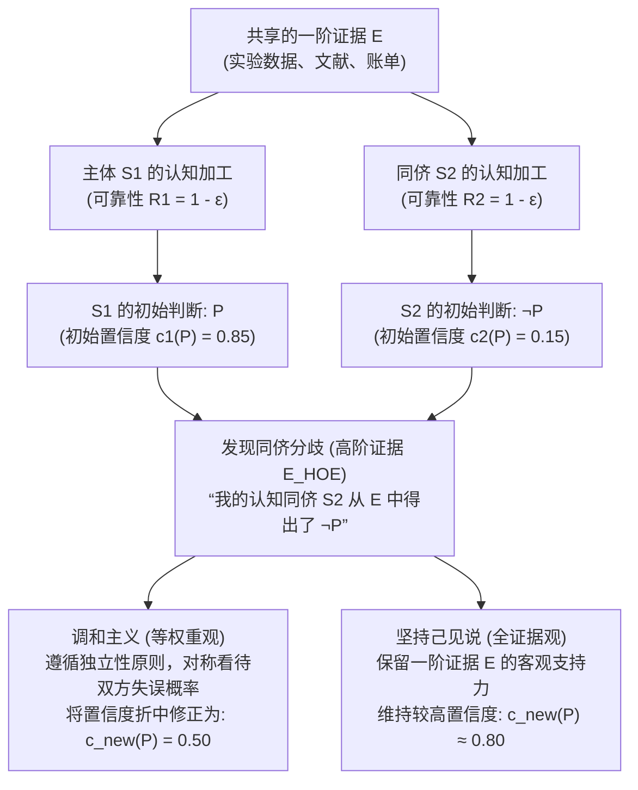
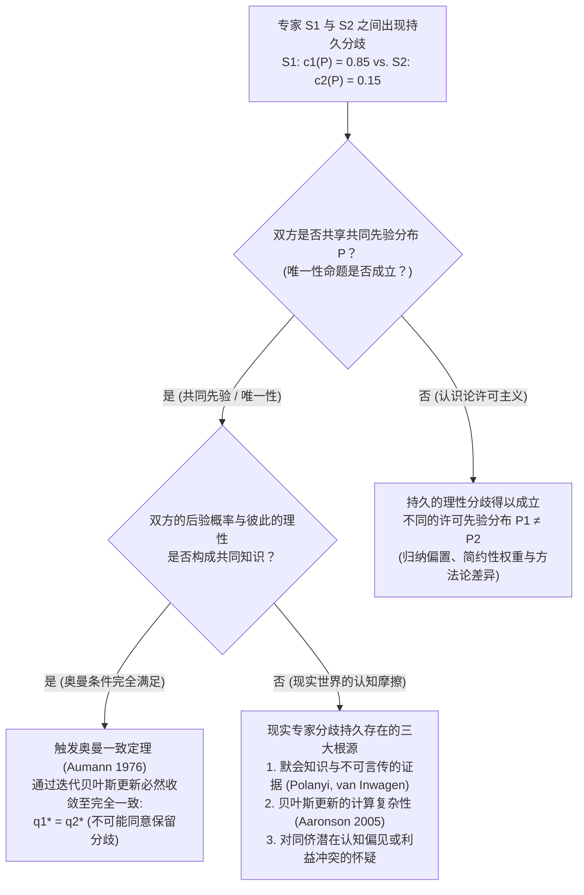

## 1. 导论：理性分歧的冲击与“认知借口”的消失

在日常生活、临床医学、宏观经济政策、司法审判、前沿科学乃至哲学争论中，我们无时无刻不在面对他人的<strong>异议与分歧（Disagreement）</strong>。在绝大多数日常争端中，发现别人不同意我们的观点并不会动摇我们的信心，因为我们手头总有现成的“打破对称性的借口”：“他还没有读过最新的实验数据”、“她缺乏严格的统计学训练”，或者“他受到了意识形态或经济利益的偏见蒙蔽”。只要我们能够合理地将对方归类为当前问题上的<strong>认知劣势者（Epistemic Inferior）</strong>，维持原有信念就显得顺理成章。

然而，如果所有这些令人安心的借口都被彻底剥夺，情况会怎样？

假设你与一位共事十年的同行专家，共同深入研究了完全相同的原始文献、临床试验数据和数学证明（即共享证据集合 $E$）。通过长期的密切合作，你非常清楚这位同事在智力水平、逻辑严密性、学术诚实度、专注力以及免受偏见干扰的程度上与你完全不相上下。用当代<strong>社会认识论（Social Epistemology）</strong>的术语来说，这位同事就是你的<strong>认知同侪（Epistemic Peer, $\text{Peer}(S_1, S_2)$）</strong>。

现在假设，在独立评估了共享证据 $E$ 之后，你坚定地相信命题 $P$ 为真（赋予其主观概率或置信度 $c_1(P) = 0.85$）；而你的认知同侪在对同一证据 $E$ 进行了同样审慎的分析后，却得出了截然相反的结论 $\neg P$（赋予 $P$ 的置信度仅为 $c_2(P) = 0.15$）。

当你得知认知同侪与你意见相左的这一刻，<strong>认识论理性（Epistemic Rationality）要求你如何回应？</strong>

1. <strong>调和主义 / 等权重观（Conciliationism / The Equal Weight View）</strong>：既然你和你的同侪在评估证据 $E$ 时具有同等的可靠性，且至少有一人在此次推理中犯了错，仅仅因为某个判断是“你自己的”就赋予其特权，无疑是认识论上的教条主义（Dogmatism）。理性要求你大幅降低对 $P$ 的自信，向同侪的立场靠拢（折中至 $c_{\text{new}}(P) = 0.50$ 并悬置判断）。
2. <strong>坚持己见说 / 非调和主义（The Steadfast View / Non-Conciliationism）</strong>：即便面对同侪的异议，如果一阶证据 $E$ 在客观上确实支持命题 $P$，且你实际上通过正确的推理掌握了这一支持关系，你并没有义务因为同侪一时的认知盲点而放弃自己有充分依据的信念。你可以在承认分歧的同时，理性地维持对 $P$ 的高置信度。

自2000年代中期以来，由理查德·费尔德曼（Richard Feldman）、大卫·克里斯滕森（David Christensen）、亚当·埃尔加（Adam Elga）、托马斯·凯利（Thomas Kelly）、詹妮弗·拉基（Jennifer Lackey）和米里亚姆·舍恩菲尔德（Miriam Schoenfield）等哲学家推动的<strong>“分歧的认识论（The Epistemology of Disagreement）”</strong>，已成为当代分析哲学最活跃的核心战场。本文将系统剖析这一争论的形式结构、高阶证据机制、元认识论根源以及博弈论中的奥曼一致定理。

---

## 2. “认知同侪”的严格定义与证据的双层架构

### 2.1 证据对等性与认知对等性

遵循托马斯·凯利（Kelly 2005, *"The Epistemic Significance of Disagreement"*）与费尔德曼（Feldman 2007）的经典界定，两个认知主体 $S_1$ 和 $S_2$ 在命题 $P$ 上互为<strong>认知同侪（$\text{Peer}(S_1, S_2, P)$）</strong>，当且仅当同时满足以下两个对称性条件：

1. <strong>证据对等性（Evidential Equality）</strong>：$S_1$ 和 $S_2$ 拥有与命题 $P$ 的真假相关的完全相同的一阶实质性证据集合 $E$（即 $E_1 = E_2 = E$），不存在任何一方独占秘密数据或未公开档案的信息不对称。
2. <strong>认知对等性（Cognitive Equality）</strong>：$S_1$ 和 $S_2$ 在处理和评估 $E$ 类证据所需的一般认知能力（智力、推理严密性、领域背景训练）和认识论美德（诚实、思想开放、免受偏见影响）上处于同一水平。形式化地讲，两人在该领域的历史准确率与一般可靠性满足 $R(S_1) \approx R(S_2)$。

### 2.2 一阶证据（$E$）与高阶证据（$E_{\text{HOE}}$）

理解同侪分歧的关键在于区分<strong>一阶证据（First-Order Evidence, $E$）</strong>与<strong>高阶证据（Higher-Order Evidence, $E_{\text{HOE}}$）</strong>（Christensen 2010; Kelly 2010）：

- <strong>一阶证据 $E$</strong>：直接指向世界事态以及命题 $P$ 真值的证据（如病理切片、宏观经济时间序列、实验观测数据或餐厅账单上的数字）。
- <strong>高阶证据 $E_{\text{HOE}}$</strong>：关于<strong>“一阶证据 $E$ 在多大程度上客观支持 $P$”或“主体 $S$ 在评估 $E$ 时其认知机能是否正常运作”的元证据（Meta-evidence）</strong>。

设想著名的<strong>“损害推理能力的药物案例”</strong>（Christensen 2010）：你刚刚完成了一个复杂的数学定理 $P$ 的证明（一阶证据 $E$），对 $P$ 的置信度高达 $0.99$。随后医生告诉你，你早上喝的咖啡里被人混入了一种新型神经药物，该药物会让 $80\%$ 的受试者在毫无察觉的情况下产生逻辑幻觉，把错误的推导当成严密的证明。医生的话并不直接关乎数学定理 $P$ 本身，但它构成了强有力的<strong>高阶击败因（Undermining Defeater, $E_{\text{HOE}}$）</strong>，迫使你怀疑自己处理一阶证据 $E$ 的可靠性，从而大幅调低对 $P$ 的置信度。

发现认知同侪得出相反结论 $\neg P$，正是一种典型的<strong>高阶证据 $E_{\text{HOE}}$</strong>：它表明在 $S_1$ 与 $S_2$ 这两套同等可靠的认知系统中，至少有一套在本次评估中发生了操作性失误（Performance Error）。

---

## 3. 调和主义阵营：餐厅分账案例、等权重观与独立性原则

### 3.1 克里斯滕森的“餐厅分账案例”（2007）

大卫·克里斯滕森在 *"Epistemology of Disagreement: The Good News"*（2007）中提出了极具说服力的<strong>餐厅分账案例（The Restaurant Check Case）</strong>：

> <strong>【思想实验：餐厅分账】</strong>
> 五位朋友共进晚餐，约定在账单金额上加 $20\%$ 小费后由五人平摊。你和你的朋友（两人的心算能力与专注度完全相当，互为认知同侪）查看了同一张账单 $E$ 并各自在脑海中心算。你算出每人应付 <strong>$43$ 美元</strong>（置信度 $c_1(P) = 0.95$），而你的朋友却自信地宣布每人应付 <strong>$45$ 美元</strong>（$c_2(P) = 0.05$）。

此时，如果你这样推理：“我算出来是 $43$ 美元，所以正确答案就是 $43$ 美元；既然朋友说是 $45$ 美元（$\neq 43$），说明她这次肯定算错了，因此我可以忽略她的意见，继续保持 $95\%$ 的把握认为是 $43$ 美元”——这显然是荒谬且傲慢的。既然双方犯心算错误的概率 $\varepsilon > 0$ 完全对称，在没有独立证据表明是她算错而非你算错的情况下，你必须将对 $43$ 美元的置信度大幅下调至 $0.50$ 左右。

### 3.2 埃尔加的“等权重观”与贝叶斯线性池化

亚当·埃尔加（Elga 2007, *"Reflection and Disagreement"*）将这一直觉上升为普遍的<strong>等权重观（The Equal Weight View）</strong>：面对认知同侪的分歧，你应当赋予同侪的评估与你自己的初始评估完全相等的权重。用概率论中的<strong>线性意见池化（Linear Opinion Pooling）</strong>表示即为：

$$c_{\text{new}}(P) = \frac{1}{2} c_1(P) + \frac{1}{2} c_2(P)$$

在标准贝叶斯条件化模型中，设命题 $P$ 的先验概率为 $\mathbb{P}(P) = p_0$，主体 $S_1, S_2$ 正确评估证据 $E$ 的准确率均为 $1 - \varepsilon$（误判率为 $\varepsilon \in (0, 1/2)$）。当发生分歧事件 $D = \{D_1 = P, D_2 = \neg P\}$ 时，由贝叶斯定理可得：

$$\mathbb{P}(P \mid D_1 = P, D_2 = \neg P) = \frac{p_0 (1 - \varepsilon)\varepsilon}{p_0 (1 - \varepsilon)\varepsilon + (1 - p_0)\varepsilon(1 - \varepsilon)} = p_0$$

分子与分母中的可靠性因子 $(1 - \varepsilon)\varepsilon$ 完全相消！$S_1$ 的判断所提供的正面证据力被 $S_2$ 的相反判断精确抵消，后验概率退回至无信息的先验基准 $p_0$（对称情形下为 $0.50$），对应于费尔德曼所说的<strong>悬置判断（Suspension of Judgment）</strong>。

### 3.3 克里斯滕森的“独立性原则（Independence Principle）”

为了防止人们利用自己的初始推理来强行贬低同侪，克里斯滕森（Christensen 2009, 2011）提出了<strong>独立性原则</strong>：

> <strong>【独立性原则（Independence）】</strong>
> 在评估他人关于命题 $P$ 的信念的认识论资质（以决定是否以及如何修正我自己关于 $P$ 的信念）时，<strong>我必须以一种不依赖于我自己关于 $P$ 的初始信念背后的推理的方式来进行评估</strong>。

如果违背独立性原则，任何主体都可以永远拒绝修正信念：“因为根据我对 $E$ 的推理，$P$ 是真的 $\rightarrow$ 所以主张 $\neg P$ 的同侪这次一定犯了糊涂 $\rightarrow$ 所以我不必理会他的异议。”这种做法与认识论中臭名昭著的<strong>“教条主义悖论（The Dogmatism Paradox）”</strong>（Harman 1973; Kripke 2011）如出一辙，犯了严重的<strong>认识论循环论证（Begging the Question）</strong>错误。要合理地调低同侪的权重，必须依赖<strong>独立于当前争议的理由（Dispute-Independent Reasons）</strong>（例如对方喝醉了、睡眠严重不足或存在经济利益冲突）。

---

## 4. 坚持己见说阵营：全证据观、个人信息的非对称性与自我击败反驳

### 4.1 托马斯·凯利的“全证据观（The Total Evidence View）”

托马斯·凯利（Kelly 2005, 2010）指出，等权重观犯了一个致命的结构性错误：它让关于分歧的高阶心理证据（$E_{\text{HOE}}$）彻底<strong>吞没（Swamp / Screen Off）</strong>了一阶实质性证据 $E$ 本身！

假设一阶证据 $E$ 在客观上确实强烈支持 $P$，且 $S_1$ 正确理解了这一逻辑联系，而 $S_2$ 犯了微妙的推理错误。在发现分歧后，$S_1$ 拥有的<strong>全证据（Total Evidence, $E_{\text{total}}$）</strong>包含三个部分：

$$E_{\text{total}} = \underbrace{E}_{\text{一阶实质证据}} \cup \underbrace{\{S_1 \text{ 基于 } E \text{ 判断 } P\}}_{\text{高阶心理事实 1}} \cup \underbrace{\{S_2 \text{ 基于 } E \text{ 判断 } \neg P\}}_{\text{高阶心理事实 2}}$$

凯利强调，虽然两个“高阶心理事实”是对称的，但<strong>第一个组成部分——一阶证据 $E$ 本身——绝不是对称的！</strong>$E$ 依然客观地指向 $P$ 而非 $\neg P$。如果要求 $S_1$ 将置信度降至 $0.50$，就等于把 $E$ 从 $E_{\text{total}}$ 中抹去，仿佛两人已经彻底忘记了证据 $E$ 的具体内容，只记得“我曾说过 $P$，他曾说过 $\neg P$”。因此，根据凯利的<strong>全证据观</strong>，同侪的异议虽然会适度降低 $S_1$ 的置信度（例如从 $0.90$ 降至 $0.75 \sim 0.80$），但一阶证据 $E$ 的直接支持力阻止了置信度滑向 $0.50$ 的中点。

### 4.2 詹妮弗·拉基的“辩护主义观（Justificationist View）”与极端案例

詹妮弗·拉基（Lackey 2010）通过<strong>极端案例（Extreme Cases）</strong>揭示了无限制适用独立性原则的荒谬性：假设你与合作二十年、一向理智诚实的同侪哈里坐在明亮的餐桌旁，你算出 $2 + 2 = 4$，或者清楚地看到共同的朋友莎拉就坐在对面喝咖啡；而哈里却严肃地坚称 $2 + 2 = 5$，或者声称莎拉根本不在房间里。

如果严格遵守独立性原则和等权重观，由于你不能调用自己关于“$2+2=4$”或“我亲眼看见莎拉”的初始根据来判定哈里失常，你竟不得不对“$2+2=4$”或“莎拉在面前”产生 $50\%$ 的怀疑！拉基指出，现实中你完全有权维持近乎 $100\%$ 的确信，并直接推断哈里出现了突发神经系统异常或在进行恶作剧。这是因为你对自己当前的认知状态拥有丰富的第一人称<strong>个人信息（Personal Information）</strong>（你直接内省到自己清醒、未服药、视力正常且没有开玩笑），而对哈里的内部状态仅有第三人称的归纳推断。当初始信念具备极高的辩护程度（High Justification）且得到个人信息支持时，这种非对称性足以合理地打破独立性原则。

### 4.3 调和主义的“自我击败 / 自我削弱悖论（Self-Defeat Objection）”

对调和主义最犀利的反驳之一是其<strong>自我削弱性（Self-Undermining）</strong>（Elga 2010, *"How to Disagree about How to Disagree"*; Kelly 2005）：

1. 设命题 $C$ 为“调和主义为真”。
2. 在当代分析认识论界，熟悉完全相同论据的顶尖认识论学者（认知同侪）在 $C$ 是否为真这一问题上严重分裂（克里斯滕森、埃尔加相信 $C$，而凯利、范·因瓦根、拉基、舍恩菲尔德等相信 $\neg C$）。
3. 因此，如果调和主义者遵循自己的理论 $C$，面对相信 $\neg C$ 的认知同侪，<strong>他必须大幅降低对调和主义 $C$ 本身的置信度！</strong>
4. 反之，如果他在同侪反对下依然坚定相信调和主义 $C$，他就直接违背了调和主义。

为摆脱这一悖论，埃尔加（Elga 2010）被迫提出<strong>“教条式调和主义（Dogmatic Conciliationism）”</strong>：任何基本归纳方法或认识论规则在评判自身正确性时，都必须对自己保持“教条式的特权”，否则就会陷入逻辑不一致。然而，坚持己见派反问道：既然基本认识论规则有权“按自身的标准（by its own lights）”拒绝折中，为什么主体在其他深思熟虑的哲学或科学问题上不能同样按自身的合理标准维持信念？

---

## 5. 元认识论深层断裂：唯一性命题 vs. 认识论许可主义

上述争论的深层根源在于元认识论中两大范式的对立：

- <strong>唯一性命题（The Uniqueness Thesis — Feldman 2007; Roger White 2005）</strong>：给定总证据集合 $E$ 与命题 $P$，主体对 $P$ 所能采取的完全理性的信念态度（或精确置信度 $c(P \mid E)$）<strong>至多只有一个</strong>。罗杰·怀特（White 2005）通过<strong>“任意性 / 魔法药丸论证”</strong>指出，如果同一证据 $E$ 允许两个同样理性的标准 $R_1$（得出 $P$）和 $R_2$（得出 $\neg P$），那么仅仅因为自己碰巧就读于传授 $R_1$ 的学派就相信 $P$ 为真，就像随机吞下一颗决定信念的药丸后还坚信该信念对应客观事实一样任意。
- <strong>认识论许可主义（Epistemic Permissivism — Gideon Rosen 2001; Miriam Schoenfield 2014）</strong>：对于复杂的整体性证据 $E$，逻辑与概率公理并不唯一决定单一的先验分布，而是存在一个<strong>合理许可的先验概率分布族 $\{\mathbb{P}_\theta\}_{\theta \in \Theta}$（或认识论标准集合）</strong>。米里亚姆·舍恩菲尔德（Schoenfield 2014, *"Permission to Believe"*）反驳怀特道：任何主体都不可能跳出所有认识论标准、站在“上帝视角”去证明自己标准的优越性；理性思考只能从自己内在融贯的标准 $R_1$ 内部出发。在 $R_1$ 的审视下，$R_1$ 就是比 $R_2$ 更能追踪真理的标准，因此同侪之间可以出现<strong>“无过错的分歧（Faultless Disagreement）”</strong>，双方各自理性地坚持己见。

| 评估维度 | 等权重观 (严格调和主义) | 全证据观 (温和坚持己见) | 辩护主义观 (混合非对称模型) | 许可主义坚持己见 (激进坚持己见) |
| :--- | :--- | :--- | :--- | :--- |
| <strong>代表学者</strong> | D. Christensen, A. Elga, R. Feldman | Thomas Kelly (2010) | Jennifer Lackey (2010) | G. Rosen, M. Schoenfield, P. van Inwagen |
| <strong>元认识论前提</strong> | 强唯一性命题 (Strict Uniqueness) | 客观证据支持关系 | 语境敏感（个人信息的非对称性） | 认识论许可主义 (Permissivism) |
| <strong>独立性原则的地位</strong> | 严格执行（禁止依赖初始推理） | 拒绝或限制（保留一阶证据 $E$ 的力量） | 在高辩护度与个人信息充分时可被推翻 | 允许依据自身合理标准 $R_1$ 评估竞争标准 |
| <strong>$E$ 与 $E_{\text{HOE}}$ 的互动</strong> | $E_{\text{HOE}}$ 屏蔽并抵消 $E$ 的非对称性 | 将 $E$ 与 $E_{\text{HOE}}$ 共同纳入 $E_{\text{total}}$ | 权重随初始辩护强度与个人信息动态转移 | $E$ 在各自标准 $R_i$ 下持续提供理性支持 |
| <strong>对餐厅心算案例的裁决</strong> | 折中平分（$c_{\text{new}} = 0.50$） | 大幅让步（心算过程易错且不透明） | 大幅让步（个人信息无法排除心算失误） | 大幅让步（算术问题具有唯一客观规则） |
| <strong>对复杂科学/哲学争论的裁决</strong> | 悬置判断（走向不可知论） | 推理正确的一方有权维持高置信度 | 经过深度验证的信念可维持坚定立场 | 双方均可无过错地理性维持各自信念 |

---

## 6. 博弈论与贝叶斯认识论：罗伯特·奥曼的“一致定理”

哲学中的同侪分歧问题与诺贝尔经济学奖得主<strong>罗伯特·奥曼（Robert J. Aumann）</strong>于1976年证明的博弈论基石——<strong>奥曼一致定理（Aumann's Agreement Theorem, *"Agreeing to Disagree"*）</strong>——构成了深刻的数学对偶。

### 6.1 奥曼一致定理（1976）的形式化与证明

设概率空间为 $(\Omega, \mathcal{F}, \mathbb{P})$，其中 $\mathbb{P}$ 是两个贝叶斯主体 $S_1, S_2$ 共享的<strong>共同先验分布（Common Prior）</strong>。$S_1$ 和 $S_2$ 关于世界状态 $\Omega$ 分别拥有私有的信息划分（Partitions）$\mathcal{P}_1$ 和 $\mathcal{P}_2$。对于任意事件 $A \in \mathcal{F}$，两人在状态 $\omega$ 下的后验概率分别为：

$$q_1(\omega) = \mathbb{P}(A \mid \mathcal{P}_1(\omega)), \quad q_2(\omega) = \mathbb{P}(A \mid \mathcal{P}_2(\omega))$$

> <strong>【奥曼一致定理（Aumann 1976）】</strong>
> 如果在真实状态 $\omega^* \in \Omega$ 下，“$q_1(\omega) = a$ 且 $q_2(\omega) = b$”这一事实成为了 $S_1$ 与 $S_2$ 之间的<strong>共同知识（Common Knowledge）</strong>，那么必然有：
> $$a = b \quad (q_1 = q_2)$$

<strong>证明概要</strong>：设共同知识事件为 $C = \{q_1 = a \cap q_2 = b\} \in \mathcal{P}_1 \wedge \mathcal{P}_2$。由于 $C$ 可表示为 $\mathcal{P}_1$ 中若干互不相交信息胞腔 $P_{1,i}$ 的并集（$C = \bigsqcup_i P_{1,i}$），且在每个胞腔上 $\mathbb{P}(A \mid P_{1,i}) = a$，求和即得 $\mathbb{P}(A \cap C) = a\mathbb{P}(C)$。同理，将 $C$ 分解为 $\mathcal{P}_2$ 的信息胞腔 $P_{2,j}$ 的并集可得 $\mathbb{P}(A \cap C) = b\mathbb{P}(C)$。因为 $\mathbb{P}(C) > 0$，故必有 <strong>$a = b$</strong>！

这一定理表明：<strong>拥有共同先验的贝叶斯理性人不可能“同意保留分歧（Agree to disagree）”</strong>。即便两人最初掌握不同的私有证据，只要相互公开各自的后验概率数值并反复进行贝叶斯更新，他们的置信度就必然收敛到完全相同的值。

### 6.2 为什么现实中的顶尖专家未能达成一致？

奥曼定理为我们诊断现实科学（如气候建模、肿瘤治疗方案、货币政策或人工智能对齐）中的专家分歧提供了精确清单：
1. <strong>缺乏共同先验（认识论许可主义）</strong>：面对样本有限或高度复杂的前沿问题，专家们持有不同的理论归纳偏置（$\mathbb{P}_1 \neq \mathbb{P}_2$）。
2. <strong>默会知识与不可传递的洞见（Tacit & Incommunicable Evidence — Polanyi; van Inwagen 1996）</strong>：资深专家的大量证据源于数十年的模式识别与直觉体悟，无法无损地转化为形式化命题 $E$ 传递给对方，导致双方的实际总证据并不相等（$E_1 \neq E_2$）。
3. <strong>计算复杂性与有限理性（Scott Aaronson 2005, *"The Complexity of Agreement"*）</strong>：计算机科学家斯科特·阿伦森证明，在高维状态空间中，要根据对方的后验概率 $q_2$ 反推其信息结构并完成奥曼式更新，在计算上是难解的（NP-hard）。

---

## 7. 结论：在教条主义与懦弱怀疑论之间保持动态平衡

“当拥有相同知识的相手与你意见相左时，是否应当削弱自信？”当代认识论给出的回答绝非非黑即白：
- 在<strong>“餐厅算账型”封闭问题</strong>（算术、代码排错、标准化测量）中，分歧几乎必然源于瞬时的注意力滑坡，此时克里斯滕森与埃尔加的<strong>调和主义与独立性原则</strong>是克服人类傲慢的良药；
- 在<strong>“整体性综合型”开放问题</strong>（前沿科学假说、法律解释、哲学与价值判断）中，机械地将置信度折中为 $0.50$ 会陷入凯利与拉基所批判的<strong>全面怀疑论（Spineless Skepticism）</strong>。此时，我们应当将同侪的异议视为最高价值的<strong>高阶审计信号</strong>——既不教条地无视对方，也不盲目放弃一阶证据的逻辑力量，而是在深入剖析双方隐含前提与证据权重的对话中推进人类认知的边界。
