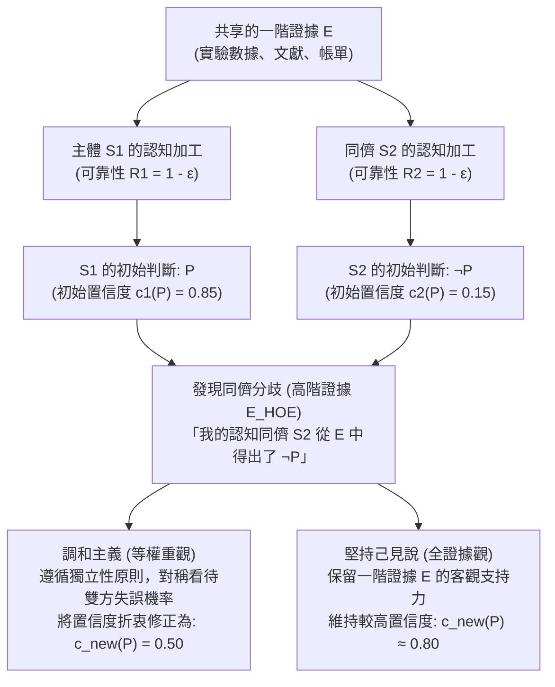
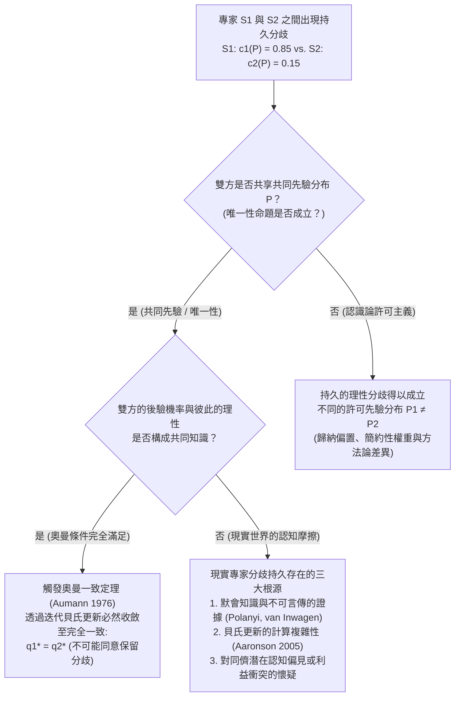

## 1. 導論：理性分歧的衝擊與「認知藉口」的消失

在日常生活、臨床醫學、總體經濟政策、司法審判、前沿科學乃至哲學爭論中，我們無時無刻不在面對他人的<strong>異議與分歧（Disagreement）</strong>。在絕大多數日常爭端中，發現別人不同意我們的觀點並不會動搖我們的信心，因為我們手頭總有現成的「打破對稱性的藉口」：「他還沒有讀過最新的實驗數據」、「她缺乏嚴格的統計學訓練」，或者「他受到了意識形態或經濟利益的偏見蒙蔽」。只要我們能夠合理地將對方歸類為當前問題上的<strong>認知劣勢者（Epistemic Inferior）</strong>，維持原有信念就顯得順理成章。

然而，如果所有這些令人安心的藉口都被徹底剝奪，情況會怎樣？

假設你與一位共事十年的同行專家，共同深入研究了完全相同的原始文獻、臨床試驗數據和數學證明（即共享證據集合 $E$）。透過長期的密切合作，你非常清楚這位同事在智力水準、邏輯嚴密性、學術誠實度、專注力以及免受偏見干擾的程度上與你完全不相上下。用當代<strong>社會認識論（Social Epistemology）</strong>的術語來說，這位同事就是你的<strong>認知同儕（Epistemic Peer, $\text{Peer}(S_1, S_2)$）</strong>。

現在假設，在獨立評估了共享證據 $E$ 之後，你堅定地相信命題 $P$ 為真（賦予其主觀機率或置信度 $c_1(P) = 0.85$）；而你的認知同儕在對同一證據 $E$ 進行了同樣審慎的分析後，卻得出了截然相反的結論 $\neg P$（賦予 $P$ 的置信度僅為 $c_2(P) = 0.15$）。

當你得知認知同儕與你意見相左的這一刻，<strong>認識論理性（Epistemic Rationality）要求你如何回應？</strong>

1. <strong>調和主義 / 等權重觀（Conciliationism / The Equal Weight View）</strong>：既然你和你的同儕在評估證據 $E$ 時具有同等的可靠性，且至少有一人在此次推理中犯了錯，僅僅因為某個判斷是「你自己的」就賦予其特權，無疑是認識論上的教條主義（Dogmatism）。理性要求你大幅降低對 $P$ 的自信，向同儕的立場靠攏（折衷至 $c_{\text{new}}(P) = 0.50$ 並懸置判斷）。
2. <strong>堅持己見說 / 非調和主義（The Steadfast View / Non-Conciliationism）</strong>：即便面對同儕的異議，如果一階證據 $E$ 在客觀上確實支持命題 $P$，且你實際上透過正確的推理掌握了這一支持關係，你並沒有義務因為同儕一時的認知盲點而放棄自己有充分依據的信念。你可以在承認分歧的同時，理性地維持對 $P$ 的高置信度。

自2000年代中期以來，由理查德·費爾德曼（Richard Feldman）、大衛·克里斯滕森（David Christensen）、亞當·埃爾加（Adam Elga）、托馬斯·凱利（Thomas Kelly）、詹妮弗·拉基（Jennifer Lackey）和米里亞姆·舍恩菲爾德（Miriam Schoenfield）等哲學家推動的<strong>「分歧的認識論（The Epistemology of Disagreement）」</strong>，已成為當代分析哲學最活躍的核心戰場。本文將系統剖析這一爭論的形式結構、高階證據機制、元認識論根源以及賽局理論中的奧曼一致定理。

---

## 2. 「認知同儕」的嚴格定義與證據的雙層架構

### 2.1 證據對等性與認知對等性

遵循托馬斯·凱利（Kelly 2005, *"The Epistemic Significance of Disagreement"*）與費爾德曼（Feldman 2007）的經典界定，兩個認知主體 $S_1$ 和 $S_2$ 在命題 $P$ 上互為<strong>認知同儕（$\text{Peer}(S_1, S_2, P)$）</strong>，當且僅當同時滿足以下兩個對稱性條件：

1. <strong>證據對等性（Evidential Equality）</strong>：$S_1$ 和 $S_2$ 擁有與命題 $P$ 的真假相關的完全相同的一階實質性證據集合 $E$（即 $E_1 = E_2 = E$），不存在任何一方獨佔秘密數據或未公開檔案的資訊不對稱。
2. <strong>認知對等性（Cognitive Equality）</strong>：$S_1$ 和 $S_2$ 在處理和評估 $E$ 類證據所需的一般認知能力（智力、推理嚴密性、領域背景訓練）和認識論美德（誠實、思想開放、免受偏見影響）上處於同一水準。形式化地講，兩人在該領域的歷史準確率與一般可靠性滿足 $R(S_1) \approx R(S_2)$。

### 2.2 一階證據（$E$）與高階證據（$E_{\text{HOE}}$）

理解同儕分歧的關鍵在於區分<strong>一階證據（First-Order Evidence, $E$）</strong>與<strong>高階證據（Higher-Order Evidence, $E_{\text{HOE}}$）</strong>（Christensen 2010; Kelly 2010）：

- <strong>一階證據 $E$</strong>：直接指向世界事態以及命題 $P$ 真值的證據（如病理切片、總體經濟時間序列、實驗觀測數據或餐廳帳單上的數字）。
- <strong>高階證據 $E_{\text{HOE}}$</strong>：關於<strong>「一階證據 $E$ 在多大程度上客觀支持 $P$」或「主體 $S$ 在評估 $E$ 時其認知機能是否正常運作」的元證據（Meta-evidence）</strong>。

設想著名的<strong>「損害推理能力的藥物案例」</strong>（Christensen 2010）：你剛剛完成了一個複雜的數學定理 $P$ 的證明（一階證據 $E$），對 $P$ 的置信度高達 $0.99$。隨後醫生告訴你，你早上喝的咖啡裡被人混入了一種新型神經藥物，該藥物會讓 $80\%$ 的受試者在毫無察覺的情況下產生邏輯幻覺，把錯誤的推導當成嚴密的證明。醫生的話並不直接關乎數學定理 $P$ 本身，但它構成了強有力的<strong>高階擊敗因（Undermining Defeater, $E_{\text{HOE}}$）</strong>，迫使你懷疑自己處理一階證據 $E$ 的可靠性，從而大幅調低對 $P$ 的置信度。

發現認知同儕得出相反結論 $\neg P$，正是一種典型的<strong>高階證據 $E_{\text{HOE}}$</strong>：它表明在 $S_1$ 與 $S_2$ 這兩套同等可靠的認知系統中，至少有一套在本次評估中發生了操作性失誤（Performance Error）。

---

## 3. 調和主義陣營：餐廳分帳案例、等權重觀與獨立性原則

### 3.1 克里斯滕森的「餐廳分帳案例」（2007）

大衛·克里斯滕森在 *"Epistemology of Disagreement: The Good News"*（2007）中提出了極具說服力的<strong>餐廳分帳案例（The Restaurant Check Case）</strong>：

> <strong>【思想實驗：餐廳分帳】</strong>
> 五位朋友共進晚餐，約定在帳單金額上加 $20\%$ 小費後由五人平攤。你和你的朋友（兩人的心算能力與專注度完全相當，互為認知同儕）查看了同一張帳單 $E$ 並各自在腦海中心算。你算出每人應付 <strong>$43$ 美元</strong>（置信度 $c_1(P) = 0.95$），而你的朋友卻自信地宣布每人應付 <strong>$45$ 美元</strong>（$c_2(P) = 0.05$）。

此時，如果你這樣推理：「我算出來是 $43$ 美元，所以正確答案就是 $43$ 美元；既然朋友說是 $45$ 美元（$\neq 43$），說明她這次肯定算錯了，因此我可以忽略她的意見，繼續保持 $95\%$ 的把握認為是 $43$ 美元」——這顯然是荒謬且傲慢的。既然雙方犯心算錯誤的機率 $\varepsilon > 0$ 完全對稱，在沒有獨立證據表明是她算錯而非你算錯的情況下，你必須將對 $43$ 美元的置信度大幅下調至 $0.50$ 左右。

### 3.2 埃爾加的「等權重觀」與貝氏線性池化

亞當·埃爾加（Elga 2007, *"Reflection and Disagreement"*）將這一直覺上升為普遍的<strong>等權重觀（The Equal Weight View）</strong>：面對認知同儕的分歧，你應當賦予同儕的評估與你自己的初始評估完全相等的權重。用機率論中的<strong>線性意見池化（Linear Opinion Pooling）</strong>表示即為：

$$c_{\text{new}}(P) = \frac{1}{2} c_1(P) + \frac{1}{2} c_2(P)$$

在標準貝氏條件化模型中，設命題 $P$ 的先驗機率為 $\mathbb{P}(P) = p_0$，主體 $S_1, S_2$ 正確評估證據 $E$ 的準確率均為 $1 - \varepsilon$（誤判率為 $\varepsilon \in (0, 1/2)$）。當發生分歧事件 $D = \{D_1 = P, D_2 = \neg P\}$ 時，由貝氏定理可得：

$$\mathbb{P}(P \mid D_1 = P, D_2 = \neg P) = \frac{p_0 (1 - \varepsilon)\varepsilon}{p_0 (1 - \varepsilon)\varepsilon + (1 - p_0)\varepsilon(1 - \varepsilon)} = p_0$$

分子與分母中的可靠性因子 $(1 - \varepsilon)\varepsilon$ 完全相消！$S_1$ 的判斷所提供的正面證據力被 $S_2$ 的相反判斷精確抵銷，後驗機率退回至無資訊的先驗基準 $p_0$（對稱情形下為 $0.50$），對應於費爾德曼所說的<strong>懸置判斷（Suspension of Judgment）</strong>。

### 3.3 克里斯滕森的「獨立性原則（Independence Principle）」

為了防止人們利用自己的初始推理來強行貶低同儕，克里斯滕森（Christensen 2009, 2011）提出了<strong>獨立性原則</strong>：

> <strong>【獨立性原則（Independence）】</strong>
> 在評估他人關於命題 $P$ 的信念的認識論資質（以決定是否以及如何修正我自己關於 $P$ 的信念）時，<strong>我必須以一種不依賴於我自己關於 $P$ 的初始信念背後的推理的方式來進行評估</strong>。

如果違背獨立性原則，任何主體都可以永遠拒絕修正信念：「因為根據我對 $E$ 的推理，$P$ 是真的 $\rightarrow$ 所以主張 $\neg P$ 的同儕這次一定犯了糊塗 $\rightarrow$ 所以我不必理會他的異議。」這種做法與認識論中臭名昭著的<strong>「教條主義悖論（The Dogmatism Paradox）」</strong>（Harman 1973; Kripke 2011）如出一轍，犯了嚴重的<strong>認識論循環論證（Begging the Question）</strong>錯誤。要合理地調低同儕的權重，必須依賴<strong>獨立於當前爭議的理由（Dispute-Independent Reasons）</strong>（例如對方喝醉了、睡眠嚴重不足或存在經濟利益衝突）。

---

## 4. 堅持己見說陣營：全證據觀、個人資訊的非對稱性與自我擊敗反駁

### 4.1 托馬斯·凱利的「全證據觀（The Total Evidence View）」

托馬斯·凱利（Kelly 2005, 2010）指出，等權重觀犯了一個致命的結構性錯誤：它讓關於分歧的高階心理證據（$E_{\text{HOE}}$）徹底<strong>吞沒（Swamp / Screen Off）</strong>了一階實質性證據 $E$ 本身！

假設一階證據 $E$ 在客觀上確實強烈支持 $P$，且 $S_1$ 正確理解了這一邏輯聯繫，而 $S_2$ 犯了微妙的推理錯誤。在發現分歧後，$S_1$ 擁有的<strong>全證據（Total Evidence, $E_{\text{total}}$）</strong>包含三個部分：

$$E_{\text{total}} = \underbrace{E}_{\text{一階實質證據}} \cup \underbrace{\{S_1 \text{ 基於 } E \text{ 判斷 } P\}}_{\text{高階心理事實 1}} \cup \underbrace{\{S_2 \text{ 基於 } E \text{ 判斷 } \neg P\}}_{\text{高階心理事實 2}}$$

凱利強調，雖然兩個「高階心理事實」是對稱的，但<strong>第一個組成部分——一階證據 $E$ 本身——絕不是對稱的！</strong>$E$ 依然客觀地指向 $P$ 而非 $\neg P$。如果要求 $S_1$ 將置信度降至 $0.50$，就等於把 $E$ 從 $E_{\text{total}}$ 中抹去，彷彿兩人已經徹底忘記了證據 $E$ 的具體內容，只記得「我曾說過 $P$，他曾說過 $\neg P$」。因此，根據凱利的<strong>全證據觀</strong>，同儕的異議雖然會適度降低 $S_1$ 的置信度（例如從 $0.90$ 降至 $0.75 \sim 0.80$），但一階證據 $E$ 的直接支持力阻止了置信度滑向 $0.50$ 的中點。

### 4.2 詹妮弗·拉基的「辯護主義觀（Justificationist View）」與極端案例

詹妮弗·拉基（Lackey 2010）透過<strong>極端案例（Extreme Cases）</strong>揭示了無限制適用獨立性原則的荒謬性：假設你與合作二十年、一向理智誠實的同儕哈里坐在明亮的餐桌旁，你算出 $2 + 2 = 4$，或者清楚地看到共同的朋友莎拉就坐在對面喝咖啡；而哈里卻嚴肅地堅稱 $2 + 2 = 5$，或者聲稱莎拉根本不在房間裡。

如果嚴格遵守獨立性原則和等權重觀，由於你不能調用自己關於「$2+2=4$」或「我親眼看見莎拉」的初始根據來判定哈里失常，你竟不得不對「$2+2=4$」或「莎拉在面前」產生 $50\%$ 的懷疑！拉基指出，現實中你完全有權維持近乎 $100\%$ 的確信，並直接推斷哈里出現了突發神經系統異常或在進行惡作劇。這是因為你對自己當前的認知狀態擁有豐富的第一人稱<strong>個人資訊（Personal Information）</strong>（你直接內省到自己清醒、未服藥、視力正常且沒有開玩笑），而對哈里的內部狀態僅有第三人稱的歸納推斷。當初始信念具備極高的辯護程度（High Justification）且得到個人資訊支持時，這種非對稱性足以合理地打破獨立性原則。

### 4.3 調和主義的「自我擊敗 / 自我削弱悖論（Self-Defeat Objection）」

對調和主義最犀利的反駁之一是其<strong>自我削弱性（Self-Undermining）</strong>（Elga 2010, *"How to Disagree about How to Disagree"*; Kelly 2005）：

1. 設命題 $C$ 為「調和主義為真」。
2. 在當代分析認識論界，熟悉完全相同論據的頂尖認識論學者（認知同儕）在 $C$ 是否為真這一問題上嚴重分裂（克里斯滕森、埃爾加相信 $C$，而凱利、范·因瓦根、拉基、舍恩菲爾德等相信 $\neg C$）。
3. 因此，如果調和主義者遵循自己的理論 $C$，面對相信 $\neg C$ 的認知同儕，<strong>他必須大幅降低對調和主義 $C$ 本身的置信度！</strong>
4. 反之，如果他在同儕反對下依然堅定相信調和主義 $C$，他就直接違背了調和主義。

為擺脫這一悖論，埃爾加（Elga 2010）被迫提出<strong>「教條式調和主義（Dogmatic Conciliationism）」</strong>：任何基本歸納方法或認識論規則在評判自身正確性時，都必須對自己保持「教條式的特權」，否則就會陷入邏輯不一致。然而，堅持己見派反問道：既然基本認識論規則有權「按自身的標準（by its own lights）」拒絕折衷，為什麼主體在其他深思熟慮的哲學或科學問題上不能同樣按自身的合理標準維持信念？

---

## 5. 元認識論深層斷裂：唯一性命題 vs. 認識論許可主義

上述爭論的深層根源在於元認識論中兩大範式的對立：

- <strong>唯一性命題（The Uniqueness Thesis — Feldman 2007; Roger White 2005）</strong>：給定總證據集合 $E$ 與命題 $P$，主體對 $P$ 所能採取的完全理性的信念態度（或精確置信度 $c(P \mid E)$）<strong>至多只有一個</strong>。羅傑·懷特（White 2005）透過<strong>「任意性 / 魔法藥丸論證」</strong>指出，如果同一證據 $E$ 允許兩個同樣理性的標準 $R_1$（得出 $P$）和 $R_2$（得出 $\neg P$），那麼僅僅因為自己碰巧就讀於傳授 $R_1$ 的學派就相信 $P$ 為真，就像隨機吞下一顆決定信念的藥丸後還堅信該信念對應客觀事實一樣任意。
- <strong>認識論許可主義（Epistemic Permissivism — Gideon Rosen 2001; Miriam Schoenfield 2014）</strong>：對於複雜的整體性證據 $E$，邏輯與機率公理並不唯一決定單一的先驗分布，而是存在一個<strong>合理許可的先驗機率分布族 $\{\mathbb{P}_\theta\}_{\theta \in \Theta}$（或認識論標準集合）</strong>。米里亞姆·舍恩菲爾德（Schoenfield 2014, *"Permission to Believe"*）反駁懷特道：任何主體都不可能跳出所有認識論標準、站在「上帝視角」去證明自己標準的優越性；理性思考只能從自己內在融貫的標準 $R_1$ 內部出發。在 $R_1$ 的審視下，$R_1$ 就是比 $R_2$ 更能追蹤真理的標準，因此同儕之間可以出現<strong>「無過錯的分歧（Faultless Disagreement）」</strong>，雙方各自理性地堅持己見。

| 評估維度 | 等權重觀 (嚴格調和主義) | 全證據觀 (溫和堅持己見) | 辯護主義觀 (混合非對稱模型) | 許可主義堅持己見 (激進堅持己見) |
| :--- | :--- | :--- | :--- | :--- |
| <strong>代表學者</strong> | D. Christensen, A. Elga, R. Feldman | Thomas Kelly (2010) | Jennifer Lackey (2010) | G. Rosen, M. Schoenfield, P. van Inwagen |
| <strong>元認識論前提</strong> | 強唯一性命題 (Strict Uniqueness) | 客觀證據支持關係 | 語境敏感（個人資訊的非對稱性） | 認識論許可主義 (Permissivism) |
| <strong>獨立性原則的地位</strong> | 嚴格執行（禁止依賴初始推理） | 拒絕或限制（保留一階證據 $E$ 的力量） | 在高辯護度與個人資訊充分時可被推翻 | 允許依據自身合理標準 $R_1$ 評估競爭標準 |
| <strong>$E$ 與 $E_{\text{HOE}}$ 的互動</strong> | $E_{\text{HOE}}$ 屏蔽並抵銷 $E$ 的非對稱性 | 將 $E$ 與 $E_{\text{HOE}}$ 共同納入 $E_{\text{total}}$ | 權重隨初始辯護強度與個人資訊動態轉移 | $E$ 在各自標準 $R_i$ 下持續提供理性支持 |
| <strong>對餐廳心算案例的裁決</strong> | 折衷平分（$c_{\text{new}} = 0.50$） | 大幅讓步（心算過程易錯且不透明） | 大幅讓步（個人資訊無法排除心算失誤） | 大幅讓步（算術問題具有唯一客觀規則） |
| <strong>對複雜科學/哲學爭論的裁決</strong> | 懸置判斷（走向不可知論） | 推理正確的一方有權維持高置信度 | 經過深度驗證的信念可維持堅定立場 | 雙方均可無過錯地理性維持各自信念 |

---

## 6. 賽局理論與貝氏認識論：羅伯特·奧曼的「一致定理」

哲學中的同儕分歧問題與諾貝爾經濟學獎得主<strong>羅伯特·奧曼（Robert J. Aumann）</strong>於1976年證明的賽局理論基石——<strong>奧曼一致定理（Aumann's Agreement Theorem, *"Agreeing to Disagree"*）</strong>——構成了深刻的數學對偶。

### 6.1 奧曼一致定理（1976）的形式化與證明

設機率空間為 $(\Omega, \mathcal{F}, \mathbb{P})$，其中 $\mathbb{P}$ 是兩個貝氏主體 $S_1, S_2$ 共享的<strong>共同先驗分布（Common Prior）</strong>。$S_1$ 和 $S_2$ 關於世界狀態 $\Omega$ 分別擁有私有的資訊劃分（Partitions）$\mathcal{P}_1$ 和 $\mathcal{P}_2$。對於任意事件 $A \in \mathcal{F}$，兩人在狀態 $\omega$ 下的後驗機率分別為：

$$q_1(\omega) = \mathbb{P}(A \mid \mathcal{P}_1(\omega)), \quad q_2(\omega) = \mathbb{P}(A \mid \mathcal{P}_2(\omega))$$

> <strong>【奧曼一致定理（Aumann 1976）】</strong>
> 如果在真實狀態 $\omega^* \in \Omega$ 下，「$q_1(\omega) = a$ 且 $q_2(\omega) = b$」這一事實成為了 $S_1$ 與 $S_2$ 之間的<strong>共同知識（Common Knowledge）</strong>，那麼必然有：
> $$a = b \quad (q_1 = q_2)$$

<strong>證明概要</strong>：設共同知識事件為 $C = \{q_1 = a \cap q_2 = b\} \in \mathcal{P}_1 \wedge \mathcal{P}_2$。由於 $C$ 可表示為 $\mathcal{P}_1$ 中若干互不相交資訊胞腔 $P_{1,i}$ 的聯集（$C = \bigsqcup_i P_{1,i}$），且在每個胞腔上 $\mathbb{P}(A \mid P_{1,i}) = a$，求和即得 $\mathbb{P}(A \cap C) = a\mathbb{P}(C)$。同理，將 $C$ 分解為 $\mathcal{P}_2$ 的資訊胞腔 $P_{2,j}$ 的聯集可得 $\mathbb{P}(A \cap C) = b\mathbb{P}(C)$。因為 $\mathbb{P}(C) > 0$，故必有 <strong>$a = b$</strong>！

這一定理表明：<strong>擁有共同先驗的貝氏理性人不可能「同意保留分歧（Agree to disagree）」</strong>。即便兩人最初掌握不同的私有證據，只要相互公開各自的後驗機率數值並反覆進行貝氏更新，他們的置信度就必然收斂到完全相同的值。

### 6.2 為什麼現實中的頂尖專家未能達成一致？

奧曼定理為我們診斷現實科學（如氣候建模、腫瘤治療方案、貨幣政策或人工智慧對齊）中的專家分歧提供了精確清單：
1. <strong>缺乏共同先驗（認識論許可主義）</strong>：面對樣本有限或高度複雜的前沿問題，專家們持有不同的理論歸納偏置（$\mathbb{P}_1 \neq \mathbb{P}_2$）。
2. <strong>默會知識與不可傳遞的洞見（Tacit & Incommunicable Evidence — Polanyi; van Inwagen 1996）</strong>：資深專家的大量證據源於數十年的模式識別與直覺體悟，無法無損地轉化為形式化命題 $E$ 傳遞給對方，導致雙方的實際總證據並不相等（$E_1 \neq E_2$）。
3. <strong>計算複雜性與有限理性（Scott Aaronson 2005, *"The Complexity of Agreement"*）</strong>：電腦科學家斯科特·阿倫森證明，在高維狀態空間中，要根據對方的後驗機率 $q_2$ 反推其資訊結構並完成奧曼式更新，在計算上是難解的（NP-hard）。

---

## 7. 結論：在教條主義與懦弱懷疑論之間保持動態平衡

「當擁有相同知識的對手與你意見相左時，是否應當削弱自信？」當代認識論給出的回答絕非非黑即白：
- 在<strong>「餐廳算帳型」封閉問題</strong>（算術、程式碼除錯、標準化測量）中，分歧幾乎必然源於瞬時的注意力滑坡，此時克里斯滕森與埃爾加的<strong>調和主義與獨立性原則</strong>是克服人類傲慢的良藥；
- 在<strong>「整體性綜合型」開放問題</strong>（前沿科學假說、法律解釋、哲學與價值判斷）中，機械地將置信度折衷為 $0.50$ 會陷入凱利與拉基所批判的<strong>全面懷疑論（Spineless Skepticism）</strong>。此時，我們應當將同儕的異議視為最高價值的<strong>高階審計訊號</strong>——既不教條地無視對方，也不盲目放棄一階證據的邏輯力量，而是在深入剖析雙方隱含前提與證據權重的對話中推進人類認知的邊界。
