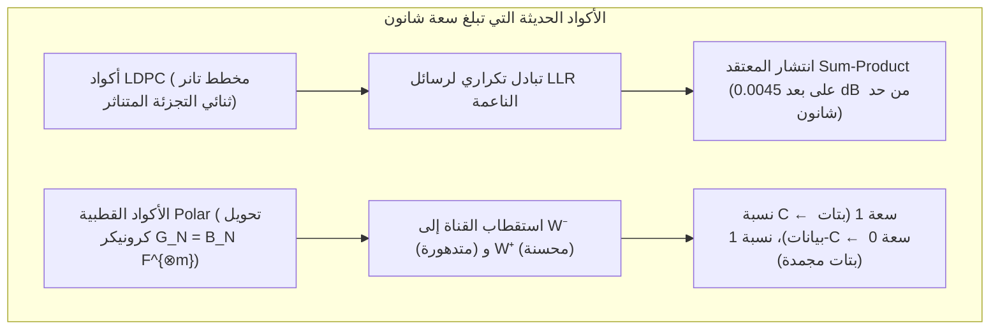

## 1. مقدمة: معجزتان هندسيتان يوميتان لإحياء المعلومات الرقمية

سواء في أعماق الفضاء بين النجوم أو أمام كاميرا هاتفك الذكي، تحقق الهندسة الرقمية الحديثة يومياً ما يبدو وكأنه يتحدى الحدس الفيزيائي: <strong>إعادة بناء المعلومات الرقمية بدقة 100% بتاً تلو الآخر من إشارات أو وسائط تعرضت للتشويه الشديد بسبب الضجيج الحراري أو التلف المادي</strong>.

### المعجزة الأولى: فوياجر 1 و2 يرسلان صوراً عبر 24 مليار كيلومتر بقدرة $10^{-16}\text{ واط}$

انطلقت مركبتا <strong>فوياجر 1 وفوياجر 2 (Voyager 1 & 2)</strong> عام 1977 لتصوير المشتري وزحل وأورانوس ونبتون، وتبحران اليوم في الفضاء بين النجوم على بُعد يتجاوز <strong>24 مليار كيلومتر</strong> من الأرض.
يعمل جهاز الإرسال اللاسلكي على متن فوياجر بقدرة <strong>$23\text{ واط}$</strong> فقط — أي أقل من مصباح ثلاجة منزلي. وعندما تصل هذه الموجة إلى هوائيات شبكة الفضاء العميق (DSN) التابعة لناسا بقطر 70 متراً على الأرض، تكون القدرة المستقبلة قد تضاءلت إلى نحو <strong>$10^{-16}\text{ واط}$ ($0.1\text{ أتواط}$)</strong>، غارقةً بالكامل في <strong>الضجيج الحراري (Thermal Noise)</strong>. ومع ذلك، أرسلت فوياجر صوراً ملونة فائقة النقاء <strong>بصفر من أخطاء البتات</strong>.

### المعجزة الثانية: رمز QR مغطى بنسبة $30\%$ ببقعة قهوة أو شعار شركة

وبالمثل، عندما توجه كاميرا هاتفك نحو <strong>رمز استجابة سريعة (QR Code)</strong> لطخته القهوة أو <strong>غطى شعار تجاري ما يصل إلى $30\%$ من مساحته الوسطى</strong>، يستعيد هاتفك الرابط أو بيانات الدفع في أقل من <strong>$10\text{ مللي ثانية}$</strong> مع <strong>صفر أخطاء في البتات (Zero Bit Errors)</strong>.


كيف يكون ذلك ممكناً رياضياً؟ تكمن الإجابة في <strong>نظرية المعلومات لكلود شانون (1948)</strong> والجبر المجرد <strong>لرموز تصحيح الأخطاء (Error-Correcting Codes, ECC)</strong>.

---

## 2. ثورة كلود شانون (1948) ومبرهنة ترميز القناة المشوشة

### 2.1 لماذا يفشل ترميز التكرار الساذج ($0 \to 00000$)

قبل عام 1948، ساد اعتقاد بأنه لجعل احتمال الخطأ $P_e \to 0$ عبر قناة مشوشة، لا بد أن ينخفض معدل نقل المعلومات $R = k/n$ إلى الصفر.
عند استخدام <strong>رمز التكرار (Repetition Code)</strong> بطول فردي $n = 2t + 1$ عبر <strong>قناة ثنائية متماثلة (BSC)</strong> باحتمال انعكاس البت $p \in (0, 0.5)$، يفشل التصويت بالأغلبية باحتمال:
$$P_e^{(n)} = \sum_{i = (n+1)/2}^{n} \binom{n}{i} p^i (1-p)^{n-i}$$
عندما $n \to \infty$، فإن $P_e^{(n)} \to 0$، لكن في الوقت نفسه ينهار معدل الكود إلى الصفر: $R = k/n = 1/n \to 0$.

### 2.2 مبرهنة شانون وحد شانون النهائي ($-1.59\,\text{dB}$)

في عام 1948، أثبت <strong>كلود شانون</strong> في بحثه الشهير *"A Mathematical Theory of Communication"* <strong>مبرهنة ترميز القناة المشوشة</strong>:

> <strong>مبرهنة (ترميز القناة المشوشة لشانون، 1948):</strong>
> لكل قناة عديمة الذاكرة <strong>سعة قناة موجبة $C > 0$</strong> تحددها خصائص الضجيج:
> - <strong>للقناة الثنائية المتماثلة (BSC)</strong> مع دالة الإنتروبيا الثنائية $H_2(p) = -p\log_2 p - (1-p)\log_2(1-p)$:
>   $$C_{\text{BSC}}(p) = 1 - H_2(p) = 1 + p\log_2 p + (1-p)\log_2(1-p) \quad [\text{bits / channel use}]$$
> - <strong>لقناة الضجيج الغاوسي الأبيض المضاف (AWGN)</strong> بعرض نطاق $B$ وقدرة إشارة $S$ وضجيج $N = N_0 B$ (مبرهنة شانون-هارتلي):
>   $$C_{\text{AWGN}} = B \log_2\!\left(1 + \frac{S}{N}\right) = B \log_2\!\left(1 + \frac{S}{N_0 B}\right) \quad [\text{bits / s}]$$
>
> <strong>لأي معدل إرسال $R < C$، توجد أكواد كتلية بطول $n \to \infty$ تجعل احتمال خطأ فك التشفير صغيراً إلى أقصى حد مطلوب ($P_e \to 0$)!</strong>

بتعويض $S = E_b R$ وأخذ النهاية عندما تقترب الكفاءة الطيفية $\eta = R/B \to 0$، نحصل على $\frac{E_b}{N_0} > \lim_{\eta \to 0} \frac{2^\eta - 1}{\eta} = \ln 2 \approx 0.6931$، أي <strong>حد شانون النهائي (Shannon Limit)</strong>:
$$\left(\frac{E_b}{N_0}\right)_{\min} = \ln 2 \approx 0.6931 \implies 10 \log_{10}(\ln 2) \approx \mathbf{-1.5917\,\text{dB}}$$

---

## 3. الاختراق الهندسي لريتشارد هامينغ (1950): مسافة هامينغ والكود التام $[7, 4, 3]$

### 3.1 مسافة هامينغ $d_H(\mathbf{u}, \mathbf{v})$ وحد تعبئة الكرات

على المكعب الفائق $\mathbb{F}_2^n$، عرّف <strong>ريتشارد هامينغ</strong> (1950) <strong>مسافة هامينغ $d_H(\mathbf{u}, \mathbf{v})$</strong> بأنها عدد الإحداثيات التي يختلف فيها المتجهان:
$$d_H(\mathbf{u}, \mathbf{v}) \triangleq \bigl|\{ i \in \{1, \dots, n\} \mid u_i \neq v_i \}\bigr| = w_H(\mathbf{u} - \mathbf{v})$$

لكود $\mathcal{C} \subset \mathbb{F}_q^n$ ذي <strong>مسافة دنيا $d_{\min} = \min_{\mathbf{u}\neq\mathbf{v}} d_H(\mathbf{u},\mathbf{v})$</strong>، تثبت هندسة كرات هامينغ غير المتقاطعة ذات نصف القطر $t$ قدرة الكود على:
- <strong>اكتشاف</strong> $d_{\min} - 1$ من الأخطاء؛
- <strong>تصحيح $e = d_{\min} - 1$ من المحو (Erasures)</strong> في مواقع معروفة؛
- <strong>تصحيح $t = \lfloor(d_{\min} - 1)/2\rfloor$ من الأخطاء العشوائية</strong> في مواقع غير معروفة:
$$\mathbf{d_{\min} \ge 2t + e + 1}, \qquad |\mathcal{C}| \cdot \sum_{i=0}^{t} \binom{n}{i} (q-1)^i \le q^n \quad \text{(حد هامينغ)}$$

### 3.2 كود هامينغ التام $(7,4)$ وفك التشفير بالمتلازمة (Syndrome Decoding)

عند $n=7, k=4, d_{\min}=3$ ($t=1$)، يتحقق التساوي $2^4 \cdot (1 + 7) = 128 = 2^7$: كود $[7,4,3]$ هو <strong>كود تام (Perfect Code)</strong>. مصفوفة التوليد $\mathbf{G}_{4\times 7} = [\mathbf{I}_4 \mid \mathbf{P}]$ ومصفوفة فحص التكافؤ $\mathbf{H}_{3\times 7} = [\mathbf{P}^T \mid \mathbf{I}_3]$ ($\mathbf{G}\mathbf{H}^T = \mathbf{0} \pmod 2$) هما:
$$\mathbf{G}_{4\times 7} = \left(\begin{array}{cccc|ccc}
1 & 0 & 0 & 0 & 1 & 1 & 0 \\
0 & 1 & 0 & 0 & 1 & 0 & 1 \\
0 & 0 & 1 & 0 & 0 & 1 & 1 \\
0 & 0 & 0 & 1 & 1 & 1 & 1
\end{array}\right), \qquad
\mathbf{H}_{3\times 7} = \left(\begin{array}{cccc|ccc}
1 & 1 & 0 & 1 & 1 & 0 & 0 \\
1 & 0 & 1 & 1 & 0 & 1 & 0 \\
0 & 1 & 1 & 1 & 0 & 0 & 1
\end{array}\right)$$

متجه <strong>المتلازمة ذو 3 بتات $\mathbf{s} = \mathbf{H}\mathbf{y}^T = \mathbf{H}(\mathbf{c} + \mathbf{e})^T = \mathbf{H}\mathbf{e}^T \pmod 2$</strong> يستخرج مباشرة عمود المصفوفة $\mathbf{H}$ المقابل للبت المنقلب: فعند ترتيب الأعمدة ثنائياً من $1$ إلى $7$، <strong>تعطي المتلازمة $\mathbf{s}$ مباشرةً الفهرس الثنائي $(1 \dots 7)$ للبت التالف</strong>! وتحمي هذه الدائرة اليوم جميع ذواكر الخوادم <strong>ECC DRAM</strong>.

---

## 4. تحفة ريد وسولومون (1960): أكواد ريد-سولومون على حقول غالوا $\mathbb{F}_{2^m}$

### 4.1 حقول غالوا $\text{GF}(2^8)$ ومناعة ضد الأخطاء الانفجارية (Burst Errors)

للتغلب على الأخطاء المتتابعة (خدوش الأقراص، بقع رموز QR)، جمع <strong>إيرفينغ ريد</strong> و<strong>غوستاف سولومون</strong> (1960) كل بايت ($m=8$ بتات) كرمز واحد في حقل غالوا المنتهي <strong>$\text{GF}(2^8) = \mathbb{F}_2[x]/(x^8 + x^4 + x^3 + x^2 + 1)$</strong>. حتى لو تلفت البتات الثمانية داخل بايت واحد، فإن ذلك يُعد في $\text{GF}(2^8)$ <strong>خطأً في رمز واحد فقط</strong>!

### 4.2 استيفاء كثيرات الحدود وتحقيق حد سينغلتون MDS ($d_{\min} = n - k + 1$)

تمثل رموز الرسالة $k$ معاملات كثيرة حدود $P(x) = m_0 + m_1 x + \dots + m_{k-1} x^{k-1}$ من الدرجة $< k$، ويتم تقييمها عند $n$ نقاط مختلفة $\mathbf{c} = \bigl(P(\alpha_1), \dots, P(\alpha_n)\bigr)$.
بما أن أي كثيرتي حدود مختلفتين من الدرجة $\le k-1$ على الحقل $\mathbb{F}_q$ تتفقان في $k-1$ نقاط على الأكثر (و<strong>أي $k$ نقاط سليمة تكفي لإعادة بناء $P(x)$ بشكل فريد عبر استيفاء لاغرانج</strong>)، فإن كل كود ريد-سولومون $[n, k]$ يحقق <strong>حد سينغلتون بالمساواة التامة (كود MDS)</strong>:
$$\mathbf{d_{\min} = n - k + 1 \implies 2t + e \le n - k}$$

وهكذا، تسمح $n - k$ بايتات تكافؤ باستعادة <strong>ما يصل إلى $e = n - k$ من المحو (RAID-6 والتخزين السحابي)</strong> أو تصحيح <strong>ما يصل إلى $t = \lfloor(n-k)/2\rfloor$ من أخطاء البايتات غير معروفة الموقع (رموز QR حتى 30% في المستوى H؛ وكود $[255, 223]$ في فوياجر)</strong> باستخدام كثيرة الحدود المولدة $g(x) = \prod_{i=1}^{2t}(x - \alpha^i)$، وخوارزمية <strong>بيرليكامب-ماسي / إقليدس</strong> ($\Lambda(x)S(x) \equiv \Omega(x) \pmod{x^{2t}}$)، و<strong>بحث تشين</strong>، و<strong>صيغة فورني</strong>.

---

## 5. الاقتراب من حد شانون: أكواد LDPC (1962) وTurbo (1993) والأكواد القطبية Polar (2009)

1. <strong>أكواد LDPC لروبرت غالاغر (1962)</strong>: تستخدم مصفوفة تكافؤ متناثرة $\mathbf{H}$ و<strong>مخطط تانر ثنائي التجزئة (Tanner Graph)</strong>. عبر التبادل التكراري لنسب الأرجحية اللوغاريتمية الناعمة $L(c_i) = \ln\frac{P(c_i=0|y_i)}{P(c_i=1|y_i)}$ بواسطة <strong>انتشار المعتقد (Belief Propagation / Sum-Product)</strong>، تقترب أكواد LDPC إلى مسافة $0.0045\,\text{dB}$<strong> فقط من حد شانون (</strong>قنوات بيانات 5G NR، وWi-Fi 6/7، وأقراص 3D NAND SSD).
2. <strong>الأكواد القطبية لإردال أريكان (Polar Codes, 2009)</strong>: بتطبيق تحويل كرونيكر $\mathbf{G}_N = \mathbf{B}_N \begin{pmatrix} 1 & 0 \\ 1 & 1 \end{pmatrix}^{\otimes m}$ تكرارياً، يؤدي <strong>استقطاب القناة (Channel Polarization)</strong> عند $N \to \infty$ إلى تقارب نسبة $C = I(W)$ من القنوات الفرعية نحو السعة $1$ (خالية من الضجيج، تحمل بتات المعلومات) ونسبة $1 - C$ نحو السعة $0$ (<strong>البتات المجمدة / Frozen Bits $= 0$</strong>)، لتكون أول أكواد بتعقيد $O(N \log N)$ <strong>تحقق سعة شانون ببرهان رياضي صارم</strong> (<strong>قنوات التحكم في 5G NR</strong>).



### جدول مقارنة شامل لعائلات رموز تصحيح الأخطاء

| عائلة الكود | السنة والرواد | البنية الرياضية | خوارزمية فك التشفير | نقطة القوة الرئيسية | التطبيقات العملية |
| :--- | :--- | :--- | :--- | :--- | :--- |
| <strong>هامينغ / SECDED</strong> | 1950<br/>R. Hamming | تعبئة الكرات في $\mathbb{F}_2^n$ | المتلازمة $\mathbf{s}=\mathbf{H}\mathbf{y}^T$ ($O(1)$) | تصحيح بت واحد في $<1\text{ ns}$ | <strong>ذاكرة الخوادم ECC DRAM</strong>، مخبأ المعالج |
| <strong>ريد-سولومون (RS)</strong> | 1960<br/>Reed & Solomon | استيفاء كثيرات الحدود في $\mathbb{F}_{2^m}$ | بيرليكامب-ماسي + تشين + فورني | <strong>حد MDS الأمثل $d_{\min}=n-k+1$</strong> ضد الأخطاء المتتابعة | <strong>رموز QR</strong>، <strong>RAID-6</strong>، السحابة، فوياجر |
| <strong>أكواد LDPC</strong> | 1962 R. Gallager<br/>(أعيد اكتشافها 1996) | مصفوفة متناثرة $\mathbf{H}$ ومخطط تانر | <strong>انتشار المعتقد (Sum-Product)</strong> | على بُعد $0.0045\,\text{dB}$ من حد شانون | <strong>5G NR (بيانات)</strong>، <strong>Wi-Fi 6/7</strong>، <strong>SSD NVMe</strong> |
| <strong>الأكواد القطبية Polar</strong> | 2009<br/>Erdal Arıkan | قوة كرونيكر $\mathbf{F}^{\otimes m}$ | فك التشفير القائمي CA-SCL ($O(N\log N)$) | <strong>يحقق سعة شانون $C$ ببرهان رياضي</strong> | <strong>5G NR (تحكم)</strong>، اتصالات 6G |

---

## 6. تطبيق بايثون الكامل: كود هامينغ $(7,4)$ وريد-سولومون على $\text{GF}(2^8)$

```python
from typing import List

def hamming74_demo() -> None:
    G = [[1,0,0,0,1,1,0], [0,1,0,0,1,0,1], [0,0,1,0,0,1,1], [0,0,0,1,1,1,1]]
    H = [[1,1,0,1,1,0,0], [1,0,1,1,0,1,0], [0,1,1,1,0,0,1]]
    msg = [1, 0, 1, 1]
    c = [sum(msg[i] * G[i][j] for i in range(4)) % 2 for j in range(7)]
    y = c.copy()
    y[2] ^= 1
    s = [sum(H[r][col] * y[col] for col in range(7)) % 2 for r in range(3)]
    err_idx = next(col for col in range(7) if [H[r][col] for r in range(3)] == s)
    y[err_idx] ^= 1
    print(f"[Hamming (7,4)] Syndrome={s} -> Flipped idx={err_idx}, Recovered={y[:4] == msg}")

class GF256:
    def __init__(self, poly: int = 0x11D) -> None:
        self.exp, self.log = [0] * 512, [0] * 256
        v = 1
        for i in range(255):
            self.exp[i] = self.exp[i + 255] = v
            self.log[v] = i
            v <<= 1
            if v & 0x100:
                v ^= poly

    def mul(self, a: int, b: int) -> int:
        return 0 if (a == 0 or b == 0) else self.exp[self.log[a] + self.log[b]]

    def inv(self, a: int) -> int:
        return self.exp[255 - self.log[a]]

    def power(self, a: int, p: int) -> int:
        return 1 if p == 0 else (0 if a == 0 else self.exp[(self.log[a] * p) % 255])

    def eval_poly(self, coeffs: List[int], x: int) -> int:
        res = 0
        for c in reversed(coeffs):
            res = self.mul(res, x) ^ c
        return res

    def solve(self, A: List[List[int]], b: List[int]) -> List[int]:
        n = len(b)
        M = [row[:] + [b[i]] for i, row in enumerate(A)]
        for col in range(n):
            piv = next(r for r in range(col, n) if M[r][col] != 0)
            M[col], M[piv] = M[piv], M[col]
            inv_p = self.inv(M[col][col])
            for j in range(col, n + 1):
                M[col][j] = self.mul(M[col][j], inv_p)
            for r in range(n):
                if r != col and M[r][col] != 0:
                    f = M[r][col]
                    for j in range(col, n + 1):
                        M[r][j] ^= self.mul(f, M[col][j])
        return [M[i][n] for i in range(n)]

def rs_demo() -> None:
    gf = GF256()
    text = "VOYAGER-1"
    k, t = len(text), 3
    n = k + 2 * t
    pts = [gf.exp[i] for i in range(n)]
    cw = [gf.eval_poly([ord(c) for c in text], x) for x in pts]
    rx = cw.copy()
    rx[1] ^= 0xFF; rx[6] ^= 0xA5; rx[13] ^= 0x3C
    A = [[gf.power(pts[i], d) for d in range(k + t)] + [gf.mul(rx[i], gf.power(pts[i], d)) for d in range(t)] for i in range(n)]
    b = [gf.mul(rx[i], gf.power(pts[i], t)) for i in range(n)]
    sol = gf.solve(A, b)
    E = sol[k + t:] + [1]
    err_pos = [i for i, x in enumerate(pts) if gf.eval_poly(E, x) == 0]
    valid = [(pts[i], rx[i]) for i in range(n) if i not in err_pos][:k]
    rec = gf.solve([[gf.power(x, d) for d in range(k)] for x, _ in valid], [y for _, y in valid])
    print(f"[RS(15,9) over GF(2^8)] Located Errors={err_pos}, Recovered='{''.join(chr(c) for c in rec)}'")

if __name__ == "__main__":
    hamming74_demo()
    rs_demo()
```

---

## 7. خاتمة

من حد شانون $-1.59\,\text{dB}$ (1948) إلى هندسة هامينغ (1950)، واستيفاء كثيرات الحدود لريد-سولومون على حقول غالوا $\mathbb{F}_{2^m}$ (1960)، وصولاً إلى انتشار المعتقد في LDPC واستقطاب القنوات لدى أريكان — تُجسد نظرية الترميز انتصار الرياضيات البحتة على الضجيج الحراري والإنتروبيا الفيزيائية للكون.
